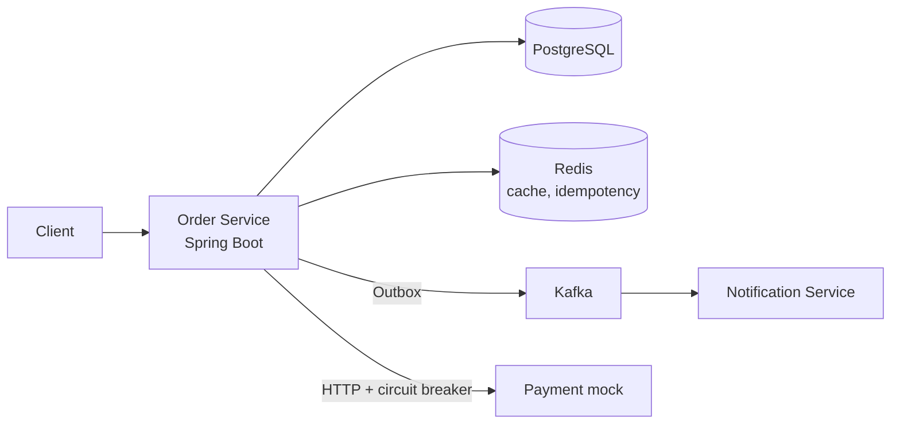

# Dự án thực hành: Order & Payment Service

Một dự án nhỏ làm xuyên suốt 12 tuần. Mục đích không phải sản phẩm đẹp mà là **có thứ thật để làm và để nói** khi cần trả lời những câu như "đã xử lý N+1 chưa", "thiết kế idempotency thế nào", "đã gặp sự cố gì".

**Tóm tắt:**

- Dự án Order & Payment Service chạy xuyên 12 tuần để có thứ thật mà nói khi bị hỏi về N+1, idempotency, sự cố.
- Kiến trúc: Order Service (Spring Boot) với PostgreSQL, Redis, outbox sang Kafka, Notification Service và Payment mock có circuit breaker.
- Mốc theo tuần bám lộ trình: tuần 5 khung dự án, 6 transaction và N+1, 7 cache, 8 bảo mật và test, 9 outbox và resilience, 11 Docker, Kubernetes và sự cố, 12 hoàn thiện.
- 8 yêu cầu tối thiểu để đạt: không N+1, đặt hàng concurrent đúng, idempotency, outbox, chịu lỗi, observability, test, đóng gói.
- Outbox giải bài toán ghi database và gửi Kafka không nằm chung một transaction; gửi at-least-once nên consumer phải idempotent.
- Tuần 11 chủ động gây ít nhất 3 sự cố (cạn connection pool, memory leak, consumer lag, deadlock) và viết thành câu chuyện STAR.
- Lỗi hay mắc: làm quá nhiều service, viết cho đẹp thay vì để gặp vấn đề, không ghi lại.

## Vì sao cần dự án

| Câu hỏi thường gặp | Không có dự án | Có dự án |
|---|---|---|
| "Kể về một lần xử lý hiệu năng" | Nói chung chung | Nói số liệu: 1.200 truy vấn xuống 3 sau khi sửa N+1 |
| "Làm sao tránh trừ tiền hai lần" | Đọc thuộc định nghĩa | Chỉ vào bảng `idempotency_key` và test đã viết |
| "Outbox là gì" | Mô tả sách | "Đã làm, đây là bug gặp phải" |

## Bài toán

Dịch vụ đặt hàng và thanh toán cho một cửa hàng nhỏ.

- Người dùng đăng nhập, xem sản phẩm, đặt hàng, thanh toán.
- Đặt hàng giữ tồn kho; thanh toán thành công thì xác nhận, thất bại thì nhả tồn kho.
- Có thông báo (email giả lập) sau khi thanh toán.
- Cổng thanh toán là một dịch vụ giả lập (mock) có thể chậm hoặc lỗi theo yêu cầu.

## Các mốc theo tuần

| Tuần | Việc làm trong dự án | Chủ đề liên quan |
|---|---|---|
| 5 | Khung Spring Boot, profile, health check, cấu trúc package (hexagonal gọn) | [Spring bên trong](/go?p=01-Spring-Boot%2Fhard%2Flt-30-spring-khoi-dong-application-context.md) |
| 6 | Entity, repository, `@Transactional`, tái hiện và sửa N+1, `@Version` | [Transaction chuyên sâu](/go?p=01-Spring-Boot%2Fhard%2Flt-31-transaction-chuyen-sau.md), [JPA hiệu năng](/go?p=01-Spring-Boot%2Fhard%2Flt-34-jpa-hieu-nang-khoa-cache.md) |
| 7 | Cache sản phẩm bằng Redis, tái hiện cache stampede rồi xử lý, đọc `EXPLAIN` | [Cache pattern](/go?p=06-Distributed-Systems%2FRedis%2Fmedium%2Flt-03-cache-pattern-van-de-cache.md) |
| 8 | JWT, authorization, `ProblemDetail`, metric và trace, test Testcontainers | [REST API thực chiến](/go?p=01-Spring-Boot%2Fmedium%2Flt-33-rest-api-thuc-chien.md), [Security sâu](/go?p=01-Spring-Boot%2Fhard%2Flt-35-spring-security-chuyen-sau.md) |
| 9 | Outbox + Kafka, consumer idempotent, circuit breaker cho Payment mock | [Resilience](/go?p=01-Spring-Boot%2Fhard%2Flt-32-resilience-chiu-loi.md), [Idempotency](/go?p=01-Spring-Boot%2Fhard%2Flt-26-distributed-lock-idempotency.md) |
| 11 | Dockerfile, chạy trên Kubernetes cục bộ, gây sự cố có chủ đích và viết post-mortem | [Docker và Kubernetes](/go?p=01-Spring-Boot%2Fhard%2Flt-29-docker-kubernetes.md), [SRE](/go?p=04-DevOps%2Fhard%2Flt-07-su-co-sre-observability.md) |
| 12 | README, sơ đồ kiến trúc, 5 câu chuyện STAR | [Khung STAR](/go?p=07-Interview-QA%2FBehavioral%2Feasy%2Flt-01-star-chuan-bi-cau-chuyen.md) |

## Yêu cầu tối thiểu để "tính là đạt"

1. **Không có N+1** ở API danh sách đơn hàng; có test đếm số câu SQL.
2. **Đặt hàng concurrent:** hai request cùng mua món cuối cùng, chỉ một thành công (optimistic lock hoặc cập nhật có điều kiện).
3. **Idempotency:** gọi lại `POST /payments` với cùng `Idempotency-Key` không tạo payment thứ hai.
4. **Outbox:** tắt Kafka lúc đang đặt hàng, bật lại thì event vẫn được gửi, không mất không trùng quá mức cho phép (consumer chịu được trùng).
5. **Fault tolerance:** Payment mock chậm 5 giây thì request không treo thread pool; có timeout, circuit breaker và response rõ ràng.
6. **Observability:** có log theo `traceId`, metric độ trễ p95 theo endpoint, health/readiness.
7. **Kiểm thử:** có test đơn vị, test tích hợp với database thật (Testcontainers), ít nhất một test concurrency.
8. **Packaging:** chạy được bằng `docker compose up`; tùy chọn có manifest Kubernetes.

**Nền tảng:** Outbox giải bài toán "ghi database và gửi Kafka không thể nằm chung một transaction". Cách làm: ghi event vào bảng `outbox` trong cùng transaction với dữ liệu nghiệp vụ, rồi một process riêng đọc bảng này và gửi sang Kafka. Gửi có thể lặp lại (at-least-once) nên consumer phải idempotent; đó là lý do yêu cầu 3 và 4 đi cùng nhau.

## Bài "gây sự cố" (tuần 11)

Chọn ít nhất ba sự cố và ghi lại triệu chứng, cách phát hiện, nguyên nhân gốc, cách sửa, cách phòng ngừa:

- Cạn connection pool (một truy vấn chậm giữ kết nối).
- Memory leak (cache không giới hạn kích thước), lấy heap dump để chứng minh.
- Consumer Kafka bị lag do một message "độc" làm lỗi liên tục.
- Database deadlock giữa hai transaction cập nhật theo thứ tự ngược nhau.

Mỗi sự cố thành một câu chuyện STAR dùng được cho câu hỏi "kể về một sự cố đã xử lý".

## Gợi ý công nghệ

Java 21, Spring Boot 3.x, PostgreSQL, Redis, Kafka (hoặc Redpanda cho nhẹ), Flyway, Testcontainers, Resilience4j, Micrometer. Chọn thứ sẽ gặp trong công việc hoặc mục tiêu học của mình; không cần dùng hết.

## Lỗi hay mắc

- Làm quá nhiều dịch vụ. Một dịch vụ chính cộng một dịch vụ thông báo là đủ.
- Viết cho "đẹp" thay vì viết để **gặp** vấn đề rồi sửa. Cố tình tái hiện lỗi mới là phần học.
- Không ghi lại. Mỗi vấn đề gặp phải thì viết ba dòng: triệu chứng, nguyên nhân, cách sửa.

