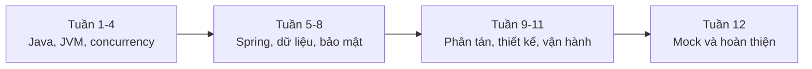

# Lộ trình học 12 tuần

Lộ trình cho bất kỳ ai học Java, Spring, backend và hệ thống, dù để ôn phỏng vấn hay để nâng tay nghề. Mục tiêu là **nắm chắc nền tảng đến mức làm được và giải thích được**; phỏng vấn chỉ là một cách kiểm tra.

**Khối lượng tham khảo:** 10-15 giờ/tuần, tổng khoảng 140-170 giờ. Nếu có ít thời gian hơn, kéo dài lộ trình (ví dụ 6 giờ/tuần thì khoảng 24 tuần, mỗi tuần làm một nửa). Nếu có nhiều hơn, giữ nguyên 12 tuần và dành thêm giờ cho dự án và bài tập. Người đã vững một giai đoạn có thể đọc lướt phần "Bắt buộc" và làm phần "Tự kiểm tra" để quyết định có bỏ qua không.

**Tóm tắt:**

- Mục tiêu là nắm chắc nền tảng đến mức làm được và giải thích được; phỏng vấn chỉ là một cách kiểm tra.
- Khối lượng 10-15 giờ/tuần, tổng khoảng 140-170 giờ; ít giờ hơn thì kéo dài lộ trình, không cắt nội dung.
- Mỗi tuần chỉ làm phần Bắt buộc, không đọc hết hơn 300 nghìn từ của bộ tài liệu.
- Nhịp mỗi tuần: 2 buổi đọc, 1 buổi thuật toán, 1 buổi trả lời Interview-QA thành tiếng và làm dự án.
- 4 giai đoạn: tuần 1-4 Java, JVM, concurrency; tuần 5-8 Spring, dữ liệu, bảo mật; tuần 9-11 phân tán, thiết kế, vận hành; tuần 12 mock và hoàn thiện.
- Mỗi tuần có sản phẩm cụ thể (code, sơ đồ, ghi chú) và danh sách Tự kiểm tra để quyết định có chuyển tuần hay không.
- Dự án thực hành chạy song song từ tuần 5; mock interview ở tuần 12 không bao giờ được bỏ.
- Cuối tuần 4, 8, 11 tự chấm 10 câu ngẫu nhiên; dưới 70% thì dừng và ôn lại.

## Nguyên tắc

- **Không đọc hết.** Bộ tài liệu có hơn 300 nghìn từ, không thể đọc trong 12 tuần. Mỗi tuần chỉ làm phần "Bắt buộc"; phần "Nếu còn thời gian" bỏ qua được.
- **Nói thành tiếng.** Đọc xong thì trả lời câu hỏi ở Interview-QA bằng lời của mình. Đọc mà không nói được thì chưa nhớ.
- **Mỗi tuần có sản phẩm.** Có code, sơ đồ hoặc ghi chú cụ thể, không chỉ "đã đọc".
- **Dự án chạy song song** (xem [Dự án thực hành](/go?p=00-Roadmap%2Fdu-an-tot-nghiep.md)) để có trải nghiệm thật.

## Nhịp học mỗi tuần (12 giờ mẫu)

| Buổi | Giờ | Nội dung |
|---|---|---|
| 1 | 3 | Đọc lý thuyết, tự vẽ lại sơ đồ chính không nhìn tài liệu |
| 2 | 3 | Đọc tiếp, viết code thử các ví dụ khó hiểu |
| 3 | 3 | Luyện thuật toán theo [bộ bài tập](/go?p=00-Roadmap%2Fbai-tap-thuat-toan.md) (2-4 bài, tự giới hạn thời gian) |
| 4 | 3 | Trả lời Interview-QA thành tiếng, làm dự án, ghi lại chỗ vấp |

Nếu chỉ có 10 giờ, bỏ nửa buổi 3. Nếu có 15 giờ, thêm một buổi dự án.

## Giai đoạn 1: Nền tảng Java và concurrency (tuần 1-4)

### Tuần 1: Java Core và JVM nền

- **Bắt buộc:** [Tư duy Java và JVM](/go?p=08-Java%2FJava-Core%2Feasy%2Flt-01-tu-duy-java-jvm.md), [Kiểu dữ liệu và String](/go?p=08-Java%2FJava-Core%2Feasy%2Flt-02-kieu-du-lieu-string.md), [OOP](/go?p=08-Java%2FJava-Core%2Feasy%2Flt-03-oop.md), [Exception](/go?p=08-Java%2FJava-Core%2Feasy%2Flt-04-exception.md), [Collections cơ bản](/go?p=08-Java%2FJava-Core%2Feasy%2Flt-05-collections-co-ban.md), [Java hiện đại](/go?p=08-Java%2FJava-Core%2Feasy%2Flt-06-java-hien-dai.md).
- **Tự hỏi:** [Java Core cơ bản](/go?p=07-Interview-QA%2FBackend%2Feasy%2Fqa-01-java-core-co-ban.md).
- **Thuật toán:** nhóm Array, Hash, Two pointers.
- **Sản phẩm:** trang ghi chú 1 trang "equals/hashCode, String pool, immutable" bằng lời của mình.
- **Tự kiểm tra:** giải thích được vì sao ghi đè `equals` phải ghi đè `hashCode`; `==` khác `equals`; chuyện gì xảy ra khi key của `HashMap` bị đổi sau khi put.

### Tuần 2: Collections bên trong, Generics, Stream, design pattern

- **Bắt buộc:** [Generics](/go?p=08-Java%2FJava-Core%2Fmedium%2Flt-07-generics.md), [Collections bên trong](/go?p=08-Java%2FJava-Core%2Fmedium%2Flt-08-collections-noi-bo.md), [Lambda và Stream](/go?p=08-Java%2FJava-Core%2Fmedium%2Flt-09-lambda-stream.md), [SOLID và Design Pattern](/go?p=08-Java%2FJava-Core%2Fmedium%2Flt-14-solid-design-patterns.md).
- **Tự hỏi:** [Collections, Concurrency và Java hiện đại](/go?p=07-Interview-QA%2FBackend%2Fmedium%2Fqa-03-collections-concurrency.md), [Design Patterns](/go?p=07-Interview-QA%2FBackend%2Fmedium%2Fqa-09-design-patterns.md), [Java hỏi xoáy](/go?p=07-Interview-QA%2FBackend%2Fmedium%2Fqa-23-java-hoi-xoay-tu-sach.md).
- **Thuật toán:** nhóm Stack, Queue, Linked List.
- **Sản phẩm:** tự cài `HashMap` đơn giản (không resize cũng được) và LRU cache bằng `LinkedHashMap`.
- **Tự kiểm tra:** vẽ được `HashMap` Java 8 (bucket, treeify, resize); nêu được khi nào `parallelStream` gây hại.

### Tuần 3: Concurrency I

- **Bắt buộc:** [Multithreading cơ bản và JMM](/go?p=08-Java%2FJava-Core%2Fmedium%2Flt-12-thread-co-ban.md), [java.util.concurrent](/go?p=08-Java%2FJava-Core%2Fmedium%2Flt-13-java-util-concurrent.md), [Concurrency Easy](/go?p=08-Java%2FJava-Concurrency%2Feasy%2Findex.md), [Concurrency Medium](/go?p=08-Java%2FJava-Concurrency%2Fmedium%2Findex.md).
- **Tự hỏi:** [Concurrency nền tảng](/go?p=07-Interview-QA%2FBackend%2Feasy%2Fqa-13-concurrency-nen-tang.md), [Concurrency thực chiến](/go?p=07-Interview-QA%2FBackend%2Fmedium%2Fqa-14-concurrency-thuc-chien.md).
- **Thuật toán:** nhóm Binary tree, Heap.
- **Sản phẩm:** viết producer-consumer bằng `BlockingQueue`, sau đó lặp lại bằng `wait/notify`; tái hiện một deadlock rồi sửa.
- **Tự kiểm tra:** khác nhau giữa `volatile`, `synchronized`, `Atomic`; cách chọn kích thước thread pool và vì sao.

### Tuần 4: Concurrency II và JVM

- **Bắt buộc:** [Java Memory Model sâu](/go?p=08-Java%2FJava-Core%2Fhard%2Flt-17-java-memory-model-sau.md), [GC chuyên sâu](/go?p=08-Java%2FJava-Core%2Fhard%2Flt-18-gc-chuyen-sau.md), [Virtual Threads](/go?p=08-Java%2FJava-Core%2Fhard%2Flt-20-virtual-threads-structured-concurrency.md), [Công cụ chẩn đoán JVM](/go?p=08-Java%2FJava-Core%2Fhard%2Flt-32-cong-cu-chan-doan-jvm.md), [Concurrency Hard](/go?p=08-Java%2FJava-Concurrency%2Fhard%2Findex.md) (chọn deadlock, explicit lock, atomic, JMM).
- **Tự hỏi:** [Concurrency nâng cao](/go?p=07-Interview-QA%2FBackend%2Fhard%2Fqa-17-concurrency-nang-cao.md), phần JVM của [JVM, Hiệu năng và Hệ phân tán](/go?p=07-Interview-QA%2FBackend%2Fhard%2Fqa-06-jvm-hieu-nang-phan-tan.md).
- **Thuật toán:** nhóm Graph (BFS, DFS).
- **Sản phẩm:** tạo một chương trình memory leak, lấy heap dump, tìm ra nguyên nhân; lấy thread dump của chương trình bị deadlock.
- **Tự kiểm tra:** giải thích happens-before; so sánh G1 và ZGC; nói được virtual thread bị pin khi nào.

## Giai đoạn 2: Spring, dữ liệu, bảo mật (tuần 5-8)

### Tuần 5: Spring bên trong

- **Bắt buộc:** [Tư duy Spring](/go?p=01-Spring-Boot%2Feasy%2Flt-09-tu-duy-spring.md), [IoC và DI](/go?p=01-Spring-Boot%2Feasy%2Flt-02-ioc-di.md), [Bean lifecycle](/go?p=01-Spring-Boot%2Feasy%2Flt-10-bean-lifecycle.md), [AOP và Proxy](/go?p=01-Spring-Boot%2Fmedium%2Flt-13-aop-proxy.md), [Auto-configuration](/go?p=01-Spring-Boot%2Fmedium%2Flt-14-autoconfiguration.md), [MVC bên trong](/go?p=01-Spring-Boot%2Fmedium%2Flt-15-mvc-internals.md), [Spring khởi động bên trong](/go?p=01-Spring-Boot%2Fhard%2Flt-30-spring-khoi-dong-application-context.md).
- **Tự hỏi:** [Spring cơ bản](/go?p=07-Interview-QA%2FBackend%2Feasy%2Fqa-02-spring-co-ban.md), [Spring bên trong](/go?p=07-Interview-QA%2FBackend%2Fmedium%2Fqa-04-spring-noi-bo.md).
- **Thuật toán:** nhóm Binary search, Sorting.
- **Sản phẩm:** **khởi động dự án thực hành** (khung Spring Boot, cấu hình profile, health check).
- **Tự kiểm tra:** kể được các bước từ `SpringApplication.run` đến lúc nhận request; vì sao `@Transactional` gọi nội bộ không chạy; singleton bean và tính thread-safe.

### Tuần 6: Transaction và JPA

- **Bắt buộc:** [Transaction](/go?p=01-Spring-Boot%2Fmedium%2Flt-05-transaction.md), [Transaction chuyên sâu](/go?p=01-Spring-Boot%2Fhard%2Flt-31-transaction-chuyen-sau.md), [Spring Data JPA](/go?p=01-Spring-Boot%2Fmedium%2Flt-04-spring-data-jpa.md), [JPA bên trong](/go?p=01-Spring-Boot%2Fmedium%2Flt-16-jpa-internals.md), [JPA: hiệu năng, lock và cache](/go?p=01-Spring-Boot%2Fhard%2Flt-34-jpa-hieu-nang-khoa-cache.md), [SQL cơ bản](/go?p=02-Database%2Feasy%2Flt-01-sql-co-ban.md), [Index và tối ưu truy vấn](/go?p=02-Database%2Fmedium%2Flt-03-index-toi-uu-truy-van.md).
- **Tự hỏi:** [Database và SQL](/go?p=07-Interview-QA%2FBackend%2Fmedium%2Fqa-05-database-sql.md), [Hibernate và JPA](/go?p=07-Interview-QA%2FBackend%2Fmedium%2Fqa-12-hibernate-jpa.md).
- **Thuật toán:** nhóm Dynamic programming I (1D).
- **Sản phẩm:** trong dự án, tái hiện N+1, đo số câu SQL, sửa bằng `JOIN FETCH` hoặc batch; thêm optimistic lock `@Version`.
- **Tự kiểm tra:** giải thích 7 mức propagation (nói chắc `REQUIRED` và `REQUIRES_NEW`); các mức isolation và hiện tượng đi kèm; persistence context và dirty checking.

### Tuần 7: Database sâu và Redis

- **Bắt buộc:** [Transaction, Isolation và Lock](/go?p=02-Database%2Fmedium%2Flt-04-transaction-isolation-lock.md), [EXPLAIN và query planner](/go?p=02-Database%2Fhard%2Flt-09-explain-query-planner-tuning.md), [Replication, Sharding, HA](/go?p=02-Database%2Fhard%2Flt-05-replication-sharding-ha.md), [Redis tổng quan](/go?p=06-Distributed-Systems%2FRedis%2Feasy%2Flt-01-redis-tong-quan-cau-truc-du-lieu.md), [Cache pattern](/go?p=06-Distributed-Systems%2FRedis%2Fmedium%2Flt-03-cache-pattern-van-de-cache.md), [Distributed lock và Lua](/go?p=06-Distributed-Systems%2FRedis%2Fhard%2Flt-05-distributed-lock-lua-streams.md).
- **Tự hỏi:** [Database chuyên sâu](/go?p=07-Interview-QA%2FBackend%2Fhard%2Fqa-22-database-chuyen-sau.md), [Redis chuyên sâu](/go?p=07-Interview-QA%2FBackend%2Fhard%2Fqa-20-redis-chuyen-sau.md).
- **Thuật toán:** nhóm Dynamic programming II (2D, string).
- **Sản phẩm:** thêm cache Redis vào dự án, tái hiện cache stampede rồi xử lý; đọc một kết quả `EXPLAIN` thật và giải thích.
- **Tự kiểm tra:** chọn index cho một truy vấn cho trước; giải thích cache-aside, cache penetration, avalanche, stampede; vì sao distributed lock bằng Redis có giới hạn.

### Tuần 8: Bảo mật, REST API, observability và kiểm thử

- **Bắt buộc:** [Thiết kế REST API thực chiến](/go?p=01-Spring-Boot%2Fmedium%2Flt-33-rest-api-thuc-chien.md), [Spring Security và JWT](/go?p=01-Spring-Boot%2Fmedium%2Flt-06-spring-security-jwt.md), [Spring Security chuyên sâu](/go?p=01-Spring-Boot%2Fhard%2Flt-35-spring-security-chuyen-sau.md), [OAuth2 và OIDC](/go?p=01-Spring-Boot%2Fmedium%2Flt-20-oauth2-oidc.md), [OWASP](/go?p=03-Network-Security%2Fmedium%2Flt-04-owasp-web-security.md), [Observability](/go?p=01-Spring-Boot%2Fmedium%2Flt-19-observability.md), [Testing nâng cao](/go?p=01-Spring-Boot%2Fhard%2Flt-27-advanced-testing.md).
- **Tự hỏi:** [Spring Boot nâng cao](/go?p=07-Interview-QA%2FBackend%2Fmedium%2Fqa-15-spring-boot-nang-cao.md).
- **Thuật toán:** nhóm Backtracking.
- **Sản phẩm:** thêm đăng nhập JWT, authorization bằng method security, định dạng lỗi `ProblemDetail`, metric và trace; viết test tích hợp với Testcontainers.
- **Tự kiểm tra:** vẽ filter chain; khác nhau giữa authentication và authorization; vì sao JWT khó thu hồi; CSRF khác CORS.

## Giai đoạn 3: Phân tán, thiết kế, vận hành (tuần 9-11)

### Tuần 9: Messaging và microservices

- **Bắt buộc:** [Kafka tổng quan](/go?p=06-Distributed-Systems%2FKafka%2Feasy%2Flt-01-kafka-tong-quan.md), [Producer, Consumer và delivery semantics](/go?p=06-Distributed-Systems%2FKafka%2Fmedium%2Flt-02-producer-consumer-delivery.md), [Exactly-once và vận hành](/go?p=06-Distributed-Systems%2FKafka%2Fhard%2Flt-05-kafka-van-hanh-exactly-once.md), [Distributed lock và Idempotency](/go?p=01-Spring-Boot%2Fhard%2Flt-26-distributed-lock-idempotency.md), [Resilience và chịu lỗi](/go?p=01-Spring-Boot%2Fhard%2Flt-32-resilience-chiu-loi.md), [Distributed Transactions](/go?p=15-System%20Design%2Fhard%2Flt-10-distributed-transactions.md), [CQRS và Event Sourcing](/go?p=01-Spring-Boot%2Fhard%2Flt-25-cqrs-event-sourcing.md).
- **Tự hỏi:** [Microservices, Kafka và hệ phân tán](/go?p=07-Interview-QA%2FBackend%2Fhard%2Fqa-16-microservices-kafka-phan-tan.md), [Kafka chuyên sâu](/go?p=07-Interview-QA%2FBackend%2Fhard%2Fqa-21-kafka-chuyen-sau.md).
- **Thuật toán:** ôn lại các nhóm yếu.
- **Sản phẩm:** thêm Kafka và **outbox pattern** vào dự án, consumer idempotent, circuit breaker và timeout cho gọi external service.
- **Tự kiểm tra:** giải thích at-least-once, exactly-once và giới hạn; saga orchestration và choreography; vì sao cần outbox.

### Tuần 10: System Design I

- **Bắt buộc:** [Khung giải 45 phút và ví dụ đầy đủ](/go?p=15-System%20Design%2Fhard%2Flt-11-khung-giai-45-phut-vi-du-day-du.md), [Cách trả lời System Design](/go?p=07-Interview-QA%2FBackend%2Fhard%2Fqa-07-cach-tra-loi-system-design.md), [Scalability và Load Balancing](/go?p=15-System%20Design%2Feasy%2Flt-02-scalability-load-balancing.md), [Caching và CDN](/go?p=15-System%20Design%2Feasy%2Flt-03-caching-cdn.md), [Back-of-the-envelope](/go?p=15-System%20Design%2Feasy%2Flt-08-back-of-envelope.md), [Consistent Hashing](/go?p=15-System%20Design%2Feasy%2Flt-09-consistent-hashing.md), [CAP và Consistency](/go?p=15-System%20Design%2Fhard%2Flt-05-cap-consistency.md).
- **Bài thiết kế luyện:** URL Shortener, Rate Limiter, News Feed, Chat System (mỗi bài **tự giải 45 phút trên giấy** rồi mới đối chiếu).
- **Sản phẩm:** 4 bản thiết kế viết tay hoặc vẽ, có ước lượng load, API, schema, bottleneck.
- **Tự kiểm tra:** tự giải bài mới trong 45 phút mà vẫn có ước lượng, sơ đồ và ít nhất hai điểm đào sâu.

### Tuần 11: System Design II, sự cố, vận hành

- **Bắt buộc:** [Payment System](/go?p=15-System%20Design%2Fhard%2F04-payment-system.md), [Ticket Booking](/go?p=15-System%20Design%2Fmedium%2F07-ticket-booking.md), [Notification System](/go?p=15-System%20Design%2Fmedium%2F03-notification-system.md), [Kubernetes vận hành](/go?p=04-DevOps%2Fhard%2Flt-06-kubernetes-van-hanh.md), [Xử lý sự cố, SRE](/go?p=04-DevOps%2Fhard%2Flt-07-su-co-sre-observability.md), [Docker và Kubernetes cho Spring Boot](/go?p=01-Spring-Boot%2Fhard%2Flt-29-docker-kubernetes.md).
- **Tự hỏi:** [Tình huống sự cố production](/go?p=07-Interview-QA%2FBackend%2Fhard%2Fqa-18-tinh-huong-su-co-production.md), [Trade-off kiến trúc](/go?p=07-Interview-QA%2FBackend%2Fhard%2Fqa-19-trade-off-kien-truc.md).
- **Sản phẩm:** package dự án bằng Docker, chạy được trên Kubernetes cục bộ (kind hoặc minikube); viết 1 tài liệu "post-mortem giả định" cho sự cố tự gây ra.
- **Tự kiểm tra:** kể được quy trình xử lý sự cố từ triệu chứng đến phòng ngừa; trình bày một quyết định kiến trúc theo khung bối cảnh, ràng buộc, phương án, quyết định, rủi ro.

## Giai đoạn 4: Hoàn thiện (tuần 12)

### Tuần 12: Mock interview và vá điểm yếu

- **Bắt buộc:** [Khung STAR](/go?p=07-Interview-QA%2FBehavioral%2Feasy%2Flt-01-star-chuan-bi-cau-chuyen.md), [Câu hỏi hành vi](/go?p=07-Interview-QA%2FBehavioral%2Fmedium%2Flt-02-cau-hoi-hanh-vi-thuong-gap.md), [Dẫn dắt và mentoring](/go?p=07-Interview-QA%2FBehavioral%2Fhard%2Flt-04-dan-dat-mentoring-xung-dot.md), [Chuẩn bị phỏng vấn và thương lượng](/go?p=07-Interview-QA%2FBehavioral%2Fhard%2Flt-05-chuan-bi-phong-van-thuong-luong.md).
- **Làm:** 3 buổi mock đầy đủ (nhờ bạn bè hoặc tự ghi âm) theo [tiêu chí chấm](/go?p=00-Roadmap%2Fcham-diem-mock-interview.md); mỗi buổi gồm Java, code, system design, hành vi.
- **Vá điểm yếu:** lấy điểm thấp nhất từ phiếu chấm, quay lại đọc đúng bài liên quan.
- **Hoàn thiện dự án:** README, sơ đồ kiến trúc, 5 câu chuyện STAR rút ra từ dự án và công việc.
- **Tự kiểm tra:** đạt tối thiểu 3/5 ở mọi vòng và 4/5 ở ít nhất hai vòng trong phiếu chấm.

## Khi trễ tiến độ

- Trễ 1 tuần: bỏ phần "nếu còn thời gian", gộp tuần 10 và 11 (giảm số bài System Design).
- Trễ 2 tuần trở lên: giữ nguyên tuần 5, 6, 9, 10, 12 (cốt lõi của vòng phỏng vấn); rút gọn tuần 7 và 8 xuống phần đã đánh dấu bắt buộc.
- Không bao giờ bỏ: nói thành tiếng, tuần 12 mock interview.

## Cách đo tiến bộ

Cuối mỗi giai đoạn (tuần 4, 8, 11), tự chấm 10 câu ngẫu nhiên trong Interview-QA của giai đoạn đó. Dưới 70% thì dừng và ôn lại trước khi đi tiếp.

