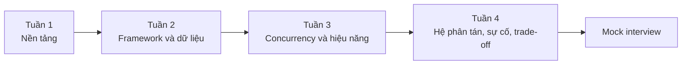

# Lộ trình ôn nhanh 4 tuần

Đây là bản **ôn nhanh 4 tuần** cho người đã nắm kiến thức. Nếu cần học từ gốc, dùng [Lộ trình 12 tuần](/go?p=00-Roadmap%2Flo-trinh-12-tuan.md).

Đi từ dễ đến khó. Mỗi bước có bài đọc (kiến thức gốc), bài tự hỏi (Q&A) và tiêu chí tự đánh giá. Chỉ chuyển bước khi trả lời thành tiếng được phần lớn câu của bước hiện tại.

**Tóm tắt:**

- Dành cho người đã nắm kiến thức; người cần học từ gốc dùng lộ trình 12 tuần.
- Đi từ dễ đến khó qua 4 tuần: nền tảng, framework và dữ liệu, concurrency và hiệu năng, hệ phân tán và trade-off.
- Mỗi tuần có bảng cặp Đọc và Tự hỏi, kèm tiêu chí tự đánh giá; chỉ chuyển tuần khi trả lời thành tiếng được phần lớn câu.
- Trước ngày phỏng vấn chạy 5 vòng mock: Java, code, System Design, sự cố và trade-off, hành vi.
- Checklist cuối: giải thích JMM, `ConcurrentHashMap`, `@Transactional` bằng lời mình, và chẩn đoán được CPU cao, memory leak, deadlock, thread pool cạn.
- Cần sẵn ít nhất 5 câu chuyện STAR và 3-5 câu hỏi ngược cho người phỏng vấn.

## Tuần 1: Nền tảng (Easy)

| Đọc | Tự hỏi |
|---|---|
| [Java Core Easy](/go?p=08-Java%2FJava-Core%2Feasy%2Findex.md) | [Java Core cơ bản](/go?p=07-Interview-QA%2FBackend%2Feasy%2Fqa-01-java-core-co-ban.md) |
| [Spring Boot Easy](/go?p=01-Spring-Boot%2Feasy%2Findex.md) | [Spring cơ bản](/go?p=07-Interview-QA%2FBackend%2Feasy%2Fqa-02-spring-co-ban.md) |
| [Thuật toán Easy](/go?p=05-Algorithms%2Findex.md) | [Bài code kinh điển](/go?p=07-Interview-QA%2FBackend%2Feasy%2Fqa-08-bai-code-kinh-dien.md) |
| [Concurrency: bài 01-03](/go?p=08-Java%2FJava-Concurrency%2Feasy%2Findex.md) | [Concurrency nền tảng](/go?p=07-Interview-QA%2FBackend%2Feasy%2Fqa-13-concurrency-nen-tang.md) |

Tự đánh giá: giải thích được `equals/hashCode`, `String` immutable, IoC/DI, race condition, `volatile` khác `synchronized`; viết được FizzBuzz, Fibonacci, đảo chuỗi không cần tra cứu.

## Tuần 2: Framework và dữ liệu (Medium)

| Đọc | Tự hỏi |
|---|---|
| [Java Core Medium](/go?p=08-Java%2FJava-Core%2Fmedium%2Findex.md) | [Collections, Concurrency và Java hiện đại](/go?p=07-Interview-QA%2FBackend%2Fmedium%2Fqa-03-collections-concurrency.md) |
| [Spring Boot Medium](/go?p=01-Spring-Boot%2Fmedium%2Findex.md) | [Spring bên trong](/go?p=07-Interview-QA%2FBackend%2Fmedium%2Fqa-04-spring-noi-bo.md) |
| [Database](/go?p=02-Database%2Findex.md) | [Database và SQL](/go?p=07-Interview-QA%2FBackend%2Fmedium%2Fqa-05-database-sql.md) |
| Design pattern, Servlet, JSON, Hibernate | [Design Patterns](/go?p=07-Interview-QA%2FBackend%2Fmedium%2Fqa-09-design-patterns.md), [Servlet](/go?p=07-Interview-QA%2FBackend%2Fmedium%2Fqa-10-servlet-tomcat-web-server.md), [Serialization và JSON](/go?p=07-Interview-QA%2FBackend%2Fmedium%2Fqa-11-serialization-json.md), [Hibernate và JPA](/go?p=07-Interview-QA%2FBackend%2Fmedium%2Fqa-12-hibernate-jpa.md) |

Tự đánh giá: giải thích được `HashMap` bên trong, proxy và `@Transactional`, index và isolation level, N+1.

## Tuần 3: Concurrency, Spring nâng cao, hiệu năng (Medium sang Hard)

| Đọc | Tự hỏi |
|---|---|
| [Java Concurrency Medium](/go?p=08-Java%2FJava-Concurrency%2Fmedium%2Findex.md) | [Concurrency thực chiến](/go?p=07-Interview-QA%2FBackend%2Fmedium%2Fqa-14-concurrency-thuc-chien.md) |
| [Spring Boot Hard](/go?p=01-Spring-Boot%2Fhard%2Findex.md) | [Spring Boot nâng cao](/go?p=07-Interview-QA%2FBackend%2Fmedium%2Fqa-15-spring-boot-nang-cao.md) |
| [Java Concurrency Hard](/go?p=08-Java%2FJava-Concurrency%2Fhard%2Findex.md), [JVM và GC](/go?p=08-Java%2FJava-Core%2Fhard%2Findex.md) | [Concurrency cấp senior](/go?p=07-Interview-QA%2FBackend%2Fhard%2Fqa-17-concurrency-nang-cao.md), [JVM, Hiệu năng và Hệ phân tán](/go?p=07-Interview-QA%2FBackend%2Fhard%2Fqa-06-jvm-hieu-nang-phan-tan.md) |

Tự đánh giá: vẽ được happens-before, chọn kích thước thread pool có lý do, giải thích pinning của virtual thread, đọc thread dump.

## Tuần 4: Hệ phân tán, sự cố, trade-off (Hard)

| Đọc | Tự hỏi |
|---|---|
| [System Design](/go?p=15-System%20Design%2Findex.md) | [Cách trả lời System Design](/go?p=07-Interview-QA%2FBackend%2Fhard%2Fqa-07-cach-tra-loi-system-design.md) |
| [Kafka, Microservices, CQRS](/go?p=01-Spring-Boot%2Fhard%2Findex.md) | [Microservices, Kafka và hệ phân tán](/go?p=07-Interview-QA%2FBackend%2Fhard%2Fqa-16-microservices-kafka-phan-tan.md) |
| [DevOps, SRE](/go?p=04-DevOps%2Fhard%2Flt-07-su-co-sre-observability.md) | [Tình huống sự cố production](/go?p=07-Interview-QA%2FBackend%2Fhard%2Fqa-18-tinh-huong-su-co-production.md) |
| [Hành vi và Dẫn dắt](/go?p=07-Interview-QA%2FBehavioral%2Findex.md) | [Trade-off kiến trúc](/go?p=07-Interview-QA%2FBackend%2Fhard%2Fqa-19-trade-off-kien-truc.md) |
| [Redis](/go?p=06-Distributed-Systems%2FRedis%2Findex.md) | [Redis chuyên sâu (hỏi xoáy)](/go?p=07-Interview-QA%2FBackend%2Fhard%2Fqa-20-redis-chuyen-sau.md) |
| [Kafka](/go?p=06-Distributed-Systems%2FKafka%2Findex.md) | [Kafka chuyên sâu (hỏi xoáy)](/go?p=07-Interview-QA%2FBackend%2Fhard%2Fqa-21-kafka-chuyen-sau.md) |
| [Database chuyên sâu](/go?p=02-Database%2Findex.md) | [Database chuyên sâu (hỏi xoáy)](/go?p=07-Interview-QA%2FBackend%2Fhard%2Fqa-22-database-chuyen-sau.md) |
| [Java hỏi xoáy](/go?p=07-Interview-QA%2FBackend%2Fmedium%2Fqa-23-java-hoi-xoay-tu-sach.md) | Ôn xen kẽ mỗi tuần |

Tự đánh giá: kể được quy trình xử lý một sự cố từ triệu chứng đến phòng ngừa; trình bày được quyết định kiến trúc theo khung bối cảnh, ràng buộc, phương án, quyết định, rủi ro.

## Mock interview (trước ngày phỏng vấn)

| Vòng | Nội dung | Thời lượng gợi ý |
|---|---|---|
| Kỹ thuật Java | 10 câu ngẫu nhiên từ Java Core, Concurrency, Spring | 45 phút |
| Code | 2 bài từ [Thuật toán](/go?p=05-Algorithms%2Findex.md) và bài code kinh điển | 45 phút |
| System Design | 1 bài từ [System Design](/go?p=15-System%20Design%2Findex.md) | 45-60 phút |
| Sự cố và trade-off | 2 tình huống ngẫu nhiên từ qa-18 và qa-19 | 30 phút |
| Hành vi | 5 câu STAR từ [Hành vi thường gặp](/go?p=07-Interview-QA%2FBehavioral%2Fmedium%2Flt-02-cau-hoi-hanh-vi-thuong-gap.md) | 30 phút |

## Checklist tự đánh giá cuối cùng

- Giải thích được JMM, `ConcurrentHashMap`, `@Transactional` và auto-configuration bằng lời của mình, không đọc thuộc.
- Chẩn đoán được CPU cao, memory leak, deadlock, thread pool cạn bằng công cụ cụ thể.
- Chọn được giữa monolith và microservices, SQL và NoSQL, sync và async kèm lý do và rủi ro.
- Có ít nhất 5 câu chuyện STAR về dẫn dắt, xung đột, sự cố, quyết định kỹ thuật, sai lầm.
- Chuẩn bị 3-5 câu hỏi ngược cho người phỏng vấn và khung thương lượng offer ([chuẩn bị phỏng vấn](/go?p=07-Interview-QA%2FBehavioral%2Fhard%2Flt-05-chuan-bi-phong-van-thuong-luong.md)).

