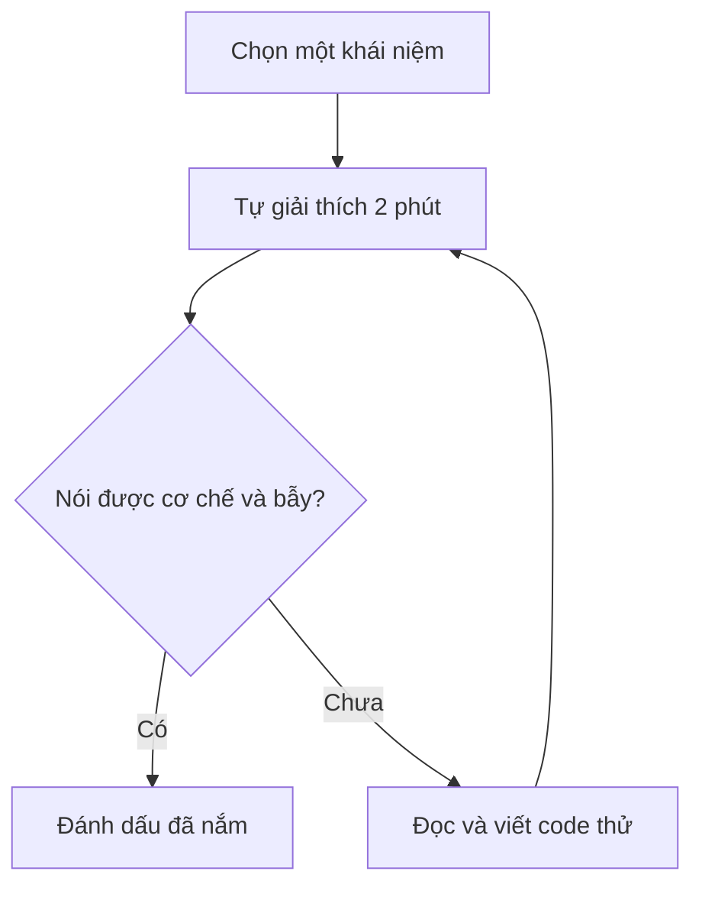

# Bản đồ khái niệm Spring

## Bản đồ này là gì và dùng để làm gì?

Đây là danh sách các khái niệm Spring và Spring Boot mà một lập trình viên cần nắm, được chia thành 11 mảng: core, Boot nội tại, web, dữ liệu, security, messaging, cloud, testing, observability, hiệu năng và kiến trúc. Bạn không cần đọc nó từ đầu đến cuối như một bài giảng. Hãy coi nó như bản đồ đường đi: mỗi dòng là một địa điểm, cột "Cần giải thích được" cho biết bạn phải hiểu đến mức nào, và cột "Bài" chỉ đường tới bài viết tương ứng.

**Tóm tắt:**

- Bản đồ chia kiến thức Spring và Spring Boot thành 11 mảng: core, Boot nội tại, web, dữ liệu, security, messaging, cloud, testing, observability, hiệu năng và kiến trúc.
- Mỗi dòng gồm khái niệm, mức cần giải thích được, và bài tương ứng để đọc.
- Cách dùng: tự giải thích mỗi khái niệm trong khoảng 2 phút theo ba ý là nó là gì, vì sao cần, và khi hỏng thì hỏng kiểu nào.
- "Chưa" nghĩa là chưa có bài riêng; "Một phần" nghĩa là chủ đề chỉ được nhắc trong bài khác.
- Nền tảng cần nắm trước: IoC, bean, proxy và auto-configuration, vì phần lớn lỗi lạ đều suy ra được từ chúng.
- Học theo mảng mà công việc hiện tại đang chạm tới, đừng học thuộc từ đầu đến cuối.

## Vì sao cần một bản đồ như vậy

Nhiều người chỉ biết gõ annotation: thêm `@Transactional` thì "có transaction", thêm `@Autowired` thì "có bean". Mọi thứ chạy tốt cho tới khi gặp một lỗi lạ, và lúc đó bạn bí vì không biết Spring đang làm gì bên dưới. Ví dụ, `@Transactional` không có tác dụng khi gọi method trong cùng class là một lỗi chỉ giải thích được nếu bạn hiểu proxy. Biết cơ chế bên trong thì việc gỡ lỗi, thiết kế và tối ưu mới có căn cứ thay vì thử đoán.

## Khi nào dùng và dùng thế nào

Dùng bản đồ khi bạn muốn tự kiểm tra mình đang hổng chỗ nào, lên kế hoạch học, hoặc ôn trước buổi phỏng vấn. Với mỗi khái niệm, hãy thử tự giải thích thành lời trong khoảng hai phút theo ba ý: nó là gì, vì sao cần (nó giải quyết vấn đề nào), và khi hỏng thì hỏng theo kiểu nào. Chỗ nào nói không trôi thì đánh dấu, mở bài tương ứng đọc, viết thử code, rồi quay lại tự giải thích lần nữa (xem sơ đồ ở cuối trang). Chỗ ghi "Chưa" nghĩa là tài liệu này chưa có bài riêng, bạn cần tìm thêm nguồn khác. Chỗ ghi "Một phần" nghĩa là chủ đề chỉ được nhắc trong bài khác, và bài đó được link kèm.

Không nên dùng bản đồ như danh sách phải thuộc lòng trước khi bắt đầu làm dự án. Cách hợp lý hơn là học theo mảng mà công việc hiện tại đang chạm tới, rồi mở rộng dần.

## Từ khóa hay gặp trong bản đồ

- **IoC (Inversion of Control)**: thay vì code của bạn tự `new` các object nó cần, một container (Spring) tạo và đưa chúng cho bạn. Là nền của cả Spring.
- **Bean**: một object do container Spring tạo và quản lý vòng đời.
- **Proxy**: object "đại diện" bọc ngoài bean thật để chèn thêm hành vi (transaction, bảo mật, cache) trước và sau khi method chạy. Đây là cơ chế đằng sau AOP.
- **Auto-configuration**: Spring Boot nhìn vào thư viện có trên classpath và cấu hình giúp bạn các bean mặc định, trừ khi bạn tự khai báo bean riêng.
- **Idempotent**: thao tác làm một lần hay nhiều lần đều cho cùng kết quả, quan trọng khi retry hoặc nhận trùng message.
- **Backpressure**: cơ chế để bên nhận báo cho bên gửi "chậm lại" khi xử lý không kịp, dùng trong lập trình reactive.

## Tổng quan các mảng

Tài liệu chia làm 11 mảng, đánh số 1 đến 11 ở các mục bên dưới. Cột "Bài" dẫn tới bài tương ứng trong tài liệu (Spring Boot, Kafka, Redis, Database, Network-Security, DevOps, Java Core, Fullstack).

## 1. Core: IoC và AOP

| Khái niệm | Cần giải thích được | Bài |
|---|---|---|
| IoC container, `BeanFactory` và `ApplicationContext` | Khác nhau thế nào, container làm gì khi khởi động | [IoC và DI](/go?p=01-Spring-Boot%2Feasy%2Flt-02-ioc-di.md) |
| Bean lifecycle | Thứ tự: khởi tạo, tiêm, `@PostConstruct`, `InitializingBean`, sẵn sàng, `@PreDestroy` | [Bean lifecycle](/go?p=01-Spring-Boot%2Feasy%2Flt-10-bean-lifecycle.md) |
| `BeanPostProcessor`, `BeanFactoryPostProcessor` | Cách Spring tạo proxy, xử lý `@Autowired`, `@Transactional` | [Bean lifecycle](/go?p=01-Spring-Boot%2Feasy%2Flt-10-bean-lifecycle.md), [AOP](/go?p=01-Spring-Boot%2Fmedium%2Flt-13-aop-proxy.md) |
| Scope | singleton, prototype, request, session; bẫy tiêm prototype vào singleton | [IoC và DI](/go?p=01-Spring-Boot%2Feasy%2Flt-02-ioc-di.md) |
| Circular dependency | Vì sao xảy ra, cách phá vỡ bằng thiết kế | [IoC và DI](/go?p=01-Spring-Boot%2Feasy%2Flt-02-ioc-di.md) |
| `@Conditional` và các biến thể | Nền tảng của auto-configuration | [Auto-configuration](/go?p=01-Spring-Boot%2Fmedium%2Flt-14-autoconfiguration.md) |
| Profile và `Environment` | Thứ tự ưu tiên nguồn cấu hình | [Cấu hình và Profile](/go?p=01-Spring-Boot%2Feasy%2Flt-11-config-profile.md) |
| `@ConfigurationProperties` | Gắn kiểu, validate, relaxed binding | [Cấu hình và Profile](/go?p=01-Spring-Boot%2Feasy%2Flt-11-config-profile.md) |
| AOP | Proxy JDK và CGLIB, pointcut, advice, thứ tự aspect | [AOP và Proxy](/go?p=01-Spring-Boot%2Fmedium%2Flt-13-aop-proxy.md) |
| Bẫy proxy | Self-invocation, `final` class/method, `private` method | [Transaction](/go?p=01-Spring-Boot%2Fmedium%2Flt-05-transaction.md) |
| Application event | `ApplicationEventPublisher`, `@EventListener`, `@TransactionalEventListener` | [Application Event](/go?p=01-Spring-Boot%2Fmedium%2Flt-17-application-events.md) |
| SpEL | Dùng trong `@Value`, `@Cacheable`, `@PreAuthorize` | [MVC bên trong (SpEL và chuyển đổi kiểu)](/go?p=01-Spring-Boot%2Fmedium%2Flt-15-mvc-internals.md) |

## 2. Spring Boot nội tại

| Khái niệm | Cần giải thích được | Bài |
|---|---|---|
| Auto-configuration | Cách đọc `AutoConfiguration.imports`, vì sao bean được bật hoặc tắt, dùng `--debug` | [Auto-configuration](/go?p=01-Spring-Boot%2Fmedium%2Flt-14-autoconfiguration.md), [Giới thiệu](/go?p=01-Spring-Boot%2Feasy%2Flt-01-gioi-thieu-spring-boot.md) |
| Tự viết starter | Cấu trúc module autoconfigure và starter | [Auto-configuration](/go?p=01-Spring-Boot%2Fmedium%2Flt-14-autoconfiguration.md) |
| Thứ tự ưu tiên cấu hình | Command-line argument, environment variable, `application.yml`, profile | [Cấu hình và Profile](/go?p=01-Spring-Boot%2Feasy%2Flt-11-config-profile.md) |
| Actuator | Health, readiness/liveness, metrics, bảo vệ endpoint | [Observability](/go?p=01-Spring-Boot%2Fmedium%2Flt-19-observability.md) |
| Graceful shutdown | Hoàn tất request đang chạy khi tắt | [Docker và Kubernetes](/go?p=01-Spring-Boot%2Fhard%2Flt-29-docker-kubernetes.md) |
| Packaging | JAR lồng, layered JAR, buildpacks, Docker image nhỏ | [Docker và Kubernetes](/go?p=01-Spring-Boot%2Fhard%2Flt-29-docker-kubernetes.md) |
| Native image (GraalVM), CDS | Khởi động nhanh, đánh đổi và hạn chế | [Docker và Kubernetes](/go?p=01-Spring-Boot%2Fhard%2Flt-29-docker-kubernetes.md) |
| Spring Boot 3 | Java 17+, `jakarta.*`, `ProblemDetail`, Observation API | [Giới thiệu](/go?p=01-Spring-Boot%2Feasy%2Flt-01-gioi-thieu-spring-boot.md), [Boot 4 và Framework 7](/go?p=01-Spring-Boot%2Fhard%2Flt-38-boot4-framework7-thay-doi.md), [Observability](/go?p=01-Spring-Boot%2Fmedium%2Flt-19-observability.md) |

## 3. Web: MVC và WebFlux

| Khái niệm | Cần giải thích được | Bài |
|---|---|---|
| Flow của `DispatcherServlet` | HandlerMapping, HandlerAdapter, ArgumentResolver, MessageConverter | [REST Controller](/go?p=01-Spring-Boot%2Feasy%2Flt-03-rest-controller.md) |
| Filter và Interceptor | Khác nhau, thứ tự, khi nào dùng cái nào | [MVC bên trong](/go?p=01-Spring-Boot%2Fmedium%2Flt-15-mvc-internals.md) |
| Xử lý lỗi | `@RestControllerAdvice`, `ProblemDetail` (RFC 7807, nay là RFC 9457) | [REST API thực chiến](/go?p=01-Spring-Boot%2Fmedium%2Flt-33-rest-api-thuc-chien.md), [REST Controller](/go?p=01-Spring-Boot%2Feasy%2Flt-03-rest-controller.md) |
| Validation | Nhóm validation, validator tùy biến | [REST API thực chiến](/go?p=01-Spring-Boot%2Fmedium%2Flt-33-rest-api-thuc-chien.md) |
| Content negotiation, CORS | Cách cấu hình và các lỗi hay gặp | [MVC bên trong](/go?p=01-Spring-Boot%2Fmedium%2Flt-15-mvc-internals.md), [Security chuyên sâu](/go?p=01-Spring-Boot%2Fhard%2Flt-35-spring-security-chuyen-sau.md) |
| Xử lý asynchronous | `Callable`, `DeferredResult`, SSE, WebSocket | [REST API thực chiến (Callable, DeferredResult, SSE)](/go?p=01-Spring-Boot%2Fmedium%2Flt-33-rest-api-thuc-chien.md), [Scheduling và Async](/go?p=01-Spring-Boot%2Fmedium%2Flt-18-scheduling-async.md), [Realtime SSE và WebSocket](/go?p=12-Fullstack%2Flt-03-realtime-sse-websocket.md) |
| Gọi HTTP đi | `RestClient`, `WebClient`, HTTP Interface, timeout | [RestClient và WebClient](/go?p=01-Spring-Boot%2Fmedium%2Flt-36-http-client-restclient.md) |
| Thiết kế API | Phiên bản, phân trang, idempotency, tài liệu OpenAPI | [REST API thực chiến](/go?p=01-Spring-Boot%2Fmedium%2Flt-33-rest-api-thuc-chien.md), [API contract và OpenAPI](/go?p=12-Fullstack%2Flt-01-hop-dong-api-openapi-client-typescript.md) |
| WebFlux và Reactor | `Mono`, `Flux`, backpressure, scheduler, khi nào chọn thay MVC | [WebFlux và Reactor](/go?p=01-Spring-Boot%2Fhard%2Flt-21-webflux-reactor.md) |
| Virtual threads | Khi nào thay được reactive, những chỗ bị "ghim" thread (pinning) | [Đồng thời và Virtual Threads](/go?p=01-Spring-Boot%2Fhard%2Flt-22-concurrency-virtual-threads.md) |

## 4. Dữ liệu và Transaction

| Khái niệm | Cần giải thích được | Bài |
|---|---|---|
| Persistence context | Cache cấp một, dirty checking, thời điểm flush | [JPA bên trong](/go?p=01-Spring-Boot%2Fmedium%2Flt-16-jpa-internals.md) |
| Lazy và N+1 | `join fetch`, `@EntityGraph`, `@BatchSize`, DTO projection | [Spring Data JPA](/go?p=01-Spring-Boot%2Fmedium%2Flt-04-spring-data-jpa.md), [JPA hiệu năng](/go?p=01-Spring-Boot%2Fhard%2Flt-34-jpa-hieu-nang-khoa-cache.md) |
| Cascade, orphan removal, quan hệ hai chiều | Sync hai phía, lỗi hay gặp | [JPA bên trong](/go?p=01-Spring-Boot%2Fmedium%2Flt-16-jpa-internals.md) |
| Lock | Optimistic (`@Version`) và pessimistic, deadlock | [Transaction](/go?p=01-Spring-Boot%2Fmedium%2Flt-05-transaction.md), [JPA hiệu năng](/go?p=01-Spring-Boot%2Fhard%2Flt-34-jpa-hieu-nang-khoa-cache.md), [Lock và deadlock ở DB](/go?p=02-Database%2Fhard%2Flt-10-locking-deadlock-database.md) |
| Transaction | Propagation, isolation, rollback rule, `readOnly` | [Transaction](/go?p=01-Spring-Boot%2Fmedium%2Flt-05-transaction.md), [Transaction chuyên sâu](/go?p=01-Spring-Boot%2Fhard%2Flt-31-transaction-chuyen-sau.md) |
| `TransactionSynchronization` | Chạy việc sau commit (gửi event, notification) | [Application Event](/go?p=01-Spring-Boot%2Fmedium%2Flt-17-application-events.md) |
| Batch insert/update | `saveAll`, `jdbc.batch_size`, vì sao `IDENTITY` cản batch | [JPA hiệu năng (ghi hàng loạt)](/go?p=01-Spring-Boot%2Fhard%2Flt-34-jpa-hieu-nang-khoa-cache.md), [Spring Batch](/go?p=01-Spring-Boot%2Fhard%2Flt-28-spring-batch.md) |
| Connection pool | HikariCP, kích thước pool, rò rỉ kết nối | [JPA hiệu năng (HikariCP)](/go?p=01-Spring-Boot%2Fhard%2Flt-34-jpa-hieu-nang-khoa-cache.md), [Database vận hành](/go?p=02-Database%2Fhard%2Flt-11-replication-partition-van-hanh.md) |
| Migration | Flyway/Liquibase, migration không downtime | [Chọn DB và migration an toàn](/go?p=02-Database%2Fhard%2Flt-06-luu-tru-chon-db.md) |
| Đa nguồn dữ liệu, đọc/ghi tách | Replica, routing datasource | [Transaction chuyên sâu](/go?p=01-Spring-Boot%2Fhard%2Flt-31-transaction-chuyen-sau.md) |
| JDBC, jOOQ | Khi nào bỏ JPA | [Spring Data JPA (JdbcTemplate, JdbcClient)](/go?p=01-Spring-Boot%2Fmedium%2Flt-04-spring-data-jpa.md) |
| Auditing, soft delete, multi-tenancy | Cách triển khai và rủi ro | [Spring Data JPA nâng cao](/go?p=01-Spring-Boot%2Fmedium%2Flt-37-spring-data-jpa-nang-cao.md), [JPA bên trong (soft delete)](/go?p=01-Spring-Boot%2Fmedium%2Flt-16-jpa-internals.md) (multi-tenancy chưa có bài riêng) |
| Cache | Spring Cache, Redis, invalidation, stampede | [Spring Cache](/go?p=01-Spring-Boot%2Fmedium%2Flt-39-spring-cache-abstraction.md), [Cache pattern](/go?p=06-Distributed-Systems%2FRedis%2Fmedium%2Flt-03-cache-pattern-van-de-cache.md) |

## 5. Security

| Khái niệm | Cần giải thích được | Bài |
|---|---|---|
| Filter chain | Thứ tự, `SecurityContext`, nhiều chain | [Security và JWT](/go?p=01-Spring-Boot%2Fmedium%2Flt-06-spring-security-jwt.md) |
| Authentication và authorization | `AuthenticationManager`, `UserDetailsService`, role và authority | [Security và JWT](/go?p=01-Spring-Boot%2Fmedium%2Flt-06-spring-security-jwt.md) |
| Method security | `@PreAuthorize`, SpEL | [Security và JWT](/go?p=01-Spring-Boot%2Fmedium%2Flt-06-spring-security-jwt.md) |
| OAuth2 và OIDC | Các luồng, resource server, client, authorization server | [OAuth2 và OIDC](/go?p=01-Spring-Boot%2Fmedium%2Flt-20-oauth2-oidc.md) |
| JWT | Ký, hạn, refresh, thu hồi, các lỗ hổng thường gặp | [Security chuyên sâu](/go?p=01-Spring-Boot%2Fhard%2Flt-35-spring-security-chuyen-sau.md), [Xác thực, phiên, token](/go?p=03-Network-Security%2Fmedium%2Flt-05-xac-thuc-phien-token.md) |
| CSRF, CORS, XSS, header bảo mật | Khi nào cần, khi nào tắt | [Security chuyên sâu](/go?p=01-Spring-Boot%2Fhard%2Flt-35-spring-security-chuyen-sau.md), [OWASP](/go?p=03-Network-Security%2Fmedium%2Flt-04-owasp-web-security.md) |
| Quản lý bí mật | Biến môi trường, Vault, không commit key | [Cấu hình và Profile](/go?p=01-Spring-Boot%2Feasy%2Flt-11-config-profile.md), [Mật mã và bảo mật hệ thống](/go?p=03-Network-Security%2Fhard%2Flt-07-mat-ma-bao-mat-he-thong.md) |
| Rate limit, chống brute force | Triển khai ở gateway hoặc filter | [Security chuyên sâu](/go?p=01-Spring-Boot%2Fhard%2Flt-35-spring-security-chuyen-sau.md), [Resilience](/go?p=01-Spring-Boot%2Fhard%2Flt-32-resilience-chiu-loi.md), [Microservices (gateway)](/go?p=01-Spring-Boot%2Fhard%2Flt-08-microservices-spring-cloud.md) |

## 6. Messaging và tích hợp

| Khái niệm | Cần giải thích được | Bài |
|---|---|---|
| Kafka với Spring | Producer, consumer group, offset, partition, thứ tự | [Kafka](/go?p=01-Spring-Boot%2Fhard%2Flt-07-event-driven-kafka.md), [Spring Kafka thực chiến](/go?p=06-Distributed-Systems%2FKafka%2Fmedium%2Flt-03-spring-kafka-thuc-chien.md) |
| RabbitMQ, JMS | Exchange, queue, ack | Một phần: [Kafka và RabbitMQ](/go?p=06-Distributed-Systems%2FKafka%2Feasy%2Flt-01-kafka-tong-quan.md) |
| Retry và dead-letter | Backoff, poison message | [Spring Kafka thực chiến](/go?p=06-Distributed-Systems%2FKafka%2Fmedium%2Flt-03-spring-kafka-thuc-chien.md), [Kafka](/go?p=01-Spring-Boot%2Fhard%2Flt-07-event-driven-kafka.md) |
| Idempotent consumer | Dedup bằng `eventId` | [Spring Kafka thực chiến](/go?p=06-Distributed-Systems%2FKafka%2Fmedium%2Flt-03-spring-kafka-thuc-chien.md), [Distributed lock và Idempotency](/go?p=01-Spring-Boot%2Fhard%2Flt-26-distributed-lock-idempotency.md) |
| Outbox, Saga | Consistency giữa DB và broker | [Outbox với Spring Kafka](/go?p=06-Distributed-Systems%2FKafka%2Fmedium%2Flt-03-spring-kafka-thuc-chien.md), [Distributed Transactions](/go?p=15-System%20Design%2Fhard%2Flt-10-distributed-transactions.md) |
| Background job | `@Scheduled`, Quartz, ShedLock (tránh chạy trùng nhiều instance) | [Scheduling và Async](/go?p=01-Spring-Boot%2Fmedium%2Flt-18-scheduling-async.md) |
| Spring Batch | Job, step, chunk, restart | [Spring Batch](/go?p=01-Spring-Boot%2Fhard%2Flt-28-spring-batch.md) |
| Spring Integration, Cloud Stream | Mẫu tích hợp doanh nghiệp | Chưa |

## 7. Cloud và hệ phân tán

| Khái niệm | Cần giải thích được | Bài |
|---|---|---|
| Gateway | Định tuyến, filter, rate limit | [Microservices (Spring Cloud Gateway)](/go?p=01-Spring-Boot%2Fhard%2Flt-08-microservices-spring-cloud.md) |
| Chịu lỗi | Circuit breaker, retry, timeout, bulkhead (Resilience4j) | [Microservices](/go?p=01-Spring-Boot%2Fhard%2Flt-08-microservices-spring-cloud.md) |
| Service discovery, load balancing | Eureka hoặc DNS Kubernetes, client-side LB | [Microservices](/go?p=01-Spring-Boot%2Fhard%2Flt-08-microservices-spring-cloud.md) |
| Cấu hình tập trung | ConfigMap, Config Server, refresh | [Docker và Kubernetes](/go?p=01-Spring-Boot%2Fhard%2Flt-29-docker-kubernetes.md) |
| Distributed transaction | Saga, 2PC, outbox | [Distributed Transactions](/go?p=15-System%20Design%2Fhard%2Flt-10-distributed-transactions.md) |
| Distributed lock | Redis, DB, ZooKeeper; rủi ro lock hết hạn | [Distributed lock và Idempotency](/go?p=01-Spring-Boot%2Fhard%2Flt-26-distributed-lock-idempotency.md) |
| Kubernetes | Probe, tài nguyên, HPA, rolling update | [Docker và Kubernetes](/go?p=01-Spring-Boot%2Fhard%2Flt-29-docker-kubernetes.md) |
| Contract testing | Spring Cloud Contract, Pact | [Testing nâng cao](/go?p=01-Spring-Boot%2Fhard%2Flt-27-advanced-testing.md) |

## 8. Testing

| Khái niệm | Cần giải thích được | Bài |
|---|---|---|
| Test pyramid | Tỷ lệ unit, integration, end-to-end | [Testing cơ bản](/go?p=01-Spring-Boot%2Feasy%2Flt-12-testing-co-ban.md) |
| Test slice | `@WebMvcTest`, `@DataJpaTest`, `@JsonTest` | [Testing cơ bản](/go?p=01-Spring-Boot%2Feasy%2Flt-12-testing-co-ban.md), [Testing nâng cao](/go?p=01-Spring-Boot%2Fhard%2Flt-27-advanced-testing.md) |
| `@SpringBootTest` | Chi phí, cache context, `@DirtiesContext` | [Testing cơ bản](/go?p=01-Spring-Boot%2Feasy%2Flt-12-testing-co-ban.md) |
| Testcontainers | DB, Kafka, Redis thật trong test | [Testing nâng cao](/go?p=01-Spring-Boot%2Fhard%2Flt-27-advanced-testing.md) |
| Mock | Mockito, `@MockitoBean` (Boot 3.4+; trước đó `@MockBean`), WireMock cho API ngoài | [Testing cơ bản](/go?p=01-Spring-Boot%2Feasy%2Flt-12-testing-co-ban.md), [Testing nâng cao (WireMock)](/go?p=01-Spring-Boot%2Fhard%2Flt-27-advanced-testing.md) |
| Test bảo mật | `@WithMockUser`, test từng quyền | [Security chuyên sâu](/go?p=01-Spring-Boot%2Fhard%2Flt-35-spring-security-chuyen-sau.md), [Security và JWT](/go?p=01-Spring-Boot%2Fmedium%2Flt-06-spring-security-jwt.md) |
| Architecture test | ArchUnit, kiểm tra quy tắc lớp | [Testing nâng cao](/go?p=01-Spring-Boot%2Fhard%2Flt-27-advanced-testing.md) |
| Flaky test | Nguyên nhân (thời gian, thứ tự, dữ liệu chung) và cách sửa | [Testing nâng cao](/go?p=01-Spring-Boot%2Fhard%2Flt-27-advanced-testing.md) |

## 9. Observability

| Khái niệm | Cần giải thích được | Bài |
|---|---|---|
| Metric | Micrometer, RED/USE, histogram, p95/p99 | [Observability](/go?p=01-Spring-Boot%2Fmedium%2Flt-19-observability.md) |
| Log | Cấu trúc JSON, MDC, `traceId`, không log dữ liệu nhạy cảm | [Observability](/go?p=01-Spring-Boot%2Fmedium%2Flt-19-observability.md) |
| Tracing | OpenTelemetry, Observation API, truyền context giữa service | [Observability](/go?p=01-Spring-Boot%2Fmedium%2Flt-19-observability.md) |
| Health và probe | Liveness khác readiness | [Observability](/go?p=01-Spring-Boot%2Fmedium%2Flt-19-observability.md) |
| Cảnh báo và SLO | Cảnh báo theo triệu chứng, ngân sách lỗi | [Observability](/go?p=01-Spring-Boot%2Fmedium%2Flt-19-observability.md) |

## 10. Hiệu năng và JVM

| Khái niệm | Cần giải thích được | Bài |
|---|---|---|
| Thread model | Thread pool của Tomcat, queue, bão hòa | [Đồng thời và Virtual Threads](/go?p=01-Spring-Boot%2Fhard%2Flt-22-concurrency-virtual-threads.md) |
| Memory và GC | Heap, G1/ZGC, memory leak, phân tích heap dump | [JVM và GC](/go?p=01-Spring-Boot%2Fhard%2Flt-23-jvm-memory-gc.md) |
| Concurrency trong Java | `synchronized`, `volatile`, `CompletableFuture`, `ExecutorService`, race condition | [Đồng thời](/go?p=01-Spring-Boot%2Fhard%2Flt-22-concurrency-virtual-threads.md) |
| Tìm bottleneck | Profiler, flame graph, `EXPLAIN ANALYZE`, load test | [JPA hiệu năng (quy trình chẩn đoán)](/go?p=01-Spring-Boot%2Fhard%2Flt-34-jpa-hieu-nang-khoa-cache.md), [EXPLAIN và query planner](/go?p=02-Database%2Fhard%2Flt-09-explain-query-planner-tuning.md), [Chẩn đoán JVM](/go?p=08-Java%2FJava-Core%2Fhard%2Flt-32-cong-cu-chan-doan-jvm.md) |
| Thời gian khởi động | Lazy init, CDS, native image | [Docker và Kubernetes](/go?p=01-Spring-Boot%2Fhard%2Flt-29-docker-kubernetes.md) |

## 11. Kiến trúc và vận hành

| Khái niệm | Cần giải thích được | Bài |
|---|---|---|
| Phân lớp và kiến trúc lục giác | Cô lập nghiệp vụ khỏi framework | [Hexagonal](/go?p=01-Spring-Boot%2Fhard%2Flt-24-hexagonal-ddd-modulith.md) |
| Modular monolith, Spring Modulith | Ranh giới module trong một ứng dụng | [Hexagonal, DDD và Modulith](/go?p=01-Spring-Boot%2Fhard%2Flt-24-hexagonal-ddd-modulith.md) |
| DDD cơ bản | Aggregate, value object, bounded context | [Hexagonal, DDD và Modulith](/go?p=01-Spring-Boot%2Fhard%2Flt-24-hexagonal-ddd-modulith.md) |
| CQRS, Event Sourcing | Khi nào đáng dùng | [CQRS và Event Sourcing](/go?p=01-Spring-Boot%2Fhard%2Flt-25-cqrs-event-sourcing.md) |
| Monolith hay microservices | Lý do chọn, chi phí vận hành | [Microservices](/go?p=01-Spring-Boot%2Fhard%2Flt-08-microservices-spring-cloud.md) |
| Quản lý phiên bản API, tương thích ngược | Thay đổi không phá vỡ client | [REST API thực chiến](/go?p=01-Spring-Boot%2Fmedium%2Flt-33-rest-api-thuc-chien.md), [Boot 4 (API versioning)](/go?p=01-Spring-Boot%2Fhard%2Flt-38-boot4-framework7-thay-doi.md) |
| CI/CD, build có thể lặp lại | Pipeline, quét lỗ hổng phụ thuộc, SBOM | [Docker và Kubernetes](/go?p=01-Spring-Boot%2Fhard%2Flt-29-docker-kubernetes.md) |
| 12-factor, cấu hình theo môi trường | Cùng artifact chạy mọi môi trường | [Cấu hình và Profile](/go?p=01-Spring-Boot%2Feasy%2Flt-11-config-profile.md) |
| Xử lý sự cố | Đọc log và metric, post-mortem | [Sự cố và SRE](/go?p=04-DevOps%2Fhard%2Flt-07-su-co-sre-observability.md) |

## Cách tự đánh giá

Dấu hiệu đã nắm vững: biết **vì sao** một thứ hoạt động, **khi nào** nó hỏng, và **đánh đổi** của mỗi lựa chọn, không chỉ biết annotation nào cần gắn.

