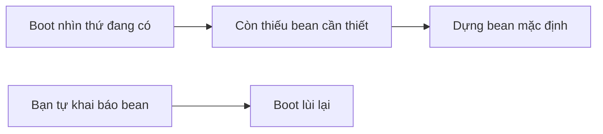
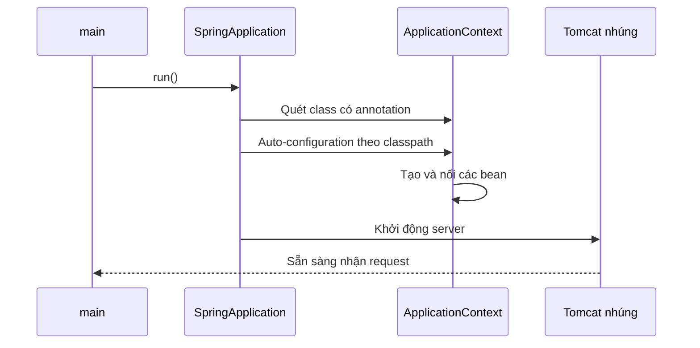
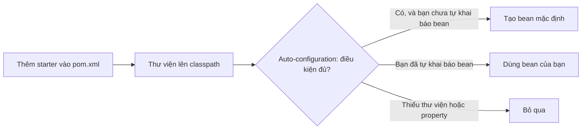

# Lý thuyết 1: Giới thiệu Spring Boot

> **Phiên bản (kiểm tra 2026-10-30):** bộ bài viết chính theo Spring Boot 3.x. Boot 3.5 đã hết hỗ trợ miễn phí từ 30/6/2026; dự án mới nên dùng Boot 4.1 (Framework 7, Jackson 3, Hibernate 7). Chỗ nào Boot 4 khác, xem [bài 38](/go?p=01-Spring-Boot%2Fhard%2Flt-38-boot4-framework7-thay-doi.md).

## Spring Boot là gì?

Spring Boot là lớp bọc bên ngoài framework Spring, giúp bạn dựng một ứng dụng Java chạy được trong vài phút thay vì vài ngày. Nó làm ba việc cho bạn: **tự cấu hình** những thứ hợp lý theo thư viện bạn đang dùng (auto-configuration), **gom thư viện theo gói dựng sẵn** (starter), và **nhúng sẵn server** như Tomcat vào ứng dụng để bạn chạy bằng một lệnh.

**Cốt lõi:** Spring thuần bắt bạn tự viết lại cùng một loạt cấu hình ở mỗi dự án. Boot nhìn vào những gì đang có (thư viện trên classpath, bean bạn đã khai báo) rồi dựng bean mặc định phù hợp, và bạn chỉ ghi đè chỗ muốn khác.

- Vì starter chỉ đưa thư viện lên classpath, nên bản thân nó không chứa logic nào.
- Vì auto-configuration kiểm tra điều kiện rồi mới tạo bean, nên thiếu thư viện hoặc property thì bean đơn giản không xuất hiện.
- Vì bean mặc định lùi lại khi bạn tự khai báo bean cùng kiểu, nên bạn thay được từng phần mà không sửa Boot.



Mô hình tư duy: Boot không hỏi bạn cần gì mà suy ra từ những gì đang có, và bean của bạn luôn được ưu tiên hơn bean mặc định.

**Tóm tắt:**

- Spring Boot không phải framework mới mà là lớp dựng sẵn cấu hình cho Spring, để chạy được ứng dụng chỉ với một lệnh.
- Ba thứ làm nên điều đó: auto-configuration, starter và embedded server như Tomcat.
- Triết lý convention over configuration: có mặc định hợp lý, bạn chỉ ghi đè chỗ muốn khác.
- Starter chỉ là gói dependency; auto-configuration mới là nơi kiểm tra điều kiện rồi tạo bean.
- Bean mặc định lùi lại khi bạn tự khai báo bean cùng kiểu (`@ConditionalOnMissingBean`).
- `@SpringBootApplication` gồm ba annotation, nên class chính phải ở package gốc để component scan thấy các package con.
- Cùng một property đặt ở nhiều nơi thì nguồn ưu tiên cao hơn thắng; command-line argument thắng tất cả.
- Boot 3 và Boot 4 đều cần Java 17 trở lên và dùng `jakarta.*` thay cho `javax.*`.

## Vấn đề nó giải quyết

Hãy hình dung bạn dựng một web app bằng Spring thuần. Bạn phải tự viết rất nhiều cấu hình (XML hoặc Java) để khai báo DispatcherServlet, DataSource, ObjectMapper, view resolver. Bạn phải tự chọn version cho từng thư viện sao cho chúng tương thích nhau, và nếu chọn sai thì gặp lỗi lạ lúc chạy (`NoSuchMethodError`, `ClassNotFoundException`). Cuối cùng bạn phải cài và cấu hình một server riêng để deploy file WAR. Mỗi project mới lặp lại đúng chừng đó việc.

Spring Boot giải quyết bằng triết lý **convention over configuration**: có thư viện web trên classpath thì Boot cho rằng bạn muốn làm web và dựng sẵn mọi thứ cần thiết; bạn chỉ ghi lại những chỗ muốn khác mặc định. Sản phẩm cuối là một file JAR duy nhất chứa cả server, chạy bằng `java -jar`.

## Khi nào dùng, khi nào không

Dùng khi làm REST API, web app, microservice, batch job; hầu như mọi project Spring mới hiện nay đều bắt đầu từ Boot. Cách làm: tạo project ở Spring Initializr (start.spring.io), chọn các starter cần dùng, viết code, chạy bằng `./mvnw spring-boot:run`. Muốn đổi hành vi mặc định thì ghi đè trong `application.yml` hoặc tự khai báo bean.

Boot ít hợp khi bạn cần một ứng dụng cực nhỏ với thời gian khởi động tính bằng mili giây và memory tối thiểu mà không dùng native image, hoặc khi bắt buộc deploy vào một application server có sẵn (vẫn làm được bằng WAR nhưng mất bớt lợi thế).

## Các khái niệm cần biết

- **Auto-configuration**: cơ chế Boot nhìn vào classpath (thư viện nào đang có), property và bean bạn đã khai báo, rồi tạo giúp các bean cần thiết. Ví dụ thấy `spring-webmvc` thì dựng DispatcherServlet; thấy driver H2 thì dựng DataSource. Nếu sai điều kiện, bean đơn giản là không được tạo và bạn gặp lỗi `NoSuchBeanDefinitionException`.
- **Starter**: một dependency "rỗng" chỉ kéo theo một nhóm thư viện đã được chọn version tương thích (ví dụ `spring-boot-starter-web` kéo Spring MVC, Jackson, Tomcat). Dùng để khỏi phải liệt kê từng thư viện.
- **Classpath**: tập hợp các JAR và thư mục mà JVM nhìn thấy lúc chạy. Auto-configuration dựa vào nó để quyết định bật gì.
- **Fat JAR**: một file JAR chứa code của bạn cùng mọi dependency và server, chạy được độc lập bằng `java -jar`.
- **BOM (Bill of Materials)**: danh sách version đã được kiểm chứng tương thích, Boot dùng để bạn khỏi ghi version cho từng thư viện.
- **ApplicationContext**: "kho" chứa mọi bean của ứng dụng, được tạo lúc khởi động. Chi tiết ở [IoC và DI](/go?p=01-Spring-Boot%2Feasy%2Flt-02-ioc-di.md).

## Flowchart: ứng dụng khởi động

Điều đầu tiên nên hiểu là chuyện gì xảy ra khi bạn gọi `SpringApplication.run`. Sơ đồ dưới đây là trình tự rút gọn.



Đọc sơ đồ: `run()` tạo `ApplicationContext`, quét các class có annotation (`@Component`, `@Service`...), áp dụng auto-configuration theo classpath, tạo và nối các bean với nhau, rồi cuối cùng mới khởi động Tomcat nhúng để nhận request. Vì server được bật sau cùng, nếu một bean lỗi thì ứng dụng dừng ngay lúc khởi động chứ không chạy dở.

## Cấu trúc project

```text
src/main/java/com/example/demo/
├── DemoApplication.java      # điểm khởi chạy
├── controller/               # nhận request
├── service/                  # nghiệp vụ
└── repository/               # truy cập dữ liệu
src/main/resources/
└── application.yml           # cấu hình
```

## Điểm khởi chạy

```java
@SpringBootApplication
public class DemoApplication {
    public static void main(String[] args) {
        SpringApplication.run(DemoApplication.class, args);
    }
}
```

`@SpringBootApplication` gồm ba thứ: `@Configuration` (class này có thể khai báo bean), `@EnableAutoConfiguration` (bật auto-configuration) và `@ComponentScan` (quét class có annotation trong package này và các package con). Hệ quả thực tế: đặt class chính ở package gốc (ví dụ `com.example.demo`) để các package con được quét; đặt ở chỗ khác thì bean ở package ngoài phạm vi sẽ không được tìm thấy.

**Phải thuộc:** `@SpringBootApplication` = `@Configuration` + `@EnableAutoConfiguration` + `@ComponentScan`. Component scan chỉ quét package của class chính và các package con của nó.

## Starter hay dùng

Mỗi starter tương ứng một nhóm tính năng. Chỉ thêm starter khi bạn thực sự cần, vì mỗi starter kéo theo thư viện và bật thêm auto-configuration.

| Starter | Dùng cho |
|---|---|
| `spring-boot-starter-web` | REST API, Tomcat nhúng |
| `spring-boot-starter-data-jpa` | Truy cập DB bằng JPA |
| `spring-boot-starter-validation` | Bean Validation |
| `spring-boot-starter-security` | Bảo mật |
| `spring-boot-starter-test` | JUnit, Mockito, MockMvc |
| `spring-boot-starter-actuator` | Health check, metric |

## Project tối thiểu chạy được

Hãy xem một project nhỏ nhất. Điểm đáng chú ý là thẻ `parent`: nó chốt version cho mọi starter nên các dependency bên dưới không cần ghi version.

```xml
<!-- pom.xml: parent quản lý version cho mọi starter, không cần ghi version -->
<parent>
    <groupId>org.springframework.boot</groupId>
    <artifactId>spring-boot-starter-parent</artifactId>
    <version>3.3.5</version>
</parent>

<properties>
    <java.version>17</java.version>
</properties>

<dependencies>
    <dependency>
        <groupId>org.springframework.boot</groupId>
        <artifactId>spring-boot-starter-web</artifactId>
    </dependency>
    <dependency>
        <groupId>org.springframework.boot</groupId>
        <artifactId>spring-boot-starter-test</artifactId>
        <scope>test</scope>
    </dependency>
</dependencies>

<build>
    <plugins>
        <!-- đóng gói fat JAR: java -jar target/demo.jar -->
        <plugin>
            <groupId>org.springframework.boot</groupId>
            <artifactId>spring-boot-maven-plugin</artifactId>
        </plugin>
    </plugins>
</build>
```

```yaml
# application.yml: chỉ ghi đè thứ khác mặc định
server:
  port: 8081
spring:
  application:
    name: demo
```

```bash
./mvnw spring-boot:run          # chạy khi phát triển
./mvnw package && java -jar target/demo-0.0.1-SNAPSHOT.jar   # chạy như production
```

## Starter và auto-configuration: ai làm gì

| Thành phần | Vai trò |
|---|---|
| Starter | Chỉ là **gói dependency** (kéo thư viện về classpath), không chứa logic |
| Auto-configuration | Class `@AutoConfiguration` kiểm tra **điều kiện** rồi mới tạo bean |
| `spring-boot-starter-parent` / BOM | Chốt version các thư viện tương thích nhau |

**Nền tảng:** Spring Boot không phải một framework mới mà là cách dựng sẵn cấu hình cho Spring theo điều kiện. Starter đưa thư viện lên classpath, auto-configuration thấy thư viện đó (và thấy bạn chưa tự khai báo bean) thì mới dựng bean mặc định. Hiểu chuỗi "classpath, điều kiện, bean mặc định có thể bị ghi đè" là hiểu gần hết hành vi của Boot.



Đọc sơ đồ: auto-configuration không tạo bean vô điều kiện. Nó kiểm tra điều kiện (có class trên classpath không, bạn đã có bean cùng kiểu chưa, property có bật không) rồi mới quyết định. Đây là lý do cùng một Boot nhưng ứng dụng này có web còn ứng dụng kia thì không.

**Suy luận:** Vì Spring phục vụ hàng nghìn kiểu ứng dụng khác nhau, Boot không thể biết trước bạn cần gì, nên nó chọn cách nhìn vào những gì đang có thay vì hỏi bạn. Thứ đầu tiên nó thấy được là classpath, vì classpath là kết quả trực tiếp của việc bạn chọn starter; do đó starter chỉ cần kéo thư viện về là đủ "bật" tính năng, không cần chứa logic nào. Nhưng chỉ nhìn classpath thì chưa đủ: nếu Boot vẫn tạo bean mặc định khi bạn đã tự khai báo một bean cùng kiểu thì sẽ có hai bean, nên mọi bean mặc định phải gắn điều kiện "chỉ tạo khi bạn chưa có" (`@ConditionalOnMissingBean`). Từ đó suy ra thứ tự đánh giá quan trọng: auto-configuration phải được xét sau khi bean của bạn đã đăng ký thì mới biết bạn đã khai báo hay chưa. Điểm dễ nhầm là nghĩ "thêm starter là xong"; thực tế starter chỉ đưa thư viện lên classpath, còn bean có tồn tại hay không do điều kiện quyết định, nên thiếu một property hoặc một class điều kiện là bean đơn giản biến mất và chỉ báo lỗi khi có nơi cần nó. Ngược lại, tự khai báo bean để "chỉnh nhẹ" lại thay thế hoàn toàn bản mặc định và làm mất các thiết lập kèm theo. Hệ quả hành động: khi bean "biến mất" hoặc cấu hình "không ăn", chạy với `--debug` để xem điều kiện nào fail trước khi đoán; muốn chỉnh nhẹ thì ưu tiên property hoặc customizer, chỉ tự khai báo bean khi muốn thay hẳn.

## Auto-configuration lùi lại khi bạn tự khai báo

Bean tự cấu hình thường gắn `@ConditionalOnMissingBean`: bạn khai báo bean cùng kiểu thì bản mặc định **không được tạo**.

```java
@Configuration
public class JsonConfig {
    // Boot đã có ObjectMapper mặc định; bean này thay thế hoàn toàn bản đó
    @Bean
    public ObjectMapper objectMapper() {
        return new ObjectMapper().findAndRegisterModules();
    }
}
```

Dùng cách này khi bạn muốn thay hẳn một thành phần; không dùng khi chỉ muốn chỉnh nhẹ, vì bạn sẽ mất các thiết lập mặc định còn lại. Hệ quả hay bị hỏi: tự khai báo `ObjectMapper` làm mất các tùy chỉnh `spring.jackson.*`. Muốn chỉnh nhẹ thì dùng property hoặc bean `Jackson2ObjectMapperBuilderCustomizer`. Cơ chế điều kiện chi tiết ở [Auto-configuration](/go?p=01-Spring-Boot%2Fmedium%2Flt-14-autoconfiguration.md), quá trình khởi động ở [Spring khởi động bên trong](/go?p=01-Spring-Boot%2Fhard%2Flt-30-spring-khoi-dong-application-context.md).

## Thứ tự ưu tiên cấu hình (từ thấp lên cao)

Cùng một property có thể được đặt ở nhiều nơi. Khi trùng, nguồn nằm thấp hơn trong bảng bị nguồn cao hơn ghi đè. Nếu bạn đặt `server.port` trong file mà ứng dụng vẫn chạy port khác, hãy nghĩ ngay tới environment variable hoặc command-line argument.

| Nguồn | Ghi chú |
|---|---|
| Mặc định của Boot | Trong auto-configuration |
| `application.yml` trong JAR | Cấu hình gói kèm |
| `application-{profile}.yml` | Ghi đè theo profile |
| Environment variable | `SERVER_PORT=9000` |
| Command-line argument | `--server.port=9000`, thắng tất cả ở trên |

**Phải thuộc:** thứ tự ưu tiên từ thấp lên cao: mặc định của Boot, `application.yml`, `application-{profile}.yml`, environment variable, command-line argument (`--key=value`) thắng tất cả. Đây là rút gọn; danh sách đầy đủ có thêm nhiều nguồn khác (ví dụ `@TestPropertySource`, system property), xem tài liệu chính thức theo phiên bản.

Chi tiết xem [Config và Profile](/go?p=01-Spring-Boot%2Feasy%2Flt-11-config-profile.md).

## Lưu ý

- Dùng Java 17 trở lên với Spring Boot 3.
- Spring Boot 3 dùng `jakarta.*` thay cho `javax.*`.
- Xem auto-configuration đã bật gì: chạy với `--debug`.

## Phỏng vấn khó: chuỗi hỏi xoáy

Người phỏng vấn senior thường mở bằng câu dễ rồi xoáy xuống cơ chế, đánh đổi và sự cố thật. Câu trả lời tốt luôn đi từ cốt lõi xuống.

### Chuỗi 1: Auto-configuration và starter

1. **Câu mở:** Spring Boot "tự cấu hình" nghĩa là gì, và starter có làm việc đó không?
2. **Xoáy 1:** Boot biết lúc nào nên dựng `DataSource`, và vì sao bạn khai báo bean cùng kiểu thì bản mặc định không xuất hiện?
3. **Xoáy 2:** Bạn tự khai báo `ObjectMapper` để chỉnh một thiết lập nhỏ, rồi các `spring.jackson.*` hết tác dụng. Vì sao, và nên sửa thế nào?

**Đáp án ngắn:** Auto-configuration là các class kiểm tra điều kiện rồi mới tạo bean mặc định. Starter chỉ là gói dependency kéo thư viện lên classpath, không chứa logic nào. Boot nhìn classpath, property và các bean bạn đã khai báo; thấy driver H2 mà chưa có `DataSource` thì dựng bản mặc định. Bean mặc định gắn `@ConditionalOnMissingBean`, nên bean cùng kiểu của bạn khiến nó lùi lại. Đổi lại, bean của bạn thay hẳn bản mặc định chứ không cộng thêm, nên tự khai báo `ObjectMapper` làm mất các thiết lập `spring.jackson.*` kèm theo. Muốn chỉnh nhẹ thì dùng property hoặc một customizer của builder (tên cụ thể đổi ở Boot 4 vì Jackson 3, kiểm tra lại theo phiên bản). Khi bean "biến mất" hay cấu hình "không ăn", chạy với `--debug` để xem điều kiện nào fail trước khi đoán.

**Sai lầm hay gặp:**
- Nói "thêm starter là có tính năng" mà không nhắc điều kiện; thiếu property hay class điều kiện thì bean đơn giản không xuất hiện.
- Nhầm starter (gói dependency) với auto-configuration (nơi kiểm tra điều kiện và tạo bean).
- Tự khai báo bean để "chỉnh nhẹ" rồi ngạc nhiên vì mất cấu hình mặc định.

### Chuỗi 2: `@SpringBootApplication`, component scan và lúc khởi động

1. **Câu mở:** `@SpringBootApplication` gồm những gì?
2. **Xoáy 1:** Class chính ở `com.example.demo.app` còn controller ở `com.example.demo.web`. Chuyện gì xảy ra, và vì sao?
3. **Xoáy 2:** Từ `SpringApplication.run` tới lúc nhận request có những bước nào, và một bean lỗi thì ứng dụng ở trạng thái gì?

**Đáp án ngắn:** Nó gộp ba thứ: `@Configuration`, `@EnableAutoConfiguration` và `@ComponentScan`. Component scan chỉ quét package của class chính và các package con của nó. Ở ví dụ trên, `web` không nằm dưới `app` nên controller không được quét, và bạn gặp lỗi kiểu không tìm thấy bean hoặc endpoint trả 404 dù code đúng. Cách sửa gọn nhất là đặt class chính ở package gốc. Khi chạy, `run()` tạo `ApplicationContext`, quét class, áp auto-configuration theo classpath, tạo và nối bean, rồi cuối cùng mới bật Tomcat nhúng. Vì server bật sau cùng, một bean lỗi làm ứng dụng dừng ngay lúc khởi động chứ không chạy dở. Đó là điều tốt: lỗi lộ ở lúc deploy thay vì lúc có người dùng thật.

**Sai lầm hay gặp:**
- Chỉ đọc thuộc "ba annotation" mà không nói được hệ quả về package gốc.
- Nghĩ Tomcat chạy trước rồi bean mới được nạp dần.
- Gặp bean không inject được thì thêm `@ComponentScan` bừa thay vì kiểm tra vị trí class chính.

