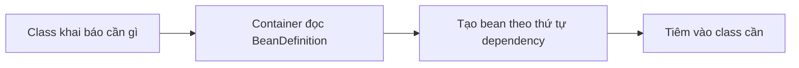
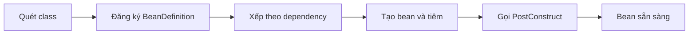
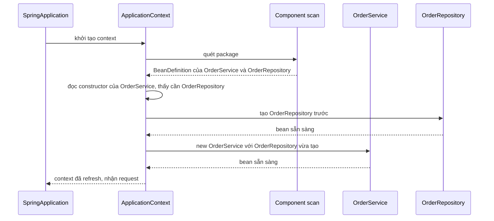
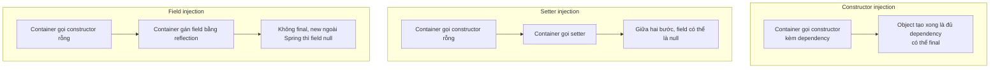
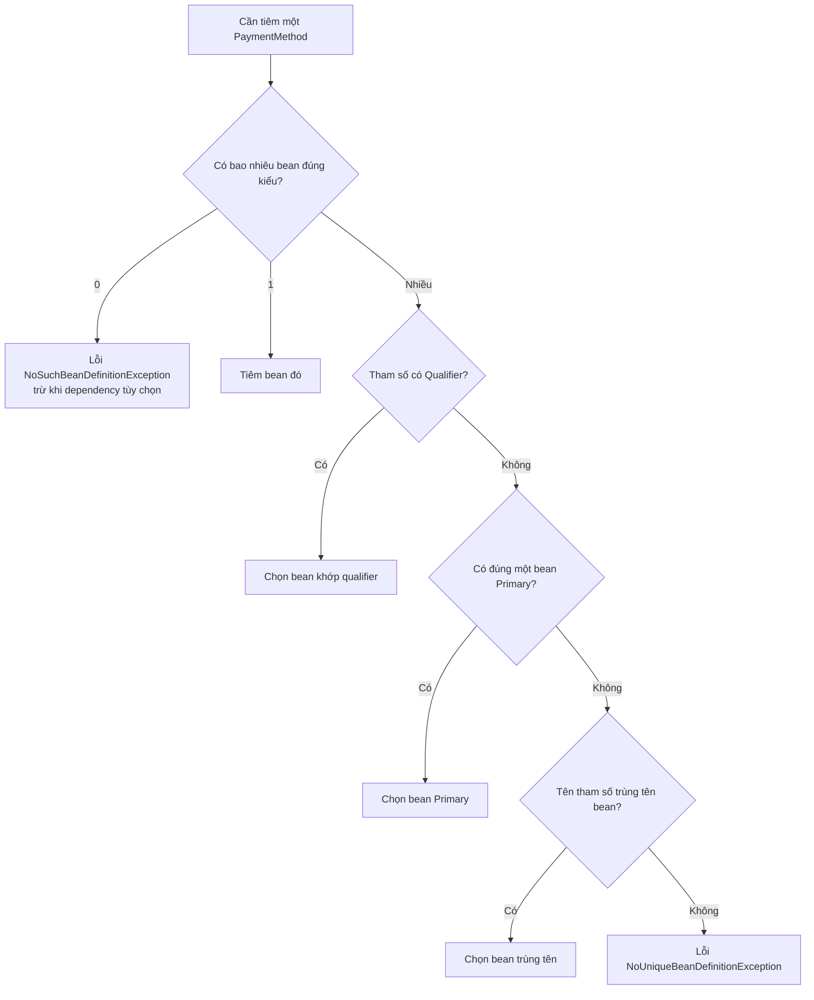
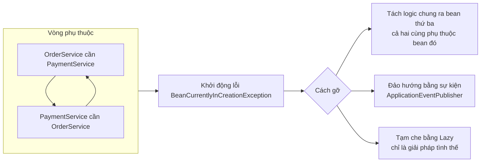

# Lý thuyết 2: IoC, Dependency Injection và Bean

## IoC, DI và bean là gì?

Bình thường, khi class `OrderService` cần `OrderRepository`, bạn tự viết `new OrderRepository()` bên trong nó. Với **IoC (Inversion of Control)**, bạn không `new` nữa: một **Spring container** tạo các object và quản lý chúng, những object đó gọi là **bean**. **DI (Dependency Injection)** là cách container thực hiện việc đó: nó tự đưa các bean mà một class cần vào cho class đó, ví dụ truyền `OrderRepository` vào constructor của `OrderService`. Hình dung nhà hàng: đầu bếp (service) không tự đi chợ mua nguyên liệu (repository); có người quản lý (container) mua và đưa tận tay.

**Cốt lõi:** Class của bạn chỉ khai báo nó cần gì, còn container đọc bản mô tả, tạo bean theo thứ tự dependency rồi nối chúng lại. Toàn bộ Spring (AOP, transaction, security) đều móc vào hai bước này.

- Vì chữ ký constructor cho container biết bean cần gì, nên nó sắp được thứ tự tạo và báo lỗi ngay lúc khởi động khi thiếu bean.
- Vì container đọc `BeanDefinition` trước khi tạo bean thật, nên Spring có chỗ để chen thêm hành vi vào giữa.
- Vì singleton chỉ được tạo và tiêm một lần, nên nó dùng chung giữa mọi thread và bean scope hẹp tiêm vào sẽ bị đóng băng.



Mô hình tư duy: bạn mô tả nhu cầu, container quyết định tạo gì, khi nào và nối với ai.

**Tóm tắt:**

- IoC: bạn không tự `new` dependency, container tạo và quản lý các object gọi là bean; DI là cách container đưa chúng vào.
- Container đọc `BeanDefinition` trước rồi mới tạo bean và inject; thiếu bean thì lỗi ngay lúc khởi động.
- Nên dùng constructor injection: có `final`, test chỉ cần `new`; tránh field injection.
- `@Component` cho class bạn viết, `@Bean` cho class thư viện hoặc khi cần logic dựng object.
- Nhiều bean cùng kiểu: chọn bằng `@Primary`, `@Qualifier`, hoặc inject `List`/`Map` để làm strategy.
- Scope mặc định là singleton, dùng chung giữa mọi thread nên không giữ state thay đổi.
- Tiêm bean scope hẹp (prototype, request) vào singleton phải qua scoped proxy hoặc `ObjectProvider`.
- Circular dependency báo lỗi lúc khởi động; sửa bằng thiết kế lại, không che bằng `@Lazy`.

## Vấn đề nó giải quyết

Nếu tự `new` bên trong class thì class dính chặt với một cài đặt cụ thể. Muốn test thì không thay được repository thật bằng object giả (mock) mà phải sửa code; muốn đổi từ MySQL sang PostgreSQL thì phải tìm mọi chỗ `new` để sửa. Khi để container lo, bạn chỉ cần đổi bean được cung cấp, class dùng nó không phải đụng tới.

## Khi nào dùng, khi nào không

Gần như mọi lúc trong Spring: controller dùng service, service dùng repository. Object đơn giản không có dependency (DTO, value object, entity) thì cứ `new` bình thường, không cần làm bean; biến chúng thành bean chỉ tốn công và dễ gây nhầm về scope. Cách làm: đánh dấu class bằng `@Component`, `@Service`, `@Repository`, `@Controller` để Spring quản lý, và nhận dependency qua constructor, cách rõ ràng nhất và test dễ nhất.

## Các khái niệm cần biết

- **Container (`ApplicationContext`)**: object giữ toàn bộ bean và biết cách tạo, nối chúng. `BeanFactory` là phiên bản tối giản của nó; thực tế bạn luôn làm việc với `ApplicationContext`.
- **`BeanDefinition`**: bản mô tả "công thức" tạo một bean (class nào, scope gì, dependency gì). Container đọc các bản mô tả này trước, rồi mới tạo bean thật.
- **Stereotype annotation** (`@Component`, `@Service`, `@Repository`, `@Controller`): các annotation đánh dấu "class này là bean". Chúng gần như giống nhau về cơ chế; khác nhau ở ý nghĩa vai trò (và `@Repository` còn dịch lỗi persistence sang exception của Spring).
- **Component scan**: Spring duyệt các package để tìm class có stereotype annotation và đăng ký thành bean.
- **Scope**: phạm vi sống của bean (một cho cả ứng dụng, một mỗi request...). Chọn sai scope gây lỗi state dùng chung giữa các thread.
- **`@Qualifier` và `@Primary`**: cách chọn bean cụ thể khi có nhiều bean cùng kiểu, nếu không Spring báo `NoUniqueBeanDefinitionException`.
- **Circular dependency**: A cần B và B cần A, nên không bên nào tạo xong trước.

## Flowchart: container tạo bean

Trước khi tiêm được gì, container phải biết có những bean nào và thứ tự tạo. Sơ đồ dưới đây là trình tự khi khởi động.



Đọc sơ đồ: container quét class và ghi lại `BeanDefinition`, sắp xếp theo dependency (bean nào cần bean nào phải tạo sau), rồi tạo bean và tiêm các dependency vào, gọi `@PostConstruct`, và bean sẵn sàng. Vì mọi dependency được giải quyết lúc khởi động, thiếu bean thì ứng dụng báo lỗi ngay chứ không đợi tới lúc có request.

Cùng quá trình đó nhìn theo thời gian, với các bên tham gia cụ thể:



Đọc từ trên xuống: container chưa tạo gì cho tới khi quét xong và có đủ `BeanDefinition`. Khi tạo `OrderService`, nó nhìn chữ ký constructor để biết cần bean nào, tạo bean phụ thuộc trước, rồi mới gọi constructor của bean chính. Thứ tự tạo vì vậy do đồ thị dependency quyết định, không do thứ tự bạn viết class.

**Nền tảng:** IoC nghĩa là code của bạn không tự tạo và nối object nữa mà giao cho container. Container làm hai bước: đọc `BeanDefinition` (công thức), sau đó mới tạo bean thật và tiêm dependency. Toàn bộ Spring (AOP, transaction, security) đều móc vào hai bước này.

## Constructor injection (nên dùng)

Vấn đề đặt ra: có ba cách nhận dependency (constructor, setter, field). Hãy bắt đầu với cách nên dùng.

```java
@Service
public class OrderService {
    private final OrderRepository repository;

    public OrderService(OrderRepository repository) {
        this.repository = repository;
    }
}
```

Một constructor duy nhất thì không cần `@Autowired`. Dùng `final` để bean immutable và dễ test.

## Khai báo bean thủ công

```java
@Configuration
public class AppConfig {
    @Bean
    public Clock clock() {
        return Clock.systemUTC();
    }
}
```

Dùng khi bean đến từ thư viện ngoài (bạn không sửa được code để gắn `@Component`) hoặc khi cần logic để dựng object. Nếu class do bạn viết và dựng đơn giản thì dùng `@Component` cho gọn.

## So sánh ba kiểu injection

| Kiểu | Ví dụ | Đánh giá |
|---|---|---|
| Constructor | `public A(B b)` | Nên dùng: `final`, thiếu bean thì lỗi lúc khởi động, test chỉ cần `new A(mockB)` |
| Setter | `@Autowired void setB(B b)` | Dành cho dependency tùy chọn, có thể đổi sau |
| Field | `@Autowired private B b;` | Tránh: không `final`, không `new` được ngoài Spring, che giấu số lượng dependency |

Ba kiểu khác nhau ở thời điểm dependency được gán vào object:



Đọc sơ đồ: chỉ nhánh constructor cho object đầy đủ ngay khi tồn tại, nên đó là lý do nên chọn nó. Hai nhánh còn lại có một khoảng object đã tạo nhưng chưa đủ dependency.

Hệ quả thực tế của field injection: bạn viết `new OrderService()` trong test thì trường `repository` là `null` và test nổ `NullPointerException`, buộc phải khởi động cả Spring hoặc dùng reflection. Mẹo: constructor có quá nhiều tham số (trên 4-5) là dấu hiệu class làm quá nhiều việc.

**Suy luận:** Container tạo mọi bean lúc khởi động và phải biết trước bean nào cần bean nào, nên cách tự nhiên nhất để một class khai báo nhu cầu của mình là chữ ký constructor: constructor buộc mọi dependency phải có thì object mới tồn tại. Nhờ vậy container dựng được đồ thị dependency, sắp thứ tự tạo, và báo lỗi ngay khi thiếu bean thay vì đợi tới request đầu tiên. Cũng vì object chỉ tồn tại khi đủ dependency nên khai báo được `final`, bean immutable và không có trạng thái nửa vời. Field injection thì ngược lại: object được tạo bằng constructor rỗng trước, rồi container dùng reflection gán field, nên có một khoảng thời gian field là `null` và class không thể `final`. Điểm dễ nhầm là thấy field injection ngắn gọn nên coi là tương đương; thực ra nó che giấu số lượng dependency (class có 10 dependency vẫn trông gọn) và buộc test phải khởi động Spring. Hệ quả hành động: khi review, thấy `@Autowired` trên field thì đề nghị chuyển sang constructor; thấy constructor quá 4-5 tham số thì coi đó là tín hiệu tách class, đừng quay lại field injection để "cho gọn".

**Phải thuộc:** ba kiểu injection là constructor, setter, field. Nên dùng constructor (có `final`, thiếu bean thì lỗi ngay lúc khởi động, test chỉ cần `new`); class chỉ có một constructor thì không cần `@Autowired`.

## `@Component` và `@Bean`

| | `@Component` (và `@Service`...) | `@Bean` |
|---|---|---|
| Gắn ở | Class | Method trong `@Configuration` |
| Phát hiện bằng | Quét class (`@ComponentScan`) | Chạy method khi tạo bean |
| Dùng khi | Class do bạn viết | Class thư viện, hoặc cần logic dựng object |
| Tên bean mặc định | Tên class viết thường chữ đầu | Tên method |

## Tiêm nhiều bean cùng kiểu

Vấn đề đặt ra: có hai cách thanh toán `CardPayment` và `MomoPayment`, cùng implements một interface. Tiêm `PaymentMethod` đơn lẻ sẽ gây lỗi mơ hồ, nhưng tiêm `Map` hoặc `List` thì Spring đưa vào tất cả.

```java
public interface PaymentMethod { String code(); void pay(long amount); }

@Component class CardPayment implements PaymentMethod { /* code() trả "CARD" */ 
    public String code() { return "CARD"; } public void pay(long a) { } }
@Component class MomoPayment implements PaymentMethod { 
    public String code() { return "MOMO"; } public void pay(long a) { } }

@Service
public class PaymentService {
    private final Map<String, PaymentMethod> byBeanName;
    private final List<PaymentMethod> all;

    // Spring tiêm Map (key là tên bean) và List (mọi bean cùng kiểu)
    public PaymentService(Map<String, PaymentMethod> byBeanName, List<PaymentMethod> all) {
        this.byBeanName = byBeanName;
        this.all = all;
    }

    public void pay(String beanName, long amount) {
        byBeanName.get(beanName).pay(amount);   // "cardPayment" hoặc "momoPayment"
    }
}
```

Đây là cách làm strategy pattern không cần `if/else`. Chọn một bean cụ thể: `@Qualifier("momoPayment")` ở tham số, hoặc `@Primary` ở bean mặc định.

Khi tiêm một `PaymentMethod` đơn lẻ, Spring chọn ứng viên theo thứ tự sau:



Đọc sơ đồ: Spring lọc theo kiểu trước, nếu còn nhiều ứng viên thì xét `@Qualifier`, rồi `@Primary`, cuối cùng mới dùng tên tham số khớp tên bean làm phương án dự phòng. Không còn cách nào phân biệt thì khởi động thất bại. Thứ tự chi tiết giữa các bước này nên kiểm tra lại với tài liệu phiên bản bạn dùng; quy tắc thực hành là khai báo tường minh bằng `@Qualifier` hoặc `@Primary` thay vì dựa vào tên tham số.

## Test không cần Spring

Lợi ích rõ nhất của constructor injection là bạn test class mà không cần khởi động container.

```java
class OrderServiceTest {
    @Test
    void createUsesRepository() {
        OrderRepository repo = org.mockito.Mockito.mock(OrderRepository.class);
        // constructor injection: chỉ cần new
        OrderService service = new OrderService(repo);
        // ... gọi service, verify repo
    }
}
```

## Scope

Mặc định mọi bean là singleton: cả ứng dụng dùng chung một instance. Điều này nhanh và gọn, nhưng đồng nghĩa nhiều thread xử lý request cùng gọi một object. Chỉ dùng scope khác khi bean thực sự cần state riêng.

| Scope | Ý nghĩa |
|---|---|
| `singleton` (mặc định) | Một instance cho cả container |
| `prototype` | Mỗi lần lấy tạo instance mới |
| `request` | Một instance mỗi HTTP request |
| `session` | Một instance mỗi phiên HTTP (chỉ trong ứng dụng web) |

**Phải thuộc:** scope mặc định là `singleton` (một instance cho cả container, dùng chung giữa mọi thread nên không giữ state thay đổi được). Các scope khác: `prototype`, `request`, `session` (và `application`, `websocket`). Bean singleton chỉ được tiêm một lần, nên tiêm bean scope hẹp vào nó phải qua scoped proxy hoặc `ObjectProvider`.

**Suy luận:** Spring chọn singleton làm mặc định vì phần lớn bean (service, repository) không giữ dữ liệu riêng của từng lần gọi, nên tạo một instance rồi dùng chung vừa tiết kiệm memory vừa nhanh. Nhưng vì chỉ có một instance mà web server xử lý nhiều request bằng nhiều thread, mọi thread đều đi qua cùng một object, nên bất kỳ field nào có thể thay đổi trong bean đó đều là dữ liệu dùng chung và dễ gây race condition. Singleton cũng chỉ được tạo và inject dependency một lần lúc khởi động, nên bean scope hẹp (prototype, request) được tiêm vào sẽ bị "đóng băng" ở instance đầu tiên, và với `request` thì lúc đó chưa có request nào nên báo lỗi scope không active. Điểm dễ nhầm là tưởng gắn `@Scope("prototype")` lên bean con là đủ, trong khi scope chỉ có tác dụng ở thời điểm container tạo bean, không phải ở thời điểm bạn gọi method. Mọi cách giải quyết đều cùng một ý: đừng tiêm instance, hãy tiêm thứ lấy được instance đúng lúc, tức proxy (tự tìm instance của request hiện tại mỗi lần gọi) hoặc `ObjectProvider` (bạn chủ động hỏi). Hệ quả hành động: bean singleton không giữ state thay đổi; cần state theo request thì để trong bean scope hẹp và truy cập qua proxy hoặc `ObjectProvider`.

### Bẫy: prototype bên trong singleton

Hiện tượng: bạn kỳ vọng mỗi lần dùng có instance mới, nhưng dữ liệu của lần gọi trước vẫn còn, vì instance chỉ được tiêm một lần.

Singleton chỉ được tiêm **một lần** lúc tạo, nên bean `prototype` bên trong thực chất cũng chỉ có một instance.

```java
@Component @Scope("prototype")
class ReportBuilder { /* có state */ }

@Service
class ReportService {
    private final ObjectProvider<ReportBuilder> builders;

    ReportService(ObjectProvider<ReportBuilder> builders) { this.builders = builders; }

    String run() {
        ReportBuilder b = builders.getObject();   // mỗi lần gọi lấy instance mới
        return b.toString();
    }
}
```

Cách khác: `@Scope(value = "prototype", proxyMode = ScopedProxyMode.TARGET_CLASS)`. Quy tắc này cũng áp dụng cho `request` scope được tiêm vào singleton (cần scoped proxy hoặc `ObjectProvider`).

Circular dependency thường biểu hiện bằng lỗi `BeanCurrentlyInCreationException` khi khởi động (Spring Boot 2.6 trở lên mặc định cấm circular dependency). Sơ đồ vòng phụ thuộc và các cách gỡ:



Đọc sơ đồ: A cần B để dựng xong, B lại cần A, nên không bên nào tạo xong trước. Cách gỡ bền vững là sửa thiết kế (tách bean thứ ba hoặc dùng sự kiện); `@Lazy` chỉ hoãn vấn đề và che giấu thiết kế sai.

Lifecycle chi tiết ở [Bean lifecycle](/go?p=01-Spring-Boot%2Feasy%2Flt-10-bean-lifecycle.md); circular dependency và cache ba tầng ở [lt-30](/go?p=01-Spring-Boot%2Fhard%2Flt-30-spring-khoi-dong-application-context.md).

## Scope web, ObjectProvider và scoped proxy

Bảng Scope ở trên liệt kê `request` và `session`, nhưng chưa nói cách dùng chúng khi tiêm vào singleton. Đây là chỗ hay gặp lỗi khởi động. Dùng scope web khi bean mang dữ liệu gắn với một request (ngữ cảnh người dùng, mã theo dõi) hoặc một phiên đăng nhập. Ứng dụng REST stateless thường tránh `session` và giữ dữ liệu ở token hoặc database.

- **`request` scope**: một instance mỗi HTTP request, hết request là bỏ. Annotation tiện lợi: `@RequestScope`.
- **`session` scope**: một instance mỗi `HttpSession`. Annotation: `@SessionScope`. Dữ liệu sống theo phiên, nên cần chú ý khi chạy nhiều server (phải chia sẻ session).
- **Scoped proxy**: Spring tiêm vào singleton một **proxy**. Mỗi lần gọi method, proxy tìm đúng instance của request hiện tại rồi chuyển call tới đó.
- **`ObjectProvider<T>`**: "nhà cung cấp" bean, hỏi lúc cần chứ không tiêm sẵn. Các method hay dùng: `getObject()` (bắt buộc có), `getIfAvailable()` (có thể `null`), `getIfUnique()`, `ifAvailable(consumer)`, `stream()`.

Vấn đề: singleton `AuditService` tạo một lần lúc khởi động, lúc đó không có request nào, nên không thể tiêm trực tiếp bean `request` (sẽ lỗi `Scope 'request' is not active`). Hai lối ra: tiêm proxy, hoặc tiêm `ObjectProvider` và lấy khi cần.

_Minh họa_:

```java
@Component
@RequestScope                       // đã gồm proxyMode TARGET_CLASS
class RequestContext {
    private String traceId;
    String traceId() { return traceId; }
    void setTraceId(String id) { this.traceId = id; }
}

@Service
class AuditService {
    private final RequestContext context;                 // thực chất là proxy
    private final ObjectProvider<PdfRenderer> renderers;  // lấy lúc cần

    AuditService(RequestContext context, ObjectProvider<PdfRenderer> renderers) {
        this.context = context;
        this.renderers = renderers;
    }

    void record(String action) {
        // proxy chọn instance của request hiện tại
        log.info("{} traceId={}", action, context.traceId());
        // bean tùy chọn, không có cũng không lỗi
        renderers.ifAvailable(r -> r.render(action));
    }
}
```

| Cách | Khi nào dùng |
|---|---|
| Scoped proxy (`@RequestScope`, `@SessionScope`) | Bean thuộc scope hẹp được nhiều singleton dùng, muốn code đọc như bean thường |
| `ObjectProvider.getObject()` | Cần instance mới mỗi lần (prototype) hoặc muốn lấy tường minh |
| `ObjectProvider.getIfAvailable()` | Dependency tùy chọn (bean có thể không tồn tại) |
| `ObjectProvider.stream()` / `orderedStream()` | Duyệt mọi bean cùng kiểu theo thứ tự `@Order` |

### Bẫy thường gặp

| Bẫy | Hệ quả |
|---|---|
| Tiêm bean `request` vào singleton mà không có proxy | Lỗi lúc khởi động hoặc lúc gọi: scope không hoạt động |
| Gọi bean scoped từ thread khác (`@Async`, `@Scheduled`, thread pool tự tạo) | `IllegalStateException`, không có request gắn với thread đó vì ngữ cảnh lưu theo thread |
| Class của bean scoped là `final` hoặc không có constructor phù hợp | Không tạo được proxy bằng CGLIB |
| Đưa dữ liệu thay đổi vào `session` scope mà không đồng bộ | Hai tab cùng phiên ghi đè nhau; dữ liệu `session` cần `Serializable` nếu session được lưu ngoài memory |
| Dùng `session` để thay cho database | Khó scale ngang, mất khi server khởi động lại |

## Lưu ý

- Bean singleton dùng chung giữa nhiều thread: không giữ state có thể thay đổi.
- Circular dependency (A cần B, B cần A) gây lỗi khi khởi động: thiết kế lại thay vì dùng `@Lazy`.
- Có nhiều bean cùng kiểu: dùng `@Primary` hoặc `@Qualifier("tên")`.

## Phỏng vấn khó: chuỗi hỏi xoáy

Người phỏng vấn senior thường mở bằng câu dễ rồi xoáy xuống cơ chế, đánh đổi và sự cố thật. Câu trả lời tốt luôn đi từ cốt lõi xuống.

### Chuỗi 1: Constructor injection và vòng phụ thuộc

1. **Câu mở:** Vì sao nên dùng constructor injection thay vì field injection?
2. **Xoáy 1:** Container nhìn constructor thì biết gì, và thiếu một bean thì phát hiện lúc nào?
3. **Xoáy 2:** `OrderService` cần `PaymentService`, `PaymentService` lại cần `OrderService`, cả hai dùng constructor. Chuyện gì xảy ra và bạn xử lý ra sao?

**Đáp án ngắn:** Constructor buộc mọi dependency phải có thì object mới tồn tại, nên bean đầy đủ ngay khi sinh ra và khai báo được `final`. Chữ ký constructor cho container biết bean cần gì, nhờ đó nó dựng đồ thị dependency, tạo bean phụ thuộc trước, và thiếu bean thì lỗi ngay lúc khởi động chứ không đợi request đầu tiên. Field injection thì object sinh ra bằng constructor rỗng rồi mới gán bằng reflection; `new` ngoài Spring thì field là `null`, test phải dựng cả Spring. Với vòng phụ thuộc, A cần B để dựng xong còn B cần A, nên không bên nào tạo xong trước; ứng dụng báo `BeanCurrentlyInCreationException` khi khởi động, và từ Boot 2.6 mặc định cấm vòng này. Cách gỡ bền vững là tách logic chung ra bean thứ ba hoặc đảo hướng bằng event; `@Lazy` chỉ che thiết kế sai. Constructor quá nhiều tham số là tín hiệu class làm quá nhiều việc.

**Sai lầm hay gặp:**
- Lý do chỉ là "code gọn hơn" hoặc "trend", không nhắc `final`, lỗi lúc khởi động và test bằng `new`.
- Gặp vòng phụ thuộc thì chuyển sang field injection hoặc thêm `@Lazy` cho xong.
- Chê constructor dài mà đề nghị quay lại field injection thay vì tách class.

### Chuỗi 2: Singleton, prototype và scope hẹp

1. **Câu mở:** Scope mặc định của bean là gì và hệ quả khi chạy nhiều thread?
2. **Xoáy 1:** Tôi tiêm bean `prototype` vào một singleton, nhưng dữ liệu lần gọi trước vẫn còn. Vì sao?
3. **Xoáy 2:** Nếu tiêm bean `request` vào singleton thì lỗi gì, và `@Async` gọi bean đó thì sao?

**Đáp án ngắn:** Mặc định là singleton: một instance cho cả container, mọi thread xử lý request đều đi qua nó, nên field nào thay đổi được đều là dữ liệu dùng chung và dễ gây race condition. Singleton chỉ được tạo và tiêm dependency một lần lúc khởi động. Vì vậy `prototype` bên trong thực chất cũng chỉ có một instance; scope chỉ có tác dụng lúc container tạo bean, không phải lúc bạn gọi method. Với `request`, lúc khởi động chưa có request nào, nên tiêm thẳng sẽ lỗi scope không active. Lối ra chung là đừng tiêm instance mà tiêm thứ lấy instance đúng lúc: scoped proxy (tự tìm instance của request hiện tại mỗi lần gọi) hoặc `ObjectProvider` (bạn chủ động hỏi). Ngữ cảnh request lưu theo thread, nên gọi từ `@Async`, `@Scheduled` hay thread pool tự tạo sẽ gặp `IllegalStateException`. Class `final` thì không tạo được proxy bằng CGLIB.

**Sai lầm hay gặp:**
- Tưởng gắn `@Scope("prototype")` lên bean con là đủ.
- Nói "singleton thì thread-safe" trong khi bean có field thay đổi được.
- Dùng `session` scope thay cho database rồi quên chuyện scale ngang nhiều server.

