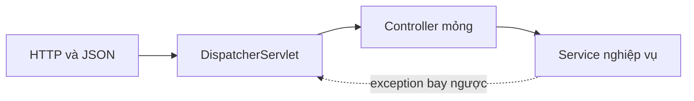
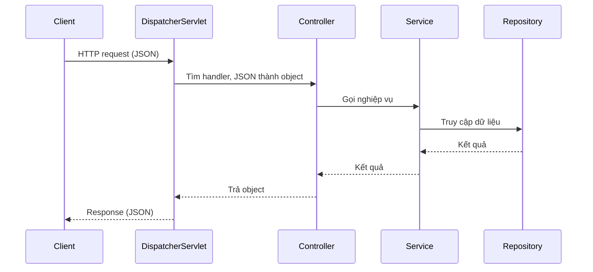
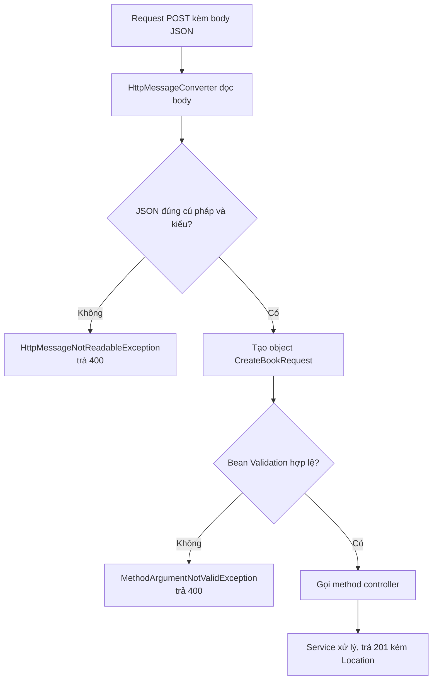
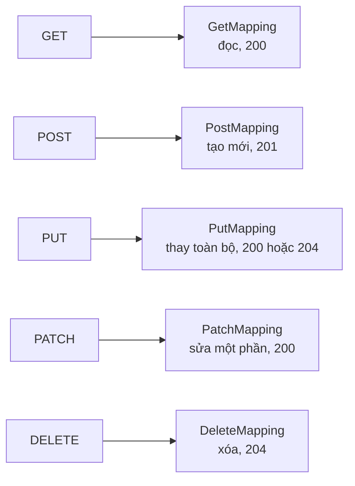
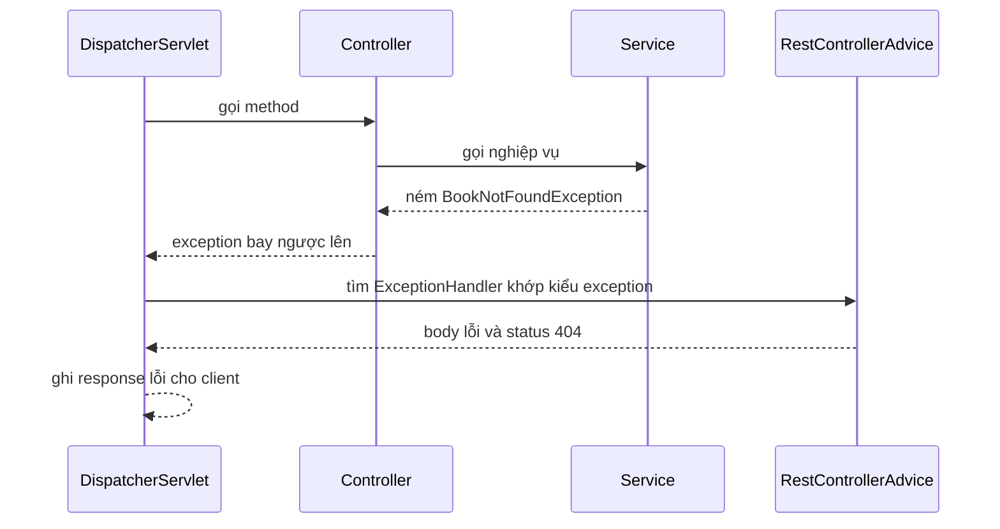

# Lý thuyết 3: REST Controller

## Controller là gì?

Controller là class đứng ở "cửa" của ứng dụng. Nó nhận HTTP request từ bên ngoài, giao việc cho service xử lý, rồi trả dữ liệu về, thường dưới dạng JSON. Hình dung lễ tân khách sạn: lễ tân tiếp khách, hỏi thông tin cần thiết, chuyển yêu cầu cho bộ phận phù hợp và báo kết quả lại; lễ tân không tự đi dọn phòng.

**Cốt lõi:** Mọi request đi qua một cửa duy nhất là `DispatcherServlet`, nên các việc chung được làm một lần ở đó. Controller chỉ còn một việc là phiên dịch giữa HTTP và lời gọi service.

- Vì mọi request qua một front controller, nên chọn handler, đổi JSON và validate không phải lặp lại ở từng endpoint.
- Vì nghiệp vụ nằm ở service, nên job nền hay consumer message dùng lại được mà không cần HTTP.
- Vì exception bay ngược về `DispatcherServlet`, nên một `@RestControllerAdvice` bắt được mọi lỗi và định dạng thống nhất.



Mô hình tư duy: request đi vào qua một cửa và lỗi đi ra qua cùng cửa đó, còn controller chỉ là chỗ dịch giữa hai thế giới.

**Tóm tắt:**

- Controller chỉ lo chuyện HTTP (đọc tham số, validate, chọn status); nghiệp vụ nằm ở service.
- `@RestController` = `@Controller` + `@ResponseBody`, kết quả ghi thẳng vào body qua `HttpMessageConverter`.
- Mọi request đi qua `DispatcherServlet` (front controller), nó tìm handler rồi chuyển JSON và object hai chiều.
- `@PathVariable` xác định tài nguyên, `@RequestParam` để lọc và phân trang (mặc định bắt buộc), `@RequestBody` lấy body JSON.
- Dùng DTO (record) thay vì trả thẳng entity; `@Valid` sai thì trả 400.
- Xử lý exception tập trung bằng `@RestControllerAdvice` để định dạng lỗi thống nhất.
- Status code: 200 đọc, 201 tạo mới (kèm `Location`), 204 xóa, 400 sai dữ liệu, 404 không thấy, 409 xung đột.
- `POST` không idempotent nên gửi lại có thể tạo bản ghi trùng.

## Vì sao phải tách controller khỏi nghiệp vụ

Nếu nhét nghiệp vụ vào controller thì nó phình to, không tái dùng được ở nơi khác (ví dụ job chạy nền cũng cần cùng logic) và rất khó test vì phải dựng cả HTTP. Controller chỉ nên lo chuyện HTTP: đọc tham số, kiểm tra đầu vào, chọn status code. Phần nghiệp vụ để service làm.

## Khi nào dùng `@RestController`, khi nào không

Dùng `@RestController` cho mọi API REST trả JSON. Nếu bạn render trang HTML phía server (Thymeleaf, JSP) thì dùng `@Controller` kèm view, không phải `@RestController`, vì kết quả method lúc đó là tên view chứ không phải dữ liệu để ghi thẳng vào body. Cách làm: gắn `@RestController` và `@RequestMapping` ở class, `@GetMapping`/`@PostMapping`... ở từng method; lấy dữ liệu từ request bằng `@PathVariable`, `@RequestParam`, `@RequestBody`; cần kiểm soát status và header thì trả `ResponseEntity`.

## Các khái niệm cần biết

- **`DispatcherServlet`**: servlet trung tâm của Spring MVC. Mọi request đi qua nó; nó tìm controller phù hợp, gọi method, rồi chuyển kết quả thành response.
- **Handler mapping**: bước tra cứu "URL và phương thức HTTP này thuộc method controller nào".
- **`HttpMessageConverter`**: thành phần chuyển đổi giữa body HTTP và object Java. Với JSON, Spring Boot dùng Jackson: JSON đến thành object (`@RequestBody`), object trả về thành JSON.
- **DTO (Data Transfer Object)**: object chỉ dùng để chuyển dữ liệu qua ranh giới API (request, response). Dùng DTO để không lộ cấu trúc entity trong database và để API ổn định khi bảng thay đổi.
- **Idempotent**: gọi một lần hay nhiều lần cho cùng kết quả. `GET`, `PUT`, `DELETE` được thiết kế idempotent; `POST` thì không, nên gửi lại `POST` có thể tạo bản ghi trùng.
- **Bean Validation**: bộ annotation (`@NotBlank`, `@Positive`...) để khai báo ràng buộc dữ liệu; `@Valid` yêu cầu Spring kiểm tra chúng.

## Flowchart: một request

Để hiểu controller đứng ở đâu, hãy theo dõi một request từ client tới database và quay lại.



Đọc sơ đồ: client không gọi thẳng controller mà gọi `DispatcherServlet`; nó tìm handler, chuyển JSON thành object, gọi controller, và chuyển object kết quả trở lại thành JSON. Controller chỉ làm cầu nối sang service, còn service mới gọi repository.

**Nền tảng:** Spring MVC là mô hình front controller: mọi request vào `DispatcherServlet`, nó tìm handler (handler mapping), gọi method, rồi `HttpMessageConverter` đổi body HTTP và object Java qua lại. Controller chỉ lo chuyện HTTP, nghiệp vụ nằm ở service.

**Suy luận:** Vì mọi request đều phải đi qua một điểm vào duy nhất là `DispatcherServlet` (front controller), Spring áp dụng được các việc chung cho mọi endpoint ở một chỗ thay vì lặp lại trong từng controller: chọn handler, chuyển JSON thành object, validate, chuyển object thành JSON, bắt exception. Kéo theo đó, controller chỉ còn một trách nhiệm là phiên dịch giữa HTTP và lời gọi service, nên nó phải mỏng. Nếu nhét nghiệp vụ hoặc transaction vào controller thì logic đó chỉ chạy được khi có HTTP request; job nền hay consumer message muốn dùng lại sẽ phải sao chép. Điểm dễ nhầm là thấy `@RequestBody` và `@Valid` "tự động" nên coi là an toàn: thực ra chúng chỉ kiểm tra những gì DTO khai báo, và nếu bind thẳng vào entity thì client có thể gửi cả những field không định cho họ sửa (mass assignment) hoặc làm lộ cấu trúc bảng. Vì vậy DTO là ranh giới bảo vệ chứ không chỉ để cho gọn. Lỗi cũng theo cùng logic: vì exception bay ngược qua `DispatcherServlet`, một `@RestControllerAdvice` duy nhất bắt được mọi thứ, còn `try/catch` rải rác sẽ cho định dạng lỗi lệch nhau. Hệ quả hành động: review controller thấy rẽ nhánh nghiệp vụ, truy cập repository hoặc trả entity thì chuyển xuống service và DTO; thấy `try/catch` dựng response lỗi thì chuyển sang advice.

## Ví dụ

Ví dụ sau là một controller CRUD tối thiểu cho sách. Chú ý mỗi method chỉ vài dòng: toàn bộ việc nặng nằm ở service.

```java
@RestController
@RequestMapping("/api/v1/books")
public class BookController {
    private final BookService service;

    public BookController(BookService service) {
        this.service = service;
    }

    @GetMapping("/{id}")
    public BookResponse get(@PathVariable Long id) {
        return service.findById(id);
    }

    @GetMapping
    public List<BookResponse> search(@RequestParam(required = false) String keyword) {
        return service.search(keyword);
    }

    @PostMapping
    public ResponseEntity<BookResponse> create(@RequestBody CreateBookRequest request) {
        BookResponse created = service.create(request);
        return ResponseEntity.status(HttpStatus.CREATED).body(created);
    }

    @DeleteMapping("/{id}")
    @ResponseStatus(HttpStatus.NO_CONTENT)
    public void delete(@PathVariable Long id) {
        service.delete(id);
    }
}
```

## Nguồn dữ liệu từ request

| Annotation | Lấy từ | Ví dụ |
|---|---|---|
| `@PathVariable` | Phần trong đường dẫn | `/books/{id}` |
| `@RequestParam` | Query string hoặc form | `/books?keyword=java&page=0` |
| `@RequestBody` | Body JSON, chuyển thành object bằng Jackson | `{"title":"Spring"}` |
| `@RequestHeader` | Header | `Authorization` |

Phân biệt `@PathVariable` và `@RequestParam`: dữ liệu xác định **một tài nguyên** (id) đặt trong đường dẫn; dữ liệu **lọc, phân trang, sắp xếp** đặt trong query string. `@RequestParam` mặc định là bắt buộc: thiếu thì trả 400. Dùng `required = false` hoặc `defaultValue = "0"` khi tùy chọn.

## DTO bằng record, kiểm tra dữ liệu và `Location`

Vấn đề đặt ra: không nên tin dữ liệu client gửi lên, và khi tạo mới nên báo cho client biết địa chỉ của tài nguyên vừa tạo. Hãy xem ví dụ sau.

```java
public record CreateBookRequest(
        @NotBlank String title,
        @Positive int pages) {}

public record BookResponse(Long id, String title, int pages) {}
```

```java
@PostMapping
public ResponseEntity<BookResponse> create(@Valid @RequestBody CreateBookRequest request) {
    BookResponse created = service.create(request);
    URI location = URI.create("/api/v1/books/" + created.id());
    return ResponseEntity.created(location).body(created);   // 201 kèm header Location
}
```

Flow xử lý một request `POST` có `@Valid @RequestBody`:



Đọc sơ đồ: có hai cổng chặn trước khi method controller chạy. Cổng đầu là parse JSON (sai cú pháp hoặc sai kiểu thì 400), cổng hai là validation theo annotation trên DTO. Nhờ vậy method controller luôn nhận dữ liệu đã hợp lệ về hình thức; kiểm tra nghiệp vụ (ví dụ trùng tiêu đề) vẫn thuộc service.

`@Valid` cần `spring-boot-starter-validation`. Vi phạm thì Spring ném `MethodArgumentNotValidException` và trả 400. Muốn định dạng lỗi thống nhất xem `ProblemDetail` ở [REST API thực chiến](/go?p=01-Spring-Boot%2Fmedium%2Flt-33-rest-api-thuc-chien.md).

## Chọn annotation theo HTTP method

Mỗi HTTP method có một annotation tương ứng và một status thành công thường gặp:



Đọc sơ đồ: chọn theo ý nghĩa thao tác chứ không theo thói quen. `GET` không đổi dữ liệu; `PUT` và `DELETE` idempotent nên client gửi lại an toàn; `POST` thì không, nên cần cơ chế chống trùng nếu client có thể thử lại.

## Xử lý exception tập trung

Exception ném ra từ service hoặc từ bước bind dữ liệu đều bay ngược về `DispatcherServlet`, và advice bắt chúng ở một chỗ:



Đọc sơ đồ: controller không bắt exception, nó để exception bay lên `DispatcherServlet`, nơi tra cứu method `@ExceptionHandler` phù hợp để dựng response lỗi thống nhất.

Nếu mỗi method tự `try/catch` rồi tự dựng response lỗi, định dạng lỗi sẽ không thống nhất và code lặp lại khắp nơi. Cách giải quyết là một class chung bắt exception cho toàn bộ controller: `@RestControllerAdvice` gom các method `@ExceptionHandler`, mỗi method xử lý một loại exception và chọn status tương ứng. Nếu quên handler, exception chưa xử lý sẽ trả 500 kèm thông tin nội bộ không mong muốn.

```java
@RestControllerAdvice
public class GlobalExceptionHandler {
    @ExceptionHandler(BookNotFoundException.class)
    @ResponseStatus(HttpStatus.NOT_FOUND)
    public Map<String, String> notFound(BookNotFoundException e) {
        return Map.of("error", e.getMessage());
    }
}
```

## `@Controller` và `@RestController`

`@RestController` = `@Controller` + `@ResponseBody`. Kết quả method được ghi thẳng vào body (qua `HttpMessageConverter`), không đi tìm view. Cơ chế dispatch bên trong ở [MVC internals](/go?p=01-Spring-Boot%2Fmedium%2Flt-15-mvc-internals.md); cách test controller bằng `@WebMvcTest` ở [Testing cơ bản](/go?p=01-Spring-Boot%2Feasy%2Flt-12-testing-co-ban.md).

## Status code nên dùng

Client dựa vào status code để quyết định hành động tiếp theo (thử lại, báo lỗi, hiển thị), nên chọn đúng quan trọng không kém body.

| Tình huống | Status |
|---|---|
| Đọc thành công | 200 |
| Tạo mới | 201 |
| Xóa thành công, không có nội dung | 204 |
| Dữ liệu gửi lên sai | 400 |
| Không tìm thấy | 404 |
| Trùng/xung đột | 409 |

**Phải thuộc:** `@RestController` = `@Controller` + `@ResponseBody`. Nguồn dữ liệu: `@PathVariable` (đường dẫn, xác định tài nguyên), `@RequestParam` (query string, mặc định bắt buộc), `@RequestBody` (body JSON), `@RequestHeader`. Status: 200 đọc, 201 tạo mới, 204 xóa, 400 sai dữ liệu, 404 không thấy, 409 xung đột; `@Valid` sai thì `MethodArgumentNotValidException` và 400.

## Lưu ý

- Controller không chứa nghiệp vụ.
- Dùng DTO (request/response) thay vì trả thẳng entity ra ngoài.
- Dùng `record` của Java cho DTO gọn.

## Phỏng vấn khó: chuỗi hỏi xoáy

Người phỏng vấn senior thường mở bằng câu dễ rồi xoáy xuống cơ chế, đánh đổi và sự cố thật. Câu trả lời tốt luôn đi từ cốt lõi xuống.

### Chuỗi 1: Đường đi của request và lỗi

1. **Câu mở:** Một request `POST` kèm JSON đi qua những gì trước khi tới method controller?
2. **Xoáy 1:** JSON sai cú pháp và JSON đúng nhưng `title` rỗng khác nhau ở bước nào, ném exception gì?
3. **Xoáy 2:** Service ném `BookNotFoundException`. Client nhận 404 bằng cách nào, và nếu quên viết handler thì sao?

**Đáp án ngắn:** Mọi request vào `DispatcherServlet`, nó tra handler mapping để tìm method, rồi `HttpMessageConverter` (Jackson) đổi body JSON thành object. Có hai cổng chặn trước khi method chạy. Cổng đầu là parse JSON: sai cú pháp hoặc sai kiểu thì `HttpMessageNotReadableException` và 400. Cổng hai là Bean Validation khi có `@Valid`: JSON đúng nhưng `@NotBlank` vi phạm thì `MethodArgumentNotValidException`, cũng 400. Nhờ vậy method controller luôn nhận dữ liệu đúng về hình thức; kiểm tra nghiệp vụ như trùng tiêu đề vẫn thuộc service. Exception từ service không bị controller bắt mà bay ngược về `DispatcherServlet`, nơi tra `@ExceptionHandler` khớp kiểu trong `@RestControllerAdvice` để dựng body và status 404. Quên handler thì exception chưa xử lý trả 500 và có nguy cơ lộ thông tin nội bộ. `@Valid` cần `spring-boot-starter-validation`.

**Sai lầm hay gặp:**
- Nói client gọi thẳng controller, bỏ qua `DispatcherServlet`.
- Gộp hai loại 400 làm một, không phân biệt lỗi parse với lỗi validation.
- `try/catch` trong từng method để dựng response lỗi, nên định dạng lỗi lệch nhau.

### Chuỗi 2: DTO, mass assignment và `POST` bị gửi lại

1. **Câu mở:** Vì sao không bind `@RequestBody` thẳng vào entity hoặc trả entity ra ngoài?
2. **Xoáy 1:** Có `@Valid` rồi thì đã an toàn chưa?
3. **Xoáy 2:** Client timeout rồi gửi lại `POST` tạo đơn, ra hai bản ghi. Vì sao, và `PUT`, `DELETE` khác chỗ nào?

**Đáp án ngắn:** DTO là ranh giới của API: nó lộ ra đúng những field bạn định lộ và giữ API ổn định khi bảng đổi. Bind thẳng vào entity thì client có thể gửi cả field không định cho họ sửa (mass assignment), còn trả entity thì làm lộ cấu trúc bảng. `@Valid` không cứu được chuyện đó: nó chỉ kiểm tra những ràng buộc đã khai báo trên chính object được bind, nên nếu object là entity thì field nhạy cảm vẫn lọt vào. `POST` không idempotent, nên gửi lại sẽ tạo bản ghi mới; `GET`, `PUT`, `DELETE` được thiết kế idempotent nên gửi lại an toàn. Với `POST` mà client có thể thử lại (mạng chập chờn, timeout), cần cơ chế chống trùng, thường là idempotency key kèm ràng buộc unique phía server. Tạo mới trả 201 kèm header `Location` để client biết địa chỉ tài nguyên vừa tạo.

**Sai lầm hay gặp:**
- Coi `@Valid` là lá chắn bảo mật thay vì chỉ kiểm tra hình thức dữ liệu.
- Chỉ nói "DTO cho gọn", không nhắc mass assignment và ổn định API.
- Nghĩ gọi lại `POST` luôn an toàn vì "server sẽ tự xử lý trùng".

