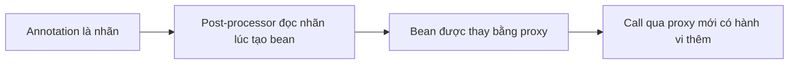
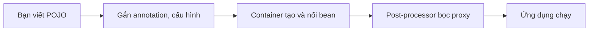
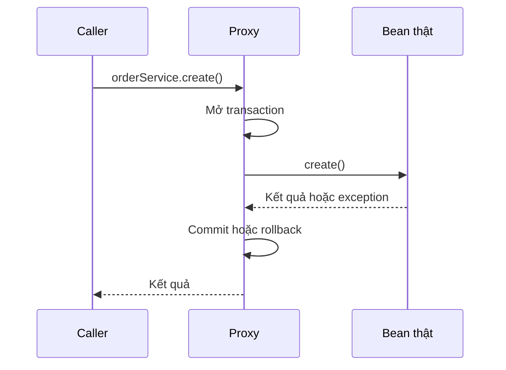

# Lý thuyết 9: Tư duy Spring (đọc đầu tiên)

## Vì sao nên đọc bài này đầu tiên

Spring có rất nhiều annotation: `@Autowired`, `@Transactional`, `@Cacheable`, `@Value`... Nếu chỉ nhớ từng cái, bạn sẽ thấy chúng như phép màu, và khi gặp lỗi lạ (bean không inject được, `@Transactional` không chạy) bạn chỉ biết thử bừa. Bài này nói về những **nguyên tắc thiết kế nằm sau Spring**. Hiểu chúng rồi thì các annotation không còn là phép màu mà là hệ quả dễ đoán: bạn có thể suy ra nguyên nhân thay vì đoán.

Hình dung một khách sạn lớn. Khách (code của bạn) chỉ nói "tôi cần phòng, bữa sáng, đưa đón sân bay" (annotation). Bộ phận quản lý (Spring) mới là bên thực sự sắp xếp phòng, gọi xe, đúng lúc. Nếu một bộ phận không làm việc (một post-processor không chạy) thì yêu cầu của khách vẫn nằm trên giấy mà không ai thực hiện.

**Cốt lõi:** Annotation của Spring chỉ là nhãn. Vì class nghiệp vụ là POJO không biết gì về framework, Spring chỉ có thể chen từ bên ngoài: đọc nhãn lúc tạo bean rồi bọc bean bằng proxy để mỗi lời gọi đi qua nó.

- Vì annotation chỉ là metadata, nên nó chỉ có tác dụng khi có thành phần khác đọc nó.
- Vì Spring chỉ chen được lúc khởi động, lúc tạo bean và lúc gọi method, nên mọi lỗi đều thu hẹp được theo ba thời điểm này.
- Vì hành vi thêm nằm ở proxy, nên chỉ call đi qua proxy mới có; `this.other()` thì không.



Mô hình tư duy: khi một annotation không chạy, hãy hỏi thành phần đọc nó có chạy không và call có đi qua proxy không.

**Tóm tắt:**

- Annotation của Spring chỉ là metadata; một thành phần khác (post-processor, proxy, filter) đọc nó rồi mới hành động.
- Annotation "không chạy" nghĩa là thành phần đọc nó không chạy, hoặc call không đi qua proxy.
- Phần lớn "phép màu" (`@Transactional`, `@Cacheable`) là proxy bọc ngoài bean; self-invocation bỏ qua proxy.
- Spring chen vào ba thời điểm: lúc khởi động, lúc tạo bean, lúc gọi method.
- `BeanFactoryPostProcessor` chạy trước khi tạo bean, `BeanPostProcessor` chạy với từng bean sau khi tạo.
- Tám nguyên tắc cốt lõi: IoC, lập trình theo interface, POJO, convention over configuration, abstraction, template và callback, proxy, extension point.
- Lỗi cấu hình thường lộ ngay lúc khởi động (fail fast), không đợi tới lúc chạy.
- Khi học tính năng mới, hỏi: Spring làm giúp gì, qua cơ chế nào, và nó hỏng khi nào.

## Khi nào đọc và dùng thế nào

Đọc trước các bài khác, rồi quay lại mỗi khi gặp hành vi Spring khó hiểu. Cách dùng đơn giản: với mỗi tính năng, tự hỏi "Spring đang làm gì thay mình, và nó chen vào lúc nào: lúc khởi động, lúc tạo bean, hay lúc gọi method?". Trả lời được hai câu đó là đã thu hẹp nguyên nhân của phần lớn lỗi.

## Các khái niệm cần biết

- **POJO (Plain Old Java Object)**: class Java thường, không kế thừa hay cài đặt gì của framework. Spring cố gắng để class nghiệp vụ của bạn là POJO, nên bạn có thể test và tái dùng nó ngoài Spring.
- **Container**: thành phần của Spring tạo, nối và quản lý lifecycle của các bean theo mô tả bạn đưa.
- **Bean**: object do container quản lý. Chi tiết ở [IoC và DI](/go?p=01-Spring-Boot%2Feasy%2Flt-02-ioc-di.md).
- **Cross-cutting concern**: việc cần làm ở nhiều nơi nhưng không thuộc nghiệp vụ chính, như transaction, bảo mật, ghi log, cache.
- **Proxy**: object đứng giữa người gọi và bean thật, thêm hành vi trước và sau khi gọi. Là cơ chế đứng sau `@Transactional`, `@Cacheable`.
- **`BeanPostProcessor`**: thành phần được container gọi với **mỗi bean sau khi tạo**, cho phép đọc annotation, thay đổi bean hoặc thay bằng proxy. Nhiều "phép màu" của Spring là một post-processor.
- **`BeanFactoryPostProcessor`**: thành phần chạy **trước khi bean được tạo**, cho phép đọc và sửa bản mô tả bean (`BeanDefinition`), ví dụ thay giá trị `${...}` trong cấu hình.
- **Fail fast**: phát hiện lỗi sớm nhất có thể (lúc khởi động) thay vì để lỗi chỉ xuất hiện khi có người dùng thật.

## Bức tranh lớn

Toàn bộ Spring có thể tóm trong một flow: bạn viết code thường, mô tả bằng annotation hoặc cấu hình, container biến mô tả thành bean thật, và các post-processor bọc thêm hành vi trước khi ứng dụng chạy.



Đọc sơ đồ: ở bước "Post-processor bọc proxy", bean mà bạn nhận được lúc chạy có thể **không phải** object gốc bạn viết mà là proxy của nó. Hiểu điều này giải thích gần như mọi lỗi kiểu "annotation không chạy".

## 8 nguyên tắc cốt lõi

Mỗi nguyên tắc dưới đây giải quyết một vấn đề cụ thể; cột ví dụ cho thấy chúng xuất hiện ở đâu trong code hằng ngày.

| # | Nguyên tắc | Ý nghĩa | Ví dụ |
|---|---|---|---|
| 1 | **IoC (Inversion of Control)** | "Đừng gọi chúng tôi, chúng tôi sẽ gọi bạn". Bạn khai báo cần gì, framework quyết định tạo và gọi khi nào | Controller không tự `new` service |
| 2 | **Lập trình theo interface** | Phụ thuộc vào interface, không phụ thuộc cài đặt | `OrderRepository` là interface, test thì thay bản giả |
| 3 | **POJO, ít xâm lấn** | Class nghiệp vụ không bắt buộc kế thừa lớp của framework | Service chỉ là class thường, không `extends` gì của Spring |
| 4 | **Convention over configuration** | Có mặc định hợp lý, chỉ ghi đè khi cần | Thêm starter web là có Tomcat chạy sẵn |
| 5 | **Abstraction layer** | Cùng một cách dùng, đổi được hạ tầng bên dưới | Cache abstraction: Redis hay Caffeine, code không đổi |
| 6 | **Template và callback** | Framework giữ phần rườm rà (mở/đóng tài nguyên, xử lý lỗi), bạn chỉ viết phần riêng | `JdbcTemplate`, `RestClient`, `TransactionTemplate` |
| 7 | **Proxy cho mối quan tâm xuyên suốt** | Hành vi phụ (transaction, bảo mật, cache) được bọc ngoài, không lẫn vào nghiệp vụ | `@Transactional`, `@Cacheable`, `@PreAuthorize` |
| 8 | **Extension point ở khắp nơi** | Có thể can thiệp vào hầu hết giai đoạn | `BeanPostProcessor`, `@Conditional`, application event |

## Hệ quả thực tế

Từ tám nguyên tắc trên rút ra ba điều dùng được ngay khi gỡ lỗi.

- Annotation thường chỉ là **metadata**; một thành phần khác (post-processor, proxy, filter) đọc nó rồi mới hành động. Nếu thành phần đó không chạy thì annotation vô tác dụng.
- Phép màu của Spring thường là **proxy**. Gọi qua proxy thì có hành vi thêm; không qua proxy thì không (xem bài [AOP và proxy](/go?p=01-Spring-Boot%2Fmedium%2Flt-13-aop-proxy.md)).
- Lỗi cấu hình thường **lộ ngay khi khởi động** (fail fast), không đợi đến lúc chạy.

**Nền tảng:** annotation của Spring chỉ là metadata. Có một thành phần khác (post-processor, proxy, filter) đọc nhãn và hành động, nên annotation "không chạy" nghĩa là thành phần đọc nó không chạy hoặc call không đi qua nó. Mọi lỗi kiểu này đều suy ra được từ hai câu hỏi: Spring chen vào lúc nào, và call có đi qua proxy không.

Điều thứ hai hay gây nhầm nhất, nên hãy xem flow gọi method qua proxy:



Đọc sơ đồ: người gọi chỉ thấy một `orderService`, nhưng thực chất gọi proxy; proxy mở transaction, mới giao cho bean thật, rồi commit hoặc rollback. Nếu bean thật tự gọi method khác của chính nó (`this.other()`) thì call đó không đi qua proxy, nên transaction không được mở. Đó là lý do bẫy self-invocation làm `@Transactional` không chạy.

**Suy luận:** Spring muốn class nghiệp vụ là POJO không biết gì về framework, nên nó không thể bắt bạn gọi `beginTransaction()` hay kế thừa một class nào; nó chỉ còn cách chen vào từ bên ngoài. Có đúng hai chỗ để chen: lúc tạo bean (đổi hoặc bọc object trước khi đưa cho bạn) và lúc gọi method (đứng giữa caller và object). Hai chỗ này gộp lại thành proxy: post-processor đọc annotation lúc tạo bean rồi thay object gốc bằng proxy, và từ đó mỗi call đi qua proxy mới được thêm hành vi. Hệ quả suy ra ngay: hành vi chỉ tồn tại ở những call đi qua proxy, nên `this.other()` trong cùng class bỏ qua nó, method `private` hoặc class `final` không bọc được, và object bạn tự `new` ra thì không có gì cả. Điểm dễ nhầm là nghĩ annotation có "sức mạnh" riêng; nó chỉ là nhãn, nên khi `@Transactional` không chạy hãy hỏi hai câu: post-processor có bọc bean này không, và call có đi qua proxy không. Ngược lại, vì proxy được bọc ở bước sau cùng của lúc tạo bean, code chạy trong constructor hay `@PostConstruct` vẫn đang cầm object gốc. Hệ quả hành động: khi hai method trong cùng class gọi nhau mà vẫn cần transaction, tách method được gọi sang bean khác, thay vì thêm annotation rồi hy vọng nó chạy.

## Ví dụ: annotation chỉ là dữ liệu, ai đó phải đọc nó

Một annotation tự định nghĩa không làm gì cho đến khi có thành phần đọc nó:

```java
@Retention(RetentionPolicy.RUNTIME)
@Target(ElementType.METHOD)
public @interface LogTime {}

// Thành phần "đọc" annotation: đây chính là vai trò của post-processor
@Component
class LogTimeBeanPostProcessor implements BeanPostProcessor {
    @Override
    public Object postProcessAfterInitialization(Object bean, String beanName) {
        for (Method m : bean.getClass().getDeclaredMethods()) {
            if (m.isAnnotationPresent(LogTime.class)) {
                System.out.println("Bean " + beanName + " có method cần đo: " + m.getName());
            }
        }
        return bean;   // trả về bean gốc hoặc một proxy bọc nó
    }
}
```

Hãy xem kỹ: annotation `@LogTime` chỉ là nhãn, còn `postProcessAfterInitialization` được container gọi cho mỗi bean sau khi khởi tạo xong. Bỏ `LogTimeBeanPostProcessor` đi thì `@LogTime` vô tác dụng. `@Transactional` cũng vậy: có hạ tầng đọc annotation và tạo proxy (do auto-configuration bật), nên mới chạy.

## Ba thời điểm Spring chen vào

| Thời điểm | Cơ chế | Ví dụ |
|---|---|---|
| Lúc khởi động (đọc cấu hình) | `@Conditional`, `@ComponentScan`, `BeanFactoryPostProcessor` | Bật/tắt bean theo classpath hoặc property |
| Lúc tạo bean | `BeanPostProcessor`, `@PostConstruct` | Bọc proxy, tiêm giá trị |
| Lúc gọi method | Proxy, interceptor, filter | Transaction, bảo mật, cache |

Dùng bảng này khi cần quyết định "mình nên can thiệp ở đâu": đổi bean theo môi trường thì làm lúc khởi động (`@Conditional`), sửa một bean đã tạo thì dùng post-processor, thêm hành vi quanh method thì dùng proxy hoặc aspect. Khi gặp lỗi, xác định lỗi thuộc thời điểm nào sẽ thu hẹp nguyên nhân rất nhanh: lỗi lúc khởi động (thiếu bean, cấu hình sai), lỗi lúc tạo bean (circular dependency, init ném exception), hay lỗi lúc gọi (proxy bị bỏ qua, rollback không như ý).

**Phải thuộc:** ba thời điểm Spring chen vào: lúc khởi động (`@Conditional`, `BeanFactoryPostProcessor`), lúc tạo bean (`BeanPostProcessor`, `@PostConstruct`), lúc gọi method (proxy, interceptor, filter). `BeanFactoryPostProcessor` chạy trước khi tạo bean, `BeanPostProcessor` chạy với từng bean sau khi tạo.

## Bảng tra: gặp triệu chứng, nghĩ tới đâu

| Triệu chứng | Hãy nghĩ tới |
|---|---|
| `@Transactional` không có tác dụng | Có đi qua proxy không? Self-invocation? Phương thức có `public`? (Từ Spring 6, proxy dựa trên class cũng áp dụng cho method `protected` hoặc package-visible; `private` thì không) |
| Bean không được tiêm / `NoSuchBeanDefinition` | Class có nằm trong phạm vi quét? Có điều kiện `@Conditional` nào tắt nó? |
| Có nhiều bean cùng kiểu | `@Primary` hoặc `@Qualifier` |
| Giá trị cấu hình không như mong đợi | Thứ tự ưu tiên nguồn cấu hình, profile đang bật |
| Bean dùng chung bị lỗi khi multi-thread | Singleton có trạng thái thay đổi được |

## Cách học

Khi học một tính năng mới, trả lời 3 câu: (1) Spring làm giúp mình điều gì? (2) Nó can thiệp qua cơ chế nào: proxy, post-processor, filter hay sự kiện? (3) Nó hỏng khi nào?

## Phỏng vấn khó: chuỗi hỏi xoáy

Người phỏng vấn senior thường mở bằng câu dễ rồi xoáy xuống cơ chế, đánh đổi và sự cố thật. Câu trả lời tốt luôn đi từ cốt lõi xuống.

### Chuỗi 1: Proxy và `@Transactional` không chạy

1. **Câu mở:** `@Transactional` không có tác dụng. Bạn nghĩ tới những nguyên nhân nào?
2. **Xoáy 1:** Vì sao `this.other()` trong cùng class bỏ qua transaction? Proxy được tạo ở đâu?
3. **Xoáy 2:** Method `private`, class `final`, object tự `new` thì sao, và bạn sửa self-invocation thế nào?

**Đáp án ngắn:** Annotation chỉ là nhãn; hành vi nằm ở proxy mà Spring bọc quanh bean. Class nghiệp vụ là POJO không biết gì về framework, nên Spring chỉ chen từ bên ngoài: một `BeanPostProcessor` đọc nhãn lúc tạo bean rồi thay object gốc bằng proxy. Người gọi bên ngoài giữ proxy, proxy mở transaction rồi mới giao cho bean thật. Nhưng khi bean thật tự gọi `this.other()`, call đó không đi qua proxy nên không có transaction. Cùng lý do, object bạn tự `new` thì không có proxy, class `final` không bọc được bằng CGLIB, method `private` không áp dụng (từ Spring 6, `protected` hoặc package-visible với proxy dựa trên class thì được). Cách sửa chắc nhất là tách method được gọi sang một bean khác để call đi qua proxy. Khi gỡ lỗi, hỏi hai câu: post-processor có bọc bean này không, và call có đi qua proxy không.

**Sai lầm hay gặp:**
- Chỉ liệt kê "phải `public`" mà không giải thích cơ chế proxy.
- Sửa bằng cách thêm annotation lên method nội bộ rồi hy vọng nó chạy.
- Nghĩ annotation có sức mạnh riêng, không cần thành phần nào đọc nó.

### Chuỗi 2: Annotation chỉ là nhãn, ai đọc nó?

1. **Câu mở:** Tôi tự viết annotation `@LogTime` nhưng không có gì xảy ra. Vì sao?
2. **Xoáy 1:** `BeanFactoryPostProcessor` và `BeanPostProcessor` khác nhau ở thời điểm và đối tượng tác động ra sao?
3. **Xoáy 2:** Một annotation "không ăn" ở production. Bạn thu hẹp nguyên nhân thế nào?

**Đáp án ngắn:** Annotation chỉ là metadata; phải có một thành phần khác đọc nó thì mới có hành vi. `@LogTime` không làm gì vì chưa có post-processor nào đi tìm nó. `BeanFactoryPostProcessor` chạy trước khi bean nào được tạo và làm việc trên `BeanDefinition`, ví dụ thay giá trị `${...}` trong cấu hình. `BeanPostProcessor` chạy với từng bean sau khi tạo, nên đọc annotation, sửa bean hoặc thay bằng proxy. Spring chen vào đúng ba thời điểm: lúc khởi động đọc cấu hình, lúc tạo bean, lúc gọi method. Gặp annotation không chạy, xác định lỗi thuộc thời điểm nào: thiếu bean hay bị điều kiện tắt là lúc khởi động, circular dependency là lúc tạo bean, proxy bị bỏ qua hay rollback lạ là lúc gọi. Sau đó kiểm tra hạ tầng đọc annotation có được bật không, thường do auto-configuration.

**Sai lầm hay gặp:**
- Gọi mọi thứ là "Spring tự làm" mà không chỉ ra thành phần nào làm.
- Lẫn hai loại post-processor, nghĩ cả hai chạy trên bean đã tạo.
- Gỡ lỗi bằng cách thử bừa thay vì khoanh vùng theo ba thời điểm.

