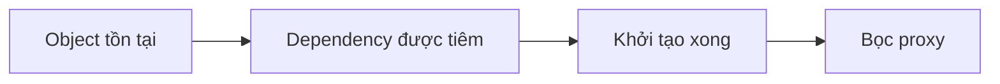
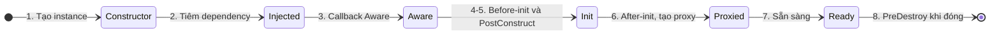
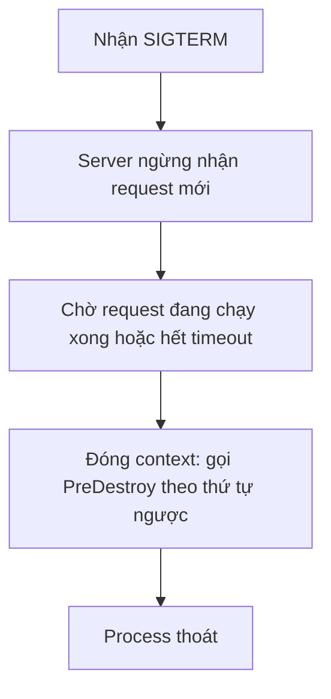

# Lý thuyết 10: Lifecycle của Bean

## Bean lifecycle là gì?

Một bean không xuất hiện đầy đủ ngay lập tức. Spring tạo nó qua nhiều bước: tạo object, tiêm các dependency, chạy các bước khởi tạo (init), cho ứng dụng dùng, và cuối cùng dọn dẹp khi ứng dụng tắt. Hình dung nhân viên mới: được tuyển (constructor), được phát máy tính và tài khoản (tiêm dependency), học việc (init), đi làm (sẵn sàng), rồi bàn giao và trả đồ khi nghỉ việc (destroy). Nếu bạn yêu cầu nhân viên làm việc cần tài khoản ngay lúc anh ta vừa được tuyển, tài khoản chưa có và công việc hỏng.

**Cốt lõi:** Bean được dựng theo thứ tự cố định vì mỗi bước cần bước trước: phải có object mới tiêm được dependency, phải khởi tạo xong mới bọc được proxy. Hiểu chuỗi phụ thuộc này là suy ra được hầu hết hành vi lạ của lifecycle.

- Vì không tiêm được vào object chưa tồn tại, nên với field hoặc setter injection, dependency chỉ dùng được từ `@PostConstruct` trở đi.
- Vì proxy cần bean đã khởi tạo xong làm đích, nên proxy được tạo sau `@PostConstruct` và trong đó `this` là object gốc.
- Vì `@PostConstruct` chạy khi context vẫn đang dựng, nên việc cần mọi bean sẵn sàng phải chuyển sang `ApplicationRunner`.



Mô hình tư duy: mỗi mũi tên là một điều kiện bắt buộc, nên không thể đảo thứ tự các bước.

**Tóm tắt:**

- Bean đi qua nhiều bước: constructor, tiêm dependency, init, tạo proxy, sẵn sàng, rồi destroy khi đóng context.
- Với field hoặc setter injection, dependency được tiêm sau constructor nên constructor chưa dùng được chúng.
- `@PostConstruct` chạy một lần sau khi tiêm xong; `@PreDestroy` chạy khi đóng context.
- Proxy (AOP, `@Transactional`) được tạo ở after-init, sau `@PostConstruct`, nên trong `@PostConstruct` `this` là object gốc.
- Class thư viện không sửa được thì dùng `@Bean(initMethod, destroyMethod)`.
- Việc cần toàn bộ bean sẵn sàng thì dùng `ApplicationRunner` hoặc `ApplicationReadyEvent`, không dùng `@PostConstruct`.
- Bean prototype không được container hủy nên `@PreDestroy` không được gọi.
- Graceful shutdown phải bật tường minh (`server.shutdown=graceful`); mặc định là `immediate`.

## Vì sao cần biết thứ tự

Nếu không biết thứ tự, bạn sẽ khởi tạo tài nguyên sai lúc, ví dụ dùng một field chưa được tiêm ngay trong constructor và gặp `NullPointerException`. Bạn cũng sẽ không hiểu vì sao bean cuối cùng bạn nhận lại là proxy chứ không phải object gốc, và vì sao `@Transactional` gọi trong `@PostConstruct` lại không có tác dụng.

## Khi nào cần dùng

Khi cần chạy code lúc ứng dụng khởi động hoặc tắt: mở kết nối, nạp cache, đóng connection pool. Cũng nên xem lại khi bean cư xử không như mong đợi. Cách làm: dùng `@PostConstruct` cho việc cần làm sau khi tiêm xong, `@PreDestroy` cho việc dọn dẹp; với class thư viện không sửa được thì dùng `@Bean(initMethod, destroyMethod)`.

## Các khái niệm cần biết

- **`@PostConstruct`**: annotation chuẩn Jakarta đánh dấu method chạy **một lần** sau khi bean được tạo và mọi dependency đã được tiêm. Dùng để khởi tạo cần đến các dependency đó.
- **`@PreDestroy`**: method chạy khi container đóng, trước khi bean bị hủy. Dùng để giải phóng tài nguyên (đóng kết nối, dừng thread).
- **`Aware` interface** (`BeanNameAware`, `ApplicationContextAware`): cho bean nhận từ container thông tin về chính nó (tên bean, context). Hiếm dùng trong nghiệp vụ.
- **`InitializingBean` / `DisposableBean`**: interface của Spring có `afterPropertiesSet()` và `destroy()`, tương đương `@PostConstruct` và `@PreDestroy` nhưng làm class dính vào Spring.
- **`BeanPostProcessor`**: thành phần được container gọi với mọi bean, trước và sau bước init. Phần sau của init là nơi AOP tạo proxy bọc bean.
- **Eager và lazy**: singleton mặc định được tạo sớm ngay khi khởi động (eager); `@Lazy` hoãn tới lần đầu có người cần.
- **SIGTERM**: tín hiệu hệ điều hành yêu cầu process tự tắt êm; khi nhận, Spring đóng context và gọi các bước hủy.

## Flowchart

Sơ đồ trạng thái dưới đây liệt kê tám bước theo thứ tự. Các con số khớp với bình luận trong đoạn code ngay sau đó.



Đọc sơ đồ: bước 2 (tiêm dependency) xảy ra **sau** constructor khi dùng field hoặc setter injection, nên constructor chưa dùng được các field đó. Bước 6 là nơi bean có thể bị thay bằng proxy, vì vậy `@PostConstruct` ở bước 5 vẫn đang làm việc trên object gốc.

**Phải thuộc:** thứ tự lifecycle của singleton: constructor, tiêm dependency, `Aware`, `BeanPostProcessor` before-init, `@PostConstruct`, `afterPropertiesSet()`, `initMethod`, `BeanPostProcessor` after-init (nơi tạo proxy), sẵn sàng; khi đóng context: `@PreDestroy`, `destroy()`, `destroyMethod`.

**Nền tảng:** proxy (AOP, `@Transactional`) được tạo ở bước after-init, tức là SAU `@PostConstruct`. Vì vậy trong `@PostConstruct` bạn đang cầm object gốc, và vì vậy bean mà bạn nhận lúc chạy có thể là proxy chứ không phải object bạn viết.

**Suy luận:** Container không thể tiêm dependency khi object chưa tồn tại, nên thứ tự bắt buộc bắt đầu bằng constructor rồi mới tiêm; đó là lý do với field hoặc setter injection, dependency chỉ dùng được từ `@PostConstruct` trở đi. `@PostConstruct` sinh ra để lấp đúng khoảng trống đó: nó là điểm đầu tiên bean biết chắc mọi dependency đã sẵn sàng. Tiếp theo, để thêm hành vi như transaction mà không sửa class của bạn, container phải bọc bean bằng proxy, và nó chỉ bọc được khi bean đã khởi tạo xong, vì proxy cần bean thật làm đích. Vì vậy proxy phải được tạo ở bước after-init, tức sau `@PostConstruct`. Chuỗi này dẫn tới hệ quả hay gây ngạc nhiên: trong `@PostConstruct`, `this` là object gốc, nên gọi method `@Transactional` hay `@Cacheable` của chính nó không có tác dụng. Điểm dễ nhầm là coi `@PostConstruct` là "lúc ứng dụng đã sẵn sàng"; thực ra context vẫn đang dựng và các bean khác có thể chưa hoàn chỉnh. Hệ quả hành động: `@PostConstruct` chỉ dùng cho khởi tạo nhẹ nội bộ của bean, còn việc cần transaction hoặc cần toàn bộ bean thì chuyển sang `ApplicationRunner` hoặc `ApplicationReadyEvent`.

## Quan sát bằng code

Cách dễ nhất để nhớ thứ tự là chạy thử và đọc log.

```java
@Component
public class DemoBean {
    public DemoBean() { System.out.println("1. constructor"); }

    @PostConstruct
    void init() { System.out.println("5. @PostConstruct"); }

    @PreDestroy
    void cleanup() { System.out.println("8. @PreDestroy"); }
}
```

## Các cách móc vào lifecycle

Có nhiều chỗ để chen code vào. Bảng sắp theo đúng thứ tự thời gian; chọn cái ít dính vào Spring nhất mà vẫn đủ nhu cầu (thường là `@PostConstruct`).

| Cách | Khi nào chạy | Ghi chú |
|---|---|---|
| Constructor | Tạo instance | Dependency field chưa có |
| `XxxAware` (`BeanNameAware`, `ApplicationContextAware`) | Sau khi tiêm | Hiếm dùng trong code nghiệp vụ |
| `BeanPostProcessor.postProcessBeforeInitialization` | Trước init | Hạ tầng của Spring dùng nhiều |
| `@PostConstruct` | Sau khi tiêm xong | Chuẩn Jakarta, nên dùng |
| `InitializingBean.afterPropertiesSet()` | Ngay sau `@PostConstruct` | Dính vào interface Spring |
| `@Bean(initMethod = "...")` | Sau `afterPropertiesSet` | Cho class thư viện |
| `BeanPostProcessor.postProcessAfterInitialization` | Sau init | Chỗ tạo proxy (AOP) |
| `@PreDestroy`, `DisposableBean`, `destroyMethod` | Khi đóng context | Singleton thôi |

### Class thư viện: initMethod và destroyMethod

```java
@Configuration
public class ClientConfig {
    // ExternalClient là class thư viện, không sửa được để gắn @PostConstruct
    @Bean(initMethod = "connect", destroyMethod = "close")
    public ExternalClient externalClient() {
        return new ExternalClient("https://api.example.com");
    }
}
```

Với `@Bean`, Spring tự suy ra `destroyMethod` là `close` hoặc `shutdown` nếu class có sẵn method đó. Đặt `destroyMethod = ""` để tắt hành vi này.

### Chạy code sau khi ứng dụng đã sẵn sàng

Vấn đề đặt ra: `@PostConstruct` chạy giữa lúc context vẫn đang dựng, nên chưa chắc các bean khác đã hoàn chỉnh. Việc cần "mọi thứ đã sẵn sàng" (nạp cache từ service dùng transaction) nên dùng `ApplicationRunner`.

```java
@Component
class CacheWarmer implements ApplicationRunner {
    private final ProductService products;

    CacheWarmer(ProductService products) { this.products = products; }

    @Override
    public void run(ApplicationArguments args) {
        // Toàn bộ bean, kể cả proxy @Transactional, đã sẵn sàng
        products.loadHotItems();
    }
}
```

Khác với `@PostConstruct` (chạy giữa lúc context đang dựng, `this` chưa là proxy), `ApplicationRunner` chạy sau khi context đã `refresh()` xong, nên gọi `@Transactional` bình thường. Ném exception trong runner thì ứng dụng không khởi động.

### Graceful shutdown

Tắt đột ngột sẽ cắt ngang các request đang xử lý, người dùng thấy lỗi. Graceful shutdown cho phép các request này hoàn tất trước khi dừng.

Khi nhận SIGTERM, Spring đóng context: dừng nhận request, rồi gọi `@PreDestroy`. Bật `server.shutdown=graceful` (kiểm tra mặc định theo phiên bản Boot đang dùng) và `spring.lifecycle.timeout-per-shutdown-phase=30s` để request đang chạy có thời gian hoàn tất. Mặc định `server.shutdown` là `immediate` trong các bản Boot 2.3 đến 3.x (không chờ request); phải đặt `graceful` thì mới chờ. Chi tiết quá trình tạo bean ở [lt-30](/go?p=01-Spring-Boot%2Fhard%2Flt-30-spring-khoi-dong-application-context.md).



Đọc sơ đồ: bước chờ có giới hạn bởi `spring.lifecycle.timeout-per-shutdown-phase`; quá hạn thì Spring vẫn tiếp tục đóng. Bean phụ thuộc bean khác sẽ được hủy trước, để không dùng một bean đã bị đóng.

## Điều cần nhớ

- Trong `@PostConstruct`, `this` là **bản gốc chưa bị bọc proxy** (proxy tạo ở bước 6). Gọi method `@Transactional` hay `@Cacheable` của chính nó ở đây sẽ không có hiệu lực.
- Constructor chạy trước khi các dependency được tiêm bằng field; vì vậy dùng **constructor injection** để dependency sẵn sàng ngay.
- `@PostConstruct` nên nhẹ. Việc nặng hoặc cần toàn bộ ứng dụng sẵn sàng thì dùng `ApplicationRunner` hoặc nghe `ApplicationReadyEvent`.
- Bean `prototype`: container tạo xong rồi **không quản lý hủy**, `@PreDestroy` không được gọi.
- Singleton được tạo sớm khi khởi động (eager); đặt `@Lazy` để trì hoãn nếu thật sự cần.

## Chọn chỗ chạy code khởi động

| Nhu cầu | Dùng |
|---|---|
| Khởi tạo nội bộ của bean | `@PostConstruct` |
| Nạp dữ liệu khi ứng dụng đã sẵn sàng | `ApplicationRunner` / `ApplicationReadyEvent` |
| Dọn dẹp khi tắt | `@PreDestroy`, hoặc `SmartLifecycle` để kiểm soát thứ tự |

## Phỏng vấn khó: chuỗi hỏi xoáy

Người phỏng vấn senior thường mở bằng câu dễ rồi xoáy xuống cơ chế, đánh đổi và sự cố thật. Câu trả lời tốt luôn đi từ cốt lõi xuống.

### Chuỗi 1: Thứ tự tạo bean và `@PostConstruct`

1. **Câu mở:** Nêu thứ tự lifecycle của một singleton bean.
2. **Xoáy 1:** Vì sao dùng dependency trong constructor bị `NullPointerException` khi dùng field injection, và `@PostConstruct` sinh ra để làm gì?
3. **Xoáy 2:** Trong `@PostConstruct` tôi gọi một method `@Transactional` của chính bean đó, nhưng không có transaction. Vì sao, và việc cần mọi bean sẵn sàng thì đặt ở đâu?

**Đáp án ngắn:** Thứ tự là constructor, tiêm dependency, `Aware`, before-init, `@PostConstruct`, `afterPropertiesSet`, `initMethod`, after-init, rồi sẵn sàng; mỗi bước cần bước trước. Với field hoặc setter injection, object phải tồn tại trước rồi container mới tiêm, nên constructor chưa dùng được dependency; `@PostConstruct` là điểm đầu tiên chắc chắn mọi dependency đã có. Proxy của AOP và `@Transactional` được tạo ở after-init, sau `@PostConstruct`, vì proxy cần bean đã khởi tạo xong làm đích. Do đó trong `@PostConstruct`, `this` là object gốc và call không đi qua proxy. Hơn nữa context vẫn đang dựng, các bean khác có thể chưa hoàn chỉnh. Việc cần transaction hoặc cần toàn bộ ứng dụng sẵn sàng, như nạp cache, nên chuyển sang `ApplicationRunner` hoặc `ApplicationReadyEvent`, chạy sau khi context `refresh()` xong. Constructor injection tránh được vấn đề `null` ngay từ đầu.

**Sai lầm hay gặp:**
- Coi `@PostConstruct` là "lúc ứng dụng đã sẵn sàng".
- Không biết proxy được tạo sau `@PostConstruct`, nên không giải thích được vì sao `@Transactional` ở đó vô hiệu.
- Nhét việc nặng hoặc gọi service khác vào `@PostConstruct`.

### Chuỗi 2: Đóng ứng dụng và dọn dẹp

1. **Câu mở:** Ứng dụng nhận SIGTERM thì chuyện gì xảy ra?
2. **Xoáy 1:** Request đang chạy dở có được chờ không?
3. **Xoáy 2:** Bean `prototype` giữ một kết nối, tôi gắn `@PreDestroy` để đóng nó. Có chạy không, và với class thư viện thì làm sao?

**Đáp án ngắn:** Khi nhận SIGTERM, Spring đóng context: dừng nhận request mới, rồi gọi `@PreDestroy`, `destroy()` và `destroyMethod` theo thứ tự ngược, bean phụ thuộc bean khác được hủy trước để không dùng một bean đã đóng. Request đang chạy chỉ được chờ khi bật `server.shutdown=graceful`; theo bài này mặc định là `immediate` ở Boot 2.3 đến 3.x, nên kiểm tra lại theo phiên bản đang dùng. Thời gian chờ giới hạn bởi `spring.lifecycle.timeout-per-shutdown-phase`; quá hạn thì Spring vẫn tiếp tục đóng. Bean `prototype` thì container tạo xong rồi không quản lý hủy, nên `@PreDestroy` không bao giờ được gọi; tài nguyên phải do nơi dùng tự đóng. Class thư viện không sửa được thì dùng `@Bean(destroyMethod = "close")`, và Spring cũng tự suy ra `close` hoặc `shutdown` nếu có.

**Sai lầm hay gặp:**
- Tin rằng tắt ứng dụng luôn chờ request xong mà không bật graceful.
- Gắn `@PreDestroy` lên bean `prototype` rồi trông chờ nó chạy.
- Không đặt `timeout-per-shutdown-phase` hợp lý, nên request dài bị cắt hoặc việc tắt kéo dài quá thời gian orchestrator cho phép.

