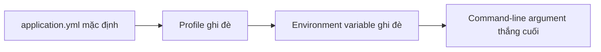
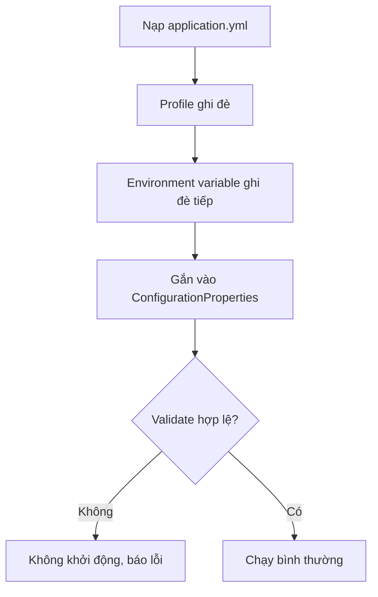
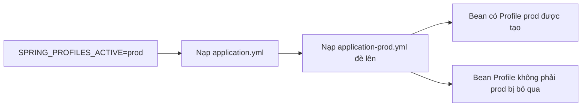

# Lý thuyết 11: Cấu hình, Profile và ConfigurationProperties

## Cấu hình là gì và vì sao phải tách khỏi code?

Mỗi ứng dụng có những giá trị thay đổi theo môi trường: port chạy, URL database, secret key, địa chỉ dịch vụ ngoài. Bài này nói về cách đưa các giá trị đó vào ứng dụng và đổi chúng giữa các môi trường (dev, test, prod) **mà không sửa code**.

Nếu hard-code URL hay mật khẩu trong code thì mỗi môi trường phải build lại một bản riêng, và rất dễ lỡ commit secret lên git. Nguyên tắc **12-factor** (bộ nguyên tắc xây dựng ứng dụng đám mây) đề ra hướng khác: cùng một artifact (một file JAR) chạy ở mọi môi trường, chỉ khác cấu hình bên ngoài. Hình dung một chiếc máy giặt: cùng một máy, bạn xoay núm chọn chế độ thay vì mua máy khác cho mỗi loại quần áo.

**Cốt lõi:** Giá trị khác nhau theo môi trường phải nằm ngoài artifact để cùng một JAR chạy ở mọi nơi. Boot gom mọi nguồn vào `Environment` rồi xếp chồng theo ưu tiên, nguồn càng gần người vận hành lúc deploy càng thắng.

- Vì đổi cấu hình lúc deploy không được build lại, nên command-line argument và environment variable thắng file trong JAR.
- Vì giá trị không đổi thường do nguồn cao hơn đang thắng, nên hãy tìm nguồn đó trước khi sửa tiếp file.
- Vì cấu hình sai nên bị chặn ngay lúc khởi động, nên key bắt buộc không đặt mặc định và được validate khi bind.



Mô hình tư duy: cấu hình là các lớp xếp chồng, lớp trên cùng quyết định giá trị bạn thực sự nhận.

**Tóm tắt:**

- Giá trị thay đổi theo môi trường phải nằm ngoài code; cùng một artifact chạy mọi môi trường (12-factor).
- Mọi nguồn được gom vào `Environment` và xếp chồng theo ưu tiên: command-line argument thắng nhất, rồi system property, environment variable, `application-{profile}.yml`, `application.yml`.
- Sửa file mà giá trị không đổi thì tìm nguồn cao hơn đang thắng.
- Profile chọn file `application-{profile}.yml` và chọn bean `@Profile` nào được tạo; không bật profile thì dùng `default`.
- `@ConfigurationProperties` (record kèm `@Validated`) tốt hơn `@Value` cho nhóm cấu hình: type-safe, gom nhóm, validate, relaxed binding.
- Validate lúc khởi động để fail fast; key bắt buộc không đặt mặc định.
- Secret không commit vào file; dùng environment variable hoặc secret manager.
- Đổi hành vi theo môi trường bằng bean theo profile, không `if (profile == prod)` trong code nghiệp vụ.

## Khi nào dùng cách nào

Mọi ứng dụng thực tế đều cần. Quy tắc làm việc: để giá trị mặc định trong `application.yml`; tách khác biệt theo môi trường bằng profile; ghi đè bằng environment variable lúc deploy; gom các nhóm cấu hình thành object có kiểu bằng `@ConfigurationProperties`. Giá trị nhạy cảm (mật khẩu, key) thì đưa qua environment variable hoặc secret manager, tuyệt đối không để trong file commit lên repo.

## Các khái niệm cần biết

- **Property**: một cặp key và value cấu hình, ví dụ `server.port=8080`. Spring gom property từ nhiều nguồn vào một object gọi là `Environment`.
- **Profile**: nhãn tên cho một môi trường (`dev`, `prod`). Bật profile nào thì file `application-{profile}.yml` và bean gắn `@Profile` tương ứng có hiệu lực.
- **`@ConfigurationProperties`**: gắn một nhóm property có cùng tiền tố vào một class (hoặc record) có kiểu. Dùng khi cần gom nhóm, kiểm tra hợp lệ, và có kiểu `Duration`, `List`.
- **Relaxed binding**: Boot chấp nhận nhiều cách viết cho cùng một key (`from-address`, `fromAddress`, `FROM_ADDRESS`), để cấu hình trong YAML và environment variable đều khớp.
- **Placeholder `${...}`**: cú pháp tham chiếu một property hoặc environment variable, có thể có giá trị mặc định sau dấu `:`.
- **Fail fast**: kiểm tra cấu hình ngay lúc khởi động và từ chối chạy nếu sai, thay vì để lỗi xuất hiện lúc có người dùng.
- **Secret manager**: nơi lưu secret có kiểm soát truy cập (Vault, Kubernetes Secret) để không phải để mật khẩu trong file.

## Thứ tự ưu tiên (cao xuống thấp, rút gọn)

1. Command-line argument (`--server.port=9000`)
2. System property của Java (`-Dserver.port=9000`)
3. Environment variable (`SERVER_PORT=9000`)
4. `application-{profile}.yml`
5. `application.yml`
6. Giá trị mặc định trong code

Nguồn ưu tiên cao ghi đè nguồn thấp. Vì vậy ở production, ghi đè bằng environment variable là cách thông dụng. Hiện tượng hay gặp: bạn sửa `application.yml` mà giá trị không đổi, vì một environment variable hoặc command-line argument cùng key đang thắng. (Danh sách thực tế của Boot dài hơn; đây là các nguồn bạn gặp thường xuyên nhất.)

**Phải thuộc:** thứ tự ưu tiên từ cao xuống thấp: command-line argument, system property (`-D`), environment variable, `application-{profile}.yml`, `application.yml`, mặc định trong code. Nguồn cao ghi đè nguồn thấp; environment variable `SERVER_PORT` khớp key `server.port` nhờ relaxed binding.

**Nền tảng:** cùng một artifact chạy ở mọi môi trường, chỉ khác cấu hình bên ngoài (12-factor). Mọi nguồn cấu hình được gom vào `Environment`, và Boot chỉ cần "xếp chồng" chúng theo thứ tự ưu tiên; hiểu thế thì mọi câu hỏi "sao giá trị không đổi" đều trả lời được bằng cách tìm nguồn đang thắng.

## Flowchart

Sơ đồ dưới cho thấy cấu hình được xếp chồng thế nào rồi được kiểm tra trước khi ứng dụng chạy.



Đọc sơ đồ: Boot nạp file mặc định, chồng profile lên, rồi chồng environment variable lên; sau đó gắn kết quả vào object `@ConfigurationProperties` và validate. Sai ở bước này thì ứng dụng không khởi động, đúng ý nghĩa fail fast.

**Suy luận:** Cùng một artifact phải chạy ở mọi môi trường, nên mọi giá trị khác nhau theo môi trường phải nằm ngoài artifact; và vì môi trường nào cũng đặt giá trị theo cách riêng của nó (file, environment variable, command-line argument), Boot cần một quy tắc chung để giải quyết xung đột. Quy tắc đó là thứ tự ưu tiên: nguồn càng gần người vận hành lúc deploy (command-line argument, environment variable) càng thắng, vì đó là chỗ đổi được mà không phải build lại, còn file trong JAR chỉ là mặc định. Hệ quả: khi sửa `application.yml` mà giá trị không đổi, nguyên nhân gần như luôn là một nguồn cao hơn cùng key đang thắng, nên việc đầu tiên là tìm nguồn đang thắng thay vì sửa tiếp file. Profile thêm một chiều nữa: nó vừa chọn file `application-{profile}.yml` vừa chọn bean nào được tạo, nên đổi hành vi theo môi trường bằng bean sạch hơn nhiều so với `if (profile == prod)`, vì code nghiệp vụ không phải biết mình đang chạy ở đâu. Điểm dễ nhầm là đặt giá trị mặc định cho mọi key: với secret, mặc định làm ứng dụng khởi động được với giá trị sai thay vì dừng lại, nên key bắt buộc không được đặt mặc định để fail fast. Hệ quả hành động: đưa secret qua environment variable hoặc secret manager, bind vào `@ConfigurationProperties` có `@Validated`, và khi debug hãy xem nguồn nào đang thắng (endpoint `env` của Actuator, hoặc `--debug`) trước khi đoán.

## ConfigurationProperties kiểu record

Hãy xem ví dụ sau: một nhóm cấu hình mail, có ràng buộc và giá trị mặc định.

```java
@ConfigurationProperties(prefix = "app.mail")
@Validated
public record MailProperties(
        @NotBlank String host,
        @Min(1) @Max(65535) int port,
        @DefaultValue("noreply@example.com") String from) {}
```

```yaml
app:
  mail:
    host: smtp.example.com
    port: 587
```

Bật bằng `@ConfigurationPropertiesScan` hoặc `@EnableConfigurationProperties(MailProperties.class)`. Relaxed binding: `app.mail.from-address`, `APP_MAIL_FROMADDRESS` đều khớp `fromAddress`.

### Cấu trúc lồng nhau, danh sách, Duration

```java
@ConfigurationProperties(prefix = "app.client")
public record ClientProperties(
        String baseUrl,
        Duration timeout,                 // "5s", "500ms", "PT5S"
        List<String> allowedOrigins,
        Retry retry) {

    public record Retry(int maxAttempts, Duration backoff) {}
}
```

```yaml
app:
  client:
    base-url: https://partner.example.com
    timeout: 5s
    allowed-origins:
      - https://a.example.com
      - https://b.example.com
    retry:
      max-attempts: 3
      backoff: 200ms
```

Record có một constructor thì Boot tự dùng constructor binding, không cần `@ConstructorBinding`. Tiêm `ClientProperties` vào service qua constructor như mọi bean.

### `@Value` và `@ConfigurationProperties`

Cả hai đều đọc property, nhưng phù hợp cho quy mô khác nhau.

| | `@Value("${app.x}")` | `@ConfigurationProperties` |
|---|---|---|
| Phạm vi | Một giá trị | Cả nhóm có cấu trúc |
| Kiểu phức tạp (List, Duration, lồng nhau) | Khó | Dễ |
| Relaxed binding | Hạn chế | Đầy đủ |
| Validate | Không | `@Validated` |
| Dùng khi | Một giá trị đơn giản, có SpEL | Gần như mọi trường hợp khác |

## Profile

Vấn đề đặt ra: ở dev bạn muốn gửi mail giả (ghi log), còn ở prod phải gửi mail thật. Profile cho phép bật bean khác nhau theo môi trường mà không sửa code nghiệp vụ.

```java
@Configuration
@Profile("dev")
class DevConfig { /* bean chỉ có ở dev */ }
```

Bật profile: `SPRING_PROFILES_ACTIVE=prod` hoặc `--spring.profiles.active=prod`.

`@Profile` đặt được trên cả method `@Bean`, ví dụ bean gửi mail thật chỉ có ở `prod`, bản giả ở `dev`:

```java
@Configuration
class MailConfig {
    @Bean @Profile("prod")
    MailSender smtpSender() { return new SmtpMailSender(); }

    @Bean @Profile("!prod")
    MailSender logSender() { return new LogMailSender(); }
}
```



Đọc sơ đồ: profile tác động ở hai nơi cùng lúc, file cấu hình và việc bean nào được tạo. Không bật profile nào thì Boot dùng profile `default`.

**Phải thuộc:** bật profile bằng `spring.profiles.active` (hoặc `SPRING_PROFILES_ACTIVE`, `--spring.profiles.active=prod`); `@Profile("!prod")` nghĩa là mọi profile trừ `prod`; trong một file YAML nhiều tài liệu dùng `spring.config.activate.on-profile`.

### Cấu hình theo profile trong YAML

Hai cách, kết quả tương đương:

```yaml
# application.yml (một file, nhiều tài liệu phân cách bằng ---)
server:
  port: 8080
---
spring:
  config:
    activate:
      on-profile: prod
server:
  port: 80
```

Hoặc tách file: `application-prod.yml` chỉ chứa phần khác biệt. Key nào không khai báo ở profile thì lấy từ `application.yml`.

### Secret và import cấu hình

Khi nạp secret, đừng ghi giá trị thật vào file. Dùng placeholder để lấy từ môi trường: key nào bắt buộc thì không đặt mặc định, để thiếu là lỗi ngay lúc khởi động.

```yaml
spring:
  datasource:
    # lấy environment variable, có giá trị mặc định sau dấu :
    url: ${DB_URL:jdbc:h2:mem:dev}
    password: ${DB_PASSWORD}            # không có mặc định: thiếu thì lỗi khi khởi động
  config:
    # nạp thêm file ngoài, optional: không có cũng không lỗi
    import: optional:file:./local.yml
```

### Ghi đè trong test

Test thường cần giá trị khác môi trường thật (timeout ngắn, DB giả). Có thể ghi đè ngay trên annotation của test.

```java
@SpringBootTest(properties = "app.client.timeout=1s")
@ActiveProfiles("test")
class ClientPropertiesTest {
    @Autowired ClientProperties props;

    @Test
    void overrides() {
        assertEquals(Duration.ofSeconds(1), props.timeout());
    }
}
```

Dùng `@TestPropertySource` hoặc `@DynamicPropertySource` (với Testcontainers) khi cần giá trị động. Xem [Testing cơ bản](/go?p=01-Spring-Boot%2Feasy%2Flt-12-testing-co-ban.md).

## Điều cần nhớ

- `@ConfigurationProperties` tốt hơn nhiều `@Value`: có kiểu, gom nhóm, validate, có metadata cho IDE.
- Validate cấu hình để **fail fast**: thiếu key thì không cho khởi động, thay vì lỗi lúc 3 giờ sáng.
- Không commit secret vào `application.yml`; dùng environment variable hoặc secret manager (Vault, Kubernetes Secret).
- Đừng nhồi `if (profile == prod)` vào code nghiệp vụ; đổi hành vi bằng bean theo profile.

## Phỏng vấn khó: chuỗi hỏi xoáy

Người phỏng vấn senior thường mở bằng câu dễ rồi xoáy xuống cơ chế, đánh đổi và sự cố thật. Câu trả lời tốt luôn đi từ cốt lõi xuống.

### Chuỗi 1: Giá trị cấu hình không đổi dù đã sửa file

1. **Câu mở:** Tôi sửa `server.port` trong `application.yml` mà ứng dụng vẫn chạy port cũ. Bạn kiểm tra gì?
2. **Xoáy 1:** Thứ tự ưu tiên là gì, và environment variable `SERVER_PORT` khớp key `server.port` bằng cách nào?
3. **Xoáy 2:** Profile `prod` đang bật và `application-prod.yml` chỉ khai báo vài key. Key còn lại lấy từ đâu, và không bật profile nào thì sao?

**Đáp án ngắn:** Gần như luôn là một nguồn cao hơn cùng key đang thắng, nên việc đầu tiên là tìm nguồn đó thay vì sửa tiếp file. Mọi nguồn gom vào `Environment` và xếp chồng: command-line argument, system property, environment variable, `application-{profile}.yml`, `application.yml`, rồi mặc định trong code. Đây là rút gọn; danh sách thực tế dài hơn. Cùng một JAR chạy ở mọi môi trường, nên nguồn càng gần người vận hành lúc deploy càng thắng, vì đổi được mà không phải build lại. `SERVER_PORT` khớp `server.port` nhờ relaxed binding. File profile chỉ chứa phần khác biệt; key không khai báo ở đó vẫn lấy từ `application.yml`. Không bật profile nào thì Boot dùng profile `default`. Khi debug, xem endpoint `env` của Actuator hoặc chạy với `--debug`.

**Sai lầm hay gặp:**
- Sửa đi sửa lại file thay vì tìm nguồn đang thắng.
- Đọc thuộc thứ tự nhưng không giải thích được vì sao command-line và environment variable thắng.
- Nghĩ file profile phải khai báo đầy đủ mọi key.

### Chuỗi 2: Validate, secret và đổi hành vi theo môi trường

1. **Câu mở:** Vì sao `@ConfigurationProperties` thường tốt hơn `@Value`?
2. **Xoáy 1:** Thiếu một key bắt buộc thì chuyện gì xảy ra, và vì sao `password: ${DB_PASSWORD}` không nên có giá trị mặc định?
3. **Xoáy 2:** Dev gửi mail giả, prod gửi mail thật. Bạn làm thế nào, và secret để ở đâu?

**Đáp án ngắn:** `@ConfigurationProperties` gom cả nhóm property thành một object có kiểu như `Duration` hay `List`, hỗ trợ relaxed binding đầy đủ và validate bằng `@Validated`; `@Value` chỉ hợp cho một giá trị đơn giản hoặc có SpEL. Sau khi xếp chồng nguồn, Boot bind vào object rồi validate; sai thì ứng dụng không khởi động, đúng ý fail fast. Với secret, giá trị mặc định làm ứng dụng khởi động được với giá trị sai thay vì dừng lại, nên key bắt buộc không đặt mặc định để thiếu là lỗi ngay. Secret không commit vào file mà đưa qua environment variable hoặc secret manager như Vault, Kubernetes Secret. Đổi hành vi theo môi trường thì khai báo hai bean gắn `@Profile("prod")` và `@Profile("!prod")`, để code nghiệp vụ không phải biết mình đang chạy ở đâu.

**Sai lầm hay gặp:**
- Đặt mặc định cho mọi key, kể cả secret, nên cấu hình sai chỉ lộ ra lúc 3 giờ sáng.
- Viết `if (profile == prod)` trong code nghiệp vụ.
- Để mật khẩu thật trong `application.yml` rồi commit.

