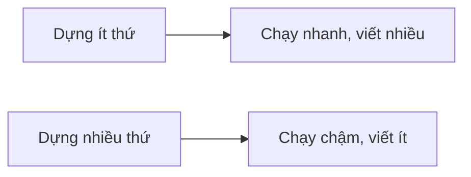
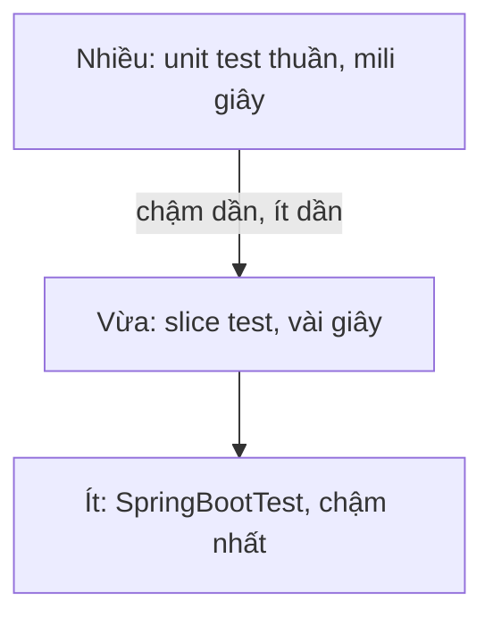
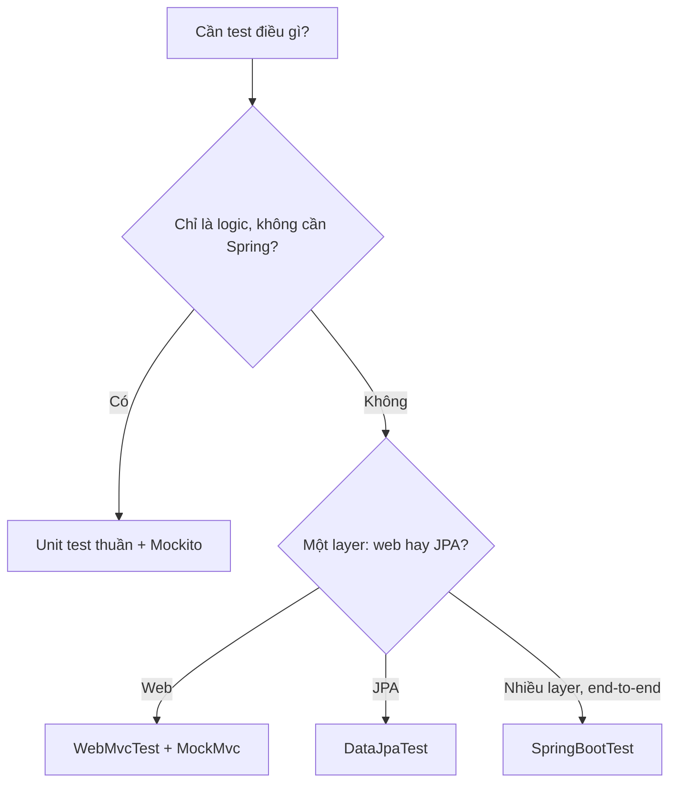

# Lý thuyết 12: Testing cơ bản trong Spring

## Test trong Spring: ba kiểu theo độ rộng

Test tự động là cách bạn biết code vẫn đúng sau mỗi lần sửa. Trong Spring Boot có ba kiểu test, phân biệt theo việc chúng nạp bao nhiêu phần của ứng dụng:

1. **Unit test thuần**: không dùng Spring, chỉ tạo class bằng `new` với dependency giả. Nhanh nhất (mili giây).
2. **Slice test**: chỉ nạp một layer của ứng dụng, ví dụ chỉ phần web (`@WebMvcTest`) hoặc chỉ phần JPA (`@DataJpaTest`). Mất vài giây.
3. **Integration test**: nạp cả ứng dụng như thật (`@SpringBootTest`). Chậm nhất, nhưng kiểm tra được mọi thứ nối với nhau đúng chưa.

**Cốt lõi:** Chi phí của một test tăng theo lượng thứ nó phải dựng. Vì vậy dồn phần lớn test về nơi rẻ nhất, và chỉ giữ ít test rộng để kiểm tra chỗ các thành phần nối với nhau.

- Vì unit test chỉ cần `new`, nên constructor injection cho phép test service bằng mock mà không cần Spring.
- Vì test càng rộng càng chậm và khó định vị lỗi, nên chọn kiểu hẹp nhất đủ kiểm tra điều cần.
- Vì Spring dùng lại context khi cấu hình giống nhau, nên mỗi tập mock khác hoặc `@DirtiesContext` tạo context mới và làm bộ test chậm dần.



Mô hình tư duy: số lượng test của mỗi kiểu tỉ lệ nghịch với chi phí dựng của nó.

**Tóm tắt:**

- Ba kiểu test theo độ rộng: unit test thuần (mili giây), slice test (vài giây), `@SpringBootTest` (chậm nhất).
- Test pyramid: nhiều test nhanh ở đáy, ít test chậm ở đỉnh.
- Nhờ constructor injection, service test được bằng `new` và mock, không cần Spring.
- `@WebMvcTest` chỉ nạp web layer, dùng `MockMvc`, service được thay bằng `@MockitoBean`.
- `@DataJpaTest` nạp JPA, dùng DB nhúng và rollback sau mỗi test.
- `@SpringBootTest` mặc định là `MOCK` (không mở port); `RANDOM_PORT` mới chạy server thật.
- Spring cache context; mỗi tập mock khác nhau hoặc `@DirtiesContext` tạo context mới và làm bộ test chậm.
- Test hành vi quan sát được, không test chi tiết cài đặt.

## Vì sao không viết toàn `@SpringBootTest`

Nếu viết mọi test dưới dạng `@SpringBootTest` thì mỗi lần chạy mất cả phút vì phải dựng toàn bộ container và kết nối DB. Khi đó dev lười chạy test, rồi bỏ luôn, và test mất tác dụng. Test nhanh và đáng tin mới giúp bạn dám refactor.

## Khi nào dùng kiểu nào

Viết test cùng lúc với code và chạy ở mỗi lần build. Kiểu test càng rộng thì càng chậm nên càng viết ít. Mặc định dùng unit test thuần cho logic; dùng slice (`@WebMvcTest`, `@DataJpaTest`) để test từng layer; chỉ dùng `@SpringBootTest` cho vài flow quan trọng chạy end-to-end. Không dùng slice hoặc tích hợp để kiểm tra một phép tính thuần, vì dựng Spring chỉ để chạy một biểu thức là lãng phí.

## Các khái niệm cần biết

- **Mock**: object giả thay thế dependency thật trong test, cho phép bạn quy định nó trả gì (`when(...).thenReturn(...)`) và kiểm tra nó có được gọi không. Thư viện phổ biến là Mockito.
- **`MockMvc`**: công cụ giả lập một request HTTP tới controller mà không cần mở port mạng thật. Dùng trong `@WebMvcTest`.
- **`@MockitoBean` (Boot 4: duy nhất; `@MockBean` đã bị bỏ)**: thay một bean trong context bằng mock. Dùng trong slice test để cô lập layer đang test.
- **Slice test**: chỉ nạp những bean thuộc một layer, nên nhanh hơn nhiều so với cả ứng dụng.
- **Context cache**: Spring giữ lại context đã dựng và dùng lại cho các test có cấu hình giống nhau, để khỏi dựng lại. Phá cache làm bộ test chậm hẳn.
- **Rollback sau mỗi test**: test chạy trong một transaction rồi hoàn tác, để dữ liệu của test này không ảnh hưởng test khác.
- **Testcontainers**: thư viện chạy database hoặc broker thật trong container Docker ngay trong test, để kiểm thử gần với production.

## Test pyramid

Test pyramid mô tả tỉ lệ số lượng test: nhiều test nhanh ở đáy, ít test chậm ở đỉnh.



Đọc sơ đồ: càng đi xuống phía dưới, test càng nhanh và càng nhiều; càng lên cao, test càng chậm và càng ít. Một bộ test đảo ngược (nhiều integration test, ít unit test) sẽ chậm và khó chỉ ra lỗi nằm ở đâu.

**Nền tảng:** càng nạp nhiều Spring thì test càng chậm và càng khó định vị lỗi, nên chọn kiểu test hẹp nhất đủ kiểm tra điều bạn cần. Nhờ constructor injection, logic nghiệp vụ test được bằng `new` và mock mà không cần Spring.

**Suy luận:** Chi phí của một test tăng theo lượng thứ nó phải dựng: unit test chỉ cần `new`, slice test dựng một layer, `@SpringBootTest` dựng cả context và thường cả database. Chi phí cao thì chạy ít lần, test chạy ít thì phát hiện lỗi muộn, nên suy ra phải dồn phần lớn test về nơi rẻ nhất. Ngược lại, thứ mà test rẻ không kiểm tra được là chỗ các thành phần nối với nhau, như mapping URL, serialize JSON hay transaction thật, nên vẫn cần một ít test rộng hơn; đó chính là hình dạng của test pyramid. Constructor injection đóng vai trò quyết định ở đáy: nhờ nó, service dựng được bằng `new` với mock mà không cần container. Điểm dễ nhầm là context cache: Spring dùng lại context giữa các test có cấu hình giống nhau, nhưng mỗi tập `@MockitoBean` hoặc `@MockBean` khác nhau, mỗi `@DirtiesContext` hay property khác nhau đều tạo ra một context mới, nên bộ test chậm dần mà không ai thấy lý do. Hệ quả hành động: bắt đầu bằng kiểu test hẹp nhất đủ kiểm tra điều cần kiểm tra, gom các mock vào một base class chung để tái dùng context, và dành `@SpringBootTest` cho vài flow end-to-end thật sự cần.

## Unit test: không cần Spring

Nhờ constructor injection, test chỉ việc truyền bản giả:

```java
@ExtendWith(MockitoExtension.class)
class TodoServiceTest {
    @Mock TodoRepository repository;
    @InjectMocks TodoService service;

    @Test
    void findById_notFound_throws() {
        when(repository.findById(1L)).thenReturn(Optional.empty());
        assertThrows(TodoNotFoundException.class, () -> service.findById(1L));
    }
}
```

## Slice test: chỉ nạp một slice

Vấn đề đặt ra: muốn kiểm tra URL, JSON và status của controller nhưng không muốn dựng service và database thật. `@WebMvcTest` chỉ nạp web layer; service được thay bằng mock.

```java
@WebMvcTest(TodoController.class)
class TodoControllerTest {
    @Autowired MockMvc mvc;
    @MockitoBean TodoService service;   // Spring Boot 3.4+ và Boot 4; Boot 3.3 trở về trước dùng @MockBean

    @Test
    void get_returns200() throws Exception {
        when(service.findById(1L)).thenReturn(new TodoResponse(1L, "Học Spring", false));
        mvc.perform(get("/api/todos/1"))
           .andExpect(status().isOk())
           .andExpect(jsonPath("$.title").value("Học Spring"));
    }
}
```

### Test POST và kiểm tra dữ liệu

```java
@Test
void create_invalidBody_returns400() throws Exception {
    mvc.perform(post("/api/todos")
            .contentType(MediaType.APPLICATION_JSON)
            .content("{\"title\":\"\"}"))          // title rỗng, vi phạm @NotBlank
       .andExpect(status().isBadRequest());
}

@Test
void create_ok_returns201() throws Exception {
    when(service.create(any())).thenReturn(new TodoResponse(2L, "Mới", false));
    mvc.perform(post("/api/todos")
            .contentType(MediaType.APPLICATION_JSON)
            .content("{\"title\":\"Mới\"}"))
       .andExpect(status().isCreated())
       .andExpect(jsonPath("$.id").value(2));
}
```

Import tĩnh: `MockMvcRequestBuilders.*`, `MockMvcResultMatchers.*`, `Mockito.*`, `ArgumentMatchers.any`. Nếu có Spring Security trong classpath thì `@WebMvcTest` bật cả security: thêm `@WithMockUser` hoặc cấu hình riêng, xem [Spring Security chuyên sâu](/go?p=01-Spring-Boot%2Fhard%2Flt-35-spring-security-chuyen-sau.md).

## Test repository: `@DataJpaTest`

Dùng khi muốn kiểm tra query và mapping entity có đúng không, mà không cần web layer.

```java
@DataJpaTest
class TodoRepositoryTest {
    @Autowired TodoRepository repository;

    @Test
    void findByDone_returnsOnlyMatching() {
        repository.save(new Todo("A", true));
        repository.save(new Todo("B", false));

        List<Todo> done = repository.findByDone(true);

        assertThat(done).extracting(Todo::getTitle).containsExactly("A");
    }
}
```

Mặc định `@DataJpaTest` thay DataSource bằng DB nhúng (H2 nếu có trên classpath) và **rollback sau mỗi test**. Muốn dùng đúng DB thật (PostgreSQL qua Testcontainers) thì thêm `@AutoConfigureTestDatabase(replace = Replace.NONE)`; xem [Advanced testing](/go?p=01-Spring-Boot%2Fhard%2Flt-27-advanced-testing.md). Lưu ý: `save` chưa chắc chạy SQL ngay, gọi `repository.flush()` nếu test cần thấy lỗi ràng buộc.

## Integration test: `@SpringBootTest`

Dùng khi cần xác nhận mọi thành phần nối với nhau đúng (cấu hình, transaction, serialize thật), điều mà test từng layer không thấy được.

```java
@SpringBootTest(webEnvironment = SpringBootTest.WebEnvironment.RANDOM_PORT)
class TodoApiIT {
    @Autowired TestRestTemplate rest;

    @Test
    void createThenGet() {
        ResponseEntity<TodoResponse> created =
                rest.postForEntity("/api/todos", new CreateTodoRequest("Học"), TodoResponse.class);
        assertThat(created.getStatusCode()).isEqualTo(HttpStatus.CREATED);

        TodoResponse got = rest.getForObject("/api/todos/" + created.getBody().id(), TodoResponse.class);
        assertThat(got.title()).isEqualTo("Học");
    }
}
```

Chạy qua server thật trên port ngẫu nhiên, đi hết controller, service, DB. Chỉ giữ vài flow chính.



Đọc sơ đồ: luôn thử nhánh nhanh nhất trước; chỉ chuyển sang kiểu rộng hơn khi kiểu hẹp không kiểm tra được điều bạn cần.

## Chọn kiểu test

| Muốn kiểm tra | Dùng |
|---|---|
| Logic nghiệp vụ, rẽ nhánh | Unit test thuần + Mockito |
| Mapping URL, JSON, status, validation | `@WebMvcTest` + MockMvc |
| Query, mapping entity | `@DataJpaTest` |
| Cấu hình nối đúng, flow end-to-end | `@SpringBootTest` |

| Annotation | Nạp gì |
|---|---|
| `@WebMvcTest` | Controller, converter, filter; không nạp service/repository |
| `@DataJpaTest` | Entity, repository, DB nhúng hoặc Testcontainers |
| `@JsonTest` | Chỉ phần serialize/deserialize JSON |
| `@SpringBootTest` | Toàn bộ ứng dụng |

**Phải thuộc:** `@WebMvcTest` chỉ nạp web layer (dùng `MockMvc`, service phải mock bằng `@MockitoBean`, Boot 3.4 trở lên; trước đó `@MockBean`). `@DataJpaTest` nạp JPA, thay DB bằng DB nhúng và rollback sau mỗi test. `@SpringBootTest` nạp cả ứng dụng, `webEnvironment` mặc định là `MOCK` (không mở port), `RANDOM_PORT` mới chạy server thật.

## Điều cần nhớ

Phần này giải thích lý do bộ test hay chậm đi mà không ai biết nguyên nhân.

- Spring cache **context** giữa các test có cùng cấu hình. Mỗi `@MockitoBean`/`@MockBean` khác nhau tạo ra một context mới, làm bộ test chậm.
- `@DirtiesContext` phá cache context, dùng thưa thớt.
- Test nên độc lập thứ tự và dữ liệu; flaky test ("lúc được lúc không") thường do thời gian, thứ tự hoặc dữ liệu chung.
- Test hành vi (kết quả quan sát được), đừng test chi tiết cài đặt (số lần gọi hàm nội bộ).

## Phỏng vấn khó: chuỗi hỏi xoáy

Người phỏng vấn senior thường mở bằng câu dễ rồi xoáy xuống cơ chế, đánh đổi và sự cố thật. Câu trả lời tốt luôn đi từ cốt lõi xuống.

### Chuỗi 1: Chọn kiểu test và `@WebMvcTest`

1. **Câu mở:** Bạn test một service có logic rẽ nhánh và một controller. Mỗi cái dùng kiểu test nào, vì sao?
2. **Xoáy 1:** `@WebMvcTest` nạp gì và không nạp gì? Service thiếu thì chuyện gì xảy ra?
3. **Xoáy 2:** Dự án có Spring Security, test controller đột nhiên trả 401 hoặc 403. Vì sao, và `@MockBean` còn dùng được không?

**Đáp án ngắn:** Chi phí test tăng theo lượng thứ nó phải dựng, nên chọn kiểu hẹp nhất đủ kiểm tra điều cần. Logic nghiệp vụ test bằng unit test thuần: nhờ constructor injection, chỉ cần `new` với mock, không cần Spring. Controller thì dùng `@WebMvcTest` với `MockMvc` để kiểm tra mapping URL, JSON, status và validation. Nó chỉ nạp web layer (controller, converter, filter), không nạp service hay repository, nên service phải được thay bằng mock, nếu không context không dựng được. Nếu có Spring Security trên classpath thì slice này bật cả security, nên request giả bị chặn; cần `@WithMockUser` hoặc cấu hình riêng. Về mock bean: `@MockitoBean` dùng từ Boot 3.4 trở lên; `@MockBean` dùng ở Boot 3.3 trở về trước và đã bị bỏ ở Boot 4. `@SpringBootTest` giữ cho vài flow end-to-end.

**Sai lầm hay gặp:**
- Viết mọi test bằng `@SpringBootTest` rồi than bộ test chậm.
- Dùng slice hoặc test tích hợp để kiểm tra một phép tính thuần.
- Không biết `@WebMvcTest` bật security và không nạp service.

### Chuỗi 2: Bộ test chậm dần và `@DataJpaTest`

1. **Câu mở:** Bộ test từ vài giây lên mười mấy phút mà không ai thêm nhiều test. Bạn nghi ngờ gì?
2. **Xoáy 1:** Context cache hoạt động thế nào, và cái gì phá nó?
3. **Xoáy 2:** Trong `@DataJpaTest`, `save` một bản ghi vi phạm ràng buộc nhưng test vẫn xanh. Vì sao, và DB nhúng khác DB thật ở điểm nào cần cẩn thận?

**Đáp án ngắn:** Nghi ngờ đầu tiên là context cache bị phá. Spring giữ context đã dựng và dùng lại cho các test có cấu hình giống nhau. Mỗi tập `@MockitoBean` hoặc `@MockBean` khác nhau, mỗi property khác và mỗi `@DirtiesContext` đều tạo context mới, nên bộ test chậm dần mà không ai thấy lý do. Cách khắc phục là gom các mock vào một base class chung, dùng `@DirtiesContext` thưa thớt. `@DataJpaTest` chạy trong transaction rồi rollback sau mỗi test để test độc lập nhau. Vì vậy `save` chưa chắc chạy SQL ngay, nên lỗi ràng buộc chưa lộ; gọi `repository.flush()` khi cần thấy lỗi. Mặc định nó thay DataSource bằng DB nhúng như H2, có thể hành xử khác PostgreSQL thật; muốn sát production thì dùng Testcontainers kèm `@AutoConfigureTestDatabase(replace = Replace.NONE)`.

**Sai lầm hay gặp:**
- Đổ lỗi bộ test chậm cho "máy yếu" mà không kiểm tra context cache.
- Tin test xanh dù lỗi ràng buộc chưa được flush xuống DB.
- Test chi tiết cài đặt như số lần gọi hàm nội bộ thay vì hành vi quan sát được.

