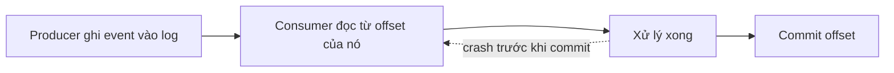
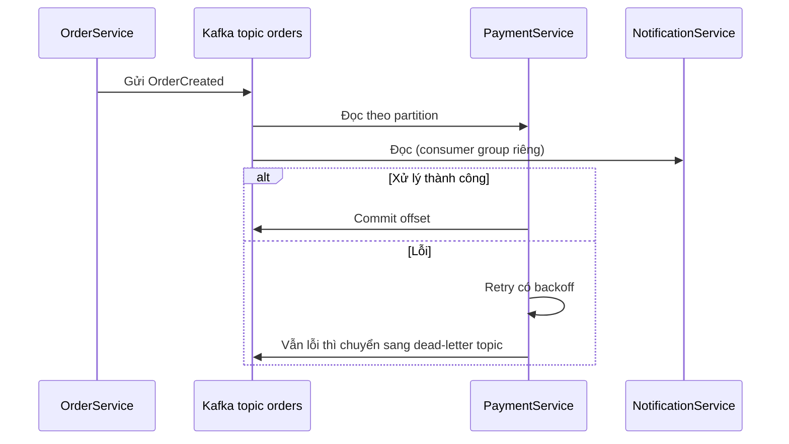
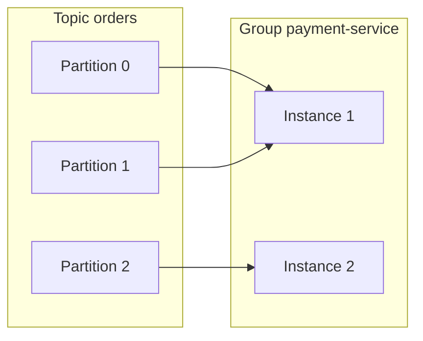
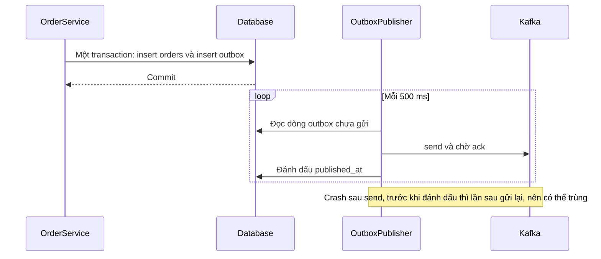
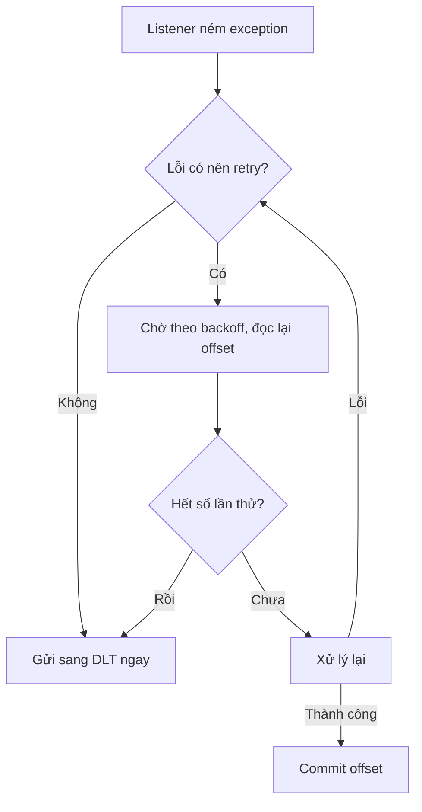

# Lý thuyết 7: Kiến trúc hướng sự kiện với Kafka

## Kiến trúc hướng event là gì?

Thay vì service này gọi API của service kia, các service nói chuyện với nhau bằng **event**: một thông báo "chuyện này vừa xảy ra", ví dụ `OrderCreated`. Service tạo đơn chỉ đẩy event vào Kafka, còn service nào quan tâm (thanh toán, thông báo, phân tích) thì tự đọc. Hình dung bảng tin chung ở văn phòng: người đăng không cần biết ai sẽ đọc, và ai cần thì tự đến xem.

**Cốt lõi:** Service ghi event vào một log chỉ ghi thêm của Kafka, còn consumer tự nhớ vị trí đọc (offset), nên producer không cần biết ai đọc. Đổi lại, việc không mất và không trùng message phải do thiết kế của bạn bảo đảm.

- Vì offset chỉ được commit sau khi xử lý xong, nên crash giữa hai bước làm message giao lại, và consumer phải idempotent.
- Vì không có đồng hồ chung giữa các partition, nên thứ tự chỉ giữ trong một partition, và cùng key mới cùng partition.
- Vì lưu DB và gửi Kafka là hai hệ thống không có transaction chung, nên outbox ghi event cùng transaction DB rồi gửi sau.



Mô hình tư duy: vòng đọc, xử lý, commit cho thấy vì sao giao nhận là at-least-once và nhận trùng là chuyện bình thường.

**Tóm tắt:**

- Các service giao tiếp bằng event qua Kafka thay vì gọi trực tiếp, nên producer không cần biết ai đọc và một service chết không kéo theo service khác.
- Kafka chỉ bảo đảm thứ tự trong một partition; cùng key thì cùng partition, nên dùng `orderId` làm key để giữ thứ tự event của một đơn.
- Trong một consumer group mỗi partition chỉ có một consumer, nên số consumer hữu ích tối đa bằng số partition; mỗi group khác nhau nhận đủ bản của topic.
- Giao nhận mặc định là at-least-once, nên consumer phải idempotent, cách chắc chắn là ghi `event_id` đã xử lý trong cùng transaction với tác dụng nghiệp vụ.
- Dual write (lưu DB rồi gửi Kafka) có thể mất event; outbox ghi event vào cùng transaction DB rồi gửi sau, đổi "có thể mất" lấy "có thể trùng".
- Message lỗi được retry có backoff rồi chuyển sang dead-letter topic; lỗi vĩnh viễn nên sang DLT ngay, không retry.
- Không dùng hướng event khi cần kết quả tức thì cho người gọi, vì nó kéo theo trùng lặp, thứ tự và eventual consistency.

## Vấn đề nó giải quyết

Khi gọi trực tiếp, service A phải biết địa chỉ và cách gọi của B, C, D. B chết hoặc chậm thì A cũng bị kéo theo: request của người dùng treo hoặc lỗi dây chuyền. Qua Kafka thì các bên tách khỏi nhau: A chỉ cần ghi vào Kafka. Khi tải tăng đột biến, event được xếp vào queue đệm trong Kafka và consumer xử lý theo sức của mình. Muốn thêm một service mới quan tâm tới đơn hàng thì chỉ cần thêm consumer mới, không phải sửa producer.

## Khi nào dùng, khi nào không

Dùng cho flow asynchronous, đồng bộ dữ liệu giữa các service, thông báo, và phân tích. Không dùng khi cần trả kết quả ngay cho người gọi (kiểm tra tồn kho để báo "còn hàng" tức thì): gọi trực tiếp đơn giản hơn nhiều, vì hướng event kéo theo độ phức tạp về trùng lặp, thứ tự, và eventual consistency. Cách làm: dùng `spring-kafka`, `KafkaTemplate` để gửi, `@KafkaListener` để nhận; chuẩn bị sẵn retry và dead-letter topic cho message xử lý lỗi; thiết kế consumer chịu được việc nhận trùng message.

## Các khái niệm cần biết

- **Topic**: một "kênh" có tên (ví dụ `orders`) chứa các event cùng loại, theo thứ tự thêm vào.
- **Partition**: topic được chia thành nhiều phân vùng để xử lý song song. Thứ tự chỉ được bảo đảm **trong một partition**.
- **Key**: giá trị đi kèm message; Kafka hash key để chọn partition, nên cùng key luôn vào cùng partition. Dùng `orderId` làm key để mọi event của một đơn giữ đúng thứ tự.
- **Offset**: số thứ tự của một message trong partition. Consumer ghi nhớ nó đã đọc tới offset nào (gọi là commit offset); sau khi khởi động lại sẽ đọc tiếp từ đó.
- **Consumer group**: tập các instance cùng một service chia nhau các partition của topic. Mỗi partition chỉ do một consumer trong group đọc; mỗi group khác nhau đọc độc lập toàn bộ topic.
- **Rebalance**: Kafka chia lại partition giữa các consumer khi có instance vào hoặc ra group. Trong lúc đó việc đọc tạm dừng.
- **At-least-once**: message chắc chắn đến nơi nhưng có thể đến nhiều hơn một lần. Hệ quả: consumer phải **idempotent**, tức xử lý một message hai lần cho kết quả như một lần.
- **Dual write**: ghi vào hai hệ thống độc lập (DB và Kafka) trong cùng một thao tác mà không có transaction chung, nên có thể một bên thành công còn bên kia thất bại.
- **Dead-letter topic (DLT)**: topic chứa các message lỗi sau khi đã thử lại hết số lần, để xử lý tay sau mà không chặn queue.
- **Backoff**: khoảng chờ giữa các lần thử lại, thường tăng dần (1 giây, 2 giây, 4 giây) để không dội tải vào hệ thống đang gặp sự cố.
- **CDC (change data capture) và WAL**: WAL là nhật ký ghi thay đổi của database; CDC đọc nhật ký đó để biết dữ liệu nào vừa đổi mà không cần truy vấn bảng.

## Flowchart

Sơ đồ dưới đây cho thấy đường đi của một event từ lúc tạo đơn tới lúc được xử lý, kể cả khi lỗi.



Đọc sơ đồ: `OrderService` chỉ gửi event rồi xong việc. Hai service đọc ở hai consumer group khác nhau nên **mỗi bên đều nhận một bản** của event. Nếu xử lý thất bại, consumer thử lại có backoff, hết lượt thì chuyển message sang dead-letter topic để các message sau không bị kẹt.

Quan hệ giữa partition và consumer trong cùng một group cũng quan trọng không kém:



Đọc sơ đồ: ba partition được chia cho hai instance; mỗi partition chỉ có một người đọc trong group. Thêm instance thứ tư vào group này cũng không tăng tốc vì chỉ có ba partition, nên instance thừa sẽ rảnh. Muốn xử lý song song hơn thì phải tăng số partition.

**Phải thuộc:** Kafka chỉ bảo đảm thứ tự trong một partition; cùng key thì cùng partition. Trong một consumer group mỗi partition chỉ có một consumer, nên số consumer hữu ích tối đa bằng số partition; mỗi group khác nhau nhận đủ bản của topic. Giao nhận mặc định là at-least-once nên consumer phải idempotent.

**Nền tảng:** Kafka là log chỉ ghi thêm, consumer tự nhớ vị trí đọc (offset) thay vì broker xóa message sau khi giao. Nhờ vậy nhiều group đọc độc lập và đọc lại được, đổi lại việc không mất message và không trùng message (exactly-once end-to-end) phải do thiết kế của bạn bảo đảm (outbox, idempotent consumer).

**Suy luận:** Vì Kafka là log chỉ ghi thêm và consumer tự giữ offset, broker không cần biết ai đã đọc gì, nên nhiều group đọc độc lập và đọc lại được. Nhưng vì offset chỉ được commit sau khi xử lý xong, một crash giữa lúc "xử lý xong" và "commit offset" làm message được giao lại; đây là lý do mặc định là at-least-once chứ không phải exactly-once. Nếu đảo thứ tự (commit trước, xử lý sau) thì crash làm mất message, tức at-most-once, thường tệ hơn nhiều với nghiệp vụ tiền bạc. Từ đó suy ra thứ tự cũng chỉ giữ trong một partition: nhiều partition cho phép nhiều consumer chạy song song, nhưng không có đồng hồ chung giữa các partition, nên chỉ cùng key mới giữ đúng thứ tự. Điểm dễ nhầm là tưởng "dùng Kafka là có exactly-once", hoặc tưởng thêm consumer luôn tăng tốc; cả hai đều sai khi số consumer vượt số partition hay khi consumer không idempotent. Hệ quả khi review: mỗi consumer phải trả lời được "nhận trùng thì sao" và "event nào cần cùng key", nếu không có câu trả lời thì thiết kế chưa xong.

## Producer và Consumer

Hãy xem cặp code tối thiểu: một bên gửi, một bên nhận.

```java
@Service
public class OrderEventPublisher {
    private final KafkaTemplate<String, OrderCreated> kafka;

    public OrderEventPublisher(KafkaTemplate<String, OrderCreated> kafka) {
        this.kafka = kafka;
    }

    public void publish(OrderCreated event) {
        kafka.send("orders", event.orderId().toString(), event);
    }
}

@Component
public class PaymentListener {
    @KafkaListener(topics = "orders", groupId = "payment-service")
    public void onOrderCreated(OrderCreated event) {
        // xử lý idempotent
    }
}
```

Dùng `orderId` làm key để mọi event của cùng đơn vào cùng partition, giữ thứ tự. Nếu để key rỗng, message được rải giữa các partition (không theo đơn) và event "hủy đơn" có thể được xử lý trước "tạo đơn".

## Transactional outbox: không mất, có thể trùng

Vấn đề dual write: lưu DB rồi gửi Kafka là hai hệ thống, không có transaction chung. Crash giữa hai bước thì đơn đã lưu mà event không bao giờ được gửi. Outbox đưa việc "ghi event" vào **cùng transaction DB** với dữ liệu; việc gửi Kafka tách ra làm sau.



```sql
create table outbox (
    id           bigserial primary key,
    event_id     uuid         not null unique,
    aggregate_id varchar(64)  not null,           -- dùng làm key Kafka
    type         varchar(100) not null,
    payload      text         not null,           -- JSON
    published_at timestamp    null
);

create table processed_events (
    event_id uuid         not null,
    consumer varchar(100) not null,
    primary key (event_id, consumer)
);
```

Phía ghi: lưu đơn và outbox trong một `@Transactional`.

```java
@Service
public class OrderService {
    private final OrderRepository orders;
    private final OutboxRepository outbox;
    private final ObjectMapper json;

    // constructor bỏ qua

    @Transactional
    public Order create(CreateOrderCmd cmd) {
        Order order = orders.save(Order.from(cmd));
        outbox.save(new OutboxEvent(UUID.randomUUID(), order.getId().toString(),
                "OrderCreated", toJson(new OrderCreated(order.getId(), order.getTotal()))));
        return order;
    }

    private String toJson(Object o) {
        try { return json.writeValueAsString(o); }
        // unchecked để rollback
        catch (JsonProcessingException e) { throw new UncheckedIOException(e); }
    }
}
```

Phía gửi: polling publisher. `for update skip locked` cho phép nhiều instance chạy song song mà không lấy trùng dòng (PostgreSQL, MySQL 8+).

```java
public interface OutboxRepository extends JpaRepository<OutboxEvent, Long> {
    @Query(value = """
            select * from outbox where published_at is null
            order by id limit 100 for update skip locked
            """, nativeQuery = true)
    List<OutboxEvent> lockPending();
}

@Component
public class OutboxPublisher {
    private final OutboxRepository repo;
    private final KafkaTemplate<String, String> kafka;

    // constructor bỏ qua

    @Scheduled(fixedDelay = 500)            // cần @EnableScheduling
    @Transactional
    public void publish() throws Exception {
        for (OutboxEvent e : repo.lockPending()) {
            var rec = new ProducerRecord<>("orders", e.getAggregateId(), e.getPayload());
            rec.headers().add("eventId", e.getEventId().toString().getBytes(StandardCharsets.UTF_8));
            kafka.send(rec).get(5, TimeUnit.SECONDS);   // chờ ack rồi mới đánh dấu
            e.markPublished(Instant.now());             // dirty checking tự update
        }
    }
}
```

Thay thế polling: CDC (Debezium đọc WAL của DB) cho độ trễ thấp và không tải thêm lên bảng. Bảng outbox cần dọn định kỳ các dòng đã gửi.

Dùng outbox khi event **bắt buộc** phải được gửi mỗi khi dữ liệu đã lưu (đơn đã tạo thì thanh toán phải biết). Không cần outbox khi mất thi thoảng một event là chấp nhận được (log hành vi, số liệu thống kê); gửi thẳng đơn giản hơn.

## Consumer idempotent với `processed_events`

Outbox cho at-least-once, nên consumer phải loại trùng. Cách chắc chắn: ghi `event_id` vào bảng có primary key **trong cùng transaction** với tác dụng nghiệp vụ. Trùng thì insert không ghi được dòng nào, bỏ qua.

```java
@Component
public class PaymentListener {
    private final PaymentHandler handler;

    @KafkaListener(topics = "orders", groupId = "payment-service")
    public void onMessage(ConsumerRecord<String, String> rec) {
        String eventId = new String(rec.headers().lastHeader("eventId").value(), StandardCharsets.UTF_8);
        handler.handle(UUID.fromString(eventId), rec.value());
    }
}

@Service
public class PaymentHandler {
    private final JdbcTemplate jdbc;

    @Transactional
    public void handle(UUID eventId, String payload) {
        int inserted = jdbc.update("""
                insert into processed_events(event_id, consumer) values (?, 'payment-service')
                on conflict do nothing""", eventId);          // cú pháp PostgreSQL
        if (inserted == 0) return;                            // đã xử lý, bỏ qua
        // ... trừ tiền, lưu payment (cùng transaction)
    }
}
```

Nếu tác dụng phụ nằm ngoài DB (call API thanh toán), transaction không bao được; khi đó phải truyền idempotency key sang hệ thống kia. Xem [Khóa phân tán và Idempotency](/go?p=01-Spring-Boot%2Fhard%2Flt-26-distributed-lock-idempotency.md).

## Retry và dead-letter topic

Vấn đề đặt ra: một message xử lý lỗi thì làm gì? Nếu bỏ qua thì mất dữ liệu; nếu thử mãi thì chặn mọi message phía sau trong partition (poison message). Cách giải quyết là thử lại có giới hạn rồi chuyển sang DLT.

Khi listener ném exception, `DefaultErrorHandler` seek lại offset và thử lại theo `BackOff`; hết số lần thì `DeadLetterPublishingRecoverer` gửi bản ghi sang topic `<topic gốc>.DLT` (cùng số partition), consumer đi tiếp. Spring Boot tự gắn bean `CommonErrorHandler` vào container factory.

```java
@Bean
CommonErrorHandler errorHandler(KafkaTemplate<Object, Object> template) {
    var backOff = new ExponentialBackOffWithMaxRetries(3);   // tối đa 3 lần thử lại
    backOff.setInitialInterval(1_000);
    backOff.setMultiplier(2.0);
    backOff.setMaxInterval(10_000);
    var handler = new DefaultErrorHandler(new DeadLetterPublishingRecoverer(template), backOff);
    handler.addNotRetryableExceptions(JsonProcessingException.class, IllegalArgumentException.class);
    return handler;
}
```



Đọc sơ đồ: lỗi vĩnh viễn (JSON hỏng) đi thẳng sang DLT vì thử lại bao nhiêu lần cũng vô ích; lỗi tạm thời được thử lại có giãn cách. Dùng bảng sau để phân loại.

| Loại lỗi | Xử lý |
|---|---|
| Tạm thời (DB timeout, API ngoài 503) | Retry có backoff |
| Vĩnh viễn (JSON hỏng, dữ liệu sai) | Không retry, sang DLT ngay |
| Retry blocking làm kẹt cả partition | Cần retry không chặn thì dùng `@RetryableTopic` (topic retry riêng) |

Bẫy: backoff tổng dài hơn `max.poll.interval.ms` (mặc định 5 phút) thì consumer bị đẩy khỏi group và rebalance. Dấu hiệu: log `CommitFailedException` hoặc rebalance liên tục. DLT phải có người theo dõi (alert theo lag) và có cách replay.

## Điểm cần nắm

- **Giao nhận at-least-once:** consumer có thể nhận trùng, phải **idempotent** (lưu `eventId` đã xử lý).
- **Consumer group:** các instance cùng group chia partition; số consumer hữu ích tối đa bằng số partition.
- **Dead-letter topic:** nơi chứa message lỗi nhiều lần để kiểm tra sau.
- **Outbox pattern:** ghi event vào bảng `outbox` cùng transaction với dữ liệu, tiến trình khác đẩy ra Kafka. Tránh trường hợp lưu DB xong nhưng gửi Kafka thất bại.
- Phiên bản schema của event (Avro/JSON Schema) để tương thích ngược.

Liên quan: [Distributed Message Queue (kiểu Kafka)](/go?p=15-System%20Design%2Fhard%2F05-distributed-message-queue.md) và [Distributed Transactions](/go?p=15-System%20Design%2Fhard%2Flt-10-distributed-transactions.md).

## Phỏng vấn khó: chuỗi hỏi xoáy

Người phỏng vấn senior thường mở bằng câu dễ rồi xoáy xuống cơ chế, đánh đổi và sự cố thật. Câu trả lời tốt luôn đi từ cốt lõi xuống.

### Chuỗi 1: At-least-once và consumer idempotent

1. **Câu mở:** Kafka bảo đảm giao nhận kiểu gì, có exactly-once không?
2. **Xoáy 1:** Vì sao crash giữa lúc xử lý và commit offset làm message bị giao lại? Đảo thứ tự thì sao?
3. **Xoáy 2:** Consumer trừ tiền nhận trùng một event. Bạn chặn thế nào, và nếu tác dụng phụ là gọi API thanh toán bên ngoài thì sao?

**Đáp án ngắn:** Mặc định là at-least-once: message chắc chắn đến nhưng có thể đến nhiều lần, và exactly-once end-to-end do thiết kế của bạn bảo đảm chứ Kafka không cho sẵn. Kafka là log chỉ ghi thêm, consumer tự giữ offset, và offset chỉ được commit sau khi xử lý xong. Crash giữa "xử lý xong" và "commit" thì lần sau đọc lại từ offset cũ, nên nhận trùng là chuyện bình thường. Nếu đảo thứ tự, commit trước rồi xử lý sau, thì crash làm mất message (at-most-once), thường tệ hơn với nghiệp vụ tiền bạc. Cách chặn trùng chắc chắn là ghi `event_id` vào bảng `processed_events` có primary key, trong cùng transaction với tác dụng nghiệp vụ; insert trùng không ghi được dòng nào thì bỏ qua. Khi tác dụng phụ nằm ngoài DB, transaction không bao được, nên phải truyền idempotency key sang hệ thống kia.

**Sai lầm hay gặp:**
- Nói "dùng Kafka là có exactly-once".
- Chặn trùng bằng kiểm tra rồi mới ghi ở hai bước riêng, nên hai lần xử lý song song vẫn lọt.
- Không trả lời được "nhận trùng thì sao" cho từng consumer.

### Chuỗi 2: Transactional outbox

1. **Câu mở:** Lưu đơn vào DB rồi gửi event Kafka có vấn đề gì?
2. **Xoáy 1:** Outbox giải quyết thế nào, và vì sao vẫn có thể trùng event?
3. **Xoáy 2:** Chạy nhiều instance publisher thì lấy dòng outbox ra sao để không gửi trùng? Có phương án nào thay polling không?

**Đáp án ngắn:** Đó là dual write: DB và Kafka là hai hệ thống không có transaction chung, nên crash giữa hai bước thì đơn đã lưu mà event không bao giờ được gửi. Outbox đưa việc ghi event vào cùng transaction DB với dữ liệu, bằng cách insert vào bảng `outbox`, và việc gửi Kafka tách ra làm sau. Một publisher định kỳ đọc dòng chưa gửi, gửi và chờ ack, rồi mới đánh dấu `published_at`. Crash sau khi gửi mà trước khi đánh dấu thì lần sau gửi lại, nên outbox đổi "có thể mất" lấy "có thể trùng", và consumer vẫn phải idempotent. Nhiều instance dùng `for update skip locked` để mỗi instance khóa các dòng khác nhau (PostgreSQL, MySQL 8 trở lên). Thay thế polling là CDC, như Debezium đọc WAL của DB, độ trễ thấp và không tải thêm lên bảng. Bảng outbox cần dọn định kỳ. Mất thi thoảng một event mà chấp nhận được, như log hành vi, thì không cần outbox.

**Sai lầm hay gặp:**
- Nghĩ outbox cho exactly-once.
- Gửi Kafka trực tiếp trong `@Transactional` rồi cho rằng rollback sẽ thu hồi event.
- Quên dọn bảng outbox và không có `event_id` để consumer loại trùng.

### Chuỗi 3: Thứ tự, consumer group và retry

1. **Câu mở:** Làm sao bảo đảm event "hủy đơn" không bị xử lý trước "tạo đơn"?
2. **Xoáy 1:** Topic có 3 partition, group có 4 consumer. Tăng tốc không? Hai service khác nhau cùng đọc topic thì sao?
3. **Xoáy 2:** Một message lỗi liên tục. Retry bao nhiêu lần, lỗi nào không nên retry, và backoff dài thì có hại gì?

**Đáp án ngắn:** Kafka chỉ giữ thứ tự trong một partition, và cùng key thì cùng partition, nên dùng `orderId` làm key. Để key rỗng thì message rải qua các partition và thứ tự mất. Trong một group, mỗi partition chỉ có một consumer, nên consumer thứ tư rảnh; muốn song song hơn phải tăng số partition. Mỗi group khác nhau nhận đủ bản của topic. Với message lỗi, thử mãi sẽ chặn mọi message sau trong partition (poison message), còn bỏ qua thì mất dữ liệu; cách giải quyết là retry có backoff rồi chuyển sang dead-letter topic. Lỗi vĩnh viễn như JSON hỏng thì sang DLT ngay vì retry vô ích. Bẫy là tổng backoff dài hơn `max.poll.interval.ms`: consumer bị đẩy khỏi group và rebalance, dấu hiệu là `CommitFailedException` hoặc rebalance liên tục. DLT cần alert theo lag và cách replay.

**Sai lầm hay gặp:**
- Nói "Kafka giữ thứ tự" mà không nói rõ chỉ trong một partition.
- Nghĩ thêm consumer luôn tăng tốc.
- Retry vô hạn, hoặc có DLT mà không ai theo dõi.

