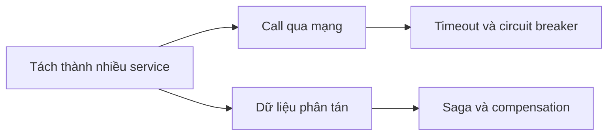
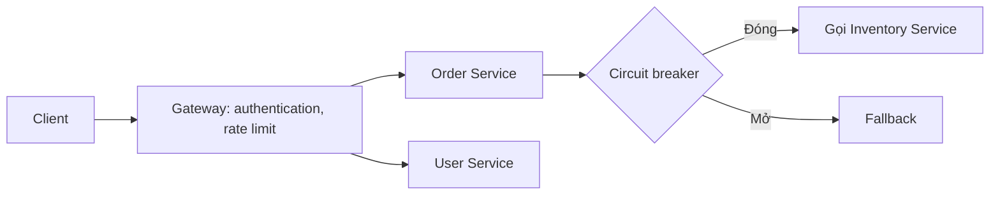
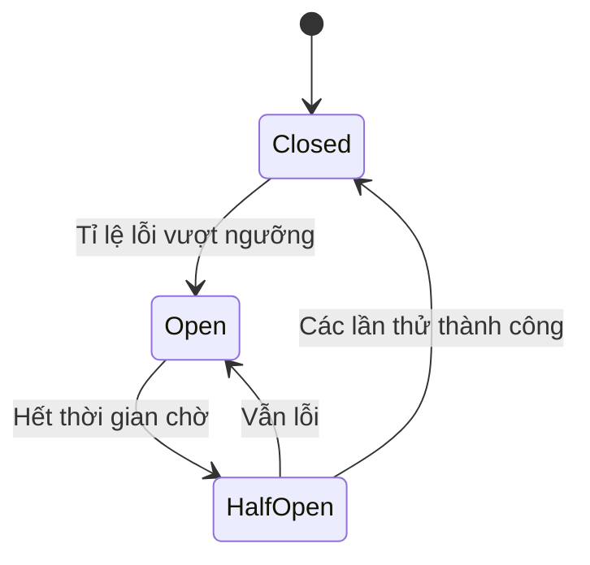
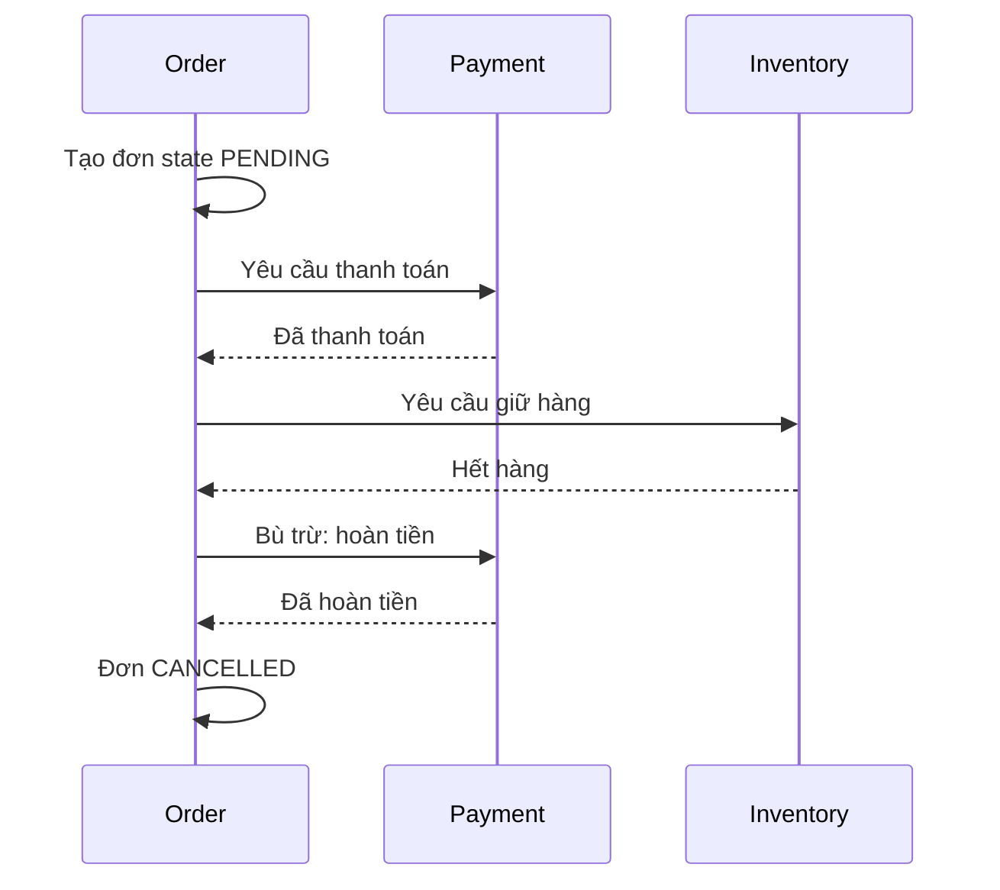

# Lý thuyết 8: Microservices với Spring Cloud

## Microservices là gì?

Thay vì một ứng dụng khổng lồ (**monolith**) chứa mọi thứ, bạn chia hệ thống thành nhiều service nhỏ; mỗi service lo một mảng nghiệp vụ (đơn hàng, người dùng, kho), chạy và deploy riêng, thường có database riêng. **Spring Cloud** là bộ công cụ cho các bài toán nảy sinh khi làm vậy: cổng vào chung (API gateway), cấu hình tập trung, chịu lỗi khi service khác chết, tìm địa chỉ service khác.

**Cốt lõi:** Tách microservices là đổi lời gọi hàm trong một process lấy call qua mạng và dữ liệu phân tán. Mạng có thể chậm, mất, timeout, và không còn transaction chung; mọi thành phần của Spring Cloud tồn tại để xử lý hai hệ quả này.

- Vì call mạng có thể chậm hoặc chết, nên mọi call cần timeout và circuit breaker để lỗi không lan dây chuyền.
- Vì retry có thể chạy một thao tác hai lần, nên chỉ retry thao tác idempotent hoặc có idempotency key.
- Vì mỗi service một database nên không có rollback chung, nên saga dùng chuỗi transaction cục bộ cộng compensation.



Mô hình tư duy: một quyết định tách service sinh ra hai nhóm vấn đề, và mỗi nhóm có công cụ riêng.

**Tóm tắt:**

- Microservices đổi lời gọi hàm trong một process lấy call qua mạng và dữ liệu phân tán: mạng có thể chậm, mất, timeout, và không còn transaction chung.
- Mọi thành phần (gateway, discovery, circuit breaker, saga, outbox) tồn tại để xử lý hai hệ quả đó.
- Mọi call mạng phải có timeout; không có timeout thì một service chậm kéo sập cả chuỗi.
- Circuit breaker có ba state: Closed (bình thường), Open (từ chối ngay, chạy fallback), HalfOpen (cho vài call thử trước khi đóng lại).
- Chỉ retry thao tác idempotent hoặc có idempotency key; retry thao tác không idempotent có thể trừ tiền hai lần.
- Mỗi service một database riêng; thao tác qua nhiều service dùng saga: chuỗi transaction cục bộ cộng compensation, không có rollback.
- Trên Kubernetes, config, discovery và load balancing nên dùng chức năng của nền tảng; giữ Spring Cloud cho phần ở tầng ứng dụng như Gateway có logic và Resilience4j.
- Không dùng microservices cho ứng dụng nhỏ; bắt đầu từ monolith tổ chức tốt, tách khi có lý do rõ.

## Vấn đề nó giải quyết

Khi monolith lớn dần, sửa một chỗ nhỏ cũng phải build và deploy lại toàn bộ, nhiều team dẫm chân nhau trên cùng codebase, và không thể scale riêng phần chịu tải nhiều (ví dụ chỉ tăng số bản chạy của phần tìm kiếm). Chia nhỏ thì từng phần scale, deploy, và chọn công nghệ độc lập.

Nhưng cái giá là đáng kể: các lời gọi hàm trong cùng process biến thành call qua mạng (có thể chậm, mất, hoặc timeout), dữ liệu bị tách thành nhiều database nên không còn transaction chung, và số thứ phải vận hành tăng vọt.

## Khi nào dùng, khi nào không

Dùng cho hệ thống lớn, nhiều team, các phần có yêu cầu scale hoặc nhịp phát hành khác nhau. **Đừng dùng cho ứng dụng nhỏ**: bạn gánh thêm độ phức tạp về mạng, dữ liệu phân tán và vận hành mà chưa được lợi gì. Một monolith tổ chức tốt thành các module rõ ràng thường là điểm xuất phát an toàn hơn.

Cách làm cơ bản: API Gateway ở cửa vào; service discovery (hoặc DNS của Kubernetes) để các service tìm nhau; Resilience4j (timeout, retry, circuit breaker) khi call service khác; config qua biến môi trường hoặc config server.

## Các khái niệm cần biết

- **API Gateway**: cổng vào duy nhất cho client. Nó định tuyến request tới service phù hợp và làm các việc chung (authentication, rate limit, gắn `traceId`) một lần cho mọi service.
- **Service discovery**: cơ chế để service tìm địa chỉ của service khác khi địa chỉ thay đổi liên tục (container sinh ra rồi mất). Eureka là một registry; trên Kubernetes, DNS của `Service` đã làm việc này.
- **Circuit breaker**: bộ phận bao quanh call tới service khác; khi call lỗi quá nhiều, nó "ngắt" và trả lỗi hoặc giá trị thay thế ngay, thay vì chờ mãi. Giống cầu dao điện tự ngắt khi quá tải để bảo vệ hệ thống.
- **Fallback**: giá trị hoặc hành vi dự phòng khi call thất bại (ví dụ trả "chưa rõ tồn kho").
- **Bulkhead**: giới hạn số call đồng thời tới một service để một service chậm không chiếm hết thread của cả ứng dụng, như vách ngăn khoang tàu.
- **Timeout**: thời gian tối đa chờ một call; bắt buộc có.
- **Saga**: cách giữ nhất quán cho thao tác trải qua nhiều service mà không có transaction chung, bằng chuỗi transaction cục bộ và compensation.
- **Compensation**: bước hoàn tác về nghiệp vụ (hoàn tiền) cho một bước đã hoàn tất.
- **BFF (Backend for Frontend)**: một layer backend riêng cho từng loại giao diện, gom dữ liệu từ nhiều service thành đúng hình dạng mà giao diện cần.
- **Idempotent**: xử lý một lần hay nhiều lần cho cùng kết quả; cần cho retry và event trùng.

## Flowchart

Sơ đồ dưới đây là bức tranh một request đi qua hệ thống microservices điển hình.



Đọc sơ đồ: client chỉ biết gateway; gateway làm authentication và rate limiting rồi định tuyến. Khi `Order Service` gọi `Inventory Service`, call đi qua circuit breaker: đóng thì gọi bình thường, mở thì trả fallback ngay.

**Nền tảng:** tách microservices là đổi lời gọi hàm trong một process lấy call qua mạng và dữ liệu phân tán: mạng có thể chậm, mất, timeout; không còn transaction chung giữa các service. Mọi thành phần (gateway, discovery, circuit breaker, saga, outbox) tồn tại để xử lý hai hệ quả đó.

## Thành phần và công cụ

Mỗi bài toán của microservices có một công cụ tương ứng trong hệ sinh thái Spring hoặc Kubernetes.

| Nhu cầu | Công cụ |
|---|---|
| Cổng vào duy nhất | Spring Cloud Gateway |
| Call service khác | `RestClient`, `WebClient`, OpenFeign (cách dùng `RestClient` và `@HttpExchange`: [Gọi HTTP đi với RestClient, HTTP Service interface và WebClient](/go?p=01-Spring-Boot%2Fmedium%2Flt-36-http-client-restclient.md)) |
| Chịu lỗi | Resilience4j: circuit breaker, retry, rate limiter, bulkhead |
| Tìm service | Eureka hoặc DNS/Service của Kubernetes |
| Config | Biến môi trường, ConfigMap, Spring Cloud Config |
| Theo dõi | Actuator, Micrometer, OpenTelemetry |

## Circuit breaker

Vấn đề đặt ra: `Inventory Service` đang chậm. Nếu `Order Service` vẫn gọi và chờ, các thread bị chiếm dần, rồi `Order Service` cũng chết theo (lỗi dây chuyền). Circuit breaker phát hiện lỗi liên tục và ngừng gọi một thời gian để cả hai có cơ hội hồi phục. Nó có ba state:



Đọc sơ đồ: `Closed` là bình thường, mọi call đi qua. Khi tỉ lệ lỗi vượt ngưỡng nó chuyển `Open`: call bị từ chối ngay (đi vào fallback). Sau một thời gian chờ, nó sang `HalfOpen` cho vài call thử nghiệm; thành công thì đóng lại, thất bại thì mở lại. Dùng khi call service ngoài có thể chậm hoặc chết; không dùng để che lỗi logic của chính bạn.


```java
@CircuitBreaker(name = "inventory", fallbackMethod = "inventoryFallback")
@Retry(name = "inventory")
public StockResponse checkStock(Long productId) {
    return inventoryClient.getStock(productId);
}

private StockResponse inventoryFallback(Long productId, Throwable ex) {
    return StockResponse.unknown(productId);
}
```

Lưu ý: `@Retry` trên một thao tác không idempotent (tạo đơn, trừ tiền) có thể thực hiện hai lần. Chỉ retry thao tác đọc hoặc thao tác có idempotency key.

## Gateway: định tuyến và timeout

Gateway là nơi đặt các quy tắc định tuyến theo đường dẫn và các timeout. Hãy xem config mẫu.

```yaml
spring:
  cloud:
    gateway:
      httpclient:
        connect-timeout: 1000          # ms
        response-timeout: 5s           # lớn hơn timeout gọi bên trong
      routes:
        - id: orders
          # trên Kubernetes dùng tên Service; có Eureka thì lb://order-service
          uri: http://order-service:8080
          predicates:
            - Path=/api/orders/**
          filters:
            - StripPrefix=1                  # /api/orders/1 thành /orders/1
        - id: users
          uri: http://user-service:8080
          predicates:
            - Path=/api/users/**
          filters:
            - StripPrefix=1
```

Gateway chạy trên WebFlux (xem [WebFlux và Reactor](/go?p=01-Spring-Boot%2Fhard%2Flt-21-webflux-reactor.md)), nên filter tự viết không được block thread. Authentication JWT, rate limit và gắn `traceId` làm ở đây, một lần cho mọi service. Tên key config đổi ở các bản Spring Cloud mới (nhóm `spring.cloud.gateway.server.webflux.*`), luôn đối chiếu tài liệu của phiên bản đang dùng. Config Resilience4j xem [Resilience và chịu lỗi](/go?p=01-Spring-Boot%2Fhard%2Flt-32-resilience-chiu-loi.md), không lặp lại ở đây.

## Config Server, LoadBalancer, OpenFeign và Gateway filter tự viết

Bốn mảnh này là phần "Spring Cloud kinh điển". Trên Kubernetes nhiều mảnh đã có chỗ thay thế, nên mỗi mục dưới đây nêu rõ khi nào còn cần. Bài này chỉ mô tả ở mức nhận biết và chọn lựa; chưa chạy thử trong sandbox, và tên config đổi giữa các phiên bản Spring Cloud: kiểm tra lại theo phiên bản.

### Config Server và @RefreshScope

Vấn đề: config rải ở nhiều service, đổi một giá trị phải build lại hoặc sửa từng nơi. **Spring Cloud Config Server** là một ứng dụng phục vụ config lấy từ Git theo tên ứng dụng và profile; mỗi service khi khởi động nạp config từ đó (qua `spring.config.import: configserver:http://config:8888`). **`@RefreshScope`** đánh dấu bean được tạo lại khi gọi `POST /actuator/refresh`, nhờ vậy đổi giá trị mà không khởi động lại.

_Minh họa_:

```java
@RefreshScope
@Component
class FeatureFlags {
    @Value("${feature.new-checkout:false}")
    private boolean newCheckout;
    boolean newCheckout() { return newCheckout; }
}
```

Chú ý: chỉ bean `@RefreshScope` và `@ConfigurationProperties` được refresh; các bean khác giữ giá trị cũ. Refresh thủ công chỉ cho instance bạn gọi, muốn cả cụm phải phát event (Spring Cloud Bus qua message broker) hoặc gọi từng instance. Config Server thành thêm một thành phần phải vận hành và bảo vệ, và mật khẩu trong Git phải mã hóa. Phương án thay thế: trên Kubernetes dùng ConfigMap và Secret (nạp bằng biến môi trường hoặc file mount), đổi config bằng rolling update; đơn giản hơn nhưng đổi config thì cần khởi động lại pod.

### LoadBalancer phía client

Vấn đề: một service có nhiều instance, client chọn gọi instance nào? **Spring Cloud LoadBalancer** chọn instance (mặc định round-robin) từ danh sách do service discovery cung cấp; địa chỉ dạng `lb://order-service` hoặc `RestClient.Builder` gắn `@LoadBalanced` được đổi thành instance thật. Bản thay thế Netflix Ribbon cũ. Trên Kubernetes, `Service` đã làm load balancing ở tầng mạng (kube-proxy) và DNS đã đóng vai discovery, nên thường không cần LoadBalancer phía client cũng như Eureka. Chỉ giữ khi chạy ngoài Kubernetes hoặc cần chiến lược chọn instance riêng.

### OpenFeign

OpenFeign cho phép khai báo client HTTP bằng interface với `@FeignClient(name = "inventory")`, tích hợp sẵn với LoadBalancer và Resilience4j. Về vai trò nó trùng với HTTP Service interface của Spring Framework (xem [Gọi HTTP đi với RestClient, HTTP Service interface và WebClient](/go?p=01-Spring-Boot%2Fmedium%2Flt-36-http-client-restclient.md)); dự án mới thường chọn `@HttpExchange` vì không cần thêm thư viện, còn dự án cũ đã dùng Feign thì giữ. Timeout của Feign phải đặt tường minh (`connectTimeout`, `readTimeout`) vì mặc định không phù hợp cho môi trường production.

### Gateway filter tự viết

Cấu hình sẵn như `StripPrefix` đủ cho đa số trường hợp. Khi cần logic riêng (kiểm tra header, gắn `traceId`, đổi body), viết `GlobalFilter` (áp mọi route) hoặc `GatewayFilterFactory` (gắn theo route). Filter chạy trên WebFlux nên trả `Mono<Void>` và tuyệt đối không block thread.

_Minh họa_:

```java
@Component
class RequestIdFilter implements GlobalFilter, Ordered {
    @Override
    public Mono<Void> filter(ServerWebExchange exchange, GatewayFilterChain chain) {
        String id = UUID.randomUUID().toString();
        ServerHttpRequest request = exchange.getRequest().mutate()
            .header("X-Request-Id", id).build();
        return chain.filter(exchange.mutate().request(request).build());
    }

    @Override
    public int getOrder() { return -1; }       // số nhỏ chạy trước
}
```

### Khi nào thay bằng Kubernetes

| Nhu cầu | Spring Cloud | Trên Kubernetes |
|---|---|---|
| Config tập trung | Config Server | ConfigMap, Secret |
| Tìm service, load balancing | Eureka, LoadBalancer | DNS của `Service` |
| Cổng vào | Spring Cloud Gateway | Ingress hoặc Gateway API, hoặc vẫn dùng Spring Cloud Gateway nếu cần logic ứng dụng |
| Chịu lỗi, retry | Resilience4j | Resilience4j (hoặc service mesh) |

Quy tắc chọn: chạy trên Kubernetes thì ưu tiên chức năng của nền tảng cho config, discovery và load balancing; giữ Spring Cloud cho phần chỉ có ở tầng ứng dụng (Gateway có logic nghiệp vụ, Resilience4j). Chạy ngoài Kubernetes (máy ảo) thì bộ Spring Cloud đầy đủ mới đáng giá. Xem [Đóng gói, Docker và Kubernetes cho Spring Boot](/go?p=01-Spring-Boot%2Fhard%2Flt-29-docker-kubernetes.md).

## Mỗi service một database thì transaction xử lý ra sao: Saga

Vấn đề đặt ra: đặt hàng cần trừ tiền ở Payment và giữ hàng ở Inventory, mỗi bên một database. Nếu tiền đã trừ mà hết hàng thì ai hoàn tiền? Không có transaction chung giữa các service, nên không thể rollback tự động. Saga chia thao tác thành chuỗi **transaction cục bộ**, mỗi bước phát event; nếu một bước hỏng thì chạy **compensation** cho các bước đã xong.



Đọc sơ đồ: mỗi bước đều là transaction cục bộ đã commit, nên khi bước giữ hàng thất bại, bước thanh toán không "rollback" được mà phải được **compensate** bằng một nghiệp vụ mới là hoàn tiền. Có hai cách tổ chức saga.

| | Choreography | Orchestration |
|---|---|---|
| Điều phối | Không ai chỉ huy; mỗi service nghe event rồi phát event kế | Một orchestrator giữ state và ra lệnh từng bước |
| Dễ theo dõi flow | Khó: flow rải trong nhiều service | Dễ: toàn bộ ở một chỗ |
| Dependency | Lỏng, nhưng dễ thành vòng event | Các service phụ thuộc vào orchestrator |
| Hợp với | 2 đến 3 bước đơn giản | Nhiều bước, có nhánh và compensation |

**Phải thuộc:** Saga thay transaction phân tán bằng chuỗi transaction cục bộ cộng compensation (hoàn tác về nghiệp vụ chứ không rollback). Hai kiểu: choreography (mỗi service nghe event rồi phát event kế) và orchestration (một orchestrator ra lệnh từng bước). Mọi handler phải idempotent; mỗi service một database riêng; mọi call mạng phải có timeout.

Orchestrator tối giản: state của saga lưu trong DB, mỗi event đến thì chuyển state và ra lệnh kế tiếp (lệnh gửi qua outbox, xem [Kiến trúc hướng sự kiện với Kafka](/go?p=01-Spring-Boot%2Fhard%2Flt-07-event-driven-kafka.md)).

```java
enum SagaState { AWAITING_PAYMENT, AWAITING_STOCK, COMPENSATING, COMPLETED, CANCELLED }

@Component
class OrderSaga {
    private final SagaRepository sagas;
    private final CommandBus commands;      // ghi vào outbox, không gửi thẳng

    // constructor bỏ qua

    @Transactional
    public void on(PaymentSucceeded e) {
        Saga s = sagas.findByOrderId(e.orderId()).orElseThrow();
        if (s.state() != SagaState.AWAITING_PAYMENT) return;     // event trùng: bỏ qua
        s.moveTo(SagaState.AWAITING_STOCK);
        commands.send(new ReserveStock(e.orderId()));
    }

    @Transactional
    public void on(StockReservationFailed e) {
        Saga s = sagas.findByOrderId(e.orderId()).orElseThrow();
        if (s.state() != SagaState.AWAITING_STOCK) return;
        s.moveTo(SagaState.COMPENSATING);
        // compensation: hoàn tiền, không xóa transaction
        commands.send(new RefundPayment(e.orderId()));
    }

    @Transactional
    public void on(PaymentRefunded e) {
        Saga s = sagas.findByOrderId(e.orderId()).orElseThrow();
        if (s.state() == SagaState.COMPENSATING) {
            s.moveTo(SagaState.CANCELLED);
            commands.send(new CancelOrder(e.orderId()));
        }
    }
}
```

Quy tắc nhớ:

- Mọi handler **idempotent** (kiểm tra state hiện tại trước khi đổi) vì event có thể tới trùng hoặc sai thứ tự.
- Compensation là **hoàn tác về nghiệp vụ** (hoàn tiền, hủy giữ hàng), không phải rollback; nó cũng phải idempotent và có thể thất bại, nên cần retry.
- Đặt bước **khó compensate nhất** (gửi email, giao hàng) ở cuối chuỗi.
- Giữa chừng, dữ liệu ở state trung gian (`PENDING`) mà người dùng nhìn thấy: thiết kế giao diện và API chịu được.
- Muốn đọc dữ liệu từ nhiều service cho một màn hình: gọi song song rồi ghép ở gateway/BFF (API composition), hoặc giữ bảng đọc riêng nuôi bằng event (xem [CQRS và Event Sourcing](/go?p=01-Spring-Boot%2Fhard%2Flt-25-cqrs-event-sourcing.md)).

**Suy luận:** Vì mỗi service có database riêng, một thao tác nghiệp vụ trải qua nhiều service không thể nằm trong một transaction, nên mỗi bước phải commit riêng ngay khi xong. Vì đã commit, bước trước không thể rollback khi bước sau hỏng, nên chỉ còn cách chạy một nghiệp vụ ngược lại (compensation) như hoàn tiền. Nhưng compensation cũng là một call mạng, nó có thể timeout hay chạy hai lần, nên cả bước thuận lẫn bước bù đều phải idempotent và có retry. Cũng vì các bước commit lần lượt, có một khoảng thời gian dữ liệu ở state trung gian như `PENDING` mà người dùng nhìn thấy; đây là eventual consistency, không phải lỗi. Điểm dễ nhầm là coi saga như transaction phân tán "mềm" có isolation: nó không có, nên hai saga cùng chạm một dữ liệu có thể đọc state dở dang của nhau. Hệ quả thiết kế: đặt bước khó bù nhất (gửi email, giao hàng) ở cuối chuỗi, kiểm tra state hiện tại trước khi đổi, và thiết kế API và giao diện chịu được state trung gian.

## Lưu ý

- Mỗi service có **database riêng**, không dùng chung bảng.
- Đặt **timeout** cho mọi call mạng; không có timeout thì một service chậm kéo sập cả chuỗi.
- Retry chỉ an toàn với thao tác idempotent.
- Truyền `traceId` giữa các service để lần theo một request.
- Bắt đầu với monolith tổ chức tốt; tách service khi có lý do rõ.

## Phỏng vấn khó: chuỗi hỏi xoáy

Người phỏng vấn senior thường mở bằng câu dễ rồi xoáy xuống cơ chế, đánh đổi và sự cố thật. Câu trả lời tốt luôn đi từ cốt lõi xuống.

### Chuỗi 1: Timeout, circuit breaker và retry

1. **Câu mở:** `Inventory Service` chậm thì vì sao `Order Service` cũng chết theo?
2. **Xoáy 1:** Circuit breaker có mấy state, và `HalfOpen` để làm gì?
3. **Xoáy 2:** Tôi gắn `@Retry` và `@CircuitBreaker` lên method tạo đơn. Có vấn đề gì? Timeout ở gateway nên đặt so với timeout bên trong thế nào?

**Đáp án ngắn:** Call qua mạng có thể chậm, và nếu không có timeout thì thread của `Order Service` bị chiếm dần cho tới khi nó cũng không phục vụ nổi, lỗi lan dây chuyền. Circuit breaker có ba state: `Closed` cho call đi qua bình thường, `Open` từ chối ngay và chạy fallback khi tỉ lệ lỗi vượt ngưỡng, `HalfOpen` cho vài call thử sau thời gian chờ, thành công thì đóng lại, thất bại thì mở lại. Nhờ vậy service đang yếu có cơ hội hồi phục thay vì bị dội tải. Retry trên thao tác không idempotent như tạo đơn hay trừ tiền có thể làm chạy hai lần; chỉ retry thao tác đọc hoặc thao tác có idempotency key. Timeout của gateway nên lớn hơn timeout gọi bên trong, để lỗi được xử lý ở tầng gần nguồn trước. Fallback phải là giá trị hợp lý như "chưa rõ tồn kho", không dùng circuit breaker để che lỗi logic của chính bạn.

**Sai lầm hay gặp:**
- Nói circuit breaker "chống lỗi" mà không nhắc timeout bên dưới nó.
- Retry thao tác ghi không có idempotency key.
- Không phân biệt được `Open` (từ chối ngay) với `HalfOpen` (thăm dò).

### Chuỗi 2: Saga thay cho transaction phân tán

1. **Câu mở:** Đặt hàng cần trừ tiền ở Payment và giữ hàng ở Inventory, mỗi bên một database. Bảo đảm nhất quán thế nào?
2. **Xoáy 1:** Giữ hàng thất bại sau khi tiền đã trừ. Compensation khác rollback ở đâu? Choreography và orchestration chọn khi nào?
3. **Xoáy 2:** Event hoàn tiền tới trùng, hoặc chính bước hoàn tiền thất bại thì sao? Người dùng nhìn thấy gì ở giữa chừng?

**Đáp án ngắn:** Không có transaction chung giữa các service, nên saga chia thao tác thành chuỗi transaction cục bộ, mỗi bước commit riêng và phát event. Vì đã commit nên không rollback được; khi bước sau hỏng, ta chạy một nghiệp vụ ngược lại là compensation, ví dụ hoàn tiền. Choreography hợp với hai ba bước đơn giản nhưng flow rải nhiều service và dễ thành vòng event; orchestration có một orchestrator giữ state và ra lệnh từng bước, hợp khi nhiều bước có nhánh và compensation. Vì event có thể trùng hoặc sai thứ tự, mọi handler phải idempotent: kiểm tra state hiện tại trước khi đổi. Compensation cũng là call mạng nên có thể thất bại hoặc chạy hai lần, cần retry và idempotent. Giữa chừng dữ liệu ở state trung gian như `PENDING` mà người dùng thấy; đó là eventual consistency, không phải lỗi. Saga không có isolation. Bước khó bù nhất, như gửi email hay giao hàng, đặt ở cuối chuỗi.

**Sai lầm hay gặp:**
- Gọi saga là "transaction phân tán mềm" và quên nó không có isolation.
- Coi compensation là rollback, không thấy nó có thể thất bại.
- Gửi lệnh thẳng vào broker thay vì qua outbox, nên mất lệnh khi crash.

### Chuỗi 3: Có cần Spring Cloud khi đã có Kubernetes?

1. **Câu mở:** Nên chuyển monolith sang microservices không?
2. **Xoáy 1:** Nếu chạy trên Kubernetes, Eureka, LoadBalancer và Config Server còn cần không?
3. **Xoáy 2:** Dùng `@RefreshScope` đổi config không khởi động lại: bean nào được refresh, và cả cụm có đổi không?

**Đáp án ngắn:** Không mặc định. Microservices đổi lời gọi hàm trong một process lấy call qua mạng và dữ liệu phân tán, kèm gánh nặng vận hành, nên với ứng dụng nhỏ thì bắt đầu từ monolith tổ chức tốt rồi tách khi có lý do rõ như nhiều team, nhu cầu scale hay nhịp phát hành khác nhau. Trên Kubernetes, `Service` đã làm load balancing và DNS đóng vai discovery, ConfigMap và Secret thay config server, nên thường không cần Eureka hay LoadBalancer phía client. Giữ Spring Cloud cho phần chỉ có ở tầng ứng dụng, như Gateway có logic và Resilience4j. Chạy ngoài Kubernetes thì bộ đầy đủ mới đáng giá. Với `@RefreshScope`, chỉ bean `@RefreshScope` và `@ConfigurationProperties` được refresh, bean khác giữ giá trị cũ. Refresh thủ công chỉ tác động instance bạn gọi; muốn cả cụm cần Spring Cloud Bus hoặc gọi từng instance. Tên config đổi theo phiên bản Spring Cloud, kiểm tra lại.

**Sai lầm hay gặp:**
- Chọn microservices vì "hiện đại" chứ không vì một vấn đề cụ thể.
- Chạy cả Eureka lẫn DNS Service của Kubernetes cho cùng một việc.
- Tưởng gọi `/actuator/refresh` một lần là cả cụm đổi config.

