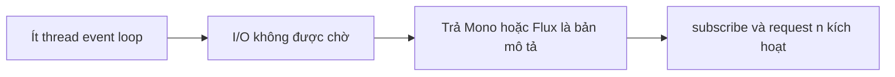
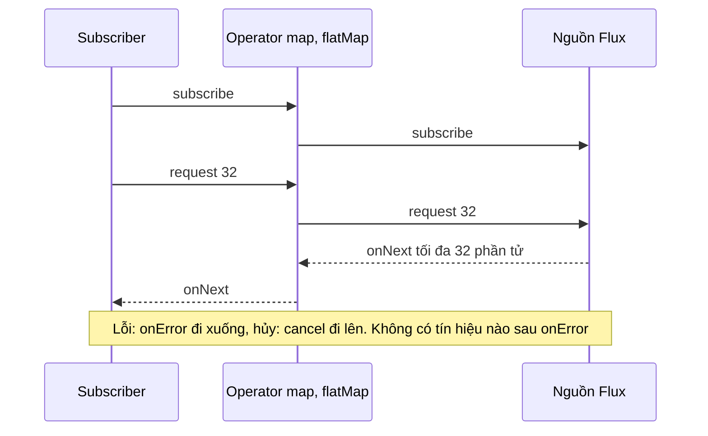
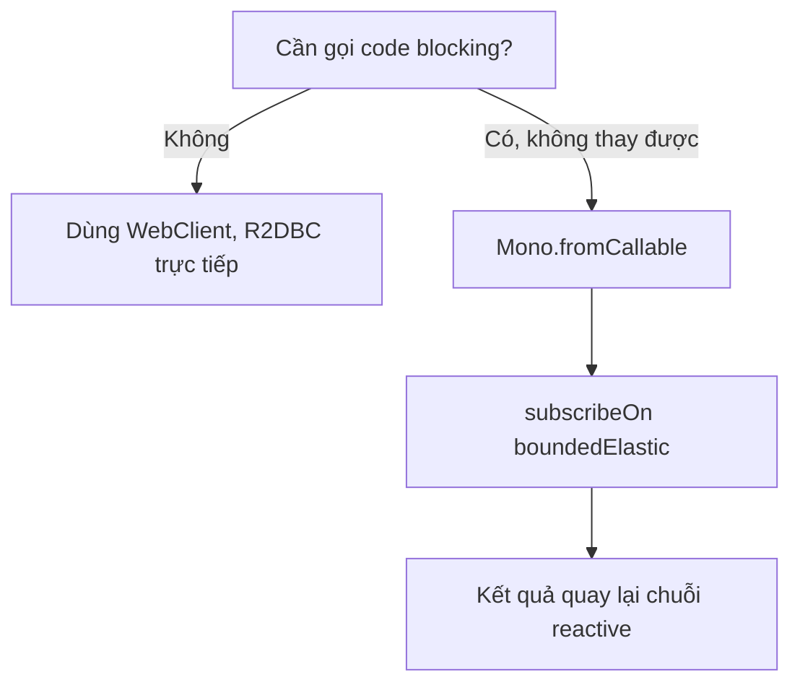

# Lý thuyết 21: WebFlux và Reactor

## Lập trình reactive là gì?

Trong code thông thường, khi bạn gọi một API hoặc truy vấn DB, thread của bạn đứng chờ cho tới khi có kết quả. Lập trình **reactive** đảo lại: bạn khai báo "khi dữ liệu về thì làm gì", rồi thread được giải phóng để làm việc khác; khi dữ liệu về, hệ thống chạy tiếp phần bạn đã khai báo. Dữ liệu đi theo các stream của thư viện **Reactor**: `Mono` chứa 0 hoặc 1 phần tử, `Flux` chứa 0 tới n phần tử. **Spring WebFlux** là phần web của Spring xây trên Reactor. Hình dung quán cà phê: kiểu cũ là nhân viên đứng cạnh máy pha chờ cà phê xong mới nhận khách khác; kiểu reactive là nhân viên đặt cà phê vào máy, nhận khách tiếp theo, và khi máy báo xong mới quay lại giao.

**Cốt lõi:** Thread hệ điều hành đắt, nên WebFlux dùng rất ít thread chạy event loop và không bao giờ để chúng đứng chờ. Vì vậy API không trả kết quả mà trả `Mono` hoặc `Flux`, tức bản mô tả việc sẽ làm khi dữ liệu về.

- Vì thread không được chờ, nên pipeline chỉ chạy khi có `subscribe`, và `request(n)` cho bên nhận kiểm soát tốc độ.
- Vì ít thread dùng chung cho nhiều kết nối, nên một call blocking trên event loop làm đứng mọi kết nối cùng thread, dù CPU vẫn thấp.
- Vì reactive không rút ngắn một request mà chỉ chịu được nhiều request đang chờ, nên việc nặng CPU hoặc ít kết nối chỉ thêm phức tạp.



Mô hình tư duy: mỗi mũi tên là hệ quả bắt buộc của mũi tên trước, từ tiết kiệm thread đến lazy và backpressure.

**Tóm tắt:**

- Reactive đảo mô hình chờ: khai báo "khi dữ liệu về thì làm gì" rồi giải phóng thread, nên vài thread có thể phục vụ rất nhiều kết nối đang chờ I/O.
- `Mono` chứa 0 hoặc 1 phần tử, `Flux` chứa 0 tới n; pipeline chỉ là bản mô tả và không chạy gì cho tới khi có `subscribe`.
- Cả chuỗi từ controller đến DB phải non-blocking; chỉ một call blocking trên event loop là treo mọi kết nối dùng chung thread đó.
- Không hợp với việc nặng CPU, JDBC/JPA, hay team chưa quen; MVC vẫn là mặc định tốt cho đa số.
- `map` cho hàm trả giá trị thường, `flatMap` cho hàm trả `Mono`/`Flux`; `flatMap` mặc định chạy tới 256 inner nên phải truyền `concurrency`.
- Backpressure để bên nhận báo tốc độ cho bên gửi; chọn `limitRate`, buffer, drop hay latest tùy dữ liệu có bỏ được hay không.
- Lỗi trong `Flux` kết thúc cả stream, nên muốn "lỗi một phần tử vẫn đi tiếp" phải xử lý lỗi bên trong `flatMap`.
- Từ Java 21, MVC cộng virtual thread thường đủ; chọn WebFlux khi cần streaming, backpressure thật sự.

## Vấn đề nó giải quyết

Mô hình **thread-per-request** (mỗi request một thread) có chi phí: một request đang chờ I/O vẫn chiếm trọn một thread cùng vài trăm KB tới vài MB memory cho stack, nên hàng chục nghìn kết nối đang chờ sẽ ngốn rất nhiều memory và làm hệ điều hành context switch liên tục. Reactive dùng ít thread (thường bằng số lõi CPU) để phục vụ rất nhiều kết nối đang **chờ I/O**, và có **backpressure** để bên nhận báo bên gửi chậm lại khi không xử lý kịp.

## Khi nào dùng, khi nào không

Dùng cho gateway, streaming, nhiều call I/O song song, kết nối kéo dài (SSE, WebSocket). Không hợp khi phần lớn thời gian là tính toán CPU (không có gì để "chờ" mà nhả thread), và đừng dùng nếu team chưa quen vì code và debug khó hơn hẳn. Cách làm: dùng `spring-boot-starter-webflux`, method trả về `Mono`/`Flux`. Cả chuỗi từ controller đến DB phải **non-blocking**; chỉ cần một chỗ gọi blocking là mất lợi thế và có thể treo server.

## Các khái niệm cần biết

- **Non-blocking**: gọi I/O xong là thread đi làm việc khác; kết quả được báo lại sau. Ngược lại, blocking là thread đứng chờ.
- **Event loop**: vài thread chạy vòng lặp nhận event (có dữ liệu về, có kết nối mới) rồi chạy phần code đăng ký cho event đó. Netty, server mặc định của WebFlux, hoạt động như vậy. Nếu code của bạn block event loop, mọi kết nối đang dùng chung thread đó bị đứng.
- **Publisher và Subscriber**: Publisher (`Mono`, `Flux`) là nguồn phát dữ liệu; Subscriber là bên nhận. Chúng nói chuyện qua các tín hiệu `onNext`, `onError`, `onComplete`.
- **Cold publisher và lazy**: pipeline chỉ là bản mô tả; không có gì chạy cho tới khi có `subscribe`.
- **Operator**: hàm biến đổi stream, như `map`, `flatMap`, `zip`.
- **Backpressure**: cơ chế để bên nhận nói với bên gửi tốc độ nó chịu được, tránh bị dồn ứ tới tràn memory.
- **Scheduler**: pool thread mà Reactor dùng để chạy công việc; `boundedElastic` dành cho việc buộc phải blocking.
- **R2DBC**: API truy cập database non-blocking, thay cho JDBC trong ứng dụng reactive.

## So sánh với MVC

Khác biệt cốt lõi: MVC giữ một thread cho mỗi request kể cả lúc chờ I/O (200 thread thì tối đa khoảng 200 request chờ cùng lúc), còn WebFlux nhả thread khi chờ I/O để nhận việc khác.

| | Spring MVC | WebFlux |
|---|---|---|
| Mô hình | Thread-per-request, blocking | Event loop, non-blocking |
| Server | Tomcat | Netty |
| Kiểu trả về | Giá trị thường | `Mono<T>`, `Flux<T>` |
| Ưu thế | Đơn giản, dễ gỡ lỗi | Nhiều kết nối đồng thời, streaming |
| Cần thiết | Mặc định tốt cho đa số | Khi thật sự cần quy mô I/O |

**Nền tảng:** WebFlux đổi mô hình "một thread giữ một request" thành vài thread event loop phục vụ rất nhiều kết nối đang chờ I/O. Cái giá là mọi bước phải non-blocking: chỉ một call blocking trên event loop là đứng cả các kết nối dùng chung thread đó. Đây cũng là lý do reactive không giúp gì cho việc nặng CPU.

**Phải thuộc:** `Mono` là 0 hoặc 1 phần tử, `Flux` là 0 đến n; pipeline lười nên không `subscribe` thì không chạy gì (framework tự subscribe giúp ở tầng web). `map` cho hàm trả giá trị thường, `flatMap` cho hàm trả `Mono`/`Flux`; `flatMap` mặc định đồng thời tối đa 256 inner nên phải truyền `concurrency` khi call service ngoài.

## Ví dụ

Hãy xem một endpoint tổng hợp thông tin: call hai service cùng lúc, ghép kết quả, và có dự phòng khi chậm hoặc lỗi. Chú ý không có chỗ nào chờ trực tiếp.

```java
@GetMapping("/orders/{id}/summary")
public Mono<Summary> summary(@PathVariable Long id) {
    Mono<Order> order = orderClient.get(id);          // call HTTP non-blocking
    Mono<Customer> customer = customerClient.get(id); // chạy song song
    return Mono.zip(order, customer)
               .map(t -> Summary.of(t.getT1(), t.getT2()))
               .timeout(Duration.ofSeconds(2))
               .onErrorResume(e -> Mono.just(Summary.empty()));
}
```

Đọc ví dụ: hai call `get` chỉ được **khai báo** rồi `Mono.zip` ghép chúng chạy song song; `timeout` giới hạn tổng thời gian chờ; `onErrorResume` cho giá trị dự phòng thay vì báo lỗi. Controller trả `Mono` và Spring tự `subscribe` khi gửi response.

## Khái niệm cốt lõi

- **Không có gì xảy ra cho đến khi có `subscribe`** (lazy). Framework subscribe giúp bạn ở tầng web.
- **Operator**: `map` (đổi giá trị), `flatMap` (nối asynchronous), `zip` (kết hợp song song), `onErrorResume`, `retryWhen`.
- **Backpressure**: bên tiêu thụ báo cho bên sản xuất tốc độ nó chịu được. Nếu thiếu, nguồn nhanh hơn bên nhận sẽ gây đầy memory hoặc `OverflowException`.
- **`map` và `flatMap`**: dùng `map` khi hàm biến đổi trả về giá trị thường; dùng `flatMap` khi hàm trả về một `Mono`/`Flux` (một call asynchronous khác). Dùng nhầm `map` ở chỗ cần `flatMap` sẽ ra `Mono<Mono<T>>` và không có gì chạy.
- **Scheduler**: `Schedulers.boundedElastic()` cho việc buộc phải blocking.

## Cơ chế: subscribe, request(n) và scheduler

Pipeline là một **bản mô tả**. Khi có `subscribe`, tín hiệu đi ngược lên nguồn (`request(n)`: "tôi nhận được n phần tử"), rồi dữ liệu đi xuống (`onNext`, `onError`, `onComplete`). Đó là backpressure: nguồn không được đẩy nhiều hơn số đã yêu cầu.



Thread chạy: mặc định pipeline chạy trên thread của chỗ gọi `subscribe` (với WebClient là thread của Netty). `subscribeOn` chọn thread cho **phần nguồn**; `publishOn` chuyển thread cho **các operator phía sau nó**.

### Chọn operator ghép

Vấn đề đặt ra: với mỗi phần tử bạn cần call một API asynchronous. Có ba cách ghép kết quả, khác nhau ở chỗ có chạy song song và có giữ thứ tự không.

| Operator | Chạy song song | Giữ thứ tự | Dùng khi |
|---|---|---|---|
| `flatMap(fn, concurrency)` | Có, tối đa `concurrency` | Không | Gọi nhiều API độc lập, thứ tự không quan trọng |
| `flatMapSequential` | Có | Có (kết quả xếp lại) | Cần song song nhưng giữ thứ tự |
| `concatMap` | Không, từng cái một | Có | Thao tác phải tuần tự |

`flatMap` không giới hạn thì mặc định subscribe tới 256 inner cùng lúc; luôn truyền `concurrency` rõ ràng khi call service ngoài để không dội tải.

### Pipeline có giới hạn song song, timeout, retry, lỗi từng phần tử

```java
public Flux<Item> loadAll(List<Long> ids) {
    return Flux.fromIterable(ids)
        .flatMap(id -> webClient.get().uri("/items/{id}", id)
                .retrieve()
                .bodyToMono(Item.class)
                // mỗi phần tử có timeout riêng
                .timeout(Duration.ofSeconds(2))
                // tối đa 2 lần, backoff lũy tiến
                .retryWhen(Retry.backoff(2, Duration.ofMillis(200))
                        .filter(e -> e instanceof WebClientResponseException w
                                && w.getStatusCode().is5xxServerError()))
                // một phần tử lỗi không giết cả stream
                .onErrorResume(e -> {
                    log.warn("Bỏ qua item {}: {}", id, e.toString());
                    return Mono.empty();
                // tối đa 8 call đồng thời
                }), 8);
}
```

Quy tắc: lỗi trong một `Flux` là **kết thúc** stream. Muốn "lỗi một phần tử vẫn đi tiếp" thì xử lý lỗi **bên trong** `flatMap`, như trên, không đặt `onErrorResume` bên ngoài.

### Backpressure khi nguồn nhanh hơn bên nhận

Chọn cách xử lý tùy theo dữ liệu có thể bỏ được hay không: số liệu giám sát có thể bỏ bớt, đơn hàng thì không.

| Cách | Hành vi khi bên nhận chậm |
|---|---|
| `limitRate(100)` | Yêu cầu nguồn theo batch 100, nguồn "kéo" được (file, DB) thì không dồn ứ |
| `onBackpressureBuffer(n)` | Đệm tới n, đầy thì báo lỗi (hoặc chọn chiến lược `DROP_OLDEST`) |
| `onBackpressureDrop()` | Bỏ phần tử tới khi bên nhận sẵn sàng (số liệu giám sát) |
| `onBackpressureLatest()` | Chỉ giữ phần tử mới nhất (giá, vị trí) |
| Không làm gì với nguồn đẩy như `Flux.interval` | `OverflowException` |

### Bọc code blocking bắt buộc phải dùng

Đôi khi bạn bắt buộc phải gọi thư viện blocking (JDBC cũ). Đừng gọi nó trực tiếp trên event loop; hãy đẩy sang pool riêng dành cho việc blocking.

```java
Mono<Report> report(Long id) {
    return Mono.fromCallable(() -> legacyJdbcRepo.load(id))   // code blocking
               // đẩy ra pool dành cho việc blocking
               .subscribeOn(Schedulers.boundedElastic());
}
```

Phát hiện: thư viện BlockHound ném lỗi khi có call blocking trên thread không cho phép (dùng khi test). Dấu hiệu ở môi trường thật: CPU thấp nhưng độ trễ tăng, thread `reactor-http-nio-*` ở state chờ trong dump.



Đọc sơ đồ: ưu tiên thay bằng thư viện non-blocking; nếu không thể, cô lập phần blocking trong `boundedElastic` để event loop không bị giữ.

### Context đi theo chuỗi

`ThreadLocal` hỏng khi thread đổi giữa các operator, nên dữ liệu context (traceId, user) đặt vào Reactor Context:

```java
Mono.deferContextual(ctx -> service.handle(ctx.get("traceId")))
    // ghi ở cuối, đọc được ở các operator phía trên
    .contextWrite(Context.of("traceId", traceId));
```

### Kiểm thử bằng `StepVerifier`

`StepVerifier` (trong `reactor-test`) subscribe vào pipeline giúp bạn và kiểm tra từng tín hiệu theo thứ tự.

```java
StepVerifier.create(service.loadAll(List.of(1L, 2L)))
        .expectNextCount(2)
        .verifyComplete();   // thiếu verify thì test không chạy gì
```

**Suy luận:** Vì thread hệ điều hành đắt (vài trăm KB tới vài MB stack, cộng chi phí context switch), WebFlux chọn dùng rất ít thread chạy event loop và không bao giờ để chúng đứng chờ. Vì thread không được chờ, kết quả I/O không thể là giá trị trả về ngay, nên API phải trả `Mono`/`Flux` là bản mô tả việc sẽ làm khi dữ liệu về. Vì đó chỉ là bản mô tả, cần có người `subscribe` để kích hoạt và `request(n)` để bên nhận kiểm soát tốc độ; đó chính là gốc của lazy và backpressure. Hệ quả là chỉ cần một call blocking trên event loop, cả vài thread đó đứng và mọi kết nối dùng chung bị treo, trong khi CPU vẫn thấp nên rất khó nhận ra. Điểm dễ nhầm là nghĩ reactive làm code nhanh hơn: nó không rút ngắn một request, chỉ giúp chịu được nhiều request chờ cùng lúc, nên với việc nặng CPU hoặc ít kết nối thì chỉ thêm độ phức tạp. Khi review, hãy tìm mọi chỗ block (`.block()`, JDBC, `Thread.sleep`) và mọi chỗ gọi nhưng không trả `Mono` về; hai lỗi này gây ra đa số sự cố production.

## Bẫy chết người

Hầu hết sự cố reactive trên production rơi vào các bẫy sau. Bẫy đầu tiên đáng sợ nhất vì không báo lỗi gì, chỉ thấy server chậm dần.

| Bẫy | Hậu quả |
|---|---|
| Gọi code **blocking** (JDBC, `Thread.sleep`, `.block()`) trên event loop | Treo cả server vì ít thread |
| Quên subscribe / không trả `Mono` về | Việc không bao giờ chạy |
| Mất `SecurityContext`, MDC | Context gắn với thread không đi theo chuỗi reactive; dùng Reactor Context |
| Gỡ lỗi khó (stack trace rời rạc) | Dùng `checkpoint()`, `Hooks.onOperatorDebug()` khi phát triển |
| Dùng JDBC/JPA | Blocking; dùng R2DBC hoặc giữ MVC |

## Reactive hay virtual threads?

**Virtual thread** là thread rất nhẹ do JVM quản lý (Java 21): khi gặp I/O blocking, JVM tự nhả thread hệ điều hành bên dưới. Nó cho kết quả gần giống reactive (scale nhiều kết nối chờ) mà code vẫn viết kiểu tuần tự quen thuộc.

Java 21 virtual threads cho phép viết code blocking **đơn giản** mà vẫn scale I/O tốt. Nhiều trường hợp trước đây cần WebFlux giờ chỉ cần MVC + virtual threads. Chọn WebFlux khi cần streaming/backpressure thật sự hoặc hệ sinh thái reactive sẵn có (xem [Đồng thời trong Java và Virtual Threads](/go?p=01-Spring-Boot%2Fhard%2Flt-22-concurrency-virtual-threads.md)).

## Phỏng vấn khó: chuỗi hỏi xoáy

Người phỏng vấn senior thường mở bằng câu dễ rồi xoáy xuống cơ chế, đánh đổi và sự cố thật. Câu trả lời tốt luôn đi từ cốt lõi xuống.

### Chuỗi 1: Event loop và call blocking

1. **Câu mở:** WebFlux khác Spring MVC ở đâu, và khi nào nó thật sự có lợi?
2. **Xoáy 1:** Tôi gọi JDBC trong một handler WebFlux. Điều gì xảy ra?
3. **Xoáy 2:** Production có độ trễ tăng mà CPU thấp. Bạn phát hiện call blocking bằng cách nào, và nếu buộc phải dùng thư viện blocking thì làm sao?

**Đáp án ngắn:** MVC giữ một thread cho mỗi request kể cả lúc chờ I/O, còn WebFlux dùng vài thread event loop (Netty) và không để chúng đứng chờ, nên phục vụ được rất nhiều kết nối đang chờ I/O. Nó có lợi với gateway, streaming, nhiều call I/O song song và kết nối kéo dài như SSE hay WebSocket; với việc nặng CPU thì không giúp gì, vì không có gì để chờ mà nhả thread. Gọi JDBC trên event loop làm thread đó đứng, và mọi kết nối dùng chung nó bị treo, trong khi CPU vẫn thấp nên rất khó nhận ra. Dấu hiệu là độ trễ tăng, thread `reactor-http-nio-*` ở trạng thái chờ trong thread dump. Khi test, BlockHound ném lỗi nếu có call blocking trên thread không cho phép. Buộc dùng code blocking thì bọc bằng `Mono.fromCallable` rồi `subscribeOn(Schedulers.boundedElastic())`; tốt hơn là thay bằng WebClient hoặc R2DBC.

**Sai lầm hay gặp:**
- Nói WebFlux "nhanh hơn" thay vì "chịu được nhiều request chờ hơn".
- Dùng JDBC hoặc JPA trong chuỗi reactive mà không cô lập.
- Gọi `.block()` giữa chuỗi để "cho dễ".

### Chuỗi 2: Lazy, `map` và `flatMap`

1. **Câu mở:** Tôi tạo một `Mono` gọi API nhưng không thấy request nào được gửi. Vì sao?
2. **Xoáy 1:** `map` và `flatMap` khác nhau thế nào, và dùng nhầm thì ra gì?
3. **Xoáy 2:** Với 10.000 id, mỗi id gọi một API ngoài. Chọn operator nào, giới hạn gì, và một id lỗi thì cả stream có chết không?

**Đáp án ngắn:** `Mono` và `Flux` chỉ là bản mô tả việc sẽ làm; không có gì chạy cho tới khi có `subscribe`. Ở tầng web, framework tự subscribe khi gửi response, nhưng quên trả `Mono` về hoặc gọi mà bỏ đó thì việc không bao giờ chạy. `map` dùng khi hàm trả giá trị thường; hàm trả `Mono` hay `Flux` thì phải `flatMap`, nếu dùng `map` sẽ ra `Mono<Mono<T>>` và không có gì chạy. Với nhiều call độc lập, dùng `flatMap` kèm `concurrency` rõ ràng, vì mặc định nó subscribe tới 256 inner cùng lúc và có thể dội tải vào service ngoài. Cần giữ thứ tự thì `flatMapSequential`; phải tuần tự thì `concatMap`. Lỗi trong một `Flux` kết thúc cả stream, nên muốn một phần tử lỗi vẫn đi tiếp phải đặt `onErrorResume` bên trong `flatMap`, kèm timeout và retry riêng cho từng phần tử.

**Sai lầm hay gặp:**
- Quên rằng không `subscribe` thì không có gì chạy; trong test thì thiếu `verify`.
- Dùng `flatMap` không truyền `concurrency` khi gọi service ngoài.
- Đặt `onErrorResume` ở ngoài rồi ngạc nhiên vì cả stream dừng.

### Chuỗi 3: Backpressure, ngữ cảnh và virtual thread

1. **Câu mở:** Backpressure là gì và `request(n)` làm gì?
2. **Xoáy 1:** Nguồn đẩy như `Flux.interval` nhanh hơn bên nhận thì sao? Chọn `drop`, `latest` hay `buffer` thế nào?
3. **Xoáy 2:** Với Java 21, vì sao không dùng MVC cộng virtual thread? Và `ThreadLocal`, MDC trong chuỗi reactive có đáng tin không?

**Đáp án ngắn:** Backpressure là cơ chế để bên nhận báo cho bên gửi tốc độ nó chịu được. Khi có `subscribe`, tín hiệu `request(n)` đi ngược lên nguồn, và nguồn không được đẩy nhiều hơn số đã yêu cầu. Nguồn "đẩy" như `Flux.interval` mà bên nhận chậm thì nếu không xử lý sẽ có `OverflowException`. Chọn cách theo việc dữ liệu có bỏ được hay không: số liệu giám sát thì `onBackpressureDrop`, giá hay vị trí thì `onBackpressureLatest`, đơn hàng thì không được bỏ nên dùng `onBackpressureBuffer` có giới hạn, hoặc `limitRate` với nguồn kéo được như file hay DB. Virtual thread cho code blocking tuần tự quen thuộc mà vẫn scale nhiều kết nối chờ, nên MVC cộng virtual thread thường đủ; chọn WebFlux khi cần streaming, backpressure thật sự hoặc hệ sinh thái reactive sẵn có. `ThreadLocal` hỏng khi thread đổi giữa các operator, nên traceId hay user phải đặt vào Reactor Context.

**Sai lầm hay gặp:**
- Chọn WebFlux theo trào lưu dù team chưa quen và không có nhu cầu streaming.
- Đọc `SecurityContext` hay MDC bằng `ThreadLocal` giữa chuỗi reactive.
- Dùng buffer không giới hạn cho nguồn nhanh rồi tràn memory.

