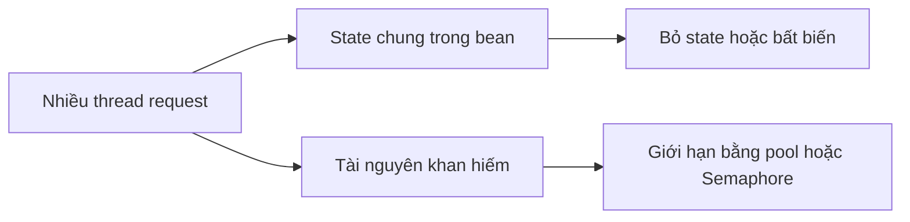
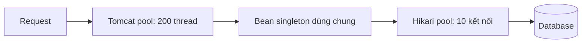

# Lý thuyết 22: Đồng thời trong Java và Virtual Threads

Bài này nói về một chuyện mà mọi ứng dụng web đều gặp nhưng ít người để ý cho đến khi có sự cố: nhiều thread chạy cùng lúc và cùng đụng vào một dữ liệu. Phần sau của bài cũng giới thiệu virtual thread của Java 21, một loại thread siêu nhẹ do JVM quản lý, cho phép tạo hàng trăm nghìn thread mà không tốn như thread hệ điều hành thông thường.

**Cốt lõi:** Nhiều request chạy cùng lúc trên các thread khác nhau, nhưng bean Spring chỉ có một object dùng chung. Mọi lỗi concurrency đều đến từ việc nhiều thread cùng đụng vào một state thay đổi được, và mọi giới hạn tải đều đến từ tài nguyên khan hiếm nằm cuối đường đi.

- Vì bean là singleton nên mọi field thay đổi được trong bean là state chung, và tốt nhất là không có state.
- Vì `count++` gồm đọc, cộng, ghi nên hai thread xen kẽ sẽ làm mất một lần cộng.
- Vì virtual thread chỉ gỡ giới hạn số thread chứ không gỡ giới hạn kết nối DB hay API đối tác, nên tài nguyên khan hiếm vẫn phải tự giới hạn.



Mô hình tư duy: nhiều thread đi vào hai chỗ dễ hỏng, state chung và tài nguyên hữu hạn, và mỗi chỗ có một cách chặn riêng.

**Tóm tắt:**

- Bean Spring mặc định là singleton, nên nhiều thread request dùng chung một object; mọi state thay đổi được trong bean là lỗi concurrency chờ xảy ra.
- Cách an toàn theo thứ tự ưu tiên: bean không state, object bất biến (`record`, field `final`), rồi mới tới `Concurrent*` và `Atomic*`.
- `volatile` chỉ bảo đảm thấy giá trị, không làm `count++` atomic; `ConcurrentHashMap` chỉ atomic từng thao tác đơn, nên dùng `computeIfAbsent` và `merge` thay vì check-then-act.
- Một ứng dụng web có nhiều pool chồng nhau (Tomcat 200 thread, Hikari 10 kết nối), và số kết nối DB mới là giới hạn thật của throughput.
- Bật virtual thread bằng `spring.threads.virtual.enabled=true` (Java 21 và Boot 3.2 trở lên); nó chỉ có lợi với việc chờ I/O, không làm việc nặng CPU nhanh hơn.
- Virtual thread không có pool nên mất giới hạn tải tự nhiên; phải tự giới hạn tài nguyên khan hiếm bằng `Semaphore` hoặc bulkhead.
- Mọi pool phải có giới hạn và queue giới hạn, và không giữ lock trong lúc call mạng hoặc DB.

## Vấn đề nó giải quyết

Hãy hình dung một quầy thu ngân có 200 nhân viên cùng ghi vào một cuốn sổ chung. Nếu hai người cùng đọc con số "100", cùng cộng thêm 1 rồi cùng ghi "101", thì một lần cộng đã biến mất. Trong Spring, bean mặc định là singleton, tức chỉ có một object được mọi request dùng chung. Nếu bean đó giữ state chung (một biến đếm, một `HashMap` làm cache) mà không an toàn, bạn sẽ gặp loại lỗi tệ nhất: chỉ thỉnh thoảng mới xảy ra, thường chỉ khi tải cao, và gần như không tái hiện được trên máy cá nhân.

Cách giải quyết gồm bốn việc: giữ bean không có state thay đổi, dùng cấu trúc dữ liệu thread-safe (`ConcurrentHashMap`, `AtomicLong`), cấu hình thread pool có giới hạn rõ ràng, và cân nhắc bật virtual thread cho phần việc nhiều chờ I/O.

## Khi nào nên dùng, khi nào không

Kiến thức concurrency cần cho mọi ứng dụng web, nhất là khi có cache nội bộ, bộ đếm hay tác vụ nền. Riêng virtual thread chỉ có lợi khi code phần lớn thời gian là chờ (call DB, call HTTP, đọc file). Với việc nặng CPU (mã hóa, nén, tính toán), virtual thread không làm nhanh hơn chút nào vì CPU vẫn chỉ có từng ấy core. Phần dưới sẽ nói rõ từng lựa chọn.

## Mô hình thread của một ứng dụng Spring MVC

Một request đi qua nhiều layer, mỗi layer có một giới hạn riêng.



Mỗi layer là một **điểm nghẽn tiềm năng**: 200 thread nhưng chỉ 10 kết nối DB, nên 190 thread xếp hàng chờ.

**Nền tảng:** bean Spring mặc định là singleton nên nhiều thread request dùng chung một object. Bất kỳ state thay đổi được nào trong bean (biến đếm, `HashMap`) đều là lỗi concurrency chờ xảy ra; mặc định nên giữ bean không state, dùng cấu trúc `Concurrent*`/`Atomic*` hoặc object bất biến khi buộc phải chia sẻ. Tomcat mặc định có tối đa 200 thread (`server.tomcat.threads.max`).

## Những điều cần nắm

Nền tảng lý thuyết (race condition, visibility, atomic, deadlock, immutable) đã có bài gốc trong mục Java Concurrency, nên bài này không chép lại. Đọc theo nhu cầu:

- **Race condition, thao tác atomic, lock:** [Thread Safety](/go?p=08-Java%2FJava-Concurrency%2Feasy%2Flt-02-thread-safety.md).
- **`volatile`, visibility, safe publication, immutable:** [Chia sẻ object: visibility, publication, immutability](/go?p=08-Java%2FJava-Concurrency%2Feasy%2Flt-03-chia-se-doi-tuong.md).
- **Deadlock và cách đọc thread dump:** [Liveness hazards: deadlock, starvation, livelock](/go?p=08-Java%2FJava-Concurrency%2Fhard%2Flt-10-liveness-hazards.md).
- **`CompletableFuture`, `ExecutorService`:** [java.util.concurrent](/go?p=08-Java%2FJava-Core%2Fmedium%2Flt-13-java-util-concurrent.md).

Tóm một câu cho bean Spring: `volatile` chỉ bảo đảm thấy giá trị, không làm `count++` atomic; `AtomicLong` dùng CAS nên nhanh khi tranh chấp thấp; object bất biến (`record`, field `final`) là lựa chọn nên thử trước vì chia sẻ không cần lock. Ví dụ lỗi cổ điển trong bean singleton:

```java
@Service
class CounterService {
    private int count = 0;                 // nhiều request cùng sửa: SAI
    void hit() { count++; }                // đọc-cộng-ghi không atomic
    // Đúng: private final AtomicLong count = new AtomicLong();
}
```

## Virtual threads trong Spring Boot

Cơ chế virtual thread (carrier, mount/unmount, pinning, structured concurrency) có bài gốc ở [Virtual Threads và Structured Concurrency](/go?p=08-Java%2FJava-Core%2Fhard%2Flt-20-virtual-threads-structured-concurrency.md). Ở Spring Boot 3.2+ với Java 21, bạn chỉ cần một property:

```yaml
spring.threads.virtual.enabled: true
```

Khi bật, mỗi request chạy trên một virtual thread; khi chờ I/O, thread thật được trả lại, nên code blocking bình thường vẫn scale I/O như reactive. Điều cần nhớ ở tầng ứng dụng:

- Virtual thread **không** làm CPU nhanh hơn; nó giải bài toán chờ I/O. Không dùng khi việc nặng CPU, hoặc khi code dựa vào pool nhỏ để tự giới hạn tải.
- Pool kết nối DB vẫn là giới hạn thật: **không tăng số request đồng thời hữu ích hơn số kết nối DB**.
- `ThreadLocal` hoạt động nhưng mỗi virtual thread giữ một bản; với hàng trăm nghìn thread, bản sao lớn sẽ ngốn memory.
- `synchronized` quanh I/O từng gây ghim (pinning) ở Java 21; từ Java 24 (JEP 491) phần lớn trường hợp `synchronized` không còn ghim nữa (kiểm tra lại theo phiên bản JDK). Chi tiết và cách phát hiện ở bài gốc.

**Phải thuộc:** bật virtual thread trong Boot bằng `spring.threads.virtual.enabled=true` (cần Java 21 trở lên và Boot 3.2 trở lên). Virtual thread chỉ có lợi với việc chờ I/O, không làm việc nặng CPU nhanh hơn, và không thay thế giới hạn tải: pool kết nối DB và API đối tác vẫn là giới hạn thật, cần `Semaphore` hoặc bulkhead.

## Lỗi "kiểm tra rồi mới làm" trong cache của bean

`ConcurrentHashMap` chỉ bảo đảm **từng thao tác đơn**; hai thao tác ghép lại vẫn hở. Với cache hoặc bộ đếm trong bean singleton, hãy dùng thao tác atomic có sẵn của map thay vì `containsKey` rồi `put`:

```java
// ĐÚNG: một thao tác atomic (SAI là containsKey rồi put)
cache.computeIfAbsent(id, this::load);          // load phải ngắn, không gọi lại cache
counters.merge(key, 1L, Long::sum);             // thay cho get rồi put
```

Giải thích vì sao thao tác ghép bị hở và các biến thể của nó nằm ở [Thread Safety](/go?p=08-Java%2FJava-Concurrency%2Feasy%2Flt-02-thread-safety.md) (check-then-act) và [Building blocks: collection đồng thời và synchronizer](/go?p=08-Java%2FJava-Concurrency%2Fmedium%2Flt-05-building-blocks.md) (thao tác atomic của `ConcurrentMap`).

**Suy luận:** Vì Spring tạo bean một lần và mọi thread request gọi chung vào nó, state nằm trong field của bean chính là state chia sẻ, và không có gì trong Spring tự bảo vệ nó. Vì `count++` thực chất gồm đọc, cộng, ghi, hai thread xen kẽ giữa ba bước đó làm mất một lần cộng; lỗi chỉ lộ khi nhiều thread thật sự chạy cùng lúc, tức là khi tải cao chứ không phải trên máy dev. Vì vậy thứ tự ưu tiên là bỏ state, rồi dùng object bất biến, rồi mới tới `Atomic*`, và lock chỉ là phương án cuối vì lock làm các thread xếp hàng. Điểm dễ nhầm là nghĩ cứ dùng `ConcurrentHashMap` là xong: nó chỉ bảo đảm từng call đơn, còn `containsKey` rồi `put` vẫn hở giữa hai call. Một điểm dễ nhầm khác là nghĩ virtual thread giải quyết hết: nó chỉ gỡ giới hạn số thread, trong khi giới hạn thật nằm ở 10 kết nối DB hay 50 call/s của API đối tác, nên bật nó mà không có `Semaphore` chỉ khiến 10.000 request cùng lao vào tài nguyên đó. Khi review, hãy hỏi với mỗi field của bean "ai ghi vào field này" và với mỗi tài nguyên khan hiếm "giới hạn đồng thời của nó nằm ở đâu".

## Thread pool trong Spring: cấu hình và cỡ

Cơ chế của pool (vào queue trước, mở thêm thread sau, từ chối cuối cùng), saturation policy và công thức tính cỡ pool nằm ở bài gốc [Thread pool trong thực tế](/go?p=08-Java%2FJava-Concurrency%2Fmedium%2Flt-08-thread-pool.md). Hệ quả cần nhớ: queue lớn thì pool không bao giờ tăng tới `max`. Cấu hình `ThreadPoolTaskExecutor`, `@Async`, `TaskDecorator` và graceful shutdown đã có ở [Scheduling và Async](/go?p=01-Spring-Boot%2Fmedium%2Flt-18-scheduling-async.md).

Điều đặc thù của một ứng dụng web Spring là có nhiều pool chồng lên nhau, mỗi pool giới hạn một lớp: pool Tomcat, pool `@Async`, pool kết nối Hikari. Cỡ pool thread phải xét cùng cỡ pool kết nối: ví dụ 500 request/s, mỗi request 0,2 s thì có khoảng 100 request cùng lúc (định luật Little), mà Hikari chỉ 10 kết nối nghĩa là 90 thread đứng chờ kết nối. Cỡ pool kết nối xem [JPA hiệu năng, khóa và cache](/go?p=01-Spring-Boot%2Fhard%2Flt-34-jpa-hieu-nang-khoa-cache.md).

## Virtual thread: giới hạn tài nguyên bằng Semaphore

Virtual thread không đi kèm pool, nên thứ từng giới hạn tải giờ biến mất. Nếu bật virtual thread mà quên điều này, 10.000 request có thể cùng lao vào một API đối tác chỉ chịu được 50 call, hoặc cùng chờ 10 kết nối DB. Mỗi task một virtual thread (`Executors.newVirtualThreadPerTaskExecutor()`, xem bài gốc) và tự giới hạn tài nguyên khan hiếm bằng `Semaphore`, bộ đếm permit: `acquire()` lấy một permit (hết thì chờ), `release()` trả lại.

```java
// tối đa 20 call đồng thời
private final Semaphore partnerPermits = new Semaphore(20);

Price callPartner(Long id) throws InterruptedException {
    partnerPermits.acquire();
    try { return priceClient.get(id); }
    finally { partnerPermits.release(); }
}
```

Về pinning, thread dump của virtual thread (`jcmd <pid> Thread.dump_to_file -format=json dump.json`) và cách thay `synchronized` bằng `ReentrantLock` quanh I/O, xem [Virtual Threads và Structured Concurrency](/go?p=08-Java%2FJava-Core%2Fhard%2Flt-20-virtual-threads-structured-concurrency.md).

## Quy tắc thực dụng

1. Bean singleton: không giữ state thay đổi.
2. Dữ liệu chia sẻ: cấu trúc `Concurrent*`, `Atomic*`, hoặc bất biến.
3. Mọi pool phải có **giới hạn** và queue giới hạn; quyết định rõ hành vi khi đầy.
4. Đo trước khi chỉnh: số thread bận, độ dài queue, thời gian chờ kết nối.
5. Tránh giữ lock trong lúc call mạng hoặc DB.

## Phỏng vấn khó: chuỗi hỏi xoáy

Người phỏng vấn senior thường mở bằng câu dễ rồi xoáy xuống cơ chế, đánh đổi và sự cố thật. Câu trả lời tốt luôn đi từ cốt lõi xuống: ai dùng chung state, và tài nguyên khan hiếm nằm ở đâu.

### Chuỗi 1: State chung trong bean singleton

1. **Câu mở:** Bean Spring là singleton, vậy một field `int count` trong service có an toàn không?
2. **Xoáy 1:** `volatile` có cứu được không, và `AtomicLong` làm gì bên dưới để khỏi mất lần cộng?
3. **Xoáy 2:** Cache dùng `ConcurrentHashMap` mà viết `containsKey` rồi `put` thì còn lỗi không? `computeIfAbsent` có đủ không?

**Đáp án ngắn:** Không an toàn. Singleton nghĩa là mọi thread request dùng chung một object, nên field thay đổi được là state chung. `count++` gồm đọc, cộng, ghi; hai thread xen kẽ thì mất một lần cộng. `volatile` chỉ bảo đảm thấy giá trị mới, không làm ba bước đó atomic. `AtomicLong` dùng CAS: chỉ ghi nếu giá trị chưa bị ai đổi, nếu đổi thì thử lại, nên nhanh khi tranh chấp thấp. `ConcurrentHashMap` chỉ atomic từng call đơn, nên giữa `containsKey` và `put` vẫn hở. Dùng `computeIfAbsent` hoặc `merge`, và hàm load phải ngắn, không gọi lại chính cache. Thứ tự ưu tiên là bỏ state, rồi object bất biến, rồi `Atomic*`, lock là phương án cuối. Lỗi này chỉ lộ khi tải cao, nên cách phát hiện thực tế là review: với mỗi field của bean hỏi "ai ghi vào nó".

**Sai lầm hay gặp:**
- Nói "dùng `ConcurrentHashMap` là xong" mà không phân biệt thao tác đơn với thao tác ghép.
- Nhầm `volatile` với atomic.
- Thêm `synchronized` ngay thay vì hỏi có bỏ được state không.

### Chuỗi 2: Virtual thread và giới hạn tải

1. **Câu mở:** Bật `spring.threads.virtual.enabled=true` thì ứng dụng nhanh hơn bao nhiêu?
2. **Xoáy 1:** Bên dưới, khi virtual thread chờ I/O thì thread thật làm gì, và `synchronized` quanh I/O gây chuyện gì?
3. **Xoáy 2:** Bật xong, hôm sau DB báo hết kết nối và API đối tác trả lỗi hàng loạt. Vì sao, sửa thế nào?

**Đáp án ngắn:** Chỉ nhanh hơn với việc chờ I/O; việc nặng CPU không nhanh hơn vì vẫn chỉ có từng ấy core. Virtual thread do JVM quản lý, chạy trên một ít thread thật (carrier); gặp blocking I/O thì nó unmount và trả carrier, nên code blocking bình thường vẫn scale I/O. Ở Java 21, `synchronized` quanh I/O từng ghim carrier (pinning); từ Java 24 (JEP 491) phần lớn đã hết, kiểm tra lại theo phiên bản JDK, và cách cũ là đổi sang `ReentrantLock`. Điều hay bị quên là pool Tomcat 200 thread từng là giới hạn tải tự nhiên, còn virtual thread không có pool. Vậy 10.000 request cùng lao vào 10 kết nối Hikari hoặc API chỉ chịu 50 call. Sửa bằng `Semaphore` hoặc bulkhead quanh tài nguyên khan hiếm. Dấu hiệu trong production là thời gian chờ kết nối tăng vọt.

**Sai lầm hay gặp:**
- Nói virtual thread làm mọi thứ nhanh hơn, kể cả CPU.
- Quên rằng bật nó là mất giới hạn tải tự nhiên.
- Quên `ThreadLocal` bị nhân bản theo từng virtual thread nên ngốn memory.

### Chuỗi 3: Các pool chồng nhau

1. **Câu mở:** Tomcat 200 thread, Hikari 10 kết nối. Throughput tối đa bị chặn bởi cái nào?
2. **Xoáy 1:** 500 request/s, mỗi request 0,2 giây thì có bao nhiêu request đồng thời, và hệ quả với Hikari?
3. **Xoáy 2:** Tăng Hikari lên 200 có giải quyết không? Queue của pool để lớn thì sao?

**Đáp án ngắn:** Giới hạn thật là số kết nối DB, vì mỗi layer là một điểm nghẽn tiềm năng và layer hẹp nhất quyết định. Theo định luật Little, số request đồng thời bằng tốc độ nhân thời gian: 500 nhân 0,2 là khoảng 100. Hikari chỉ 10 nên 90 thread đứng chờ kết nối. Tăng Hikari mù quáng chỉ đẩy hàng đợi sang phía DB, nên phải xét cỡ pool thread cùng cỡ pool kết nối thay vì chỉnh riêng từng cái. Với pool thực thi, queue lớn thì pool không bao giờ tăng tới `max`, vì task vào queue trước rồi mới mở thêm thread. Vì vậy mọi pool cần giới hạn và queue giới hạn, và phải quyết định rõ hành vi khi đầy. Trong production hãy đo số thread bận, độ dài queue và thời gian chờ kết nối trước khi chỉnh. Và không giữ lock hay transaction trong lúc call mạng.

**Sai lầm hay gặp:**
- Tăng `server.tomcat.threads.max` để chữa chậm mà không nhìn pool kết nối.
- Đặt queue vô hạn rồi ngạc nhiên khi pool không nở ra.
- Chỉnh theo cảm giác, không đo.

