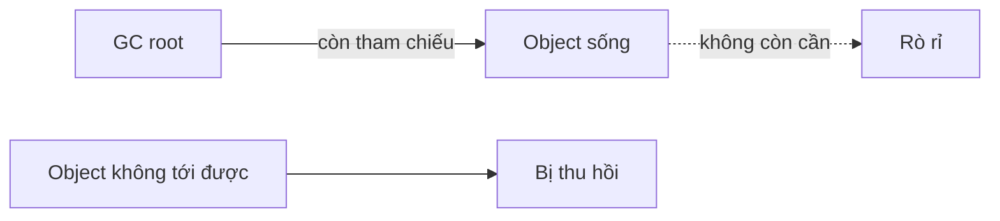
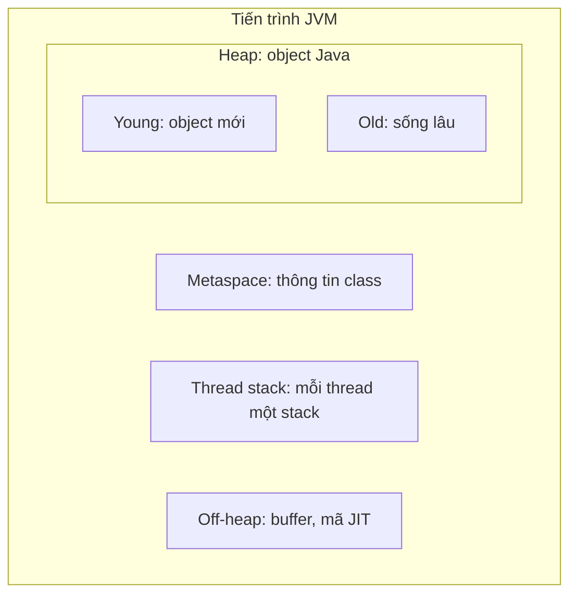

# Lý thuyết 23: Bộ nhớ JVM và Garbage Collection

Bài này giải thích JVM xin memory cho object ở đâu và ai dọn những object không còn ai dùng. JVM chia memory thành nhiều vùng (heap, metaspace, stack...), còn **garbage collector (GC)** là bộ phận tự động tìm và thu hồi object không còn cần đến, để lập trình viên không phải tự `free()` như trong C.

**Cốt lõi:** JVM tự thu hồi object mà từ các GC root không còn đi tới được, và dựa vào việc phần lớn object chết sớm để chỉ dọn vùng trẻ cho rẻ. Heap chỉ là một phần của RAM tiến trình, nên hiểu "ai còn giữ tham chiếu" và "RAM được chia cho những vùng nào" là hiểu hầu hết sự cố memory.

- Vì GC xét khả năng tới được từ GC root chứ không xét code còn cần hay không, nên object bị giữ nhầm là rò rỉ.
- Vì phần lớn object chết sớm nên heap chia Young dọn thường xuyên và Old dọn ít.
- Vì tổng RAM gồm heap, metaspace, stack và off-heap nên heap bằng 100% RAM container sẽ bị OOMKilled.



Mô hình tư duy: sống hay chết do đường tham chiếu từ GC root quyết định, nên rò rỉ là object còn đường tới mà không còn ai cần.

**Tóm tắt:**

- JVM chia memory thành heap (Young và Old), metaspace, thread stack và off-heap; garbage collector chỉ quản lý heap.
- GC coi object là còn sống nếu tới được từ một GC root; rò rỉ trong Java là object vẫn còn tham chiếu mà không còn cần.
- Phần lớn object chết sớm, nên heap chia Young (dọn thường xuyên, rẻ) và Old (dọn ít) để không phải quét cả heap mỗi lần.
- Tổng RAM tiến trình bằng heap cộng metaspace, cộng stack nhân số thread, cộng off-heap; đặt heap bằng 100% RAM container sẽ bị OOMKilled (exit code 137).
- Container nhỏ dùng khoảng `MaxRAMPercentage=65`; heap từ khoảng 8 GiB mới nâng lên 75.
- G1 là GC mặc định và đủ cho đa số; chỉ đổi sang ZGC khi cần latency thấp ổn định, và chỉ chỉnh GC sau khi đã đo.
- Điều tra theo thứ tự: metric, GC log, rồi heap dump nếu heap sau GC cứ tăng dần.
- Loại `OutOfMemoryError` cho biết vùng nào hết (heap, metaspace, native thread, direct buffer).

## Vấn đề nó giải quyết

Bạn sẽ cần kiến thức này khi gặp những hiện tượng như: ứng dụng tự nhiên chậm từng đợt (GC đôi khi phải tạm dừng cả ứng dụng), RAM cứ tăng dần, `OutOfMemoryError`, hoặc container bị Kubernetes kill vì vượt giới hạn memory. Gốc của cả bốn đều nằm ở cách JVM chia và dọn memory. Nếu không hiểu, cách duy nhất bạn biết là tăng RAM lên cho đỡ, và việc đó thường chỉ trì hoãn sự cố.

## Khi nào nên chỉnh, khi nào không

Cần học và chỉnh khi bạn tinh chỉnh hiệu năng, chạy ứng dụng trong container, hoặc điều tra memory leak. Nếu ứng dụng chạy ổn, cứ để mặc định; đừng chỉnh GC khi chưa đo, vì cấu hình sai thường tệ hơn mặc định. Quy trình hợp lý là: xem metric `jvm.*` trước, đặt heap hợp lý so với giới hạn container, chọn GC theo nhu cầu (latency hay throughput), và chỉ phân tích heap dump khi nghi có rò rỉ.

## Các khái niệm cần biết

- **Heap** là vùng chứa mọi object Java (`new Foo()`). Đây là vùng GC quản lý. Kích thước đặt bằng `-Xmx` hoặc `MaxRAMPercentage`.
- **Generational**: phần lớn object chết rất sớm (object tạm trong một request). Nên heap chia làm **Young** (object mới, dọn thường xuyên và rẻ) và **Old** (object sống sót qua nhiều lần dọn, dọn ít hơn). Nhờ vậy GC không phải quét toàn bộ heap mỗi lần.
- **GC root và reachability**: GC coi một object là "còn sống" nếu từ một gốc (biến local trên stack, biến `static`, thread đang chạy) đi theo chuỗi tham chiếu tới được nó. Không tới được thì là rác. Đây là lý do rò rỉ trong Java là "còn được tham chiếu nhưng không còn dùng".
- **Stop-the-world (STW)**: giai đoạn GC tạm dừng mọi thread ứng dụng để làm việc an toàn. Người dùng thấy đó là một cú giật. Các GC hiện đại (G1, ZGC) cố làm phần lớn việc song song để giảm thời gian dừng.
- **Metaspace** chứa thông tin về class (tên method, bytecode), nằm ngoài heap, trong memory native.
- **Thread stack**: mỗi thread có một stack riêng chứa biến local và chuỗi call hàm.
- **Off-heap / native memory**: memory ngoài heap mà JVM hoặc thư viện dùng (direct buffer của Netty/NIO, code cache của JIT). GC không dọn phần này theo cách thông thường.
- **p99** là latency mà 99% request nhanh hơn; nó phản ánh những lần "chậm bất thường" do GC rõ hơn trung bình.
- **OOMKilled (exit code 137)**: hệ điều hành hoặc Kubernetes giết tiến trình vì tổng RAM vượt giới hạn container. Khác với `OutOfMemoryError`, đây là cái chết từ bên ngoài, log app thường không có gì.
- **Dominator tree** (trong Eclipse MAT): công cụ tìm object giữ nhiều memory nhất; định nghĩa ở [Công cụ chẩn đoán JVM: thread dump, heap dump, JFR](/go?p=08-Java%2FJava-Core%2Fhard%2Flt-32-cong-cu-chan-doan-jvm.md).

## Các vùng nhớ



Tổng RAM tiến trình = heap + metaspace + stack × số thread + off-heap. Vì vậy **heap = 100% RAM container là sai**: container bị kill (OOMKilled) dù không có `OutOfMemoryError`.

Lifecycle của object theo generation: object mới sinh ra ở Young, sống sót qua mỗi lần dọn Young thì tăng tuổi, đủ tuổi thì thăng cấp lên Old; nếu Old đầy mà không dọn nổi thì rơi vào Full GC kéo dài hoặc `OutOfMemoryError`. Sơ đồ chi tiết (Eden, Survivor, thăng cấp) ở [Garbage Collection chuyên sâu](/go?p=08-Java%2FJava-Core%2Fhard%2Flt-18-gc-chuyen-sau.md).

**Phải thuộc:** các vùng nhớ: heap (Young và Old), metaspace, thread stack, off-heap. Tổng RAM tiến trình lớn hơn heap, nên đặt heap bằng 100% RAM container sẽ bị OOMKilled (exit code 137). `MaxRAMPercentage` mặc định là 25% RAM container; G1 là GC mặc định từ JDK 9.

**Nền tảng:** GC thu hồi object không còn tới được từ GC root (không phải object hết dùng). Vì vậy rò rỉ trong Java là object vẫn còn tham chiếu mà không còn cần; phần lớn object chết sớm nên heap chia Young/Old để dọn Young rẻ và thường xuyên.

**Suy luận:** Vì phần lớn object chết rất sớm (object tạm trong một request), việc quét toàn bộ heap mỗi lần là lãng phí, nên JVM chia Young và Old để dọn Young thường xuyên và rẻ, còn Old chỉ dọn khi cần. Vì GC quyết định "còn sống" bằng khả năng tới được từ GC root chứ không bằng việc code còn dùng hay không, một object nằm trong `static Map`, `ThreadLocal` của thread trong pool, hay listener chưa hủy sẽ không bao giờ bị thu hồi dù không còn ai cần; đó là cơ chế của memory leak trong Java. Từ đó, heap sau mỗi lần GC mà tăng dần là dấu hiệu rò rỉ, còn heap đầy nhưng sau GC giảm xuống là chỉ cần heap lớn hơn. Điểm dễ nhầm là cho rằng container bị kill vì heap hết: heap chỉ là một phần, còn metaspace, stack nhân số thread và off-heap cũng tính vào giới hạn container, nên heap bằng 100% RAM chắc chắn bị OOMKilled mà log app không có `OutOfMemoryError`. Hệ quả hành động: đặt heap theo phần trăm RAM container chừa chỗ cho phần ngoài heap, xem metric trước, và chỉ lấy heap dump khi thấy mức "sau GC" tăng dần.

## Cách chọn GC

Mỗi GC đánh đổi giữa throughput và latency. Tóm lại: G1 (mặc định) cân bằng và hợp phần lớn ứng dụng; ZGC dừng rất ngắn cho yêu cầu latency thấp ổn định; Parallel cho batch không nhạy latency. Bảng so sánh đầy đủ và cây chọn GC ở [Garbage Collection chuyên sâu](/go?p=08-Java%2FJava-Core%2Fhard%2Flt-18-gc-chuyen-sau.md).

Triệu chứng GC có vấn đề: latency p99 tăng theo từng đợt, CPU dành nhiều cho GC, heap luôn gần đầy sau khi thu gom. Không nên đổi sang ZGC chỉ vì "nghe nói nhanh": nếu ứng dụng không nhạy latency, G1 mặc định là đủ.

## Memory leak trong Java

Rò rỉ là nguyên nhân hàng đầu khiến RAM tăng mãi. Java vẫn rò rỉ khi object **còn được tham chiếu nhưng không còn dùng**:

| Nguồn thường gặp | Cách tránh |
|---|---|
| `static Map`/cache nội bộ không giới hạn | Dùng Caffeine với kích thước/TTL tối đa |
| `ThreadLocal` không dọn trong pool thread | `remove()` ở `finally` |
| Listener/callback đăng ký mà không hủy | Hủy đăng ký khi xong |
| Tải cả bảng lớn vào danh sách | Phân trang, stream |
| Tag metric có vô hạn giá trị | Giới hạn label |

## Công cụ

Khi nghi ngờ, hãy đo chứ đừng đoán. Bộ công cụ dưới đây đi từ nhẹ đến nặng: metric thì luôn bật được, heap dump thì tạm dừng ứng dụng nên chỉ dùng khi cần.

- Metric: `jvm.memory.used`, `jvm.gc.pause`, `jvm.threads.live`.
- Cờ hữu ích: `-XX:MaxRAMPercentage=65`, `-XX:+HeapDumpOnOutOfMemoryError`, `-Xlog:gc*`.
- Heap dump, profiling (JFR, async-profiler) và lệnh `jcmd`/`jstat`: xem [Công cụ chẩn đoán JVM: thread dump, heap dump, JFR](/go?p=08-Java%2FJava-Core%2Fhard%2Flt-32-cong-cu-chan-doan-jvm.md).

## Tính ngân sách memory cho container

Ví dụ container giới hạn **2 GiB**, app Spring MVC khoảng 200 thread:

| Phần | Ước lượng |
|---|---|
| Heap (`-XX:MaxRAMPercentage=65`) | 1,3 GiB |
| Metaspace (class Spring, Hibernate) | 150 MiB |
| Stack thread: 200 × 1 MiB (`-Xss` mặc định thường 1 MiB) | 200 MiB |
| Code cache JIT | 50 đến 100 MiB |
| Direct buffer (Netty, NIO), GC, memory native khác | 100 đến 200 MiB |
| Tổng | khoảng 1,8 đến 1,9 GiB |

Cộng lại: 1,3 GiB + 150 MiB + 200 MiB + (50 đến 100) MiB + (100 đến 200) MiB ra khoảng 1,8 đến 1,9 GiB (1,3 GiB tương đương khoảng 1.330 MiB), tức còn rất ít dư so với 2 GiB. Đặt 75% cho heap (1,5 GiB) thì phần còn lại chỉ 512 MiB, dễ vượt khi thêm thread hoặc buffer: container bị OOMKilled (exit code 137) mà log app không có `OutOfMemoryError`. Quy ước thống nhất trong tài liệu: container nhỏ dùng khoảng 65; heap lớn (từ khoảng 8 GiB) mới nâng lên 75. Cách đo phần ngoài heap thật sự dùng bao nhiêu (`jcmd <pid> VM.native_memory summary`) ở [Công cụ chẩn đoán JVM: thread dump, heap dump, JFR](/go?p=08-Java%2FJava-Core%2Fhard%2Flt-32-cong-cu-chan-doan-jvm.md).

## Cờ JVM thường dùng

```bash
java -XX:MaxRAMPercentage=65 -XX:InitialRAMPercentage=65 \
     -XX:MaxMetaspaceSize=256m \
     -XX:+HeapDumpOnOutOfMemoryError -XX:HeapDumpPath=/dumps \
     -XX:+ExitOnOutOfMemoryError \
     -Xlog:gc*:file=/logs/gc.log:time,uptime:filecount=5,filesize=20m \
     -jar app.jar
```

| Cờ | Tác dụng |
|---|---|
| `MaxRAMPercentage` / `InitialRAMPercentage` | Heap theo phần trăm RAM container; đặt hai giá trị bằng nhau để heap không phải giãn lúc chạy |
| `-Xmx`, `-Xms` | Heap theo số tuyệt đối, ghi đè phần trăm |
| `MaxMetaspaceSize` | Chặn metaspace phình vô hạn (lỗi nạp class lặp) |
| `HeapDumpOnOutOfMemoryError` + `HeapDumpPath` | Tự ghi heap dump lúc chết; đường dẫn phải là volume bền |
| `ExitOnOutOfMemoryError` | Thoát hẳn để Kubernetes khởi động lại, thay vì sống dở chết dở |
| `-Xlog:gc*:file=...` | GC log có xoay vòng (JDK 9+) |

## Đọc GC log (G1)

Cách đọc dòng log G1 (`trước->sau(tổng đã cấp phát) thời gian dừng`) và các dấu hiệu cần nhìn (mức "sau" tăng dần là rò rỉ, `Pause Full` ở G1 Compaction Pause, Pause Young vài lần mỗi giây, phép tính SLA p99 200 ms) có bảng đầy đủ ở [Garbage Collection chuyên sâu](/go?p=08-Java%2FJava-Core%2Fhard%2Flt-18-gc-chuyen-sau.md).

## Lệnh chẩn đoán trên tiến trình đang chạy

Các lệnh `jcmd GC.heap_info`, `GC.class_histogram`, `GC.heap_dump`, `jstat -gcutil` và quy trình dùng heap dump cùng dominator tree trong MAT ở [Công cụ chẩn đoán JVM: thread dump, heap dump, JFR](/go?p=08-Java%2FJava-Core%2Fhard%2Flt-32-cong-cu-chan-doan-jvm.md). Lưu ý nhớ: heap dump chứa dữ liệu thật nên phải bảo vệ như dữ liệu nhạy cảm.

## Phân biệt các loại OutOfMemoryError

| Thông báo | Nguyên nhân thường gặp | Hướng xử lý |
|---|---|---|
| `Java heap space` | Heap nhỏ hoặc rò rỉ | Xem GC log, heap dump |
| `Metaspace` | Sinh class động liên tục, rò classloader | Tìm nơi sinh class (proxy, script), đặt giới hạn |
| `unable to create native thread` | Quá nhiều thread, hết RAM hoặc giới hạn hệ điều hành | Giảm pool, giảm `-Xss`, kiểm tra ulimit |
| `Direct buffer memory` | Buffer NIO/Netty không giải phóng | Kiểm tra `MaxDirectMemorySize`, rò buffer |
| `GC overhead limit exceeded` | GC chiếm hầu hết thời gian mà thu được rất ít | Như heap space |

Cấu hình Kubernetes tương ứng (request, limit) xem [Đóng gói, Docker và Kubernetes cho Spring Boot](/go?p=01-Spring-Boot%2Fhard%2Flt-29-docker-kubernetes.md).

## Quy trình điều tra

Tóm lại: nếu heap sau GC tăng dần thì lấy heap dump, tìm đường tham chiếu tới GC root và sửa nguồn rò; nếu không tăng thì heap hoặc container quá nhỏ. Các bước chi tiết (so sánh hai heap dump, dominator tree, path to GC roots) ở [Công cụ chẩn đoán JVM: thread dump, heap dump, JFR](/go?p=08-Java%2FJava-Core%2Fhard%2Flt-32-cong-cu-chan-doan-jvm.md).

## Phỏng vấn khó: chuỗi hỏi xoáy

Người phỏng vấn senior thường mở bằng câu dễ rồi xoáy xuống cơ chế, đánh đổi và sự cố thật. Câu trả lời tốt luôn đi từ cốt lõi xuống: ai còn giữ tham chiếu, và RAM được chia cho những vùng nào.

### Chuỗi 1: Rò rỉ memory trong ngôn ngữ có GC

1. **Câu mở:** Java có GC thì còn rò rỉ memory được không?
2. **Xoáy 1:** GC quyết định một object là rác bằng cách nào, và những chỗ nào hay giữ object sống nhầm?
3. **Xoáy 2:** Heap đầy: làm sao phân biệt rò rỉ với heap nhỏ, và bạn điều tra theo thứ tự nào?

**Đáp án ngắn:** Được. GC chỉ xét khả năng tới được từ GC root (biến local trên stack, biến `static`, thread đang chạy), không xét code còn cần object hay không. Vì vậy object nằm trong `static Map` không giới hạn, `ThreadLocal` của thread trong pool chưa `remove()`, hoặc listener chưa hủy đăng ký sẽ không bao giờ bị thu hồi. Đó là rò rỉ: còn được tham chiếu nhưng không còn dùng. Để phân biệt, nhìn mức heap sau mỗi lần GC: tăng dần là rò rỉ, còn đầy nhưng sau GC giảm xuống thì chỉ cần heap lớn hơn. Điều tra từ nhẹ đến nặng: metric `jvm.memory.used`, GC log, rồi heap dump (tự ghi bằng `HeapDumpOnOutOfMemoryError`) và tìm đường tham chiếu tới GC root bằng dominator tree. Heap dump chứa dữ liệu thật nên phải bảo vệ như dữ liệu nhạy cảm.

**Sai lầm hay gặp:**
- Nói "Java có GC nên không rò rỉ".
- Thấy RAM tăng là tăng RAM, không xem heap sau GC.
- Lấy heap dump ngay khi chưa có dấu hiệu từ metric.

### Chuỗi 2: Container bị OOMKilled

1. **Câu mở:** Pod bị OOMKilled, exit code 137, nhưng log không có `OutOfMemoryError`. Vì sao?
2. **Xoáy 1:** Tính ngân sách memory cho container 2 GiB, app khoảng 200 thread.
3. **Xoáy 2:** Vì sao không đặt heap 75%, và khi nào mới nâng?

**Đáp án ngắn:** OOMKilled là cái chết từ bên ngoài: hệ điều hành hoặc Kubernetes giết tiến trình vì tổng RAM vượt limit. `OutOfMemoryError` thì do chính JVM báo khi một vùng hết. Tổng RAM gồm heap, metaspace, stack nhân số thread, và off-heap (code cache JIT, direct buffer). Ví dụ 2 GiB: heap 65% khoảng 1,3 GiB, metaspace 150 MiB, stack 200 nhân 1 MiB, code cache 50 đến 100 MiB, direct buffer cùng native khác 100 đến 200 MiB. Cộng lại khoảng 1,8 đến 1,9 GiB, còn rất ít dư. Đặt 75% thì phần ngoài heap chỉ còn 512 MiB, dễ vượt khi thêm thread hoặc buffer. Heap từ khoảng 8 GiB trở lên mới nâng 75 vì lúc đó phần ngoài heap chiếm tỷ lệ nhỏ hơn. Muốn đo phần ngoài heap thật dùng `jcmd <pid> VM.native_memory summary`, và nên có `ExitOnOutOfMemoryError` để Kubernetes khởi động lại hẳn.

**Sai lầm hay gặp:**
- Đặt heap bằng 100% RAM container.
- Nhầm OOMKilled với `OutOfMemoryError`.
- Quên stack nhân số thread khi tính ngân sách.

### Chuỗi 3: Chia vùng heap và chọn GC

1. **Câu mở:** Vì sao heap chia Young và Old?
2. **Xoáy 1:** Vòng đời một object đi qua các vùng thế nào, và khi nào xảy ra Full GC?
3. **Xoáy 2:** Latency p99 tăng từng đợt, có nên đổi sang ZGC luôn không?

**Đáp án ngắn:** Phần lớn object chết rất sớm, ví dụ object tạm trong một request, nên dọn Young thường xuyên thì rẻ, còn Old chỉ dọn khi cần; nhờ vậy khỏi quét cả heap mỗi lần. Object mới sinh ra ở Young, sống sót qua mỗi lần dọn thì tăng tuổi, đủ tuổi thì thăng cấp lên Old. Nếu Old đầy mà không dọn nổi thì rơi vào Full GC kéo dài hoặc `OutOfMemoryError`. Giai đoạn stop-the-world làm mọi thread ứng dụng dừng, người dùng thấy là cú giật, và p99 phản ánh điều đó rõ hơn trung bình. Không đổi sang ZGC chỉ vì nghe nói nhanh: bật `-Xlog:gc*`, xem Pause Young kéo dài bao lâu, có `Pause Full` không, CPU dành cho GC bao nhiêu. G1 là mặc định và cân bằng; ZGC khi cần latency thấp ổn định; Parallel cho batch. Cấu hình GC sai thường tệ hơn mặc định.

**Sai lầm hay gặp:**
- Chỉnh GC khi chưa đo.
- Cho rằng GC pause là lỗi của GC mà không xem tốc độ sinh object của ứng dụng.
- Không phân biệt Pause Young với Full GC khi đọc log.

