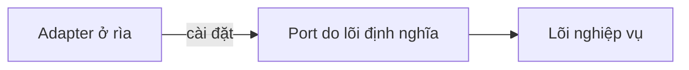
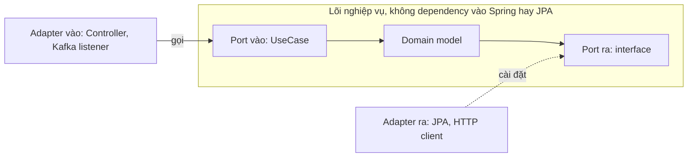
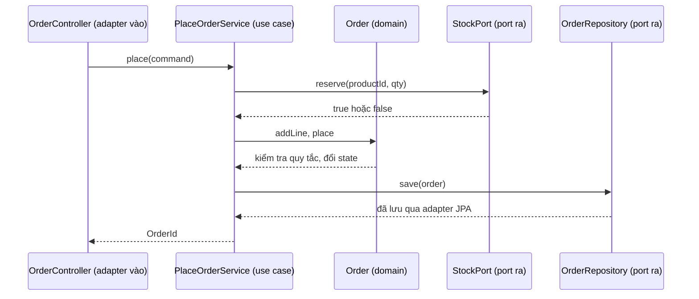
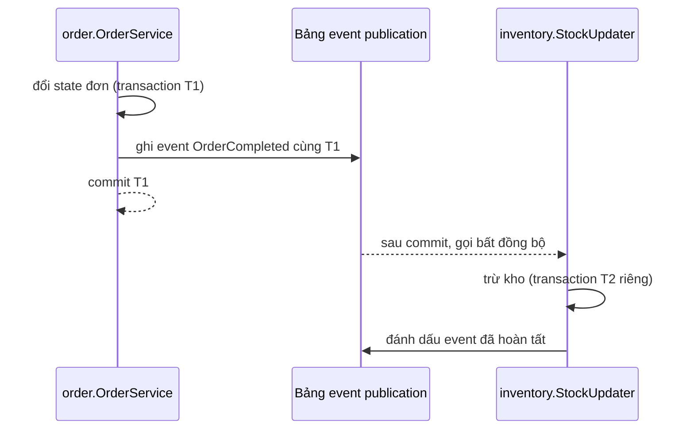

# Lý thuyết 24: Kiến trúc Hexagonal, DDD và Modular Monolith

Bài này nói về cách tổ chức code sao cho phần nghiệp vụ (quy tắc đặt đơn, tính tiền, kiểm tra tồn kho...) không dính vào Spring hay database, và cách chia một ứng dụng lớn thành các module có ranh giới rõ ràng nhưng vẫn deploy chung một khối (modular monolith).

**Cốt lõi:** Framework và hạ tầng đổi nhanh hơn nghiệp vụ, nên nghiệp vụ không được phụ thuộc vào chúng. Lõi tự khai báo thứ nó cần dưới dạng interface, còn hạ tầng ở rìa cài đặt interface đó, và cùng tư duy ranh giới ấy áp dụng cho aggregate và module.

- Vì lõi định nghĩa port còn adapter cài đặt nên mũi tên dependency luôn hướng vào trong.
- Vì transaction chỉ bảo đảm nhất quán trong một lần commit nên aggregate gom những gì phải đúng cùng nhau và nên nhỏ.
- Vì module chỉ lộ API công khai và nói chuyện qua event nên lỗi bên nhận không làm hỏng bên gửi.



Mô hình tư duy: rìa phụ thuộc vào lõi chứ lõi không biết rìa, nên đổi hạ tầng chỉ đổi adapter.

**Tóm tắt:**

- Hexagonal đặt nghiệp vụ ở lõi, và lõi nói chuyện với bên ngoài qua port (interface do lõi định nghĩa) và adapter (phần cài đặt ở rìa như JPA, REST, Kafka).
- Quy tắc dependency luôn hướng vào trong: lõi không import JPA, Spring Web hay Kafka, nên test nghiệp vụ không cần Spring và đổi hạ tầng chỉ đổi adapter.
- Use case là nơi duy nhất đặt ranh giới transaction; domain là Java thuần, tự bảo vệ quy tắc của mình.
- Cái giá của Hexagonal là thêm layer và mapping giữa entity JPA và domain model, nên với CRUD nhỏ thì layered thông thường là đủ.
- Aggregate là cụm object có một root, bảo vệ invariant; transaction không vượt quá một aggregate, và aggregate chỉ tham chiếu aggregate khác bằng id.
- Entity có danh tính, Value Object chỉ có giá trị và bất biến; bounded context là ranh giới mà một mô hình có nghĩa nhất quán.
- Modular monolith deploy một khối nhưng chia module có ranh giới; Spring Modulith kiểm tra ranh giới bằng test và cho module giao tiếp qua event.
- Event giữa module chỉ được phát sau khi transaction của bên gửi commit và được lưu để phát lại, nên lỗi ở bên nhận không làm hỏng bên gửi.

## Vấn đề nó giải quyết

Kiểu "controller, service, repository" nếu để trộn lẫn mọi thứ thì lâu ngày thành một cục khó đổi: service nghiệp vụ call thẳng JPA, entity có đầy annotation của Hibernate, module này chui vào ruột module kia. Hậu quả thực tế là muốn test một quy tắc nghiệp vụ cũng phải dựng cả Spring và database, đổi từ JPA sang một kho dữ liệu khác thì phải sửa khắp nơi. Điều đáng chú ý là framework và hạ tầng thay đổi nhanh hơn nghiệp vụ, nên đừng để nghiệp vụ có dependency vào chúng.

Cách giải quyết là đặt nghiệp vụ ở lõi, và để lõi nói chuyện với thế giới bên ngoài qua **port** (một interface do lõi tự định nghĩa, ví dụ "tôi cần lưu đơn hàng") và **adapter** (phần cài đặt cụ thể ở rìa, ví dụ lưu bằng JPA, nhận request bằng REST, nhận event từ Kafka). Giống ổ cắm điện: lõi chỉ biết hình dáng ổ cắm (port), còn thiết bị cắm vào (adapter) thay được. Với module, mỗi module chỉ lộ ra một API công khai nhỏ.

## Khi nào nên dùng, khi nào không

Nên dùng với ứng dụng sống lâu, nghiệp vụ phức tạp, nhiều team cùng làm. Không nên dùng với ứng dụng CRUD nhỏ: cấu trúc này thêm nhiều layer và mapping, nên ở đó nó là thừa và layered thông thường là đủ. Bảng chọn kiến trúc ở cuối bài giúp quyết định.

## Các khái niệm cần biết

- **Port vào (inbound port / use case)**: interface mô tả "ứng dụng làm được việc gì" (ví dụ `PlaceOrderUseCase`). Adapter vào như controller gọi nó.
- **Port ra (outbound port)**: interface mô tả "lõi cần gì từ bên ngoài" (`OrderRepository`, `StockPort`). Adapter ra cài đặt nó.
- **Dependency inversion**: thay vì lõi phụ thuộc vào JPA, ta để JPA adapter phụ thuộc vào interface của lõi. Mũi tên dependency luôn hướng vào trong.
- **Command**: object gói dữ liệu đầu vào cho một use case (`PlaceOrderCommand`), tách khỏi request HTTP.
- **Aggregate root**: object "cổng vào" duy nhất của một cụm object liên quan (xem phần DDD bên dưới).

## Hexagonal (Ports và Adapters)



**Quy tắc dependency:** mũi tên dependency luôn chỉ **vào trong**. Lõi không `import` JPA, Spring Web hay Kafka.

Cấu trúc package gợi ý:

```text
order/
├── domain/          # Order, Money, quy tắc nghiệp vụ (Java thuần)
├── application/     # PlaceOrderUseCase, các port
└── adapter/
    ├── in/web/      # OrderController
    └── out/persistence/  # OrderJpaEntity, OrderRepositoryAdapter
```

**Nền tảng:** dependency inversion: lõi nghiệp vụ định nghĩa interface (port) cho thứ nó cần, còn hạ tầng (JPA, HTTP, Kafka) cài đặt interface đó (adapter). Nhờ vậy mũi tên dependency hướng vào lõi, nghiệp vụ test được không cần Spring và đổi hạ tầng chỉ đổi adapter.

**Suy luận:** Vì framework và hạ tầng thay đổi nhanh hơn nghiệp vụ, phần nghiệp vụ không nên phụ thuộc vào chúng; nếu lõi `import` JPA thì mỗi lần đổi hạ tầng là sửa cả quy tắc nghiệp vụ. Muốn lõi không phụ thuộc mà vẫn dùng được hạ tầng, lõi phải tự khai báo thứ nó cần dưới dạng interface (port) và để hạ tầng cài đặt, nên mũi tên dependency lúc runtime vẫn đi từ lõi ra adapter nhưng mũi tên dependency lúc compile đảo lại đi từ adapter vào lõi. Hệ quả trực tiếp là test: thay adapter thật bằng bản in-memory thì test use case chạy trong mili giây mà không cần Spring hay database. Điểm dễ nhầm là nghĩ Hexagonal chỉ là thêm thư mục: nếu domain vẫn mang `@Entity` hay use case vẫn trả `ResponseEntity` thì dependency vẫn trỏ ra ngoài và mọi lợi ích mất đi, dù cây thư mục trông đúng. Chi phí đi kèm là hai mô hình (entity JPA và domain) phải map qua lại, nên với CRUD không có quy tắc nghiệp vụ thì cái giá này lớn hơn lợi ích. Khi review, hãy kiểm tra import của package domain và application bằng ArchUnit thay vì tin vào tên thư mục.

Lợi ích: test nghiệp vụ không cần Spring; đổi DB/broker chỉ đổi adapter.
Chi phí: nhiều layer và mapping hơn. Với CRUD đơn giản thì **quá tay**.

Để thấy các mảnh nối với nhau thế nào, đây là flow của một lần đặt đơn (code đầy đủ ở các mục sau).



Đọc sơ đồ: controller chỉ chuyển request thành command. Use case điều phối: hỏi kho, nhờ `Order` tự kiểm tra quy tắc, rồi lưu qua port. `StockPort` và `OrderRepository` ở đây chỉ là interface; lõi không biết phía sau là JPA hay HTTP.

### Code: domain, port, adapter

Domain là Java thuần, tự bảo vệ quy tắc của mình:

```java
// order/domain
public record OrderId(UUID value) {}
public record Money(BigDecimal amount) {
    public Money plus(Money o) { return new Money(amount.add(o.amount)); }
    public Money times(int n) { return new Money(amount.multiply(BigDecimal.valueOf(n))); }
}

public class Order {                                   // aggregate root
    public enum Status { NEW, PLACED }
    public record Line(Long productId, int qty, Money unitPrice) {}

    private final OrderId id;
    private final List<Line> lines = new ArrayList<>();
    private Status status = Status.NEW;

    public Order(OrderId id) { this.id = id; }

    public void addLine(Long productId, int qty, Money unitPrice) {
        if (status != Status.NEW) throw new IllegalStateException("Đơn đã đặt, không sửa được");
        if (qty <= 0) throw new IllegalArgumentException("Số lượng phải dương");
        lines.add(new Line(productId, qty, unitPrice));
    }

    public void place() {
        if (lines.isEmpty()) throw new IllegalStateException("Đơn rỗng");
        status = Status.PLACED;
    }

    public Money total() {
        return lines.stream().map(l -> l.unitPrice().times(l.qty())).reduce(new Money(BigDecimal.ZERO), Money::plus);
    }
    public OrderId id() { return id; }
    public Status status() { return status; }
    public List<Line> lines() { return List.copyOf(lines); }
}
```

Port vào (use case) và port ra (thứ lõi cần từ bên ngoài) đều là interface nằm trong lõi:

```java
// order/application/port/in
public interface PlaceOrderUseCase {
    OrderId place(PlaceOrderCommand cmd);
}
public record PlaceOrderCommand(List<Item> items) {
    public record Item(Long productId, int qty, BigDecimal unitPrice) {}
}

// order/application/port/out
public interface OrderRepository {
    void save(Order order);
    Optional<Order> findById(OrderId id);
}
public interface StockPort {
    boolean reserve(Long productId, int qty);
}
```

Use case chỉ biết port. Đây là nơi duy nhất đặt ranh giới transaction:

```java
@Service
class PlaceOrderService implements PlaceOrderUseCase {
    private final OrderRepository orders;
    private final StockPort stock;

    PlaceOrderService(OrderRepository orders, StockPort stock) { this.orders = orders; this.stock = stock; }

    @Override
    @Transactional
    public OrderId place(PlaceOrderCommand cmd) {
        Order order = new Order(new OrderId(UUID.randomUUID()));
        for (var i : cmd.items()) {
            if (!stock.reserve(i.productId(), i.qty()))
                throw new OutOfStockException(i.productId());
            order.addLine(i.productId(), i.qty(), new Money(i.unitPrice()));
        }
        order.place();
        orders.save(order);
        return order.id();
    }
}
```

Adapter ra cài port bằng JPA, chuyển đổi giữa entity JPA và domain (hai mô hình tách nhau, đó là chi phí của Hexagonal):

```java
@Repository
class OrderRepositoryAdapter implements OrderRepository {
    // Spring Data, chỉ adapter biết
    private final OrderJpaRepository jpa;
    OrderRepositoryAdapter(OrderJpaRepository jpa) { this.jpa = jpa; }

    @Override public void save(Order o) { jpa.save(OrderJpaEntity.fromDomain(o)); }
    @Override public Optional<Order> findById(OrderId id) {
        return jpa.findById(id.value()).map(OrderJpaEntity::toDomain);
    }
}

@RestController
class OrderController {                                         // adapter vào
    private final PlaceOrderUseCase placeOrder;
    OrderController(PlaceOrderUseCase placeOrder) { this.placeOrder = placeOrder; }

    @PostMapping("/orders")
    ResponseEntity<Map<String, UUID>> place(@RequestBody PlaceOrderRequest req) {
        OrderId id = placeOrder.place(req.toCommand());
        return ResponseEntity.status(HttpStatus.CREATED).body(Map.of("id", id.value()));
    }
}
```

Lợi ích hiện ra khi test: không cần Spring, không DB, chạy mili giây.

```java
class PlaceOrderServiceTest {
    @Test
    void rejectsWhenOutOfStock() {
        // class giả cài OrderRepository
        var repo = new InMemoryOrderRepository();
        StockPort noStock = (productId, qty) -> false;
        var service = new PlaceOrderService(repo, noStock);

        var cmd = new PlaceOrderCommand(List.of(new PlaceOrderCommand.Item(1L, 2, BigDecimal.TEN)));
        assertThrows(OutOfStockException.class, () -> service.place(cmd));
        assertTrue(repo.isEmpty());
    }
}
```

Giữ quy tắc dependency bằng ArchUnit (xem [Testing nâng cao](/go?p=01-Spring-Boot%2Fhard%2Flt-27-advanced-testing.md)). Lưu ý `@Service`/`@Transactional` trong layer application là thỏa hiệp thực dụng phổ biến; domain mới là nơi cấm tuyệt đối annotation Spring/JPA.

| Sai | Đúng |
|---|---|
| Domain có `@Entity`, `@Column` | Entity JPA nằm ở adapter, ánh xạ sang domain |
| Controller gọi thẳng `JpaRepository` | Controller gọi use case |
| Use case nhận `HttpServletRequest` hay trả `ResponseEntity` | Use case nhận command, trả giá trị nghiệp vụ |
| Aggregate giữ tham chiếu object sang aggregate khác | Chỉ giữ **id** của aggregate khác |

## DDD cơ bản

DDD (Domain-Driven Design) là cách mô hình hóa phần mềm bám sát nghiệp vụ, thay vì bám bảng database. Hexagonal cho bạn chỗ để đặt mô hình đó (lõi), còn DDD cho bạn các khái niệm để xây mô hình. Các khái niệm chính:

| Khái niệm | Ý nghĩa |
|---|---|
| Ubiquitous language | Code và nghiệp vụ dùng cùng thuật ngữ |
| Entity / Value Object | Có danh tính / chỉ có giá trị (`Money`, `Address`), bất biến |
| **Aggregate** | Cụm object thay đổi cùng nhau, có một gốc (aggregate root); transaction không vượt quá một aggregate |
| Bounded context | Ranh giới mà một mô hình có nghĩa nhất quán (`Order` ở bán hàng khác `Order` ở kho) |
| Domain event | Chuyện đã xảy ra trong nghiệp vụ (`OrderPlaced`) |

Hai điểm hay bị hiểu sai. Thứ nhất, **aggregate** tồn tại để bảo vệ các quy tắc bất biến (invariant): trong code ở trên, `Order` là root và mọi thay đổi dòng hàng đều đi qua `addLine`, nên không ai thêm dòng vào đơn đã đặt được. Nếu cho code bên ngoài sửa trực tiếp danh sách dòng hàng, quy tắc này vỡ. Thứ hai, aggregate nên **nhỏ**, và chỉ tham chiếu aggregate khác bằng id; aggregate to kéo theo lock dài và tranh chấp khi nhiều người cùng sửa. Không nên dùng DDD đầy đủ cho phần ứng dụng chỉ đọc/ghi dữ liệu không có quy tắc, vì khi đó các khái niệm này chỉ thêm thủ tục.

**Phải thuộc:** Aggregate là cụm object có một root (aggregate root), bảo vệ các quy tắc bất biến; transaction không vượt quá một aggregate; aggregate chỉ tham chiếu aggregate khác bằng id. Entity có danh tính, Value Object chỉ có giá trị và bất biến; Bounded context là ranh giới mà một mô hình có nghĩa nhất quán.

**Suy luận:** Vì transaction database chỉ bảo đảm nhất quán trong một lần commit, DDD gom các object luôn phải đúng cùng nhau thành một aggregate và coi transaction là ranh giới của nó; quy tắc như "đơn đã đặt thì không sửa dòng hàng" chỉ giữ được khi mọi thay đổi đi qua aggregate root. Vì aggregate bị khóa hoặc version khi sửa, aggregate càng to thì càng nhiều người tranh chấp cùng một dòng dữ liệu và transaction càng dài, nên aggregate phải nhỏ. Vì aggregate nhỏ và không chia sẻ transaction với nhau, chúng chỉ nên tham chiếu nhau bằng id; thay đổi trải qua nhiều aggregate được nối bằng domain event và chấp nhận eventual consistency. Điểm dễ nhầm là vẽ aggregate theo quan hệ bảng database (có khóa ngoại là gộp vào), trong khi tiêu chí đúng là invariant nào phải đúng ngay trong một transaction. Hệ quả khi thiết kế: bắt đầu từ danh sách quy tắc phải đúng tức thì, gom đúng phần dữ liệu cần chúng, phần còn lại tách ra và nối bằng id cộng event.

## Modular Monolith và Spring Modulith

Microservices giải quyết việc nhiều team deploy độc lập, nhưng đổi lại phải trả giá bằng mạng, nhất quán dữ liệu và vận hành phức tạp. **Modular monolith** lấy phần lợi về ranh giới mà không phải trả giá đó:

- Một ứng dụng deploy một khối, nhưng chia **module có ranh giới**, giao tiếp qua API công khai hoặc event.
- Spring Modulith kiểm tra ranh giới module, hỗ trợ event giữa module và tạo tài liệu.
- Là bước đệm tốt trước microservices: ranh giới rõ thì sau này tách service dễ.
- Không nên dùng khi các module thực sự cần scale hoặc deploy độc lập ngay từ đầu, hoặc khi cả ứng dụng quá nhỏ để chia.

```java
@ApplicationModule(allowedDependencies = "inventory")
package com.example.order;
```

Spring Modulith coi mỗi **package con trực tiếp** của package chứa `@SpringBootApplication` là một module. Class ở package gốc của module là API công khai; class trong package con (`com.example.order.internal`) là nội bộ, module khác không được dùng.

```text
com.example
├── Application.java
├── order/            # API công khai: OrderService, event OrderCompleted
│   └── internal/     # nội bộ: repository, entity
└── inventory/
    └── internal/
```

Test kiểm tra ranh giới (cần dependency `spring-modulith-starter-test`): vi phạm là test đỏ, gồm cả dependency vòng giữa module.

```java
class ModularityTests {
    @Test
    void verifiesStructure() {
        ApplicationModules.of(Application.class).verify();
    }
}
```

Giao tiếp giữa module bằng event thay vì gọi trực tiếp, để `order` không phải biết `inventory`. Flow của một event như sau.



Đọc sơ đồ: event chỉ được phát sau khi `order` commit thành công, nên không có chuyện kho bị trừ cho một đơn bị rollback. Nếu listener lỗi, event vẫn còn trong bảng chưa đánh dấu hoàn tất và có thể phát lại. Đoạn code tương ứng:

```java
// module order
@Service
public class OrderService {
    private final ApplicationEventPublisher events;
    // constructor bỏ qua

    @Transactional
    public void complete(OrderId id) {
        // ... đổi state đơn
        // record nằm ở package gốc order
        events.publishEvent(new OrderCompleted(id.value()));
    }
}

// module inventory
@Component
class StockUpdater {
    // chạy bất đồng bộ, transaction riêng, sau khi transaction phát event commit
    @ApplicationModuleListener
    void on(OrderCompleted event) {
        // trừ kho
    }
}
```

`@ApplicationModuleListener` gộp `@Async`, `@Transactional(REQUIRES_NEW)` và `@TransactionalEventListener`, nên cần bật `@EnableAsync`. Với `spring-modulith-starter-jpa`, event được lưu vào bảng event publication trong cùng transaction với dữ liệu nghiệp vụ và đánh dấu hoàn tất khi listener xong: đây là outbox trong nội bộ app, listener lỗi thì event không mất và có thể phát lại. Phiên bản đầy đủ ra Kafka xem [Kiến trúc hướng sự kiện với Kafka](/go?p=01-Spring-Boot%2Fhard%2Flt-07-event-driven-kafka.md).

| | Gọi trực tiếp giữa module | Event giữa module |
|---|---|---|
| Dependency | `order` biết `inventory` | `inventory` biết event của `order` |
| Lỗi ở bên nhận | Làm hỏng cả flow gọi | Cô lập; phát lại được |
| Consistency | Strong, cùng transaction | Eventual |
| Dùng khi | Cần kết quả ngay | Phản ứng phụ, không cần chờ |

## Chọn kiến trúc

| Tình huống | Gợi ý |
|---|---|
| CRUD đơn giản, một team | Layered thông thường |
| Nghiệp vụ phức tạp, sống lâu | Hexagonal + DDD |
| Nhiều team trong một sản phẩm | Modular monolith |
| Cần scale/deploy độc lập từng phần | Microservices (sau khi ranh giới đã rõ) |

Nguyên tắc: kiến trúc phục vụ độ phức tạp thực tế, không phải ngược lại.

## Phỏng vấn khó: chuỗi hỏi xoáy

Người phỏng vấn senior thường mở bằng câu dễ rồi xoáy xuống cơ chế, đánh đổi và sự cố thật. Câu trả lời tốt luôn đi từ cốt lõi xuống: ranh giới nào phải giữ, và giữ bằng cơ chế gì chứ không bằng tên thư mục.

### Chuỗi 1: Hexagonal và dependency inversion

1. **Câu mở:** Hexagonal khác kiến trúc controller, service, repository thông thường ở điểm nào?
2. **Xoáy 1:** Lúc runtime use case vẫn gọi tới JPA, vậy "dependency hướng vào trong" nghĩa là gì?
3. **Xoáy 2:** Nếu domain vẫn có `@Entity` và use case trả `ResponseEntity`, cây thư mục đúng thì có sao không? Khi nào không nên dùng Hexagonal?

**Đáp án ngắn:** Điểm khác là hướng dependency: lõi nghiệp vụ không phụ thuộc framework hay hạ tầng. Lõi tự khai báo thứ nó cần dưới dạng port (interface), còn JPA, REST, Kafka là adapter ở rìa cài đặt port đó. Lúc runtime lời gọi vẫn đi từ use case ra adapter, nhưng ở compile time adapter phụ thuộc vào interface của lõi, nên mũi tên dependency đảo lại và hướng vào trong. Hệ quả trực tiếp là test: thay adapter bằng bản in-memory thì test use case chạy mili giây, không cần Spring hay database. Nếu domain mang `@Entity` hay use case trả `ResponseEntity` thì dependency vẫn trỏ ra ngoài, mọi lợi ích mất dù cây thư mục đẹp. Cái giá là hai mô hình (entity JPA và domain) phải map qua lại, nên CRUD đơn giản thì layered là đủ. Cách kiểm tra khách quan là ArchUnit trên import của package domain.

**Sai lầm hay gặp:**
- Nói Hexagonal chỉ là chia thêm thư mục.
- Không nêu được chi phí mapping hai mô hình.
- Coi `@Transactional` ở use case là vi phạm, trong khi bài coi đó là thỏa hiệp thực dụng, còn domain mới cấm annotation.

### Chuỗi 2: Aggregate và ranh giới transaction

1. **Câu mở:** Aggregate là gì và vì sao nên nhỏ?
2. **Xoáy 1:** Hai aggregate cần cập nhật cùng một nghiệp vụ thì làm sao khi transaction không được vượt quá một aggregate?
3. **Xoáy 2:** Bảng này có khóa ngoại sang bảng kia, vậy gộp vào cùng aggregate được không?

**Đáp án ngắn:** Aggregate là cụm object thay đổi cùng nhau, có một root và bảo vệ các invariant. Transaction database chỉ bảo đảm nhất quán trong một lần commit, nên DDD gom những gì phải đúng cùng lúc vào một aggregate và coi transaction là ranh giới của nó. Mọi thay đổi đi qua root, ví dụ `addLine`, nên không ai thêm dòng vào đơn đã đặt được. Aggregate phải nhỏ vì aggregate to kéo theo khóa hoặc version trên nhiều dữ liệu, transaction dài và nhiều người tranh chấp. Các aggregate chỉ tham chiếu nhau bằng id; thay đổi trải qua nhiều aggregate được nối bằng domain event và chấp nhận eventual consistency. Khóa ngoại không phải tiêu chí: tiêu chí là invariant nào phải đúng ngay trong một transaction. Cách thiết kế là liệt kê quy tắc phải đúng tức thì, gom đúng dữ liệu cần chúng, phần còn lại tách ra nối bằng id cộng event.

**Sai lầm hay gặp:**
- Vẽ aggregate theo quan hệ bảng.
- Cho aggregate giữ tham chiếu object sang aggregate khác.
- Dùng DDD đầy đủ cho phần chỉ đọc ghi dữ liệu không có quy tắc.

### Chuỗi 3: Event giữa các module

1. **Câu mở:** Module `order` và `inventory` giao tiếp bằng event thay vì gọi trực tiếp thì được gì, mất gì?
2. **Xoáy 1:** Event được phát lúc nào so với commit, và listener lỗi thì chuyện gì xảy ra?
3. **Xoáy 2:** Đơn đã hoàn tất nhưng kho chưa trừ vì listener đang lỗi. Xử lý thế nào, và listener cần tính chất gì?

**Đáp án ngắn:** Được: `order` không phải biết `inventory`, lỗi ở bên nhận không làm hỏng flow bên gửi. Mất: consistency chuyển từ strong sang eventual. Với `@ApplicationModuleListener` (gộp `@Async`, `@Transactional(REQUIRES_NEW)` và `@TransactionalEventListener`) listener chạy sau khi transaction của bên gửi commit, bằng transaction riêng, nên không có chuyện kho bị trừ cho một đơn bị rollback. Với `spring-modulith-starter-jpa`, event được ghi vào bảng event publication cùng transaction nghiệp vụ và chỉ đánh dấu hoàn tất khi listener xong, đây là outbox trong nội bộ app. Listener lỗi thì event còn trong bảng và phát lại được, vì vậy listener nên idempotent, vì phát lại nghĩa là có thể xử lý trùng. Nếu cần kết quả ngay trong cùng transaction thì không dùng event mà gọi trực tiếp.

**Sai lầm hay gặp:**
- Nghĩ event giữa module vẫn nằm trong transaction của bên gửi.
- Quên bật `@EnableAsync`.
- Dùng event cho chỗ cần kết quả ngay.

