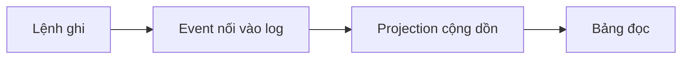
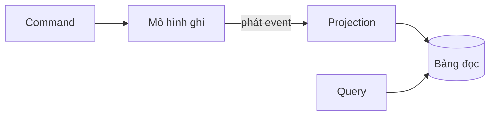
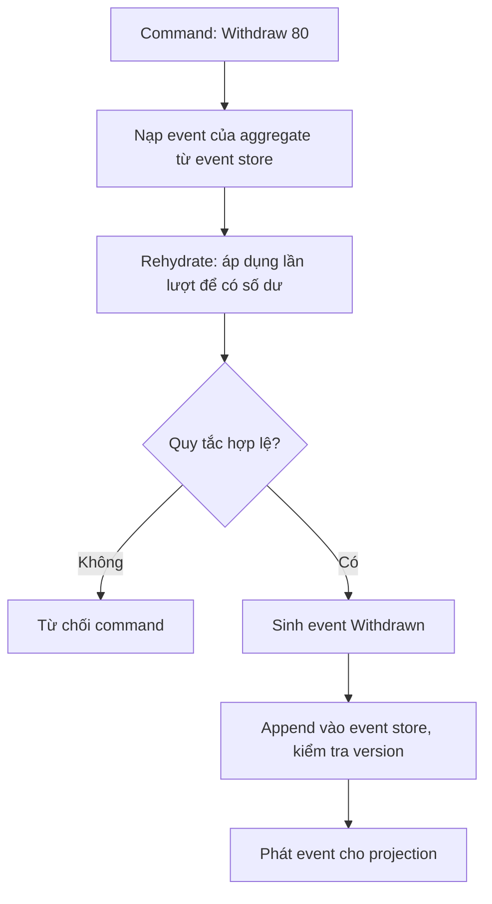
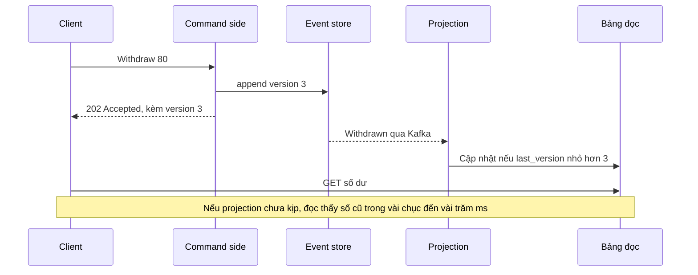

# Lý thuyết 25: CQRS và Event Sourcing

Bài này gồm hai ý tưởng thường đi cùng nhau nhưng độc lập về bản chất. **CQRS** (Command Query Responsibility Segregation) là tách đường **ghi** (command) khỏi đường **đọc** (query), mỗi bên có mô hình riêng. **Event Sourcing** là không lưu state hiện tại mà lưu **chuỗi event** đã xảy ra; state hiện tại chỉ là kết quả cộng dồn các event đó, giống như sổ cái ngân hàng: số dư không được ghi đè, nó được suy ra từ mọi giao dịch.

**Cốt lõi:** Một mô hình chung khó tối ưu cho cả ghi lẫn đọc, và bảng chỉ giữ state mới nhất thì làm mất lịch sử. CQRS tách đường ghi khỏi đường đọc rồi nối bằng event; Event Sourcing lưu chuỗi event làm nguồn sự thật và suy ra state bằng cách cộng dồn.

- Vì ghi cần ràng buộc chặt còn đọc cần dữ liệu đã gộp nên mỗi bên có mô hình riêng, và đọc luôn chậm hơn ghi một nhịp.
- Vì event đã xảy ra thì không thể sai nên chỉ được ghi thêm vào cuối, không sửa, và state được dựng lại bằng cách áp dụng lần lượt.
- Vì projection có thể nhận event trùng hoặc phải chạy lại từ đầu nên nó phải idempotent và không phụ thuộc thứ bên ngoài.



Mô hình tư duy: log event là gốc, còn mọi bảng đọc chỉ là bản cộng dồn có thể xây lại bất cứ lúc nào.

**Tóm tắt:**

- CQRS tách đường ghi (command) khỏi đường đọc (query), mỗi bên một mô hình; Event Sourcing lưu chuỗi event thay vì state hiện tại; hai thứ độc lập nhau.
- Command đặt tên mệnh lệnh và có thể bị từ chối (`WithdrawMoney`); event đặt tên ở quá khứ và không bị từ chối (`MoneyWithdrawn`).
- CQRS áp dụng theo ba mức từ nhẹ đến nặng: tách code, tách bảng đọc, tách hẳn kho đọc; bắt đầu từ mức 1 và chỉ đi tiếp khi có nhu cầu thật.
- Nối hai bên bằng event nên đọc chậm hơn ghi một nhịp (eventual consistency); nghiệp vụ không chịu được thì dừng ở mức 1 hoặc 2.
- Event Sourcing: event bất biến, append-only; state hiện tại được rehydrate bằng cách áp dụng lần lượt, snapshot chỉ để tăng tốc.
- Ghi đồng thời bị chặn bằng optimistic locking: `(aggregate_id, version)` là UNIQUE, bên thua phải thử lại.
- Projection phải idempotent (chỉ áp dụng khi version mới hơn) và xây lại được từ đầu, nên không được call service ngoài.
- Đổi cấu trúc event bằng upcaster chứ không sửa event cũ; đa số hệ thống không cần Event Sourcing vì chi phí thật.

## Vấn đề nó giải quyết

Một mô hình chung cho cả đọc lẫn ghi rất khó tối ưu cho cả hai: màn hình báo cáo cần dữ liệu đã gộp từ nhiều bảng, còn đường ghi lại cần ràng buộc chặt và chuẩn hóa. Cố ép một bảng phục vụ cả hai thì truy vấn báo cáo chậm, hoặc ràng buộc ghi bị nới lỏng. CQRS cho phép mỗi bên có cấu trúc riêng.

Với bảng chỉ giữ state mới nhất, lịch sử thay đổi bị mất: bạn biết số dư là 70 nhưng không biết nó từng là 100, rồi ai đó rút 80. Trong tài chính, audit cần biết ai đã đổi gì và khi nào. Event Sourcing giữ toàn bộ lịch sử làm nguồn sự thật.

## Khi nào nên dùng, khi nào không

Nên cân nhắc khi có báo cáo nặng, yêu cầu audit nghiêm ngặt, hoặc nghiệp vụ tài chính nơi lịch sử là tài sản. **Không** dùng cho CRUD thông thường: độ phức tạp tăng rất nhiều (eventual consistency, versioning event, dựng lại projection) mà không đổi lại lợi ích gì. Cơ chế chung: command thay đổi state và phát ra event, rồi projection nghe event để dựng các bảng đọc phù hợp từng nhu cầu truy vấn.

## Các khái niệm cần biết

- **Command**: yêu cầu thay đổi state, đặt tên mệnh lệnh (`WithdrawMoney`). Có thể bị từ chối nếu vi phạm quy tắc.
- **Query**: yêu cầu đọc, không thay đổi gì.
- **Event**: chuyện đã xảy ra, đặt tên ở quá khứ (`MoneyWithdrawn`). Không bị từ chối vì nó đã xảy ra rồi.
- **Projection**: tiến trình nghe event và cập nhật một bảng/index đọc theo hình dạng mà truy vấn cần.
- **Rehydrate**: dựng lại aggregate, nạp các event của một aggregate rồi áp dụng lần lượt để có lại state hiện tại.
- **Eventual consistency**: sau khi ghi, bảng đọc chưa cập nhật ngay mà sẽ đúng sau một lúc.
- **Optimistic locking**: không lock trước; thay vào đó kiểm tra version khi ghi, nếu có người khác đã ghi trước thì báo lỗi để thử lại.
- **Idempotent**: xử lý cùng một event nhiều lần cho kết quả như xử lý một lần. Cần vì Kafka có thể giao lại.
- **Upcaster**: hàm chuyển event version cũ sang version mới lúc đọc.
- **Snapshot**: ảnh chụp state aggregate tại một thời điểm, để không phải phát lại từ đầu.

## Flowchart CQRS

Hãy theo dõi một thao tác ghi đi qua hệ thống rồi một truy vấn đọc lấy dữ liệu ở đâu.



Mức độ áp dụng (từ nhẹ đến nặng):

1. Cùng một DB nhưng tách code command/query.
2. Tách bảng/view đọc riêng.
3. Tách hẳn kho dữ liệu đọc (Elasticsearch, Redis) cập nhật qua event.

Bắt đầu từ mức 1; chỉ đi tiếp khi có nhu cầu thật. Mức 3 buộc bạn chấp nhận eventual consistency; nếu nghiệp vụ không chịu được việc "ghi xong đọc chưa thấy" thì dừng ở mức 1 hoặc 2.

**Nền tảng:** CQRS tách mô hình ghi (chuẩn hóa, ràng buộc chặt) khỏi mô hình đọc (phi chuẩn hóa theo nhu cầu truy vấn). Nối hai bên bằng event nên đọc chậm hơn ghi một nhịp (eventual consistency); đây là cái giá phải trả, chỉ đáng khi cần.

**Phải thuộc:** Command đặt tên mệnh lệnh và có thể bị từ chối (`WithdrawMoney`); Event đặt tên ở quá khứ và không bị từ chối (`MoneyWithdrawn`). CQRS và Event Sourcing độc lập nhau: có thể dùng CQRS không cần Event Sourcing.

**Suy luận:** Vì ghi cần ràng buộc chặt và chuẩn hóa, còn đọc cần dữ liệu đã gộp theo từng màn hình, một mô hình chung buộc phải thỏa hiệp cho cả hai và cuối cùng chậm ở một bên. CQRS tách hai mô hình, nhưng hai mô hình đó phải được nối với nhau, và cách nối rẻ nhất là phát event từ bên ghi để projection cập nhật bên đọc. Vì việc cập nhật đó diễn ra sau khi ghi xong, bên đọc luôn chậm hơn một nhịp, nên eventual consistency không phải lỗi mà là cái giá trực tiếp của việc tách. Điểm dễ nhầm là nghĩ CQRS bắt buộc phải có Event Sourcing hay broker: mức 1 chỉ là tách code command và query trên cùng một DB, hoàn toàn nhất quán ngay. Hệ quả khi thiết kế: hỏi nghiệp vụ "ghi xong đọc chưa thấy trong vài trăm ms có chấp nhận được không", nếu không thì dừng ở mức 1 hoặc 2, và nếu có thì phải thiết kế UI chịu được (trả version, optimistic UI).

## Event Sourcing

Thay vì lưu "số dư = 70", lưu chuỗi event:

```text
AccountOpened(100), Deposited(50), Withdrawn(80)
```

State hiện tại = **áp dụng lần lượt** các event (có thể lưu snapshot để nhanh): 100, cộng 50 thành 150, trừ 80 thành 70.



Đọc sơ đồ: mỗi command đều đi qua chu trình nạp, kiểm tra, sinh event, ghi nối thêm. Bước ghi kiểm tra `version` để phát hiện hai command đồng thời. Event đã ghi không bao giờ được sửa; muốn "đính chính" thì ghi thêm một event bù.

| Ưu điểm | Nhược điểm |
|---|---|
| Lịch sử đầy đủ, audit miễn phí | Phức tạp hơn nhiều |
| Tái dựng state tại bất kỳ thời điểm | Đổi cấu trúc event (versioning) khó |
| Dễ sinh nhiều projection | Eventual consistency giữa ghi và đọc |
| Hợp với kiến trúc hướng event | Truy vấn trực tiếp trên event khó, cần projection |

**Phải thuộc:** Event Sourcing lưu chuỗi event chỉ ghi thêm (append-only) làm nguồn sự thật; state hiện tại được dựng lại (rehydrate) bằng cách áp dụng lần lượt các event, snapshot chỉ để tăng tốc. Chặn ghi đồng thời bằng optimistic locking trên `version`; projection phải idempotent và xây lại được từ đầu.

**Suy luận:** Vì event đã xảy ra thì không thể sai về mặt lịch sử, Event Sourcing coi chuỗi event là nguồn sự thật duy nhất và chỉ cho phép thêm vào cuối; state hiện tại chỉ là kết quả của việc áp dụng chúng. Vì state được dựng lại bằng cách chạy lại các event, hàm `on` phải thuần túy (không kiểm tra, không tác dụng phụ), còn việc kiểm tra quy tắc nằm ở command trước khi sinh event; nếu để kiểm tra trong `on`, một event cũ có thể bị từ chối khi replay vì quy tắc đã đổi. Vì nhiều command có thể cùng nạp một aggregate ở cùng version, bước append phải kiểm tra version, và ràng buộc UNIQUE `(aggregate_id, version)` biến optimistic locking thành bảo đảm của database. Từ đó suy ra projection cũng phải replay được và idempotent, nên không được call service ngoài hay dùng giờ hiện tại, vì replay vài tháng sau sẽ cho kết quả khác. Điểm dễ nhầm là "sửa" event sai: không sửa, mà ghi thêm event bù, và khi đổi cấu trúc thì dùng upcaster lúc đọc. Khi review, kiểm tra ba thứ: `on` có thuần túy không, append có kiểm tra version không, projection có chạy lại an toàn không.

## Cài đặt tối thiểu: event, aggregate, event store

Event là bất biến, đặt tên ở quá khứ:

```java
public sealed interface AccountEvent permits AccountOpened, Deposited, Withdrawn {}
public record AccountOpened(String accountId, long initial) implements AccountEvent {}
public record Deposited(String accountId, long amount) implements AccountEvent {}
public record Withdrawn(String accountId, long amount) implements AccountEvent {}
```

Aggregate nhận command, **kiểm tra quy tắc**, rồi sinh event. Hàm `on` chỉ đổi state, không kiểm tra, không có tác dụng phụ, vì nó cũng được dùng khi dựng lại từ lịch sử.

```java
public class Account {
    private String id;
    private long balance;
    private long version;                                  // số event đã áp dụng
    private final List<AccountEvent> pending = new ArrayList<>();

    public static Account rehydrate(List<AccountEvent> history) {
        Account a = new Account();
        history.forEach(a::on);
        return a;
    }

    public void withdraw(long amount) {                    // command
        if (amount <= 0 || amount > balance) throw new IllegalStateException("Số dư không đủ");
        raise(new Withdrawn(id, amount));
    }

    private void raise(AccountEvent e) { on(e); pending.add(e); }

    private void on(AccountEvent e) {                      // áp dụng, không kiểm tra
        if (e instanceof AccountOpened o) { id = o.accountId(); balance = o.initial(); }
        else if (e instanceof Deposited d) { balance += d.amount(); }
        else if (e instanceof Withdrawn w) { balance -= w.amount(); }
        version++;
    }

    public List<AccountEvent> pendingEvents() { return List.copyOf(pending); }
    public long committedVersion() { return version - pending.size(); }
}
```

Kho event chỉ thêm, không sửa. Cột `version` cùng `aggregate_id` là UNIQUE: đây chính là **optimistic locking**. Hai command đồng thời trên cùng tài khoản thì một bên vi phạm unique và phải thử lại.

```sql
create table event_store (
    global_seq   bigserial primary key,               -- thứ tự toàn cục cho projection
    aggregate_id varchar(64) not null,
    version      int         not null,
    type         varchar(100) not null,
    payload      jsonb       not null,
    occurred_at  timestamptz not null default now(),
    unique (aggregate_id, version)
);
```

```java
@Transactional
public void append(String aggId, long expectedVersion, List<AccountEvent> events) {
    long v = expectedVersion;
    try {
        for (AccountEvent e : events) {
            jdbc.update("""
                insert into event_store(aggregate_id, version, type, payload)
                values (?, ?, ?, ?::jsonb)""", aggId, ++v, e.getClass().getSimpleName(), toJson(e));
        }
    } catch (DuplicateKeyException ex) {
        throw new ConcurrentModificationException("Aggregate " + aggId + " đã bị đổi, thử lại");
    }
    // cùng transaction: ghi outbox để đẩy event ra Kafka (xem bài Kafka)
}
```

Flow đầy đủ: nạp event của `aggregate_id` theo `version`, `rehydrate`, gọi `withdraw`, `append` với `committedVersion()`.

## Projection và eventual consistency

Vấn đề đặt ra: event nằm trong event store không thể truy vấn tiện (ví dụ "tổng số dư mỗi khách"), nên ta cần projection biến chúng thành bảng đọc. Đổi lại, bảng đọc chậm hơn đường ghi một nhịp.



Kafka có thể giao cùng một event nhiều lần, và nếu cộng hai lần thì số dư sai. Để projection idempotent, lưu vị trí đã áp dụng ngay trong bảng đọc và chỉ áp dụng khi event mới hơn:

```sql
create table account_balance (account_id varchar(64) primary key, balance bigint not null, last_version int not null);
```

```java
@KafkaListener(topics = "account-events", groupId = "account-projection")
@Transactional
public void on(AccountEventEnvelope env) {      // gồm accountId, version, event
    long delta = switch (env.event()) {
        case Deposited d -> d.amount();
        case Withdrawn w -> -w.amount();
        case AccountOpened o -> o.initial();
    };
    int rows = jdbc.update("""
        update account_balance set balance = balance + ?, last_version = ?
        where account_id = ? and last_version < ?""", delta, env.version(), env.accountId(), env.version());
    // AccountOpened: insert dòng mới ở nhánh riêng. rows == 0 nghĩa là đã áp dụng, bỏ qua.
}
```

Ví dụ switch pattern trên sealed interface cần Java 21. Kafka giữ thứ tự trong cùng partition, nên dùng `accountId` làm key.

Cách xử lý "ghi xong đọc chưa thấy":

| Cách | Ghi chú |
|---|---|
| Trả version trong response, client đọc kèm `minVersion` và thử lại ngắn | Chính xác, thêm logic client |
| UI cập nhật tạm (optimistic UI) | Rẻ, hợp màn hình thường |
| Đọc từ event store/aggregate cho đúng thao tác vừa ghi | Chỉ dùng cho flow cần chắc chắn |

## Snapshot, dựng lại, đổi cấu trúc event

- **Snapshot:** aggregate có hàng nghìn event thì lưu state mỗi N event (ví dụ 100) và chỉ nạp phần sau snapshot. Chỉ thêm khi đo thấy nạp chậm.
- **Dựng lại projection:** tạo bảng mới, phát lại toàn bộ `event_store` theo `global_seq`, xong thì chuyển truy vấn sang bảng mới (blue-green cho dữ liệu đọc). Vì vậy projection không được call service ngoài hay dùng giờ hiện tại.
- **Đổi cấu trúc event:** không sửa event cũ. Thêm trường tùy chọn, hoặc dùng **upcaster**: hàm chuyển event version 1 sang 2 lúc đọc. Lưu `schema_version` trong payload.
- **Xóa dữ liệu cá nhân (GDPR):** log bất biến mâu thuẫn với quyền xóa; thường encrypt dữ liệu cá nhân bằng key riêng từng người rồi hủy key.

## Điều cần nhớ

- **Eventual consistency:** ngay sau khi ghi, truy vấn có thể chưa thấy; giao diện cần xử lý (hiển thị kết quả tạm, đọc theo version).
- Projection phải **idempotent** và có thể **xây lại** từ đầu từ log event.
- Event là contract công khai: đặt tên theo quá khứ (`OrderPlaced`), thêm trường thay vì đổi nghĩa.
- Công cụ: Axon Framework, hoặc tự cài trên Kafka/DB. Liên hệ [Distributed Message Queue (kiểu Kafka)](/go?p=15-System%20Design%2Fhard%2F05-distributed-message-queue.md).
- Đa số hệ thống **không cần** Event Sourcing; chi phí thật.

## Phỏng vấn khó: chuỗi hỏi xoáy

Người phỏng vấn senior thường mở bằng câu dễ rồi xoáy xuống cơ chế, đánh đổi và sự cố thật. Câu trả lời tốt luôn đi từ cốt lõi xuống: log event là gốc, còn bảng đọc chỉ là bản cộng dồn.

### Chuỗi 1: CQRS, Event Sourcing và eventual consistency

1. **Câu mở:** CQRS và Event Sourcing có phải là một thứ không?
2. **Xoáy 1:** Ba mức áp dụng CQRS là gì, và mức nào buộc phải chấp nhận eventual consistency?
3. **Xoáy 2:** Người dùng rút tiền xong tải lại thấy số dư cũ. Bạn xử lý thế nào, và khi nào không nên dùng cả hai?

**Đáp án ngắn:** Không. CQRS tách đường ghi khỏi đường đọc, mỗi bên một mô hình; Event Sourcing lưu chuỗi event thay vì state hiện tại. Dùng cái này không bắt buộc cái kia. Ba mức: tách code command và query trên cùng DB, tách bảng hoặc view đọc, tách hẳn kho đọc như Elasticsearch hay Redis cập nhật qua event. Mức 1 vẫn nhất quán ngay. Khi bên đọc được cập nhật qua event thì nó luôn chậm hơn bên ghi một nhịp, đó là cái giá trực tiếp của việc tách chứ không phải lỗi. Xử lý "ghi xong đọc chưa thấy": trả version trong response rồi client đọc kèm `minVersion` và thử lại ngắn, hoặc optimistic UI, hoặc đọc thẳng từ aggregate cho flow cần chắc chắn. Câu hỏi cho nghiệp vụ là chấp nhận trễ vài trăm ms không; nếu không thì dừng ở mức 1 hoặc 2. CRUD thông thường thì không dùng, vì độ phức tạp tăng mà không đổi lại gì.

**Sai lầm hay gặp:**
- Nói CQRS bắt buộc có Event Sourcing hoặc broker.
- Coi eventual consistency là bug thay vì chi phí phải thiết kế.
- Nhầm command (mệnh lệnh, có thể bị từ chối) với event (quá khứ, không bị từ chối).

### Chuỗi 2: Ghi đồng thời và hàm `on`

1. **Câu mở:** Hai command rút tiền cùng lúc trên một tài khoản, event store chặn thế nào?
2. **Xoáy 1:** Vì sao hàm `on` không được kiểm tra quy tắc hay có tác dụng phụ?
3. **Xoáy 2:** Một event đã ghi sai số tiền. Sửa ra sao?

**Đáp án ngắn:** Mỗi command nạp event của aggregate, rehydrate, kiểm tra quy tắc, sinh event rồi append. Hai command có thể cùng nạp ở cùng version, nên append phải kèm version mong đợi, và ràng buộc UNIQUE `(aggregate_id, version)` biến optimistic locking thành bảo đảm của DB: bên thua vi phạm unique, báo lỗi và phải nạp lại để thử lại từ đầu. Hàm `on` cũng chạy khi replay lịch sử, nên nó chỉ đổi state. Nếu kiểm tra trong `on`, một event cũ có thể bị từ chối khi replay vì quy tắc đã đổi; nếu có tác dụng phụ, nó chạy lại mỗi lần rehydrate. Kiểm tra nằm ở command, trước khi sinh event. Event bất biến và chỉ ghi thêm nên không sửa: muốn đính chính thì ghi thêm event bù. Snapshot chỉ là tối ưu cho aggregate có hàng nghìn event, thêm khi đo thấy nạp chậm.

**Sai lầm hay gặp:**
- Nói "khóa bi quan" mà không nói được UNIQUE trên version.
- Để kiểm tra quy tắc hoặc gọi ra ngoài trong `on`.
- Sửa hay xóa event cũ bằng `UPDATE`.

### Chuỗi 3: Projection, dựng lại và đổi cấu trúc event

1. **Câu mở:** Projection là gì, và vì sao nó phải idempotent?
2. **Xoáy 1:** Dựng lại bảng đọc từ đầu sau sáu tháng thì projection gọi service ngoài hoặc dùng giờ hiện tại sẽ hỏng thế nào?
3. **Xoáy 2:** Đổi cấu trúc event, hoặc người dùng đòi xóa dữ liệu cá nhân trong một log bất biến, xử lý ra sao?

**Đáp án ngắn:** Projection nghe event và cập nhật bảng đọc theo hình dạng truy vấn cần. Kafka có thể giao trùng một event, cộng hai lần thì số dư sai, nên bảng đọc lưu `last_version` và chỉ áp dụng khi event mới hơn; `rows == 0` nghĩa là đã áp dụng. Dùng `accountId` làm key để giữ thứ tự trong partition. Dựng lại là tạo bảng mới, phát lại toàn bộ `event_store` theo `global_seq`, rồi chuyển truy vấn sang. Nếu projection gọi service ngoài hoặc dùng giờ hiện tại thì replay sau sáu tháng ra kết quả khác lần đầu. Đổi cấu trúc: không sửa event cũ, thêm trường tùy chọn hoặc dùng upcaster chuyển version cũ sang mới lúc đọc, lưu `schema_version` trong payload. Với GDPR, thường mã hóa dữ liệu cá nhân bằng key riêng từng người rồi hủy key khi cần xóa.

**Sai lầm hay gặp:**
- Quên rằng broker có thể giao trùng.
- Để projection phụ thuộc thứ thay đổi theo thời gian.
- Migrate event bằng cách sửa dữ liệu cũ.

