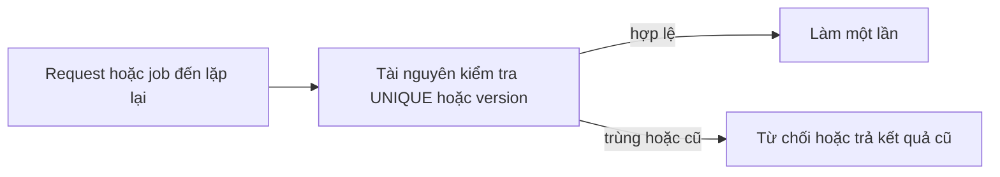
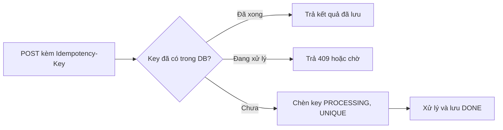
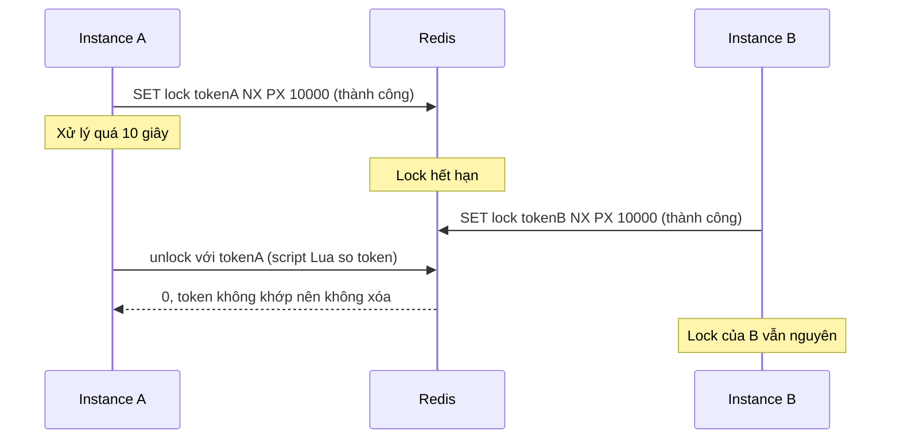
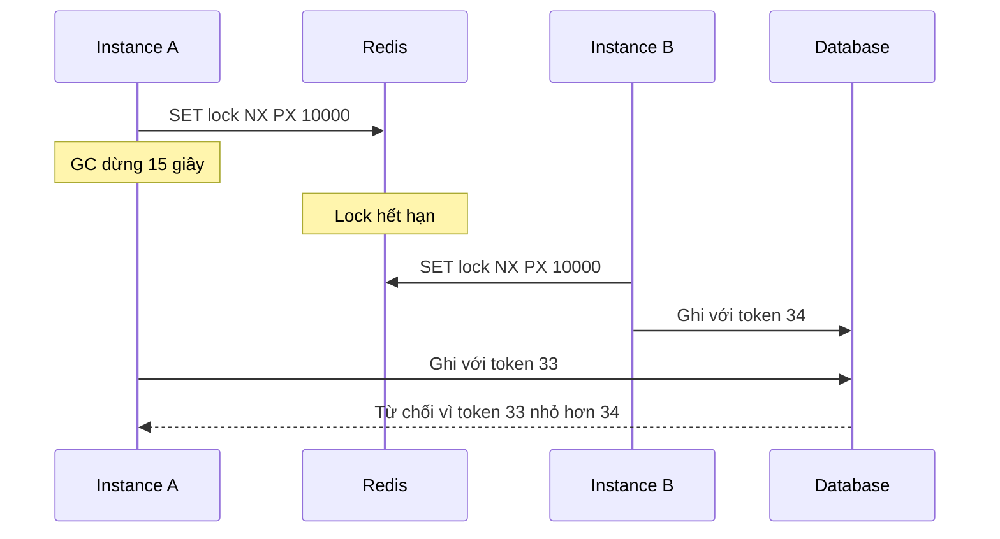
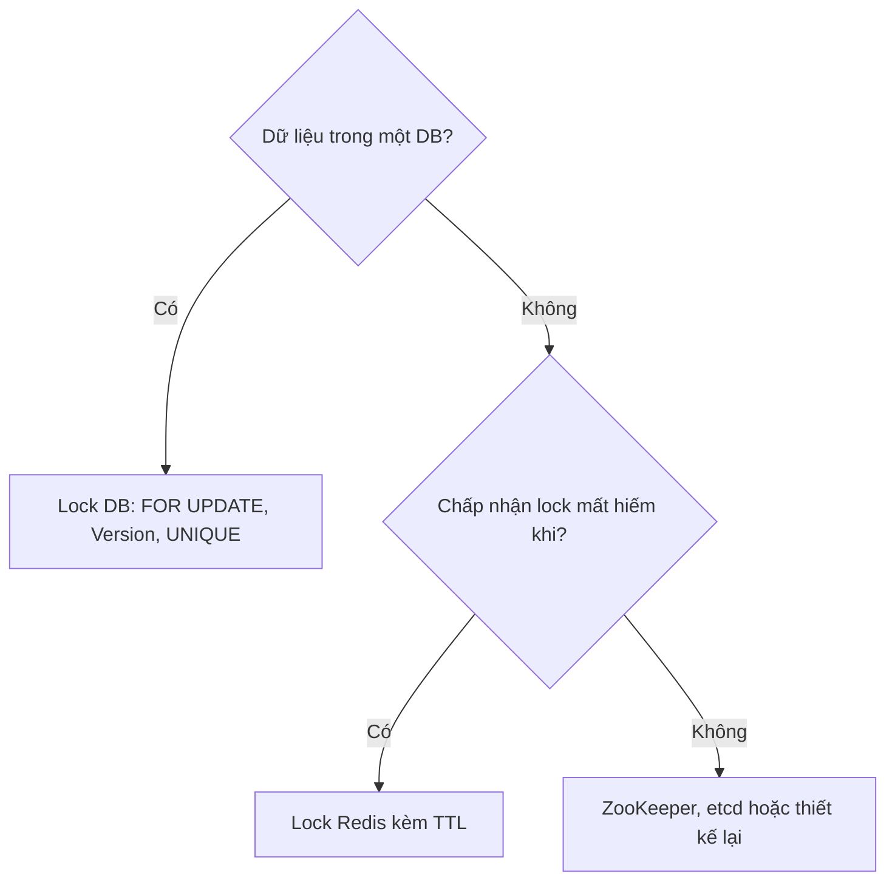

# Lý thuyết 26: Khóa phân tán và Idempotency

Bài này nói về hai công cụ để chống một việc bị làm hai lần. **Distributed lock** đảm bảo trong cả cụm nhiều instance, chỉ một nơi được làm một việc tại một thời điểm. **Idempotency** nghĩa là gọi cùng một request nhiều lần thì kết quả vẫn như gọi một lần, giống nút "gọi thang máy": bấm mười lần thang vẫn chỉ đến một lần.

**Cốt lõi:** Retry, nhiều instance và broker giao trùng khiến cùng một việc đến nhiều lần, nên phải làm cho "làm hai lần" trở nên vô hại. Cách đáng tin là để chính tài nguyên được bảo vệ, thường là database, làm trọng tài, còn lock chỉ là tối ưu giảm xung đột.

- Vì kiểm tra bằng code luôn có khoảng hở giữa kiểm tra và ghi nên phải để ràng buộc UNIQUE hoặc cập nhật có điều kiện ở DB quyết định.
- Vì lock Redis chỉ là một key có TTL nên chủ cũ có thể mất lock mà không biết, và token cùng script Lua chỉ ngăn xóa nhầm lock của người khác.
- Vì kiểm tra phía client không đủ nên tài nguyên phải tự từ chối bên cũ bằng fencing token hoặc version.



Mô hình tư duy: mọi lần lặp đều đi qua cùng một cửa kiểm tra đặt ở nơi dữ liệu nằm, nên chỉ một lần có hiệu lực.

**Tóm tắt:**

- Việc bị làm hai lần đến từ ba nguồn: nhiều instance cùng nhặt một việc, client retry khi mất response, và broker giao trùng (at-least-once).
- Thử cách đơn giản trước: ràng buộc UNIQUE hoặc cập nhật có điều kiện trong DB đáng tin hơn dựng distributed lock.
- Idempotency key do client sinh; server chèn key vào bảng có UNIQUE cùng transaction với nghiệp vụ, nên request trùng chỉ nhận lại kết quả đã lưu.
- Kiểm tra bằng code kiểu "có chưa, chưa thì làm" không đủ vì có khoảng hở giữa kiểm tra và ghi; phải để DB làm trọng tài.
- Cùng key mà nội dung khác là lỗi của client (422); tác dụng phụ ngoài DB phải truyền idempotency key sang hệ thống kia.
- Lock Redis đúng cách là `SET key token NX PX ttl`, nhả bằng script Lua so token rồi mới `DEL`; thiếu token thì A có thể xóa lock của B.
- TTL không đủ: tiến trình bị tạm dừng (GC) vẫn tưởng mình giữ lock, nên tài nguyên phải kiểm tra fencing token hoặc version.
- Job định kỳ trên nhiều instance dùng ShedLock; ưu tiên thiết kế idempotent và dựa vào DB hơn là distributed lock.

## Vấn đề nó giải quyết

Khi chạy nhiều instance, hai instance có thể cùng nhặt một việc về làm. Khi mạng chập chờn, client không nhận được response và retry, dù server thực ra đã xử lý xong. Broker như Kafka có thể giao trùng một message (cơ chế at-least-once). Thiếu cách phòng thủ thì hệ quả là trừ tiền hai lần, tạo đơn trùng, gửi email hai lần.

## Khi nào nên dùng, khi nào không

Cần cho thanh toán, tạo tài nguyên, job định kỳ và xử lý message. Nhưng hãy thử cách đơn giản trước: nếu ràng buộc unique trong DB giải quyết được thì dùng nó, vì nó đơn giản và đáng tin hơn dựng distributed lock. Cách làm gọn là dùng idempotency key kèm ràng buộc unique để chặn xử lý trùng; distributed lock (Redis hoặc DB) chỉ khi thật sự cần độc quyền, và luôn đặt TTL để khỏi kẹt khi instance chết. Với dữ liệu thì dùng optimistic locking (cột version).

## Các khái niệm cần biết

- **Idempotency key**: một mã duy nhất do client sinh (thường UUID) gửi kèm request, thường qua header `Idempotency-Key`. Server dùng nó để nhận ra "request này tôi đã thấy".
- **UNIQUE constraint**: ràng buộc DB bảo đảm không có hai dòng cùng giá trị. Vì DB tự bảo đảm, nó đúng cả khi nhiều request đến cùng lúc.
- **TTL (time to live)**: thời gian sống của lock; hết hạn thì lock tự biến mất.
- **Fencing token**: số tăng dần phát kèm mỗi lần giành lock, để tài nguyên từ chối người giữ lock cũ (giải thích ở phần rủi ro).
- **Optimistic locking**: không lock trước, mà so sánh version khi ghi; ghi hụt thì thử lại.
- **At-least-once delivery**: broker bảo đảm message đến ít nhất một lần, nên có thể đến nhiều lần, buộc consumer phải idempotent.

## Idempotency key

Flow xử lý khi một request kèm key đến:



Đọc sơ đồ: nhánh "Đã xong" là trường hợp retry sau khi lần đầu hoàn tất; ta trả lại đúng kết quả cũ thay vì làm lại. Nhánh "Đang xử lý" xảy ra khi retry đến quá nhanh, lúc request đầu chưa xong. Điểm mấu chốt là **ràng buộc UNIQUE ở DB**: hai request đồng thời cùng key thì chỉ một chèn được. Kiểm tra bằng code ("có chưa? chưa thì làm") **không đủ** vì có khoảng hở giữa kiểm tra và ghi.

**Nền tảng:** at-least-once cộng retry nghĩa là cùng một việc sẽ đến nhiều lần, nên phải biến "làm hai lần" thành vô hại. Cách đáng tin nhất là để DB làm trọng tài bằng ràng buộc UNIQUE hoặc cập nhật có điều kiện, vì mọi kiểm tra "có chưa, chưa thì làm" bằng code đều có khoảng hở giữa kiểm tra và ghi.

## Các cách đạt idempotency

| Cách | Dùng khi |
|---|---|
| Idempotency-Key (bảng lưu key và kết quả) | API tạo/thanh toán |
| Ràng buộc duy nhất theo nghiệp vụ (`order_id + type`) | Tránh bản ghi trùng |
| Cập nhật có điều kiện (`WHERE status = 'PENDING'`) | Chuyển state |
| Lưu `eventId` đã xử lý | Consumer của message |
| Thao tác tự nhiên idempotent (`PUT`, đặt giá trị) | Thay vì "tăng thêm 1" |

## Distributed lock

Idempotency chặn "cùng một request đến hai lần". Còn khi hai request **khác nhau** cùng đụng một tài nguyên (hai instance cùng chạy job, hai người cùng sửa một đơn), ta cần distributed lock: một lock nằm ở nơi mọi instance đều thấy (Redis, DB), ai giành được mới được làm. Không nên dùng khi một câu `UPDATE ... WHERE` có điều kiện hoặc ràng buộc UNIQUE là đủ.

```java
// Redisson
RLock lock = redisson.getLock("order:" + orderId);
if (lock.tryLock(2, 10, TimeUnit.SECONDS)) {   // chờ tối đa 2 giây, tự nhả sau 10 giây
    try { process(orderId); }
    finally { if (lock.isHeldByCurrentThread()) lock.unlock(); }
}
```

### Cơ chế bên dưới: `SET NX PX` + token + Lua

Redisson che đi chi tiết. Hiểu cơ chế thì tự cài được bản tối giản:

```java
@Component
public class RedisLock {
    // so khớp token rồi mới xóa, gói trong một script để atomic
    private static final DefaultRedisScript<Long> UNLOCK = new DefaultRedisScript<>("""
            if redis.call('get', KEYS[1]) == ARGV[1] then
                return redis.call('del', KEYS[1])
            else
                return 0
            end
            """, Long.class);

    private final StringRedisTemplate redis;

    public RedisLock(StringRedisTemplate redis) { this.redis = redis; }

    /** Trả token nếu giành được lock, null nếu không. */
    public String tryLock(String name, Duration ttl) {
        String token = UUID.randomUUID().toString();
        // tương đương: SET lock:name token NX PX ttl
        Boolean ok = redis.opsForValue().setIfAbsent("lock:" + name, token, ttl);
        return Boolean.TRUE.equals(ok) ? token : null;
    }

    public boolean unlock(String name, String token) {
        Long deleted = redis.execute(UNLOCK, List.of("lock:" + name), token);
        return Long.valueOf(1L).equals(deleted);
    }
}
```

| Thành phần | Nếu thiếu |
|---|---|
| `NX` | Hai nơi cùng ghi đè nhau, cùng tưởng mình giữ lock |
| `PX` (TTL) | Instance chết lúc đang giữ thì lock kẹt mãi |
| Token ngẫu nhiên | A hết TTL, B giành lock, A xong việc rồi `DEL` **lock của B** |
| Lua cho unlock | `GET` rồi `DEL` rời nhau thì lock có thể đổi chủ giữa hai lệnh |

**Phải thuộc:** lock Redis đúng cách = `SET key token NX PX ttl` (NX: chỉ khi chưa có, PX: TTL, token ngẫu nhiên riêng mỗi chủ) và nhả lock bằng script Lua so token rồi mới `DEL`. TTL hết khi tiến trình đang bị tạm dừng (GC) thì hai bên cùng tưởng giữ lock, nên cần fencing token ở tài nguyên hoặc ràng buộc ở DB.

Vì sao cần token: không có nó, sự cố dưới đây xảy ra và A vô tình xóa lock của B.



Dùng: `String t = lock.tryLock("order:" + id, Duration.ofSeconds(10)); if (t == null) return;` rồi `try { ... } finally { lock.unlock("order:" + id, t); }`. Không giành được thì trả lỗi hoặc thử lại có giới hạn, đừng quay vòng vô hạn.

Job định kỳ chạy trên nhiều instance: dùng ShedLock thay vì tự viết.

```java
@Scheduled(cron = "0 0 * * * *")
@SchedulerLock(name = "hourlyReport", lockAtMostFor = "PT10M", lockAtLeastFor = "PT1M")
public void hourlyReport() { /* chỉ một instance chạy */ }
```

## Idempotency key: cài đặt đầy đủ

```sql
create table idempotency_key (
    idem_key     varchar(100) primary key,
    request_hash char(64)     not null,        -- hash nội dung request
    response     text,                          -- null khi chưa xong
    created_at   timestamp    not null default now()
);
```

```java
@Transactional
public PaymentResponse pay(String key, PayRequest req) {
    String hash = sha256(toJson(req));
    int inserted = jdbc.update("""
            insert into idempotency_key(idem_key, request_hash) values (?, ?)
            on conflict (idem_key) do nothing""", key, hash);        // cú pháp PostgreSQL

    if (inserted == 0) {                                              // key đã tồn tại
        Map<String, Object> row = jdbc.queryForMap(
                "select request_hash, response from idempotency_key where idem_key = ?", key);
        // 422
        if (!hash.equals(row.get("request_hash"))) throw new IdempotencyMismatchException();
        // trả đúng kết quả lần đầu
        return fromJson((String) row.get("response"));
    }
    // chỉ chạy đúng một lần
    PaymentResponse result = paymentService.charge(req);
    jdbc.update("update idempotency_key set response = ? where idem_key = ?", toJson(result), key);
    return result;
}
```

Vì sao đúng: insert và nghiệp vụ nằm **cùng transaction**. Request thứ hai cùng key bị **chặn** ở insert (unique index) cho tới khi request đầu commit; lúc đó nó thấy `inserted == 0` và đọc kết quả đã lưu. Nếu request đầu rollback thì key biến mất và request thứ hai tự làm. Ba điểm cần chú ý:

- Cùng key mà nội dung khác là lỗi của client (trả 422), không trả kết quả cũ.
- Tác dụng phụ ngoài DB (call cổng thanh toán) không rollback được: truyền idempotency key sang cổng đó, hoặc lưu bước trung gian.
- Dọn key cũ theo TTL (ví dụ 24 giờ) bằng job định kỳ.

## Rủi ro của distributed lock



Sơ đồ cho thấy TTL không đủ: A vẫn tin mình giữ lock. Chỉ **tài nguyên được bảo vệ** mới chặn được A, bằng fencing token:

```sql
-- token lấy từ bộ đếm tăng dần (Redis INCR hoặc sequence DB) mỗi lần giành lock
-- 0 dòng nghĩa là token cũ
update account set balance = ?, fence = ? where id = ? and fence < ?;
```

| Rủi ro | Giải thích |
|---|---|
| Lock hết hạn khi việc chưa xong | Tiến trình A bị tạm dừng (GC), lock hết hạn, B giành lock, A tỉnh dậy vẫn tưởng mình giữ |
| Redis chết/chuyển leader | Lock có thể mất; không an toàn tuyệt đối |
| Quên nhả lock | Cần TTL tự hết |

Cách giảm rủi ro: **fencing token** (số tăng dần kèm theo lock, tài nguyên từ chối token cũ), hoặc không dựa vào lock mà dựa vào **ràng buộc/version ở DB**.

**Suy luận:** Vì lock Redis chỉ là một key có TTL, nó không biết tiến trình giữ lock còn sống hay đang bị tạm dừng; TTL tồn tại để lock không kẹt mãi khi instance chết, nhưng cũng chính TTL cho phép lock đổi chủ trong lúc chủ cũ vẫn đang chạy. Vì chủ cũ có thể tỉnh dậy sau GC dài mà không biết mình đã mất lock, mọi kiểm tra phía client ("mình còn giữ lock không") đều có khoảng hở giữa kiểm tra và hành động. Do đó thứ duy nhất đáng tin là tài nguyên được bảo vệ tự từ chối bên cũ, bằng fencing token tăng dần hoặc điều kiện `WHERE version = ?` hay `fence < ?` ở DB. Tương tự cho unlock: `GET` rồi `DEL` là hai call rời nhau nên lock có thể đổi chủ giữa chúng, vì vậy phải gói so token và xóa vào một script Lua atomic. Điểm dễ nhầm là tin rằng lock Redis cho mutual exclusion tuyệt đối; nó chỉ là tối ưu để giảm xung đột, còn tính đúng đắn phải do DB bảo đảm. Hệ quả khi thiết kế: đặt UNIQUE hoặc version trước, dùng lock chỉ để tránh làm việc thừa, và hỏi "nếu hai bên cùng tưởng mình giữ lock thì DB có chặn được không".

## Chọn công cụ



Nguyên tắc: **ưu tiên thiết kế idempotent và dựa vào DB** hơn là distributed lock.

## Phỏng vấn khó: chuỗi hỏi xoáy

Người phỏng vấn senior thường mở bằng câu dễ rồi xoáy xuống cơ chế, đánh đổi và sự cố thật. Câu trả lời tốt luôn đi từ cốt lõi xuống: để chính tài nguyên được bảo vệ làm trọng tài, đừng tin kiểm tra phía client.

### Chuỗi 1: Idempotency key

1. **Câu mở:** Client retry vì mất response. Làm sao khỏi trừ tiền hai lần?
2. **Xoáy 1:** Vì sao kiểm tra "key có chưa, chưa thì làm" bằng code là chưa đủ, và insert cùng transaction với nghiệp vụ giúp gì?
3. **Xoáy 2:** Cùng key nhưng nội dung request khác thì sao? Cổng thanh toán đã trừ tiền rồi mà DB rollback thì sao?

**Đáp án ngắn:** Client sinh idempotency key gửi kèm request; server chèn key vào bảng có UNIQUE cùng transaction với nghiệp vụ, nên request trùng chỉ nhận lại kết quả đã lưu. Kiểm tra bằng code luôn có khoảng hở giữa kiểm tra và ghi, hai request đồng thời cùng thấy "chưa có". UNIQUE thì DB tự bảo đảm: request thứ hai bị chặn ở insert cho tới khi request đầu commit, rồi thấy `inserted == 0` và đọc kết quả cũ. Nếu request đầu rollback thì key biến mất và request thứ hai tự làm. Lưu thêm hash nội dung: cùng key mà hash khác là lỗi của client, trả 422 chứ không trả kết quả cũ. Tác dụng phụ ngoài DB như cổng thanh toán không rollback được, nên truyền idempotency key sang cổng đó hoặc lưu bước trung gian. Key cũ dọn theo TTL, ví dụ 24 giờ.

**Sai lầm hay gặp:**
- Chỉ nói "lưu key vào cache rồi kiểm tra".
- Quên so khớp nội dung request với key.
- Tưởng transaction DB bao được cả call ra cổng ngoài.

### Chuỗi 2: Cơ chế lock Redis

1. **Câu mở:** Cài distributed lock bằng Redis thế nào cho đúng?
2. **Xoáy 1:** Mỗi phần `NX`, `PX`, token ngẫu nhiên, script Lua giải quyết điều gì? Thiếu token thì hỏng ra sao?
3. **Xoáy 2:** Vì sao `GET` rồi `DEL` rời nhau là không an toàn?

**Đáp án ngắn:** Lock đúng là `SET key token NX PX ttl`, nhả bằng script Lua so token rồi mới `DEL`. `NX` chỉ cho ghi khi chưa có, nếu thiếu thì hai nơi ghi đè nhau và cùng tưởng mình giữ lock. `PX` là TTL, thiếu thì instance chết lúc giữ lock làm lock kẹt mãi. Token ngẫu nhiên riêng mỗi chủ: nếu thiếu, A xử lý quá TTL, B giành lock, rồi A xong việc và `DEL` luôn lock của B. Với token, unlock của A thấy không khớp nên trả 0 và lock của B nguyên vẹn. Script Lua cần vì `GET` và `DEL` là hai lệnh rời nhau, lock có thể đổi chủ giữa hai lệnh; gói vào script thì so sánh và xóa là atomic. Không giành được lock thì trả lỗi hoặc thử lại có giới hạn, không quay vòng vô hạn.

**Sai lầm hay gặp:**
- Nhả lock bằng `DEL` thẳng, không so token.
- Dùng `SETNX` rồi `EXPIRE` rời nhau.
- Không đặt TTL nên instance chết là kẹt lock.

### Chuỗi 3: Lock có an toàn tuyệt đối không

1. **Câu mở:** Lock Redis có bảo đảm mutual exclusion tuyệt đối không?
2. **Xoáy 1:** A bị GC dừng 15 giây khi đang giữ lock TTL 10 giây. Chuyện gì xảy ra và chặn thế nào?
3. **Xoáy 2:** Redis chết hoặc chuyển leader thì sao? Job định kỳ chạy trên nhiều instance thì làm gì?

**Đáp án ngắn:** Không. Lock Redis chỉ là một key có TTL, nó không biết chủ lock còn sống hay đang bị tạm dừng. Ở tình huống GC, lock hết hạn, B giành lock và ghi, rồi A tỉnh dậy vẫn tin mình giữ lock và ghi đè. Mọi kiểm tra phía client đều có khoảng hở. Chỉ tài nguyên được bảo vệ mới chặn được A: mỗi lần giành lock lấy một fencing token tăng dần, và DB chỉ nhận khi `fence` nhỏ hơn token mới, ví dụ `update ... where fence < ?`; 0 dòng nghĩa là token cũ. Hoặc dùng cột version. Redis chết hoặc chuyển leader thì lock có thể mất, nên không an toàn tuyệt đối. Vì vậy đặt UNIQUE hoặc version ở DB trước, lock chỉ để giảm làm việc thừa. Job định kỳ nhiều instance dùng ShedLock thay vì tự viết.

**Sai lầm hay gặp:**
- Tin TTL đủ để chặn hai bên cùng chạy.
- Kiểm tra "mình còn giữ lock không" ở client rồi mới ghi.
- Dựng lock phân tán khi một `UPDATE ... WHERE` có điều kiện là đủ.

