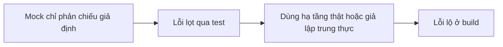
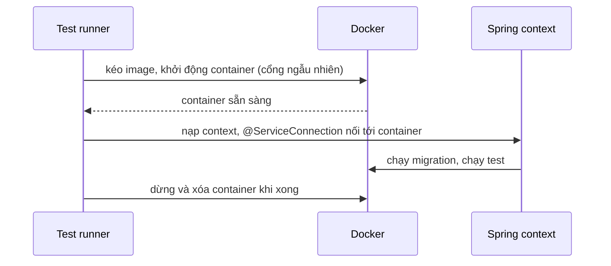
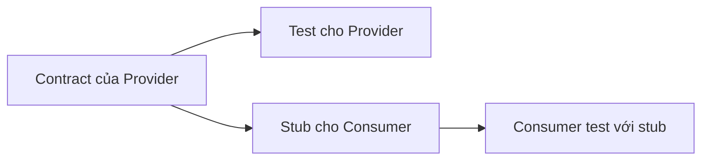

# Lý thuyết 27: Testing nâng cao

Bài này nói về các kiểu test vượt ra ngoài unit test: chạy với hạ tầng thật bằng Testcontainers, giả lập API ngoài bằng WireMock, contract test giữa các service, test kiến trúc bằng ArchUnit, và cách xử lý test lúc xanh lúc đỏ (flaky).

**Cốt lõi:** Test chỉ đáng tin ở chỗ nó không dựa vào giả định của chính người viết. Mock chỉ trả điều bạn tưởng tượng, nên chỗ nào có rủi ro thật (DB, broker, API ngoài, contract giữa service, kiến trúc) thì dùng thứ thật hoặc giả lập trung thực ở đúng chỗ đó.

- Vì mock phản chiếu điều bạn nghĩ nên lỗi dialect hay cấu hình chỉ lộ khi chạm hạ tầng thật.
- Vì container thật khởi động chậm nên chỉ dùng cho flow quan trọng và dùng chung giữa các test class.
- Vì test flaky đến từ thời gian, thứ tự, chờ async và tranh tài nguyên nên phải kiểm soát bốn thứ đó thay vì chạy lại cho xanh.



Mô hình tư duy: thay giả định bằng thứ thật ở những chỗ rủi ro, và giữ phần còn lại bằng unit test nhanh.

**Tóm tắt:**

- Unit test với mock chỉ phản chiếu điều bạn nghĩ về hệ thống, nên lỗi SQL dialect hay cấu hình Kafka chỉ lộ khi chạm hạ tầng thật.
- Testcontainers chạy container thật (PostgreSQL, Kafka, Redis) trong lifecycle của test; `@ServiceConnection` tự nối config nên không cần `@DynamicPropertySource`.
- Khai báo container làm `@Bean` để dùng chung giữa các test class, tránh khởi động lại vài giây ở mỗi class.
- WireMock giả lập API ngoài kể cả lỗi và chậm, là cách duy nhất kiểm chứng timeout, retry, circuit breaker thật sự hoạt động.
- Contract test chia việc cho provider và consumer, bắt lỗi đổi field JSON ngay lúc build thay vì lúc deploy.
- ArchUnit biến quy tắc kiến trúc thành test chạy trong CI; codebase cũ dùng `FreezingArchRule` để chỉ chặn vi phạm mới.
- Flaky test đến từ thời gian, thứ tự, chờ async và tranh tài nguyên: dùng `Clock`, dữ liệu riêng, Awaitility, port ngẫu nhiên.
- Tỷ lệ hợp lý: nhiều unit test nhanh, vừa phải integration test, rất ít end-to-end.

## Vấn đề nó giải quyết

Unit test với mock rất nhanh, nhưng mock chỉ phản chiếu những gì bạn nghĩ về hệ thống. Test xanh, lên môi trường thật mới lòi ra câu SQL sai cú pháp PostgreSQL, hoặc config Kafka sai. Với microservices còn tệ hơn: một team đổi tên field JSON của API mà không báo, team kia hỏng và không test nào bắt được cho tới khi deploy. Test nâng cao lấp những khoảng trống đó bằng cách dùng thứ thật (hoặc giả lập trung thực) ở đúng chỗ cần.

## Khi nào nên dùng, khi nào không

Dùng cho các flow quan trọng chạm DB, message broker và API ngoài. Với logic thuần (tính toán, quy tắc nghiệp vụ không gọi hạ tầng), unit test là đủ. Đừng kéo container vào mọi test: mỗi lần khởi động tốn vài giây và cả bộ test sẽ chậm đến mức không ai muốn chạy. Mục "Chiến lược chung" ở cuối bài tóm tắt tỷ lệ hợp lý.

## Các khái niệm cần biết

- **Testcontainers**: thư viện chạy container Docker (PostgreSQL, Kafka, Redis...) ngay trong lifecycle của test, rồi tự hủy. Nhờ đó test dùng đúng loại DB như production. Yêu cầu máy chạy test có Docker.
- **Slice test**: chỉ nạp một phần của ứng dụng (`@WebMvcTest` chỉ tầng web, `@DataJpaTest` chỉ tầng JPA) cho nhanh.
- **WireMock**: server HTTP giả, trả về response theo kịch bản bạn định, kể cả lỗi hay chậm. Dùng khi phụ thuộc vào API bên thứ ba.
- **Contract test**: kiểm tra hai service tuân thủ cùng một API contract mà không cần chạy cả hai cùng lúc. **Provider** là bên cung cấp API, **consumer** là bên gọi API.
- **ArchUnit**: thư viện biến quy tắc kiến trúc ("domain không được import Spring") thành test chạy trong CI.
- **Flaky test**: test lúc xanh lúc đỏ dù code không đổi, thường do thời gian, thứ tự chạy hoặc chờ asynchronous.
- **Awaitility**: thư viện chờ cho đến khi một điều kiện đúng (có timeout), thay cho `Thread.sleep`.

## Testcontainers: hạ tầng thật trong test

```java
@SpringBootTest
@Testcontainers
class OrderRepositoryIT {
    @Container
    @ServiceConnection                       // Spring Boot 3.1+: tự nối cấu hình
    static PostgreSQLContainer<?> db = new PostgreSQLContainer<>("postgres:16");

    @Autowired OrderRepository repository;

    @Test
    void savesAndFinds() { ... }
}
```

- Dùng cùng loại DB với production, tránh "chạy với H2 nhưng lỗi ở PostgreSQL".
- Dùng chung container giữa các test để chạy nhanh hơn.
- `@ServiceConnection` đọc địa chỉ và cổng ngẫu nhiên của container rồi tự đặt vào cấu hình kết nối (datasource, Kafka bootstrap servers), nên bạn không phải viết `@DynamicPropertySource`.

Flow của một integration test dùng Testcontainers:



Đọc sơ đồ: cổng được cấp ngẫu nhiên nên nhiều lần chạy song song không đụng nhau. Nếu Docker không chạy, test thất bại ngay lúc khởi động container, không phải ở assertion.

**Phải thuộc:** `@ServiceConnection` (Boot 3.1 trở lên) tự nối cấu hình kết nối tới container Testcontainers nên không cần `@DynamicPropertySource`. Chờ asynchronous dùng Awaitility, không dùng `Thread.sleep`. Compose support mặc định bỏ qua khi chạy test (`spring.docker.compose.skip.in-tests=true`).

**Nền tảng:** mock chỉ phản chiếu điều bạn nghĩ về hệ thống, còn hạ tầng thật mới lộ lỗi thật (SQL sai dialect, cấu hình Kafka sai). Vì vậy dùng đúng loại hạ tầng như production ở các flow quan trọng, giữ nhiều unit test nhanh và ít test chậm.

### Dùng chung container giữa các test class

`@Container` trên field `static` bật và tắt container theo **từng class**, nên mỗi class chờ vài giây. Cách khác: khai báo container làm `@Bean` trong cấu hình test. Spring khởi động chúng một lần, giữ trong context cache, và các class cùng cấu hình dùng lại (Spring Boot 3.1+).

```java
@TestConfiguration(proxyBeanMethods = false)
public class ContainersConfig {
    @Bean @ServiceConnection
    PostgreSQLContainer<?> postgres() { return new PostgreSQLContainer<>("postgres:16"); }

    @Bean @ServiceConnection
    KafkaContainer kafka() {
        return new KafkaContainer(DockerImageName.parse("confluentinc/cp-kafka:7.6.1"));
    }
}
```

```java
@SpringBootTest
@Import(ContainersConfig.class)
class OrderFlowIT {
    @Autowired OrderService orders;
    @Autowired PaymentRepository payments;

    @Test
    void orderCreatedLeadsToPayment() {
        orders.create(new CreateOrderCmd("C1", 100));
        // chờ asynchronous qua Kafka, không dùng Thread.sleep
        await().atMost(Duration.ofSeconds(10))
               .untilAsserted(() -> assertThat(payments.count()).isEqualTo(1));
    }
}
```

`KafkaContainer` là `org.testcontainers.containers.KafkaContainer`, `await` là `org.awaitility.Awaitility.await`. Với service không có class riêng (Redis), dùng `GenericContainer` kèm `@ServiceConnection(name = "redis")`.

Slice test cho nhanh: `@WebMvcTest` (chỉ web, mock service), `@DataJpaTest` (chỉ JPA; đặt `@AutoConfigureTestDatabase(replace = Replace.NONE)` để dùng Postgres thật thay vì H2 nhúng), `@SpringBootTest` (cả ứng dụng, chỉ cho flow quan trọng).

**Suy luận:** Vì mock chỉ trả về điều lập trình viên đã tưởng tượng, test dùng mock không thể phát hiện chỗ tưởng tượng đó sai, nên SQL sai dialect hay cấu hình Kafka sai vẫn xanh. Testcontainers sửa đúng gốc này bằng cách chạy image thật, nên kết quả test phản ánh hành vi của production. Cái giá là mỗi container khởi động mất vài giây, và `@Container` trên field `static` bật tắt theo từng class, nên một bộ test lớn sẽ chậm nếu mỗi class tự dựng container. Vì vậy container được khai báo làm `@Bean` để nằm trong context cache và dùng lại. Điểm dễ nhầm là nghĩ cứ thay mock bằng container ở mọi test cho chắc: kết quả là bộ test chậm đến mức không ai chạy, mất luôn lợi ích phát hiện lỗi sớm. Khi review, hãy hỏi test này kiểm chứng điều gì mà mock không thấy được; nếu là logic thuần thì giữ unit test, còn flow chạm DB, broker hay API ngoài thì dùng hạ tầng thật.

## Dev services: Docker Compose, SSL bundle, DevTools

Testcontainers giải quyết hạ tầng cho test. Còn lúc **phát triển**, bạn vẫn cần PostgreSQL, Redis, Kafka chạy cạnh ứng dụng, cần HTTPS cục bộ, và không muốn khởi động lại ứng dụng sau mỗi lần sửa. Spring Boot có bốn công cụ cho việc này. Chúng dành cho máy dev (và test), không phải cho production: đừng đưa vào bản đóng gói chạy thật.

### Khái niệm

- **Docker Compose support** (Boot 3.1+): Boot đọc `compose.yaml`, tự chạy `docker compose up` khi ứng dụng khởi động và nối cấu hình kết nối tới container.
- **Testcontainers khi chạy dev**: dùng cùng container như test để chạy cả ứng dụng, không cần file compose.
- **SSL bundle** (Boot 3.1+): khai báo một lần chứng chỉ và khóa dưới tên bundle, rồi tham chiếu theo tên ở server, client HTTP, Kafka, Redis.
- **DevTools**: tự restart nhanh khi classpath đổi, kèm LiveReload.

| Cần gì | Chọn |
|---|---|
| Chạy service dependency khi `bootRun`, dùng chung với đồng đội qua một file | Docker Compose support |
| Dịch vụ cho dev giống hệt cho test, viết bằng Java | Testcontainers + `@ServiceConnection` |
| HTTPS cục bộ, mutual TLS với dịch vụ khác | SSL bundle |
| Sửa code và thấy kết quả sau vài giây | DevTools |

### Docker Compose support

Thêm dependency `spring-boot-docker-compose` (scope dev, ví dụ `developmentOnly` ở Gradle, `optional` ở Maven) và đặt `compose.yaml` ở thư mục gốc. Boot nhận ra service theo tên image (`postgres`, `redis`...) và tự tạo chi tiết kết nối, nên không cần ghi `spring.datasource.url`.

_Minh họa_:

```yaml
services:
  db:
    image: postgres:16
    environment:
      POSTGRES_DB: shop
      POSTGRES_USER: shop
      POSTGRES_PASSWORD: secret
    ports:
      - "5432"        # chỉ ghi cổng container, Boot đọc cổng host ngẫu nhiên
```

Các thuộc tính hay chỉnh (kiểm tra lại theo phiên bản):

| Thuộc tính | Ý nghĩa |
|---|---|
| `spring.docker.compose.lifecycle-management` | `none`, `start-only`, `start-and-stop` (mặc định) |
| `spring.docker.compose.file` | Đường dẫn file compose khác |
| `spring.docker.compose.skip.in-tests` | Mặc định `true`: bỏ qua Compose khi chạy test |
| `spring.docker.compose.enabled` | Tắt hẳn, ví dụ ở production |

Nếu image không được nhận ra (image tự build, tên lạ), gắn nhãn `org.springframework.boot.service-connection` trên service trong file compose.

### Testcontainers khi chạy dev

Cùng `ContainersConfig` đã viết ở trên, thêm một lớp khởi chạy trong `src/test/java`. Chạy bằng `./mvnw spring-boot:test-run` hoặc `./gradlew bootTestRun`. Thêm `@RestartScope` cho bean container để DevTools khởi động lại ứng dụng mà không tắt container.

_Minh họa_:

```java
public class TestShopApplication {
    public static void main(String[] args) {
        SpringApplication.from(ShopApplication::main)
                // cấu hình container dùng chung với test
                .with(ContainersConfig.class)
                .run(args);
    }
}
```

### SSL bundle

Vấn đề: khóa, chứng chỉ rải rác ở `server.ssl.*`, `spring.kafka.ssl.*`, cấu hình client HTTP, mỗi chỗ một kiểu. Bundle gom lại một chỗ, đặt tên, rồi tham chiếu.

_Minh họa_:

```yaml
spring:
  ssl:
    bundle:
      pem:
        web:
          keystore:
            certificate: "file:certs/server.crt"
            private-key: "file:certs/server.key"
          # theo dõi file và nạp lại khi đổi (3.2+, kiểm tra lại)
          reload-on-update: true
server:
  ssl:
    bundle: web
```

Trong code, `SslBundles` cho bạn lấy bundle theo tên để dựng client; cách gắn vào `RestTemplate`/`RestClient` đổi theo phiên bản Boot nên kiểm tra tài liệu của bản bạn dùng.

_Minh họa_:

```java
@Bean
RestTemplate partnerClient(RestTemplateBuilder builder, SslBundles bundles) {
    return builder.setSslBundle(bundles.getBundle("partner")).build();
}
```

Mật khẩu keystore không để thẳng trong `application.yml` đưa vào git; lấy từ biến môi trường hoặc kho bí mật.

### DevTools

Thêm `spring-boot-devtools` (scope dev). Khi file `.class` đổi, DevTools khởi động lại **phần code của bạn** bằng một classloader riêng còn thư viện giữ nguyên, nên nhanh hơn khởi động nguội. Nó còn bật LiveReload và đặt mặc định thân thiện cho dev (tắt cache template). DevTools tự tắt khi chạy bản đóng gói `java -jar` và mặc định không nằm trong jar đóng gói bởi plugin Spring Boot.

### Bẫy thường gặp

| Bẫy | Hệ quả |
|---|---|
| Chạy test mà nghĩ Compose tự khởi động | Mặc định `skip.in-tests=true`, test không có DB; dùng Testcontainers cho test |
| Để `spring-boot-docker-compose` hoặc DevTools trong classpath production | Ứng dụng cố chạy Docker lúc khởi động; hành vi restart không mong muốn. Giữ ở scope dev |
| Restart bởi DevTools làm `ClassCastException` | Cùng một class bị nạp bởi hai classloader (thư viện ngoài giữ instance); loại class đó khỏi restart bằng `spring.devtools.restart.exclude` hoặc tắt restart |
| Port cố định trong compose (`5432:5432`) | Đụng port với DB cài sẵn; để Docker cấp port ngẫu nhiên |
| Đặt mật khẩu và khóa riêng trong repo | Lộ khóa; dùng biến môi trường và `.gitignore` thư mục `certs/` |

## Test API ngoài: WireMock

Dựng server giả trả về response theo kịch bản, kể cả lỗi và chậm, để kiểm chứng timeout, retry, circuit breaker.

```java
@SpringBootTest
class InventoryClientIT {
    @RegisterExtension
    static WireMockExtension wm = WireMockExtension.newInstance()
            .options(wireMockConfig().dynamicPort()).build();

    @DynamicPropertySource
    static void props(DynamicPropertyRegistry r) {
        r.add("inventory.base-url", wm::baseUrl);          // trỏ client tới server giả
    }

    @Autowired StockService stockService;

    @Test
    void retriesOn503ThenSucceeds() {
        wm.stubFor(get(urlPathEqualTo("/stock/42")).inScenario("retry")
                .whenScenarioStateIs(Scenario.STARTED)
                .willReturn(aResponse().withStatus(503))
                .willSetStateTo("recovered"));
        wm.stubFor(get(urlPathEqualTo("/stock/42")).inScenario("retry")
                .whenScenarioStateIs("recovered")
                .willReturn(okJson("{\"productId\":42,\"available\":5}")));

        assertThat(stockService.checkStock(42L).available()).isEqualTo(5);
        // đã thử đúng 2 lần
        wm.verify(2, getRequestedFor(urlPathEqualTo("/stock/42")));
    }

    @Test
    void timesOutWhenSlow() {
        wm.stubFor(get(urlPathEqualTo("/stock/43"))
                .willReturn(aResponse().withFixedDelay(5_000).withStatus(200)));
        assertThatThrownBy(() -> stockService.checkStock(43L)).isInstanceOf(RuntimeException.class);
    }
}
```

Các kiểu lỗi nên giả lập: `withFixedDelay` (chậm), `withFault(Fault.CONNECTION_RESET_BY_PEER)` (đứt kết nối), `withStatus(5xx)`, thân JSON hỏng. Đây là cách duy nhất kiểm chứng cấu hình timeout và circuit breaker của [Lý thuyết 32: Resilience và chịu lỗi](/go?p=01-Spring-Boot%2Fhard%2Flt-32-resilience-chiu-loi.md) thật sự có tác dụng.

## Contract test

Vấn đề đặt ra: service A gọi service B. Test end-to-end cần dựng cả hai, chậm và mong manh. Contract test chia việc làm hai nửa độc lập: nửa provider kiểm tra B đúng contract, nửa consumer kiểm tra A hiểu đúng contract bằng một stub sinh từ chính contract đó. Dùng khi có nhiều team sở hữu các service gọi nhau; không đáng làm nếu chỉ một team sở hữu cả hai và triển khai chung.



Bắt lỗi "provider đổi field JSON làm hỏng consumer" ngay lúc build, rẻ hơn nhiều so với test end-to-end.

Ví dụ contract dạng YAML của Spring Cloud Contract (đặt ở `src/test/resources/contracts` của provider): plugin sinh test cho provider và stub cho consumer từ cùng một file.

```yaml
description: Lấy tồn kho sản phẩm 42
request:
  method: GET
  url: /stock/42
response:
  status: 200
  headers:
    Content-Type: application/json
  body:
    productId: 42
    available: 5
```

Provider đổi tên `available` thì test sinh ra đỏ ngay ở build của provider. Pact đi theo hướng ngược: consumer viết kỳ vọng, provider kiểm chứng.

## Test kiến trúc: ArchUnit

Tài liệu kiến trúc không ngăn ai import nhầm. ArchUnit đọc bytecode và kiểm tra các quy tắc dependency như một test thông thường. Dùng cho các quy tắc đã chốt (hexagonal, phân lớp, cấm circular dependency); không dùng để ép phong cách code vụn vặt.

```java
@ArchTest
static final ArchRule domain_should_not_depend_on_spring =
    noClasses().that().resideInAPackage("..domain..")
               .should().dependOnClassesThat().resideInAPackage("org.springframework..");
```

Quy tắc kiến trúc được kiểm tự động trong CI, không chỉ nằm trên tài liệu.

```java
@AnalyzeClasses(packages = "com.example", importOptions = ImportOption.DoNotIncludeTests.class)
class ArchitectureTest {
    @ArchTest
    static final ArchRule layers = layeredArchitecture().consideringAllDependencies()
            .layer("Web").definedBy("..web..")
            .layer("Service").definedBy("..service..")
            .layer("Persistence").definedBy("..persistence..")
            .whereLayer("Web").mayNotBeAccessedByAnyLayer()
            .whereLayer("Service").mayOnlyBeAccessedByLayers("Web")
            .whereLayer("Persistence").mayOnlyBeAccessedByLayers("Service");
}
```

Với codebase cũ đã vi phạm sẵn, dùng `FreezingArchRule.freeze(rule)` để đóng băng vi phạm hiện có và chỉ chặn vi phạm mới.

## Test không ổn định (flaky)

Test flaky nguy hiểm vì nó dạy cả team bỏ qua test đỏ ("chạy lại là xanh"), và rồi một lỗi thật lọt qua. Nguyên nhân thường rơi vào bốn nhóm sau.

| Nguyên nhân | Cách xử lý |
|---|---|
| Phụ thuộc thời gian thực | Inject `Clock`, dùng `Clock.fixed` |
| Phụ thuộc thứ tự test / dữ liệu chung | Mỗi test tự dựng và dọn dữ liệu; không chia sẻ state |
| Chờ asynchronous bằng `Thread.sleep` | Dùng Awaitility chờ đến khi điều kiện đúng |
| Port/tài nguyên bị tranh | Port ngẫu nhiên, container riêng |

Ví dụ inject `Clock` (Awaitility đã có ở ví dụ Kafka phía trên):

```java
@Service
class TokenService {
    // inject Clock, không gọi Instant.now() trực tiếp
    private final Clock clock;
    TokenService(Clock clock) { this.clock = clock; }
    boolean isExpired(Instant issuedAt) { return issuedAt.plus(Duration.ofMinutes(15)).isBefore(clock.instant()); }
}

// trong test
Clock fixed = Clock.fixed(Instant.parse("2026-01-01T10:00:00Z"), ZoneOffset.UTC);
assertThat(new TokenService(fixed).isExpired(Instant.parse("2026-01-01T09:30:00Z"))).isTrue();
```

Cần khai báo bean `Clock.systemUTC()` ở cấu hình chính để Spring inject được.

## Chiến lược chung

- Nhiều unit test nhanh, vừa phải integration test có hạ tầng thật, rất ít end-to-end.
- Test chậm phải tách nhóm (ví dụ hậu tố `IT`) để chạy riêng trong CI.
- Ưu tiên test hành vi quan sát được; hạn chế mock quá mức (mock mọi thứ thì test chỉ phản chiếu code).

## Phỏng vấn khó: chuỗi hỏi xoáy

Người phỏng vấn senior thường mở bằng câu dễ rồi xoáy xuống cơ chế, đánh đổi và sự cố thật. Câu trả lời tốt luôn đi từ cốt lõi xuống: test này kiểm chứng điều gì mà giả định của người viết không thấy được.

### Chuỗi 1: Mock, H2 và Testcontainers

1. **Câu mở:** Test xanh hết nhưng lên môi trường thật vẫn lỗi SQL. Vì sao, và bạn sửa gốc thế nào?
2. **Xoáy 1:** `@ServiceConnection` làm gì, và vì sao nên khai báo container làm `@Bean` thay vì `@Container` static?
3. **Xoáy 2:** Vậy có nên thay mock bằng container ở mọi test cho chắc không?

**Đáp án ngắn:** Mock chỉ trả điều lập trình viên tưởng tượng, nên SQL sai dialect hay cấu hình Kafka sai vẫn xanh; chạy với H2 mà production là PostgreSQL cũng cùng lỗi đó. Gốc là thay giả định bằng thứ thật: Testcontainers chạy image thật trong lifecycle của test. Cổng container được cấp ngẫu nhiên, và `@ServiceConnection` (Boot 3.1+) đọc địa chỉ cổng đó rồi tự nối cấu hình datasource hay Kafka, nên không cần `@DynamicPropertySource`. `@Container` trên field `static` bật tắt theo từng class, nên mỗi class chờ vài giây; container làm `@Bean` nằm trong context cache và các class cùng cấu hình dùng lại. Nhưng không nên kéo container vào mọi test, vì bộ test chậm đến mức không ai chạy. Logic thuần dùng unit test; flow chạm DB, broker, API ngoài mới dùng hạ tầng thật. Nếu Docker không chạy, test thất bại ngay lúc khởi động container, không phải ở assertion.

**Sai lầm hay gặp:**
- Bảo "mock đủ rồi" cho code có SQL riêng hoặc dialect.
- Dùng container ở mọi test.
- Nhầm Docker Compose support với Testcontainers: Compose mặc định bị bỏ qua khi chạy test.

### Chuỗi 2: Kiểm chứng phần phụ thuộc ngoài

1. **Câu mở:** Làm sao chứng minh timeout và retry của bạn thật sự hoạt động?
2. **Xoáy 1:** Giả lập bằng WireMock thế nào để thấy retry sau 503 rồi thành công, và có những kiểu lỗi nào cần giả lập?
3. **Xoáy 2:** Hai team sở hữu hai service gọi nhau, một bên đổi tên field JSON. Contract test bắt lỗi đó ở đâu, và khi nào không đáng làm?

**Đáp án ngắn:** Cấu hình timeout hay circuit breaker chỉ đáng tin khi thấy nó chạy với lỗi thật, và WireMock là cách duy nhất làm điều đó có kiểm soát. Dùng scenario: lần gọi đầu trả 503 rồi đổi state sang "recovered" trả JSON thành công, sau đó `verify(2, ...)` để chắc đã thử đúng hai lần. Các kiểu lỗi cần giả lập: chậm (`withFixedDelay`), đứt kết nối (`Fault.CONNECTION_RESET_BY_PEER`), status 5xx, thân JSON hỏng. Contract test chia việc: provider test sinh từ contract, consumer test chạy với stub sinh từ cùng contract. Provider đổi `available` thì test của provider đỏ ngay lúc build, rẻ hơn nhiều so với end-to-end. Pact đi hướng ngược, consumer viết kỳ vọng. Không đáng làm nếu một team sở hữu cả hai và deploy chung.

**Sai lầm hay gặp:**
- Chỉ test happy path của client HTTP.
- Dùng end-to-end để bắt lỗi contract.
- Nói contract test thay được integration test với dependency thật.

### Chuỗi 3: Test flaky

1. **Câu mở:** Test lúc xanh lúc đỏ, chạy lại là xanh. Bạn làm gì?
2. **Xoáy 1:** Bốn nhóm nguyên nhân thường gặp là gì, và mỗi nhóm có cách trị nào?
3. **Xoáy 2:** Test chờ message Kafka đang dùng `Thread.sleep(2000)`. Có vấn đề gì và sửa thế nào?

**Đáp án ngắn:** Không chạy lại cho xanh, vì flaky dạy cả team bỏ qua test đỏ và rồi một lỗi thật lọt qua. Nguyên nhân rơi vào bốn nhóm. Thời gian thực: inject `Clock` và dùng `Clock.fixed`, không gọi `Instant.now()` trực tiếp. Thứ tự test hoặc dữ liệu chung: mỗi test tự dựng và dọn dữ liệu. Chờ asynchronous: dùng Awaitility. Tranh tài nguyên: cổng ngẫu nhiên, container riêng. `Thread.sleep(2000)` sai theo cả hai hướng: máy chậm thì chưa đủ lâu nên đỏ ngẫu nhiên, máy nhanh thì ngủ thừa nên bộ test chậm. Awaitility chờ đến khi điều kiện đúng, có timeout, ví dụ `await().atMost(Duration.ofSeconds(10)).untilAsserted(...)`. Test chậm nên tách nhóm, như hậu tố `IT`, để chạy riêng trong CI.

**Sai lầm hay gặp:**
- Bật retry cho test thay vì tìm nguyên nhân.
- Tăng thời gian `sleep` cho "chắc".
- Chia sẻ state giữa các test rồi phụ thuộc thứ tự chạy.

