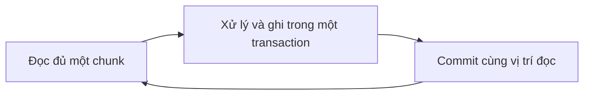
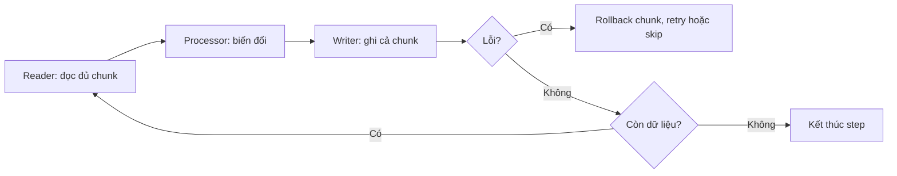
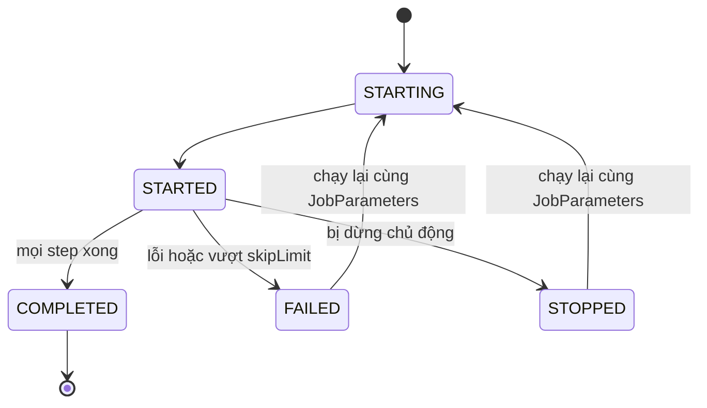
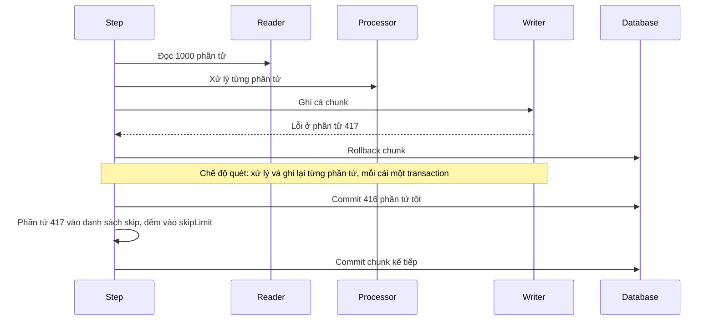

# Lý thuyết 28: Spring Batch

Spring Batch là framework để xử lý lượng dữ liệu lớn theo lô: đọc, xử lý, ghi từng đợt nhỏ. Nó cung cấp sẵn những thứ mà ai tự viết cũng sẽ phải làm lại: chạy lại từ chỗ dừng, bỏ qua dòng lỗi, thử lại lỗi tạm thời và theo dõi tiến độ.

**Cốt lõi:** Xử lý hàng triệu bản ghi trong một vòng lặp thì sự cố giữa chừng làm mất tiến độ và không biết chạy lại từ đâu. Spring Batch cắt việc thành chunk nhỏ, mỗi chunk một transaction, và ghi tiến độ vào DB cùng lúc commit.

- Vì mỗi chunk commit cùng vị trí đọc nên sự cố chỉ mất công của chunk đang chạy, và restart tiếp từ chunk cuối đã commit.
- Vì writer nhận cả lô nên khi lỗi phải rollback rồi xử lý lại từng phần tử, nên processor không được có tác dụng phụ.
- Vì restart chỉ bảo đảm không đọc lại phần đã commit nên writer phải idempotent, ví dụ upsert.



Mô hình tư duy: job là vòng lặp các chunk, và điểm commit của mỗi chunk là điểm có thể quay lại khi gặp sự cố.

**Tóm tắt:**

- Spring Batch xử lý dữ liệu lớn theo chunk, mỗi chunk là một transaction, nên sự cố chỉ làm mất công của chunk đang chạy.
- Một Job gồm nhiều Step; chunk-oriented step đọc bằng `ItemReader`, biến đổi bằng `ItemProcessor`, ghi cả lô bằng `ItemWriter`.
- `JobInstance` là Job cộng `JobParameters`; mỗi lần chạy thực sự là một `JobExecution`, và instance FAILED chạy lại được từ chunk cuối đã commit.
- `JobRepository` lưu tiến độ vào các bảng `BATCH_*`, đây là cơ chế cho phép restart.
- Skip bỏ qua phần tử lỗi trong giới hạn `skipLimit`, Retry thử lại lỗi tạm thời như deadlock.
- Khi một chunk lỗi, Spring Batch rollback rồi xử lý lại từng phần tử, nên processor không được có tác dụng phụ.
- Thiết kế job idempotent (ví dụ upsert) và đặt `name` cho reader để restart không nhân đôi hay đọc lại từ đầu.
- Chunk cỡ 500 đến 2000 là điểm bắt đầu hợp lý, sau đó đo để chọn.

## Vấn đề nó giải quyết

Hãy tưởng tượng bạn tự viết một vòng `for` để nhập 5 triệu dòng CSV vào DB. Chạy được 3 triệu dòng thì mất kết nối DB hoặc hết RAM. Bây giờ bạn không biết nó đã xử lý tới đâu; chạy lại từ đầu thì sợ trùng dữ liệu, chạy tiếp thì không biết tiếp từ đâu, còn một dòng lỗi định dạng cũng làm cả job dừng. Spring Batch giải quyết bằng cách chia việc thành các **chunk** nhỏ, mỗi chunk một transaction, và ghi lại tiến độ vào DB sau mỗi chunk, nên sự cố chỉ mất công của chunk đang chạy.

## Khi nào nên dùng, khi nào không

Dùng cho nhập/xuất dữ liệu, tính toán cuối ngày, đối soát, di chuyển dữ liệu: những việc chạy theo lịch hoặc theo yêu cầu, xử lý nhiều bản ghi, cần chạy lại an toàn. Với việc nhỏ vài trăm dòng thì một `@Scheduled` là đủ, không cần mang cả Spring Batch (và các bảng metadata) vào. Với stream liên tục không có điểm kết thúc thì dùng Kafka hoặc stream processing.

## Các khái niệm cần biết

- **Job** là một công việc hoàn chỉnh (ví dụ "nhập khách hàng"), gồm một hoặc nhiều **Step** chạy tuần tự hoặc theo điều kiện.
- **Chunk-oriented step**: step đọc từng phần tử bằng `ItemReader`, biến đổi bằng `ItemProcessor`, và ghi cả lô bằng `ItemWriter`. Kích thước chunk (ví dụ 1000) cũng là kích thước transaction.
- **JobParameters**: tham số định danh một lần chạy. Cùng `Job` với cùng tham số là cùng một **JobInstance**; mỗi lần thực sự chạy của instance đó là một **JobExecution**. Một instance FAILED có thể có nhiều execution (lần chạy lại).
- **JobRepository**: nơi lưu metadata (status, vị trí đọc, bộ đếm) trong các bảng `BATCH_*`. Đây là cơ chế cho phép **restart**.
- **Skip**: bỏ qua phần tử lỗi (có giới hạn), **Retry**: thử lại lỗi tạm thời như deadlock.
- **@StepScope**: bean được tạo mới cho mỗi lần chạy step, để đọc được `JobParameters` lúc chạy.
- **Partitioning / multi-thread step**: chia dữ liệu cho nhiều thread hoặc nhiều process để chạy parallel.

## Flowchart: một step theo chunk

Một step là vòng lặp đọc, xử lý, ghi theo lô như sau.



Đọc sơ đồ: Reader được gọi từng phần tử cho tới khi đủ một chunk, Processor biến đổi từng phần tử, còn Writer nhận **cả lô** một lần (nên ghi theo batch JDBC được, nhanh). Lỗi thì rollback chunk đó, rồi retry hoặc skip theo cấu hình.

Một lần chạy Job có lifecycle như sau; trạng thái được lưu vào `JobRepository`.



Đọc sơ đồ: chỉ instance FAILED hoặc STOPPED mới chạy lại được; COMPLETED thì không, trừ khi đổi tham số để tạo instance mới.

**Nền tảng:** Spring Batch xử lý theo chunk, mỗi chunk là một transaction, và sau mỗi chunk ghi tiến độ vào `JobRepository` (các bảng `BATCH_*`). Hai điều này cho nó khả năng chạy lại từ chunk cuối đã commit, bỏ qua phần tử lỗi mà không mất cả job.

**Phải thuộc:** quan hệ `Job` có nhiều `Step`; `JobInstance` = Job + `JobParameters` (cùng tham số là cùng instance), mỗi lần chạy thực sự là một `JobExecution`. Chunk step gồm `ItemReader`, `ItemProcessor`, `ItemWriter`. Instance COMPLETED chạy lại cùng tham số thì ném `JobInstanceAlreadyCompleteException`. Với Spring Batch 5 và Boot 3 không thêm `@EnableBatchProcessing` (thêm vào là tắt auto-configuration); Spring Batch 6 (Boot 4) có thay đổi cấu hình này, kiểm tra lại theo phiên bản.

## Các khái niệm

| Khái niệm | Ý nghĩa |
|---|---|
| `Job` / `Step` | Công việc gồm nhiều bước |
| `JobParameters` | Tham số xác định một lần chạy (cùng tham số = cùng JobInstance) |
| Chunk | Số phần tử xử lý trong một transaction (ví dụ 1000) |
| `JobRepository` | Bảng metadata lưu trạng thái, cho phép **restart** từ chỗ dừng |
| Skip / Retry | Bỏ qua bản ghi lỗi (có giới hạn) / thử lại lỗi tạm thời |
| Partitioning, multi-thread | Chạy parallel để tăng tốc |

**Suy luận:** Vì mỗi chunk là một transaction và vị trí đọc được commit cùng dữ liệu, trạng thái trong `JobRepository` luôn khớp với những gì đã thật sự ghi, nên restart có thể tin vào con số đó để tiếp tục từ chunk cuối đã commit. Chính vì ghi cả lô một lần, khi writer lỗi Spring Batch không biết phần tử nào gây lỗi, nên nó phải rollback cả chunk rồi xử lý lại từng phần tử, mỗi cái một transaction, để tìm ra phần tử xấu. Hệ quả thứ nhất là processor bị gọi lại trên các phần tử của chunk, nên processor có tác dụng phụ (gửi email, gọi API ghi) sẽ thực hiện hai lần. Hệ quả thứ hai là chunk quá nhỏ làm số lần commit tăng vọt, còn chunk quá lớn giữ nhiều object trong memory và rollback rất đắt. Điểm dễ nhầm là tin rằng restart tự bảo đảm không trùng dữ liệu: nó chỉ bảo đảm không đọc lại phần đã commit, còn phần chunk bị xử lý lại thì writer phải tự chịu được, ví dụ bằng upsert. Khi thiết kế job, hãy giữ processor thuần, writer idempotent và đặt `name` cho reader để vị trí đọc được lưu.

## Ví dụ (Spring Batch 5)

Ví dụ ngắn dưới đây cho thấy cách ghép reader, processor, writer thành một step có khả năng bỏ qua tối đa 100 dòng lỗi. Phiên bản hoàn chỉnh ở mục sau.

```java
@Bean
Step importStep(JobRepository repo, PlatformTransactionManager tx,
                FlatFileItemReader<CustomerCsv> reader,
                ItemProcessor<CustomerCsv, Customer> processor,
                JpaItemWriter<Customer> writer) {
    return new StepBuilder("importStep", repo)
            .<CustomerCsv, Customer>chunk(1000, tx)
            .reader(reader).processor(processor).writer(writer)
            .faultTolerant().skipLimit(100).skip(ValidationException.class)
            .build();
}
```

## Job nhập CSV hoàn chỉnh (Spring Batch 5, Spring Boot 3)

Boot 3 tự cấu hình Batch, **không** thêm `@EnableBatchProcessing` (thêm vào là tắt auto-configuration). `CustomerCsv` và `Customer` là POJO có getter/setter.

```java
@Configuration
class ImportJobConfig {

    @Bean
    // tạo bean mới cho mỗi lần chạy để đọc JobParameters
    @StepScope
    FlatFileItemReader<CustomerCsv> reader(@Value("#{jobParameters['file']}") String file) {
        return new FlatFileItemReaderBuilder<CustomerCsv>()
                // bắt buộc: key lưu vị trí đọc để restart
                .name("customerReader")
                .resource(new FileSystemResource(file))
                .linesToSkip(1)                        // bỏ dòng tiêu đề
                .delimited().names("id", "name", "email")
                .targetType(CustomerCsv.class)
                .build();
    }

    @Bean
    ItemProcessor<CustomerCsv, Customer> processor() {
        return csv -> {
            if (!csv.getEmail().contains("@")) throw new ValidationException("Email sai: " + csv.getId());
            return new Customer(csv.getId(), csv.getName().trim(), csv.getEmail().toLowerCase());
            // trả null nghĩa là lọc bỏ phần tử này, không tính là lỗi
        };
    }

    @Bean
    JdbcBatchItemWriter<Customer> writer(DataSource ds) {
        return new JdbcBatchItemWriterBuilder<Customer>()
                .dataSource(ds)
                .sql("""
                    insert into customer(id, name, email) values (:id, :name, :email)
                    on conflict (id) do update set name = excluded.name, email = excluded.email""")
                // lấy tham số từ getter; upsert nên chạy lại không nhân đôi
                .beanMapped()
                .build();
    }

    @Bean
    Step importStep(JobRepository repo, PlatformTransactionManager tx,
                    FlatFileItemReader<CustomerCsv> reader, ItemProcessor<CustomerCsv, Customer> processor,
                    JdbcBatchItemWriter<Customer> writer, SkipListener<CustomerCsv, Customer> skipLog) {
        return new StepBuilder("importStep", repo)
                .<CustomerCsv, Customer>chunk(1000, tx)
                .reader(reader).processor(processor).writer(writer)
                .faultTolerant()
                .skip(FlatFileParseException.class).skip(ValidationException.class).skipLimit(100)
                // lỗi tạm thời: thử lại
                .retry(DeadlockLoserDataAccessException.class).retryLimit(3)
                .listener(skipLog)
                .build();
    }

    @Bean
    Job importJob(JobRepository repo, Step importStep) {
        return new JobBuilder("importJob", repo).start(importStep).build();
    }
}
```

```java
@Component
class ImportSkipLog implements SkipListener<CustomerCsv, Customer> {
    private static final Logger log = LoggerFactory.getLogger(ImportSkipLog.class);

    @Override public void onSkipInRead(Throwable t) { log.warn("Bỏ qua dòng không đọc được: {}", t.getMessage()); }
    @Override public void onSkipInProcess(CustomerCsv item, Throwable t) { log.warn("Bỏ qua {}: {}", item.getId(), t.getMessage()); }
    // thực tế: ghi vào bảng import_error để xử lý sau
}
```

Chạy job (tắt tự chạy lúc khởi động bằng `spring.batch.job.enabled=false`):

```java
JobParameters params = new JobParametersBuilder()
        .addString("file", "/data/customers-2026-10-27.csv")
        .addString("runDate", LocalDate.now().toString())
        .toJobParameters();
// JobLauncher, ném exception checked
JobExecution exec = jobLauncher.run(importJob, params);
```

Bảng metadata do Boot tự tạo khi `spring.batch.jdbc.initialize-schema=always` (mặc định chỉ với DB nhúng).

## Chunk, lỗi và restart chạy thế nào

Mỗi chunk là **một transaction**: đọc đủ 1000 phần tử, xử lý từng cái, ghi cả lô một lần, rồi commit cùng với vị trí đọc và bộ đếm trong `BATCH_STEP_EXECUTION`.



Đọc sơ đồ: khi writer lỗi, Spring Batch không biết phần tử nào gây lỗi, nên nó rollback cả chunk rồi xử lý lại từng phần tử một để tìm ra phần tử xấu. Phần tử xấu bị bỏ qua và ghi nhận; phần còn lại vẫn được commit. Vì cơ chế này, hệ quả cần nhớ: khi một chunk lỗi, processor **chạy lại** trên các phần tử của chunk, nên processor phải không có tác dụng phụ. Skip vượt `skipLimit` thì step thất bại.

| Tình huống | Kết quả |
|---|---|
| Job lỗi ở chunk 500, chạy lại cùng `JobParameters` | `JobInstance` ở trạng thái FAILED, chạy lại **tiếp từ chunk cuối đã commit** |
| Chạy lại cùng tham số khi đã COMPLETED | `JobInstanceAlreadyCompleteException`; muốn chạy mới phải đổi tham số (ví dụ thêm `runDate`) |
| Reader không có `name` | Không lưu được vị trí, restart đọc lại từ đầu |

Tính số: 1.000.000 dòng, chunk 1000 thì có 1000 lần commit. Chunk 10 thì 100.000 lần commit, chậm vì chi phí commit; chunk 100.000 thì mỗi transaction giữ 100.000 object trong memory và khi lỗi phải rollback rất nhiều. Bắt đầu 500 đến 2000 rồi đo.

## Điều cần nhớ

- Chunk lớn nhanh hơn nhưng giữ transaction và memory lâu hơn; đo để chọn.
- **Đọc theo cursor hoặc theo trang**, không tải hết vào memory; reader theo trang phải sắp xếp ổn định.
- Thiết kế để **idempotent và restart được**: chạy lại sau lỗi không nhân đôi dữ liệu.
- Ghi lại bản ghi bị bỏ qua để xử lý sau, đừng nuốt lỗi âm thầm.
- Không để job chạy bằng `@Scheduled` trên nhiều instance mà không có lock (xem [Lý thuyết 18: Scheduling và Async](/go?p=01-Spring-Boot%2Fmedium%2Flt-18-scheduling-async.md)).
- Với stream liên tục (streaming) thì dùng Kafka/stream processing, không phải Batch.

## Phỏng vấn khó: chuỗi hỏi xoáy

Người phỏng vấn senior thường mở bằng câu dễ rồi xoáy xuống cơ chế, đánh đổi và sự cố thật. Câu trả lời tốt luôn đi từ cốt lõi xuống: điểm commit của mỗi chunk là điểm có thể quay lại.

### Chuỗi 1: Chunk và vị trí đọc

1. **Câu mở:** Nhập 5 triệu dòng CSV, vì sao dùng Spring Batch thay vì một vòng `for`?
2. **Xoáy 1:** Mất kết nối ở dòng 3 triệu. Tiến độ nằm ở đâu và vì sao tin được con số đó?
3. **Xoáy 2:** Chunk 10, chunk 1000 và chunk 100.000 khác nhau thế nào với 1 triệu dòng?

**Đáp án ngắn:** Vòng `for` mất tiến độ khi sự cố: không biết đã làm tới đâu, chạy lại từ đầu thì sợ trùng. Spring Batch chia việc thành chunk, mỗi chunk một transaction: đọc đủ chunk, xử lý từng phần tử, ghi cả lô, rồi commit cùng vị trí đọc và bộ đếm trong `BATCH_STEP_EXECUTION`. Vì vị trí đọc commit cùng dữ liệu, trạng thái trong `JobRepository` luôn khớp với những gì đã ghi thật, nên restart tiếp từ chunk cuối đã commit và chỉ mất công của chunk đang chạy. Tính số: 1 triệu dòng với chunk 1000 là 1000 lần commit. Chunk 10 thì 100.000 lần commit, chậm vì chi phí commit. Chunk 100.000 thì mỗi transaction giữ 100.000 object trong memory và rollback rất đắt. Bắt đầu 500 đến 2000 rồi đo. Reader phải có `name` để vị trí đọc được lưu.

**Sai lầm hay gặp:**
- Nói "Batch tự chạy lại nên không trùng dữ liệu".
- Chọn chunk theo cảm giác mà không nêu đánh đổi memory và commit.
- Quên đặt `name` cho reader.

### Chuỗi 2: Lỗi trong một chunk

1. **Câu mở:** Writer lỗi ở phần tử 417 của chunk 1000. Chuyện gì xảy ra?
2. **Xoáy 1:** Vì sao processor bị gọi lại, và điều đó đòi hỏi gì ở processor?
3. **Xoáy 2:** Khác nhau giữa skip và retry là gì, và vượt `skipLimit` thì sao?

**Đáp án ngắn:** Writer nhận cả lô nên khi lỗi, Spring Batch không biết phần tử nào gây lỗi. Nó rollback cả chunk rồi xử lý lại từng phần tử, mỗi cái một transaction, để tìm phần tử xấu. 416 phần tử tốt được commit, phần tử 417 vào danh sách skip rồi tiếp tục chunk sau. Hệ quả là processor chạy lại trên các phần tử của chunk, nên processor có tác dụng phụ như gửi email hay gọi API ghi sẽ thực hiện hai lần: processor phải thuần. Skip bỏ qua phần tử lỗi trong giới hạn `skipLimit` (ví dụ lỗi parse hay validation), retry thử lại lỗi tạm thời như `DeadlockLoserDataAccessException`. Vượt `skipLimit` thì step thất bại và job FAILED. Bản ghi bị bỏ qua phải được ghi lại bằng `SkipListener` vào bảng lỗi để xử lý sau, không nuốt âm thầm. Writer nên idempotent, ví dụ upsert.

**Sai lầm hay gặp:**
- Đặt tác dụng phụ trong processor.
- Dùng skip cho lỗi tạm thời đáng ra phải retry.
- Bắt và nuốt exception khiến lỗi biến mất không dấu vết.

### Chuỗi 3: JobInstance, restart và chạy trùng

1. **Câu mở:** Job lỗi ở chunk 500, bạn chạy lại cùng tham số. Chuyện gì xảy ra?
2. **Xoáy 1:** `JobInstance` khác `JobExecution` thế nào, và chạy lại job đã COMPLETED cùng tham số thì sao?
3. **Xoáy 2:** Job gắn `@Scheduled` và app chạy ba instance thì sao?

**Đáp án ngắn:** `JobInstance` là Job cộng `JobParameters`, nên cùng tham số là cùng instance; mỗi lần chạy thực sự là một `JobExecution`, và một instance FAILED có thể có nhiều execution. Chạy lại cùng tham số thì instance FAILED hoặc STOPPED tiếp tục từ chunk cuối đã commit. Instance COMPLETED chạy lại cùng tham số ném `JobInstanceAlreadyCompleteException`; muốn chạy mới phải đổi tham số, ví dụ thêm `runDate`. Restart chỉ bảo đảm không đọc lại phần đã commit, còn chunk bị xử lý lại thì writer phải tự chịu được, nên dùng upsert. Với `@Scheduled` trên nhiều instance mà không có lock thì mỗi instance tự khởi chạy job. Cần lock, ví dụ ShedLock, hoặc dựa vào cơ chế định danh bằng tham số. Việc nhỏ vài trăm dòng thì `@Scheduled` là đủ, không cần Batch.

**Sai lầm hay gặp:**
- Nhầm instance với execution.
- Tưởng restart tự bảo đảm idempotent.
- Dùng Spring Batch cho stream liên tục.

