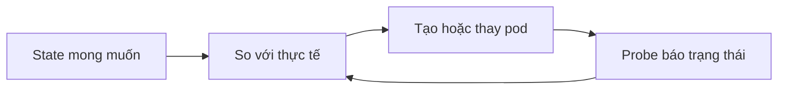
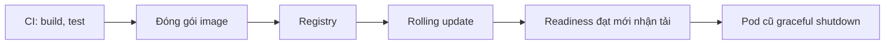
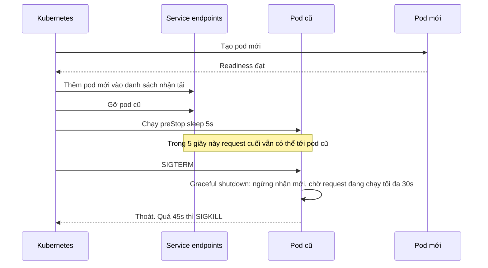
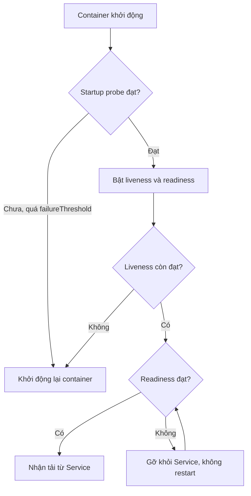

# Lý thuyết 29: Đóng gói, Docker và Kubernetes cho Spring Boot

Bài này hướng dẫn đóng ứng dụng Spring Boot thành container image rồi chạy trên Kubernetes, kèm cấu hình, health probe, giới hạn tài nguyên và cách cập nhật phiên bản mà không làm gián đoạn người dùng.

**Cốt lõi:** Container đóng ứng dụng cùng môi trường thành image bất biến, còn Kubernetes liên tục so sánh state mong muốn với thực tế rồi sửa cho khớp. Vì pod có thể bị thay bất kỳ lúc nào, ứng dụng phải stateless, nhận config từ ngoài và tự báo cho Kubernetes biết mình đang ở trạng thái nào.

- Vì thứ test là thứ chạy nên môi trường được đóng cố định vào image.
- Vì Kubernetes chỉ nhìn app qua probe nên mỗi probe gắn với một hành động: liveness thì restart, readiness thì ngừng gửi tải.
- Vì pod bị thay liên tục nên phải tắt êm, và memory limit phải tính cả phần ngoài heap.



Mô hình tư duy: vòng lặp điều phối chạy mãi, và probe là cách duy nhất app cho nó biết cần làm gì.

**Tóm tắt:**

- Container đóng ứng dụng và môi trường vào một image bất biến, nên thứ test chính là thứ chạy ở production.
- Kubernetes điều phối theo vòng lặp so sánh state mong muốn với thực tế: giữ đủ số pod, thay pod hỏng, rolling update.
- Image build bằng buildpacks hoặc Dockerfile nhiều tầng với layered JAR; chạy bằng user không phải root và JRE gọn.
- Liveness sai thì restart pod, readiness sai thì chỉ ngừng gửi tải, startup probe chặn liveness giết sớm app khởi động chậm.
- Không đưa DB hay external service vào liveness, vì sự cố nhỏ sẽ thành restart hàng loạt.
- Tắt êm cần `server.shutdown=graceful`, `terminationGracePeriodSeconds` lớn hơn thời gian shutdown và `preStop sleep`.
- Memory limit bị vượt thì OOMKilled (exit 137), nên heap chỉ nên chiếm khoảng 65% memory của container.
- Ứng dụng phải stateless, lấy config từ ConfigMap hoặc Secret, và chịu được pod bị thay bất kỳ lúc nào.

## Vấn đề nó giải quyết

Câu nói quen thuộc "máy tôi chạy được" thường vỡ ra khi lên server vì phiên bản Java, biến môi trường hay thư viện hệ thống khác nhau. **Container** đóng ứng dụng cùng toàn bộ môi trường chạy vào một **image** bất biến, nên thứ bạn test chính là thứ chạy ở production. Vẫn còn việc: khi app chết ai khởi động lại, tải tăng thì ai thêm replica, deploy phiên bản mới sao cho người dùng không thấy gián đoạn? **Kubernetes** là hệ thống điều phối làm các việc đó: tự khởi động lại, tự tăng giảm số replica theo tải và rolling update từng bản.

## Khi nào nên dùng, khi nào không

Dùng cho triển khai production hiện đại với nhiều replica và yêu cầu sẵn sàng cao. Một app nhỏ trên một server thì chạy Docker đơn giản (hoặc docker compose) là đủ; Kubernetes thêm một tầng vận hành lớn (mạng, RBAC, giám sát) mà bạn chưa cần. Quy trình: build image bằng layered JAR hoặc buildpacks, đưa cấu hình qua ConfigMap/Secret, khai báo probe để Kubernetes biết app còn sống và sẵn sàng chưa, bật graceful shutdown để rolling update không rớt request.

## Các khái niệm cần biết

- **Docker (image, container, layer, registry)**: image là bản đóng gói bất biến, container là process chạy từ image, layer được cache để build nhanh, registry là nơi lưu image. Giải thích đầy đủ ở [Docker và Container](/go?p=04-DevOps%2Fmedium%2Flt-04-docker.md); bài này chỉ dùng lại.
- **Kubernetes (Pod, Deployment, Service, ConfigMap, Secret, HPA, rolling update)**: Pod là đơn vị chạy nhỏ nhất, Deployment giữ đúng số replica và rolling update, Service là địa chỉ ổn định phía trước các pod, ConfigMap và Secret tách config khỏi image, HPA tự tăng giảm số pod. Giải thích đầy đủ và cách gỡ lỗi ở [Kubernetes vận hành](/go?p=04-DevOps%2Fhard%2Flt-06-kubernetes-van-hanh.md).
- **Probe**: câu hỏi Kubernetes hỏi app định kỳ. **Liveness**: "còn sống không?" (sai thì khởi động lại). **Readiness**: "sẵn sàng nhận request chưa?" (sai thì ngừng gửi tải nhưng không khởi động lại). **Startup**: "đã khởi động xong chưa?" (cho app chậm, chặn liveness giết sớm).
- **requests / limits**: `requests` là lượng tài nguyên Kubernetes dành sẵn cho pod (dùng để xếp lịch); `limits` là trần, vượt memory thì bị kill.
- **Graceful shutdown**: khi nhận lệnh tắt (SIGTERM), app ngừng nhận request mới nhưng hoàn tất các request đang chạy rồi mới thoát.

## Flowchart: từ code đến chạy

Hành trình của một phiên bản mới từ commit tới người dùng:



Đọc sơ đồ: pod mới phải qua readiness trước khi nhận tải; pod cũ chỉ bị tắt sau khi pod mới đã sẵn sàng, và tắt êm để request đang chạy không bị cắt.

## Đóng gói

Có hai cách chính: để buildpacks tự làm (ít công, ít kiểm soát) hoặc tự viết Dockerfile (nhiều kiểm soát hơn, ví dụ chọn base image công ty).

```bash
./mvnw spring-boot:build-image          # Cloud Native Buildpacks, không cần Dockerfile
```

Hoặc Dockerfile nhiều tầng với **layered JAR** để tận dụng cache (dependency ít đổi nằm tầng riêng). Chạy với người dùng không phải root, dùng JRE gọn.

### Dockerfile nhiều tầng với layered JAR

Ý tưởng: thư viện (hàng chục MB, ít đổi) nằm tầng riêng, code ứng dụng (vài trăm KB, đổi mỗi commit) nằm tầng cuối. Build lại chỉ đẩy tầng cuối lên registry, nhanh và nhẹ.

```dockerfile
# Tầng 1: build và tách layer
FROM eclipse-temurin:21-jdk AS build
WORKDIR /workspace
COPY .mvn .mvn
COPY mvnw pom.xml ./
# cache dependency, chỉ chạy lại khi pom.xml đổi
RUN ./mvnw -q dependency:go-offline
COPY src src
RUN ./mvnw -q -DskipTests package \
 && java -Djarmode=tools -jar target/*.jar extract --layers --destination /extracted

# Tầng 2: chạy, chỉ có JRE
FROM eclipse-temurin:21-jre
RUN groupadd -r app && useradd -r -g app app    # không chạy bằng root
WORKDIR /application
# thứ tự từ ít đổi tới hay đổi nhất
COPY --from=build /extracted/dependencies/ ./
COPY --from=build /extracted/spring-boot-loader/ ./
COPY --from=build /extracted/snapshot-dependencies/ ./
COPY --from=build /extracted/application/ ./
USER app
EXPOSE 8080
ENTRYPOINT ["java", "-jar", "app.jar"]
```

Ghi chú phiên bản: lệnh `-Djarmode=tools ... extract --layers` dùng cho Spring Boot 3.3+, và tên JAR trong image là tên file build ra (ở đây đổi `app.jar` cho khớp, ví dụ đặt `<finalName>app</finalName>`). Boot 3.2 trở xuống dùng `-Djarmode=layertools -jar app.jar extract` và chạy bằng `org.springframework.boot.loader.launch.JarLauncher`. Thêm file `.dockerignore` (loại `target/`, `.git`) để context build nhỏ. Cờ JVM đưa qua biến `JAVA_TOOL_OPTIONS` trong manifest, không cứng vào image.

## Manifest Kubernetes đầy đủ

```yaml
apiVersion: apps/v1
kind: Deployment
metadata:
  name: order-service
spec:
  replicas: 3
  strategy:
    type: RollingUpdate
    # luôn đủ 3 pod sẵn sàng khi rolling update
    rollingUpdate: { maxSurge: 1, maxUnavailable: 0 }
  selector:
    matchLabels: { app: order-service }
  template:
    metadata:
      labels: { app: order-service }
    spec:
      # lớn hơn preStop 5s + shutdown 30s
      terminationGracePeriodSeconds: 45
      containers:
        - name: app
          # tag cố định, không dùng latest
          image: registry.example.com/order-service:1.4.2
          ports: [{ containerPort: 8080 }]
          envFrom:
            # SPRING_PROFILES_ACTIVE, APP_*...
            - configMapRef: { name: order-config }
          env:
            - name: SPRING_DATASOURCE_PASSWORD
              valueFrom: { secretKeyRef: { name: order-secret, key: db-password } }
            - name: JAVA_TOOL_OPTIONS
              value: "-XX:MaxRAMPercentage=65 -XX:+ExitOnOutOfMemoryError"
          resources:
            requests: { cpu: "500m", memory: 1Gi }
            limits:   { memory: 1Gi }                   # memory limit bằng request
          # cho app khởi động chậm, chặn liveness giết sớm
          startupProbe:
            httpGet: { path: /actuator/health/liveness, port: 8080 }
            periodSeconds: 5
            failureThreshold: 30                        # tối đa 150 giây
          livenessProbe:
            httpGet: { path: /actuator/health/liveness, port: 8080 }
            periodSeconds: 10
          readinessProbe:
            httpGet: { path: /actuator/health/readiness, port: 8080 }
            periodSeconds: 5
          lifecycle:
            preStop:
              # chờ Service gỡ pod khỏi danh sách rồi mới tắt
              exec: { command: ["sh", "-c", "sleep 5"] }
```

Số liệu: memory 1 GiB, `MaxRAMPercentage=65` cho heap tối đa khoảng 665 MiB, phần còn lại cho metaspace, stack, buffer. CPU chỉ đặt `requests` (không `limits`) là lựa chọn phổ biến để tránh bị throttle; tùy chính sách cụm.

HPA co giãn theo CPU. `averageUtilization` tính trên **requests**, nên 70% của 500m là 350m mỗi pod:

```yaml
apiVersion: autoscaling/v2
kind: HorizontalPodAutoscaler
metadata:
  name: order-service
spec:
  scaleTargetRef: { apiVersion: apps/v1, kind: Deployment, name: order-service }
  minReplicas: 3
  maxReplicas: 10
  metrics:
    - type: Resource
      resource:
        name: cpu
        target: { type: Utilization, averageUtilization: 70 }
```

### Một pod bị thay thế: thứ tự sự kiện



Bỏ `preStop` thì pod nhận SIGTERM trước khi mọi nơi kịp gỡ nó khỏi danh sách, nên vài request cuối bị lỗi kết nối: dấu hiệu là lỗi 502/503 ngắn ngay lúc deploy.

### Chẩn đoán nhanh

| Triệu chứng | Nguyên nhân thường gặp | Lệnh xem |
|---|---|---|
| `CrashLoopBackOff` | App chết lúc khởi động (config, kết nối DB), hoặc liveness giết quá sớm | `kubectl logs <pod> --previous` |
| `OOMKilled`, exit code 137 | Tổng memory vượt limit (heap quá lớn so với limit) | `kubectl describe pod <pod>`, xem [Lý thuyết 23: Bộ nhớ JVM và Garbage Collection](/go?p=01-Spring-Boot%2Fhard%2Flt-23-jvm-memory-gc.md) |
| Pod `Running` nhưng `0/1 Ready` | Readiness thất bại (DB chưa nối được, probe sai port) | `kubectl describe pod`, mục Events |
| `ImagePullBackOff` | Sai tag hoặc thiếu quyền registry | `kubectl describe pod` |
| Lỗi 502 lúc deploy | Thiếu preStop hoặc graceful shutdown | Kiểm tra `server.shutdown` |

## Cấu hình trên Kubernetes

| Việc | Cách |
|---|---|
| Config thường | `ConfigMap` gắn thành biến môi trường hoặc file |
| Secret | `Secret` hoặc Vault; không đưa vào image |
| Ghi đè Spring | Biến môi trường dạng `SPRING_DATASOURCE_URL`, `APP_MAIL_HOST` |
| Profile | `SPRING_PROFILES_ACTIVE=prod` |

## Probe và tắt êm

```yaml
management:
  endpoint.health.probes.enabled: true
server:
  shutdown: graceful
spring:
  lifecycle.timeout-per-shutdown-phase: 30s
```

```yaml
livenessProbe:  { httpGet: { path: /actuator/health/liveness,  port: 8080 } }
readinessProbe: { httpGet: { path: /actuator/health/readiness, port: 8080 } }
```

- **Liveness** sai thì Kubernetes khởi động lại pod; **readiness** sai thì ngừng gửi tải.
- Không để liveness phụ thuộc DB hay external service. Lý do: DB chậm làm mọi pod đồng loạt liveness fail và bị khởi động lại, khiến sự cố nhỏ thành sự cố toàn hệ thống; khởi động lại pod cũng không sửa được DB.
- `terminationGracePeriodSeconds` phải lớn hơn thời gian tắt êm.

Cách ba loại probe phối hợp trong lifecycle một pod:



Đọc sơ đồ: readiness thất bại chỉ là "tạm đừng gửi tải" (ví dụ lúc đang nạp cache hoặc DB chập chờn), còn liveness thất bại mới dẫn tới restart. Nhầm hai cái này là nguồn của nhiều sự cố restart hàng loạt.

**Suy luận:** Vì Kubernetes chỉ nhìn app qua các câu hỏi HTTP định kỳ, mỗi loại probe phải gắn với đúng một hành động, nếu không hệ thống sẽ phản ứng sai. Liveness trả lời câu "có cần giết pod này không", nên hành động đi kèm là restart, và restart chỉ có ích khi lỗi nằm trong chính process đó, ví dụ deadlock hay thread bị kẹt. Readiness trả lời câu "có nên gửi tải vào pod này lúc này không", nên hành động đi kèm chỉ là gỡ pod khỏi danh sách của Service, vì DB chập chờn hay cache chưa nạp xong sẽ tự hết mà không cần restart. Từ đó suy ra lý do không đưa DB vào liveness: khi DB chậm, mọi pod cùng fail liveness, cùng restart, rồi cùng khởi động lại và tạo thêm tải kết nối, biến sự cố của một dependency thành sự cố toàn hệ thống mà restart không sửa được gì. Điểm dễ nhầm là thấy startup probe và liveness cùng gọi một endpoint nên gộp làm một, trong khi app khởi động chậm sẽ bị liveness giết trước khi kịp lên. Khi review manifest, hãy kiểm tra liveness chỉ phản ánh sức khỏe nội tại, readiness mới được phép phụ thuộc DB, và startup probe có `failureThreshold` đủ lớn cho thời gian khởi động thật.

**Phải thuộc:** liveness sai thì khởi động lại pod, readiness sai thì chỉ ngừng gửi tải, startup probe chặn liveness giết sớm khi app khởi động chậm. Không đưa DB hoặc external service vào liveness. Tắt êm cần `server.shutdown=graceful` (mặc định là `immediate`), `terminationGracePeriodSeconds` lớn hơn thời gian tắt êm, và `preStop sleep` để Service kịp gỡ pod. Memory `limits` vượt thì OOMKilled (exit 137).

**Nền tảng:** container là image bất biến (thứ test là thứ chạy) và Kubernetes điều phối bằng vòng lặp "so sánh state mong muốn với thực tế rồi sửa": giữ đủ số pod, thay pod hỏng, rolling update. Vì pod có thể bị thay bất kỳ lúc nào, ứng dụng phải stateless, lấy cấu hình từ bên ngoài và tắt êm được.

## Tài nguyên và JVM trong container

- Đặt `requests/limits` hợp lý; JVM nhận biết giới hạn container, đặt `-XX:MaxRAMPercentage` khoảng 65 cho container nhỏ, chỉ nâng lên 75 khi heap lớn (từ khoảng 8 GiB) (xem [Lý thuyết 23: Bộ nhớ JVM và Garbage Collection](/go?p=01-Spring-Boot%2Fhard%2Flt-23-jvm-memory-gc.md)).
- Khởi động chậm: xem xét CDS, Spring AOT, hoặc GraalVM native image (đổi lại thời gian build lâu và một số hạn chế reflection).
- Mở rộng ngang bằng HPA theo CPU hoặc metric riêng; ứng dụng phải **stateless** và chịu được pod bị thay thế bất kỳ lúc nào.
- Ví dụ trọn vẹn đóng gói cả SPA, Nginx và CI: [Lý thuyết 05: Đóng gói và deploy fullstack với Docker, Nginx và CI/CD](/go?p=12-Fullstack%2Flt-05-dong-goi-deploy-docker-nginx-ci.md). Cách gỡ lỗi pod và probe ở góc nhìn vận hành: [Kubernetes vận hành](/go?p=04-DevOps%2Fhard%2Flt-06-kubernetes-van-hanh.md).

## Các điểm hay sai

| Sai lầm | Hậu quả |
|---|---|
| Không có graceful shutdown | Mất request khi rolling update |
| Liveness gọi DB | Khởi động lại hàng loạt khi DB chậm |
| Heap bằng toàn bộ RAM giới hạn | Bị OOMKilled |
| Một image cho mỗi môi trường | Không đảm bảo thứ test là thứ chạy thật |
| Ghi log vào file trong container | Dùng stdout để hệ thống thu thập |

## Phỏng vấn khó: chuỗi hỏi xoáy

Người phỏng vấn senior thường mở bằng câu dễ rồi xoáy xuống cơ chế, đánh đổi và sự cố thật. Câu trả lời tốt luôn đi từ cốt lõi xuống: Kubernetes chỉ nhìn app qua probe, nên mỗi probe gắn với đúng một hành động.

### Chuỗi 1: Ba loại probe

1. **Câu mở:** Liveness, readiness và startup probe khác nhau thế nào?
2. **Xoáy 1:** Vì sao không đưa DB vào liveness?
3. **Xoáy 2:** App khởi động mất khoảng 100 giây và cứ bị restart liên tục. Bạn làm gì?

**Đáp án ngắn:** Mỗi probe gắn với một hành động. Liveness trả lời "có cần giết pod không" nên sai thì restart; readiness trả lời "có nên gửi tải vào pod lúc này không" nên sai thì chỉ gỡ pod khỏi Service, không restart; startup chặn liveness giết sớm app khởi động chậm. Restart chỉ có ích khi lỗi nằm trong chính process, như deadlock. Nếu liveness gọi DB, khi DB chậm mọi pod cùng fail, cùng restart rồi cùng tạo thêm tải kết nối, biến sự cố của một dependency thành sự cố toàn hệ thống mà restart không sửa được gì. Readiness mới được phép phụ thuộc DB. Với app khởi động 100 giây, thêm startup probe với `failureThreshold` đủ lớn, ví dụ `periodSeconds: 5` nhân `failureThreshold: 30` cho tối đa 150 giây, rồi liveness mới bắt đầu. Chẩn đoán: `kubectl logs <pod> --previous` cho `CrashLoopBackOff`, và `kubectl describe pod` để xem sự kiện probe.

**Sai lầm hay gặp:**
- Gộp startup và liveness làm một.
- Nói readiness fail thì pod bị restart.
- Đưa DB hoặc external service vào liveness.

### Chuỗi 2: Rolling update không rớt request

1. **Câu mở:** Rolling update thế nào để người dùng không thấy gián đoạn?
2. **Xoáy 1:** Đã có `server.shutdown=graceful` mà deploy vẫn có lỗi 502 ngắn. Vì sao?
3. **Xoáy 2:** Các con số `terminationGracePeriodSeconds`, `preStop`, `timeout-per-shutdown-phase` liên hệ nhau thế nào?

**Đáp án ngắn:** Pod mới phải qua readiness trước khi nhận tải, với `maxSurge: 1` và `maxUnavailable: 0` thì luôn đủ pod sẵn sàng; pod cũ chỉ tắt sau đó, và tắt êm để request đang chạy không bị cắt. Graceful shutdown là app ngừng nhận request mới nhưng hoàn tất request đang chạy, bật bằng `server.shutdown=graceful` (mặc định là `immediate`). Lỗi 502 xảy ra vì pod nhận SIGTERM trước khi mọi nơi kịp gỡ nó khỏi danh sách endpoint của Service, nên request cuối vẫn tới pod đang tắt. `preStop` với `sleep 5` cho Service thời gian gỡ pod rồi mới SIGTERM. Con số phải khớp: `preStop` 5 giây cộng shutdown 30 giây thì `terminationGracePeriodSeconds` phải lớn hơn, như 45, nếu không bị SIGKILL giữa chừng. Dấu hiệu trong production là 502 hoặc 503 ngắn ngay lúc deploy.

**Sai lầm hay gặp:**
- Chỉ bật graceful shutdown mà quên `preStop`.
- Đặt `terminationGracePeriodSeconds` nhỏ hơn thời gian tắt êm.
- Dùng tag `latest`, không biết chính xác phiên bản nào đang chạy.

### Chuỗi 3: Tài nguyên và co giãn

1. **Câu mở:** `requests` và `limits` khác nhau thế nào, và vượt thì chuyện gì xảy ra?
2. **Xoáy 1:** Vì sao heap chỉ nên khoảng 65% memory limit, và `limits` memory nên đặt ra sao so với `requests`?
3. **Xoáy 2:** HPA đặt 70% CPU, `requests` CPU là 500m. Pod co giãn khi nào?

**Đáp án ngắn:** `requests` là lượng Kubernetes dành sẵn cho pod, dùng để xếp lịch; `limits` là trần, và vượt memory thì pod bị kill, OOMKilled với exit code 137. Tổng RAM của JVM gồm heap, metaspace, stack và off-heap, nên với 1 GiB và `MaxRAMPercentage=65` heap tối đa khoảng 665 MiB, phần còn lại cho phần ngoài heap. Bài đặt memory limit bằng request; với CPU chỉ đặt `requests` mà không `limits` là lựa chọn phổ biến để tránh bị throttle, tùy chính sách cụm. HPA tính `averageUtilization` trên `requests`, nên 70% của 500m là 350m mỗi pod: vượt mức đó HPA thêm pod, trong khoảng `minReplicas` đến `maxReplicas`. App phải stateless để thêm hoặc thay pod bất kỳ lúc nào, và ứng dụng muốn khởi động nhanh hơn thì xem CDS, AOT hay native image. Triệu chứng OOMKilled xem bằng `kubectl describe pod`.

**Sai lầm hay gặp:**
- Đặt heap bằng toàn bộ memory limit.
- Hiểu `averageUtilization` theo `limits` thay vì `requests`.
- Cho rằng pod lưu state cục bộ được vì "chạy một replica".

