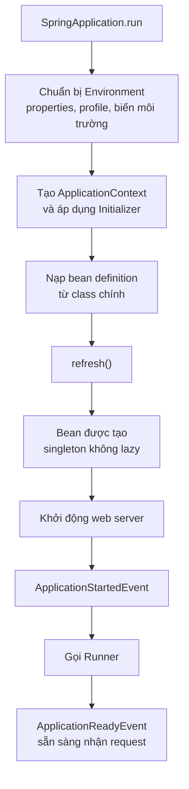
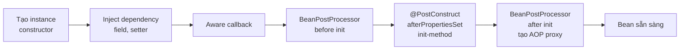
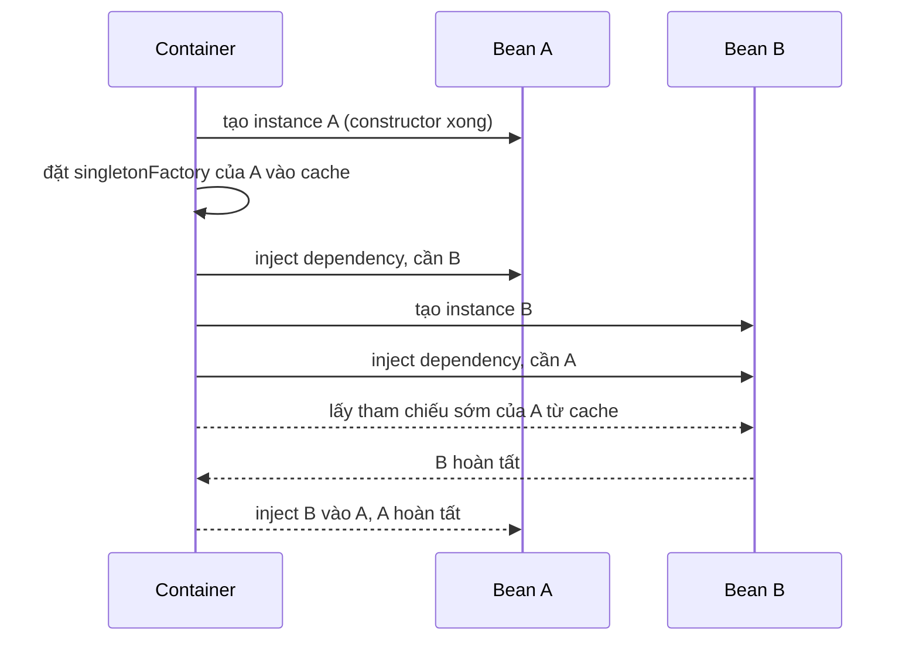

# Lý thuyết 30: Spring khởi động bên trong (SpringApplication và ApplicationContext)

Khi bạn gọi `SpringApplication.run()` trong `main`, có cả một chuỗi bước diễn ra trước khi ứng dụng nhận request đầu tiên: chuẩn bị môi trường, tạo `ApplicationContext`, gọi `refresh()`, tạo bean, khởi động web server, chạy runner. Bài này đi qua chuỗi đó theo thứ tự thực tế.

**Cốt lõi:** Spring không tạo object ngay mà đọc hết bản mô tả bean trước, rồi mới tạo object và áp proxy cùng việc inject lên từng cái. Biết lỗi nằm ở pha mô tả hay pha tạo object là gỡ được hầu hết sự cố khởi động.

- Vì dependency chỉ biết được từ metadata nên mọi `BeanDefinition` được đọc xong trước khi tạo object đầu tiên.
- Vì proxy và `@Autowired` áp lên object vừa tạo nên chúng thuộc `BeanPostProcessor`, và proxy chưa có trong `@PostConstruct`.
- Vì cần một instance đã tạo để lộ ra sớm nên chỉ vòng singleton qua field hoặc setter mới được cứu.


Mô hình tư duy: khởi động đi từ config, tới bản mô tả, tới object thật, rồi mới nhận request.

**Tóm tắt:**

- `SpringApplication.run()` đi qua ba lớp: chuẩn bị Environment và phát event, `refresh()` của container, rồi khởi động web server và chạy runner.
- Spring tách hai pha: pha một chỉ làm việc với `BeanDefinition` (metadata), pha hai mới tạo object và inject dependency.
- `BeanFactoryPostProcessor` sửa metadata trước khi có bean nào; `BeanPostProcessor` xử lý từng object vừa tạo (proxy, `@Autowired`, `@PostConstruct`).
- `finishBeanFactoryInitialization` tạo mọi singleton không lazy, nên đây là nơi lỗi bean xuất hiện nhiều nhất.
- Proxy AOP và `@Transactional` được tạo ở bước `after init`, nên trong `@PostConstruct` của chính bean đó chúng chưa có hiệu lực.
- Circular dependency chỉ cứu được với singleton inject qua field hoặc setter nhờ cache ba tầng; vòng qua constructor ném `BeanCurrentlyInCreationException` và Boot 2.6 trở lên cấm vòng mặc định.
- Code cần mọi bean sẵn sàng đặt ở runner hoặc `ApplicationReadyEvent`, không đặt ở constructor.
- Muốn khởi động nhanh có Spring AOT, native image, AppCDS, CRaC, mỗi cách có đánh đổi riêng.

## Vấn đề nó giải quyết

"Spring Boot khởi động thế nào" là câu hỏi mà phỏng vấn senior gần như luôn có, nhưng lý do thực tế quan trọng hơn: khi bean không được tạo, thứ tự khởi tạo sai, ứng dụng khởi động chậm hoặc báo circular dependency, bạn chỉ gỡ lỗi được nếu biết lỗi xảy ra ở giai đoạn nào. Giống như sửa một dây chuyền lắp ráp: phải biết trạm nào đang làm gì thì mới biết trạm nào hỏng.

## Khi nào cần kiến thức này

Khi chẩn đoán lỗi khởi động, tối ưu thời gian khởi động, viết starter hoặc auto-configuration, hoặc đặt code vào đúng thời điểm (`@PostConstruct`, `ApplicationRunner`, event). Nếu chỉ viết controller và service thông thường, bạn có thể không đụng đến tầng này hằng ngày, nhưng gặp sự cố thì đây là nơi tìm nguyên nhân. Nhớ ba lớp: (1) `SpringApplication` chuẩn bị và phát event, (2) `refresh()` của container nạp bean definition rồi tạo singleton, (3) Boot khởi động web server và chạy runner.

## Các khái niệm cần biết

- **ApplicationContext (container)**: object giữ toàn bộ bean của ứng dụng và biết cách tạo, nối chúng với nhau. Nó mở rộng `BeanFactory` bằng event, resource, environment.
- **BeanDefinition**: bản mô tả một bean ("class nào, scope gì, dependency gì") chứ chưa phải object. Spring nạp hết các bản mô tả trước, rồi mới tạo object.
- **Environment**: nơi gộp mọi nguồn config (đối số dòng lệnh, biến môi trường, file properties) và biết profile nào đang bật.
- **ApplicationContextInitializer**: hook chạy trước khi context nạp bean, dùng để chỉnh context từ sớm.
- **BeanFactoryPostProcessor**: hook sửa hoặc thêm **bản mô tả bean** trước khi có object nào. **BeanPostProcessor**: hook xử lý **object bean** vừa tạo (bọc proxy, inject `@Autowired`). Phần dưới có ví dụ.
- **Aware callback**: interface (`BeanNameAware`, `ApplicationContextAware`) để bean nhận thông tin từ container như tên của chính nó.
- **Runner**: `ApplicationRunner` / `CommandLineRunner`, code chạy một lần ngay sau khi context sẵn sàng.
- **Singleton / prototype / lazy**: singleton chỉ tạo một object dùng chung; prototype tạo mới mỗi lần xin; lazy là trì hoãn việc tạo đến khi dùng lần đầu.

## Bức tranh tổng thể

Dưới đây là toàn bộ chuỗi từ `run()` đến khi sẵn sàng nhận request.



Đọc sơ đồ: bốn nút đầu là chuẩn bị, `refresh()` là nơi mọi bean sinh ra, và chỉ sau khi nó xong cùng web server mở port thì runner mới chạy. Vì thế nếu code của bạn cần "mọi bean đã sẵn sàng", đặt nó ở runner chứ không phải constructor.

## Giai đoạn 1: SpringApplication

1. **Khởi tạo `SpringApplication`:** suy ra loại ứng dụng (servlet, reactive, hay không web) từ classpath; nạp `ApplicationContextInitializer` và `ApplicationListener` từ `META-INF/spring.factories`.
2. **Chạy `run()`:** phát `ApplicationStartingEvent`, rồi chuẩn bị `Environment`.
3. **Environment:** gộp nhiều nguồn property theo thứ tự ưu tiên (đối số dòng lệnh, biến môi trường, `application-{profile}.properties`, `application.properties`...). Phát `ApplicationEnvironmentPreparedEvent`.
4. **Tạo context:** chọn class phù hợp, ví dụ `AnnotationConfigServletWebServerApplicationContext` cho ứng dụng servlet.
5. **Chuẩn bị context:** áp dụng initializer, đăng ký class chính làm nguồn bean definition đầu tiên.

## Giai đoạn 2: `AbstractApplicationContext.refresh()`

Đây là trái tim của Spring: mọi `ApplicationContext` đều chạy qua hàm này để biến "bản mô tả" thành "bean thật". Các bước chính theo thứ tự:

| Bước | Việc làm | Điều cần nhớ |
|---|---|---|
| `prepareBeanFactory` | Cấu hình `BeanFactory` mặc định | Đăng ký các bean hạ tầng |
| `invokeBeanFactoryPostProcessors` | Chạy `BeanFactoryPostProcessor`; quan trọng nhất là `ConfigurationClassPostProcessor` | Xử lý `@Configuration`, `@ComponentScan`, `@Import`, `@Bean`, nạp auto-configuration |
| `registerBeanPostProcessors` | Tạo và đăng ký `BeanPostProcessor` | Chưa có bean nghiệp vụ nào được tạo |
| `onRefresh` | Với web, tạo web server (Tomcat) | Mới tạo, chưa nhận request |
| `finishBeanFactoryInitialization` | **Tạo tất cả singleton không lazy** | Nơi lỗi bean xuất hiện nhiều nhất |
| `finishRefresh` | Khởi động lifecycle bean, phát `ContextRefreshedEvent`, khởi động web server | Sau bước này port HTTP mới mở |

**Nền tảng:** Spring tách làm hai pha: pha một chỉ làm việc với bản mô tả (`BeanDefinition`, nơi `@Configuration`, `@ComponentScan` và auto-configuration được xử lý), pha hai mới tạo object và inject dependency. Vì tách như vậy nên `BeanFactoryPostProcessor` (sửa metadata) chạy trước, còn `BeanPostProcessor` (bọc proxy, inject `@Autowired`) chạy cho từng object sau đó.

**Phải thuộc:** thứ tự trong `refresh()`: `prepareBeanFactory`, `invokeBeanFactoryPostProcessors`, `registerBeanPostProcessors`, `onRefresh` (tạo web server), `finishBeanFactoryInitialization` (tạo mọi singleton không lazy), `finishRefresh` (mở port). Sau đó `ApplicationStartedEvent`, runner, `ApplicationReadyEvent`.

Hai khái niệm dễ nhầm:

- `BeanFactoryPostProcessor` làm việc trên **định nghĩa bean** (metadata), chạy trước khi tạo bean.
- `BeanPostProcessor` làm việc trên **object bean** đã tạo, chạy cho từng bean. AOP proxy, `@Autowired`, `@PostConstruct` đều do các `BeanPostProcessor` thực hiện.

Ví dụ: `ConfigurationClassPostProcessor` là một `BeanFactoryPostProcessor`, nó đọc `@Bean`, `@ComponentScan` để **sinh thêm bản mô tả**. Còn `AutowiredAnnotationBeanPostProcessor` là một `BeanPostProcessor`, nó thấy `@Autowired` trên object vừa tạo thì **inject** dependency vào.

**Suy luận:** Vì một bean cần dependency, mà dependency của nó chỉ có thể xác định được từ metadata như `@Bean`, `@ComponentScan`, `@Import`, Spring buộc phải đọc xong toàn bộ `BeanDefinition` trước khi tạo object đầu tiên. Từ đó suy ra `BeanFactoryPostProcessor` chạy sớm nhất: nếu nó chạy sau khi object đã tạo thì mọi thay đổi metadata đều vô nghĩa. Ngược lại, proxy và `@Autowired` phải được áp lên chính object vừa tạo, nên chúng nằm ở `BeanPostProcessor`, chạy lần lượt cho từng bean. Hệ quả của việc proxy được bọc ở bước `after init` là trong `@PostConstruct` của chính bean, bạn vẫn đang cầm object gốc chưa bị bọc, nên gọi method `@Transactional` ở đó sẽ không mở transaction. Điểm dễ nhầm là nghĩ rằng `@PostConstruct` chạy khi bean đã hoàn chỉnh, trong khi nó chỉ là một bước giữa chuỗi và AOP chưa vào cuộc. Khi cần code chạy lúc mọi thứ đã sẵn sàng, đặt ở `ApplicationRunner` hoặc `ApplicationReadyEvent`, và bean nào định phụ thuộc vào proxy thì không dựa vào `@PostConstruct`.

## Lifecycle tạo một bean

Mỗi singleton đi qua chuỗi bước sau khi `finishBeanFactoryInitialization` tạo nó:



Điểm hay hỏi: proxy AOP và `@Transactional` được tạo ở bước `after init`, nên bên trong `@PostConstruct` của chính bean đó, các advice **chưa có hiệu lực**. Ví dụ gọi một method `@Transactional` ngay trong `@PostConstruct` sẽ không có transaction.

## Circular dependency và cache ba tầng

Spring giải quyết circular dependency giữa các singleton khi inject qua field/setter bằng ba map:

| Map | Chứa |
|---|---|
| `singletonObjects` | Bean đã hoàn chỉnh |
| `earlySingletonObjects` | Bean mới tạo, chưa hoàn tất, đã bị tham chiếu sớm |
| `singletonFactories` | Factory có thể tạo tham chiếu sớm (kể cả proxy) |

Vấn đề đặt ra: A cần B, B cần A. Cách giải quyết là A được tạo xong phần "khung" (chưa inject dependency), Spring để lộ một tham chiếu sớm tới A, B nhận tham chiếu đó, B hoàn tất, rồi A mới hoàn tất.



Đọc sơ đồ: chính vì cần một instance "đã tạo xong constructor" để lộ ra sớm, cách này chỉ chạy được với inject qua field/setter.

Hệ quả:

- Vòng qua **constructor** không giải quyết được (không có instance để lộ sớm) và ném `BeanCurrentlyInCreationException`.
- Từ Spring Boot 2.6, circular dependency **bị cấm mặc định**. Cách sửa đúng là sửa thiết kế (tách class thứ ba, dùng event), không bật `spring.main.allow-circular-references`.

**Phải thuộc:** cache ba tầng gồm `singletonObjects` (hoàn chỉnh), `earlySingletonObjects` (tham chiếu sớm), `singletonFactories` (factory tạo tham chiếu sớm). Chỉ cứu được vòng singleton qua field/setter; vòng qua constructor ném `BeanCurrentlyInCreationException`; Boot 2.6 trở lên cấm vòng mặc định.

## Sau `refresh()`

1. `ApplicationStartedEvent`.
2. Gọi `ApplicationRunner` và `CommandLineRunner` (theo `@Order`).
3. `ApplicationReadyEvent`: ứng dụng sẵn sàng. Health "readiness" chuyển sang `ACCEPTING_TRAFFIC` ở đây.

Chọn chỗ đặt code khởi tạo:

| Cần làm | Đặt ở |
|---|---|
| Khởi tạo nội bộ một bean | `@PostConstruct` |
| Nạp dữ liệu sau khi mọi bean sẵn sàng | `ApplicationRunner` hoặc `ApplicationReadyEvent` |
| Phản ứng với thay đổi context | `ApplicationListener` / `@EventListener` |

## Từ khởi động đến request

Request đi qua Tomcat (connector, thread pool), Filter chain, rồi `DispatcherServlet.doDispatch`:

1. `HandlerMapping` tìm controller method.
2. `HandlerInterceptor.preHandle`.
3. `HandlerAdapter` giải quyết đối số (`HttpMessageConverter` đọc JSON), gọi method.
4. Kết quả được ghi ra bằng `HttpMessageConverter`.
5. `postHandle`, `afterCompletion`.

Chi tiết xem [Lý thuyết 15: Spring MVC bên trong, Filter và Interceptor](/go?p=01-Spring-Boot%2Fmedium%2Flt-15-mvc-internals.md).

## Gỡ lỗi và tối ưu khởi động

| Vấn đề | Cách xử lý |
|---|---|
| Không rõ auto-configuration nào bật/tắt | Chạy với `--debug` để xem condition evaluation report |
| Khởi động chậm | Bật `BufferingApplicationStartup` và xem endpoint `/actuator/startup` để biết bean nào tốn thời gian |
| Quá nhiều bean không cần | Thu hẹp `@ComponentScan`, loại auto-configuration không dùng bằng `exclude` |
| Muốn trì hoãn tạo bean | `spring.main.lazy-initialization=true`, đổi lấy lỗi chỉ lộ ra khi dùng lần đầu |
| Khởi động cực nhanh (serverless, scale to zero) | Spring AOT, GraalVM native image, CRaC; đánh đổi là thời gian build và hạn chế reflection |

## Khởi động nhanh: AOT, native image, AppCDS, CRaC

Khởi động chậm có hai nguồn: JVM nạp và biên dịch class (warm-up dần), và Spring quét, đọc condition, tạo proxy lúc chạy. Bốn kỹ thuật dưới đây đánh vào hai nguồn đó ở mức khác nhau. Chỉ dùng khi có lý do rõ (serverless, scale to zero, pod tăng giảm liên tục); ứng dụng chạy lâu trên máy chủ thường không cần.

| Kỹ thuật | Làm gì | Đánh đổi |
|---|---|---|
| **Spring AOT** | Lúc build, Spring chạy trước phần việc khởi tạo (đọc `@Conditional`, sinh code tạo bean) thay vì đợi lúc chạy | Điều kiện và profile bị "đóng băng" theo lúc build |
| **GraalVM native image** | Biên dịch toàn bộ thành file thực thi, khởi động cỡ mili giây, ít RAM | Build lâu, mất reflection/proxy động nếu không khai báo, đỉnh throughput thường thấp hơn JIT |
| **AppCDS** | Lưu sẵn class đã nạp vào một file archive để JVM nạp nhanh hơn | Vẫn là JVM, giảm một phần thời gian; archive phải khớp JDK và jar |
| **CRaC** | Chụp ảnh (checkpoint) process đã khởi động xong rồi khôi phục (restore) | Cần JDK có hỗ trợ CRaC, Linux; kết nối mở phải đóng và mở lại quanh checkpoint |

Với AOT, Spring sinh code và gợi ý (hint) trong lúc build. Nếu bạn dùng reflection, tài nguyên hoặc serialization mà Spring không tự thấy, native image sẽ lỗi lúc chạy. Cách khai báo là `RuntimeHints`.

_Minh họa_ (cần Spring Boot 3.x):

```java
@Configuration
@ImportRuntimeHints(PluginHints.class)
class PluginConfig { }

class PluginHints implements RuntimeHintsRegistrar {
    @Override
    public void registerHints(RuntimeHints hints, ClassLoader classLoader) {
        hints.reflection().registerType(LegacyPlugin.class, MemberCategory.INVOKE_PUBLIC_CONSTRUCTORS);
        hints.resources().registerPattern("templates/*.txt");
    }
}
```

Với DTO chỉ được dùng qua Jackson, `@RegisterReflectionForBinding(OrderDto.class)` gọn hơn. Build native thường chạy `mvn -Pnative native:compile` hoặc `mvn -Pnative spring-boot:build-image`; kiểm tra lại theo phiên bản plugin. Hệ quả của việc điều kiện bị đóng băng: `@Profile` và `@ConditionalOnProperty` được quyết định lúc build, nên đổi profile lúc chạy không còn tác dụng như trước.

AppCDS và CRaC không đổi code, chỉ đổi cách chạy. Quy trình AppCDS từ Boot 3.3 là giải nén jar bằng `-Djarmode=tools`, chạy một lần với `-XX:ArchiveClassesAtExit=app.jsa` để tạo archive, rồi chạy thật với `-XX:SharedArchiveFile=app.jsa`. CRaC bật bằng `spring.context.checkpoint=onRefresh` (chụp ảnh ngay sau `refresh()`) cùng cờ `-XX:CRaCCheckpointTo` và `-XX:CRaCRestoreFrom`. Tên cờ và lệnh thay đổi giữa các bản, kiểm tra lại theo phiên bản Boot và JDK bạn dùng.

## Bẫy thường gặp

- Inject `prototype` bean vào `singleton` thì chỉ inject một lần. Dùng `ObjectProvider` hoặc `@Lookup`.
- Bean `@Configuration` nhưng bị proxy CGLIB; method `@Bean` gọi nhau trả về cùng singleton, trừ khi dùng `proxyBeanMethods = false`.
- `@Value` và `@ConfigurationProperties` cần property sẵn sàng: nếu ghi đè bằng biến môi trường, tên theo quy tắc relaxed binding (`MY_APP_NAME` ứng với `my.app.name`).
- Làm việc nặng hoặc gọi mạng trong `@PostConstruct` làm khởi động chậm và dễ lỗi khi dependency chưa sẵn sàng.

## Phỏng vấn khó: chuỗi hỏi xoáy

Người phỏng vấn senior thường mở bằng câu dễ rồi xoáy xuống cơ chế, đánh đổi và sự cố thật. Câu trả lời tốt luôn đi từ cốt lõi xuống: đọc bản mô tả trước, tạo object sau, và biết lỗi nằm ở pha nào.

### Chuỗi 1: Proxy, vòng đời và tham chiếu sớm

1. **Câu mở:** Kể vòng đời một singleton từ constructor đến lúc sẵn sàng, và proxy AOP được tạo ở bước nào?
2. **Xoáy 1:** A và B phụ thuộc vòng tròn qua field, và A có `@Transactional`. B nhận A thật hay proxy?
3. **Xoáy 2:** Chuyển sang constructor injection, hoặc chạy Boot 2.6 trở lên thì sao, và sửa thế nào?

**Đáp án ngắn:** Vòng đời: tạo instance bằng constructor, inject field và setter, aware callback, `BeanPostProcessor` before init, `@PostConstruct` cùng `afterPropertiesSet` và init-method, rồi `BeanPostProcessor` after init, nơi tạo proxy AOP. Vòng tròn qua field được cứu nhờ cache ba tầng: A tạo xong instance thì đặt factory tham chiếu sớm vào `singletonFactories`; B lấy tham chiếu sớm đó, hoàn tất, rồi A hoàn tất. Bài ghi factory này có thể tạo tham chiếu sớm kể cả proxy, vì nếu B giữ bean gốc chưa bọc thì advice của A bị bỏ qua; cơ chế chi tiết kiểm tra lại theo phiên bản Spring. Với constructor, A chỉ có instance sau khi B có sẵn mà B cần A, nên không có gì để lộ sớm và Spring ném `BeanCurrentlyInCreationException`. Từ Boot 2.6 vòng còn bị cấm mặc định; cách đúng là sửa thiết kế, tách class thứ ba hoặc dùng event, không bật `spring.main.allow-circular-references`.

**Sai lầm hay gặp:**
- Nói cache ba tầng cứu mọi vòng phụ thuộc.
- Không biết tham chiếu sớm liên quan đến proxy.
- Bật `allow-circular-references` để "cho chạy".

### Chuỗi 2: Đặt code đúng pha

1. **Câu mở:** Cần nạp dữ liệu hoặc gọi một API lúc khởi động. Bạn đặt code ở đâu?
2. **Xoáy 1:** Một bean ném lỗi lúc tạo singleton. Port HTTP đã mở chưa, và readiness ở trạng thái nào?
3. **Xoáy 2:** Bật `spring.main.lazy-initialization=true` để khởi động nhanh thì đổi lại gì?

**Đáp án ngắn:** Khởi tạo nội bộ một bean thì dùng `@PostConstruct`; nạp dữ liệu cần mọi bean sẵn sàng thì dùng `ApplicationRunner` hoặc `ApplicationReadyEvent`. Gọi mạng hay làm việc nặng trong `@PostConstruct` làm khởi động chậm và dễ lỗi khi dependency chưa sẵn sàng. Web server được tạo ở `onRefresh` nhưng port chỉ mở ở `finishRefresh`, sau khi `finishBeanFactoryInitialization` đã tạo xong mọi singleton. Vậy bean lỗi thì ứng dụng thất bại trước khi mở port, không request nào vào. Sau đó là `ApplicationStartedEvent`, runner, và readiness chuyển sang `ACCEPTING_TRAFFIC` ở `ApplicationReadyEvent`, nên runner chạy lâu kéo dài khoảng chưa sẵn sàng nhận tải. Lazy initialization trì hoãn việc tạo bean tới lần dùng đầu, đổi lại lỗi chỉ lộ khi có người dùng, có thể ngay ở request đầu tiên. Để gỡ lỗi: chạy với `--debug`, đo bằng `/actuator/startup`.

**Sai lầm hay gặp:**
- Đặt code cần mọi bean ở constructor.
- Nghĩ port mở ngay khi `run()` bắt đầu.
- Bật lazy để che chậm mà không đo bean nào chậm.

### Chuỗi 3: Khởi động nhanh và cái giá

1. **Câu mở:** Khi nào đáng dùng Spring AOT, native image, AppCDS hay CRaC?
2. **Xoáy 1:** AOT làm gì lúc build, và hệ quả với `@Profile` hoặc `@ConditionalOnProperty` là gì?
3. **Xoáy 2:** Native image chạy lỗi vì reflection, sửa thế nào? AppCDS khác CRaC ở đâu?

**Đáp án ngắn:** Chỉ khi có lý do rõ như serverless, scale to zero hay pod tăng giảm liên tục; ứng dụng chạy lâu thường không cần. Khởi động chậm có hai nguồn: JVM nạp và biên dịch class, và Spring quét, đọc condition, tạo proxy lúc chạy. AOT chạy trước phần khởi tạo ngay lúc build, sinh code tạo bean thay vì đợi lúc chạy; đổi lại điều kiện bị đóng băng theo lúc build, nên đổi profile lúc chạy không còn tác dụng như trước. Native image khởi động cỡ mili giây và ít RAM, nhưng build lâu, mất reflection hay proxy động nếu không khai báo, và đỉnh throughput thường thấp hơn JIT. Khai báo bằng `RuntimeHints` hoặc `@RegisterReflectionForBinding`. AppCDS lưu sẵn class đã nạp trong archive, vẫn là JVM, giảm một phần thời gian, archive phải khớp JDK và jar. CRaC chụp checkpoint process đã khởi động xong rồi restore, cần JDK hỗ trợ và Linux, kết nối mở phải đóng và mở lại. Tên cờ thay đổi theo phiên bản, kiểm tra lại.

**Sai lầm hay gặp:**
- Dùng native image cho mọi ứng dụng.
- Quên rằng condition bị đóng băng lúc build.
- Gộp AppCDS và CRaC làm một.

## Câu hỏi phỏng vấn thường gặp

1. Mình gọi `SpringApplication.run` trong `main`, rồi vài giây sau ứng dụng nhận được request đầu tiên. Ở giữa chuyện gì đã xảy ra, theo thứ tự nào?

   **Phải thuộc:** Câu này là câu cốt lõi, gặp rất thường xuyên.

   **Gợi ý suy luận:**
   - Trước khi tạo bất kỳ bean nào, Spring cần biết gì (config, profile)? Thông tin đó nằm ở đâu?
   - "Bản mô tả bean" và "object bean" cái nào có trước? Bước nào của `refresh()` làm việc đó?
   - Web server mở port khi bean đã đủ hay chưa? Code cần "mọi bean đã sẵn sàng" nên đặt ở đâu?

   **Lập luận:** bean cần config để quyết định tạo hay không, nên `Environment` được chuẩn bị trước. Có config rồi mới tạo `ApplicationContext` và nạp các bean definition (nguồn đầu tiên là class chính). `refresh()` chạy hậu xử lý bean definition, đăng ký `BeanPostProcessor`, rồi tạo mọi singleton không lazy. Chỉ khi các bean đã sẵn, web server mới mở port ở `finishRefresh`, và sau đó runner chạy. Cuối cùng `ApplicationReadyEvent` báo sẵn sàng nhận request.

   **Đáp án ngắn:** chuẩn bị Environment, tạo context và nạp bean definition, `refresh()` tạo singleton, mở web server, gọi runner, phát `ApplicationReadyEvent`; từ đó request đi qua Tomcat, Filter, `DispatcherServlet`.

   **Nhớ:** ba lớp: `SpringApplication` chuẩn bị, `refresh()` tạo bean, Boot mở server và chạy runner. Xem sơ đồ "Bức tranh tổng thể" ở trên.

2. Một hook cần thêm bean mới từ `@Bean`, một hook khác cần bọc bean bằng proxy. Hai hook đó là `BeanFactoryPostProcessor` hay `BeanPostProcessor`, và phân biệt thế nào?

   **Phải thuộc:** Câu này là câu cốt lõi, gặp rất thường xuyên.

   **Gợi ý suy luận:**
   - Việc "thêm bean" có thể làm khi chưa có object nào không? Vậy nó tác động lên metadata hay lên object?
   - Việc "bọc proxy" cần có gì trong tay trước khi làm?

   **Lập luận:** sinh thêm bean chỉ cần bản mô tả, nên phải làm trước khi tạo object: đó là `BeanFactoryPostProcessor` (ví dụ `ConfigurationClassPostProcessor` đọc `@Bean`, `@ComponentScan`). Bọc proxy hoặc inject `@Autowired` cần object đã được tạo, nên chạy theo từng bean: đó là `BeanPostProcessor` (ví dụ `AutowiredAnnotationBeanPostProcessor`). Thứ tự trong `refresh()` cũng phản ánh điều này: hậu xử lý bean factory chạy trước, đăng ký `BeanPostProcessor` sau, và tạo singleton sau cùng.

   **Đáp án ngắn:** `BeanFactoryPostProcessor` sửa hoặc thêm bean definition trước khi có object; `BeanPostProcessor` xử lý từng object bean vừa tạo.

   **Nhớ:** metadata thì factory post-processor, object thì bean post-processor.

3. Mình gọi method `@Transactional` ngay trong `@PostConstruct` của cùng bean, nhưng không thấy transaction. Vì sao?

   **Gợi ý suy luận:**
   - `@Transactional` hoạt động nhờ cái gì bọc ngoài bean (proxy)? Proxy đó được tạo ở bước nào của lifecycle bean?
   - `@PostConstruct` chạy ở bước nào so với bước đó? Lúc đó `this` là bean thật hay proxy?

   **Lập luận:** transaction chỉ có khi lời gọi đi qua proxy. Proxy AOP được tạo ở `BeanPostProcessor after init`, tức là sau `@PostConstruct`. Khi `@PostConstruct` chạy, proxy chưa tồn tại, và `this` là bean thật, nên advice chưa có hiệu lực. Vì vậy gọi method `@Transactional` ở đó không mở transaction nào.

   **Đáp án ngắn:** vì proxy được tạo sau `@PostConstruct` (ở after-init), nên lúc đó chưa có advice. Dùng `ApplicationReadyEvent` hoặc runner.

   **Nhớ:** thứ tự lifecycle bean: constructor, inject dependency, aware, before init, `@PostConstruct`, after init (proxy).

4. Bean A và B phụ thuộc lẫn nhau: vì sao inject qua field chạy được mà qua constructor thì báo `BeanCurrentlyInCreationException`?

   **Gợi ý suy luận:**
   - Muốn B nhận được A khi A chưa xong, Spring phải có sẵn thứ gì của A?
   - Khi inject bằng constructor, instance của A có tồn tại trước khi B được tạo không?
   - Ba map `singletonObjects`, `earlySingletonObjects`, `singletonFactories` đóng vai trò gì?

   **Lập luận:** để phá vòng, Spring tạo instance A (constructor xong), đặt factory tham chiếu sớm của A vào cache, rồi mới inject dependency, nên B nhận được A dở dang, hoàn tất, rồi A hoàn tất. Cách này cần một instance đã có trước khi inject. Với constructor injection, A chỉ có instance sau khi B có sẵn, mà B cần A: không có gì để lộ sớm, nên Spring ném `BeanCurrentlyInCreationException`. Từ Spring Boot 2.6 circular dependency còn bị cấm mặc định, cách sửa đúng là sửa thiết kế.

   **Đáp án ngắn:** Spring dùng cache ba tầng để lộ tham chiếu sớm của bean đã tạo instance; constructor injection không có instance để lộ nên không giải quyết được.

   **Nhớ:** cache ba tầng chỉ cứu được vòng qua field/setter.

5. Một auto-configuration của starter tự động bật dù mình không khai báo gì. Nó được nạp lúc nào và theo cơ chế gì? (Xem [Lý thuyết 14: Auto-configuration và @Conditional](/go?p=01-Spring-Boot%2Fmedium%2Flt-14-autoconfiguration.md).)

   **Gợi ý suy luận:**
   - Auto-configuration là các class `@Configuration`. Bước nào trong `refresh()` xử lý `@Configuration` và `@Import`?
   - Lấy danh sách các class đó từ đâu, và điều kiện nào quyết định có bật hay không?

   **Lập luận:** class config chỉ trở thành bean definition khi `ConfigurationClassPostProcessor` xử lý nó, nên auto-configuration được nạp ở giai đoạn `invokeBeanFactoryPostProcessors`, trước khi tạo bất kỳ bean nào. Danh sách class được nhập qua cơ chế import của `@EnableAutoConfiguration`, rồi từng class lọc theo các điều kiện (`@Conditional...`) để quyết định bật hay không. Chạy với `--debug` sẽ in condition evaluation report để xem lý do.

   **Đáp án ngắn:** trong bước `invokeBeanFactoryPostProcessors` của `refresh()`, qua `@EnableAutoConfiguration` import danh sách class, mỗi class lọc bằng các điều kiện.

   **Nhớ:** nạp auto-configuration là việc của `ConfigurationClassPostProcessor`, trước khi tạo bean.

6. Ứng dụng khởi động mất 40 giây. Bạn làm gì để giảm?

   **Gợi ý suy luận:**
   - Trước khi tối ưu, đo cái gì để biết bean nào tốn thời gian?
   - Thời gian khởi động tỷ lệ với số bean tạo và việc làm trong lúc tạo: giảm cả hai bằng cách nào?
   - Trì hoãn tạo bean đổi lấy điều gì?

   **Lập luận:** không đo thì tối ưu mù, nên bật `BufferingApplicationStartup` và xem `/actuator/startup`. Khi biết bean nào chậm, thu hẹp `@ComponentScan`, loại auto-configuration không dùng bằng `exclude`, bỏ việc nặng khỏi `@PostConstruct`. Có thể bật `spring.main.lazy-initialization=true`, nhưng lỗi bean sẽ chỉ lộ ở lần dùng đầu. Khi cần cực nhanh thì AOT, native image, CRaC, đổi lại thời gian build và hạn chế reflection.

   **Đáp án ngắn:** đo bằng `/actuator/startup`, giảm số bean và việc nặng lúc khởi tạo, cân nhắc lazy initialization, và dùng AOT hoặc native image nếu cần cực nhanh.

   **Nhớ:** đo trước, rồi mới giảm bean, trì hoãn hoặc đổi công nghệ.

