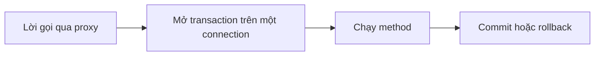
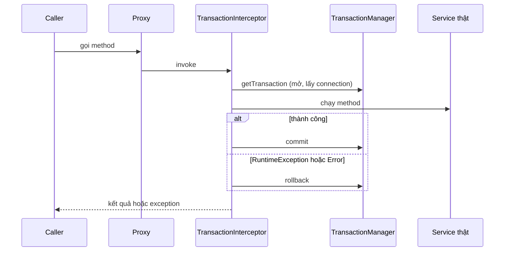
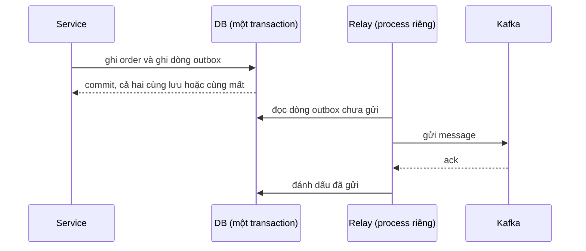
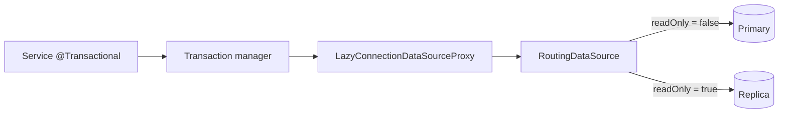

# Lý thuyết 31: Transaction chuyên sâu

Bài này đào sâu bài [Lý thuyết 5: Transaction](/go?p=01-Spring-Boot%2Fmedium%2Flt-05-transaction.md). Đọc bài đó trước.

Bài này chỉ đi vào phần nâng cao: Spring quản lý transaction qua proxy ra sao, rollback-only, giữ transaction ngắn, dual write với message, định tuyến đọc ghi và `open-in-view`. Bảy kiểu propagation, self-invocation và các chỗ `@Transactional` không chạy nằm ở bài [Lý thuyết 5: Transaction](/go?p=01-Spring-Boot%2Fmedium%2Flt-05-transaction.md).

**Cốt lõi:** `@Transactional` không phải phép màu mà là một proxy mở một connection và gắn nó vào thread hiện tại, rồi commit hoặc rollback khi method kết thúc. Hiểu mô hình "một proxy, một thread, một connection" thì suy ra được self-invocation, `@Async`, cạn pool, rollback-only và dual write.

- Vì state transaction nằm trong `ThreadLocal` của thread hiện tại nên chỉ lời gọi qua proxy và cùng thread mới thuộc transaction.
- Vì `REQUIRED` chỉ có một transaction vật lý nên lỗi ở method con đặt cờ rollback-only một chiều, và cha bắt lỗi vẫn bị rollback.
- Vì DB và Kafka không chung transaction nên phải ghi ý định gửi vào DB cùng transaction (outbox) rồi gửi sau.



Mô hình tư duy: phạm vi transaction chính là khoảng từ lúc proxy mở đến lúc proxy đóng, trên một thread và một connection.

**Tóm tắt:**

- Transaction trong Spring là một connection lấy từ pool cộng một bộ đồng bộ gắn vào thread hiện tại qua `ThreadLocal`.
- Chỉ lời gọi đi qua proxy và trên cùng thread mới thuộc transaction; `this.method()`, `@Async`, `parallelStream` đều đứng ngoài.
- Mặc định chỉ `RuntimeException` và `Error` gây rollback, checked exception thì commit trừ khi khai báo `rollbackFor`.
- Method con `REQUIRED` ném lỗi qua proxy sẽ đặt cờ rollback-only một chiều, nên cha bắt lỗi vẫn nhận `UnexpectedRollbackException`.
- `REQUIRES_NEW` cần connection thứ hai, nên nhiều request đồng thời với pool nhỏ có thể làm cạn pool và treo hệ thống.
- Giữ transaction ngắn: không gọi HTTP chậm bên trong, vì connection và lock dòng bị giữ theo thời gian của API ngoài.
- DB và Kafka không chung transaction (dual write); transactional outbox ghi event cùng transaction rồi gửi sau, consumer phải idempotent.
- `readOnly` chỉ là gợi ý, `open-in-view` nên tắt, và test có `@Transactional` sẽ che lỗi chỉ lộ lúc commit thật.

## Vấn đề nó giải quyết

Lỗi transaction nguy hiểm vì thường **không báo lỗi** mà làm dữ liệu sai âm thầm: không rollback khi lẽ ra phải rollback, rollback ngoài ý muốn, giữ kết nối quá lâu làm cạn pool, hoặc gửi message ra ngoài mà dữ liệu thì không được lưu. Một người dùng `@Transactional` mà không hiểu cơ chế dưới nó sẽ tin rằng "có annotation là an toàn", và chính niềm tin đó tạo ra các lỗi khó tìm nhất.

## Khi nào cần hiểu sâu

Mọi nghiệp vụ ghi nhiều bước, nghiệp vụ gọi service khác, nghiệp vụ vừa ghi DB vừa gửi message hoặc gọi API ngoài. Ba điều cần nhớ xuyên suốt bài: transaction gắn với **thread** và **một connection**; ranh giới transaction đặt ở tầng service; và giữ transaction ngắn, không đưa I/O chậm vào trong.

## Các khái niệm cần biết

- **Transaction**: nhóm thao tác DB hoặc cùng thành công hoặc cùng bị hủy (commit hoặc rollback).
- **Proxy**: object "bọc" bean thật. Khi bạn gọi method, thực ra gọi proxy; proxy mở transaction rồi mới gọi bean thật. Đó là lý do gọi `this.method()` bỏ qua transaction.
- **Propagation**: quy định method này làm gì khi đã có sẵn transaction của method gọi nó: tham gia, tạo mới hay từ chối.
- **Rollback-only**: cờ đánh dấu transaction chắc chắn phải rollback; một khi đã đặt thì không gỡ được và lúc commit sẽ bị chuyển thành rollback.
- **Savepoint**: điểm lưu trong một transaction, cho phép hủy một phần mà giữ phần trước điểm đó (cơ chế của `NESTED`).
- **Dual write**: ghi vào hai hệ thống (DB và Kafka) trong một thao tác mà không có transaction chung, nên có thể lệch nhau.
- **Outbox**: kỹ thuật ghi event cần gửi vào một bảng cùng transaction với dữ liệu nghiệp vụ, rồi gửi sau (xem phần dual write).
- **Lazy loading**: dữ liệu relation chỉ được nạp khi truy cập, cần session còn mở.

## Cách hoạt động

Mỗi lần bạn gọi một method `@Transactional`, các bước sau diễn ra phía sau proxy.



Hệ quả cốt lõi:

- Transaction **gắn với thread** qua `TransactionSynchronizationManager` (dùng `ThreadLocal`). Code chạy ở thread khác (`@Async`, `CompletableFuture`, `parallelStream`) **không** nằm trong transaction đó.
- Một transaction dùng **một connection** từ pool cho đến khi kết thúc.
- Chỉ call đi **qua proxy** mới có transaction. Gọi `this.method()` thì không.

**Nền tảng:** transaction trong Spring là hai thứ gắn vào thread hiện tại: một connection lấy từ pool và một bộ synchronization (`TransactionSynchronizationManager`, `ThreadLocal`). `TransactionInterceptor` trong proxy mở nó trước khi gọi method và đóng sau đó. Hiểu mô hình này thì suy ra được self-invocation, `@Async`, cạn pool và rollback-only.

## Propagation

Bảng đủ bảy kiểu, sơ đồ audit log với `REQUIRES_NEW` và cảnh báo cạn pool nằm ở mục "Bảy kiểu propagation" của bài [Lý thuyết 5: Transaction](/go?p=01-Spring-Boot%2Fmedium%2Flt-05-transaction.md). Điều cần mang sang bài này: `REQUIRED` dùng chung một transaction nên lỗi ở method trong làm hỏng cả transaction ngoài (xem rollback-only ngay dưới), còn `REQUIRES_NEW` tạm dừng transaction ngoài và cần **một connection thứ hai**, nên nhiều request đồng thời với pool nhỏ có thể cạn pool và treo cả hệ thống.

## Quy tắc rollback

Mặc định Spring rollback với `RuntimeException` và `Error`, còn checked exception thì **commit**; muốn khác đi thì khai báo `rollbackFor = Exception.class`. Bắt exception rồi nuốt cũng khiến transaction commit như không có gì. Chi tiết và ví dụ ở bài [Lý thuyết 5: Transaction](/go?p=01-Spring-Boot%2Fmedium%2Flt-05-transaction.md); phần dưới là chỗ dễ vấp nhất, khi exception đã bị bắt mà transaction vẫn hỏng.

### Rollback-only và `UnexpectedRollbackException`

```java
@Service
class OrderService {
    private final PaymentService payment;

    @Transactional
    public void placeOrder(Order o) {
        try {
            payment.charge(o);        // REQUIRED, tham gia transaction ngoài
        } catch (PaymentException e) {
            // nuốt lỗi, tiếp tục
        }
        // ... ghi thêm dữ liệu ...
    }   // commit thất bại: UnexpectedRollbackException
}
```

`charge` ném runtime exception qua proxy nên **đánh dấu transaction chung là rollback-only**. Dù `placeOrder` bắt lỗi, lúc commit Spring phát hiện cờ này và ném `UnexpectedRollbackException`. Muốn "thử, lỗi thì bỏ qua mà không ảnh hưởng nghiệp vụ chính" thì phần thử phải chạy trong `REQUIRES_NEW` (hoặc `NESTED`).

**Phải thuộc:** method con `REQUIRED` ném runtime exception qua proxy thì đánh dấu transaction chung là rollback-only (một chiều, không gỡ được); cha bắt lỗi vẫn bị `UnexpectedRollbackException` lúc commit. `REQUIRES_NEW` cần connection thứ hai nên dễ cạn pool; `NESTED` dùng savepoint trong cùng transaction và phụ thuộc transaction manager (JDBC hỗ trợ, JPA/Hibernate thuần thường không).

**Suy luận:** Vì proxy chỉ thấy lời gọi đi qua nó, nên khi method con ném lỗi, chính `TransactionInterceptor` của method con là nơi quyết định rollback, chứ không phải method cha. Với `REQUIRED` chỉ có một transaction vật lý duy nhất, nên bên con không thể rollback riêng phần của mình mà chỉ có thể đánh dấu cả transaction là rollback-only. Cờ này phải một chiều, vì nếu cho gỡ thì một method khác có thể commit những thay đổi mà method con đã coi là hỏng, dẫn tới dữ liệu nửa vời. Do đó khi cha bắt exception và đi tiếp, đến lúc commit Spring thấy cờ, đổi commit thành rollback và ném `UnexpectedRollbackException` để báo rằng điều cha tưởng đã không xảy ra. Điểm dễ nhầm là nghĩ `try/catch` quanh lời gọi con đủ để cô lập lỗi, trong khi transaction không đi theo phạm vi của khối `try`. Khi thiết kế, nếu phần "thử" cần độc lập thì đặt nó vào `REQUIRES_NEW` (nhớ chi phí connection thứ hai) hoặc `NESTED` nếu transaction manager hỗ trợ savepoint.

## Những chỗ `@Transactional` không chạy

Self-invocation, method `private` (hoặc không `public` với Spring trước 6), class `final`, object tự `new`, thread khác, `@PostConstruct`: bảng đầy đủ kèm cách xử lý nằm ở bài [Lý thuyết 5: Transaction](/go?p=01-Spring-Boot%2Fmedium%2Flt-05-transaction.md), mục self-invocation. Điểm chung của tất cả là call không đi qua proxy hoặc không cùng thread.

## Giữ transaction ngắn

Transaction dài giữ connection, giữ lock dòng, làm tăng xung đột và cạn pool.

```java
// Không nên: gọi HTTP chậm bên trong transaction
@Transactional
public void checkout(Order o) {
    repo.save(o);
    gateway.charge(o);     // có thể mất 10 giây, connection DB bị giữ
}
```

Cách làm đúng: ghi trạng thái `PENDING` trong một transaction ngắn, gọi payment gateway **ngoài** transaction, rồi cập nhật kết quả trong transaction ngắn thứ hai.

## Transaction và message: dual write

```java
@Transactional
public void createOrder(Order o) {
    repo.save(o);
    kafka.send("orders", o);   // gửi xong nhưng transaction rollback => message ma
}
```

Hai tài nguyên (DB và Kafka) không cùng một transaction nên có hai kịch bản lỗi: message đã gửi mà DB rollback, hoặc DB commit mà gửi thất bại. Giải pháp:

1. **Transactional outbox:** ghi event vào bảng `outbox` **trong cùng transaction** với dữ liệu nghiệp vụ; một process riêng đọc bảng và gửi lên Kafka. Consumer phải idempotent (xử lý trùng không gây hại) vì có thể nhận trùng.



Đọc sơ đồ: vì order và outbox cùng một transaction, không có trường hợp "có message mà không có đơn" hoặc ngược lại. Nếu relay chết sau khi gửi mà trước khi đánh dấu, message sẽ được gửi lại, nên consumer cần chịu được trùng.

2. `@TransactionalEventListener(phase = AFTER_COMMIT)`: chỉ gửi sau khi commit thành công, nhưng nếu gửi lỗi thì mất event, nên dùng cho việc không quan trọng.

**Suy luận:** Vì DB và Kafka là hai tài nguyên với hai cơ chế commit riêng, không có điểm nào để cả hai cùng thành công hoặc cùng thất bại, nên gửi message trong thân method luôn để lại một trong hai kịch bản lệch. Outbox giải bằng cách đưa việc "ghi nhận ý định gửi" về chính transaction DB, vốn là thứ duy nhất ta có thể làm nguyên tử, và để một relay độc lập đưa ý định đó ra Kafka sau. Cái giá là relay có thể chết sau khi gửi mà trước khi đánh dấu, nên message bị gửi lại và hệ thống chỉ bảo đảm at-least-once, từ đó consumer buộc phải idempotent. Điểm dễ nhầm là thay bằng `@TransactionalEventListener(AFTER_COMMIT)` rồi tin rằng đã an toàn: nó loại được message ma nhưng nếu gửi lỗi sau commit thì mất event mà không ai biết. Khi review, hỏi sự kiện này có quan trọng không; nếu có thì dùng outbox và test idempotency của consumer.

Xem thêm [Lý thuyết 26: Khóa phân tán và Idempotency](/go?p=01-Spring-Boot%2Fhard%2Flt-26-distributed-lock-idempotency.md) và [Distributed Transactions](/go?p=15-System%20Design%2Fhard%2Flt-10-distributed-transactions.md).

## Isolation và `readOnly`

- `isolation` mặc định theo database; hiện tượng của từng mức ở [Transaction, Isolation và Khóa](/go?p=02-Database%2Fmedium%2Flt-04-transaction-isolation-lock.md).
- `readOnly = true` là **gợi ý**: với Hibernate, nó đặt chế độ flush thành `MANUAL` (bỏ dirty checking) và có thể điều hướng sang replica nếu bạn cấu hình routing datasource. Nó không ngăn ghi ở mọi database.
- `timeout` giới hạn thời gian transaction; hữu ích để chặn treo lock.

## Nhiều DataSource và định tuyến đọc ghi

Vấn đề: DB có một primary và một hoặc nhiều replica (xem [Replication, Partitioning, Sharding và High Availability](/go?p=02-Database%2Fhard%2Flt-05-replication-sharding-ha.md)), ta muốn các transaction chỉ đọc đi sang replica để giảm tải primary. Lưu ý trước khi làm: replica trễ nên đọc sau ghi có thể thấy dữ liệu cũ, và nếu chưa có áp lực tải đọc thì cách này chỉ thêm phức tạp.

Hai cách tổ chức khác nhau. Nếu là hai database độc lập (ví dụ dữ liệu nghiệp vụ và dữ liệu báo cáo), khai báo hai `DataSource`, hai `EntityManagerFactory`, hai transaction manager và gán `@Primary` cho một cặp; Boot không còn tự cấu hình một `DataSource` duy nhất. Nếu là cùng dữ liệu, chỉ khác node primary và replica, dùng một `DataSource` "định tuyến" chọn node theo từng transaction.



_Minh họa_. `AbstractRoutingDataSource` gọi `determineCurrentLookupKey()` mỗi lần lấy connection; ta trả key dựa trên cờ `readOnly` của transaction hiện tại.

```java
public class ReadWriteRoutingDataSource extends AbstractRoutingDataSource {
    @Override
    protected Object determineCurrentLookupKey() {
        return TransactionSynchronizationManager.isCurrentTransactionReadOnly() ? "replica" : "primary";
    }
}

@Configuration
class DataSourceConfig {
    @Bean @Primary
    DataSource dataSource(@Qualifier("primaryDs") DataSource primary, @Qualifier("replicaDs") DataSource replica) {
        var routing = new ReadWriteRoutingDataSource();
        routing.setTargetDataSources(Map.of("primary", primary, "replica", replica));
        routing.setDefaultTargetDataSource(primary);
        routing.afterPropertiesSet();
        // hoãn lấy connection tới khi có câu SQL đầu tiên
        return new LazyConnectionDataSourceProxy(routing);
    }
}

@Service
class BookService {
    @Transactional(readOnly = true)    // đi replica
    public List<Book> list() { return bookRepository.findAll(); }

    @Transactional                     // đi primary
    public void rename(long id, String title) { /* ... */ }
}
```

Điểm hay sai: nếu connection được lấy ngay lúc bắt đầu transaction, cờ `readOnly` có thể chưa được đặt khi `determineCurrentLookupKey()` chạy, nên mọi thứ rơi về primary. `LazyConnectionDataSourceProxy` hoãn việc lấy connection tới câu SQL đầu tiên để cờ kịp có mặt. Hành vi này phụ thuộc cấu hình JPA và phiên bản, kiểm tra lại bằng log xem connection nào được dùng.

Các bẫy khác: mỗi `DataSource` có pool Hikari riêng nên cộng dồn số connection; transaction đã `readOnly` mà gọi lồng sang method `@Transactional` ghi sẽ vẫn ở replica (tham gia transaction ngoài, theo `REQUIRED`) và ghi thất bại; đọc ngay sau khi ghi cần đi primary (để `readOnly = false` hoặc không dùng routing cho flow đó).

## Lazy loading và `open-in-view`

`spring.jpa.open-in-view=true` (mặc định của Boot) giữ session mở suốt request nên che `LazyInitializationException`, đổi lại là giữ connection lâu và sinh query ẩn ở tầng view. Khuyến nghị đặt `false` và tải dữ liệu cần thiết trong service; cách sửa lỗi lazy có "trước và sau" ở [Lý thuyết 16: JPA bên trong, Persistence Context](/go?p=01-Spring-Boot%2Fmedium%2Flt-16-jpa-internals.md).

## Kiểm thử

`@Transactional` trên test tự rollback nên **che** các lỗi chỉ lộ lúc commit thật (`REQUIRES_NEW`, `AFTER_COMMIT`, outbox): viết test không dùng nó và dọn dữ liệu thủ công. Lý do và ví dụ ở bài [Lý thuyết 5: Transaction](/go?p=01-Spring-Boot%2Fmedium%2Flt-05-transaction.md).

## Phỏng vấn khó: chuỗi hỏi xoáy

Người phỏng vấn senior thường mở bằng câu dễ rồi xoáy xuống cơ chế, đánh đổi và sự cố thật. Câu trả lời tốt luôn đi từ cốt lõi xuống: một proxy, một thread, một connection.

### Chuỗi 1: Transaction gắn với thread

1. **Câu mở:** Trong một method `@Transactional`, mình dùng `parallelStream` hoặc `@Async` để ghi DB. Phần đó có nằm trong cùng transaction không?
2. **Xoáy 1:** Spring biết "đang trong transaction" bằng cách nào, và một transaction dùng mấy connection?
3. **Xoáy 2:** Method chính rollback thì phần đã ghi ở thread khác ra sao?

**Đáp án ngắn:** Không. Transaction là hai thứ gắn vào thread hiện tại: một connection lấy từ pool và một bộ synchronization do `TransactionSynchronizationManager` giữ bằng `ThreadLocal`. `TransactionInterceptor` trong proxy mở nó trước khi gọi method và đóng sau đó. Thread khác không thấy `ThreadLocal` đó nên không nằm trong transaction ấy. Một transaction dùng đúng một connection cho đến khi kết thúc. Hệ quả là rollback ở method chính không thu hồi phần đã commit ở thread kia, vì chúng không cùng một transaction, nghĩa là mất tính nguyên tử. Mỗi thread muốn có transaction riêng còn lấy thêm một connection từ pool, dễ cạn pool. Nếu thật sự cần song song, chấp nhận mỗi phần một transaction riêng và thiết kế cho idempotent hoặc có bước bù. Cùng gốc với self-invocation: chỉ lời gọi qua proxy và cùng thread mới thuộc transaction.

**Sai lầm hay gặp:**
- Nghĩ `@Transactional` bao mọi thứ chạy "bên trong" method, kể cả thread khác.
- Không nhắc được `ThreadLocal` và connection.
- Bỏ qua chi phí connection khi song song hóa.

### Chuỗi 2: Định tuyến đọc ghi sang replica

1. **Câu mở:** Muốn các transaction chỉ đọc đi sang replica để giảm tải primary, thiết kế thế nào?
2. **Xoáy 1:** Vì sao cần `LazyConnectionDataSourceProxy`, và nếu thiếu thì mọi thứ rơi về đâu?
3. **Xoáy 2:** Method `readOnly` lại gọi lồng một method `@Transactional` ghi, hoặc đọc ngay sau khi ghi, thì sao?

**Đáp án ngắn:** Dùng một `DataSource` định tuyến kế thừa `AbstractRoutingDataSource`, hàm `determineCurrentLookupKey()` trả `replica` hoặc `primary` theo cờ `readOnly` của transaction hiện tại. Vấn đề là thứ tự: nếu connection được lấy ngay lúc bắt đầu transaction thì cờ `readOnly` có thể chưa được đặt khi hàm trên chạy, nên mọi thứ rơi về primary. `LazyConnectionDataSourceProxy` hoãn việc lấy connection tới câu SQL đầu tiên để cờ kịp có mặt. Hành vi này phụ thuộc cấu hình JPA và phiên bản, kiểm tra lại bằng log xem connection nào được dùng. Method `readOnly` gọi lồng method ghi sẽ tham gia transaction ngoài theo `REQUIRED`, vẫn ở replica nên ghi thất bại. Replica trễ nên đọc ngay sau ghi cần đi primary. Mỗi `DataSource` có pool Hikari riêng nên số connection cộng dồn. Nếu chưa có áp lực tải đọc thì cách này chỉ thêm phức tạp.

**Sai lầm hay gặp:**
- Tin `readOnly` là cơ chế bảo vệ mà không nhắc routing phụ thuộc cờ đó.
- Quên replica trễ khi đọc sau ghi.
- Quên pool riêng của từng `DataSource`.

### Chuỗi 3: Gửi event sau commit và kiểm thử

1. **Câu mở:** `@TransactionalEventListener(AFTER_COMMIT)` có thay được outbox không?
2. **Xoáy 1:** Relay của outbox chết sau khi gửi mà trước khi đánh dấu thì sao, và consumer cần tính chất gì?
3. **Xoáy 2:** Vì sao test gắn `@Transactional` có thể che các lỗi này?

**Đáp án ngắn:** Chỉ thay được với việc không quan trọng. `AFTER_COMMIT` loại được message ma vì chỉ gửi sau khi commit thành công, nhưng nếu gửi lỗi sau commit thì event mất mà không ai biết, vì nó không được lưu ở đâu. Outbox ghi event vào bảng trong cùng transaction với dữ liệu nghiệp vụ, nên hai thứ cùng lưu hoặc cùng mất; một relay riêng đọc bảng, gửi lên Kafka rồi đánh dấu đã gửi. Relay chết sau khi gửi mà trước khi đánh dấu thì message được gửi lại, nên chỉ có bảo đảm at-least-once và consumer buộc phải idempotent. Test gắn `@Transactional` tự rollback ở cuối test, nên các lỗi chỉ lộ lúc commit thật như `REQUIRES_NEW`, `AFTER_COMMIT` hay outbox không bao giờ xảy ra. Viết test không dùng nó và dọn dữ liệu thủ công. Khi review, hỏi sự kiện này có quan trọng không; nếu có thì dùng outbox và test idempotency của consumer.

**Sai lầm hay gặp:**
- Coi `AFTER_COMMIT` là an toàn tuyệt đối.
- Quên consumer phải chịu được trùng.
- Test flow event với `@Transactional` rồi tin kết quả xanh.

## Câu hỏi phỏng vấn thường gặp

1. Mình đặt `@Transactional` mà lúc có transaction, lúc không. Cơ chế nào đứng sau, và vì sao gọi `this.method()` trong cùng class thì không có tác dụng?

   **Phải thuộc:** Câu này là câu cốt lõi, gặp rất thường xuyên.

   **Gợi ý suy luận:**
   - Ai mở và đóng transaction: bean thật hay một object bọc ngoài (proxy)?
   - Khi một bean gọi method của chính nó, call đi qua object nào?
   - Transaction được gắn vào thread và connection bằng cơ chế nào?

   **Lập luận:** Spring bọc bean bằng proxy; proxy chạy `TransactionInterceptor` mở transaction, lấy connection, gọi bean thật rồi commit hoặc rollback. Mọi thứ phụ thuộc vào việc call đi qua proxy. `this.method()` gọi thẳng bean thật, bỏ qua proxy, nên không có transaction. State của transaction được lưu theo thread (`TransactionSynchronizationManager`, `ThreadLocal`), nên thread khác cũng không nằm trong transaction đó.

   **Đáp án ngắn:** `@Transactional` hoạt động qua proxy AOP; gọi nội bộ bỏ qua proxy nên không có transaction. Tách sang bean khác hoặc dùng `TransactionTemplate`.

   **Nhớ:** chỉ call đi qua proxy, trên cùng thread, mới thuộc transaction. Xem mục "Cách hoạt động".

2. Method audit log phải lưu dù nghiệp vụ chính lỗi. `REQUIRED` khác `REQUIRES_NEW` thế nào, và `REQUIRES_NEW` có rủi ro gì?

   **Gợi ý suy luận:**
   - Hai method dùng chung một transaction thì rollback của bên nào ảnh hưởng bên nào?
   - Nếu muốn transaction trong độc lập, thì cần mấy connection?
   - Chuyện gì xảy ra nếu nhiều request cùng giữ connection thứ nhất và chờ connection thứ hai?

   **Lập luận:** `REQUIRED` tham gia transaction đang có, nên lỗi bên trong làm hỏng cả transaction ngoài. Muốn log vẫn lưu khi nghiệp vụ rollback thì log phải commit độc lập: `REQUIRES_NEW` tạm dừng transaction ngoài và mở transaction mới trên connection thứ hai. Vì connection đầu vẫn bị giữ, nhiều request đồng thời với pool nhỏ sẽ cùng giữ connection thứ nhất và chờ thứ hai, dẫn tới cạn pool và treo hệ thống.

   **Đáp án ngắn:** `REQUIRED` dùng chung transaction; `REQUIRES_NEW` tạo transaction độc lập và tạm dừng bên ngoài. Rủi ro là cần connection thứ hai, dễ cạn pool.

   **Nhớ:** `REQUIRES_NEW` = hai connection cùng lúc.

3. Một method ném `IOException` (checked) trong `@Transactional`, dữ liệu vẫn được lưu. Vì sao, và đổi thế nào?

   **Gợi ý suy luận:**
   - Spring mặc định rollback với loại exception nào?
   - Muốn checked exception cũng rollback thì cấu hình ở đâu?

   **Lập luận:** mặc định Spring chỉ rollback với `RuntimeException` và `Error`; checked exception được coi là tình huống nghiệp vụ có thể xử lý, nên transaction vẫn commit. Muốn khác đi, khai báo `rollbackFor = Exception.class`. Tương tự, bắt rồi nuốt exception cũng làm transaction commit như không có gì.

   **Đáp án ngắn:** không, mặc định commit với checked exception; dùng `@Transactional(rollbackFor = Exception.class)` để rollback.

   **Nhớ:** mặc định rollback chỉ với unchecked exception và `Error`.

4. Mình đã `try/catch` lỗi từ method con nhưng cuối method vẫn nhận `UnexpectedRollbackException`. Chuyện gì xảy ra?

   **Phải thuộc:** Câu này là câu cốt lõi, gặp rất thường xuyên.

   **Gợi ý suy luận:**
   - Method con `REQUIRED` dùng chung transaction với method cha hay có transaction riêng?
   - Khi runtime exception đi qua proxy của method con, cờ nào được đặt?
   - Cờ đó có bị bỏ đi khi cha bắt exception không?

   **Lập luận:** method con tham gia transaction của cha, nên khi nó ném runtime exception qua proxy, transaction chung bị đánh dấu rollback-only. Cờ này đã đặt thì không gỡ được. Cha bắt exception và tiếp tục chạy, nhưng đến lúc commit Spring thấy cờ và chuyển commit thành rollback, rồi ném `UnexpectedRollbackException` để báo rằng việc commit không thành như cha tưởng. Muốn "thử, lỗi thì bỏ qua", phần thử phải nằm trong `REQUIRES_NEW` hoặc `NESTED`.

   **Đáp án ngắn:** method con đã đánh dấu transaction chung là rollback-only; bắt exception không gỡ được cờ nên commit bị chuyển thành rollback.

   **Nhớ:** rollback-only là một chiều. Xem mục "Rollback-only và `UnexpectedRollbackException`".

5. Trong transaction mình gọi API payment gateway, thỉnh thoảng cả hệ thống chậm. Vì sao không nên làm vậy, và thiết kế lại thế nào?

   **Gợi ý suy luận:**
   - Transaction giữ những gì suốt thời gian chạy (connection, lock dòng)?
   - Nếu API ngoài mất 10 giây, tài nguyên đó bị giữ bao lâu, và nhiều request như vậy thì sao?

   **Lập luận:** một transaction giữ một connection từ pool và các lock dòng đến lúc kết thúc. Gọi HTTP chậm bên trong khiến những tài nguyên đó bị giữ theo thời gian của API ngoài; nhiều request như vậy làm cạn pool và tăng xung đột lock. Cách làm đúng là chia nhỏ: transaction ngắn ghi trạng thái `PENDING`, gọi payment gateway ngoài transaction, rồi transaction ngắn thứ hai cập nhật kết quả.

   **Đáp án ngắn:** vì connection và lock bị giữ theo thời gian của API ngoài. Ghi `PENDING`, gọi API ngoài transaction, rồi cập nhật kết quả trong transaction ngắn.

   **Nhớ:** giữ transaction ngắn, không đưa I/O chậm vào trong.

6. Trong `@Transactional` mình `save` đơn hàng rồi `kafka.send`. Nếu sau đó transaction rollback thì sao? Outbox giải quyết thế nào?

   **Gợi ý suy luận:**
   - DB và Kafka có chung một transaction không? Có những kịch bản lỗi nào ở giữa?
   - Nếu event được ghi ngay trong DB cùng transaction, thì "có event mà không có đơn" còn xảy ra được không?
   - Ai chịu trách nhiệm đưa event từ DB lên Kafka, và nếu nó gửi trùng thì phía nhận phải chịu được điều gì?

   **Lập luận:** DB và Kafka không chung transaction (dual write), nên có thể message đã gửi mà DB rollback (message ma), hoặc DB commit mà gửi lỗi. Outbox ghi event vào bảng `outbox` trong cùng transaction với đơn hàng: cả hai cùng lưu hoặc cùng mất. Một relay riêng đọc bảng và gửi lên Kafka. Vì relay có thể chết sau khi gửi mà trước khi đánh dấu, message có thể được gửi lại, nên consumer phải idempotent.

   **Đáp án ngắn:** có thể có message ma hoặc mất message. Outbox ghi event cùng transaction rồi gửi sau bằng relay; consumer phải idempotent.

   **Nhớ:** dual write không có transaction chung; outbox đưa hai việc về một transaction DB. Xem [Lý thuyết 26: Khóa phân tán và Idempotency](/go?p=01-Spring-Boot%2Fhard%2Flt-26-distributed-lock-idempotency.md).

7. Mình đặt `readOnly = true` và nghĩ DB sẽ chặn mọi lệnh ghi. Điều đó có đúng không?

   **Gợi ý suy luận:**
   - `readOnly` là một ràng buộc cứng hay một gợi ý cho tầng bên dưới?
   - Với Hibernate, flush mode đổi thế nào và dirty checking có còn không?

   **Lập luận:** `readOnly` là gợi ý truyền xuống JPA và driver, không phải cơ chế bảo vệ của mọi DB. Với Hibernate nó đặt flush mode thành `MANUAL`, nên không dirty checking, tiết kiệm công việc; nó cũng có thể điều hướng sang replica nếu bạn cấu hình routing datasource. Vì vậy không thể dựa vào nó để chặn ghi.

   **Đáp án ngắn:** nó là gợi ý: Hibernate bỏ dirty checking (flush `MANUAL`) và có thể định tuyến sang replica; không đảm bảo chặn ghi ở mọi database.

   **Nhớ:** `readOnly` để tối ưu, không phải để bảo vệ.

8. Controller đọc quan hệ lazy của entity dù service đã đóng transaction mà không gặp `LazyInitializationException`. Vì sao, và vì sao vẫn nên tắt `open-in-view`?

   **Gợi ý suy luận:**
   - `LazyInitializationException` xảy ra khi nào so với lifecycle của session?
   - Nếu session mở suốt request thì connection được giữ bao lâu, và query lazy xảy ra ở đâu?

   **Lập luận:** lỗi này xảy ra khi truy cập quan hệ lazy sau khi session đã đóng. `open-in-view=true` (mặc định của Boot) giữ session mở suốt request nên lỗi biến mất, nhưng connection bị giữ lâu và các query lazy chạy ngầm ở tầng view, khó thấy và gây N+1. Đặt `false` buộc tải dữ liệu cần thiết ngay trong service (DTO, `JOIN FETCH`).

   **Đáp án ngắn:** nó giữ session mở suốt request, che lỗi lazy nhưng giữ connection lâu và sinh query ẩn. Nên tắt và tải dữ liệu trong service.

   **Nhớ:** `spring.jpa.open-in-view=false`, dữ liệu cần thiết tải trong service.

