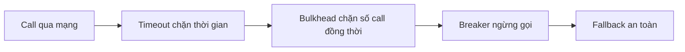
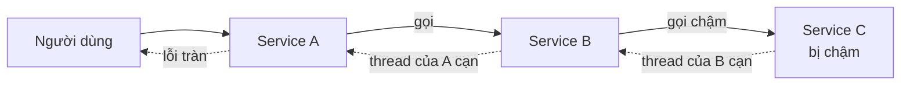
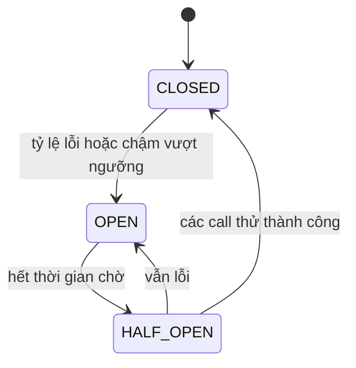
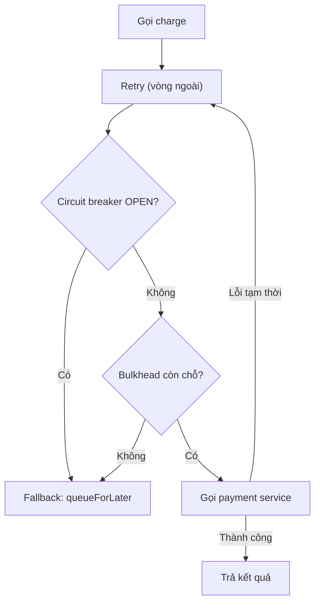

# Lý thuyết 32: Resilience và chịu lỗi

Resilience (khả năng chịu lỗi) là tập hợp kỹ thuật để một service vẫn hoạt động ở mức chấp nhận được khi dependency của nó chậm hoặc lỗi: timeout, retry, circuit breaker, bulkhead, rate limiter, fallback. Mục tiêu không phải là "không bao giờ lỗi" mà là lỗi nhỏ thì không biến thành sự cố lớn.

**Cốt lõi:** Thread và connection là hữu hạn, nên một dependency chậm giữ chúng lâu hơn một dependency chết và lỗi lan ngược lên các service gọi. Resilience là chặn việc chiếm tài nguyên theo từng trục: thời gian, số lần thử, số call đồng thời, rồi ngừng gọi hẳn.

- Vì thread hữu hạn nên call không có timeout có thể treo vô hạn và làm cạn pool.
- Vì retry thêm call đúng lúc dependency đang yếu nên phải giới hạn số lần, có backoff, jitter và chỉ ở một tầng.
- Vì timeout không giới hạn số call đồng thời nên cần bulkhead, và cần breaker để ngừng gọi khi dependency đã hỏng.



Mô hình tư duy: mỗi lớp trong sơ đồ chặn một trục chiếm tài nguyên khác nhau, đi từ giới hạn một call tới ngừng gọi hẳn.

**Tóm tắt:**

- Một service chậm nguy hiểm hơn một service chết, vì nó giữ thread của bên gọi chờ, thread pool cạn dần và lỗi lan ngược thành cascading failure.
- Mọi call qua mạng phải có timeout, gồm cả connect timeout và read timeout, chọn theo p99 chứ không đặt 30 giây cho chắc.
- Timeout phải nhỏ dần khi đi sâu vào hệ thống, nếu không bên trong sẽ xử lý tiếp request mà người gọi đã bỏ cuộc.
- Retry chỉ với lỗi tạm thời và thao tác idempotent, tối đa 2 đến 3 lần, có backoff và jitter, ở một tầng; retry nhiều tầng nhân call lên (3 x 3 x 3 = 27).
- Circuit breaker có ba trạng thái CLOSED, OPEN, HALF_OPEN; OPEN từ chối ngay để dependency có thời gian hồi phục.
- Bulkhead giới hạn số call đồng thời tới từng dependency, bổ sung cho timeout vốn chỉ giới hạn thời gian.
- Fallback phải thật sự an toàn: với thanh toán là đưa vào queue xử lý sau, không phải bỏ qua.
- Annotation của Resilience4j hoạt động qua proxy nên gọi nội bộ không có hiệu lực, và breaker tính riêng theo từng instance.

## Vấn đề nó giải quyết

Một service **chậm** nguy hiểm hơn một service **chết**. Service chết thì lỗi ngay và bạn xử lý lỗi ngay. Service chậm thì giữ thread của bạn chờ, thread pool cạn dần, rồi lỗi lan ngược lên mọi service gọi bạn. Hiện tượng này gọi là **cascading failure**. Hãy hình dung một quầy thu ngân mà khách phía trước cứ loay hoay tìm ví: cả hàng đứng chờ dù các quầy khác vẫn trống.

## Khi nào nên dùng

Với mọi call qua mạng: HTTP, gRPC, database, cache, message broker. Càng nhiều service phụ thuộc nhau càng cần. Nguyên tắc chung: đặt timeout cho **mọi** call; retry có kiểm soát và chỉ với thao tác idempotent; ngắt mạch khi dependency hỏng; cô lập tài nguyên theo dependency; có phương án suy giảm. Từng kỹ thuật dưới đây đều ghi rõ khi nào nên và không nên dùng.

## Các khái niệm cần biết

- **Timeout**: thời gian tối đa chờ một call; hết thì bỏ cuộc.
- **Retry**: thử lại call thất bại. **Backoff** là giãn thời gian giữa các lần thử (200ms, 400ms, 800ms); **jitter** là cộng thêm độ ngẫu nhiên để nhiều client không thử lại cùng một lúc.
- **Circuit breaker**: ngắt tạm thời call tới dependency đang hỏng, như cầu dao điện tự ngắt khi quá tải.
- **Bulkhead**: chia riêng tài nguyên cho từng dependency để một cái hỏng không kéo theo cái khác.
- **Rate limiter / load shedding**: giới hạn số request nhận vào, từ chối sớm khi quá tải.
- **Fallback**: phương án thay thế khi call thất bại (dữ liệu cache, giá trị mặc định).
- **Idempotent**: gọi nhiều lần cho kết quả như gọi một lần; điều kiện để retry an toàn.
- **p99**: ngưỡng mà 99% call nhanh hơn, dùng để chọn timeout.

## Cascading failure



Chỉ C chậm, nhưng thread của B kẹt đợi C, rồi thread của A kẹt đợi B. Cả hệ thống ngừng dù chỉ một service yếu.

**Nền tảng:** tài nguyên (thread, connection) là hữu hạn, nên một dependency chậm giữ chúng lâu hơn một dependency chết và lan ngược lên các service gọi. Mọi kỹ thuật resilience đều nhằm giới hạn thời gian chờ (timeout), số lần thử (retry), số call đồng thời (bulkhead) hoặc ngừng gọi (circuit breaker) để lỗi nhỏ không thành sự cố lớn.

## Các công cụ

### 1. Timeout (bắt buộc)

Call không có timeout có thể treo vô hạn. Thiết lập ít nhất hai loại: **connect timeout** (kết nối) và **read timeout** (chờ response).

```java
HttpClient http = HttpClient.newBuilder()
        .connectTimeout(Duration.ofSeconds(1))
        .build();
JdkClientHttpRequestFactory factory = new JdkClientHttpRequestFactory(http);
factory.setReadTimeout(Duration.ofSeconds(2));

RestClient client = RestClient.builder()
        .baseUrl("https://payment.internal")
        .requestFactory(factory)
        .build();
```

Cách dùng `RestClient`, interface `@HttpExchange`, interceptor và xử lý lỗi theo mã trạng thái xem [Lý thuyết 36: Gọi HTTP đi với RestClient, HTTP Service interface và WebClient](/go?p=01-Spring-Boot%2Fmedium%2Flt-36-http-client-restclient.md).

Quy tắc **ngân sách thời gian**: timeout của request ngoài cùng (người dùng hoặc gateway) phải **lớn hơn** tổng thời gian các call bên trong cộng thời gian xử lý. Nói cách khác, timeout đi sâu vào hệ thống phải **nhỏ dần**; nếu timeout bên trong lớn hơn bên ngoài, bạn vẫn xử lý một request mà người gọi đã bỏ cuộc từ lâu.

### 2. Retry

| Nên | Không nên |
|---|---|
| Chỉ retry lỗi **tạm thời** (timeout, 503, lỗi kết nối) | Retry lỗi 4xx (sai dữ liệu) |
| Chỉ với thao tác **idempotent** hoặc có idempotency key | Retry `POST` trừ tiền không có idempotency key |
| Backoff **lũy tiến kèm ngẫu nhiên (jitter)** | Retry ngay lập tức, nhiều client đồng bộ |
| Giới hạn số lần (2-3) | Retry vô hạn |
| Retry ở **một tầng** | Retry ở mọi tầng, nhân lên thành bão retry |

Ví dụ bão retry: 3 tầng, mỗi tầng retry 3 lần thì một lỗi ở tầng cuối sinh ra 27 call. Vì vậy dependency vốn đang yếu bị dồn thêm tải đúng lúc nó cần được nghỉ. Jitter giải quyết vấn đề khác: nếu 1000 client cùng retry sau đúng 200ms, họ đập vào server cùng một lúc lần nữa; thêm độ ngẫu nhiên thì các lần thử rải đều ra.

### 3. Circuit breaker

Theo dõi tỷ lệ lỗi hoặc call chậm. Vượt ngưỡng thì **mở mạch**: từ chối ngay lập tức (không gọi) trong một khoảng thời gian, cho dependency có thời gian hồi phục.



Khi nào dùng: dependency có thể hỏng kéo dài (service khác, API đối tác), gọi tiếp chỉ tốn thread. Khi nào không: call nội bộ trong cùng process, hoặc thao tác mà "từ chối ngay" còn tệ hơn "chờ" mà không có fallback hợp lý. Hậu quả nếu không có: mỗi request vẫn chờ hết timeout rồi mới lỗi, làm cạn thread dù biết trước kết quả.

- **CLOSED:** gọi bình thường, ghi nhận kết quả.
- **OPEN:** trả lỗi ngay (`CallNotPermittedException`) hoặc chạy fallback.
- **HALF_OPEN:** cho một số ít call thử; tốt thì đóng, xấu thì mở lại.

**Phải thuộc:** ba trạng thái circuit breaker: `CLOSED` (gọi bình thường) sang `OPEN` (từ chối ngay) khi vượt ngưỡng lỗi hoặc chậm, hết thời gian chờ sang `HALF_OPEN` (thử vài call) rồi về `CLOSED` hoặc lại `OPEN`. Retry chỉ với lỗi tạm thời, thao tác idempotent, tối đa 2 đến 3 lần, có backoff và jitter, ở một tầng.

### 4. Bulkhead

Giới hạn số call đồng thời tới **từng** dependency để một dependency chậm không chiếm hết tài nguyên của các dependency khác (như vách ngăn khoang tàu). Hai kiểu: semaphore (giới hạn số call đồng thời) và thread pool riêng.

### 5. Rate limiter và load shedding

Giới hạn số request chấp nhận để tự bảo vệ. Khi quá tải, **từ chối sớm** (`429` hoặc `503` kèm `Retry-After`) tốt hơn xử lý chậm cho tất cả.

### 6. Fallback và suy giảm duyên dáng

Khi dependency lỗi: trả dữ liệu cache cũ, giá trị mặc định, hoặc ẩn một phần giao diện thay vì lỗi toàn trang. Với thanh toán thì fallback đúng thường là "đưa vào queue xử lý sau" chứ không phải bỏ qua.

**Suy luận:** Vì thread và connection là hữu hạn, mọi cơ chế resilience thực chất là một cách chặn một trục khác nhau của việc chiếm tài nguyên. Timeout chặn thời gian một call được giữ, nhưng không chặn số call đồng thời, nên trong lúc chờ hàng trăm call vẫn có thể chiếm hết thread; bulkhead bổ sung trục số lượng và cô lập theo từng dependency. Retry thêm call vào đúng lúc dependency đang yếu, nên nó chỉ an toàn khi giới hạn số lần, có backoff, jitter và đặt ở một tầng; circuit breaker là lớp chặn tiếp theo, vì nó nhận ra retry vẫn thất bại và ngừng gọi hẳn. Điểm dễ nhầm là thêm retry mà quên timeout, khi đó retry trên một call treo vô hạn không có nghĩa gì, hoặc đặt retry ở mọi tầng rồi bão retry làm dependency yếu càng sập. Khi review một lời gọi qua mạng, hãy kiểm tra theo thứ tự: có timeout chưa, retry có idempotent và ở đúng một tầng không, có bulkhead hoặc breaker cho dependency hay hỏng không, và fallback có an toàn về nghiệp vụ không.

## Resilience4j trong Spring Boot

```yaml
resilience4j:
  circuitbreaker:
    instances:
      payment:
        slidingWindowSize: 20
        failureRateThreshold: 50
        slowCallDurationThreshold: 2s
        slowCallRateThreshold: 80
        waitDurationInOpenState: 20s
        permittedNumberOfCallsInHalfOpenState: 3
  retry:
    instances:
      payment:
        maxAttempts: 3
        waitDuration: 200ms
        enableExponentialBackoff: true
        exponentialBackoffMultiplier: 2
        enableRandomizedWait: true
        retryExceptions:
          - java.io.IOException
          - java.util.concurrent.TimeoutException
  bulkhead:
    instances:
      payment:
        maxConcurrentCalls: 20
        maxWaitDuration: 50ms
```

```java
@Service
public class PaymentClient {
    private final RestClient client;

    @CircuitBreaker(name = "payment", fallbackMethod = "queueForLater")
    @Retry(name = "payment")
    @Bulkhead(name = "payment")
    public PaymentResult charge(PaymentRequest req) {
        return client.post().uri("/charge").body(req)
                .retrieve().body(PaymentResult.class);
    }

    private PaymentResult queueForLater(PaymentRequest req, Throwable ex) {
        return PaymentResult.pending(req.id());
    }
}
```

Thứ tự áp dụng mặc định của Resilience4j (ngoài vào trong): Retry, CircuitBreaker, RateLimiter, TimeLimiter, Bulkhead. Nghĩa là mỗi lần retry đều đi qua circuit breaker và được tính vào thống kê của nó.



Đọc sơ đồ: breaker mở thì bỏ qua call mạng và chạy fallback. Lỗi tạm thời quay lại vòng retry; mỗi lần thử vẫn được breaker ghi nhận, nên nhiều lần thất bại liên tiếp sẽ mở mạch. Sơ đồ là bản rút gọn để thấy ý chính (không vẽ `TimeLimiter`, `RateLimiter`); chi tiết về chỗ fallback chạy tùy cách khai báo, xem tài liệu Resilience4j. Cũng như `@Transactional`, các annotation này hoạt động qua proxy nên **gọi nội bộ không có hiệu lực**.

Số liệu chỉ có ý nghĩa khi quan sát được: bật metric của Resilience4j qua Micrometer (xem [Lý thuyết 19: Observability (Log, Metric, Trace)](/go?p=01-Spring-Boot%2Fmedium%2Flt-19-observability.md)), theo dõi trạng thái mạch, tỷ lệ lỗi, số call bị từ chối.

## Chọn tham số có cơ sở

| Tham số | Cách chọn |
|---|---|
| Timeout | Dựa trên p99 (hoặc p99.9) độ trễ bình thường của dependency, cộng chút dư; không đặt "cho chắc" 30 giây |
| `slidingWindowSize` | Đủ lớn để tránh mở mạch vì vài lỗi ngẫu nhiên; đủ nhỏ để phản ứng nhanh |
| `waitDurationInOpenState` | Thời gian dependency thường cần hồi phục |
| `maxConcurrentCalls` | Dựa trên (tải mục tiêu x độ trễ trung bình) theo luật Little: số call đồng thời xấp xỉ QPS nhân thời gian phản hồi |

## Liên quan tới hệ thống lớn

- **Idempotency:** retry chỉ an toàn khi thao tác idempotent. Xem [Lý thuyết 26: Khóa phân tán và Idempotency](/go?p=01-Spring-Boot%2Fhard%2Flt-26-distributed-lock-idempotency.md).
- **Health check:** readiness phải phản ánh khả năng phục vụ; đừng để liveness dependency service ngoài (nếu không, dependency chết sẽ làm restart cả đàn).
- **Graceful shutdown:** `server.shutdown=graceful` để xử lý nốt request đang chạy.
- **Giới hạn queue:** luôn đặt giới hạn cho queue và thread pool; queue không giới hạn chỉ che giấu lỗi cho đến khi hết memory.
- **Kiểm thử:** dùng WireMock để mô phỏng độ trễ hoặc lỗi, Toxiproxy để mô phỏng lỗi mạng; kiểm chứng rằng breaker mở và hệ thống phục hồi.

## Bẫy thường gặp

- Chỉ đặt retry mà quên timeout: retry trên call treo vô hạn là vô nghĩa.
- Retry ở cả client, gateway và service: nhân số call theo cấp số nhân.
- Dùng circuit breaker mà fallback lại gọi service khác cũng đang lỗi.
- Bắt exception quá rộng trong `retryExceptions` nên cả lỗi nghiệp vụ cũng bị retry.
- Quên rằng breaker theo **từng instance**; mỗi pod có state mạch riêng.

## Phỏng vấn khó: chuỗi hỏi xoáy

Người phỏng vấn senior thường mở bằng một câu dễ, rồi xoáy xuống cơ chế, đánh đổi và sự cố thật. Câu trả lời tốt luôn đi từ cốt lõi xuống, không nhảy thẳng vào chi tiết.

### Chuỗi 1: Retry, circuit breaker và thứ tự bọc

1. **Câu mở:** Bạn gắn cả `@Retry` và `@CircuitBreaker` lên cùng một method gọi cổng thanh toán. Cái nào bọc cái nào?
2. **Xoáy 1:** Mỗi lần retry có được breaker ghi nhận là một call riêng không, và điều đó ảnh hưởng gì đến việc mở mạch?
3. **Xoáy 2:** Nếu fallback của breaker lại gọi một service khác cũng đang lỗi, hoặc method bị gọi bằng `this` trong cùng class, chuyện gì xảy ra?

**Đáp án ngắn:** Thứ tự mặc định của Resilience4j từ ngoài vào trong là Retry, CircuitBreaker, RateLimiter, TimeLimiter, Bulkhead. Nghĩa là retry nằm ngoài cùng, nên mỗi lần thử đều đi qua breaker và được tính vào thống kê của nó. Một call lỗi được thử ba lần thì breaker thấy ba lần thất bại, nên mạch mở nhanh hơn bạn tính theo số request gốc. Khi mạch đã `OPEN`, lần thử tiếp theo bị từ chối ngay bằng `CallNotPermittedException` hoặc chạy fallback, không tốn thread. Fallback phải an toàn về nghiệp vụ và không phụ thuộc vào thứ cũng đang hỏng; với thanh toán là đưa vào queue xử lý sau. Các annotation này chạy qua proxy, nên gọi bằng `this` thì cả ba lớp bị bỏ qua mà không báo lỗi. Trong production, theo dõi trạng thái mạch và số call bị từ chối qua Micrometer để thấy mạch mở trước khi người dùng báo.

**Sai lầm hay gặp:**
- Nói retry nằm trong breaker, hoặc breaker chỉ đếm request gốc, mà không biết mỗi lần thử được tính riêng.
- Cho fallback trả "thành công giả" cho thanh toán, hoặc gọi sang dependency khác cũng đang lỗi.
- Quên rằng annotation chạy qua proxy nên gọi nội bộ vô hiệu.

### Chuỗi 2: Tính cỡ timeout và bulkhead bằng số

1. **Câu mở:** Bạn đặt timeout 2 giây cho một call, tải khoảng 200 request mỗi giây. Dependency đột ngột chậm tới mức mọi call chạm timeout. Thread của bạn ra sao?
2. **Xoáy 1:** Số call đồng thời xấp xỉ bao nhiêu, và bạn chọn `maxConcurrentCalls` dựa trên gì?
3. **Xoáy 2:** `maxWaitDuration` 50ms để làm gì, và nếu bulkhead đầy thì request nhận gì?

**Đáp án ngắn:** Theo luật Little, số call đồng thời xấp xỉ QPS nhân thời gian phản hồi. Bình thường 200 QPS với 100ms là khoảng 20 call; khi mọi call chờ hết 2 giây thì thành khoảng 400. Tức timeout chỉ chặn thời gian một call chứ không chặn số lượng, và thread pool bị chiếm hết trong lúc chờ. `maxConcurrentCalls` chọn từ tải mục tiêu nhân độ trễ bình thường cộng chút dư, không chọn theo con số tròn cho đẹp. `maxWaitDuration` là khoảng ngắn mà một call được chờ chỗ trống; hết thì bị từ chối ngay (`BulkheadFullException`) và đi vào fallback. Từ chối sớm tốt hơn xếp hàng, vì xếp hàng làm độ trễ lan ngược lên bên gọi. Dấu hiệu trong production: số thread chờ tăng, số call bị bulkhead từ chối tăng trong khi các dependency khác vẫn khỏe. Đây chỉ là ước lượng, nên đo p99 thực tế rồi chỉnh.

**Sai lầm hay gặp:**
- Nghĩ có timeout là đủ bảo vệ, quên rằng hàng trăm call vẫn kẹt cùng lúc.
- Đặt `maxConcurrentCalls` bằng một số tròn mà không có phép tính nào.
- Cho thời gian chờ của bulkhead quá dài, biến từ chối nhanh thành xếp hàng dài.

### Chuỗi 3: Breaker theo từng instance và health check

1. **Câu mở:** Service chạy 10 pod, payment service hỏng. Breaker của bạn mở ở đâu?
2. **Xoáy 1:** Ở `HALF_OPEN` với `permittedNumberOfCallsInHalfOpenState: 3`, payment service nhận bao nhiêu call thử?
3. **Xoáy 2:** Có người cho liveness probe gọi thử payment service để "biết nó còn sống". Bạn nghĩ sao?

**Đáp án ngắn:** Breaker là state trong memory của từng instance, nên mỗi pod tự đếm lỗi và tự mở mạch; không có mạch dùng chung cả cụm. Các pod thường mở gần nhau khi lỗi dày, nhưng không đồng thời. Ở `HALF_OPEN` mỗi pod tự cho 3 call thử, nên 10 pod gộp lại là khoảng 30 call tới một dependency đang hồi phục. Con số đó cần tính vào, nhất là khi số pod lớn. Liveness trả lời câu "process này có cần restart không", nên không được phụ thuộc dependency ngoài: dependency chết sẽ làm restart cả đàn, đúng lúc không cần thêm khởi động. Readiness mới phản ánh khả năng phục vụ. Cách phát hiện: xem trạng thái mạch theo từng pod trên dashboard, thấy pod mở pod đóng lệch nhau; nhớ giới hạn queue và thread pool để lỗi không bị che đến lúc hết memory.

**Sai lầm hay gặp:**
- Tưởng breaker là trạng thái dùng chung cho cả cụm.
- Cho liveness probe gọi dependency ngoài.
- Chỉ nhìn một pod khi chẩn đoán trạng thái mạch.

## Câu hỏi phỏng vấn thường gặp

1. Service C chỉ chậm chứ không chết, vậy mà cả hệ thống ngừng phục vụ. Vì sao chậm nguy hiểm hơn chết, và lỗi lan thế nào?

   **Phải thuộc:** Câu này là câu cốt lõi, gặp rất thường xuyên.

   **Gợi ý suy luận:**
   - Service chết trả lời thế nào, và service chậm thì thread gọi nó làm gì?
   - Thread pool có số lượng hữu hạn. Khi thread kẹt đợi, còn ai xử lý request mới?
   - Nếu B kẹt, thread của A gọi B sẽ ra sao?

   **Lập luận:** service chết lỗi ngay nên thread được giải phóng ngay. Service chậm giữ thread của B chờ, pool của B cạn dần, B không nhận thêm request nên thread của A gọi B cũng kẹt, rồi A cạn. Mỗi tầng chậm lan ngược lên tầng gọi nó cho đến người dùng. Đó là lỗi dây chuyền: một service yếu kéo sập cả đường gọi.

   **Đáp án ngắn:** service chậm giữ thread chờ, pool cạn, rồi lan ngược lên các service gọi; service chết thì lỗi ngay và thread được trả lại.

   **Nhớ:** thread hữu hạn, chờ vô hạn thì cạn. Xem mục "Cascading failure".

2. Khi nào nên retry? Backoff và jitter dùng để làm gì, và bão retry là gì?

   **Phải thuộc:** Câu này là câu cốt lõi, gặp rất thường xuyên.

   **Gợi ý suy luận:**
   - Lỗi nào là tạm thời, lỗi nào thử lại vẫn sai? Thử lại một `POST` trừ tiền có an toàn không?
   - Nếu 1000 client cùng retry sau đúng 200ms thì server nhận gì?
   - Nếu mỗi tầng trong 3 tầng retry 3 lần thì lỗi ở tầng cuối sinh ra bao nhiêu call?

   **Lập luận:** retry chỉ có ích với lỗi tạm thời (timeout, 503, lỗi kết nối) và chỉ an toàn với thao tác idempotent hoặc có idempotency key, nếu không thử lại sẽ nhân đôi tác dụng. Retry ngay và đồng bộ khiến mọi client đập vào server cùng lúc: backoff giãn thời gian, jitter rải ngẫu nhiên để các lần thử không trùng thời điểm. Retry ở nhiều tầng nhân lên: 3 x 3 x 3 = 27 call cho một lỗi, dồn tải vào đúng dependency đang yếu: đó là bão retry. Nên giới hạn 2-3 lần và chỉ retry ở một tầng.

   **Đáp án ngắn:** retry lỗi tạm thời với thao tác idempotent; backoff giãn thời gian, jitter làm các client không thử cùng lúc; bão retry là retry nhiều tầng nhân số call lên.

   **Nhớ:** chỉ retry lỗi tạm thời, idempotent, giới hạn số lần, một tầng. Xem mục "Retry".

3. Mô tả ba trạng thái của circuit breaker, và điều gì khiến nó chuyển trạng thái?

   **Gợi ý suy luận:**
   - Nếu dependency đã hỏng, gọi tiếp có ích gì, và nó cần gì để hồi phục?
   - Làm sao biết dependency đã khỏe lại mà không đổ cả tải vào?

   **Lập luận:** breaker theo dõi tỷ lệ lỗi hoặc call chậm. `CLOSED`: gọi bình thường và ghi nhận kết quả; khi vượt ngưỡng thì chuyển `OPEN`: từ chối ngay (hoặc chạy fallback), không tốn thread và cho dependency thời gian nghỉ. Hết thời gian chờ, nó sang `HALF_OPEN`: chỉ cho một số ít call thử, vì chưa biết dependency khỏe chưa. Thử tốt thì về `CLOSED`, vẫn lỗi thì lại `OPEN`.

   **Đáp án ngắn:** `CLOSED` gọi bình thường; vượt ngưỡng lỗi hoặc chậm thì `OPEN` và từ chối ngay; hết thời gian chờ sang `HALF_OPEN` thử vài call, tốt thì đóng, xấu thì mở lại.

   **Nhớ:** breaker theo từng instance, ngưỡng cấu hình bằng `failureRateThreshold`, `waitDurationInOpenState`, v.v.

4. Đã đặt timeout rồi, vì sao còn cần bulkhead?

   **Gợi ý suy luận:**
   - Timeout giới hạn thời gian mỗi call chờ, nhưng trong khoảng đó có bao nhiêu call cùng kẹt?
   - Nếu mọi dependency dùng chung một thread pool, một dependency chậm chiếm hết pool thì dependency khỏe ra sao?

   **Lập luận:** timeout giới hạn mỗi call nhưng không giới hạn số call đồng thời; trong thời gian chờ, hàng trăm call tới dependency chậm vẫn có thể chiếm hết thread dùng chung. Khi đó các dependency khỏe cũng không còn thread. Bulkhead chia riêng tài nguyên (semaphore hoặc thread pool) cho từng dependency, nên một cái chậm chỉ cạn phần của nó.

   **Đáp án ngắn:** timeout giới hạn thời gian một call; bulkhead giới hạn số call đồng thời tới từng dependency để một cái chậm không chiếm hết tài nguyên của cái khác.

   **Nhớ:** timeout chặn thời gian, bulkhead chặn số lượng và cô lập.

5. Bạn chọn timeout cho một call như thế nào, và vì sao không đặt 30 giây "cho chắc"?

   **Gợi ý suy luận:**
   - Độ trễ bình thường của dependency phân bố thế nào (p99)? Timeout nên nằm gần hay xa số đó?
   - Nếu timeout bên trong lớn hơn timeout bên ngoài thì chuyện gì xảy ra với request đã bị người gọi bỏ?
   - Timeout dài thì thread bị giữ bao lâu?

   **Lập luận:** timeout phải dựa vào số đo: lấy p99 (hoặc p99.9) độ trễ bình thường cộng chút dư, vì quá ngắn gây lỗi giả, quá dài giữ thread khi dependency hỏng, và 30 giây "cho chắc" gần như tương đương không có timeout. Timeout cũng phải nhỏ dần theo độ sâu: timeout ngoài cùng lớn hơn tổng các call trong; nếu ngược lại, hệ thống tiếp tục xử lý request mà người gọi đã bỏ cuộc.

   **Đáp án ngắn:** dựa trên p99 độ trễ bình thường cộng chút dư, và timeout ngoài phải lớn hơn tổng các call bên trong (ngân sách thời gian).

   **Nhớ:** đo p99, đặt cả connect timeout và read timeout, timeout nhỏ dần khi đi sâu.

6. Thiết kế call tới cổng thanh toán sao cho dù có retry cũng không trừ tiền hai lần.

   **Gợi ý suy luận:**
   - Khi timeout xảy ra, ta có biết cổng đã trừ tiền hay chưa không?
   - Làm sao để cổng nhận ra "đây là cùng một request" khi nhận lần hai?
   - Nếu circuit breaker mở hoặc cổng chậm, fallback đúng của thanh toán là gì?

   **Lập luận:** timeout không cho biết cổng đã xử lý hay chưa, nên retry `POST` có thể trừ tiền hai lần. Giải pháp là thao tác idempotent: client sinh một idempotency key duy nhất cho mỗi ý định thanh toán và gửi kèm mọi lần thử; cổng thấy key đã xử lý thì trả kết quả cũ chứ không trừ lại. Kết hợp: timeout rõ ràng, retry hạn chế với backoff và jitter, breaker để chặn gọi khi cổng hỏng, và fallback đúng là đưa vào queue xử lý sau (trạng thái `PENDING`) chứ không bỏ qua thanh toán.

   **Đáp án ngắn:** dùng idempotency key cố định cho mỗi lần thanh toán để cổng loại trùng; thêm timeout, retry giới hạn có jitter, breaker, và fallback là queue xử lý sau.

   **Nhớ:** retry chỉ an toàn khi thao tác idempotent. Xem [Lý thuyết 26: Khóa phân tán và Idempotency](/go?p=01-Spring-Boot%2Fhard%2Flt-26-distributed-lock-idempotency.md).

