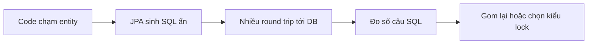
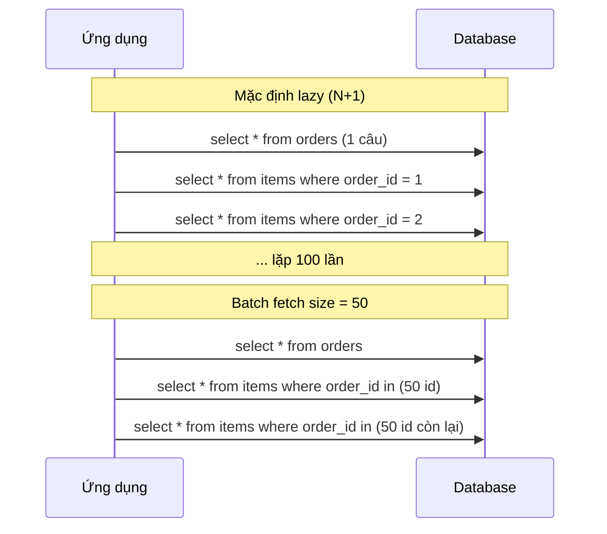
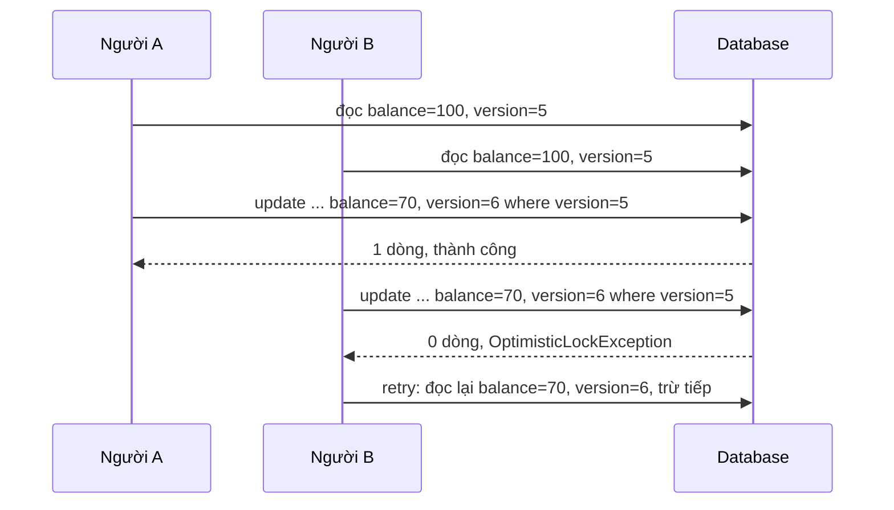

# Lý thuyết 34: JPA hiệu năng, khóa và cache

Đọc trước [Lý thuyết 4: Spring Data JPA](/go?p=01-Spring-Boot%2Fmedium%2Flt-04-spring-data-jpa.md) và [Lý thuyết 16: JPA bên trong, Persistence Context](/go?p=01-Spring-Boot%2Fmedium%2Flt-16-jpa-internals.md).

Bài này nói về các vấn đề hiệu năng và đồng thời hay gặp khi dùng JPA/Hibernate: N+1, tải dữ liệu thừa, ghi hàng loạt, optimistic lock và pessimistic lock, cache cấp 1 và cấp 2, connection pool.

**Cốt lõi:** JPA che giấu SQL, nên một lần chạm getter lazy có thể là một query và hiệu năng phụ thuộc vào số câu SQL thật sự chạy. Phần lớn kỹ thuật trong bài là gom nhiều lần truy cập DB thành ít lần, hoặc chọn cách xử lý khi nhiều transaction cùng ghi một dòng.

- Vì mỗi lần nạp lazy là một round trip nên cost tỷ lệ với N, và mọi cách chữa N+1 đều là gom N lần nạp lại.
- Vì lost update xảy ra khi hai transaction ghi dựa trên giá trị cũ nên phải phát hiện lúc ghi (optimistic) hoặc chặn lúc đọc (pessimistic), chọn theo mức tranh chấp.
- Vì database chỉ song song theo phần cứng của nó nên pool lớn không nhanh hơn, và pool cạn do transaction giữ connection lâu.



Mô hình tư duy: SQL bị ẩn sau code Java, nên phải đo số câu thật rồi mới gom lại hoặc chọn lock.

**Tóm tắt:**

- JPA che giấu SQL, nên một getter lazy có thể là một query; luôn bật log và đếm số câu SQL mỗi request trước khi tối ưu.
- N+1 là 1 query lấy cha rồi N query lấy con; chữa bằng batch fetching, `JOIN FETCH` hoặc `@EntityGraph`, hay DTO projection.
- `JOIN FETCH` một collection kèm `Pageable` khiến Hibernate phân trang trong memory; phân trang theo id trước rồi mới tải chi tiết.
- Đặt mọi relationship là LAZY, dùng projection cho query chỉ đọc, `Slice` hoặc keyset pagination thay cho offset lớn.
- `GenerationType.IDENTITY` tắt JDBC batching; ghi hàng loạt cần `SEQUENCE`, `batch_size` và `flush`/`clear` định kỳ.
- Lost update được chặn bằng optimistic lock (`@Version`, hợp khi xung đột hiếm) hoặc pessimistic lock (`FOR UPDATE`, hợp khi xung đột thường xuyên).
- Cache cấp 1 luôn bật trong một transaction; cache cấp 2 khó giữ nhất quán giữa nhiều instance nên thường thay bằng cache tầng ứng dụng.
- Connection pool lớn không làm database nhanh hơn; pool cạn do transaction giữ connection lâu, nên chữa bằng rút ngắn transaction.

## Vấn đề nó giải quyết

Phần lớn sự cố hiệu năng của ứng dụng Spring nằm ở tầng dữ liệu, và JPA che giấu SQL thật sự được sinh ra: bạn gọi `order.getItems()` trông như đọc một danh sách trong memory, nhưng phía sau có thể là một query DB. Vì vậy một vòng lặp vô hại trên giấy có thể bắn hàng trăm câu SQL. Senior phải **nhìn thấy** và **kiểm soát** SQL. Ngoài hiệu năng, khi nhiều người cùng sửa một bản ghi, dữ liệu có thể bị ghi đè sai (lost update), cần chọn kiểu lock phù hợp.

## Khi nào cần đến những kỹ thuật này

Khi API chậm, CPU database cao, connection pool cạn, hoặc dữ liệu bị ghi đè sai trong xử lý đồng thời. Cách làm xuyên suốt: bật log và thống kê SQL, đếm số câu lệnh mỗi request, chọn chiến lược tải phù hợp, dùng DTO projection cho query đọc, chọn lock theo mức tranh chấp. Chưa đo thì đừng tối ưu: nhiều "tối ưu" chỉ thêm phức tạp mà không giải quyết điểm nghẽn thật.

## Các khái niệm cần biết

- **Persistence context (cache cấp 1)**: memory của một session/transaction chứa các entity đã nạp. Hibernate theo dõi chúng ở đây.
- **Dirty checking**: cuối transaction, Hibernate so sánh entity với bản chụp lúc nạp và tự sinh `UPDATE` cho cái nào thay đổi, nên bạn không cần gọi `save`. Tiện nhưng tốn memory và CPU khi nạp nhiều entity.
- **Lazy / eager loading**: lazy chỉ nạp quan hệ khi truy cập lần đầu (qua một proxy), eager nạp ngay cùng entity cha.
- **N+1**: 1 câu lấy danh sách cha, rồi N câu nữa, mỗi câu lấy con của một cha. Xem phần N+1.
- **Projection / DTO**: chỉ lấy các cột cần dùng, không tạo entity.
- **Keyset pagination**: phân trang bằng điều kiện "lấy sau bản ghi cuối đã thấy" (`id > :last`) thay vì bỏ qua N dòng (offset).
- **Lost update**: hai transaction đọc cùng giá trị cũ rồi cùng ghi, một thay đổi bị mất.
- **Optimistic / pessimistic lock**: optimistic (phát hiện xung đột lúc ghi qua cột version) và pessimistic (lock dòng ngay lúc đọc).
- **Connection pool**: tập các connection DB dùng chung (HikariCP), vì mở connection mới rất đắt.

## Nhìn thấy SQL trước khi tối ưu

```yaml
spring:
  jpa:
    properties:
      hibernate:
        generate_statistics: true      # số câu lệnh, cache hit
        session.events.log.LOG_QUERIES_SLOWER_THAN_MS: 50
logging:
  level:
    org.hibernate.SQL: debug           # câu SQL
    org.hibernate.orm.jdbc.bind: trace # giá trị tham số
```

Trong test, dùng thư viện đếm câu lệnh (ví dụ datasource-proxy) để **khẳng định số câu SQL** của một API. Test như vậy bắt N+1 tái phát.

## N+1

Lấy 100 đơn hàng rồi mỗi đơn truy cập `order.getItems()` (lazy) sinh **1 + 100** câu SQL.

```java
List<Order> orders = orderRepo.findAll();         // 1 câu
orders.forEach(o -> o.getItems().size());          // 100 câu nữa
```

Mỗi câu lệnh phải đi tới DB và về, nên 101 câu nghĩa là 101 lần chờ mạng và phân tích SQL. Dev vẫn chạy nhanh vì DB ít dữ liệu, rồi production mới chậm. Hãy so sánh cách chạy mặc định (N+1) và batch fetching:



Đọc sơ đồ: batch fetching không đổi cách bạn viết code, chỉ gom nhiều lần nạp lazy thành vài câu `IN`. Khi nào chọn `JOIN FETCH` thay vì batch: khi cần đúng một collection, không phân trang. Khi nào không: có phân trang hoặc nhiều collection.

Cách khắc phục:

| Cách | Ví dụ | Lưu ý |
|---|---|---|
| `JOIN FETCH` | `select o from Order o join fetch o.items` | Kết quả nhân bản theo số item; cẩn thận phân trang |
| `@EntityGraph` | `@EntityGraph(attributePaths = "items")` trên method repository | Gọn hơn JOIN FETCH |
| Batch fetching | `hibernate.default_batch_fetch_size=50` hoặc `@BatchSize` | Gom 100 câu thành 2; an toàn với phân trang; thường là lựa chọn mặc định tốt |
| DTO projection | Query chỉ các cột cần | Tốt nhất cho query chỉ đọc |

**Nền tảng:** JPA che giấu SQL nên một call getter lazy có thể là một query. N+1 xảy ra vì mỗi lần chạm collection lazy của một entity cha lại sinh một câu riêng; mọi cách chữa (`JOIN FETCH`, `@EntityGraph`, batch fetching, DTO projection) đều là gom các lần nạp đó lại hoặc không nạp entity.

**Phải thuộc:** `@ManyToOne` và `@OneToOne` mặc định EAGER, `@OneToMany` và `@ManyToMany` mặc định LAZY; nên đặt mọi quan hệ LAZY và tải rõ ràng khi cần. `JOIN FETCH` collection kèm phân trang thì Hibernate phân trang trong memory.

**Suy luận:** Vì JPA trả về proxy cho quan hệ lazy, mỗi lần chạm vào collection là một lần DB phải nạp, và Hibernate không biết trước bạn sẽ lặp qua bao nhiêu entity cha, nên nó nạp từng cái một khi được hỏi. Hệ quả là cost tỷ lệ với N, và mỗi query là một round trip qua mạng cộng phân tích SQL, nên ở dev với ít dữ liệu mọi thứ vẫn nhanh. Mọi cách chữa đều đánh vào cùng một điểm là gom N lần nạp thành ít lần hơn: `JOIN FETCH` gom bằng join nhưng nhân dòng theo số con, từ đó phát sinh vấn đề phân trang trong memory; batch fetching gom bằng `IN` nên giữ nguyên số dòng cha và an toàn với phân trang. Điểm dễ nhầm là đổi sang EAGER cho hết lỗi lazy: nó không bỏ N+1 mà còn tải thừa ở mọi chỗ dùng entity. Khi review, hãy viết test đếm số câu SQL của API và đặt `default_batch_fetch_size` làm mặc định, chỉ dùng `JOIN FETCH` khi cần đúng một collection và không phân trang.

### Cạm bẫy của `JOIN FETCH`

- **Phân trang với collection:** `JOIN FETCH` một collection kèm `Pageable` khiến Hibernate tải **toàn bộ kết quả vào memory** rồi mới phân trang (cảnh báo `HHH000104` ở Hibernate 5, mã `HHH90003004` ở Hibernate 6). Giải pháp: phân trang theo id trước rồi tải chi tiết, hoặc dùng batch fetching.
- **Nhiều collection kiểu `List`:** `MultipleBagFetchException`. Dùng `Set`, hoặc tải từng collection bằng query riêng.
- **Tích Descartes:** fetch hai collection cùng lúc nhân số dòng.

### Kiểu tải mặc định

`@ManyToOne` và `@OneToOne` mặc định `EAGER`, `@OneToMany` và `@ManyToMany` mặc định `LAZY`. Nên đặt **mọi quan hệ là `LAZY`** và tải rõ ràng khi cần; EAGER gây tải thừa không kiểm soát được.

## Chỉ tải thứ cần dùng: projection

```java
public record OrderSummary(Long id, String status, BigDecimal total) {}

@Query("select new com.example.OrderSummary(o.id, o.status, o.total) from Order o where o.customerId = :cid")
List<OrderSummary> summaries(@Param("cid") String cid);
```

Không tạo entity được quản lý nên không tốn dirty checking và memory của persistence context. Dùng cho API danh sách, báo cáo.

## Phân trang hiệu quả

- `Page` chạy thêm câu `count(*)` tốn kém trên bảng lớn; nếu chỉ cần biết còn trang sau, dùng `Slice`.
- Offset lớn rất chậm; dùng keyset pagination (Spring Data hỗ trợ `Window` và `ScrollPosition` từ Spring Data 3.1) hoặc điều kiện `id > :last` tự viết.

## Ghi hàng loạt

| Vấn đề | Cách xử lý |
|---|---|
| `GenerationType.IDENTITY` **tắt** JDBC batching vì cần lấy id ngay sau mỗi insert | Dùng `SEQUENCE` với `allocationSize` phù hợp |
| Mỗi insert một lần gửi | `hibernate.jdbc.batch_size=50`, `hibernate.order_inserts=true`, `order_updates=true` |
| Xử lý 1 triệu entity làm đầy persistence context | Định kỳ `flush()` và `clear()` (hoặc dùng `StatelessSession`) |
| Cập nhật hàng loạt | JPQL `update ... where ...` kèm `@Modifying(clearAutomatically = true)`; lưu ý nó **bỏ qua** persistence context và `@Version` |

## Concurrency: optimistic lock và pessimistic lock

Kịch bản lost update: hai người đọc cùng số dư 100, mỗi người trừ 30, cả hai ghi 70; đúng ra phải còn 40.

### Optimistic lock: `@Version`

```java
@Entity
class Account {
    @Id Long id;
    BigDecimal balance;
    @Version long version;     // Hibernate thêm "where version = ?" khi update
}
```

Flow của hai người cùng sửa một tài khoản:



Nếu có người sửa trước, câu `update ... where id=? and version=?` ảnh hưởng 0 dòng và Hibernate ném `OptimisticLockException` (Spring: `ObjectOptimisticLockingFailureException`). **Retry** cả nghiệp vụ hoặc trả `409` cho client. Không giữ lock DB nên chịu tải tốt khi xung đột hiếm.

### Pessimistic lock

```java
@Lock(LockModeType.PESSIMISTIC_WRITE)       // SELECT ... FOR UPDATE
@Query("select a from Account a where a.id = :id")
Optional<Account> lockById(@Param("id") Long id);
```

Chặn các transaction khác đến khi commit. Hợp khi xung đột **thường xuyên** (ví dụ giảm tồn kho của sản phẩm hot). Rủi ro: chờ lock, deadlock. Giảm rủi ro bằng cách lock theo thứ tự cố định, giữ transaction ngắn, đặt `jakarta.persistence.lock.timeout` (0 tương đương `NOWAIT`, `-2` tương đương `SKIP LOCKED` trên các dialect hỗ trợ, kiểm tra lại theo phiên bản Hibernate). Với job queue dùng `FOR UPDATE SKIP LOCKED`.

| Tiêu chí | Optimistic | Pessimistic |
|---|---|---|
| Xung đột hiếm | Phù hợp | Tốn kém không cần thiết |
| Xung đột thường xuyên | Retry nhiều, lãng phí | Phù hợp |
| Giữ lock DB | Không | Có |
| Nguy cơ deadlock | Không | Có |

**Phải thuộc:** optimistic lock dùng `@Version`, câu `update ... where version = ?` ảnh hưởng 0 dòng thì ném `OptimisticLockException` (Spring: `ObjectOptimisticLockingFailureException`), hợp khi xung đột hiếm. Pessimistic lock dùng `PESSIMISTIC_WRITE` (`SELECT ... FOR UPDATE`), hợp khi xung đột thường xuyên, có rủi ro deadlock.

Cách đơn giản nhất vẫn là cập nhật có điều kiện bằng một câu lệnh (`update stock set qty = qty - :n where id = :id and qty >= :n` rồi kiểm tra số dòng bị ảnh hưởng). Sơ đồ chọn công cụ theo mức tranh chấp, `NOWAIT`, `SKIP LOCKED` và vòng retry ở tầng database nằm ở [Khóa, deadlock và đồng thời ở tầng database](/go?p=02-Database%2Fhard%2Flt-10-locking-deadlock-database.md).

**Suy luận:** Vì lost update chỉ xảy ra khi hai transaction cùng dựa trên giá trị cũ, có hai cách chặn: phát hiện ở lúc ghi hoặc ngăn từ lúc đọc. Optimistic lock chọn phát hiện lúc ghi bằng cột `version`, nên không giữ lock DB và không có deadlock, nhưng người thua phải retry cả nghiệp vụ; vì vậy nó rẻ khi xung đột hiếm và lãng phí khi xung đột dày đặc. Pessimistic lock chọn ngăn từ lúc đọc bằng `FOR UPDATE`, nên người đến sau phải chờ thay vì làm xong rồi bị loại, hợp với dòng nóng như tồn kho; cái giá là giữ lock trong suốt transaction, kéo theo chờ lock, cạn pool và deadlock nếu thứ tự lock không cố định. Điểm dễ nhầm là chọn pessimistic cho mọi thứ cho chắc, trong khi transaction dài giữ lock sẽ biến nó thành điểm nghẽn toàn hệ thống. Khi thiết kế, ước lượng mức tranh chấp trước, ưu tiên optimistic lock với retry giới hạn, và dùng cập nhật có điều kiện bằng một câu lệnh nếu logic đủ đơn giản.

## Cache

| Cấp | Phạm vi | Ghi chú |
|---|---|---|
| Cấp 1 (persistence context) | Một session/transaction | Luôn bật, đảm bảo cùng id trả cùng object trong một transaction |
| Cấp 2 (Ehcache, Infinispan, Hazelcast, Redis qua provider) | Toàn ứng dụng (SessionFactory) | Phải bật tường minh, đánh dấu `@Cache` cho entity |
| Query cache | Kết quả query | Dễ mất hiệu lực, ít khi đáng giá |
| Cache tầng ứng dụng (`@Cacheable`, Redis) | Do bạn kiểm soát | Thường là lựa chọn tốt hơn |

Cache cấp 2 chỉ có lợi với dữ liệu **đọc nhiều, ít đổi**, và phải xử lý nhất quán khi chạy nhiều instance (cần cache phân tán hoặc đồng bộ vô hiệu). Nhiều đội chọn bỏ qua và dùng cache tầng ứng dụng với key và TTL rõ ràng; xem [Lý thuyết 39: Spring Cache abstraction](/go?p=01-Spring-Boot%2Fmedium%2Flt-39-spring-cache-abstraction.md) và [Lý thuyết 03: Cache pattern và các vấn đề của cache](/go?p=06-Distributed-Systems%2FRedis%2Fmedium%2Flt-03-cache-pattern-van-de-cache.md).

## Connection pool (HikariCP)

- Pool lớn không có nghĩa nhanh hơn: database chỉ xử lý song song bằng số lõi/đĩa của nó. Điểm khởi đầu hợp lý là kích thước nhỏ (vài chục connection mỗi service, tính cả tổng số instance), rồi đo.
- Kiểm tra số connection tối đa của database so với `số instance x maximumPoolSize`.
- `maxLifetime` nhỏ hơn thời gian database/firewall ngắt connection nhàn rỗi.
- `leakDetectionThreshold` giúp tìm code giữ connection quá lâu.
- Triệu chứng cạn pool: thread chờ `getConnection`, lỗi timeout sau `connectionTimeout`. Nguyên nhân thường là transaction dài, gọi HTTP trong transaction, hoặc `REQUIRES_NEW` lồng nhau ([Lý thuyết 31: Transaction chuyên sâu](/go?p=01-Spring-Boot%2Fhard%2Flt-31-transaction-chuyen-sau.md)).

## Một số điểm khác

- `equals/hashCode` của entity, tránh `@Data` của Lombok và lưu enum bằng `STRING`: giải thích ở [Lý thuyết 16: JPA bên trong, Persistence Context](/go?p=01-Spring-Boot%2Fmedium%2Flt-16-jpa-internals.md).
- Schema đổi bằng công cụ migration (Flyway, Liquibase), không bằng `ddl-auto=update` ở production: xem [Lý thuyết 4: Spring Data JPA](/go?p=01-Spring-Boot%2Fmedium%2Flt-04-spring-data-jpa.md).
- Index: mọi foreign key dùng để join nên có index; xem [Index và tối ưu truy vấn](/go?p=02-Database%2Fmedium%2Flt-03-index-toi-uu-truy-van.md).

## Quy trình chẩn đoán API chậm

1. Đo: số câu SQL mỗi request, thời gian từng câu.
2. Có N+1? Sửa bằng batch fetching, `EntityGraph` hoặc projection.
3. Câu nào chậm? Chạy `EXPLAIN` trên database thật ([EXPLAIN, query planner và tối ưu truy vấn sâu](/go?p=02-Database%2Fhard%2Flt-09-explain-query-planner-tuning.md)); thêm hoặc sửa index.
4. Tải thừa dữ liệu? Dùng projection, `Slice`, keyset.
5. Pool cạn hoặc lock chờ lâu? Rút ngắn transaction, kiểm tra lock.
6. Chỉ sau cùng mới nghĩ tới cache.

## Phỏng vấn khó: chuỗi hỏi xoáy

Người phỏng vấn senior thường mở bằng một câu dễ, rồi xoáy xuống cơ chế, đánh đổi và sự cố thật. Câu trả lời tốt luôn đi từ cốt lõi xuống, không nhảy thẳng vào chi tiết.

### Chuỗi 1: LAZY, EAGER và fetch nhiều collection

1. **Câu mở:** Gặp `LazyInitializationException`, đồng đội đổi quan hệ sang `EAGER` cho nhanh. Bạn phản biện thế nào?
2. **Xoáy 1:** Nếu một query `JOIN FETCH` hai collection kiểu `List` của cùng entity thì có vấn đề gì?
3. **Xoáy 2:** Vậy tải hai collection đó bằng cách nào, và vì sao batch fetching an toàn hơn khi có phân trang?

**Đáp án ngắn:** EAGER không bỏ N+1, nó chỉ biến việc tải thành bắt buộc ở mọi chỗ dùng entity, nên tải thừa không kiểm soát được. Lỗi lazy nghĩa là bạn chạm quan hệ ngoài persistence context; cách đúng là tải rõ ràng bằng `JOIN FETCH`, `@EntityGraph` hoặc DTO projection, và giữ mọi quan hệ LAZY. Fetch hai collection `List` cùng lúc gây `MultipleBagFetchException`. Đổi sang `Set` làm lỗi biến mất nhưng tích Descartes vẫn còn: 10 item nhân 5 payment ra 50 dòng cho mỗi cha. Nên tải từng collection bằng query riêng, hoặc đặt `default_batch_fetch_size` để Hibernate gom các lần nạp lazy thành vài câu `IN`. Batch giữ nguyên số dòng cha nên phân trang cắt đúng, còn `JOIN FETCH` collection kèm `Pageable` thì bị phân trang trong memory. Cách phát hiện: log SQL hoặc test đếm số câu SQL của API; chưa đo thì đừng đoán.

**Sai lầm hay gặp:**
- Chữa lỗi lazy bằng EAGER hoặc `open-in-view` rồi nói "hết N+1".
- Chỉ biết tên `MultipleBagFetchException` mà không giải thích được tích Descartes.
- Dùng `JOIN FETCH` cho mọi trường hợp, kể cả khi có phân trang.

### Chuỗi 2: `@Version`, bulk update và retry

1. **Câu mở:** `@Version` ngăn lost update ở mức SQL như thế nào?
2. **Xoáy 1:** Một job dùng JPQL `@Modifying` update hàng loạt trong lúc người dùng sửa cùng dòng. `@Version` có bảo vệ được không?
3. **Xoáy 2:** Gặp `OptimisticLockException` thì retry ở đâu, và với trừ tồn kho đơn giản có cách nào không cần version?

**Đáp án ngắn:** Hibernate thêm `where version = ?` vào câu update và tăng version. Nếu có người ghi trước, câu update ảnh hưởng 0 dòng và Hibernate ném `OptimisticLockException` (Spring: `ObjectOptimisticLockingFailureException`). Nó không giữ lock DB nào, chỉ phát hiện xung đột lúc ghi. JPQL bulk update đi thẳng xuống DB, bỏ qua persistence context và `@Version`, nên không phát hiện được xung đột với người đang sửa, và entity đã nạp còn giữ giá trị cũ nếu quên `clearAutomatically`. Khi bị từ chối, phải retry cả nghiệp vụ: đọc lại, tính lại, ghi lại trong transaction mới, giới hạn số lần, hoặc trả `409` cho client. Retry riêng câu update là vô nghĩa vì dữ liệu đọc đã cũ. Với tồn kho, `update stock set qty = qty - :n where id = :id and qty >= :n` rồi kiểm tra số dòng bị ảnh hưởng là đơn giản nhất. Retry dày là tín hiệu xung đột nhiều, nên cân nhắc pessimistic.

**Sai lầm hay gặp:**
- Nói `@Version` "khóa dòng" trong khi nó không giữ lock nào.
- Retry riêng câu update mà không đọc lại dữ liệu.
- Quên rằng bulk update bỏ qua `@Version` và persistence context.

### Chuỗi 3: Pessimistic lock, deadlock và job queue

1. **Câu mở:** Tồn kho sản phẩm hot bị tranh chấp liên tục, bạn dùng `PESSIMISTIC_WRITE`. Nó làm gì và đổi lại bằng gì?
2. **Xoáy 1:** Hai transaction cùng lock hai sản phẩm A và B nhưng theo thứ tự ngược nhau thì sao, phòng thế nào?
3. **Xoáy 2:** Nhiều worker cùng lấy việc từ một bảng job. Bạn tránh chúng chờ nhau thế nào?

**Đáp án ngắn:** `PESSIMISTIC_WRITE` sinh `SELECT ... FOR UPDATE`, chặn transaction khác lock hoặc sửa dòng đó tới khi commit. Người đến sau chờ thay vì làm xong rồi bị loại, nên hợp khi xung đột thường xuyên vì tránh retry lãng phí. Cái giá là giữ lock suốt transaction: chờ lock, giữ connection, cạn pool, và deadlock khi hai bên lock theo thứ tự ngược. Phòng bằng cách lock theo thứ tự cố định (ví dụ sắp xếp theo id), giữ transaction ngắn, và đặt `jakarta.persistence.lock.timeout`: 0 tương đương `NOWAIT`, `-2` tương đương `SKIP LOCKED` trên dialect hỗ trợ, kiểm tra lại theo phiên bản Hibernate. Với job queue dùng `FOR UPDATE SKIP LOCKED` để mỗi worker bỏ qua dòng đang bị khóa thay vì chờ. Dấu hiệu trong production: thread chờ `getConnection`, lỗi deadlock từ DB, thời gian transaction tăng dần.

**Sai lầm hay gặp:**
- Chọn pessimistic cho mọi thứ "cho chắc", kể cả khi xung đột hiếm.
- Chỉ đề xuất tăng timeout khi gặp deadlock, không nhắc thứ tự lock.
- Giữ lock trong transaction có gọi HTTP chậm.

## Câu hỏi phỏng vấn thường gặp

1. API trả danh sách 100 đơn hàng chạy nhanh ở dev nhưng chậm ở production, log cho thấy hơn 100 câu SQL. Đây là N+1 là gì, và bạn sửa thế nào?

   **Phải thuộc:** Câu này là câu cốt lõi, gặp rất thường xuyên.

   **Gợi ý suy luận:**
   - `order.getItems()` trông như đọc memory, nhưng với quan hệ lazy thì phía sau là gì?
   - Mỗi câu SQL tốn gì (vòng đi về tới DB)? 101 câu so với 2 câu khác nhau ra sao?
   - Muốn gom nhiều lần nạp lazy lại, có những cách nào, và cách nào an toàn khi có phân trang?

   **Lập luận:** lấy danh sách cha bằng 1 câu, rồi mỗi lần truy cập collection lazy của một cha lại sinh 1 câu nữa, tổng 1 + N câu; mỗi câu là một lần chờ mạng và phân tích SQL. Dev ít dữ liệu nên không thấy, production N lớn thì chậm. Cách sửa là gom lại: `JOIN FETCH` hoặc `@EntityGraph` (một câu join, nhưng nhân bản dòng và rắc rối khi phân trang), batch fetching (`default_batch_fetch_size`, gom N câu thành vài câu `IN`, an toàn với phân trang), hoặc DTO projection cho query chỉ đọc.

   **Đáp án ngắn:** N+1 là 1 câu lấy cha rồi N câu lấy con. Sửa bằng batch fetching, `JOIN FETCH` hoặc `@EntityGraph`, hoặc DTO projection; phát hiện bằng log hoặc test đếm câu SQL.

   **Nhớ:** nhìn thấy SQL trước khi tối ưu. Xem mục "N+1".

2. `JOIN FETCH` một collection kèm `Pageable` thì Hibernate cảnh báo `HHH000104`. Chuyện gì đang xảy ra, và nên làm gì?

   **Gợi ý suy luận:**
   - Join cha với collection con cho bao nhiêu dòng so với số cha?
   - Nếu `LIMIT` áp trên dòng join, nó cắt theo cha hay theo dòng con?
   - Vậy Hibernate buộc phải làm gì để phân trang đúng theo cha?

   **Lập luận:** kết quả join có số dòng bằng số con, không phải số cha, nên `LIMIT` ở SQL sẽ cắt sai theo dòng con. Để phân trang đúng theo cha, Hibernate tải toàn bộ kết quả vào memory rồi phân trang ở đó, nên tốn memory và chậm khi dữ liệu lớn. Cách tránh: phân trang theo id của cha trước, rồi tải chi tiết cho các id đó, hoặc dùng batch fetching.

   **Đáp án ngắn:** Hibernate phân trang trong memory sau khi tải toàn bộ kết quả; thay bằng phân trang id trước rồi tải chi tiết, hoặc batch fetching.

   **Nhớ:** `JOIN FETCH` collection thì không đi cùng phân trang.

3. Màn hình danh sách chỉ cần id, trạng thái và tổng tiền nhưng bạn nạp cả entity. Tốn kém ở đâu, và projection giải quyết thế nào?

   **Gợi ý suy luận:**
   - Entity được quản lý sống ở đâu, và Hibernate làm gì với nó cuối transaction (dirty checking)?
   - Nếu chỉ đọc vài cột, có cần object được theo dõi không?

   **Lập luận:** mỗi entity nạp vào persistence context được Hibernate giữ bản chụp để dirty checking, tốn memory và CPU, chưa kể các cột thừa và quan hệ có thể kéo theo. Truy vấn đọc không cần theo dõi thay đổi, nên chỉ chọn các cột cần vào DTO hoặc record: không tạo entity được quản lý, ít dữ liệu truyền hơn.

   **Đáp án ngắn:** projection chỉ lấy cột cần, không tạo entity nên không tốn dirty checking và persistence context.

   **Nhớ:** dùng DTO projection cho API danh sách và báo cáo.

4. Import 1 triệu bản ghi bằng `saveAll` rất chậm và có lúc hết memory. Vì sao, và tối ưu thế nào?

   **Gợi ý suy luận:**
   - Với `GenerationType.IDENTITY`, Hibernate lấy id lúc nào, và điều đó ảnh hưởng JDBC batching ra sao?
   - Mỗi entity `save` ở lại persistence context đến khi nào? Một triệu entity thì sao?

   **Lập luận:** `IDENTITY` buộc Hibernate chạy insert ngay để biết id, nên không gom batch được; mỗi insert một lần gửi. Ngoài ra mọi entity ở lại persistence context và được dirty checking, một triệu entity làm đầy memory. Cách xử lý: dùng `SEQUENCE` với `allocationSize` phù hợp, bật `hibernate.jdbc.batch_size` cùng `order_inserts`, và định kỳ `flush()` rồi `clear()` (hoặc dùng `StatelessSession`).

   **Đáp án ngắn:** `IDENTITY` tắt batching và persistence context phình ra; dùng `SEQUENCE`, `batch_size`, và `flush`/`clear` định kỳ.

   **Nhớ:** batching cần id biết trước; persistence context cần dọn khi xử lý hàng loạt.

5. Hai người cùng trừ 30 từ số dư 100 nhưng số dư cuối là 70 thay vì 40. Hiện tượng gì, và optimistic lock khác pessimistic lock thế nào, chọn cái nào khi nào?

   **Phải thuộc:** Câu này là câu cốt lõi, gặp rất thường xuyên.

   **Gợi ý suy luận:**
   - Hai transaction đọc cùng giá trị cũ rồi cùng ghi: tên hiện tượng đó là gì?
   - Có thể phát hiện xung đột lúc ghi (so cột version) hay phải chặn ngay lúc đọc (lock dòng)?
   - Xung đột hiếm hay thường xuyên thì cách nào lãng phí ít hơn?

   **Lập luận:** đó là lost update: cả hai ghi dựa trên giá trị cũ nên một thay đổi bị mất. Optimistic lock thêm `@Version` và câu `update ... where version = ?`; người ghi sau ảnh hưởng 0 dòng và nhận `OptimisticLockException`, rồi retry hoặc trả `409`. Không giữ lock DB nên tốt khi xung đột hiếm. Pessimistic lock (`SELECT ... FOR UPDATE`) chặn người khác tới khi commit, hợp khi xung đột thường xuyên vì tránh retry lãng phí, đổi lại có chờ lock và nguy cơ deadlock (giảm bằng lock theo thứ tự cố định, transaction ngắn, timeout). Với trừ tồn kho còn có cách `update ... set qty = qty - :n where qty >= :n` kiểm tra số dòng.

   **Đáp án ngắn:** đó là lost update. Optimistic (`@Version`) phát hiện lúc ghi, hợp xung đột hiếm; pessimistic lock dòng lúc đọc, hợp xung đột thường xuyên nhưng có rủi ro chờ và deadlock.

   **Nhớ:** chọn lock theo mức tranh chấp. Xem mục "Concurrency: optimistic lock và pessimistic lock".

6. Tăng `maximumPoolSize` của HikariCP lên 200 mà hệ thống không nhanh hơn, có khi còn chậm. Vì sao, và khi pool cạn thì triệu chứng là gì?

   **Gợi ý suy luận:**
   - Database xử lý song song được bao nhiêu (số lõi, đĩa)? Thêm connection có thêm lõi không?
   - Tổng connection là bao nhiêu khi nhân với số instance, và database cho phép tối đa bao nhiêu?
   - Ai giữ connection lâu: transaction nào?

   **Lập luận:** database chỉ chạy song song theo tài nguyên phần cứng của nó; hàng trăm connection chỉ thêm tranh chấp và chuyển context. Hơn nữa tổng connection bằng số instance nhân `maximumPoolSize` có thể vượt giới hạn của database. Cạn pool xảy ra khi connection bị giữ lâu: transaction dài, gọi HTTP trong transaction, `REQUIRES_NEW` lồng nhau. Triệu chứng là thread chờ `getConnection` rồi lỗi timeout sau `connectionTimeout`. Gốc rễ là rút ngắn transaction, không phải tăng pool; dùng `leakDetectionThreshold` để tìm chỗ giữ connection.

   **Đáp án ngắn:** pool lớn không làm database nhanh hơn và có thể vượt giới hạn của nó; cạn pool do giữ connection lâu, nên rút ngắn transaction.

   **Nhớ:** pool nhỏ, đo rồi chỉnh. Xem [Lý thuyết 31: Transaction chuyên sâu](/go?p=01-Spring-Boot%2Fhard%2Flt-31-transaction-chuyen-sau.md).

7. Cache cấp 1 và cấp 2 khác nhau thế nào, và vì sao nhiều đội chọn bỏ cache cấp 2?

   **Gợi ý suy luận:**
   - Phạm vi sống của persistence context là gì, so với `SessionFactory`?
   - Với nhiều instance, ai bảo đảm cache cấp 2 của các instance nhất quán?

   **Lập luận:** cache cấp 1 là persistence context của một session hoặc transaction, luôn bật, bảo đảm cùng id trả cùng object trong transaction đó. Cache cấp 2 có phạm vi toàn ứng dụng, phải bật tường minh, chỉ có lợi với dữ liệu đọc nhiều và ít đổi, và khi chạy nhiều instance phải có cache phân tán hoặc cơ chế vô hiệu hóa đồng bộ. Do cái giá nhất quán đó, nhiều đội dùng cache tầng ứng dụng (`@Cacheable`, Redis) với key và TTL rõ ràng.

   **Đáp án ngắn:** cấp 1 trong một session, luôn bật; cấp 2 dùng chung toàn ứng dụng, khó giữ nhất quán giữa nhiều instance nên thường thay bằng cache tầng ứng dụng.

   **Nhớ:** chưa đo thì đừng cache; cache là bước cuối của quy trình chẩn đoán.

