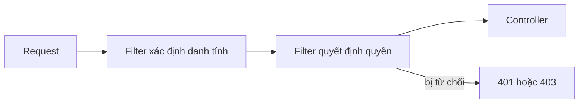
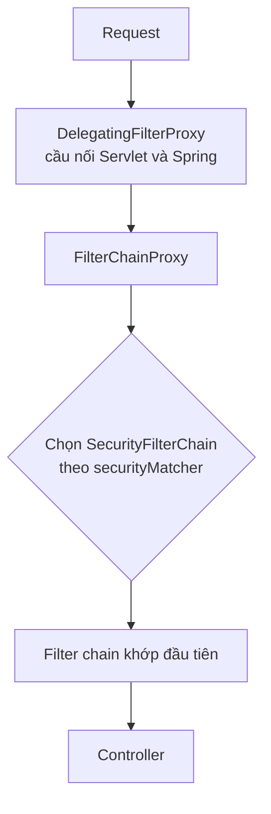
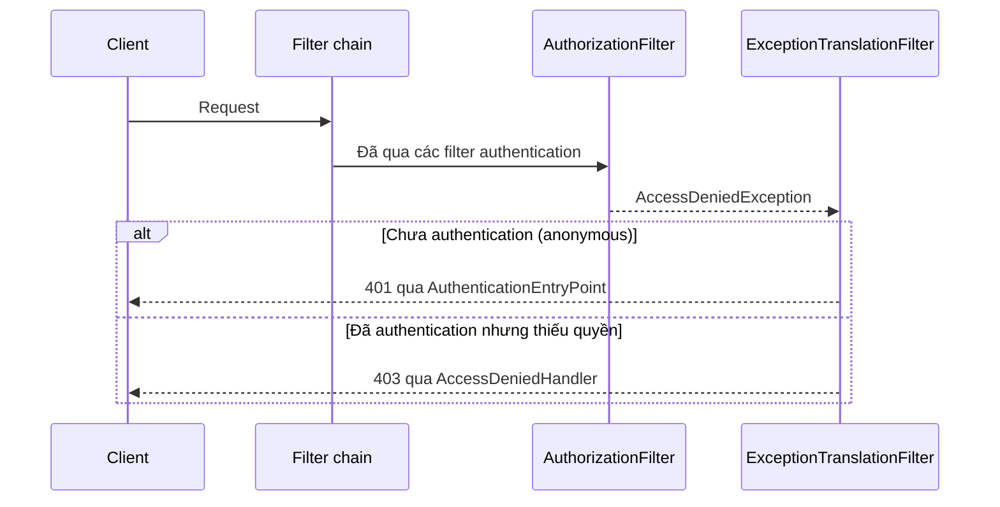
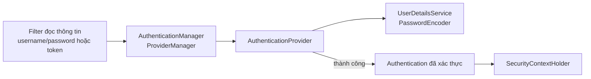
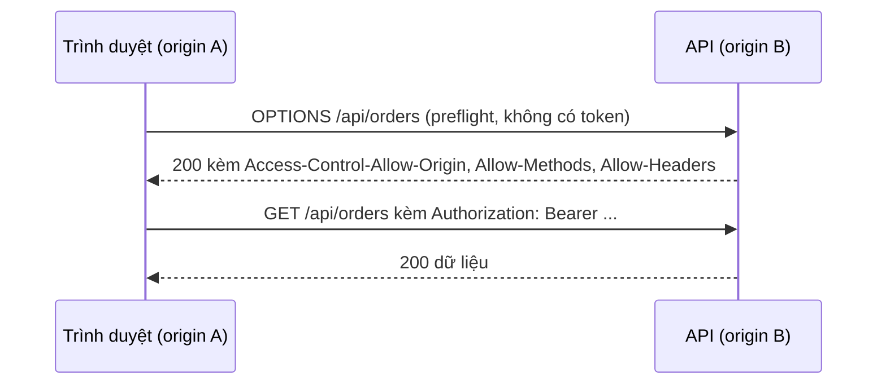

# Lý thuyết 35: Spring Security chuyên sâu

Đọc trước [Lý thuyết 6: Spring Security và JWT](/go?p=01-Spring-Boot%2Fmedium%2Flt-06-spring-security-jwt.md) và [Lý thuyết 20: OAuth2 và OpenID Connect](/go?p=01-Spring-Boot%2Fmedium%2Flt-20-oauth2-oidc.md).

## Bài này nói về điều gì?

Bài trước đã cho bạn cách cấu hình Spring Security để chạy được đăng nhập và JWT. Bài này mở nắp ca-pô: Spring Security thực chất là một **filter chain** đứng trước controller của bạn, và mọi thứ như authentication, authorization, chống CSRF, xử lý CORS, bảo mật theo method đều là các mắt xích trong chuỗi hoặc xoay quanh chuỗi đó. Hiểu được sơ đồ này, bạn sẽ biết một request bị chặn ở đâu, vì sao ra `401` hay `403`, và đặt cấu hình ở chỗ nào cho đúng.

Vì sao phải hiểu sâu đến vậy? Vì cấu hình bảo mật sai thường **không báo lỗi**. Ứng dụng vẫn chạy bình thường, test chức năng vẫn xanh, nhưng người dùng A đọc được đơn hàng của người dùng B. Đây là loại lỗi chỉ lộ ra khi bị tấn công hoặc khi bạn chủ động viết test cho các trường hợp bị từ chối. Các câu hỏi phỏng vấn senior cũng xoay quanh việc bạn hiểu flow chứ không phải chép lại cấu hình.

Bạn cần kiến thức này trong mọi API có người dùng, đặc biệt khi dùng JWT hoặc OAuth2, khi có nhiều loại client (trình duyệt, mobile, service khác) hoặc khi cần phân quyền theo từng dữ liệu cụ thể. Cách học hiệu quả là: nắm sơ đồ filter chain, phân biệt rõ authentication với authorization, chọn đúng cơ chế (session hay token), phân quyền ở cả tầng URL lẫn tầng method, và luôn kiểm tra quyền sở hữu dữ liệu.

**Cốt lõi:** Spring Security là một chuỗi servlet filter đứng trước controller, nên mọi quyết định bảo mật diễn ra trước khi code của bạn chạy. Nó tách "bạn là ai" khỏi "bạn được làm gì" và đổi lỗi thành 401 hoặc 403 ngay trong chuỗi.

- Vì filter chạy trước `DispatcherServlet` nên lỗi bảo mật không đi qua `@RestControllerAdvice`, mà `ExceptionTranslationFilter` đổi thành 401 hoặc 403.
- Vì kết quả authentication nằm trong `ThreadLocal` nên thread khác như `@Async` không thấy user hiện tại.
- Vì luật URL không biết dữ liệu thuộc ai nên quyền trên từng dữ liệu phải kiểm tra ở tầng method hoặc query.



Mô hình tư duy: request phải qua hai cổng trong chuỗi filter, và chỉ khi qua cả hai mới tới controller.

**Tóm tắt:**

- Spring Security là một filter chain đứng trước `DispatcherServlet`, nên nó chạy trước controller và trước cả `@RestControllerAdvice`.
- `FilterChainProxy` giữ nhiều `SecurityFilterChain` và chọn chuỗi đầu tiên khớp `securityMatcher`.
- Authentication trả lời "bạn là ai", authorization trả lời "bạn được làm gì"; `401` là chưa authentication, `403` là đã authentication nhưng thiếu quyền.
- Kết quả authentication nằm trong `SecurityContextHolder` theo `ThreadLocal`, nên thread khác như `@Async` không thấy user hiện tại.
- Luật `authorizeHttpRequests` khớp theo thứ tự khai báo và nên kết thúc bằng `anyRequest().authenticated()` hoặc `denyAll()`.
- Quyền trên từng dữ liệu cụ thể (chống IDOR) phải kiểm tra ở tầng method hoặc query, vì luật URL không biết dữ liệu thuộc ai.
- CSRF chỉ cần khi dùng cookie hoặc session; CORS là chính sách của trình duyệt và `CorsFilter` phải chạy trước authentication vì preflight không mang token.
- JWT không thu hồi được trước khi hết hạn; cần thu hồi tức thì thì dùng opaque token hoặc access token ngắn kèm refresh token xoay vòng.

## Các khái niệm cần biết

- **Authentication** trả lời câu hỏi "bạn là ai?". Ví dụ kiểm tra username và mật khẩu, hoặc kiểm tra chữ ký của JWT. Kết quả là một object `Authentication`.
- **Authorization** trả lời câu hỏi "bạn được làm gì?". Nó chạy sau authentication. Nhầm hai khái niệm này là nguồn gốc của nhiều lỗi: đăng nhập được không có nghĩa là được xem mọi thứ.
- **Servlet Filter** là đoạn code chạy trước và sau servlet (ở đây là `DispatcherServlet`) cho mỗi request. Spring Security nằm hoàn toàn trong tầng filter, nên nó chạy trước cả controller và trước cả `@RestControllerAdvice`.
- **Principal và GrantedAuthority**: principal là "người đang đăng nhập" (thường là `UserDetails` hoặc `Jwt`); `GrantedAuthority` là một quyền cụ thể gắn với người đó, ví dụ `ROLE_ADMIN` hay `SCOPE_orders:read`.
- **CSRF (Cross-Site Request Forgery)**: trang độc hại lừa trình duyệt của bạn gửi một request thay đổi dữ liệu tới site bạn đã đăng nhập, và trình duyệt tự gắn cookie. Cần phòng khi xác thực bằng cookie.
- **CORS (Cross-Origin Resource Sharing)**: cơ chế để trình duyệt cho phép trang ở origin khác (khác domain, port hoặc giao thức) gọi API của bạn. Đây là chính sách do trình duyệt thi hành, không phải lớp bảo vệ phía server.
- **Preflight**: trước một số request khác origin, trình duyệt gửi trước một request `OPTIONS` để hỏi server "tôi có được gọi không?". Nếu preflight bị `401` thì request thật không bao giờ được gửi.
- **IDOR**: lỗi đoán id là xem được dữ liệu người khác (giải thích ở mục lỗ hổng).
- **Stateless**: server không lưu session đăng nhập, mỗi request tự mang đủ thông tin (thường là token). Ngược lại với session lưu ở server.

## Kiến trúc filter chain



`FilterChainProxy` giữ một danh sách `SecurityFilterChain`; request đi vào **chain đầu tiên khớp**. Có thể có nhiều chain (ví dụ `/api/**` dùng JWT stateless, còn `/admin/**` dùng session và form).

**Nền tảng:** Spring Security là chuỗi servlet filter đứng trước `DispatcherServlet`, nên nó chạy trước controller và trước `@RestControllerAdvice`. Mọi quyết định (authentication, CSRF, CORS, phân quyền, đổi lỗi thành 401/403) là một mắt xích trong chuỗi; kết quả authentication nằm trong `SecurityContextHolder`, mặc định theo `ThreadLocal`.

Các filter chính, theo thứ tự tương đối (Spring Security 6):

| Filter | Vai trò |
|---|---|
| `SecurityContextHolderFilter` | Nạp `SecurityContext` (từ session nếu có) |
| `HeaderWriterFilter` | Thêm header bảo mật (HSTS, X-Content-Type-Options...) |
| `CorsFilter` | Xử lý CORS, phải chạy trước authentication |
| `CsrfFilter` | Kiểm tra token CSRF với request thay đổi dữ liệu |
| `LogoutFilter` | Đăng xuất |
| `UsernamePasswordAuthenticationFilter` | Đăng nhập bằng form |
| `BearerTokenAuthenticationFilter` | Đọc token `Authorization: Bearer` (OAuth2 resource server) |
| `BasicAuthenticationFilter` | HTTP Basic |
| `AnonymousAuthenticationFilter` | Gán user ẩn danh nếu chưa authentication |
| `ExceptionTranslationFilter` | Chuyển `AuthenticationException` thành 401 và `AccessDeniedException` thành 403 |
| `AuthorizationFilter` | Quyết định cuối: có được truy cập URL này không |

Hãy xem điều gì xảy ra khi một request không hợp lệ đi qua chain: filter chain không tự ném lỗi ra ngoài mà giao cho `ExceptionTranslationFilter` quyết định trả mã nào.



Đọc sơ đồ: `AuthorizationFilter` nằm cuối chain và ném exception khi không đủ quyền. `ExceptionTranslationFilter` bắt exception đó và phân loại: user ẩn danh nhận `401` (hãy đăng nhập), user đã đăng nhập nhưng thiếu quyền nhận `403` (đăng nhập rồi vẫn không được). Lưu ý: mã `401` thực sự phụ thuộc `AuthenticationEntryPoint` đang dùng. Chain không cấu hình `formLogin`, `httpBasic` hay entry point riêng thì request ẩn danh nhận `403` (Http403ForbiddenEntryPoint); `oauth2ResourceServer` dùng `BearerTokenAuthenticationEntryPoint` nên trả `401`. API tự làm JWT cần khai báo entry point trả `401`.

**Phải thuộc:** `401` = chưa authentication (`AuthenticationEntryPoint`), `403` = đã authentication nhưng thiếu quyền (`AccessDeniedHandler`). Luật `authorizeHttpRequests` khớp theo thứ tự khai báo, khớp đầu tiên thắng, và nên kết thúc bằng `anyRequest().authenticated()` hoặc `denyAll()`.

## Authentication

Vấn đề đặt ra là các filter khác nhau (form, Basic, Bearer token) đều cần kiểm tra danh tính nhưng không nên mỗi cái tự viết một kiểu. Spring Security tách việc này ra: filter chỉ **đọc** thông tin đăng nhập từ request, còn việc **kiểm tra** giao cho `AuthenticationManager` (cài đặt phổ biến là `ProviderManager`), và manager này hỏi lần lượt các `AuthenticationProvider`.



- `UserDetailsService` nạp thông tin người dùng (mật khẩu đã hash, quyền) theo username, thường từ database. `PasswordEncoder` so khớp mật khẩu người dùng nhập với bản hash đó.
- Kết quả được lưu trong `SecurityContextHolder`, mặc định theo **ThreadLocal** (mỗi thread có một ô nhớ riêng). Hệ quả: code chạy ở thread khác (`@Async`, executor tự tạo) **không thấy** người dùng hiện tại, và `SecurityContextHolder.getContext().getAuthentication()` trả về `null`, trừ khi truyền context (ví dụ `DelegatingSecurityContextExecutor`).
- Mật khẩu: dùng `DelegatingPasswordEncoder` (mặc định tạo `BCryptPasswordEncoder`, chuỗi lưu có tiền tố `{bcrypt}` để sau này đổi thuật toán vẫn đọc được bản hash cũ), hoặc Argon2. Vì sao phải hash chậm có salt, không dùng MD5/SHA-1 thuần: xem [Authentication, Session và Token](/go?p=03-Network-Security%2Fmedium%2Flt-05-xac-thuc-phien-token.md).

## Authorization

### Theo URL

Cách đơn giản nhất là khai báo "đường nào ai được vào". Dùng khi quy tắc chỉ phụ thuộc vào đường dẫn và vai trò. Không đủ khi quyền phụ thuộc vào dữ liệu cụ thể (ví dụ đơn hàng số 42 của ai), lúc đó cần authorization theo method ở phần sau.

```java
@Bean
SecurityFilterChain api(HttpSecurity http) throws Exception {
    http
        .securityMatcher("/api/**")
        // API dùng Bearer token, không dùng cookie
        .csrf(csrf -> csrf.disable())
        .sessionManagement(s -> s.sessionCreationPolicy(SessionCreationPolicy.STATELESS))
        .authorizeHttpRequests(a -> a
            .requestMatchers("/api/public/**", "/actuator/health").permitAll()
            .requestMatchers(HttpMethod.GET, "/api/products/**").permitAll()
            .requestMatchers("/api/admin/**").hasRole("ADMIN")
            // luôn kết thúc bằng "từ chối mặc định"
            .anyRequest().authenticated())
        .oauth2ResourceServer(o -> o.jwt(Customizer.withDefaults()));
    return http.build();
}
```

Quy tắc khớp: **theo thứ tự khai báo, khớp đầu tiên thắng**. Đặt luật cụ thể trước, luật chung sau; kết thúc bằng `anyRequest().authenticated()` hoặc `denyAll()`.

### Theo method

`@PreAuthorize` kiểm tra điều kiện (viết bằng SpEL, ngôn ngữ biểu thức của Spring) **trước** khi method chạy; `@PostAuthorize` kiểm tra **sau** khi method chạy, dựa trên giá trị trả về (`returnObject`). Cần `@EnableMethodSecurity` để bật.

```java
@EnableMethodSecurity
class SecurityConfig {}

@Service
class OrderService {
    @PreAuthorize("hasRole('ADMIN') or #userId == authentication.name")
    public List<Order> ordersOf(String userId) { ... }

    @PostAuthorize("returnObject.ownerId == authentication.name")
    public Order get(long id) { ... }
}
```

Authorization theo method là nơi bạn kiểm tra **quyền trên từng dữ liệu cụ thể**, thứ mà luật URL không làm được. Cũng như `@Transactional`, nó hoạt động qua proxy nên gọi nội bộ (`this.ordersOf(...)` trong cùng class) không có hiệu lực: kiểm tra bị bỏ qua mà không có cảnh báo nào. Lưu ý `@PostAuthorize` vẫn để method chạy xong (kể cả ghi dữ liệu) rồi mới từ chối, nên không dùng nó cho thao tác có tác dụng phụ.

### Role và authority

Spring Security chỉ có một khái niệm là authority (một chuỗi quyền). "Role" chỉ là quy ước: authority bắt đầu bằng `ROLE_`.

- `hasRole("ADMIN")` tự thêm tiền tố `ROLE_`, tức kiểm tra authority `ROLE_ADMIN`. `hasAuthority("ROLE_ADMIN")` thì không thêm.
- Với JWT, ánh xạ claim sang authority bằng `JwtAuthenticationConverter` (đặt tiền tố đúng, nếu không `hasRole` luôn sai). Mặc định Spring chỉ đọc claim `scope`/`scp` và thêm tiền tố `SCOPE_`; code ánh xạ `realm_access.roles` của Keycloak ở [Lý thuyết 20: OAuth2 và OpenID Connect](/go?p=01-Spring-Boot%2Fmedium%2Flt-20-oauth2-oidc.md).

**Phải thuộc:** `hasRole("ADMIN")` kiểm tra authority `ROLE_ADMIN` (tự thêm tiền tố), `hasAuthority("ADMIN")` kiểm tra đúng chuỗi. Mật khẩu hash bằng `DelegatingPasswordEncoder` (mặc định BCrypt, tiền tố `{bcrypt}`). Bảo mật theo method cần `@EnableMethodSecurity` và qua proxy nên self-invocation bị bỏ qua.

**Suy luận:** Vì Spring Security là filter chain chạy trước `DispatcherServlet`, mọi exception phát sinh trong đó không thể đi qua `@RestControllerAdvice`, nên cần một filter riêng để biến chúng thành mã HTTP, và đó là `ExceptionTranslationFilter`. Filter này phải đặt gần cuối chuỗi vì nó chỉ bắt được exception ném bởi các filter đứng sau nó, chủ yếu là `AuthorizationFilter`. Để chọn giữa hai mã, nó chỉ cần hỏi một câu: request này đã có `Authentication` thật chưa. Chưa có (anonymous) thì còn cách khắc phục là đăng nhập, nên trả `401` qua `AuthenticationEntryPoint`; đã có mà vẫn bị từ chối thì đăng nhập lại cũng vô ích, nên trả `403` qua `AccessDeniedHandler`. Điểm dễ nhầm là tin rằng API tự làm JWT lúc nào cũng trả `401`: nếu không khai báo entry point, request anonymous nhận `403` mặc định, và client không biết cần gửi lại token. Khi review cấu hình, hãy kiểm tra entry point cho từng chuỗi và viết test cho cả hai trường hợp chưa đăng nhập và thiếu quyền.

## Lỗ hổng phổ biến

Các lỗ hổng dưới đây không do thiếu thư viện mà do thiếu một bước kiểm tra. Bảng liệt kê từng lỗi, biểu hiện và cách chặn.

| Lỗ hổng | Mô tả | Phòng ngừa |
|---|---|---|
| **IDOR** (broken object-level authorization) | `GET /orders/42` trả đơn của người khác chỉ vì có id | Luôn kiểm tra quyền sở hữu: query kèm `ownerId`, hoặc `@PostAuthorize` |
| Mass assignment | Client gửi thêm trường như `role`, `price` | Dùng DTO riêng cho input, không bind trực tiếp vào entity |
| Lộ endpoint quản trị | Actuator, h2-console, swagger mở công khai | Đặt riêng một filter chain bảo vệ, chỉ mở `health` |
| Rò rỉ thông tin qua lỗi | Stack trace, thông báo "user không tồn tại" và "sai mật khẩu" khác nhau | Thông báo chung, `ProblemDetail` đã lọc |
| Brute force, nhồi thông tin đăng nhập | Thử mật khẩu liên tục | Rate limiting, lock tạm, MFA |
| Mật khẩu yếu hoặc lưu sai | Hash nhanh, không salt | BCrypt hoặc Argon2 |

## CSRF và CORS: hai thứ khác nhau

| | CSRF | CORS |
|---|---|---|
| Là gì | Tấn công khiến trình duyệt gửi request thay đổi dữ liệu kèm cookie của người dùng | Chính sách trình duyệt cho phép trang ở origin khác gọi API của bạn |
| Ai thực thi | Server (kiểm tra token CSRF) | **Trình duyệt** (dựa trên header server trả về) |
| Khi nào cần | Xác thực bằng **cookie/session** | Frontend và API khác origin |
| Với Bearer token trong header | Thường **không cần** CSRF (trình duyệt không tự gắn header) | Vẫn cần nếu khác origin |

**Phải thuộc:** CSRF chỉ cần khi xác thực bằng cookie/session (trình duyệt tự gắn cookie); API dùng Bearer token trong header thì có thể tắt. CORS là chính sách do trình duyệt thi hành (curl và Postman bỏ qua), preflight `OPTIONS` không mang token nên `CorsFilter` phải chạy trước xác thực.

Flow của một request khác origin có preflight, để thấy vì sao CORS phải xử lý trước xác thực:



Preflight không mang token, nên nếu `CorsFilter` chạy sau filter xác thực thì preflight bị `401` và trình duyệt chặn luôn request thật (bạn thấy lỗi CORS trong console dù nguyên nhân là xác thực).

**Suy luận:** Vì trình duyệt tự gắn cookie vào mọi request tới một site nhưng không tự gắn header `Authorization`, hai cơ chế xác thực này có bề mặt tấn công khác nhau: cookie cần CSRF token để phân biệt request do trang của bạn gửi với request do trang độc hại ép gửi, còn Bearer token do code frontend gắn thủ công nên trang độc hại không giả mạo được. Vì vậy tắt CSRF chỉ an toàn khi chắc chắn không còn đường xác thực bằng cookie nào. CORS đến từ một vấn đề khác: trình duyệt chặn trang ở origin này đọc response của origin kia, và với request có header tùy chỉnh nó gửi preflight `OPTIONS` trước mà không kèm token. Từ đó suy ra `CorsFilter` phải chạy trước filter authentication, nếu không preflight bị `401` và request thật không bao giờ được gửi, trong khi console chỉ báo lỗi CORS. Điểm dễ nhầm là coi CORS như một lớp bảo vệ server (curl và Postman bỏ qua nó hoàn toàn) hoặc cho phép mọi origin cùng `allowCredentials(true)`. Khi thiết kế, hãy liệt kê origin cụ thể, tắt CSRF chỉ cho chuỗi stateless dùng Bearer token, và nếu lưu token trong cookie thì bật lại CSRF.

Sai lầm hay gặp về CORS: cho phép mọi origin cùng `allowCredentials(true)`; xử lý CORS sau filter xác thực nên request `OPTIONS` (preflight) bị `401`; coi CORS là cơ chế bảo mật phía server (curl và Postman bỏ qua nó).

## JWT: điểm yếu và cách làm đúng

Cấu trúc JWT, các kiểu tấn công (`alg: none`, nhầm public key thành key HMAC), access token ngắn hạn kèm refresh token xoay vòng và chỗ lưu token ở trình duyệt đã có ở bài [Authentication, Session và Token](/go?p=03-Network-Security%2Fmedium%2Flt-05-xac-thuc-phien-token.md); đừng chép lại ở đây. Phần Spring cần nhớ: JWT không thu hồi được trước khi hết hạn nếu không có danh sách chặn, nên cần thu hồi tức thì thì dùng opaque token (xem bảng bên dưới); dùng thư viện chuẩn của Spring (Nimbus) và kiểm tra `iss`, `aud`, `exp` như ở [Lý thuyết 20: OAuth2 và OpenID Connect](/go?p=01-Spring-Boot%2Fmedium%2Flt-20-oauth2-oidc.md); và nếu lưu token trong cookie thì khi đó phải xử lý CSRF.

Trong kiến trúc nhiều service, nên dùng identity provider (Keycloak, Auth0, Cognito) theo OAuth2/OIDC thay vì tự cài.

## Phần hay bị hỏi thêm: AuthorizationManager, remember-me, header, opaque token, session

Các cơ chế dưới đây là mảnh ghép nhỏ quanh filter chain nhưng hay xuất hiện khi bắt tay vào dự án thật. Bảng cho cái nhìn tổng, các mục sau có ví dụ ngắn.

| Chủ đề | Là gì | Dùng khi | Lưu ý |
|---|---|---|---|
| **AuthorizationManager** | Interface quyết định "cho qua hay không" cho một request hoặc một call method; `authorizeHttpRequests` và `@PreAuthorize` đều chạy trên nó (từ Security 6) | Quy tắc phân quyền không diễn đạt được bằng `hasRole` | Trả `AuthorizationDecision`; viết một lần, dùng lại ở URL và method |
| **Remember-me** | Giữ đăng nhập sau khi hết session bằng cookie riêng | Ứng dụng web có form đăng nhập | Dạng băm đơn giản yếu hơn dạng lưu token trong DB; không hợp với API stateless |
| **Security headers** | Header response chống clickjacking, sniffing, ép HTTPS | Mọi ứng dụng trả HTML | Mặc định đã bật vài header; CSP phải tự đặt |
| **Opaque token** | Token là chuỗi ngẫu nhiên, server hỏi authorization server (introspection) để biết hợp lệ không | Cần thu hồi token ngay | Thêm một call mạng mỗi request, nên cache ngắn |
| **Session concurrency** | Giới hạn số session đồng thời của một user | Cấm chia sẻ tài khoản, ép đăng xuất nơi khác | Cần `HttpSessionEventPublisher` để biết session đã hết |

AuthorizationManager tùy biến, _Minh họa_ (Spring Security 6.x):

```java
http.authorizeHttpRequests(auth -> auth
    .requestMatchers("/api/orders/{id}").access((authentication, context) -> {
        String ownerId = context.getVariables().get("id");   // ví dụ minh họa
        boolean allowed = authentication.get().getName().equals(ownerId);
        return new AuthorizationDecision(allowed);
    })
    .anyRequest().authenticated());
```

Remember-me, header và session concurrency cấu hình cùng một `SecurityFilterChain`, _Minh họa_:

```java
http.rememberMe(r -> r.key("change-me").tokenValiditySeconds(14 * 24 * 3600))
    .headers(h -> h
        .contentSecurityPolicy(c -> c.policyDirectives("default-src 'self'"))
        .frameOptions(f -> f.deny()))
    .sessionManagement(s -> s.sessionConcurrency(c -> c
        // đăng nhập mới đá session cũ
        .maximumSessions(1).maxSessionsPreventsLogin(false)));

@Bean HttpSessionEventPublisher httpSessionEventPublisher() { return new HttpSessionEventPublisher(); }
```

Mặc định Spring Security đã thêm `X-Content-Type-Options`, `X-Frame-Options`, `Cache-Control` và HSTS (HSTS chỉ khi request đi qua HTTPS). Đặt `maxSessionsPreventsLogin(true)` thì người đăng nhập mới bị từ chối thay vì đá session cũ.

Resource server dùng opaque token thay JWT, _Minh họa_:

```java
http.oauth2ResourceServer(o -> o.opaqueToken(t -> t
    .introspectionUri("https://auth.example.com/oauth2/introspect")
    .introspectionClientCredentials("client-id", "client-secret")));
```

JWT tự kiểm chữ ký nên nhanh nhưng khó thu hồi; opaque token chậm hơn một call nhưng thu hồi tức thì. Tên phương thức cấu hình đã đổi giữa các bản (cú pháp lambda là chuẩn ở 6.x), kiểm tra lại theo phiên bản.

## Xử lý lỗi bảo mật

- `AuthenticationEntryPoint`: trả `401` khi chưa authentication.
- `AccessDeniedHandler`: trả `403` khi đã authentication nhưng không đủ quyền.
- Exception ném từ **filter** không đi qua `@RestControllerAdvice`, vì `@RestControllerAdvice` chỉ bắt lỗi phát sinh bên trong `DispatcherServlet`, còn filter chạy trước đó. Nếu không cấu hình, client nhận một trang lỗi mặc định khác hẳn định dạng lỗi của các endpoint còn lại. Để trả cùng định dạng lỗi (`ProblemDetail`), cấu hình hai thành phần trên.

## Kiểm thử

```java
@Test
@WithMockUser(roles = "USER")
void userCannotAccessAdmin() throws Exception {
    mockMvc.perform(get("/api/admin/stats")).andExpect(status().isForbidden());
}

@Test
void jwtWithScope() throws Exception {
    mockMvc.perform(get("/api/orders")
            .with(SecurityMockMvcRequestPostProcessors.jwt()
                    .authorities(new SimpleGrantedAuthority("SCOPE_orders:read"))))
           .andExpect(status().isOk());
}
```

Hãy viết test cho các trường hợp **bị từ chối** (chưa đăng nhập, sai quyền, quyền sở hữu), vì đó là nơi lỗ hổng xuất hiện.

## Phỏng vấn khó: chuỗi hỏi xoáy

Người phỏng vấn senior thường mở bằng một câu dễ, rồi xoáy xuống cơ chế, đánh đổi và sự cố thật. Câu trả lời tốt luôn đi từ cốt lõi xuống, không nhảy thẳng vào chi tiết.

### Chuỗi 1: Vì sao API JWT trả 403 thay vì 401

1. **Câu mở:** API JWT tự cấu hình của bạn trả `403` cho request không có token, trong khi client mong đợi `401`. Vì sao?
2. **Xoáy 1:** `ExceptionTranslationFilter` quyết định mã nào, dựa vào cái gì?
3. **Xoáy 2:** Bạn thêm `@ExceptionHandler` cho `AccessDeniedException` trong `@RestControllerAdvice` nhưng response không đổi. Tại sao?

**Đáp án ngắn:** `AuthorizationFilter` ném `AccessDeniedException`, `ExceptionTranslationFilter` bắt và hỏi một câu: request đã có `Authentication` thật chưa. Chưa có (anonymous) thì gọi `AuthenticationEntryPoint` để trả 401; đã có mà thiếu quyền thì gọi `AccessDeniedHandler` trả 403. Nhưng entry point mặc định phụ thuộc cấu hình: chain không có `formLogin`, `httpBasic` hay entry point riêng thì request ẩn danh nhận 403 (`Http403ForbiddenEntryPoint`), còn `oauth2ResourceServer` dùng `BearerTokenAuthenticationEntryPoint` nên trả 401. Vì vậy API tự làm JWT phải khai báo entry point trả 401. `@RestControllerAdvice` không có tác dụng vì nó chỉ bắt exception bên trong `DispatcherServlet`, còn Security chạy trong filter chain phía trước. Muốn định dạng lỗi thống nhất thì cấu hình entry point và access denied handler trả cùng `ProblemDetail`. Kiểm chứng bằng test cho cả hai trường hợp: chưa đăng nhập và thiếu quyền.

**Sai lầm hay gặp:**
- Nói "401 là chưa đăng nhập, 403 là thiếu quyền" nhưng không biết entry point mặc định có thể cho ra 403.
- Cố bắt lỗi bảo mật bằng `@RestControllerAdvice`.
- Chỉ test trường hợp thành công.

### Chuỗi 2: CORS preflight và thứ tự filter

1. **Câu mở:** Frontend ở origin khác báo lỗi CORS trong console, nhưng log backend thấy `401` ở request `OPTIONS`. Chuyện gì xảy ra?
2. **Xoáy 1:** Vì sao preflight không mang token, và `CorsFilter` phải đứng ở đâu so với filter authentication?
3. **Xoáy 2:** Có người cấu hình cho phép mọi origin cùng `allowCredentials(true)` cho "dễ". Vấn đề gì?

**Đáp án ngắn:** Với request khác origin, trình duyệt gửi trước một request `OPTIONS` (preflight) để hỏi server có cho phép không, và request này không kèm token. Nếu `CorsFilter` chạy sau filter xác thực thì preflight bị 401, trình duyệt chặn request thật và console chỉ báo lỗi CORS dù nguyên nhân là xác thực. Vì vậy CORS phải được xử lý trước authentication để preflight trả 200 kèm các header `Access-Control-Allow-*`. CORS là chính sách do trình duyệt thi hành dựa trên header server trả về, không phải lớp bảo vệ phía server; curl và Postman bỏ qua nó hoàn toàn. Cho mọi origin cùng credentials nghĩa là mở API cho trang của bất kỳ ai gọi kèm danh tính của người dùng đang đăng nhập; nên liệt kê origin cụ thể. Cách phát hiện: tab network của trình duyệt thấy `OPTIONS` thất bại trước khi request thật được gửi.

**Sai lầm hay gặp:**
- Coi CORS là cơ chế bảo mật phía server.
- Nhầm CORS với CSRF.
- Debug ở phía frontend trong khi gốc là thứ tự filter.

### Chuỗi 3: Method security qua proxy và `@PostAuthorize`

1. **Câu mở:** Luật URL của bạn yêu cầu `authenticated()` cho `/api/orders/**`. User A đã đăng nhập có đọc được đơn của B không, và bạn thêm lớp nào?
2. **Xoáy 1:** Bạn dùng `@PostAuthorize("returnObject.ownerId == authentication.name")` cho endpoint xóa đơn. Có ổn không?
3. **Xoáy 2:** Annotation đặt trên method, nhưng một method khác trong cùng class gọi nó bằng `this`. Kết quả?

**Đáp án ngắn:** Luật URL không biết dữ liệu thuộc ai, nên quyền trên từng dữ liệu phải kiểm tra ở tầng method hoặc query. Cách chắc nhất là query kèm `ownerId` của người hiện tại, hoặc `@PreAuthorize` so tham số với `authentication.name` trước khi method chạy. `@PostAuthorize` kiểm tra sau khi method chạy xong, dựa trên `returnObject`, nên với thao tác ghi hoặc xóa thì tác dụng phụ đã xảy ra rồi mới từ chối; chỉ hợp cho thao tác đọc. Method security cần `@EnableMethodSecurity` và hoạt động qua proxy như `@Transactional`, nên gọi bằng `this` bỏ qua kiểm tra mà không có cảnh báo nào. Đây là loại lỗi không làm test chức năng đỏ. Cách phát hiện là viết test cho trường hợp bị từ chối: user A đọc đơn của B phải bị chặn, kể cả khi đi qua đường gọi nội bộ.

**Sai lầm hay gặp:**
- Nghĩ `authenticated()` là đủ phân quyền.
- Dùng `@PostAuthorize` cho thao tác có tác dụng phụ.
- Không viết test cho các trường hợp bị từ chối.

## Câu hỏi phỏng vấn thường gặp

1. Một request tới API của bạn đi qua những gì của Spring Security trước khi chạm controller, và `FilterChainProxy` làm gì?

   **Phải thuộc:** Câu này là câu cốt lõi, gặp rất thường xuyên.

   **Gợi ý suy luận:**
   - Spring Security nằm ở tầng nào so với `DispatcherServlet` (servlet filter hay MVC)?
   - Nếu một ứng dụng có `/api/**` dùng JWT và `/admin/**` dùng form, một filter chain có đủ không?
   - Lỗi authentication và authorization được chuyển thành mã HTTP ở đâu?

   **Lập luận:** vì Spring Security là chuỗi servlet filter nên nó chạy trước controller và trước cả `@RestControllerAdvice`. `DelegatingFilterProxy` nối Servlet với Spring, giao cho `FilterChainProxy`. Mỗi ứng dụng có thể cần cách bảo vệ khác nhau cho từng nhóm URL, nên `FilterChainProxy` giữ nhiều `SecurityFilterChain` và chọn **chain đầu tiên khớp** theo `securityMatcher`. Trong chain, các filter authentication đọc thông tin đăng nhập, `AuthorizationFilter` quyết định cuối, và `ExceptionTranslationFilter` đổi exception thành `401` hoặc `403`.

   **Đáp án ngắn:** request đi qua `DelegatingFilterProxy` tới `FilterChainProxy`, nơi chọn `SecurityFilterChain` khớp đầu tiên; các filter authentication rồi `AuthorizationFilter` xử lý, `ExceptionTranslationFilter` trả `401`/`403`.

   **Nhớ:** Spring Security là filter chain trước `DispatcherServlet`. Xem mục "Kiến trúc filter chain".

2. Đăng nhập thành công rồi nhưng vẫn bị từ chối xem một đơn hàng. Authentication khác authorization thế nào, và kết quả authentication được giữ ở đâu?

   **Gợi ý suy luận:**
   - "Bạn là ai" và "bạn được làm gì" có cùng một câu trả lời không?
   - Sau khi authentication xong, các filter phía sau lấy danh tính từ đâu mà không phải xác thực lại?
   - Cơ chế lưu mặc định gắn với cái gì (thread)?

   **Lập luận:** authentication chỉ chứng minh danh tính, còn authorization chạy sau đó để quyết định danh tính đó được làm gì, nên đăng nhập được không bảo đảm xem được mọi thứ. Kết quả authentication là object `Authentication`, được lưu trong `SecurityContextHolder`, mặc định theo `ThreadLocal`, để mọi code trong cùng request/thread đọc được danh tính hiện tại.

   **Đáp án ngắn:** authentication xác định "bạn là ai", authorization quyết định "bạn được làm gì" sau đó. Kết quả được lưu trong `SecurityContextHolder`, mặc định theo `ThreadLocal`.

   **Nhớ:** hai bước tách bạch, nhầm chúng sinh lỗi bảo mật.

3. Trong method `@Async`, `SecurityContextHolder.getContext().getAuthentication()` trả về `null`. Vì sao, và xử lý thế nào?

   **Gợi ý suy luận:**
   - `SecurityContextHolder` mặc định lưu theo cơ chế nào, và `@Async` chạy ở thread nào?
   - Muốn thread mới thấy user, ta phải làm gì với context khi giao việc?

   **Lập luận:** security context lưu theo `ThreadLocal`, tức mỗi thread có ô nhớ riêng. `@Async` chạy ở thread của executor khác thread request, ô nhớ đó rỗng nên `getAuthentication()` trả `null`. Cách xử lý là truyền context sang thread mới, ví dụ bọc executor bằng `DelegatingSecurityContextExecutor` hoặc truyền sẵn dữ liệu cần thiết (như user id) làm tham số.

   **Đáp án ngắn:** vì `SecurityContext` nằm trong `ThreadLocal` của thread request; thread `@Async` không có. Dùng `DelegatingSecurityContextExecutor` hoặc truyền sẵn thông tin cần dùng.

   **Nhớ:** mọi thứ gắn `ThreadLocal` (security, transaction) không tự sang thread khác.

4. API của bạn dùng Bearer token trong header nhưng có người bảo "tắt CSRF đi". Khi nào cần CSRF, khi nào tắt, và nó khác CORS ra sao?

   **Phải thuộc:** Câu này là câu cốt lõi, gặp rất thường xuyên.

   **Gợi ý suy luận:**
   - CSRF khai thác điều gì mà trình duyệt tự làm (tự gắn cái gì vào request)?
   - Header `Authorization: Bearer` có được trình duyệt tự gắn không?
   - CORS do ai thi hành (server hay trình duyệt) và bảo vệ cái gì?

   **Lập luận:** CSRF lợi dụng việc trình duyệt tự gắn cookie vào mọi request tới site, nên chỉ nguy hiểm khi xác thực bằng cookie hoặc session. Bearer token do code frontend gắn thủ công vào header, trình duyệt không tự gắn, nên trang độc hại không giả mạo được: có thể tắt CSRF. CORS thì khác bản chất: là chính sách do trình duyệt thi hành dựa trên header server trả về, quyết định trang ở origin khác có được đọc response từ API hay không, không phải lớp bảo vệ phía server (curl bỏ qua nó). Một cái chống giả mạo request, một cái cho phép gọi khác origin.

   **Đáp án ngắn:** bật CSRF khi dùng cookie/session; có thể tắt khi dùng Bearer token. CSRF chống giả mạo request kèm cookie; CORS là chính sách trình duyệt cho gọi khác origin.

   **Nhớ:** CSRF và CORS giải hai bài toán khác nhau. Xem mục "CSRF và CORS".

5. `hasRole('ADMIN')` cho người dùng có authority `ADMIN` lại trả `403`. Vì sao?

   **Gợi ý suy luận:**
   - Spring Security có mấy khái niệm: role hay chỉ authority?
   - `hasRole` thêm gì vào chuỗi trước khi so khớp?

   **Lập luận:** Spring Security thực chất chỉ có authority (chuỗi quyền); "role" là quy ước authority bắt đầu bằng `ROLE_`. `hasRole("ADMIN")` tự thêm tiền tố và kiểm tra `ROLE_ADMIN`, trong khi `hasAuthority("ADMIN")` kiểm tra đúng chuỗi `ADMIN`. Người dùng chỉ có `ADMIN` nên `hasRole` không khớp. Với JWT cần cấu hình `JwtAuthenticationConverter` để đặt tiền tố đúng, vì mặc định chỉ đọc claim `scope` với tiền tố `SCOPE_`.

   **Đáp án ngắn:** `hasRole('ADMIN')` kiểm tra `ROLE_ADMIN` (tự thêm tiền tố), còn `hasAuthority('ADMIN')` kiểm tra đúng chuỗi `ADMIN`.

   **Nhớ:** role chỉ là authority có tiền tố `ROLE_`.

6. JWT có nhược điểm gì, và làm sao thu hồi quyền truy cập khi token đã phát ra?

   **Gợi ý suy luận:**
   - Vì sao server không cần tra database khi nhận JWT, và điều đó đánh đổi lấy khả năng gì?
   - Token hết hạn sau bao lâu thì quyền bị thu hồi thật sự?
   - Giảm thiểu rủi ro bằng cách nào: thời hạn, refresh, danh sách chặn?

   **Lập luận:** JWT tự chứa thông tin và chữ ký, server chỉ kiểm tra chữ ký nên stateless, nhưng cũng nghĩa là server không có state để "hủy" một token trước hạn. Vì vậy phải giảm thiểu: access token sống ngắn (vài phút), refresh token xoay vòng và lưu phía server để thu hồi được, và danh sách chặn khi cần. Ngoài ra payload chỉ mã hóa base64 nên không để dữ liệu nhạy cảm, chỉ chấp nhận thuật toán đã định (không cho `alg: none`), và kiểm tra `iss`, `aud`, `exp`; nơi lưu ở trình duyệt cũng phải cân nhắc XSS và CSRF.

   **Đáp án ngắn:** JWT không thu hồi được trước khi hết hạn; dùng access token sống ngắn, refresh token xoay vòng lưu phía server, và danh sách chặn khi cần.

   **Nhớ:** stateless đổi lấy khó thu hồi. Xem mục "JWT: điểm yếu và cách làm đúng".

7. `GET /orders/42` trả đơn của người khác chỉ vì họ đoán ra id, dù đã đăng nhập đúng. Đây là lỗi gì, và ngăn thế nào trong Spring?

   **Gợi ý suy luận:**
   - Luật URL (`authenticated()`) biết được "đơn 42 của ai" không?
   - Vậy kiểm tra quyền sở hữu phải đặt ở tầng nào, và có thể đặt ngay trong query không?

   **Lập luận:** đó là IDOR (broken object-level authorization): hệ thống chỉ kiểm tra "đã đăng nhập" mà không kiểm tra user này sở hữu object cụ thể. Luật theo URL không biết dữ liệu thuộc ai, nên phải kiểm tra ở tầng method hoặc query: query kèm `ownerId` của người hiện tại, hoặc `@PreAuthorize`/`@PostAuthorize` so sánh với `authentication.name`. Lưu ý `@PostAuthorize` để method chạy xong rồi mới từ chối nên không dùng cho thao tác ghi; và hãy viết test cho các trường hợp bị từ chối.

   **Đáp án ngắn:** đó là IDOR; ngăn bằng cách luôn kiểm tra quyền sở hữu dữ liệu (query kèm `ownerId` hoặc `@PreAuthorize`/`@PostAuthorize`), không chỉ dựa vào luật URL.

   **Nhớ:** đăng nhập không bằng được phép xem mọi thứ.

