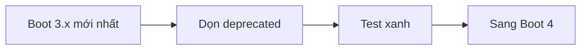
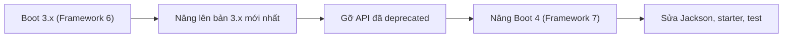
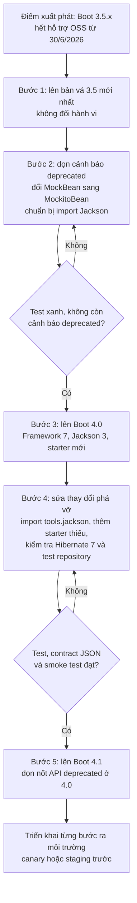
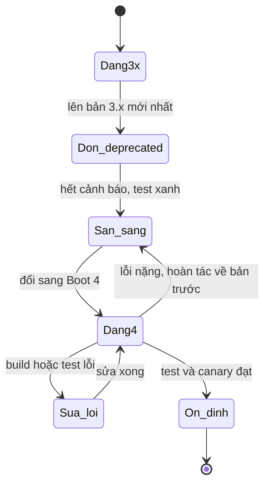
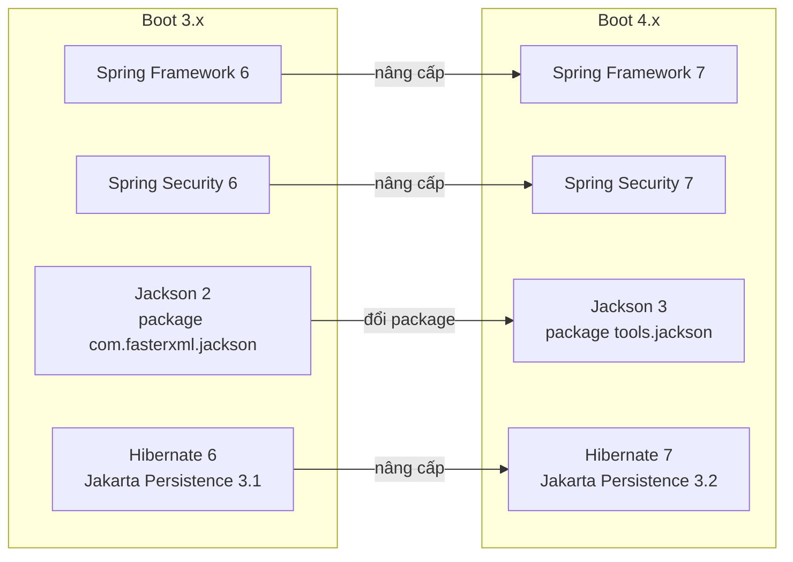
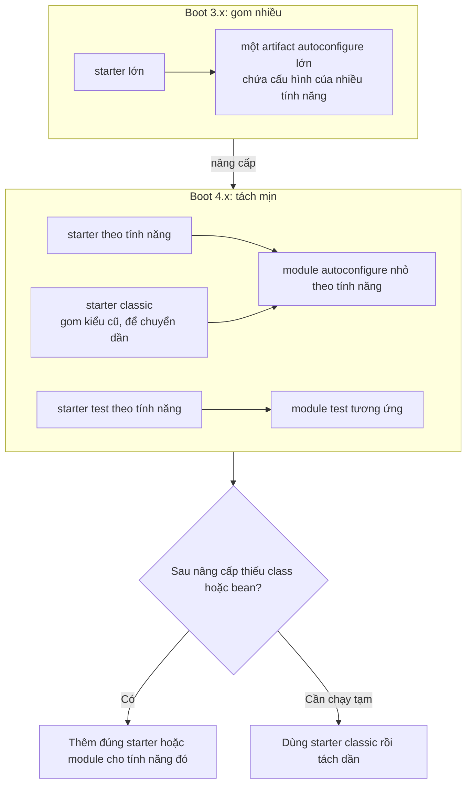

# Lý thuyết 38: Spring Boot 4, Framework 7 và Security 7 thay đổi gì

Các bài khác trong bộ tài liệu này viết cho **Spring Boot 3.x** (Spring Framework 6, Spring Security 6). Bài này tóm tắt những thay đổi đáng chú ý của thế hệ tiếp theo: Boot 4, Framework 7, Security 7. Mục tiêu là để bạn biết trước chỗ nào code Boot 3 sẽ phải sửa khi nâng cấp, chứ không phải thay thế các bài kia.

**Cốt lõi:** Một bản major cho phép phá tương thích, nên API muốn bỏ được đánh dấu deprecated ở dòng cũ rồi bị xóa ở dòng mới. Vì vậy nâng cấp an toàn là dọn nợ trên nền 3.x đang chạy tốt trước, rồi mới sang Boot 4 với ít thay đổi cùng lúc.

- Vì warning deprecated ở Boot 3.x mới nhất là danh sách việc sẽ làm hỏng build ở Boot 4 nên phải dọn trước khi nhảy.
- Vì Jackson 3 phải cùng tồn tại với thế hệ cũ nên package gốc đổi sang `tools.jackson`, còn annotation giữ package cũ.
- Vì Boot 4 tách module mịn hơn nên thiếu class sau nâng cấp nghĩa là cần thêm đúng starter, không phải sửa logic.



Mô hình tư duy: nâng cấp là chuỗi bước nhỏ, mỗi bước phải xanh test trước khi sang bước sau.

**Tóm tắt:**

- Bộ tài liệu viết cho Boot 3.x; thế hệ tiếp theo gồm Boot 4, Framework 7, Security 7, và chi tiết API cần kiểm tra lại theo migration guide.
- Đường nâng cấp an toàn: lên bản 3.x mới nhất, dọn mọi API deprecated, rồi mới sang Boot 4.
- Jackson 3 đổi package gốc sang `tools.jackson`, annotation giữ package cũ, và phần lớn exception thành unchecked.
- Boot 4 chia thành nhiều module và starter mịn hơn, nên có thể thiếu class sau khi nâng cấp và phải thêm đúng starter.
- Framework 7 có sẵn `@Retryable` và `@ConcurrencyLimit`, nhưng đó chỉ là retry đơn giản trong process, circuit breaker vẫn cần Resilience4j.
- API versioning khai báo ngay trên mapping, nên logic chọn phiên bản không còn rải trong controller.
- Null-safety chuyển sang JSpecify, và `RestTestClient` cho test REST kiểu fluent không cần WebFlux.
- Không nâng cấp chỉ vì có phiên bản mới; cần lý do như tính năng cần hoặc hết hỗ trợ. Với Boot 3.5, lý do hết hỗ trợ đã xảy ra (30/6/2026).
- Boot 4 đi với Hibernate 7 (Jakarta Persistence 3.2); Boot 4.1 (10/6/2026) bổ sung module gRPC và bộ lọc chống SSRF.


**Lưu ý độ tin cậy:** phần này phụ thuộc phiên bản và đổi nhanh giữa các bản phát hành. Mọi tên package, artifact, property dưới đây hãy kiểm tra lại theo phiên bản bạn dùng (đọc release notes và migration guide chính thức) trước khi áp dụng. Code trong bài là _Minh họa_, chưa chạy thử.

Khi nào đọc: bạn chuẩn bị nâng cấp, hoặc dự án mới chọn phiên bản nền. Khi nào chưa cần: dự án đang ổn trên Boot 3.x và đã có kế hoạch hoặc hỗ trợ thương mại sau 30/6/2026; nâng cấp lớn nên có lý do (tính năng cần, hết hỗ trợ), không chạy theo phiên bản.

## Tình trạng phiên bản (kiểm tra 2026-10-30)

| Dòng | Trạng thái |
|---|---|
| Boot 3.5 | Hết hỗ trợ mã nguồn mở 30/6/2026 (bản cuối 3.5.16), chỉ còn hỗ trợ thương mại |
| Boot 4.0 | Hỗ trợ mã nguồn mở tới 31/12/2026 |
| Boot 4.1 | Ra 10/6/2026, hỗ trợ tới khoảng 31/7/2027; nên chọn cho dự án mới |
| Boot 4.2 | Dự kiến 30/11/2026 |

Số bản vá mới nhất khác nhau giữa các nguồn tổng hợp, nên xem spring.io khi cần số chính xác.

## Các khái niệm cần biết

| Từ khóa | Là gì | Dùng khi |
|---|---|---|
| **Jackson 3** | Thế hệ mới của thư viện JSON; package `tools.jackson`, nhiều exception đổi thành unchecked | Nâng cấp Boot 4, code dùng `ObjectMapper` trực tiếp |
| **Modularization** | Boot 4 chia code thành nhiều module nhỏ, starter cũng mịn hơn | Muốn classpath gọn, hoặc starter cũ báo thiếu class |
| **`@Retryable` native** | Retry nằm sẵn trong Framework 7, không cần thư viện Spring Retry | Retry call không ổn định |
| **API versioning native** | Framework 7 hỗ trợ phiên bản API ngay trong mapping | Cần `v1`, `v2` song song |
| **JSpecify** | Bộ annotation null-safety chuẩn (`@Nullable`, `@NonNull`) thay annotation riêng của Spring | Muốn IDE và công cụ bắt `null` |
| **`RestTestClient`** | Client kiểm thử mới cho REST, dùng được không cần server thật | Viết test controller kiểu fluent |

## Hibernate 7 và Jakarta Persistence 3.2

Boot 4 đi với Hibernate 7.x, chạy trên Jakarta Persistence 3.2 và Java 17 trở lên. Hibernate 7 đổi một số kiểu tham số trong API (ví dụ timeout chuyển từ `int` sang `Integer`), nên code gọi API riêng của Hibernate (không phải JPA chuẩn) có thể phải sửa. Annotation quen thuộc như `@SQLRestriction` vẫn dùng được. Cách làm an toàn: nâng lên Boot 4 rồi chạy toàn bộ test repository, và đọc migration guide của Hibernate 7. Xem [JPA bên trong](/go?p=01-Spring-Boot%2Fmedium%2Flt-16-jpa-internals.md).

## Có gì mới ở Boot 4.1

- **gRPC:** ba module `spring-boot-grpc-server`, `spring-boot-grpc-client`, `spring-boot-grpc-test`.
- **Chống SSRF:** `InetAddressFilter` chặn client HTTP gọi tới địa chỉ nội bộ, áp dụng cho cả client chặn lẫn reactive.
- **Dọn deprecated:** gỡ mọi API bị đánh dấu deprecated ở 4.0, ví dụ chế độ `layertools` của jar (dùng `-Djarmode=tools`, bài [Docker](/go?p=01-Spring-Boot%2Fhard%2Flt-29-docker-kubernetes.md) đã dùng cách này).
- **Actuator:** mục `ProcessInfo` của `/actuator/info` thêm uptime, múi giờ, locale, thư mục làm việc.

Điều này củng cố quy tắc ở dưới: dọn deprecated ở 4.0 trước khi lên 4.1.

## Bức tranh nâng cấp



Quy tắc an toàn: lên bản 3.x mới nhất trước, dọn hết cảnh báo deprecated, rồi mới nhảy sang Boot 4. API bị đánh dấu deprecated ở bản cũ thường là thứ bị xóa ở bản mới.

Lộ trình cụ thể cho một dự án đang ở 3.5, chia thành các bước có release riêng, mỗi bước kiểm tra bằng bộ test trước khi sang bước sau:



Đọc sơ đồ: có hai cổng kiểm tra (G1 và G2) dạng vòng lặp, tức không sang bước tiếp theo khi chưa đạt. Mỗi bước nên là một release riêng để khi lỗi xuất hiện bạn biết nó thuộc thay đổi nào. Thứ tự bước 2 và bước 3 có thể điều chỉnh theo dự án, nhưng nguyên tắc "đứng yên trên 3.x để dọn nợ trước" nên giữ. Nếu bạn đang ở Boot 3.4 hoặc thấp hơn, thêm một bước lên 3.5 trước bước 1.

Trạng thái của một lần nâng cấp, nhìn như máy trạng thái để thấy đường lùi:



Đọc sơ đồ: trạng thái `San_sang` là điểm an toàn để quay về; nhờ đã dọn deprecated trên 3.x, bạn vẫn chạy được trên bản cũ nếu nâng cấp gặp lỗi nặng.

Cặp phiên bản đi cùng nhau (chỉ ghi số major, vì số minor và bản vá đổi liên tục; xem bảng phiên bản của từng bản Boot trong tài liệu chính thức):



Đọc sơ đồ: bốn thành phần trượt cùng nhau khi bạn đổi dòng Boot, nên nâng Boot nghĩa là nâng cả bốn. Hàng khó nhất là Jackson vì nó đổi package (mọi `import` và module tùy biến phải xem lại), trong khi Hibernate chủ yếu ảnh hưởng nếu bạn gọi API riêng của nó ngoài JPA chuẩn. Số minor chính xác (ví dụ Hibernate 6.6 hay 7.1) kiểm tra lại theo bản Boot bạn dùng.

**Phải thuộc:** cặp phiên bản: Boot 3.x đi với Framework 6, Security 6, Jackson 2; Boot 4 đi với Framework 7, Security 7, Jackson 3 (package `tools.jackson`, annotation vẫn giữ package cũ). Đường nâng cấp an toàn: lên bản 3.x mới nhất, dọn deprecated, rồi mới sang Boot 4. Chi tiết tên API kiểm tra lại theo migration guide của phiên bản bạn dùng.

**Suy luận:** Vì một bản major cho phép phá tương thích, mọi API mà đội Spring muốn bỏ sẽ được đánh dấu deprecated ở các bản minor cuối của dòng cũ rồi bị xóa ở dòng mới. Do đó warning deprecated ở Boot 3.x mới nhất chính là danh sách việc sẽ làm hỏng build ở Boot 4, và dọn chúng trước cho phép bạn sửa từng thay đổi nhỏ trên nền tảng đang chạy tốt. Nhảy thẳng từ một bản 3.x cũ lên Boot 4 dồn deprecated, đổi package Jackson, đổi starter và đổi API test vào một lần, nên khi lỗi xuất hiện không biết nguyên nhân thuộc thay đổi nào. Điểm dễ nhầm là nghĩ chế độ tương thích tạm thời của Boot 4 cho phép bỏ qua việc này: nó chỉ làm chậm lỗi chứ không loại bỏ, và đến bản sau sẽ biến mất. Khi lập kế hoạch, hãy chia thành ít nhất hai bước có release riêng, bước đầu không đổi hành vi, bước hai mới đổi phiên bản.

## Jackson 3

Jackson 3 đổi package gốc từ `com.fasterxml.jackson` sang `tools.jackson` (riêng các annotation như `@JsonProperty` vẫn giữ package cũ), và `ObjectMapper` được xây bằng builder bất biến. Phần lớn exception đổi thành unchecked, nên bớt `try/catch` bắt buộc. Hệ quả khi nâng cấp: mọi chỗ `import com.fasterxml.jackson.databind...` và module tùy biến (`Module`, serializer) cần xem lại. Boot 4 có chế độ tương thích giai đoạn chuyển tiếp với Jackson 2, nhưng đừng dựa vào nó lâu dài; kiểm tra lại theo phiên bản.

**Suy luận:** Vì Jackson 3 muốn sửa những quyết định thiết kế cũ mà không thể sửa tương thích ngược, đội Jackson đổi package gốc để hai thế hệ cùng tồn tại trên classpath mà không đè lên nhau. Annotation như `@JsonProperty` được giữ package cũ vì chúng chỉ là metadata gắn trên model, nên model của bạn không phải sửa, còn class thực thi như `ObjectMapper` mới đổi. Việc chuyển exception sang unchecked là hệ quả cùng xu hướng: bớt `try/catch` bắt buộc ở nơi không có cách xử lý hợp lý. Điểm dễ nhầm là chỉ đổi dependency mà quên các thư viện bên thứ ba còn phụ thuộc Jackson 2, hoặc module tùy biến (`Module`, serializer) viết theo API cũ, nên có thể chạy lẫn hai thế hệ với cấu hình khác nhau. Khi nâng cấp, tìm mọi `import com.fasterxml.jackson.databind` và mọi nơi tự dựng `ObjectMapper`, rồi kiểm tra serialize và deserialize bằng contract test JSON trước và sau.

## Modularization và starter

Boot 4 tách các module auto-configuration thành nhiều artifact nhỏ theo tính năng, đi kèm starter mịn hơn, kể cả starter riêng cho test. Lợi ích là classpath gọn, khởi động và native image tốt hơn. Cái giá: ứng dụng quen "một starter, mọi thứ có sẵn" có thể thiếu class sau khi nâng cấp, và phải thêm đúng starter. Bản Boot 4 có starter "classic" gom lại kiểu cũ để chuyển dần; kiểm tra lại tên chính xác. Gợi nhớ: `@MockBean` của Boot đã bị bỏ, dùng `@MockitoBean` của Framework (đã có từ 6.2).



Đọc sơ đồ: Boot 4 đổi cách đóng gói chứ không đổi ý nghĩa tính năng. Khi thiếu class sau nâng cấp, hỏi "tính năng này nay nằm ở starter nào" thay vì tìm lỗi trong code. Tên starter và module cụ thể cần kiểm tra lại theo migration guide; sơ đồ chỉ minh họa cấu trúc.

## Retry và giới hạn đồng thời có sẵn

Trước đây `@Retryable` thuộc thư viện Spring Retry riêng. Framework 7 đưa retry vào lõi, bật bằng `@EnableResilientMethods`, cùng `@ConcurrencyLimit` để giới hạn số call parallel. _Minh họa_:

```java
@Configuration
@EnableResilientMethods
class ResilienceConfig { }

@Service
class RateService {
    // thuộc tính có thể khác theo phiên bản
    @Retryable(maxRetries = 3, delay = 200)
    @ConcurrencyLimit(10)
    BigDecimal fetchRate(String currency) { /* gọi service ngoài */ return BigDecimal.ONE; }
}
```

Đây vẫn là retry đơn giản trong process. Circuit breaker, bulkhead, rate limiter thực thụ vẫn thuộc về thư viện như Resilience4j, xem [Lý thuyết 32: Resilience và chịu lỗi](/go?p=01-Spring-Boot%2Fhard%2Flt-32-resilience-chiu-loi.md). Retry bọc call không idempotent là bẫy cũ, xem [Lý thuyết 26: Khóa phân tán và Idempotency](/go?p=01-Spring-Boot%2Fhard%2Flt-26-distributed-lock-idempotency.md).

## API versioning native

Trước đây phiên bản API thường nằm trong URL (`/v1/orders`) do bạn tự tổ chức controller. Framework 7 cho khai báo phiên bản ngay trên mapping, và chọn cách đọc phiên bản (path, header, parameter, media type) bằng cấu hình trung tâm. _Minh họa_:

```java
@RestController
@RequestMapping("/orders")
class OrderController {
    @GetMapping(version = "1")
    OrderV1 getV1() { /* ... */ return null; }

    @GetMapping(version = "2")
    OrderV2 getV2() { /* ... */ return null; }
}
```

Hệ quả: logic chọn phiên bản không còn rải trong code. Chiến lược và chính sách ngừng hỗ trợ phiên bản cũ vẫn là quyết định của bạn, xem [Lý thuyết 33: Thiết kế REST API thực chiến](/go?p=01-Spring-Boot%2Fmedium%2Flt-33-rest-api-thuc-chien.md).

## JSpecify và RestTestClient

Framework 7 chuyển sang annotation null-safety của **JSpecify** (`org.jspecify.annotations.Nullable`), thay cho `org.springframework.lang.Nullable` đã bị loại. Code của bạn nên đổi import; lợi ích là IDE và công cụ như NullAway cảnh báo `null` nhất quán. Về test, `RestTestClient` cho phép viết test REST kiểu fluent như `WebTestClient` nhưng không kéo theo WebFlux, chạy được trên MockMvc hoặc server thật; xem nền tảng ở [Lý thuyết 27: Testing nâng cao](/go?p=01-Spring-Boot%2Fhard%2Flt-27-advanced-testing.md).

## Security 7

Security 7 đi cùng Framework 7: tiếp tục dọn config kiểu cũ (nối chuỗi `.and()`, API deprecated ở bản 6) và ưu tiên config bằng lambda. Nếu code của bạn đã theo mẫu `SecurityFilterChain` + lambda của [Lý thuyết 35: Spring Security chuyên sâu](/go?p=01-Spring-Boot%2Fhard%2Flt-35-spring-security-chuyen-sau.md) thì thay đổi thường nhỏ; chi tiết từng API kiểm tra lại theo migration guide.

## Bẫy thường gặp

| Bẫy | Hệ quả |
|---|---|
| Nhảy thẳng từ bản 3.x cũ lên Boot 4 | Dồn mọi deprecated và thay đổi vào một lần, khó khoanh vùng lỗi |
| Giữ import `com.fasterxml.jackson.databind` sau nâng cấp | Compile lỗi hoặc dùng nhầm thế hệ Jackson |
| Coi `@Retryable` native là circuit breaker | Service lỗi kéo dài vẫn bị gọi dồn dập |
| Tin tài liệu cũ về tên starter/property | Thiếu bean, config không có tác dụng; luôn đối chiếu bản đang dùng |

## Phỏng vấn khó: chuỗi hỏi xoáy

Người phỏng vấn senior thường mở bằng một câu dễ, rồi xoáy xuống cơ chế, đánh đổi và sự cố thật. Câu trả lời tốt luôn đi từ cốt lõi xuống, không nhảy thẳng vào chi tiết.

### Chuỗi 1: Lộ trình nâng cấp lên Boot 4

1. **Câu mở:** Dự án đang ở Boot 3.3, bạn lên Boot 4.1 như thế nào?
2. **Xoáy 1:** Vì sao không nhảy thẳng, và vì sao phải dọn deprecated trên 3.x trước?
3. **Xoáy 2:** Nâng lên Boot 4 xong gặp lỗi nặng, đường lùi nằm ở đâu?

**Đáp án ngắn:** Chia thành các bước có release riêng: lên bản 3.x mới nhất (thấp hơn 3.5 thì lên 3.5 trước), dọn mọi API deprecated và đổi `@MockBean` sang `@MockitoBean`, rồi mới sang Boot 4.0, sửa thay đổi phá vỡ, cuối cùng lên 4.1. Lý do là một bản major cho phép phá tương thích, nên API bị đánh dấu deprecated ở dòng cũ chính là thứ bị xóa ở dòng mới; warning trên 3.x là danh sách việc sẽ làm hỏng build. Nhảy thẳng thì dồn deprecated, đổi package Jackson, đổi starter và đổi API test vào một lần, khi lỗi xuất hiện không biết thuộc thay đổi nào. Chế độ tương thích chuyển tiếp chỉ làm chậm lỗi chứ không loại bỏ. Mỗi bước phải qua test, contract test JSON và smoke test, rồi triển khai canary hoặc staging trước. Điểm an toàn để quay về là trạng thái đã dọn deprecated trên 3.x, vì ứng dụng vẫn chạy được ở bản cũ. Mốc hỗ trợ theo bài (3.5 hết hỗ trợ mã nguồn mở 30/6/2026) kiểm tra lại tại spring.io.

**Sai lầm hay gặp:**
- Nâng cấp chỉ vì có bản mới, không nêu được lý do như tính năng cần hay hết hỗ trợ.
- Dựa vào chế độ tương thích như giải pháp lâu dài.
- Gộp đổi phiên bản và đổi hành vi vào cùng một release.

### Chuỗi 2: Thiếu class sau nâng cấp, modularization

1. **Câu mở:** Sau khi lên Boot 4, một tính năng ngừng hoạt động dù code không đổi và không có lỗi logic. Bạn nghĩ tới đâu đầu tiên?
2. **Xoáy 1:** Vì sao Boot 4 làm vậy, lợi và hại là gì?
3. **Xoáy 2:** Test dùng `@MockBean` giờ báo lỗi. Xử lý thế nào, và làm sao biết bean không xuất hiện vì đâu?

**Đáp án ngắn:** Nghĩ tới đóng gói trước. Boot 4 tách auto-configuration thành nhiều module nhỏ theo tính năng, kèm starter mịn hơn, kể cả starter cho test. Ứng dụng quen "một starter, mọi thứ có sẵn" có thể thiếu class hoặc bean sau nâng cấp, và cách xử lý là hỏi "tính năng này nay nằm ở starter nào" rồi thêm đúng starter, không sửa logic. Lợi ích là classpath gọn, khởi động và native image tốt hơn; cái giá là công sức nâng cấp. Có starter "classic" gom kiểu cũ để chạy tạm rồi tách dần, tên chính xác kiểm tra lại theo migration guide. `@MockBean` của Boot đã bỏ, dùng `@MockitoBean` của Framework (có từ 6.2, nên đổi được ngay trên Boot 3.4 trở lên và là việc dọn trước khi nâng). Khi bean không xuất hiện, đọc condition evaluation report bằng `--debug` thay vì đoán, và có smoke test từng tính năng trong CI.

**Sai lầm hay gặp:**
- Tìm lỗi trong logic code khi thực ra thiếu starter.
- Tin tài liệu cũ về tên starter và property.
- Dùng starter classic làm đích cuối thay vì bước chuyển.

### Chuỗi 3: Jackson 3, Hibernate 7 và cách kiểm chứng

1. **Câu mở:** Vì sao Jackson 3 đổi package gốc mà annotation vẫn giữ package cũ?
2. **Xoáy 1:** Dự án có thư viện bên thứ ba còn dùng Jackson 2 và một `ObjectMapper` tự dựng. Rủi ro gì?
3. **Xoáy 2:** Làm sao chứng minh sau nâng cấp, JSON trả ra và truy vấn dữ liệu không đổi?

**Đáp án ngắn:** Đổi package gốc sang `tools.jackson` để hai thế hệ cùng tồn tại trên classpath mà không đè nhau. Annotation như `@JsonProperty` chỉ là metadata gắn trên model nên giữ package cũ, model không phải sửa; còn class thực thi như `ObjectMapper` mới đổi. Rủi ro là chạy lẫn hai thế hệ với cấu hình khác nhau: thư viện bên thứ ba còn Jackson 2, module tùy biến (`Module`, serializer) viết theo API cũ, nên cùng một object có thể serialize khác nhau tùy đi qua mapper nào. Đừng dựa lâu dài vào chế độ tương thích của Boot 4. Hibernate 7 (Jakarta Persistence 3.2) chủ yếu ảnh hưởng nếu bạn gọi API riêng của Hibernate ngoài JPA chuẩn. Cách chứng minh: contract test JSON so response trước và sau, chạy toàn bộ test repository, và tìm mọi `import com.fasterxml.jackson.databind` cùng nơi tự dựng `ObjectMapper`. Chi tiết API kiểm tra lại theo migration guide.

**Sai lầm hay gặp:**
- Chỉ đổi dependency, bỏ qua thư viện phụ thuộc Jackson 2.
- Nhớ "package đổi, annotation giữ" nhưng không giải thích được vì sao.
- Không có contract test nên không biết JSON đã đổi.

## Câu hỏi phỏng vấn thường gặp

1. Sau khi nâng ứng dụng lên Boot 4, nhiều class báo không tìm thấy `com.fasterxml.jackson.databind.ObjectMapper` và vài exception không còn phải bắt. Chuyện gì đã xảy ra?

   **Gợi ý suy luận:**
   - Phiên bản lớn của một thư viện thường đổi gì để cho phép thay đổi không tương thích?
   - Annotation và class xử lý có cùng package không?
   - Exception đổi từ checked sang unchecked ảnh hưởng thế nào đến `try/catch`?

   **Lập luận:** Boot 4 mặc định dùng Jackson 3, đổi package gốc sang `tools.jackson`, nên import cũ không còn lớp tương ứng. Vì cho phép phá tương thích, Jackson 3 cũng đưa các exception thành unchecked nên `try/catch` bắt buộc biến mất. Annotation giữ package cũ để mã model đỡ phải sửa.

   **Đáp án ngắn:** Jackson 3 đổi package sang `tools.jackson` và dùng exception unchecked; sửa import, kiểm tra module tùy biến, đối chiếu migration guide.

2. Đội muốn bỏ thư viện Spring Retry vì thấy Framework 7 đã có `@Retryable`. Khi nào làm vậy là hợp lý và khi nào chưa?

   **Gợi ý suy luận:**
   - Retry đơn giản khác circuit breaker ở điểm nào?
   - Phiên bản Framework của bạn là bao nhiêu?
   - Call được retry có idempotent không?

   **Lập luận:** retry native chỉ có trên Framework 7, nên trên Boot 3 vẫn cần Spring Retry hoặc Resilience4j. Retry chỉ giải quyết lỗi thoáng qua; lỗi kéo dài cần ngắt mạch. Retry call không idempotent gây xử lý trùng.

   **Đáp án ngắn:** hợp lý khi đã lên Framework 7 và chỉ cần retry đơn giản trên call idempotent; cần circuit breaker thì vẫn dùng Resilience4j.

3. Hai client mobile bản cũ và mới cùng gọi `/orders` nhưng cần định dạng response khác nhau. Spring mới giúp gì so với tự tách controller?

   **Gợi ý suy luận:**
   - Phiên bản có thể đặt ở đâu trong một request?
   - Ai chịu trách nhiệm chọn handler đúng phiên bản?

   **Lập luận:** nếu mỗi controller tự đọc header rồi rẽ nhánh thì logic phiên bản nằm rải rác. Framework 7 đưa phiên bản vào mapping và một cấu hình trung tâm đọc phiên bản, nên chọn handler là việc của framework.

   **Đáp án ngắn:** khai báo `version` trên mapping và cấu hình nơi đọc phiên bản (path, header...); chi tiết API kiểm tra lại theo phiên bản.

