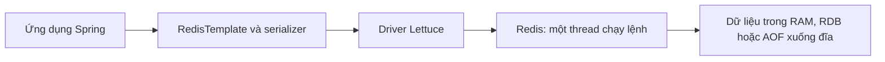
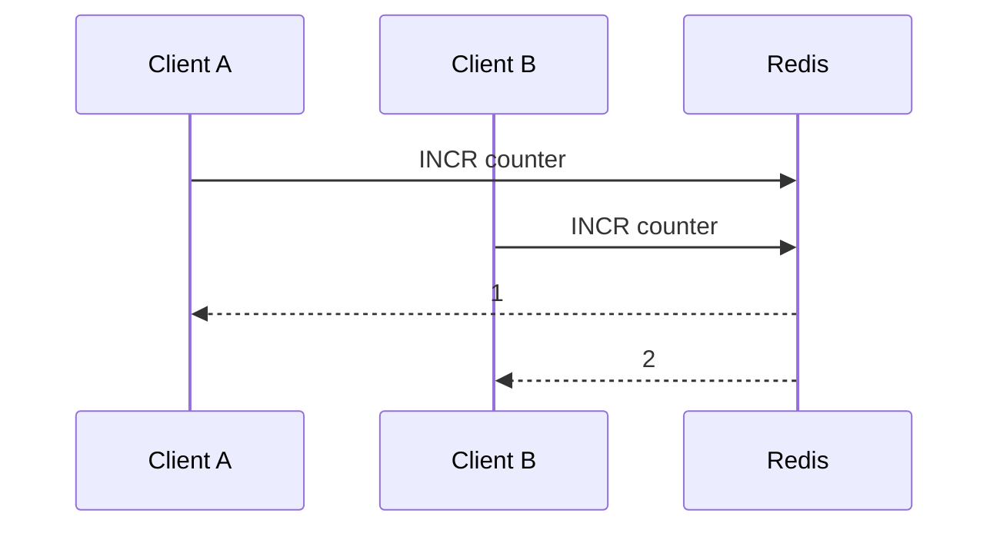
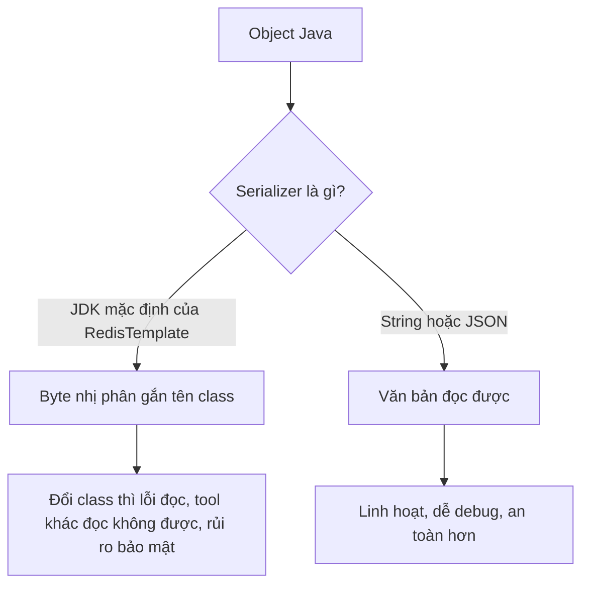
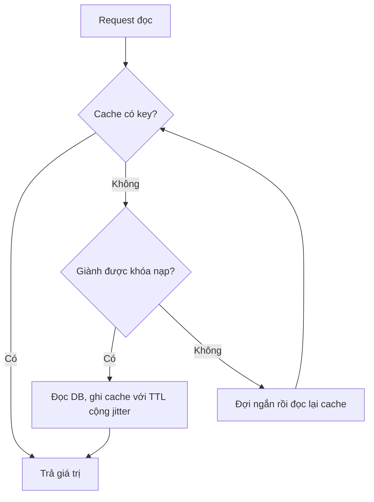
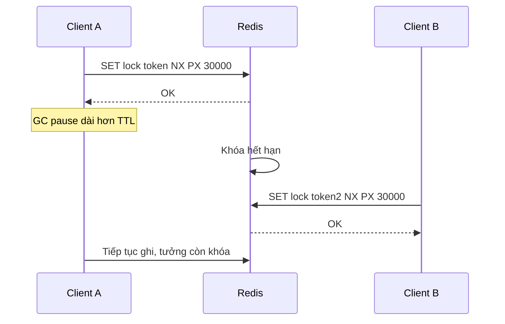
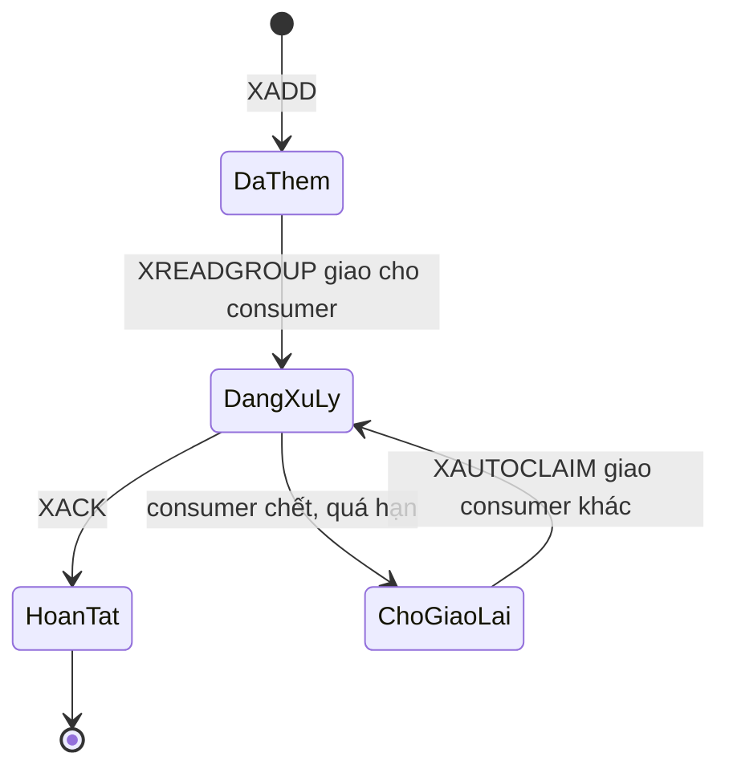
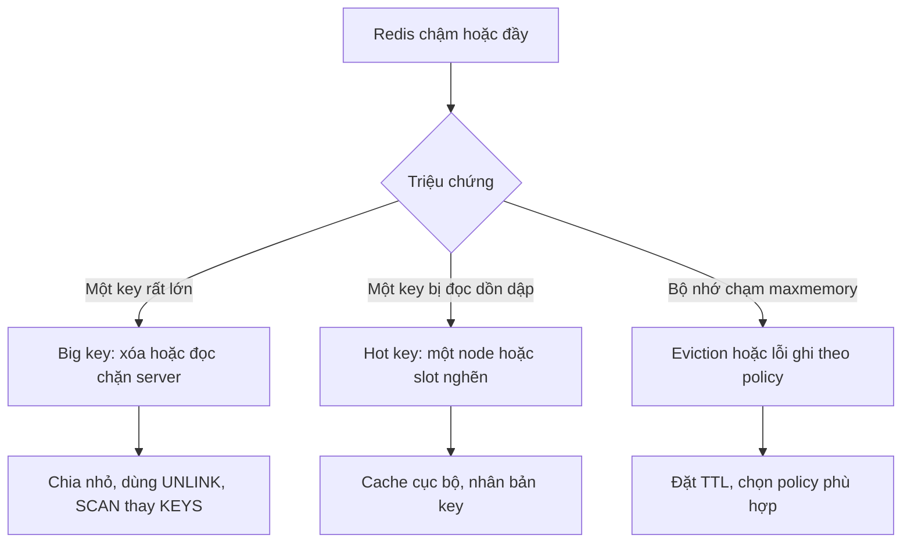

# Lý thuyết 42: Redis với Spring (Spring Data Redis, Lettuce, Redisson, Bucket4j)

Database quan hệ bền nhưng chậm so với RAM, và mỗi request đều đập vào nó thì sớm muộn nó quá tải. Redis là kho dữ liệu trong bộ nhớ, trả lời trong cỡ dưới một mili giây, nên được dùng làm cache, khóa phân tán, bộ đếm rate limit, kho session và hàng đợi nhẹ. Bài này nói cách Spring nối vào Redis (Spring Data Redis, Lettuce, Redisson), các pattern hay dùng và các bẫy production. Phần cache annotation xem [Spring Cache abstraction](/go?p=01-Spring-Boot%2Fmedium%2Flt-39-spring-cache-abstraction.md); phần khóa và idempotency xem [Distributed lock và idempotency](/go?p=01-Spring-Boot%2Fhard%2Flt-26-distributed-lock-idempotency.md); phần câu hỏi sâu xem [Redis chuyên sâu](/go?p=07-Interview-QA%2FBackend%2Fhard%2Fqa-20-redis-chuyen-sau.md).

> **Phiên bản (kiểm tra 2026-10-30):** Spring Boot 4.1.2 dùng Spring Data Redis 4.1.2; starter là `spring-boot-starter-data-redis` (mặc định Lettuce, dùng cho cả servlet lẫn reactive), session là `spring-boot-starter-session-data-redis`. Property kết nối là `spring.data.redis.*`. Boot 3.5 dùng cùng tên property và starter nhưng serializer JSON là loại Jackson 2. Redisson, Bucket4j là thư viện ngoài Spring: số phiên bản và việc Redisson ghép với Boot 4.1 phải kiểm tra lại theo tài liệu của chúng trước khi chốt.

**Cốt lõi:** Redis giữ dữ liệu trong RAM và thực thi mỗi lệnh tuần tự trên một thread, nên mỗi lệnh đơn là nguyên tử và rất nhanh, nhưng cũng nên một lệnh chậm chặn mọi client. Spring chỉ là lớp bọc: nó biến object Java thành byte (serializer) rồi gửi lệnh qua driver.

- Vì lệnh chạy tuần tự trên một thread nên một lệnh nặng (`KEYS`, xóa big key, Lua dài) làm đứng cả server, và nhờ đó `INCR`, `SET NX` là nguyên tử mà không cần lock.
- Vì Redis chỉ lưu byte nên serializer quyết định dữ liệu đọc lại được không, và JDK serialization mặc định của `RedisTemplate` là bẫy.
- Vì dữ liệu nằm trong RAM có giới hạn nên mọi key phải có TTL hoặc chính sách eviction, và cache không bao giờ là nguồn sự thật.



Mô hình tư duy: Redis là một thread rất nhanh đứng giữa mọi client, nên đừng bao giờ bắt nó làm việc dài, và đừng tin rằng thứ nằm trong đó là bền.

**Tóm tắt:**

- Redis nhanh vì dữ liệu trong RAM và thực thi lệnh đơn luồng, nên lệnh đơn là nguyên tử nhưng một lệnh chậm chặn tất cả.
- Chọn cấu trúc theo truy vấn: string cho cache và bộ đếm, hash cho object, list cho hàng đợi đơn giản, set cho tập duy nhất, sorted set cho bảng xếp hạng, stream cho log sự kiện có consumer group.
- Boot mặc định dùng Lettuce (một connection chia sẻ an toàn giữa các thread); Jedis cần pool vì connection không an toàn đa luồng.
- `RedisTemplate` mặc định dùng JDK serialization: đọc không được bằng công cụ khác, dễ vỡ khi đổi class; ưu tiên `StringRedisTemplate` hoặc serializer JSON.
- Cache-aside là pattern chuẩn; luôn đặt TTL kèm jitter, và phòng ba sự cố stampede, penetration, avalanche.
- Khóa phân tán đúng tối thiểu là `SET key token NX PX ttl` kèm release bằng Lua kiểm token; Redisson lo watchdog gia hạn nhưng không an toàn tuyệt đối khi failover.
- Pub/Sub là bắn rồi quên (mất tin nếu subscriber vắng), Stream mới có lưu và xác nhận.
- Production: tránh big key và hot key, đặt `maxmemory` và policy, hiểu RDB/AOF, Sentinel (HA) khác Cluster (chia shard).

## Vấn đề nó giải quyết

Database quan hệ chịu tải đọc lặp lại kém: cùng một sản phẩm được đọc hàng nghìn lần mỗi giây mà dữ liệu hiếm khi đổi. Ngoài ra có những việc cần trạng thái chung giữa nhiều instance nhưng không đáng ghi vào DB: khóa, bộ đếm, session, hàng chờ. Redis phục vụ cả hai bằng độ trễ cỡ micro-giây đến mili-giây và các lệnh nguyên tử.

## Khi nào dùng, khi nào không

Dùng cho dữ liệu có thể dựng lại (cache), dữ liệu ngắn hạn (session, OTP, rate limit), trạng thái chia sẻ cần nguyên tử (khóa, bộ đếm) và bảng xếp hạng. Không dùng làm nguồn sự thật duy nhất cho dữ liệu tiền bạc hay đơn hàng, vì persistence của Redis (RDB/AOF) có thể mất vài giây dữ liệu và replication là bất đồng bộ. Không dùng Redis để truy vấn quan hệ phức tạp: nó không có join hay index phụ linh hoạt. Nếu dữ liệu to hơn RAM hợp lý, đừng nhét hết vào.

## Các khái niệm cần biết

| Khái niệm | Ý nghĩa |
|---|---|
| Single-thread | Một thread chạy lệnh; I/O mạng có thể đa luồng ở bản mới nhưng lệnh vẫn tuần tự |
| TTL | Thời gian sống của key (`EXPIRE`, `PX`); hết hạn thì key bị xóa |
| Lettuce | Driver mặc định, dựa trên Netty, connection an toàn đa luồng, hỗ trợ reactive |
| Jedis | Driver đồng bộ, mỗi connection không an toàn đa luồng nên cần pool |
| `RedisTemplate` | API mức cao theo kiểu key và value tổng quát, serializer cấu hình được |
| `StringRedisTemplate` | `RedisTemplate` cố định key và value là String |
| Serializer | Chuyển object thành byte và ngược lại |
| Lua script | Đoạn script chạy nguyên tử trên server (`EVAL`) |
| Eviction | Chính sách xóa key khi đầy `maxmemory` |
| RDB và AOF | Snapshot định kỳ và nhật ký ghi từng lệnh |
| Sentinel và Cluster | Giám sát và failover (HA) so với chia dữ liệu theo slot (scale) |

## Mô hình single-thread và cấu trúc dữ liệu

Redis đọc lệnh từ nhiều client rồi xếp hàng thực thi từng lệnh một. Hệ quả có hai mặt: mỗi lệnh đơn không bao giờ bị chen ngang nên không cần lock, nhưng một lệnh tốn 200 ms làm 200 ms đó không client nào được phục vụ.



Cách đọc: hai `INCR` đến gần như cùng lúc nhưng được xếp hàng, nên ra 1 rồi 2, không có chuyện hai client cùng đọc rồi cùng ghi trùng. Ngược lại, nếu A gửi `KEYS *` trên 10 triệu key thì B phải đợi.

**Nền tảng:** Tính nguyên tử của Redis đến từ việc thực thi lệnh tuần tự trên một thread, không phải từ lock. Do đó mọi thao tác "đọc rồi ghi" gồm nhiều lệnh rời nhau (GET rồi SET) không nguyên tử; phải gộp thành một lệnh (`INCR`, `SET NX`) hoặc một Lua script.

| Cấu trúc | Dùng khi | Ví dụ |
|---|---|---|
| String | Cache một giá trị, bộ đếm, khóa | `product:42` là JSON; `INCR` đếm lượt |
| Hash | Object có nhiều field, cập nhật từng field | `user:7` với field `name`, `plan` |
| List | Hàng đợi đơn giản, giữ N phần tử mới nhất | `LPUSH` và `BRPOP` |
| Set | Tập duy nhất, giao hoặc hợp tập | Tag, người đã xem |
| Sorted set | Xếp hạng theo điểm, truy vấn theo khoảng | Leaderboard, hàng đợi trễ theo thời gian |
| Stream | Log sự kiện append-only có consumer group và ack | Hàng đợi tin cậy nhẹ |

Quy tắc chọn: truy vấn theo khóa chính thì string hoặc hash; cần thứ tự theo điểm thì sorted set; cần giao hàng có xác nhận thì stream chứ không phải list hay pub/sub.

## Tích hợp Spring: driver, template và serializer

Với Boot, chỉ cần thêm `spring-boot-starter-data-redis` và đặt `spring.data.redis.host`, `port`, `password`. Auto-configuration cho bạn `RedisConnectionFactory`, `StringRedisTemplate` và `RedisTemplate<Object, Object>`. Lettuce dùng một connection dùng chung cho nhiều thread nên thường không cần pool; pool chỉ được bật khi có `commons-pool2` trên classpath (ví dụ khi dùng lệnh blocking hoặc transaction). Jedis chỉ dùng khi có lý do cụ thể, và Jedis không hỗ trợ master/replica theo tài liệu Boot.



Cách đọc: cùng một object nhưng chọn serializer khác nhau cho ra dữ liệu có đời sống khác nhau. Với JDK serialization, byte chứa tên class, nên đổi package hay thêm field không tương thích là đọc lỗi, và deserialize dữ liệu không tin cậy là lỗ hổng. Mặc định của `RedisCacheConfiguration` cũng là `JdkSerializationRedisSerializer` theo tài liệu Spring Data Redis, nên phải đổi khi dùng cache.

**Phải thuộc:** `StringRedisTemplate` dùng `StringRedisSerializer` cho cả key và value, an toàn và đọc được bằng `redis-cli`. `RedisTemplate` tổng quát mặc định dùng JDK serialization. Key luôn nên là String. Với Boot 4 (Jackson 3, package `tools.jackson`), serializer JSON là loại dựa trên Jackson 3 (tên lớp như `GenericJacksonJsonRedisSerializer`: kiểm tra lại theo phiên bản); Boot 3.5 dùng `GenericJackson2JsonRedisSerializer`.

```java
// Minh họa (chưa chạy thử)
@Configuration
class RedisConfig {

    @Bean
    RedisTemplate<String, ProductDto> productTemplate(RedisConnectionFactory cf) {
        var t = new RedisTemplate<String, ProductDto>();
        t.setConnectionFactory(cf);
        t.setKeySerializer(RedisSerializer.string());
        t.setHashKeySerializer(RedisSerializer.string());
        // Boot 4: serializer JSON dựa trên Jackson 3; Boot 3.5: GenericJackson2JsonRedisSerializer
        t.setValueSerializer(new GenericJacksonJsonRedisSerializer(/* cấu hình type */));
        return t;
    }
}
```

Lưu ý bean `redisTemplate` do Boot tạo chỉ lùi lại khi bạn định nghĩa bean tên `redisTemplate`, không phải theo kiểu, nên đặt tên bean khác nếu muốn giữ cả hai.

## Spring Cache với Redis

Chỉ cần `@EnableCaching` và `spring.cache.type=redis`, rồi chỉnh bằng `spring.cache.redis.time-to-live`, `key-prefix`, `use-key-prefix`, `cache-null-values` (hoặc bean `RedisCacheConfiguration`). Mặc định theo tài liệu: không có TTL, có cache `null`, key được tiền tố bằng tên cache và `::`. Không TTL nghĩa là key sống mãi cho tới khi đầy RAM, đây là sự cố cache kinh điển.

```java
// Minh họa (chưa chạy thử)
@Bean
RedisCacheConfiguration cacheDefaults() {
    return RedisCacheConfiguration.defaultCacheConfig()
        .entryTtl(Duration.ofMinutes(10))
        .disableCachingNullValues()
        .prefixCacheNameWith("shop:v2:")        // đổi v2 khi đổi cấu trúc dữ liệu
        .serializeValuesWith(SerializationPair.fromSerializer(
            new GenericJacksonJsonRedisSerializer(/* ... */)));
}
```

Hai chi tiết đáng nhớ. Thứ nhất, mặc định `RedisCacheWriter` không khóa (lock-free) và xóa cả cache bằng `KEYS` rồi `DEL`, nên `@CacheEvict(allEntries = true)` trên keyspace lớn có thể chặn Redis; có thể đổi sang chiến lược `SCAN`. Thứ hai, đổi cấu trúc DTO mà giữ nguyên key thì dữ liệu cũ đọc lỗi, nên đặt phiên bản vào tiền tố key.

## Cache-aside và ba sự cố của cache

Pattern chuẩn: đọc cache, miss thì đọc DB rồi ghi cache; khi ghi thì cập nhật DB trước rồi xóa key cache (không cập nhật cache), vì xóa tránh để lại giá trị cũ khi hai cập nhật chồng nhau.



Cách đọc: nhánh khóa nạp là phòng **stampede** (một key nóng hết hạn, hàng nghìn request cùng đập vào DB). Hai sự cố còn lại: **penetration** là request tới key không tồn tại nên luôn miss và luôn chạm DB (chống bằng cache giá trị rỗng với TTL ngắn hoặc Bloom filter), và **avalanche** là nhiều key hết hạn cùng lúc (chống bằng TTL cộng jitter ngẫu nhiên, và giữ Redis có HA). Chi tiết các pattern này nằm ở bài Redis chuyên đề; ở đây nhớ rằng `@Cacheable(sync = true)` chỉ khóa trong một JVM.

## Khóa phân tán: SET NX PX và Redisson

Khóa tối thiểu đúng gồm ba phần: `SET lock:order:42 <token> NX PX 30000` để chiếm khóa nguyên tử với TTL, token ngẫu nhiên để biết ai giữ, và release bằng Lua kiểm token rồi mới `DEL`. Không kiểm token thì client chậm có thể xóa nhầm khóa của người khác đã chiếm sau khi khóa của nó hết hạn.

```java
// Minh họa (chưa chạy thử): release an toàn bằng Lua
private static final RedisScript<Long> RELEASE = RedisScript.of("""
    if redis.call('get', KEYS[1]) == ARGV[1] then
        return redis.call('del', KEYS[1])
    else return 0 end
    """, Long.class);

boolean tryLock(String key, String token, Duration ttl) {
    return Boolean.TRUE.equals(redis.opsForValue().setIfAbsent(key, token, ttl));
}
void unlock(String key, String token) {
    redis.execute(RELEASE, List.of(key), token);
}
```

Redisson cung cấp `RLock` đã làm sẵn: reentrant, chờ bằng pub/sub thay vì quay vòng, và watchdog. Watchdog là thread tự gia hạn TTL khi bạn gọi `lock()` hoặc `tryLock` mà **không** chỉ định `leaseTime`; mặc định `lockWatchdogTimeout` là 30 giây và gia hạn khoảng mỗi một phần ba. Nếu bạn truyền `leaseTime` thì watchdog tắt và khóa hết hạn đúng hạn, kể cả khi việc chưa xong.



Cách đọc: khóa có TTL không bảo đảm loại trừ lẫn nhau tuyệt đối. Tiến trình giữ khóa có thể bị dừng (GC, mạng) quá TTL, và lúc đó hai bên cùng nghĩ mình giữ khóa. Failover cũng nguy hiểm: replication bất đồng bộ, nên master chết trước khi khóa kịp sang replica thì khóa biến mất. Vì vậy khóa Redis là tối ưu hiệu năng (giảm việc trùng), còn tính đúng đắn phải do ràng buộc ở DB hoặc fencing token đảm bảo; xem phần idempotency ở [bài khóa phân tán](/go?p=01-Spring-Boot%2Fhard%2Flt-26-distributed-lock-idempotency.md).

**Suy luận:** Vì Redis không biết client còn sống hay không, nó chỉ dựa vào TTL để thu hồi khóa. TTL ngắn thì việc dài bị mất khóa giữa chừng; TTL dài thì client chết làm khóa kẹt lâu. Watchdog giải bài toán này bằng cách gia hạn khi tiến trình còn chạy, nhưng nếu tiến trình bị treo mà thread watchdog vẫn sống thì khóa vẫn được giữ trong khi công việc không tiến triển. Không có thiết kế nào miễn phí: kết luận thực tế là dùng khóa để giảm tranh chấp, và đặt cơ chế bảo vệ cuối cùng (unique constraint, version, fencing token) ở nơi lưu dữ liệu thật. Redisson có thêm `RedLock` nhiều master nhưng nó gây tranh cãi về độ an toàn, nên đừng trình bày nó như đảm bảo tuyệt đối.

Redisson khai báo qua `redisson-spring-boot-starter` (hoặc tự dựng bean `RedissonClient`); phiên bản tương thích Boot 4.1 phải xem bảng của Redisson, vì lớp auto-configuration Redis đổi ở Boot 4 nên các cấu hình `exclude` cũ có thể mất tác dụng âm thầm.

## Rate limit: Bucket4j hoặc Lua

Hai hướng. Hướng nhẹ nhất là cửa sổ cố định bằng Lua để `INCR` và đặt TTL nguyên tử; nhược điểm là đỉnh gấp đôi ở ranh giới cửa sổ.

```java
// Minh họa (chưa chạy thử): tối đa N lần mỗi cửa sổ, nguyên tử
private static final RedisScript<Long> HIT = RedisScript.of("""
    local c = redis.call('incr', KEYS[1])
    if c == 1 then redis.call('pexpire', KEYS[1], ARGV[1]) end
    return c
    """, Long.class);

boolean allow(String userId, int limit, Duration window) {
    Long c = redis.execute(HIT, List.of("rl:" + userId), String.valueOf(window.toMillis()));
    return c != null && c <= limit;
}
```

Hướng thứ hai là Bucket4j theo thuật toán token bucket (cho phép burst, nạp token đều). Bucket4j có module lưu trạng thái trong Redis qua Lettuce (artifact dạng `com.bucket4j:bucket4j_jdk17-lettuce`; tên chính xác và phiên bản kiểm tra lại trên Maven Central) để nhiều instance dùng chung một bucket. Chọn token bucket khi cần burst hợp lý; chọn Lua cố định khi muốn đơn giản. Luôn quyết định hành vi khi Redis chết: fail-open (cho qua, an toàn cho người dùng) hay fail-closed (chặn, an toàn cho hệ thống phía sau).

## Session và truyền tin

Spring Session với `spring-boot-starter-session-data-redis` chuyển `HttpSession` ra Redis, nên nhiều instance dùng chung phiên đăng nhập mà không cần sticky session. Timeout đặt bằng `spring.session.timeout`. Dùng JSON serializer thay vì JDK cho dữ liệu session nếu có thể, vì class đổi giữa các phiên bản deploy sẽ làm session cũ hỏng.

Về truyền tin: Pub/Sub là bắn rồi quên, không lưu, subscriber vắng mặt thì mất tin, hợp để báo hiệu như xóa cache cục bộ. Stream lưu log, có consumer group, ack và đọc lại tin chưa xử lý, hợp cho tác vụ cần tin cậy nhẹ. Cần thứ tự toàn cục, retention dài hay replay lớn thì dùng Kafka.



Cách đọc: tin ở trạng thái chờ xác nhận vẫn nằm trong danh sách pending, nên consumer chết không làm mất tin. Pub/Sub không có các trạng thái này, tin đi qua là hết.

## Bẫy production



- **Big key**: một hash hay list hàng triệu phần tử. Đọc, xóa (`DEL` đồng bộ) hay di chuyển làm chặn thread duy nhất. Chia nhỏ theo bucket, dùng `UNLINK` (xóa bất đồng bộ), lặp bằng `SCAN` thay vì `KEYS`.
- **Hot key**: một key chiếm gần hết lưu lượng. Trong Cluster nó đè lên một node. Giảm bằng cache cục bộ (Caffeine) đứng trước, hoặc nhân bản key.
- **Eviction**: khi chạm `maxmemory`, hành vi do policy quyết định. `noeviction` (mặc định của bản cài thông thường) từ chối ghi mới; `allkeys-lru` và `allkeys-lfu` xóa bất kỳ key; `volatile-*` chỉ xóa key có TTL. Dùng Redis làm cache thuần thì chọn `allkeys-lru` hoặc `allkeys-lfu`; nếu trộn dữ liệu quan trọng vào cùng instance thì policy xóa key sẽ xóa luôn chúng.
- **Persistence**: RDB là snapshot định kỳ (nhanh phục hồi, mất dữ liệu từ lần snapshot cuối); AOF ghi từng lệnh (với `appendfsync everysec` thường mất tối đa khoảng một giây). Cache thuần có thể tắt cả hai; dữ liệu không dựng lại được thì cần AOF và vẫn phải coi là có thể mất.
- **Sentinel và Cluster**: Sentinel giám sát một master với các replica và tự failover, nhưng dữ liệu vẫn nằm một master (không scale dung lượng ghi). Cluster chia key vào 16384 slot trên nhiều master, vừa scale vừa có failover; đánh đổi là lệnh nhiều key chỉ chạy khi các key cùng slot (dùng hash tag `{...}`), và Lua cũng bị ràng buộc tương tự.

**Phải thuộc:** Cache stampede là một key nóng hết hạn kéo nhiều request cùng đập DB; penetration là truy vấn key không tồn tại; avalanche là nhiều key hết hạn cùng lúc. Sentinel là HA, Cluster là chia shard và HA. Mặc định `RedisCacheConfiguration`: không TTL, serializer giá trị JDK, key có tiền tố tên cache.

## Bẫy thường gặp

| Bẫy | Nguyên nhân | Cách xử lý |
|---|---|---|
| Cache không bao giờ hết hạn, Redis đầy | `RedisCacheConfiguration` mặc định không TTL | Luôn đặt `entryTtl` |
| Đọc lại dữ liệu cũ lỗi sau deploy | JDK serialization gắn với class | Dùng JSON, đặt phiên bản vào tiền tố key |
| Release khóa xóa nhầm khóa của người khác | Không kiểm token | Lua kiểm token rồi `DEL` |
| Khóa Redisson hết hạn giữa việc | Truyền `leaseTime` làm tắt watchdog | Không truyền `leaseTime` cho việc dài |
| `@CacheEvict(allEntries)` làm Redis đứng | Mặc định dùng `KEYS` | Chuyển sang chiến lược `SCAN` hoặc chia cache nhỏ |
| `@Cacheable(sync = true)` không chống stampede nhiều instance | Chỉ khóa trong một JVM | Khóa nạp phân tán hoặc nạp trước |
| Rate limit sai ở ranh giới cửa sổ | Cửa sổ cố định | Token bucket hoặc cửa sổ trượt |
| Coi Redis là nguồn sự thật | Replication bất đồng bộ, persistence có thể mất dữ liệu | DB là nguồn gốc, Redis là bản sao |

## Phỏng vấn khó: chuỗi hỏi xoáy

### Chuỗi 1: Redis nhanh vì sao, và mặt trái của single-thread

1. **Câu mở:** Redis đơn luồng mà vẫn nhanh, vì sao?
2. **Xoáy 1:** Vì sao `INCR` không cần lock nhưng `GET` rồi `SET` thì có race?
3. **Xoáy 2:** Production có sự cố Redis đứng vài trăm mili-giây; bạn nghi gì và xử lý thế nào?

**Đáp án ngắn:** Redis giữ dữ liệu trong RAM, cấu trúc dữ liệu đơn giản và thực thi lệnh tuần tự trên một thread nên không tốn chi phí lock hay chuyển ngữ cảnh. Chính việc tuần tự này làm mỗi lệnh đơn nguyên tử: hai `INCR` được xếp hàng nên không trùng. `GET` rồi `SET` là hai lệnh rời, giữa chúng client khác chen vào được, nên phải gộp thành một lệnh hoặc một Lua script. Đánh đổi là một lệnh chậm chặn mọi client. Khi đứng đột ngột, tôi nghi big key bị xóa hoặc đọc, `KEYS` hay `SMEMBERS` trên tập lớn, Lua dài, hoặc fork của RDB/AOF rewrite. Xử lý bằng `SLOWLOG`, `--bigkeys`, đổi sang `SCAN` và `UNLINK`, chia key nhỏ, và giám sát độ trễ lệnh.

**Sai lầm hay gặp:**
- Nói "Redis nhanh vì đơn luồng" mà không nói là nhờ RAM và cấu trúc dữ liệu.
- Cho rằng chuỗi `GET` rồi `SET` là nguyên tử.
- Dùng `KEYS *` trên production.

### Chuỗi 2: Khóa phân tán có thật sự an toàn

1. **Câu mở:** Bạn cài khóa phân tán bằng Redis thế nào?
2. **Xoáy 1:** Redisson watchdog làm gì, và khi nào nó không chạy?
3. **Xoáy 2:** Khóa này có đảm bảo loại trừ lẫn nhau tuyệt đối không, vì sao?

**Đáp án ngắn:** Tối thiểu là `SET key token NX PX ttl` để chiếm nguyên tử có hạn, token ngẫu nhiên định danh người giữ, và release bằng Lua kiểm token rồi mới xóa để không xóa nhầm khóa của người khác. Redisson đóng gói sẵn: khóa reentrant, chờ bằng pub/sub, và watchdog gia hạn TTL (mặc định 30 giây, gia hạn khoảng mỗi một phần ba) khi bạn không truyền `leaseTime`; truyền `leaseTime` thì watchdog tắt. Khóa không tuyệt đối vì Redis không biết client còn sống không, chỉ dựa vào TTL. Client bị GC hay mạng dừng quá TTL thì hai bên cùng giữ khóa, và failover với replication bất đồng bộ cũng làm mất khóa. Vì vậy trong production khóa chỉ giảm tranh chấp; tính đúng đắn phải do unique constraint, version hoặc fencing token ở kho dữ liệu bảo đảm.

**Sai lầm hay gặp:**
- Release bằng `DEL` không kiểm token.
- Nói RedLock "đảm bảo an toàn" mà không nhắc tranh cãi và giả định thời gian.
- Dùng khóa Redis để bảo vệ thao tác tiền tệ mà không có ràng buộc ở DB.

### Chuỗi 3: Cache và các sự cố của nó

1. **Câu mở:** Thiết kế cache cho trang chi tiết sản phẩm với Spring và Redis.
2. **Xoáy 1:** Ba sự cố stampede, penetration, avalanche khác nhau thế nào, chống ra sao?
3. **Xoáy 2:** Vì sao cấu hình mặc định của `RedisCache` nguy hiểm?

**Đáp án ngắn:** Dùng cache-aside: đọc cache, miss thì đọc DB và ghi cache có TTL; khi ghi thì cập nhật DB trước rồi xóa key. Stampede là một key nóng hết hạn làm nhiều request cùng đập DB, chống bằng khóa nạp, nạp trước hoặc TTL mềm. Penetration là truy vấn key không tồn tại luôn xuyên qua cache, chống bằng cache giá trị rỗng TTL ngắn hoặc Bloom filter. Avalanche là nhiều key hết hạn cùng lúc, chống bằng TTL cộng jitter và giữ Redis có HA. Mặc định `RedisCacheConfiguration` không có TTL, serializer giá trị là JDK, và xóa cả cache bằng `KEYS`. Không TTL làm RAM đầy, JDK làm dữ liệu vỡ khi đổi class, `KEYS` chặn server. Thực tế production cần TTL, JSON serializer, tiền tố có phiên bản và giám sát tỉ lệ hit.

**Sai lầm hay gặp:**
- Cập nhật cache thay vì xóa, để lại giá trị cũ khi hai cập nhật chồng nhau.
- Tin `@Cacheable(sync = true)` chống được stampede toàn cụm.
- Đặt cùng một TTL cho mọi key.

## Câu hỏi tự kiểm tra

**1. Vì sao `GET` rồi `SET` không an toàn còn `INCR` thì an toàn?**

Gợi ý suy luận: Redis chạy lệnh theo kiểu nào, và giữa hai lệnh rời có gì xen vào được?

Lập luận và đáp án: Redis thực thi mỗi lệnh tuần tự trên một thread nên một lệnh đơn là nguyên tử. `GET` và `SET` là hai lệnh, client khác có thể chen vào giữa, dẫn tới ghi đè mất cập nhật. `INCR` đọc và ghi trong một lệnh nên không có khoảng hở. Muốn gộp nhiều bước thì dùng một lệnh nguyên tử hoặc Lua script.

**2. Tại sao không nên để `RedisTemplate` dùng serializer mặc định?**

Gợi ý suy luận: Byte được lưu chứa gì, và điều gì xảy ra khi class đổi?

Lập luận và đáp án: Serializer mặc định là JDK, byte chứa tên class và phiên bản nên đổi class làm đọc lỗi, công cụ khác không đọc được, và deserialize dữ liệu không tin cậy là rủi ro bảo mật. Dùng key String và value JSON, kèm tiền tố có phiên bản để đổi cấu trúc an toàn.

**3. Khóa Redisson có watchdog nhưng vẫn có thể bị hai bên cùng giữ, khi nào?**

Gợi ý suy luận: Watchdog gia hạn dựa vào cái gì, và Redis biết gì về trạng thái tiến trình?

Lập luận và đáp án: Redis chỉ có TTL, không biết tiến trình có đang làm việc hay không. Khi tiến trình bị dừng quá TTL mà không gia hạn kịp (GC, mạng), hoặc khi master chết trước khi khóa sang replica, khóa mất và bên khác chiếm được. Cũng vậy khi bạn truyền `leaseTime` làm watchdog tắt. Vì thế cần fencing token hoặc ràng buộc ở DB làm lớp bảo vệ cuối.

**4. Cache thuần nên đặt eviction policy nào, và vì sao `noeviction` nguy hiểm cho nó?**

Gợi ý suy luận: Khi đầy RAM, bạn muốn Redis xóa bớt hay từ chối ghi?

Lập luận và đáp án: Cache có thể dựng lại nên chấp nhận xóa bớt: `allkeys-lru` hoặc `allkeys-lfu`. Với `noeviction`, khi chạm `maxmemory` Redis từ chối lệnh ghi, nên lần ghi cache và cả khóa, session đều lỗi, làm sự cố lan rộng. Nếu chung instance với dữ liệu không dựng lại được thì tách instance riêng thay vì dùng chung policy.

Nguồn: tài liệu Spring Boot 4.1.2 (Working with NoSQL Technologies, Spring Session), Spring Data Redis 4.1.2 (Redis Cache), tra ngày 2026-10-30; thông tin về Redisson và Bucket4j từ trang tài liệu và kho Maven của chúng, chưa kiểm chứng đầy đủ cho Boot 4.1, cần kiểm tra lại theo phiên bản.

