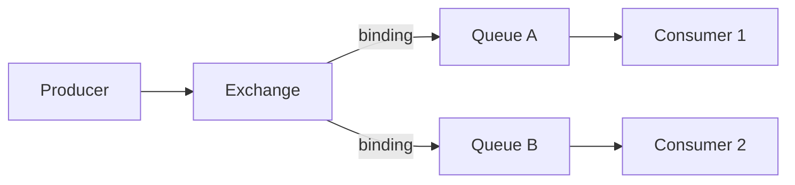
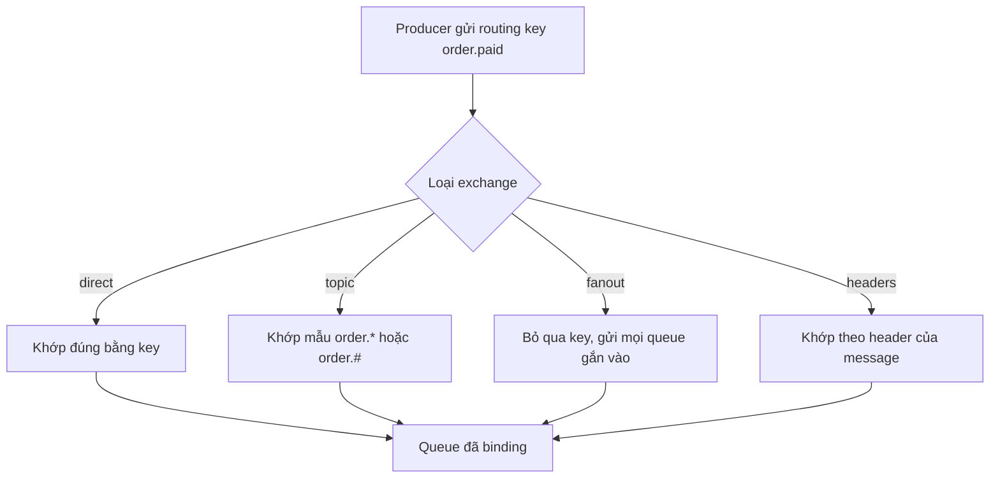
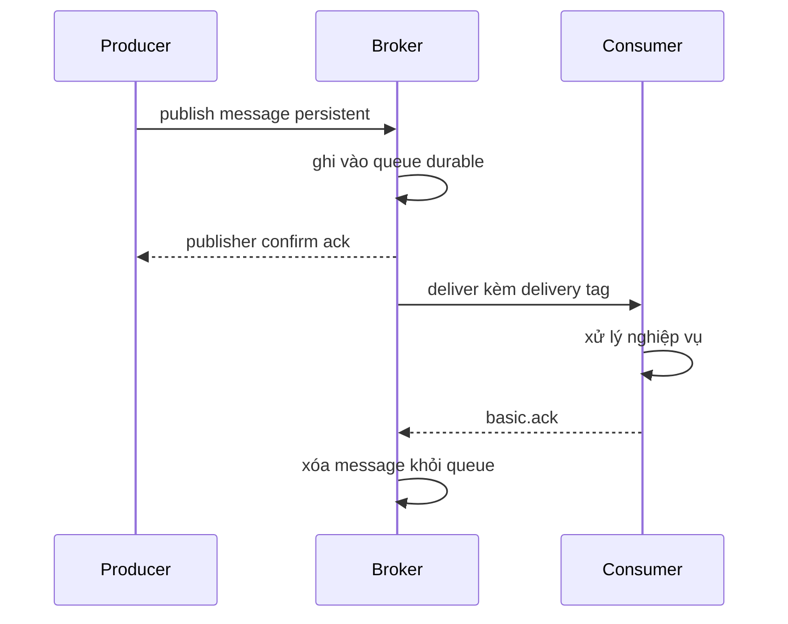
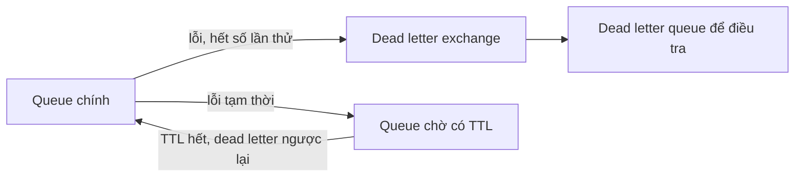
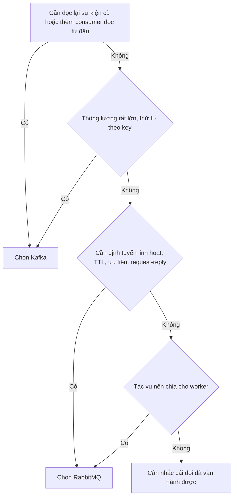

# Lý thuyết 44: RabbitMQ với Spring AMQP (và khi nào chọn Kafka)

RabbitMQ là message broker kiểu hàng đợi thông minh: nó nhận message từ producer, quyết định đưa vào queue nào theo luật định tuyến, rồi đẩy cho consumer và xóa message khi consumer xác nhận. Hình dung một bưu điện: người gửi bỏ thư vào hòm, bưu điện phân loại theo địa chỉ vào từng ngăn, người nhận ra lấy thư và ký nhận thì thư mới bị bỏ khỏi ngăn. Spring AMQP là lớp Spring bọc client Java của RabbitMQ để bạn gửi bằng `RabbitTemplate` và nhận bằng `@RabbitListener`.

> **Phiên bản (kiểm tra 2026-10-30):** Spring Boot 4.1 (Framework 7, Spring AMQP 4.x, Jackson 3). Tài liệu Boot 4.1 vẫn dùng starter `spring-boot-starter-amqp` cho RabbitMQ, package auto-config là `org.springframework.boot.amqp.autoconfigure`. Tài liệu nhánh 4.2 đang phát triển có nhắc tách starter riêng cho RabbitMQ, nên khi nâng phiên bản hãy kiểm tra lại tên artifact. Converter JSON cho Jackson 3 là `JacksonJsonMessageConverter`; các lớp `Jackson2Json...` đã bị đánh dấu deprecated for removal từ Spring AMQP 4.0. Với Boot 3.5 (Jackson 2), dùng `Jackson2JsonMessageConverter`. Giá trị mặc định phía broker (quorum queue, delivery limit) thay đổi theo bản RabbitMQ, hãy kiểm tra lại theo phiên bản bạn chạy.

**Cốt lõi:** Producer không gửi thẳng vào queue mà gửi vào exchange; exchange là bộ định tuyến, dùng binding (luật gắn exchange với queue) để quyết định message đi vào queue nào, và consumer lấy từ queue. Tách "gửi" khỏi "ai nhận" như vậy cho phép thêm hay bớt consumer mà producer không đổi, còn độ tin cậy đến từ ack: broker chỉ xóa message khi consumer báo đã xử lý xong.

- Vì message chỉ bị xóa sau ack nên consumer chết giữa chừng thì message được giao lại, và đó là at-least-once, nên consumer phải idempotent.
- Vì routing nằm ở exchange và binding chứ không ở producer nên đổi cách phân phối chỉ cần đổi binding, không sửa code gửi.
- Vì queue xóa message sau khi giao thành công nên không có replay như log của Kafka, nên cần đọc lại lịch sử thì phải chọn công cụ khác.



Mô hình tư duy: RabbitMQ là bưu điện định tuyến và giao thư đến khi có người ký nhận, còn Kafka là cuốn sổ cái ghi nối tiếp mà ai muốn thì tự đọc lại từ trang nào cũng được.

**Tóm tắt:**

- Mô hình AMQP gồm producer, exchange, binding, queue, consumer; producer chỉ biết exchange và routing key.
- Bốn loại exchange: direct (khớp đúng key), topic (khớp mẫu có `*` và `#`), fanout (gửi mọi queue), headers (khớp theo header, ít dùng).
- Độ tin cậy cần cả ba chặng: publisher confirm (producer biết broker đã nhận), queue durable cộng message persistent (sống qua restart), consumer ack (chỉ xóa khi xử lý xong).
- `prefetch` giới hạn số message chưa ack mỗi consumer, vừa cân tải vừa quyết định thứ tự và bộ nhớ.
- Message lỗi nên đi vào dead letter exchange (DLX) thay vì requeue vô hạn; retry có delay làm bằng TTL cộng DLX hoặc plugin delayed message.
- Quorum queue (Raft, nhân bản) là lựa chọn mặc định cho dữ liệu quan trọng; classic mirrored queue không còn đường đi dài hạn.
- Thứ tự chỉ được đảm bảo trong một queue với một consumer và không có redelivery; còn lại phải thiết kế bằng idempotency.
- Chọn RabbitMQ khi cần định tuyến linh hoạt, tác vụ nền, request-reply, độ trễ thấp; chọn Kafka khi cần log bền, replay, thông lượng rất lớn.

## Vấn đề nó giải quyết

Gọi đồng bộ giữa các service buộc bên gọi chờ, và bên nhận sập thì bên gọi lỗi theo. Hàng đợi tách hai bên theo thời gian: bên gửi bỏ việc vào queue rồi đi tiếp, bên nhận xử lý theo tốc độ của mình, kể cả khi nó tạm sập. Queue còn làm đệm khi tải tăng đột ngột và cho phép chia việc cho nhiều worker.

## Khi nào dùng, khi nào không

Dùng RabbitMQ cho tác vụ nền (gửi email, xuất báo cáo), phân phối việc cho nhóm worker, định tuyến phức tạp theo nhiều điều kiện, request-reply, và khi cần từng message có TTL, ưu tiên hay retry riêng. Không nên dùng khi cần đọc lại sự kiện cũ, nhiều consumer độc lập cùng đọc một dòng sự kiện dài hạn, hoặc thông lượng hàng trăm nghìn message mỗi giây trở lên; khi đó xem [Kafka](/go?p=01-Spring-Boot%2Fhard%2Flt-07-event-driven-kafka.md) và [Kafka chuyên sâu](/go?p=07-Interview-QA%2FBackend%2Fhard%2Fqa-21-kafka-chuyen-sau.md).

## Các khái niệm cần biết

| Khái niệm | Ý nghĩa |
|---|---|
| Exchange | Bộ định tuyến nhận message từ producer, không lưu message |
| Binding | Luật nối exchange với queue, kèm binding key hoặc mẫu |
| Routing key | Nhãn producer gắn vào message để exchange so với binding |
| Queue | Nơi lưu message chờ consumer, có thứ tự FIFO trong nó |
| Ack, nack, reject | Consumer báo đã xử lý, xử lý lỗi, hoặc từ chối; nack và reject có thể requeue hoặc loại |
| Prefetch (QoS) | Số message tối đa đã giao nhưng chưa ack cho mỗi consumer |
| Publisher confirm | Broker báo lại producer rằng đã nhận và lưu message |
| DLX | Exchange nhận message bị từ chối, hết hạn hoặc vượt giới hạn giao lại |
| Quorum queue | Loại queue nhân bản bằng Raft, bền, thay mirrored queue |
| Listener container | Thành phần Spring AMQP quản lý thread, ack, prefetch và gọi `@RabbitListener` |

## Cơ chế: exchange và binding



Cách đọc: loại exchange chỉ khác nhau ở bước so khớp, còn kết quả luôn là danh sách queue. Topic dùng `*` thay đúng một từ và `#` thay không hay nhiều từ, nên `order.#` bắt cả `order.paid` lẫn `order.paid.vn`. Fanout hợp với broadcast như xóa cache ở mọi instance. Message không khớp binding nào thì bị bỏ âm thầm, trừ khi producer đặt cờ mandatory để nhận lại qua publisher return.

**Nền tảng:** producer luôn nói chuyện với exchange, không với queue. "Default exchange" là exchange direct không tên, mỗi queue tự được binding với key bằng tên queue, nên `convertAndSend("", "tenQueue", msg)` trông như gửi thẳng vào queue nhưng thực ra vẫn qua exchange.

## Độ tin cậy: ba chặng

Mất message có thể xảy ra ở ba chỗ, và mỗi chỗ có một cơ chế riêng. Thiếu một chặng là mất bảo đảm.



Cách đọc: confirm ack về producer nghĩa là broker đã nhận (với quorum queue là đã nhân bản đa số), không phải consumer đã xử lý. Ack từ consumer mới là lúc message bị xóa. Nếu consumer chết trước khi ack, broker giao lại cho consumer khác, nên mọi consumer phải chịu được nhận trùng.

**Phải thuộc:** durable là thuộc tính của queue và exchange (còn sau restart broker), persistent là thuộc tính của message (`deliveryMode=2`, ghi đĩa). Cần cả hai: queue durable nhưng message transient thì message vẫn mất; message persistent nhưng queue không durable thì queue mất cùng message. Spring AMQP mặc định gửi message persistent. Quorum queue luôn durable. Publisher confirm bật bằng `spring.rabbitmq.publisher-confirm-type=correlated`, và `publisher-returns=true` để biết message không có queue nhận.

**Suy luận:** vì ack nằm sau khi xử lý nên khoảng "đã xử lý xong nhưng chưa kịp ack" luôn tồn tại, và broker chỉ có hai lựa chọn: giao lại (at-least-once) hoặc coi như xong (at-most-once). Không có "đúng một lần" từ phía broker. Muốn hiệu ứng đúng một lần, ta ghép at-least-once với consumer idempotent, đúng tinh thần của [idempotency](/go?p=01-Spring-Boot%2Fhard%2Flt-26-distributed-lock-idempotency.md). Auto-ack phía client (ack ngay khi giao) nhanh nhưng chuyển sang at-most-once, nên chỉ hợp với dữ liệu mất được.

## Prefetch và cân tải

Prefetch là số message chưa ack mà broker được phép đẩy cho một consumer. Giá trị lớn thì thông lượng cao nhưng một consumer chậm có thể ôm nhiều message trong khi consumer khác rảnh, và khi nó chết thì cả lô bị giao lại. Prefetch bằng 1 cho cân tải công bằng nhất và giữ thứ tự chặt nhất nhưng chậm do chờ qua lại. Spring AMQP mặc định prefetch 250 (kiểm tra lại theo phiên bản), chỉnh bằng `spring.rabbitmq.listener.simple.prefetch`. Tác vụ nặng và lâu thì hạ xuống 1 đến 10; tác vụ nhẹ thì để lớn.

## Dead letter, retry và delay

Message lỗi không nên quay lại đầu queue vô hạn: một "poison message" sẽ chặn cả hàng. Cách đúng là loại nó sang DLX sau khi thử vài lần.



Cách đọc: vòng dưới là retry có delay. Message lỗi tạm được đẩy sang queue chờ không có consumer và có TTL; hết TTL thì broker dead-letter nó trở lại queue chính. Mỗi tầng chờ (ví dụ 10 giây, 1 phút, 10 phút) là một queue chờ riêng, vì TTL của queue được tôn trọng chắc chắn hơn TTL từng message (TTL từng message chỉ được kiểm khi message ở đầu queue). Cách khác là plugin `rabbitmq_delayed_message_exchange`; đây là plugin cộng đồng có hạn chế về quy mô và độ bền, hãy đọc kỹ ghi chú của nó trước khi dùng.

Trong Spring AMQP, nếu listener ném exception và không bật retry, message bị giao lại liên tục (mặc định requeue). Hai cách dừng: đặt `defaultRequeueRejected=false`, hoặc ném `AmqpRejectAndDontRequeueException`. Khi bật retry của Spring, hết lần thử thì `RejectAndDontRequeueRecoverer` mặc định từ chối message không requeue, và nếu queue có `x-dead-letter-exchange` thì nó sang DLX. Retry trong Spring là retry tại chỗ trong thread của consumer (có backoff), nên nó giữ message, chặn thread và tính vào prefetch; chỉ dùng cho lỗi ngắn.

## Quorum queue và classic queue

| | Classic | Quorum |
|---|---|---|
| Nhân bản | Một node; mirrored queue cũ đã bị loại bỏ ở RabbitMQ 4.0 | Raft, đa số node xác nhận |
| Độ bền | Tùy cấu hình | Luôn durable, mất một node vẫn chạy |
| Phù hợp | Dữ liệu tạm, độ trễ thấp, không cần HA | Dữ liệu quan trọng, mặc định nên chọn |
| Đặc thù | Hỗ trợ priority, lazy tốt | Có giới hạn giao lại (`x-delivery-limit`) chống poison message |

Khai báo quorum queue bằng `QueueBuilder.durable("orders").quorum()`. Cần ít nhất ba node để có lợi ích HA thật. Giá phải trả là tốn ghi đĩa và mạng hơn classic.

## Thứ tự và idempotency

Thứ tự FIFO chỉ đúng trong một queue và chỉ khi có một consumer; thêm consumer đồng thời thì các message xử lý song song và xong theo thứ tự bất kỳ. Redelivery cũng làm message cũ quay lại sau message mới. Giải pháp phổ biến là gắn khóa nghiệp vụ (id đơn hàng) và làm consumer chịu được thứ tự lệch: kiểm tra version hoặc trạng thái trước khi áp dụng. Muốn thứ tự theo khóa mà vẫn song song, dùng consistent-hash exchange (plugin) hoặc nhiều queue, mỗi queue một consumer; đây là chỗ Kafka (partition theo key) tự nhiên hơn.

Idempotency: lưu `messageId` đã xử lý vào bảng có ràng buộc UNIQUE trong cùng transaction với thay đổi nghiệp vụ, rồi bỏ qua nếu đã có. Chi tiết ở [bài 26](/go?p=01-Spring-Boot%2Fhard%2Flt-26-distributed-lock-idempotency.md).

## Spring AMQP trong thực tế

Cấu hình mẫu cho Boot 4.1 (_Minh họa_, chưa chạy thử). Property `spring.rabbitmq.*` và `spring.rabbitmq.template.retry.*` được tài liệu Boot 4.1 xác nhận; tên property retry của listener hãy kiểm tra lại trong bản bạn dùng vì Boot 4 chuyển sang `RetryPolicy` của Framework 7.

```yaml
spring:
  rabbitmq:
    host: localhost
    port: 5672
    username: app
    password: ${RABBIT_PASSWORD}
    publisher-confirm-type: correlated
    publisher-returns: true
    listener:
      simple:
        prefetch: 10
        acknowledge-mode: auto
        default-requeue-rejected: false
```

```java
@Configuration
class RabbitConfig {
    static final String EX = "orders.x", Q = "orders.created", DLX = "orders.dlx", DLQ = "orders.created.dlq";

    @Bean TopicExchange ordersExchange() { return new TopicExchange(EX); }
    @Bean FanoutExchange deadExchange() { return new FanoutExchange(DLX); }

    @Bean Queue ordersQueue() {
        return QueueBuilder.durable(Q).quorum()
                .deadLetterExchange(DLX).build();
    }
    @Bean Queue deadQueue() { return QueueBuilder.durable(DLQ).quorum().build(); }

    @Bean Binding bind() { return BindingBuilder.bind(ordersQueue()).to(ordersExchange()).with("order.created"); }
    @Bean Binding bindDead() { return BindingBuilder.bind(deadQueue()).to(deadExchange()); }

    // Jackson 3: package tools.jackson. Giới hạn kiểu được giải mã để tránh deserialize tùy ý.
    @Bean MessageConverter jsonConverter() {
        var c = new JacksonJsonMessageConverter();
        c.setTrustedPackages("com.example.orders.event");
        return c;
    }
}

@Service
class OrderPublisher {
    private final RabbitTemplate rabbit;
    OrderPublisher(RabbitTemplate rabbit) { this.rabbit = rabbit; }

    void publish(OrderCreated e) {
        rabbit.convertAndSend(RabbitConfig.EX, "order.created", e,
                m -> { m.getMessageProperties().setMessageId(e.eventId().toString()); return m; });
    }
}

@Component
class OrderListener {
    @RabbitListener(queues = RabbitConfig.Q)
    void on(OrderCreated e) {
        // 1. thử insert eventId vào bảng processed_message (UNIQUE)
        // 2. trùng thì return, không làm gì
        // 3. chưa có thì xử lý nghiệp vụ trong cùng transaction
    }
}
```

Bean `MessageConverter` được auto-config gắn vào `RabbitTemplate` và container mặc định. Tài liệu nhánh 4.2 nói nếu không khai báo converter và có Jackson thì Boot dùng `JacksonJsonMessageConverter`; với 4.1 hãy khai báo tường minh như trên cho chắc. Container mặc định là `SimpleRabbitListenerContainerFactory`; đổi sang direct container bằng `spring.rabbitmq.listener.type`. Tài liệu Boot cũng cho biết nếu có bean `MessageRecoverer` thì nó tự gắn vào factory mặc định.

## RabbitMQ hay Kafka: flow chọn

Khác biệt gốc: RabbitMQ là queue, broker đẩy (push) message tới consumer rồi xóa; Kafka là log, consumer tự kéo (pull) theo offset và message ở lại theo retention.



| Tiêu chí | RabbitMQ | Kafka |
|---|---|---|
| Mô hình | Queue, broker xóa sau ack | Log phân vùng, giữ theo retention |
| Giao message | Push, có prefetch | Pull theo offset |
| Replay | Không (trừ stream) | Có, tua offset |
| Thứ tự | Trong một queue, một consumer | Trong một partition |
| Thông lượng | Hàng chục nghìn đến vài trăm nghìn mỗi giây | Rất cao nhờ ghi tuần tự và batch |
| Định tuyến | Rất linh hoạt qua exchange | Đơn giản: topic và key |
| Nhiều consumer độc lập | Mỗi nhóm cần queue riêng | Tự nhiên qua consumer group |

Lưu ý: RabbitMQ cũng có Streams (log bền có replay) nên ranh giới không tuyệt đối. Bản chất khác nhau vẫn là ai giữ vị trí đọc: broker (RabbitMQ) hay consumer (Kafka).

## Bẫy thường gặp

- Queue durable nhưng message transient, hoặc không bật publisher confirm: mất message mà không biết.
- Listener ném exception vĩnh viễn và requeue mặc định: vòng lặp giao lại vô hạn, CPU và log tăng vọt.
- Prefetch lớn với tác vụ chậm: một consumer ôm hết việc, consumer khác ngồi chơi.
- Tin rằng "có ack nên đúng một lần": thực tế là at-least-once, thiếu idempotency sẽ xử lý trùng.
- `JacksonJsonMessageConverter` không giới hạn trusted packages: cho phép giải mã kiểu tùy ý từ header, rủi ro bảo mật.
- Thêm consumer rồi mong thứ tự được giữ.
- Dùng Boot 3.5 code `Jackson2JsonMessageConverter` rồi copy sang Boot 4 mà quên đổi sang Jackson 3.

## Phỏng vấn khó: chuỗi hỏi xoáy

### Chuỗi 1: Không mất message với RabbitMQ

1. **Câu mở:** Làm sao để một message gửi vào RabbitMQ không bị mất?
2. **Xoáy 1:** Durable và persistent khác nhau thế nào, và publisher confirm bảo đảm điều gì?
3. **Xoáy 2:** Có đúng một lần (exactly-once) không, và consumer chết sau khi xử lý nhưng trước khi ack thì sao?

**Đáp án ngắn:** Mất message có thể xảy ra ở ba chặng nên cần ba cơ chế. Producer dùng publisher confirm để biết broker đã nhận. Broker giữ bền bằng queue durable (tốt nhất là quorum queue) cùng message persistent; thiếu một trong hai thì message vẫn mất khi restart. Consumer dùng ack thủ công hoặc ack sau khi listener thành công để broker chỉ xóa khi đã xử lý. Confirm chỉ nói broker đã nhận, không nói consumer đã xử lý. Nếu consumer chết sau khi xử lý nhưng trước ack thì message được giao lại, nên kết quả là at-least-once. Đánh đổi là chọn ack sớm (at-most-once, có thể mất) hay ack muộn (at-least-once, có thể trùng). Trong production ta chọn at-least-once và làm consumer idempotent bằng khóa message trong bảng UNIQUE cùng transaction nghiệp vụ, cộng DLX cho message không xử lý được.

**Sai lầm hay gặp:**
- Nói durable queue là đủ.
- Nhầm confirm của producer với ack của consumer.
- Khẳng định RabbitMQ cho exactly-once.

### Chuỗi 2: Poison message và retry

1. **Câu mở:** Một message luôn làm listener ném exception. Chuyện gì xảy ra mặc định?
2. **Xoáy 1:** Bạn chặn vòng lặp và giữ message để điều tra thế nào?
3. **Xoáy 2:** Retry có delay lũy tiến làm sao khi RabbitMQ không có delay sẵn?

**Đáp án ngắn:** Mặc định listener lỗi thì message bị requeue và giao lại liên tục, chặn hàng đợi và đốt tài nguyên. Cách chặn là bật retry có giới hạn của Spring rồi hết lần thì từ chối không requeue (`RejectAndDontRequeueRecoverer`, hoặc ném `AmqpRejectAndDontRequeueException`), kèm `x-dead-letter-exchange` trên queue để message sang DLQ cho người điều tra hoặc replay có kiểm soát. Retry của Spring chạy tại chỗ nên chặn thread và tính vào prefetch, chỉ hợp lỗi ngắn. Cho lỗi tạm thời cần chờ lâu, dùng các queue chờ có TTL tăng dần (ví dụ 10 giây, 1 phút, 10 phút) dead-letter ngược về queue chính, hoặc plugin delayed message với các hạn chế riêng. Quorum queue có thêm giới hạn giao lại (`x-delivery-limit`) làm lưới an toàn. Production cần giám sát độ dài DLQ và cảnh báo khi nó tăng.

**Sai lầm hay gặp:**
- Retry vô hạn bằng requeue.
- Dùng sleep trong listener để delay.
- Có DLQ nhưng không ai theo dõi.

### Chuỗi 3: RabbitMQ hay Kafka

1. **Câu mở:** Khi nào bạn chọn RabbitMQ thay vì Kafka?
2. **Xoáy 1:** Về thứ tự và scale consumer, hai bên khác nhau ra sao?
3. **Xoáy 2:** Hệ thống cần thêm một service mới đọc lại toàn bộ sự kiện đơn hàng từ đầu năm. Bên nào làm được và vì sao?

**Đáp án ngắn:** Khác biệt gốc là queue so với log. RabbitMQ đẩy message tới consumer rồi xóa sau ack, mạnh ở định tuyến linh hoạt, TTL, ưu tiên, request-reply và chia tác vụ nền. Kafka giữ log theo retention và consumer tự kéo theo offset, mạnh ở thông lượng, replay và nhiều nhóm đọc độc lập. Thứ tự của RabbitMQ chỉ giữ trong một queue với một consumer; scale bằng cách thêm consumer làm mất thứ tự. Kafka giữ thứ tự theo partition và scale bằng số partition, nên thứ tự theo key và song song cùng đạt được, đổi lại số partition là trần song song. Service mới đọc lại từ đầu năm cần log còn dữ liệu, nên Kafka làm tự nhiên bằng consumer group mới tua offset; RabbitMQ classic hay quorum đã xóa message sau ack, chỉ RabbitMQ Streams mới có replay. Thực tế production còn tính chi phí vận hành: nhóm vận hành thạo bên nào thì rủi ro thấp hơn bên đó.

**Sai lầm hay gặp:**
- Nói "Kafka luôn nhanh hơn nên luôn tốt hơn".
- Dùng RabbitMQ làm kho sự kiện để replay.
- Quên rằng độ trễ thấp từng message là điểm mạnh của RabbitMQ.

## Câu hỏi tự kiểm tra

**1. Producer gửi message với routing key `order.paid` tới topic exchange, queue binding `order.*` và queue binding `order.#.vn`. Queue nào nhận?**

Gợi ý suy luận: nhớ `*` thay đúng một từ, `#` thay không hay nhiều từ, và các từ tách bằng dấu chấm.

Lập luận và đáp án: key `order.paid` có hai từ. Mẫu `order.*` khớp vì `*` thay `paid`. Mẫu `order.#.vn` đòi kết thúc bằng từ `vn` nên không khớp. Chỉ queue thứ nhất nhận. Nếu không queue nào khớp, message bị bỏ trừ khi đặt mandatory.

**2. Queue là durable nhưng producer gửi message transient. Restart broker thì sao?**

Gợi ý suy luận: durable và persistent là hai thuộc tính ở hai đối tượng khác nhau.

Lập luận và đáp án: queue sống lại nhưng message transient bị mất vì chưa ghi đĩa. Cần cả queue durable và message persistent; Spring AMQP mặc định gửi persistent nên lỗi này hay do tự tạo `MessageProperties` sai.

**3. Listener ném `IllegalStateException` cho một message, retry tắt, mặc định Spring. Điều gì xảy ra và sửa ra sao?**

Gợi ý suy luận: hãy nhớ hành vi requeue mặc định và hai cách dừng.

Lập luận và đáp án: message bị giao lại vô hạn. Sửa bằng `defaultRequeueRejected=false` hoặc ném `AmqpRejectAndDontRequeueException`, và cấu hình DLX để giữ message cho điều tra. Nếu lỗi có thể tạm thời, dùng queue chờ TTL để thử lại sau.

**4. Bạn cần xử lý đơn hàng theo đúng thứ tự cho từng khách nhưng vẫn song song giữa các khách. RabbitMQ làm thế nào, và vì sao Kafka dễ hơn?**

Gợi ý suy luận: thứ tự chỉ có trong một queue với một consumer.

Lập luận và đáp án: với RabbitMQ chia theo khách vào nhiều queue (consistent-hash exchange hoặc routing theo key), mỗi queue một consumer và prefetch thấp, cộng kiểm tra version để chịu redelivery. Kafka gán key khách vào partition, mỗi partition do một consumer trong nhóm xử lý nên thứ tự theo key và song song cùng đạt được mà không cần dựng nhiều queue.

Nguồn: tài liệu Spring Boot 4.1 mục Messaging, AMQP (docs.spring.io/spring-boot/reference/messaging/amqp.html); tài liệu Spring AMQP 4.x về message converter và `JacksonJsonMessageConverter`; tài liệu RabbitMQ về exchange, quorum queue, dead letter, confirm và prefetch (một số mặc định theo bản broker chưa kiểm lại trực tiếp), tra ngày 2026-10-30.

