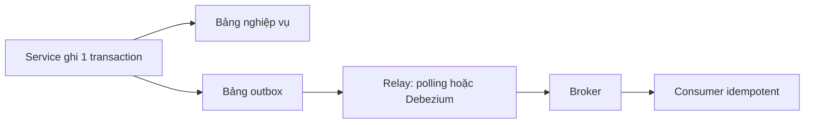
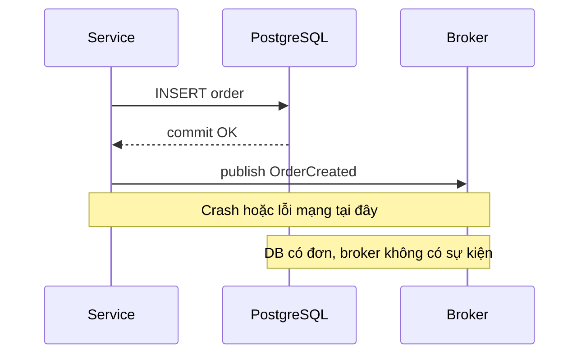
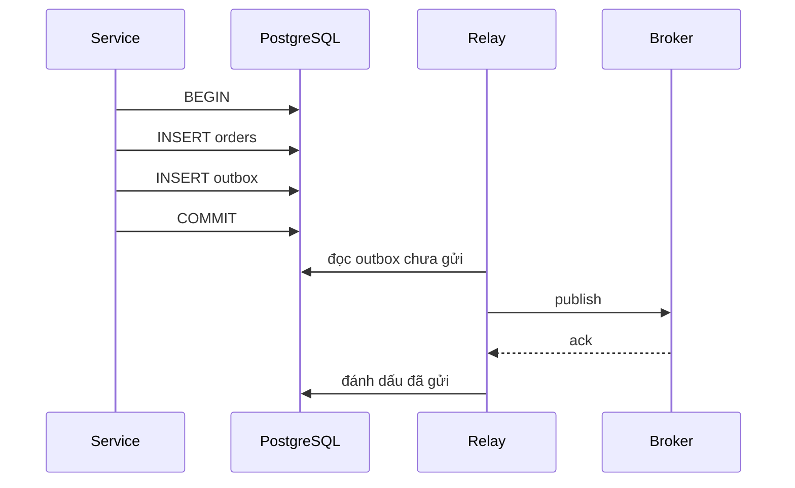
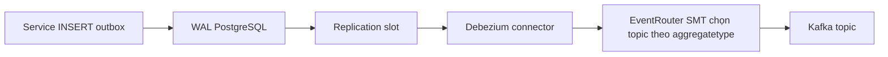
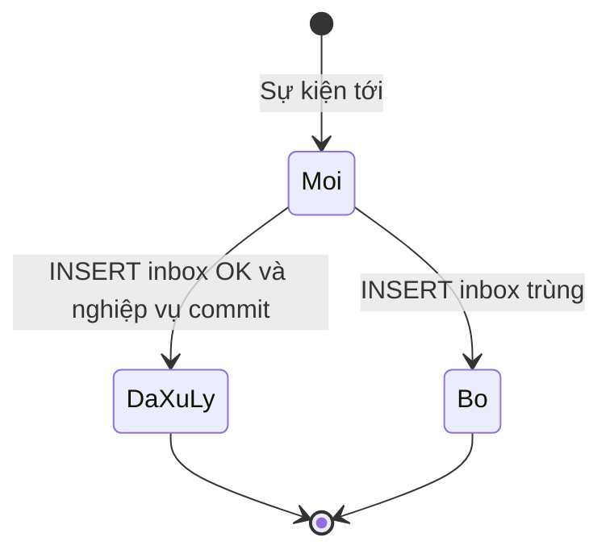
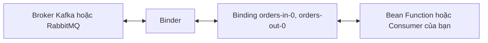
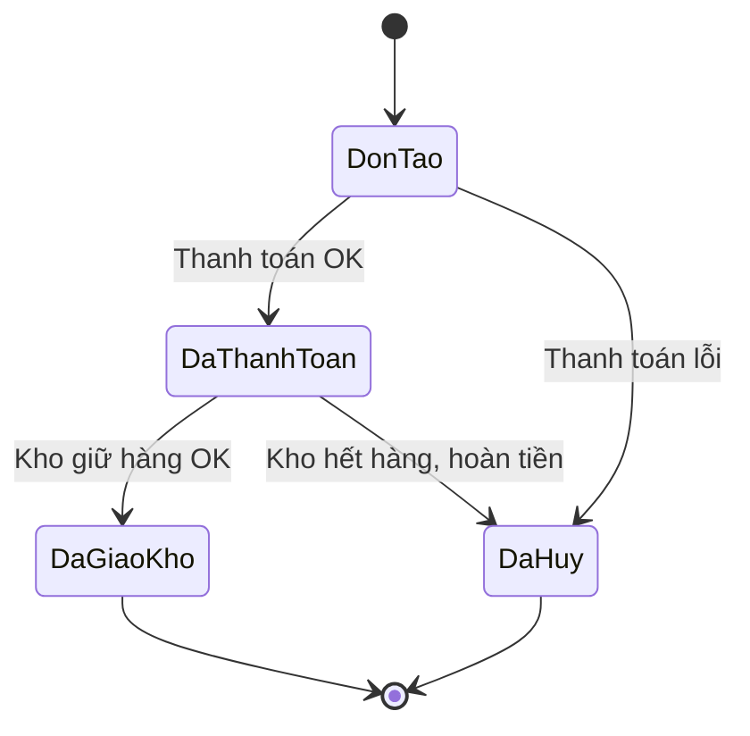

# Lý thuyết 45: Spring Cloud Stream, Transactional Outbox và Debezium

Khi một service vừa lưu dữ liệu vào database vừa phải báo cho service khác qua message broker, hai việc đó nằm ở hai hệ thống không chia sẻ transaction. Làm sao để không bao giờ xảy ra cảnh đã lưu mà không báo, hoặc báo rồi mà không lưu? Bài này đi từ vấn đề dual write, qua mẫu Transactional Outbox, hai cách chuyển outbox ra broker (polling và CDC bằng Debezium), tới yêu cầu consumer idempotent, rồi Spring Cloud Stream như lớp trừu tượng và Saga ở mức tổng quan.

> **Phiên bản (kiểm tra 2026-10-30):** Spring Boot 4.1 (Framework 7, Jackson 3, Hibernate 7), PostgreSQL làm database mặc định. Spring Cloud Stream đã có dòng 5.0 (tài liệu liệt kê 5.0.x là mới nhất); dòng Spring Cloud tương thích với Boot 4.1 và tên artifact cần kiểm tra lại trong bảng tương thích của Spring Cloud trước khi dùng. Debezium PostgreSQL connector đọc stream `pgoutput` có sẵn từ PostgreSQL 10, không cần cài plugin phía server. Các property của binder (DLQ, retry) ghi ở đây dựa trên tài liệu dòng 4.x và 5.0, hãy kiểm tra lại theo phiên bản. Với Boot 3.5, dùng dòng Spring Cloud tương ứng; mẫu thiết kế không đổi.

**Cốt lõi:** Ghi database và gửi message là hai thao tác trên hai hệ thống nên không thể atomic với nhau; làm tuần tự thì luôn có một khoảnh khắc mà một bên đã xong còn bên kia chưa. Transactional Outbox biến "gửi message" thành "ghi một dòng vào bảng outbox trong cùng transaction với dữ liệu nghiệp vụ", nên atomic được, rồi một relay riêng đọc outbox và đẩy ra broker.

- Vì dòng outbox và dữ liệu nghiệp vụ cùng commit hoặc cùng rollback nên không bao giờ có sự kiện "ma" hay thiếu sự kiện, nên nguồn sự thật nằm gọn trong một database.
- Vì relay có thể chết sau khi gửi nhưng trước khi đánh dấu đã gửi nên message được gửi ít nhất một lần, nên consumer phải idempotent.
- Vì Debezium đọc WAL của PostgreSQL thay vì truy vấn bảng nên không tốn tải polling và giữ đúng thứ tự commit, nhưng replication slot giữ WAL lại nếu connector ngừng đọc.



Mô hình tư duy: biến việc "nhắn tin" thành việc "ghi sổ" trong cùng một cuốn sổ, rồi có người giao thư đọc sổ và giao đi, giao lại nếu không chắc đã giao.

**Tóm tắt:**

- Dual write là ghi DB rồi gửi broker (hoặc ngược lại); không có transaction chung nên một trong hai có thể hỏng, gây dữ liệu lệch.
- Transactional Outbox ghi sự kiện vào bảng outbox cùng transaction với dữ liệu nghiệp vụ, tách việc gửi ra relay chạy sau.
- Relay làm bằng polling (truy vấn bảng định kỳ, đơn giản, thêm tải và độ trễ) hoặc CDC (Debezium đọc WAL, độ trễ thấp, đúng thứ tự commit, phức tạp hơn khi vận hành).
- Debezium dùng logical replication của PostgreSQL: cần `wal_level=logical`, một replication slot và một publication; slot không được đọc sẽ làm WAL phình đầy đĩa.
- Cả hai cách relay đều at-least-once, nên consumer cần dedup bằng inbox table hoặc khóa trùng (UNIQUE).
- Spring Cloud Stream trừu tượng hóa broker bằng binder và mô hình hàm `Function`, `Consumer`, `Supplier`; đổi Kafka sang RabbitMQ chủ yếu là đổi binder và cấu hình.
- Không nên dùng Spring Cloud Stream khi cần tính năng đặc thù của broker (Kafka Streams, transaction Kafka, định tuyến RabbitMQ phức tạp), vì lớp trừu tượng che mất chúng.
- Saga chia giao dịch phân tán thành chuỗi giao dịch cục bộ có bù trừ; choreography (sự kiện tự điều phối) hoặc orchestration (có người điều phối).

## Vấn đề nó giải quyết

Ví dụ đặt hàng: lưu đơn vào PostgreSQL rồi gửi sự kiện `OrderCreated` sang Kafka. Nếu lưu xong mà gửi lỗi, kho không biết có đơn mới. Nếu gửi trước rồi lưu lỗi, kho giữ hàng cho một đơn không tồn tại. Đặt cả hai trong `@Transactional` không giúp, vì transaction của Spring chỉ bao DB; broker không tham gia, và commit DB cũng có thể thất bại sau khi message đã đi. Dùng two-phase commit (XA) xuyên DB và broker thì chậm, khóa lâu và Kafka không hỗ trợ XA.



Cách đọc: khoảng giữa hai mũi tên "commit OK" và "publish" là cửa sổ rủi ro. Đảo thứ tự chỉ đảo hướng lệch, không xóa cửa sổ. Muốn xóa nó thì không được có hai hệ thống ghi riêng rẽ; đó là lý do outbox đưa cả hai việc về một hệ thống (DB).

## Khi nào dùng, khi nào không

Dùng outbox khi sự kiện phải khớp chắc chắn với thay đổi dữ liệu: đơn hàng, thanh toán, tồn kho, bất cứ nơi nào mất hoặc lệch sự kiện gây hậu quả tiền bạc. Không cần khi sự kiện mất được (log, analytics không quan trọng), hoặc khi chính broker là nguồn sự thật (event sourcing, xem [CQRS và Event Sourcing](/go?p=01-Spring-Boot%2Fhard%2Flt-25-cqrs-event-sourcing.md)). Outbox thêm một bảng, một relay và nghĩa vụ idempotent cho consumer, nên với hệ thống nhỏ chịu được lệch thì đừng dựng.

## Các khái niệm cần biết

| Khái niệm | Ý nghĩa |
|---|---|
| Dual write | Ghi hai hệ thống riêng rẽ không có transaction chung |
| Outbox table | Bảng chứa sự kiện chờ gửi, ghi cùng transaction nghiệp vụ |
| Relay | Tiến trình đọc outbox và đẩy ra broker |
| CDC | Change Data Capture: bắt thay đổi từ log của DB thay vì truy vấn bảng |
| WAL | Write-Ahead Log của PostgreSQL, mọi thay đổi ghi vào đây trước |
| Replication slot | Đánh dấu vị trí đọc WAL của một consumer; PostgreSQL giữ WAL cho tới khi slot đọc xong |
| Publication | Tập bảng được phát qua logical replication |
| Inbox table | Bảng consumer ghi id message đã xử lý để loại trùng |
| Binder | Thành phần Spring Cloud Stream nối ứng dụng với một broker cụ thể |
| Saga | Chuỗi giao dịch cục bộ, mỗi bước có thao tác bù khi thất bại |

## Cơ chế: Transactional Outbox

Dòng outbox được ghi trong cùng transaction với dữ liệu, nên chúng cùng thành công hoặc cùng bị hủy.



Cách đọc: nửa trên là atomic, nửa dưới là bất đồng bộ và có thể lặp. Nếu relay chết giữa "ack" và "đánh dấu đã gửi", lần chạy sau gửi lại cùng sự kiện. Vì vậy mỗi sự kiện cần một `id` ổn định (UUID sinh lúc ghi) để consumer nhận ra bản trùng.

**Nền tảng:** outbox đúng nghĩa là bài toán "một nguồn sự thật". Mọi thay đổi trạng thái được ghi vào DB; sự kiện là hệ quả sinh ra từ dữ liệu đã commit, không phải một bản ghi độc lập có thể lệch với dữ liệu. Hiểu được điều này thì mọi biến thể (polling, CDC) chỉ là cách chuyển hệ quả ra ngoài.

Bảng outbox tối thiểu cho PostgreSQL (_Minh họa_, chưa chạy thử):

```sql
CREATE TABLE outbox (
    id            uuid        PRIMARY KEY,
    aggregatetype text        NOT NULL,   -- ví dụ 'order', quyết định topic
    aggregateid   text        NOT NULL,   -- khóa nghiệp vụ, dùng làm message key
    type          text        NOT NULL,   -- ví dụ 'OrderCreated'
    payload       jsonb       NOT NULL,
    created_at    timestamptz NOT NULL DEFAULT now(),
    sent_at       timestamptz               -- chỉ dùng cho polling
);
CREATE INDEX outbox_unsent ON outbox (created_at) WHERE sent_at IS NULL;
```

```java
@Service
class OrderService {
    private final OrderRepository orders;
    private final OutboxRepository outbox;
    private final JsonMapper json;   // tools.jackson.databind.json.JsonMapper (Jackson 3)

    // constructor bỏ qua

    @Transactional
    public Order create(CreateOrder cmd) {
        Order o = orders.save(Order.from(cmd));
        outbox.save(new OutboxEvent(UUID.randomUUID(), "order", o.getId().toString(),
                "OrderCreated", json.writeValueAsString(new OrderCreated(o.getId(), o.getTotal()))));
        return o;   // cùng một transaction: commit cả hai hoặc không gì cả
    }
}
```

## Hai cách relay

### Polling

Một tác vụ định kỳ chọn các dòng chưa gửi, gửi lên broker rồi đánh dấu. Để nhiều instance không gửi trùng việc, dùng `FOR UPDATE SKIP LOCKED`.

```java
@Scheduled(fixedDelay = 500)
@Transactional
void relay() {
    List<OutboxEvent> batch = outbox.lockNextBatch(100);   // SELECT ... WHERE sent_at IS NULL
                                                           // ORDER BY created_at LIMIT 100 FOR UPDATE SKIP LOCKED
    for (OutboxEvent e : batch) {
        kafka.send(topicFor(e.getAggregateType()), e.getAggregateId(), e.getPayload()).join();
        e.markSent();
    }
}
```

Ưu điểm là đơn giản, không cần hạ tầng thêm. Nhược điểm: tải truy vấn đều đặn lên DB, độ trễ bằng chu kỳ poll, bảng phải dọn dẹp, và `SKIP LOCKED` cho phép các batch chạy song song nên thứ tự toàn cục không được bảo đảm (thứ tự theo `aggregateid` cần thêm thiết kế). Chi tiết về khóa dòng xem phần transaction trong bài PostgreSQL.

### CDC với Debezium

Thay vì truy vấn bảng, Debezium đọc thẳng WAL của PostgreSQL qua logical replication, nên thấy mọi dòng mới theo đúng thứ tự commit với độ trễ thấp, và không có tải truy vấn định kỳ.



Cách đọc: slot là điểm neo. PostgreSQL chỉ xóa WAL cũ sau khi slot xác nhận đã đọc tới đó. Connector chạy trong Kafka Connect, dùng plugin `pgoutput` (có sẵn từ PostgreSQL 10). SMT `io.debezium.transforms.outbox.EventRouter` biến dòng thay đổi của bảng outbox thành message sạch: topic theo `aggregatetype`, key theo `aggregateid`, value là `payload`, và id sự kiện đặt vào header để consumer dedup.

Điều kiện phía PostgreSQL: `wal_level=logical`, đủ `max_replication_slots` và `max_wal_senders`, và một user có quyền replication. Chi tiết WAL và logical replication xem [Logical replication, wal_level, FDW](/go?p=02-Database%2Fhard%2Flt-20-logical-replication-wal-level-fdw.md).

Cấu hình connector mẫu (_Minh họa_, chưa chạy thử; tên property theo tài liệu Debezium, hãy kiểm tra lại với phiên bản bạn dùng):

```json
{
  "name": "outbox-connector",
  "config": {
    "connector.class": "io.debezium.connector.postgresql.PostgresConnector",
    "plugin.name": "pgoutput",
    "database.hostname": "postgres",
    "database.port": "5432",
    "database.user": "debezium",
    "database.password": "${file:/secrets/db.properties:password}",
    "database.dbname": "shop",
    "topic.prefix": "shop",
    "table.include.list": "public.outbox",
    "slot.name": "outbox_slot",
    "publication.name": "outbox_pub",
    "transforms": "outbox",
    "transforms.outbox.type": "io.debezium.transforms.outbox.EventRouter"
  }
}
```

Mẹo hay gặp: vì Debezium đọc WAL chứ không đọc nội dung bảng, ứng dụng có thể `INSERT` rồi `DELETE` dòng outbox ngay trong cùng transaction; sự kiện vẫn được bắt từ WAL còn bảng không phình. Cách này bỏ được việc dọn dẹp, nhưng nghĩa là bảng không còn là nhật ký để điều tra, nên cân nhắc.

**Phải thuộc:** replication slot không được đọc sẽ buộc PostgreSQL giữ WAL mãi, và đĩa có thể đầy. Phòng bằng cách giám sát độ trễ slot, đặt `max_slot_wal_keep_size` (khi vượt, slot bị vô hiệu hóa và connector phải snapshot lại), và dùng heartbeat của Debezium để slot tiến lên ngay cả khi bảng outbox ít thay đổi. Xóa slot khi gỡ connector.

**Suy luận:** vì PostgreSQL đảm bảo WAL được đọc theo thứ tự commit và slot nhớ vị trí, Debezium có thể khởi động lại và tiếp tục từ đúng chỗ, nên không mất sự kiện. Nhưng vị trí chỉ được xác nhận sau khi message đã vào Kafka; connector chết giữa lúc gửi và xác nhận thì sau khi chạy lại nó gửi lại một số sự kiện. Vậy CDC cũng là at-least-once, không phải exactly-once, và consumer vẫn cần idempotent. Chọn polling hay CDC chỉ là đổi giữa sự đơn giản và độ trễ cùng thứ tự commit; không cái nào miễn phí khỏi vấn đề trùng.

| | Polling | CDC (Debezium) |
|---|---|---|
| Hạ tầng thêm | Không | Kafka Connect, connector, slot |
| Độ trễ | Bằng chu kỳ poll | Thấp, theo WAL |
| Tải lên DB | Truy vấn đều đặn | Đọc WAL, tải nhỏ |
| Thứ tự | Cần thiết kế thêm | Theo thứ tự commit |
| Rủi ro riêng | Bảng phình, khóa dòng | WAL phình khi slot kẹt |
| Giao | At-least-once | At-least-once |

## Consumer idempotent: inbox và dedup key

Vì relay giao ít nhất một lần, consumer phải coi việc nhận trùng là bình thường. Cách chắc nhất là ghi `id` sự kiện vào bảng inbox với ràng buộc UNIQUE trong cùng transaction với tác động nghiệp vụ.

```java
@Transactional
void handle(String eventId, OrderCreated e) {
    int inserted = jdbc.update(
        "INSERT INTO inbox(event_id) VALUES (?) ON CONFLICT DO NOTHING", eventId);
    if (inserted == 0) return;          // đã xử lý, bỏ qua bản trùng
    stock.reserve(e.orderId(), e.items());   // tác động nghiệp vụ, cùng transaction với inbox
}
```

Nếu transaction rollback thì dòng inbox cũng mất, nên lần giao lại sau sẽ xử lý được; nếu commit thì mọi bản trùng sau đó bị chặn. Chỉ lưu id trong bộ nhớ hoặc Redis rồi xử lý ngoài transaction thì vẫn hở cửa sổ giữa hai bước. Cách khác là làm chính thao tác idempotent tự nhiên (đặt trạng thái bằng giá trị cụ thể thay vì cộng dồn). Chi tiết ở [Distributed lock và idempotency](/go?p=01-Spring-Boot%2Fhard%2Flt-26-distributed-lock-idempotency.md).



Cách đọc: mỗi sự kiện kết thúc ở một trong hai trạng thái, và chỉ trạng thái "đã xử lý" tạo tác động. Trùng lặp bị chặn bởi ràng buộc UNIQUE, không bởi logic dễ sai trong code.

## Spring Cloud Stream

Spring Cloud Stream cho bạn viết logic nhắn tin như các hàm Java thuần, còn việc nối với broker do binder lo. Bạn khai báo bean `Function`, `Consumer` hoặc `Supplier`; framework tạo binding tên theo quy ước `<tên hàm>-in-<chỉ số>` và `<tên hàm>-out-<chỉ số>`, rồi ánh xạ chúng sang destination của broker (topic với Kafka, exchange với RabbitMQ).



Cách đọc: code nghiệp vụ chỉ thấy hàm và binding, binder là phần thay được. Artifact binder đặt theo dạng `spring-cloud-stream-binder-kafka` và `spring-cloud-stream-binder-rabbit`; đổi broker là đổi binder và cấu hình binding, trong khi hàm giữ nguyên.

```java
@SpringBootApplication
public class InventoryApp {
    @Bean
    public Consumer<OrderCreated> orders() {      // binding: orders-in-0
        return e -> inventory.reserve(e);
    }

    @Bean
    public Function<OrderCreated, StockReserved> reserve() {   // reserve-in-0 và reserve-out-0
        return e -> new StockReserved(e.orderId());
    }
}
```

```yaml
spring:
  cloud:
    function:
      definition: orders          # chọn hàm nào được bind, nên khai báo tường minh
    stream:
      bindings:
        orders-in-0:
          destination: shop.order      # topic hoặc exchange
          group: inventory             # consumer group, mỗi group nhận một bản
          consumer:
            max-attempts: 3            # retry tại chỗ trước khi chuyển DLQ
      kafka:
        bindings:
          orders-in-0:
            consumer:
              enable-dlq: true         # kiểm tra lại tên property theo binder và phiên bản
              dlq-name: shop.order.inventory.dlq
```

Điểm cần hiểu thay vì học thuộc property: `group` quyết định nhiều instance chia nhau việc (cùng group) hay mỗi service nhận bản riêng (khác group); không đặt group thì mỗi instance thành một anonymous group và nhận trùng. DLQ do binder cấu hình: Kafka binder gửi message hết retry vào một topic DLQ, RabbitMQ binder dùng dead letter exchange của broker (bật bằng cờ riêng cho consumer; kiểm tra lại tên property theo tài liệu binder). Với bài trước về broker, xem [RabbitMQ](/go?p=01-Spring-Boot%2Fhard%2Flt-44-rabbitmq-spring-amqp.md) và [Kafka](/go?p=01-Spring-Boot%2Fhard%2Flt-07-event-driven-kafka.md).

Để gửi từ code thường (không phải bean hàm), dùng `StreamBridge.send("binding-hoặc-destination", payload)`. Dùng nó trong hàm nghiệp vụ thì quay lại vấn đề dual write; vẫn cần outbox.

**Khi nào không nên dùng Spring Cloud Stream:**

- Cần tính năng đặc thù của broker: transaction Kafka, Kafka Streams với topology phức tạp, định tuyến exchange nhiều tầng của RabbitMQ. Lớp trừu tượng che hoặc làm khó cấu hình chúng.
- Chỉ dùng một broker và đội đã quen `KafkaTemplate` hay `@KafkaListener`: thêm một lớp là thêm thứ phải hiểu và gỡ lỗi.
- Cần kiểm soát chi tiết ack, offset hoặc xử lý lỗi theo từng loại exception.

Lợi ích thật của nó là tính nhất quán giữa nhiều service và khả năng đổi broker; nếu không cần cả hai thì lợi ích mỏng.

## Saga ngắn gọn

Giao dịch trải qua nhiều service không có transaction chung. Saga chia thành chuỗi giao dịch cục bộ, mỗi bước phát sự kiện; nếu một bước thất bại, các bước trước chạy thao tác bù (hủy đơn, hoàn tiền) theo thứ tự ngược.



| | Choreography | Orchestration |
|---|---|---|
| Điều phối | Mỗi service phản ứng với sự kiện của service khác | Một orchestrator ra lệnh từng bước |
| Ưu điểm | Lỏng lẻo, không điểm trung tâm | Luồng rõ ràng, dễ theo dõi và gỡ lỗi |
| Nhược điểm | Khó thấy toàn cục, dễ vòng lặp sự kiện | Orchestrator là điểm phụ thuộc, thêm một thành phần |
| Phù hợp | Luồng ngắn, ít bước | Luồng dài, nhiều nhánh bù trừ |

Mọi bước của saga cần outbox (để sự kiện khớp với trạng thái) và consumer idempotent (vì giao trùng). Bù trừ không phải rollback: nó là một giao dịch mới có thể thất bại và phải được thiết kế idempotent. Thiết kế trạng thái saga liên quan tới [CQRS và Event Sourcing](/go?p=01-Spring-Boot%2Fhard%2Flt-25-cqrs-event-sourcing.md).

## Bẫy thường gặp

- Gọi `kafkaTemplate.send` ngay trong `@Transactional` và tin là an toàn: vẫn dual write, và message có thể đi trước khi transaction commit.
- Quên giám sát replication slot: connector ngừng, WAL phình, đĩa PostgreSQL đầy và cả database dừng.
- Outbox không có id ổn định hoặc consumer không dedup: sự kiện giao trùng gây xử lý hai lần.
- Dùng polling với nhiều instance mà không có `SKIP LOCKED`: gửi trùng, hoặc khóa chờ nhau.
- Mong thứ tự toàn cục từ outbox: chỉ có thứ tự theo key (cùng `aggregateid` vào cùng partition), và với polling song song còn phải thêm thiết kế.
- Không đặt `group` trong Spring Cloud Stream: mỗi instance nhận bản riêng.
- Tưởng Spring Cloud Stream đổi broker là chỉ đổi dependency: ngữ nghĩa DLQ, partition, retry khác nhau giữa binder.
- Saga bù trừ không idempotent hoặc không có bước xử lý khi chính bù trừ thất bại.

## Phỏng vấn khó: chuỗi hỏi xoáy

### Chuỗi 1: Dual write và Outbox

1. **Câu mở:** Service lưu đơn vào PostgreSQL rồi gửi sự kiện lên Kafka. Có vấn đề gì?
2. **Xoáy 1:** Đặt `kafkaTemplate.send` trong `@Transactional` có sửa được không, và đảo thứ tự gửi trước lưu sau thì sao?
3. **Xoáy 2:** Outbox giải quyết bằng cách nào, và nó có cho đúng một lần không?

**Đáp án ngắn:** Vấn đề gốc là ghi database và gửi broker nằm ở hai hệ thống không có transaction chung, nên luôn có cửa sổ mà một bên đã xong còn bên kia thì chưa. `@Transactional` của Spring chỉ bao DB, nên đặt `send` bên trong không làm broker tham gia; message còn có thể đi trước khi commit, hoặc commit lỗi sau khi đã gửi. Đảo thứ tự chỉ đổi hướng lệch từ "thiếu sự kiện" sang "sự kiện ma". Outbox đưa hai việc về một hệ thống: ghi dòng sự kiện vào bảng outbox trong cùng transaction với dữ liệu nghiệp vụ, nên atomic; một relay đọc outbox rồi đẩy ra broker. Relay có thể chết sau khi gửi nhưng trước khi đánh dấu hoặc xác nhận, nên sự kiện được giao ít nhất một lần, không phải đúng một lần. Hiệu ứng đúng một lần đạt được bằng consumer idempotent (inbox, UNIQUE). Production cần id sự kiện ổn định, giám sát độ trễ của relay và cách dọn bảng outbox.

**Sai lầm hay gặp:**
- Nói XA hay `@Transactional` giải quyết được vì "cùng một transaction".
- Khẳng định outbox cho exactly-once.
- Quên rằng thứ tự chỉ bảo đảm theo key.

### Chuỗi 2: Polling hay Debezium

1. **Câu mở:** Hai cách chuyển outbox ra broker, bạn chọn thế nào?
2. **Xoáy 1:** Debezium với PostgreSQL hoạt động ra sao, và replication slot gây rủi ro gì?
3. **Xoáy 2:** Connector chết giữa chừng thì có mất hoặc trùng sự kiện không?

**Đáp án ngắn:** Cả hai đều chuyển outbox ra broker; polling truy vấn bảng định kỳ, còn CDC đọc log thay đổi. Polling đơn giản, không cần hạ tầng thêm, nhưng thêm tải truy vấn, độ trễ bằng chu kỳ poll và thứ tự khó đảm bảo khi chạy song song. Debezium đọc WAL qua logical replication (`wal_level=logical`, plugin `pgoutput`, một replication slot và publication), bắt dòng outbox theo đúng thứ tự commit với độ trễ thấp, và EventRouter chuyển dòng thành message theo `aggregatetype` và `aggregateid`. Rủi ro chính là slot: PostgreSQL giữ WAL cho tới khi slot đọc xong, nên connector kẹt hay ngừng làm WAL phình đầy đĩa. Phòng bằng giám sát độ trễ slot, `max_slot_wal_keep_size`, heartbeat và xóa slot khi gỡ connector. Connector chết thì không mất sự kiện vì slot nhớ vị trí, nhưng vì vị trí chỉ được xác nhận sau khi ghi vào Kafka nên có thể gửi lại một số sự kiện; kết luận là at-least-once. Chọn polling cho quy mô vừa, đội ít vận hành Kafka Connect; chọn CDC khi cần độ trễ thấp, thông lượng cao và thứ tự commit.

**Sai lầm hay gặp:**
- Nói CDC là exactly-once.
- Quên giám sát slot và gặp sự cố đầy đĩa.
- Cho rằng CDC không tốn gì trên database.

### Chuỗi 3: Idempotent consumer, Spring Cloud Stream và Saga

1. **Câu mở:** Vì sao consumer của sự kiện outbox phải idempotent, và bạn làm thế nào?
2. **Xoáy 1:** Spring Cloud Stream giúp gì, `group` và DLQ đóng vai trò nào, và lúc nào bạn không dùng nó?
3. **Xoáy 2:** Saga choreography khác orchestration ra sao, và bù trừ có phải rollback không?

**Đáp án ngắn:** Relay giao ít nhất một lần nên trùng là điều bình thường, nên consumer phải cho cùng kết quả khi nhận cùng sự kiện nhiều lần. Cách chắc nhất là ghi id sự kiện vào bảng inbox có UNIQUE trong cùng transaction với tác động nghiệp vụ: trùng thì `ON CONFLICT DO NOTHING` trả 0 và bỏ qua, rollback thì dòng inbox mất theo để lần giao sau xử lý lại. Cách khác là làm thao tác tự nhiên idempotent. Spring Cloud Stream cho phép viết hàm `Function`, `Consumer`, `Supplier` và để binder nối với Kafka hoặc RabbitMQ; `group` quyết định các instance chia việc hay mỗi service nhận bản riêng, và DLQ giữ message hết retry. Nó đáng dùng khi cần nhất quán giữa nhiều service hoặc khả năng đổi broker, nhưng không nên dùng khi cần tính năng đặc thù như transaction Kafka, Kafka Streams phức tạp hay định tuyến RabbitMQ nhiều tầng vì lớp trừu tượng che mất chúng. Saga chia giao dịch phân tán thành các giao dịch cục bộ: choreography để mỗi service phản ứng với sự kiện, lỏng lẻo nhưng khó thấy toàn cục; orchestration có một bộ điều phối ra lệnh, dễ theo dõi nhưng thêm điểm phụ thuộc. Bù trừ không phải rollback mà là một giao dịch mới, có thể lỗi và phải idempotent, nên mỗi bước saga vẫn cần outbox và inbox.

**Sai lầm hay gặp:**
- Dedup trong bộ nhớ hoặc Redis ngoài transaction nghiệp vụ.
- Không đặt `group`, khiến mỗi instance nhận một bản.
- Coi bước bù trừ là chắc chắn thành công.

## Câu hỏi tự kiểm tra

**1. Service ghi đơn rồi gọi `kafkaTemplate.send` trong cùng phương thức `@Transactional`. Cho một kịch bản làm lệch dữ liệu.**

Gợi ý suy luận: hỏi broker có nằm trong transaction của Spring không, và `send` chạy trước hay sau commit.

Lập luận và đáp án: transaction chỉ bao database. `send` chạy trước commit nên nếu commit sau đó thất bại, sự kiện đã đi nhưng đơn không tồn tại. Nếu `send` chạy xong và commit thành công thì ổn, nhưng nếu `send` lỗi sau khi bạn bắt exception, đơn có mà sự kiện không. Dùng outbox để sự kiện là một dòng trong cùng transaction.

**2. Debezium ngừng chạy ba ngày. Điều gì xảy ra ở PostgreSQL và bạn phòng thế nào?**

Gợi ý suy luận: slot đại diện cho vị trí đọc, và PostgreSQL cần giữ WAL cho tới vị trí đó.

Lập luận và đáp án: slot không tiến lên nên WAL chưa được đọc không thể xóa, đĩa đầy dần và có thể làm cả database dừng. Phòng bằng cách giám sát độ trễ slot và cảnh báo, đặt `max_slot_wal_keep_size`, bật heartbeat, và xóa slot khi gỡ connector. Đổi lại, vượt giới hạn thì slot bị vô hiệu hóa và connector cần snapshot lại.

**3. Consumer xử lý `OrderCreated` rồi crash trước khi commit offset. Chuyện gì xảy ra lần sau và làm sao an toàn?**

Gợi ý suy luận: tác động đã xảy ra nhưng broker chưa biết, nên giao lại.

Lập luận và đáp án: sự kiện được giao lại. Nếu tác động nghiệp vụ và dòng inbox nằm trong cùng transaction DB thì khi crash trước commit cả hai bị hủy và lần sau xử lý sạch; nếu đã commit thì lần sau INSERT inbox trùng và bị bỏ qua. An toàn nhờ UNIQUE trong cùng transaction, không nhờ việc ack broker.

**4. Hai instance của service kho cùng nghe `orders-in-0`, một cấu hình không đặt `group`, một có `group: inventory`. Mỗi sự kiện xử lý mấy lần?**

Gợi ý suy luận: group xác định ai chia việc với ai.

Lập luận và đáp án: instance có `group: inventory` tạo consumer group cố định, các instance cùng group chia nhau và mỗi sự kiện chỉ một instance trong group xử lý. Instance không có group trở thành anonymous group riêng và nhận thêm một bản nữa. Như vậy một sự kiện có thể được xử lý hai lần. Luôn đặt `group` cho consumer cần chia tải.

Nguồn: tài liệu Spring Cloud Stream (docs.spring.io/spring-cloud-stream, mục Producing and Consuming Messages, danh sách phiên bản 5.0.x và các trang binder); tài liệu Debezium PostgreSQL connector (debezium.io, mục pgoutput, plugin.name, snapshot) và Outbox Event Router; tài liệu PostgreSQL về logical replication; tra ngày 2026-10-30. Tên property DLQ của từng binder, giá trị mặc định retry và bản Spring Cloud tương thích Boot 4.1 chưa kiểm chứng trực tiếp, cần kiểm tra lại theo phiên bản.

