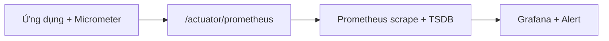
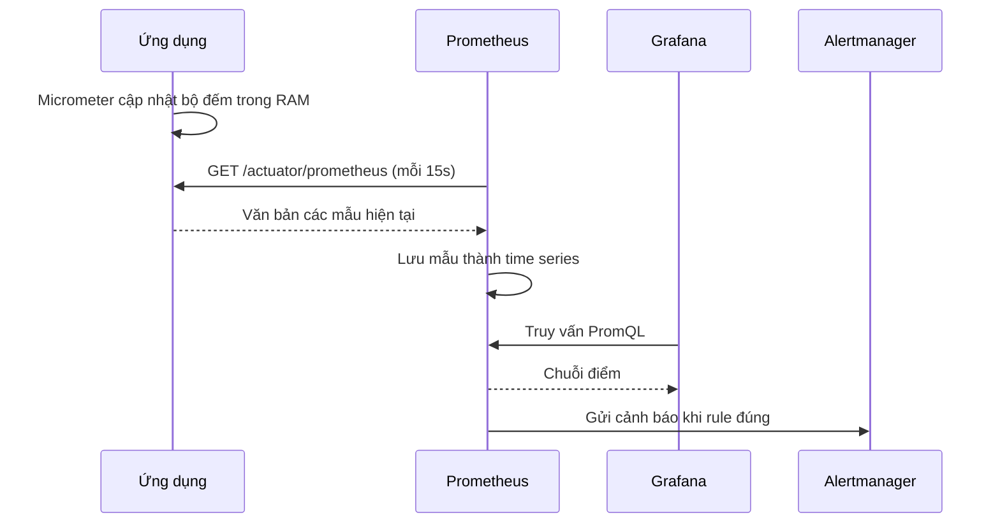
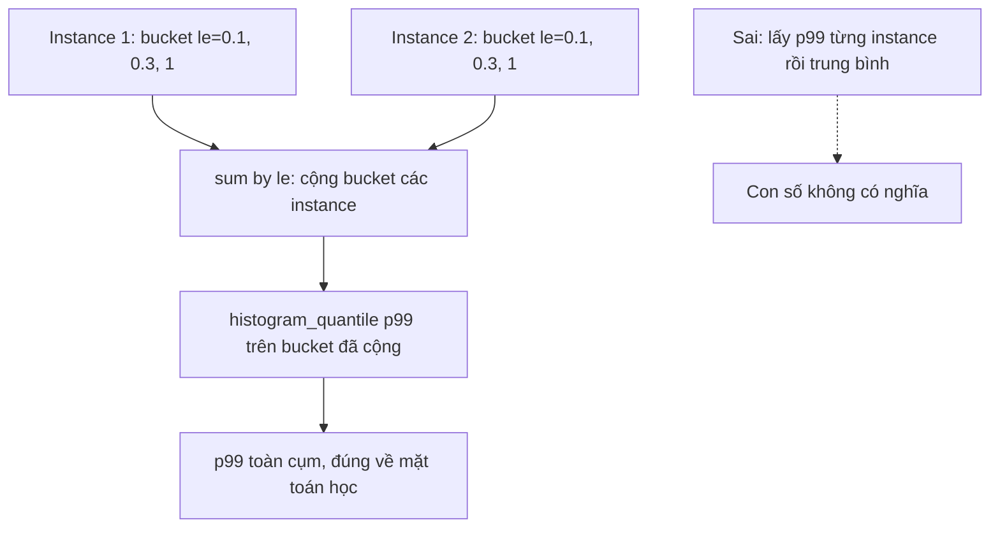
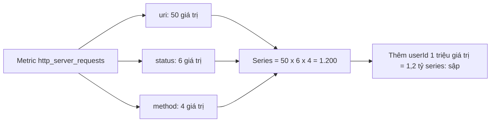
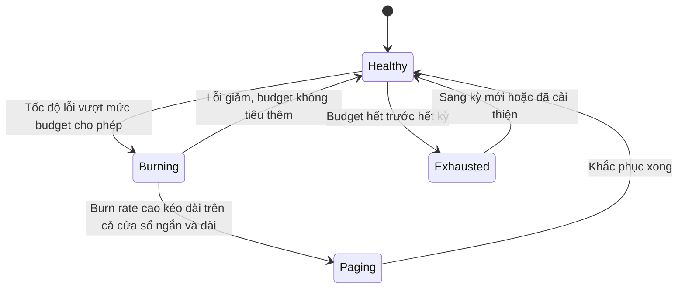

# Lý thuyết 52: Metric trong thực tế (Micrometer, Prometheus, Grafana, SLO)

Log cho bạn biết một request cụ thể đã xảy ra gì. Metric cho bạn biết cả hệ thống đang khỏe hay yếu: bao nhiêu request mỗi giây, bao nhiêu phần trăm lỗi, request chậm nhất mất bao lâu, pool kết nối còn chỗ không. Hình dung bảng đồng hồ ô tô: bạn không đọc nhật ký động cơ khi đang lái, bạn nhìn kim tốc độ và đèn cảnh báo. Bài này đi từ cách ứng dụng Spring Boot đo (Micrometer), cách Prometheus thu và lưu, cách đọc bằng PromQL và Grafana, tới cách biến con số thành cam kết (SLO) và cảnh báo có ý nghĩa.

> **Phiên bản (kiểm tra 2026-10-30):** Spring Boot 4.1 (tài liệu 4.1.2, Micrometer 1.17). Endpoint `/actuator/prometheus` mặc định không được expose, phải bật. Boot 4 chia module và starter mịn hơn; tên starter cho Prometheus nên kiểm tra lại theo phiên bản, còn registry là `io.micrometer:micrometer-registry-prometheus`. Boot 3.5 dùng cùng cách, khác ở tên package và starter. Client Prometheus mặc định là `prometheus-metrics` (simpleclient đã deprecated).

**Cốt lõi:** Một hệ thống sống cần con số tổng hợp theo thời gian để phát hiện sự cố trước khi người dùng báo. Micrometer là lớp trừu tượng để code chỉ nói "đếm cái này, đo thời gian cái kia", còn việc xuất ra định dạng nào (Prometheus, OTLP...) do registry quyết định; Prometheus chủ động kéo (scrape) các con số này theo chu kỳ rồi lưu thành time series.

- Vì Prometheus kéo (pull) từ endpoint chứ ứng dụng không đẩy nên ứng dụng chỉ cần phơi `/actuator/prometheus`, và nếu scrape thất bại thì bản thân việc đó là tín hiệu (`up == 0`).
- Vì mỗi tổ hợp giá trị của label tạo ra một time series riêng nên label có nhiều giá trị (như `userId`) làm bộ nhớ Prometheus nổ tung (cardinality explosion).
- Vì trung bình che mất đuôi chậm và percentile không cộng được nên phải đo bằng histogram rồi tính percentile ở phía Prometheus bằng `histogram_quantile`.



Mô hình tư duy: ứng dụng chỉ ghi số liệu thô vào bộ đếm trong bộ nhớ, còn "theo thời gian", "theo tỷ lệ", "percentile" đều là phép tính của Prometheus trên các lần scrape.

**Tóm tắt:**

- Micrometer là facade metric (như SLF4J cho log): code dùng `MeterRegistry`, registry cụ thể xuất ra Prometheus hoặc OTLP.
- Bốn loại meter hay dùng: counter (chỉ tăng), gauge (giá trị tức thời lên xuống), timer (đếm và đo thời gian), distribution summary (phân bố giá trị không phải thời gian).
- Prometheus pull: scrape định kỳ, mỗi series được định danh bởi tên metric cộng bộ label; Pushgateway chỉ dành cho job ngắn.
- PromQL cốt lõi: `rate()` cho counter, `histogram_quantile()` cho percentile, `sum by (...)` để gộp.
- Không lấy trung bình của percentile; phải tính percentile từ bucket đã cộng (`sum by (le)`).
- Cardinality là giới hạn thật: tag chỉ nhận tập giá trị nhỏ, hữu hạn (route, status), không bao giờ là id người dùng hay URL thô.
- Bốn tín hiệu vàng (latency, traffic, errors, saturation), RED cho service, USE cho tài nguyên; SLO và error budget biến chúng thành cam kết, alert theo burn rate thay vì ngưỡng thô.
- Khi sự cố xem JVM (heap, GC, thread), HikariCP (pending, timeout) và Tomcat (thread busy) trước.

## Vấn đề nó giải quyết

Không có metric, bạn phát hiện sự cố bằng cách người dùng gọi điện, rồi mò log của từng instance. Không ai biết "bình thường" trông thế nào nên không phân biệt được chậm thật với chậm quen thuộc. Metric cho bạn đường cơ sở, xu hướng, và điều kiện tự động báo động. SLO còn trả lời câu hỏi khó hơn: độ tin cậy bao nhiêu là đủ, để đội biết khi nào nên dừng làm tính năng mà sửa độ ổn định.

## Khi nào dùng, khi nào không

Dùng metric cho mọi service chạy production: nó rẻ (vài bộ đếm trong bộ nhớ) và cho cái nhìn tổng thể. Không dùng metric để tìm nguyên nhân của một request cụ thể (đó là việc của trace và log, xem [Tracing và log tập trung](/go?p=01-Spring-Boot%2Fhard%2Flt-53-opentelemetry-tracing-log.md)), và không dùng nó để lưu dữ liệu nghiệp vụ theo từng thực thể (đơn hàng nào, người dùng nào). Tổng quan về Actuator và observability nằm ở [Observability](/go?p=01-Spring-Boot%2Fmedium%2Flt-19-observability.md); bài này đi sâu vào cách dùng metric đúng để vận hành.

## Các khái niệm cần biết

| Khái niệm | Ý nghĩa ngắn |
|---|---|
| **Meter / MeterRegistry** | Meter là một phép đo; registry là nơi đăng ký và xuất chúng |
| **Counter** | Chỉ tăng (số request, số lỗi); đọc bằng `rate()` |
| **Gauge** | Giá trị tức thời (số kết nối đang dùng, kích thước queue) |
| **Timer** | Ghi count, tổng thời gian, và tùy chọn histogram của thời lượng |
| **Distribution summary** | Như timer nhưng cho đại lượng khác (kích thước payload) |
| **Tag (Micrometer) = Label (Prometheus)** | Cặp khóa-giá trị chia một metric thành nhiều series |
| **Time series** | Chuỗi (thời điểm, giá trị) của đúng một tổ hợp tên + label |
| **Scrape** | Một lần Prometheus gọi endpoint và lưu các mẫu |
| **Cardinality** | Số series khác nhau; tích số giá trị của các label |
| **Histogram bucket** | Bộ đếm "số quan sát nhỏ hơn hoặc bằng ngưỡng le" |
| **SLI / SLO** | Chỉ số đo chất lượng; mục tiêu cho chỉ số đó |
| **Error budget / burn rate** | Phần lỗi được phép; tốc độ đang tiêu hao phần đó |

## Cơ chế: từ code tới biểu đồ

Spring Boot tự đăng ký sẵn metric cho HTTP server (`http.server.requests`), JVM, datasource, cache. Bạn thêm của mình bằng `MeterRegistry`. Dòng dữ liệu đi qua bốn chặng:



Cách đọc: ứng dụng không biết Prometheus tồn tại, nó chỉ trả bộ đếm hiện tại khi được hỏi. Mỗi lần scrape là một điểm trên biểu đồ; giữa hai lần scrape bạn không thấy gì, nên độ phân giải bằng chu kỳ scrape. Nhờ kéo nên Prometheus biết ngay khi một instance chết (scrape lỗi), điều mà mô hình đẩy khó làm.

**Nền tảng:** Counter trong ứng dụng là con số cộng dồn từ lúc tiến trình khởi động, không phải "số request mỗi giây". Mọi ý nghĩa theo thời gian (tốc độ, tỷ lệ, percentile) đến từ việc Prometheus lấy hiệu giữa các lần scrape. Hiểu điều này thì `rate()` và hành vi khi tiến trình restart (counter về 0, Prometheus bù lại) đều tự nhiên.

## Bốn loại meter và Micrometer trong code

Cấu hình tối thiểu cho Boot 4 (Minh họa, chưa chạy thử):

```properties
# pom: spring-boot-starter-actuator + io.micrometer:micrometer-registry-prometheus
management.endpoints.web.exposure.include=health,prometheus
management.metrics.tags.application=${spring.application.name}
management.metrics.distribution.percentiles-histogram.http.server.requests=true
# SLO bucket thêm (kiểm tra lại tên property theo phiên bản)
management.metrics.distribution.slo.http.server.requests=100ms,300ms,1s
```

Dùng `MeterRegistry` trong service (Minh họa, chưa chạy thử):

```java
@Service
class PaymentService {
    private final Counter failed;
    private final Timer latency;
    private final AtomicInteger inFlight = new AtomicInteger();

    PaymentService(MeterRegistry registry) {
        this.failed = Counter.builder("payment.failed")
                .tag("reason", "declined")          // tập giá trị nhỏ, hữu hạn
                .register(registry);
        this.latency = Timer.builder("payment.latency")
                .publishPercentileHistogram()        // xuất bucket để tính percentile ở Prometheus
                .register(registry);
        Gauge.builder("payment.inflight", inFlight, AtomicInteger::get).register(registry);
    }

    void pay(PaymentRequest r) {
        inFlight.incrementAndGet();
        try {
            latency.record(() -> doPay(r));
        } catch (DeclinedException e) {
            failed.increment();
            throw e;
        } finally {
            inFlight.decrementAndGet();
        }
    }
}
```

Quy ước đặt tên: Micrometer dùng dấu chấm (`payment.latency`), Prometheus đổi thành gạch dưới và thêm đơn vị (`payment_latency_seconds`, `payment_failed_total`). Gauge chỉ giữ tham chiếu yếu tới object, nên phải giữ object ở đâu đó (field) kẻo bị GC và gauge trả NaN.

**Phải thuộc:** counter chỉ tăng và đọc bằng `rate()`; gauge là giá trị tức thời và đọc trực tiếp; timer và distribution summary xuất `_count`, `_sum` (và `_bucket` nếu bật histogram). Endpoint `/actuator/prometheus` mặc định không expose, phải thêm `prometheus` vào `management.endpoints.web.exposure.include`.

## PromQL cơ bản

PromQL trả lời câu hỏi bằng cách tính trên các chuỗi mẫu. Ba toán tử bạn dùng hằng ngày:

```text
# Traffic: số request mỗi giây, gộp theo route
sum by (uri) (rate(http_server_requests_seconds_count[5m]))

# Errors: tỷ lệ 5xx
sum(rate(http_server_requests_seconds_count{status=~"5.."}[5m]))
  / sum(rate(http_server_requests_seconds_count[5m]))

# Latency: p95 toàn service, tính từ bucket đã cộng
histogram_quantile(0.95,
  sum by (le) (rate(http_server_requests_seconds_bucket[5m])))
```

`rate(x[5m])` lấy mức tăng trung bình mỗi giây của counter trong 5 phút gần nhất và tự xử lý lúc counter reset. `sum by (...)` giữ lại các label liệt kê và cộng phần còn lại. `histogram_quantile` nội suy percentile từ các bucket; vì vậy độ chính xác phụ thuộc vào ranh giới bucket.

## Histogram và percentile: đừng tính trung bình percentile

Trung bình thời gian phản hồi che đuôi chậm: 99 request 10ms và 1 request 5 giây cho trung bình khoảng 60ms, trong khi người dùng xui xẻo chờ 5 giây. Percentile (p95, p99) mô tả đuôi, nhưng có một cái bẫy: percentile không cộng được. p99 của hai instance không cho p99 của cả hai; trung bình hai p99 là con số vô nghĩa.



Cách đọc: bucket là bộ đếm, và bộ đếm thì cộng được. Vì vậy hãy xuất histogram (`percentiles-histogram`), cộng bucket qua các instance bằng `sum by (le)`, rồi mới tính quantile. Đừng dùng `publishPercentiles(0.99)` (percentile tính sẵn phía client) khi bạn có nhiều instance: nó cho từng instance một p99 không gộp được. Đánh đổi của histogram là mỗi bucket thêm một series; vì thế chỉ bật cho vài metric quan trọng và chọn ranh giới (SLO bucket) bao quanh ngưỡng bạn quan tâm.

**Suy luận:** Vì Prometheus chỉ lưu bộ đếm theo thời gian, mọi thứ muốn gộp qua instance hoặc thời gian phải là thứ cộng được. Bucket cộng được nên histogram gộp đúng; percentile tính sẵn thì không. Từ đó suy ra ba hệ quả. Thứ nhất, p99 trong dashboard phải luôn đến từ `histogram_quantile` trên `sum by (le)`. Thứ hai, độ chính xác của p99 bị chặn bởi bucket: nếu bucket cuối cùng quanh 1s mà request thật chậm 4s thì con số vẫn là xấp xỉ. Thứ ba, nếu SLO nói "99% dưới 300ms" thì phải có một bucket đúng tại 300ms để đếm chính xác tỷ lệ đạt, thay vì suy từ percentile. Điểm dễ nhầm là thấy biểu đồ p99 mượt nên tin nó chính xác trong khi nó nội suy giữa hai bucket thưa. Khi review, hỏi "bucket nằm ở đâu so với ngưỡng SLO".

## Cardinality explosion

Mỗi tổ hợp giá trị label là một time series, và mỗi series tốn bộ nhớ cùng chỉ mục trong Prometheus. Thêm một label `userId` với một triệu người dùng nhân số series lên một triệu lần. Prometheus hết RAM, truy vấn chậm, đôi khi sập; đây là lỗi vận hành kinh điển.



Quy tắc: label chỉ nhận tập giá trị nhỏ, biết trước, hữu hạn (route đã chuẩn hóa như `/orders/{id}`, status, loại lỗi). Không dùng id người dùng, id đơn hàng, email, URL thô có tham số, thông điệp lỗi, traceId. Spring MVC dùng mẫu route làm tag `uri` nên an toàn; vấn đề thường đến từ code tự viết. Cần tra cứu theo thực thể thì dùng log và trace, vì chúng thiết kế cho dữ liệu có cardinality cao.

## Bốn tín hiệu vàng, RED và USE

Không biết đo gì thì đo bốn thứ này (Google SRE):

| Tín hiệu | Câu hỏi | Ví dụ Spring Boot |
|---|---|---|
| Latency | Phục vụ nhanh cỡ nào, tách riêng request lỗi | `http_server_requests_seconds` |
| Traffic | Nhu cầu đang là bao nhiêu | `rate(..._count)` |
| Errors | Bao nhiêu request thất bại | tỷ lệ `status=~"5.."` |
| Saturation | Tài nguyên đầy đến đâu | thread busy, pending pool, heap |

RED (Rate, Errors, Duration) áp cho từng service nhìn từ phía người gọi. USE (Utilization, Saturation, Errors) áp cho từng tài nguyên như CPU, pool, thread. Dùng cả hai: RED cho biết người dùng có đau không, USE cho biết tài nguyên nào nghẽn.

## SLI, SLO, error budget và burn rate

SLI là một con số đo chất lượng, thường là tỷ lệ sự kiện tốt trên tổng sự kiện (ví dụ request có status không phải 5xx và dưới 300ms). SLO là mục tiêu cho SLI đó trong một cửa sổ, ví dụ 99,9% trong 30 ngày. Error budget là phần còn lại: 0,1% request được phép hỏng. Nó biến độ tin cậy thành tài nguyên có thể tiêu: còn budget thì ra tính năng, cạn budget thì tập trung ổn định.



Burn rate là tốc độ tiêu budget so với tốc độ "đúng bằng SLO". Burn rate 1 nghĩa là budget vừa hết đúng cuối kỳ; burn rate 14,4 sẽ đốt 2% budget tháng chỉ trong một giờ. Cảnh báo theo ngưỡng thô ("lỗi trên 1%") thường ồn hoặc muộn. Cách tốt hơn ở mức khái niệm: cảnh báo khi burn rate vượt ngưỡng cao trên một cửa sổ ngắn (phát hiện nhanh sự cố lớn) và đồng thời trên cửa sổ dài hơn (tránh báo nhầm do đỉnh thoáng qua), kèm cảnh báo mức thấp hơn (ticket) cho cháy chậm. Các con số cụ thể (14,4 trong 1 giờ, 6 trong 6 giờ) lấy từ SRE Workbook, hãy tính lại theo SLO của bạn.

**Suy luận:** SLO 100% là sai mục tiêu vì chi phí tiến tới 100% tăng vô hạn mà người dùng không phân biệt nổi 99,99% với 100% khi mạng và thiết bị của họ đã kém hơn. Chọn SLO thấp hơn mức hoàn hảo tạo ra error budget, và budget biến tranh luận "ổn định hay tính năng" thành con số. Alert theo burn rate gắn cảnh báo với tác động lên budget, nên mỗi alert đều có nghĩa "nếu cứ thế này budget sẽ hết sau bao lâu", khác với alert ngưỡng thô không cho biết có đáng đánh thức người trực không. Điểm dễ nhầm là đặt SLO theo con số hiện tại thay vì theo kỳ vọng người dùng.

## Grafana dashboard

Một dashboard tốt kể một câu chuyện từ trên xuống: hàng đầu là RED của service (traffic, tỷ lệ lỗi, p95 và p99), hàng giữa là SLO và budget còn lại, hàng cuối là saturation (JVM, pool, thread). Dùng biến `$application` và `$instance` để một dashboard phục vụ mọi service. Dashboard là công cụ khám phá; cảnh báo phải nằm trong rule của Prometheus hoặc Grafana Alerting, đừng dựa vào việc có người nhìn màn hình. Với trace, bật exemplar để từ một điểm trên biểu đồ nhảy sang trace cụ thể (xem bài 53).

## JVM, HikariCP và Tomcat: nhìn gì khi sự cố

Khi p99 tăng, đây là các saturation hay là thủ phạm:

| Nhóm | Metric Prometheus (tên thường gặp) | Dấu hiệu |
|---|---|---|
| JVM heap | `jvm_memory_used_bytes{area="heap"}`, `jvm_memory_max_bytes` | Dốc lên mãi sau GC: rò rỉ |
| GC | `jvm_gc_pause_seconds_*`, `jvm_gc_live_data_size_bytes` | Pause dài hoặc GC liên tục |
| Thread | `jvm_threads_live_threads` | Tăng bất thường |
| HikariCP | `hikaricp_connections_active`, `_pending`, `_timeout_total`, `_acquire_seconds` | `pending` lớn, `timeout` tăng: thiếu kết nối |
| Tomcat | `tomcat_threads_busy_threads` so với `tomcat_threads_config_max_threads` | Busy sát max: thread cạn |

Tomcat metric cần bật `server.tomcat.mbeanregistry.enabled=true`. Hikari metric được gắn tag theo tên pool. Chuỗi suy luận hay gặp: p99 tăng, Tomcat busy sát max, `hikaricp_connections_pending` lớn, tức request đứng chờ lấy kết nối vì truy vấn chậm hoặc pool nhỏ, không phải CPU. Chi tiết GC và heap xem [JVM memory và GC](/go?p=01-Spring-Boot%2Fhard%2Flt-23-jvm-memory-gc.md); phía cơ sở dữ liệu (truy vấn chậm, số kết nối) xem [PostgreSQL cấu hình, tuning, giám sát](/go?p=02-Database%2Fhard%2Flt-19-pg-cau-hinh-tuning-giam-sat.md).

## Tích hợp Kubernetes: ServiceMonitor ở mức giới thiệu

Trong Kubernetes, instance đến và đi liên tục nên khai báo `static_configs` không dùng được. Prometheus Operator thêm CRD `ServiceMonitor`: bạn mô tả Service nào, cổng nào, đường dẫn nào, và operator tự cấu hình scrape cho mọi pod khớp. Ví dụ ý tưởng (Minh họa, chưa chạy thử):

```yaml
apiVersion: monitoring.coreos.com/v1
kind: ServiceMonitor
metadata:
  name: orders
spec:
  selector:
    matchLabels: { app: orders }
  endpoints:
    - port: http
      path: /actuator/prometheus
      interval: 15s
```

Nên đặt Actuator trên cổng quản lý riêng (`management.server.port`) và không phơi ra Internet; probe `liveness` và `readiness` cũng nằm ở đó. Label `pod`, `namespace` được operator gắn vào series, nhớ rằng pod churn cao cũng làm tăng cardinality.

## Bẫy thường gặp

| Bẫy | Nguyên nhân | Cách xử lý |
|---|---|---|
| Prometheus hết RAM | Label cardinality cao (`userId`, URL thô) | Chuẩn hóa label, xóa label khỏi metric |
| p99 sai khi nhiều instance | Trung bình percentile tính sẵn ở client | Xuất histogram, `sum by (le)` rồi `histogram_quantile` |
| `/actuator/prometheus` 404 | Chưa expose hoặc thiếu registry | Thêm `prometheus` vào exposure, thêm registry |
| Gauge trả NaN | Object bị GC vì không giữ tham chiếu | Giữ object trong field |
| `rate()` cho kết quả lạ | Dùng `rate` trên gauge hoặc cửa sổ ngắn hơn 2 lần chu kỳ scrape | Chỉ dùng trên counter, cửa sổ tối thiểu bốn lần chu kỳ scrape |
| Alert ồn, không ai tin | Ngưỡng thô không gắn với SLO | Alert theo burn rate, mỗi alert có hành động |
| Mất metric job ngắn | Job kết thúc trước khi bị scrape | Dùng Pushgateway cho batch ngắn |

## Phỏng vấn khó: chuỗi hỏi xoáy

### Chuỗi 1: Percentile và histogram

1. **Câu mở:** Vì sao dashboard của bạn hiển thị p99 chứ không phải latency trung bình?
2. **Xoáy 1:** Bạn có 10 instance, mỗi instance báo p99 riêng. Lấy trung bình 10 con số đó có đúng không?
3. **Xoáy 2:** Vậy tính p99 toàn cụm thế nào, và độ chính xác phụ thuộc vào đâu?

**Đáp án ngắn:** Trung bình che đuôi chậm, trong khi người dùng cảm nhận những request tệ nhất, nên cần percentile. Percentile không cộng được, nên trung bình của p99 các instance không phải p99 của cụm và có thể sai rất nhiều khi tải lệch. Cơ chế đúng là xuất histogram: mỗi bucket là một counter "số quan sát nhỏ hơn hoặc bằng ngưỡng", mà counter thì cộng được. Prometheus cộng bucket bằng `sum by (le) (rate(..._bucket[5m]))` rồi `histogram_quantile(0.99, ...)` nội suy ra p99 toàn cụm. Đánh đổi là mỗi bucket thêm một series, và độ chính xác bị giới hạn bởi ranh giới bucket vì kết quả là nội suy tuyến tính giữa hai bucket. Vì vậy trong production ta bật histogram cho vài metric then chốt và đặt bucket quanh ngưỡng SLO. Percentile tính sẵn phía client (`publishPercentiles`) chỉ phù hợp khi có một instance hoặc khi chấp nhận không gộp được.

**Sai lầm hay gặp:**
- Lấy trung bình hoặc max của các p99 từng instance rồi coi là p99 cụm.
- Quên `sum by (le)` nên giữ lại label `instance` làm quantile tính riêng từng cái.
- Tin p99 là chính xác tuyệt đối dù bucket thưa.

### Chuỗi 2: Cardinality

1. **Câu mở:** Đồng nghiệp thêm tag `userId` vào counter "đơn hàng tạo". Bạn phản đối vì sao?
2. **Xoáy 1:** Con số cụ thể: 50 route, 6 status, 4 method và một triệu người dùng thì ra bao nhiêu series?
3. **Xoáy 2:** Nhu cầu "xem người dùng X đã làm gì" vẫn có thật. Dùng công cụ nào thay thế, và vì sao?

**Đáp án ngắn:** Mỗi tổ hợp giá trị label là một time series, nên số series bằng tích số giá trị các label. 50 x 6 x 4 là 1.200 series, nhân một triệu người dùng thành khoảng 1,2 tỷ, vượt xa khả năng bộ nhớ và chỉ mục của Prometheus. Hậu quả là OOM, truy vấn chậm, scrape trễ, và vì metric gom chung nên một service sai làm hỏng cả hệ thống giám sát. Nguyên tắc: label chỉ nhận tập giá trị nhỏ, biết trước (route chuẩn hóa, status, loại lỗi). Nhu cầu truy vết theo người dùng thuộc về log có cấu trúc và trace, vốn được thiết kế cho dữ liệu cardinality cao, và ta nối chúng bằng traceId. Trong production nên đặt giới hạn: `sample_limit` ở scrape config, theo dõi `prometheus_tsdb_head_series`, và có `MeterFilter` của Micrometer chặn hoặc giới hạn số giá trị tag.

**Sai lầm hay gặp:**
- Nghĩ "label nào cũng rẻ vì chỉ là chuỗi".
- Đưa URL thô hoặc thông điệp exception vào label.
- Không có cơ chế giới hạn nên lỗi này chỉ lộ khi Prometheus sập.

### Chuỗi 3: SLO và cảnh báo

1. **Câu mở:** SLO, SLI và error budget khác nhau thế nào? Cho ví dụ.
2. **Xoáy 1:** Vì sao không đặt SLO 100%, và vì sao alert "lỗi trên 1%" lại tệ?
3. **Xoáy 2:** Alert theo burn rate hoạt động ra sao, và vì sao dùng hai cửa sổ?

**Đáp án ngắn:** SLI là phép đo (tỷ lệ request thành công và dưới 300ms), SLO là mục tiêu cho SLI (99,9% trong 30 ngày), error budget là phần sai số được phép (0,1%). Nó biến độ tin cậy thành tài nguyên: còn budget thì ra tính năng, cạn thì sửa ổn định. SLO 100% không đạt được và không có giá trị với người dùng, đồng thời không còn budget để thay đổi. Alert ngưỡng thô không biết ngữ cảnh: 1% lỗi trong 2 phút có thể không sao, 0,2% kéo dài cả tuần lại cạn budget. Burn rate là tốc độ tiêu budget so với tốc độ vừa đủ hết đúng cuối kỳ; alert khi burn rate cao (ví dụ 14,4 trong một giờ) báo sự cố lớn cần can thiệp ngay. Dùng cửa sổ ngắn để báo nhanh và cửa sổ dài để xác nhận đó không phải đỉnh thoáng qua, giảm báo nhầm và giảm độ trễ khi hết lỗi. Ngoài ra cần cảnh báo mức thấp (ticket) cho cháy chậm, và mỗi alert phải kèm hành động rõ ràng.

**Sai lầm hay gặp:**
- Đặt SLO bằng con số hiện tại thay vì kỳ vọng người dùng.
- Alert theo CPU hoặc ngưỡng thô thay vì theo tác động tới người dùng.
- Dùng một cửa sổ duy nhất nên hoặc ồn hoặc chậm.

## Câu hỏi tự kiểm tra

**Câu 1.** Vì sao Prometheus dùng mô hình pull thay vì ứng dụng đẩy số liệu, và khi nào pull không phù hợp?

*Gợi ý suy luận:* Ai biết instance còn sống? Điều gì xảy ra với job chạy 10 giây?

*Lập luận và đáp án:* Với pull, Prometheus kiểm soát chu kỳ và danh sách đích, và scrape thất bại là một tín hiệu (`up == 0`) cho biết instance chết, điều mô hình đẩy khó phân biệt với "không có gì để báo". Ứng dụng cũng không cần biết địa chỉ Prometheus. Pull không phù hợp với job ngắn hơn chu kỳ scrape vì nó kết thúc trước khi bị kéo; khi đó dùng Pushgateway để job đẩy kết quả cuối lên. Ngoài ra pull đòi hỏi Prometheus tới được endpoint, nên mạng và service discovery (như ServiceMonitor) là một phần của thiết kế.

**Câu 2.** Một counter `payment_failed_total` tăng từ 1000 lên 1060 trong 5 phút. Bạn đọc nó ra tốc độ lỗi thế nào, và vì sao đọc trực tiếp giá trị 1060 vô nghĩa?

*Gợi ý suy luận:* Counter là cộng dồn từ lúc khởi động. Hiệu chia cho thời gian là gì?

*Lập luận và đáp án:* Giá trị tuyệt đối phụ thuộc thời điểm tiến trình khởi động, nên 1060 không nói gì về hiện tại. Mức tăng 60 trong 300 giây là 0,2 lỗi mỗi giây; `rate(payment_failed_total[5m])` tính đúng điều này và còn tự xử lý khi counter reset sau restart. Từ đó suy ra counter luôn đọc qua `rate` hoặc `increase`, còn gauge mới đọc trực tiếp.

**Câu 3.** Service có 20 instance. Bạn muốn p95 toàn service. Viết truy vấn và giải thích vì sao có `sum by (le)`.

*Gợi ý suy luận:* Cái gì cộng được qua instance, cái gì không?

*Lập luận và đáp án:* `histogram_quantile(0.95, sum by (le) (rate(http_server_requests_seconds_bucket[5m])))`. Bucket là counter nên cộng được qua 20 instance; `sum by (le)` giữ lại ranh giới bucket và bỏ label `instance`, tạo ra một phân bố gộp. Nếu thiếu, quantile được tính riêng từng instance và bạn lại đứng trước bài toán trung bình percentile. Độ chính xác bị giới hạn bởi cách đặt bucket nên cần bucket quanh ngưỡng SLO.

**Câu 4.** p99 của API tăng gấp 5 lần, CPU thấp. Bạn xem metric nào theo thứ tự, và giả thuyết nào hợp lý?

*Gợi ý suy luận:* CPU thấp mà chậm nghĩa là đang chờ cái gì đó.

*Lập luận và đáp án:* Đi theo saturation: `tomcat_threads_busy_threads` sát max cho thấy thread cạn, rồi `hikaricp_connections_pending` và `hikaricp_connections_acquire_seconds` cho thấy request đang chờ kết nối. Nếu pending lớn, giả thuyết là truy vấn chậm giữ kết nối quá lâu hoặc pool quá nhỏ, và chuyển sang giám sát phía PostgreSQL (truy vấn chậm, khóa). Nếu pool bình thường, xem GC pause và heap. CPU thấp chỉ ra nghẽn I/O hoặc chờ tài nguyên, không phải tính toán.

Nguồn: Spring Boot Reference (Metrics, Prometheus, Tracing/Observability) tài liệu 4.1.2; Micrometer reference 1.17; Prometheus docs; Google SRE Workbook (Alerting on SLOs). Đã tra ngày 2026-10-30. Tên starter Prometheus theo Boot 4 và tên property `slo` cần kiểm tra lại theo phiên bản.

