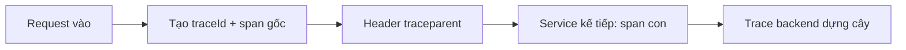
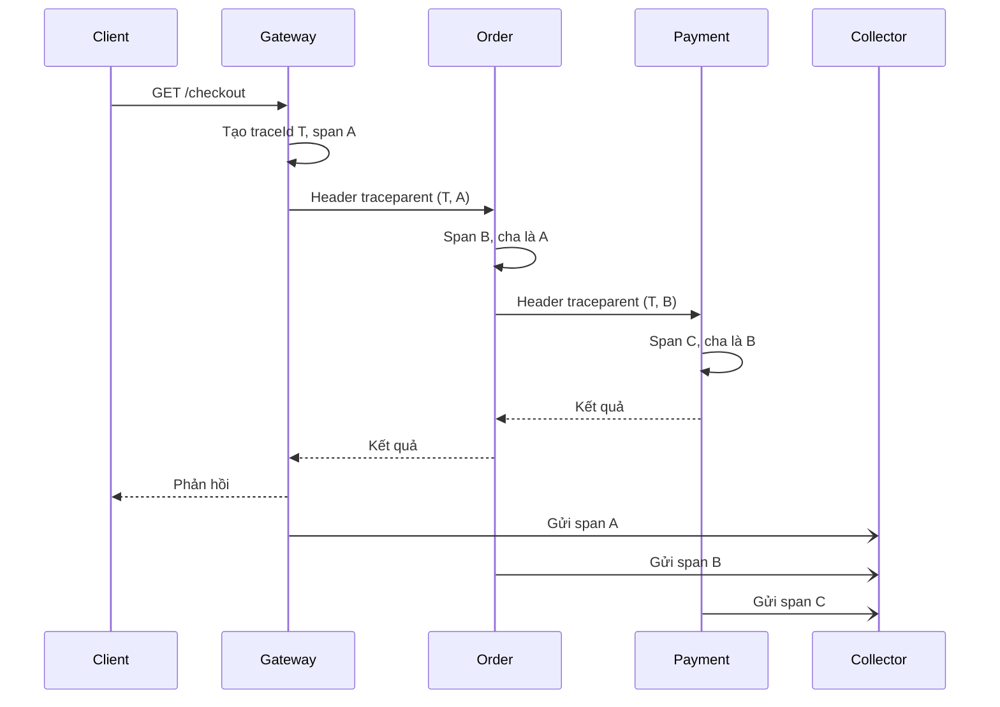
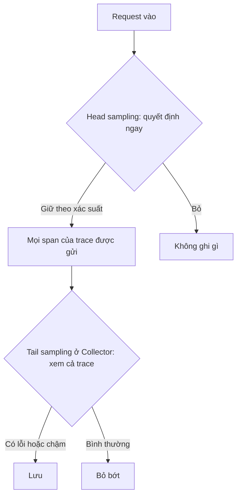
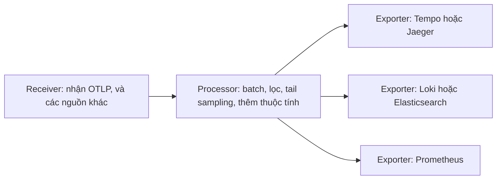
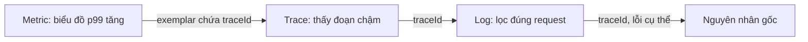
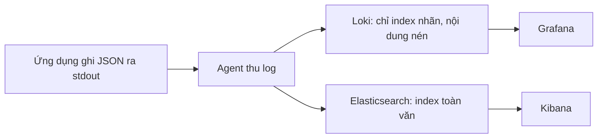
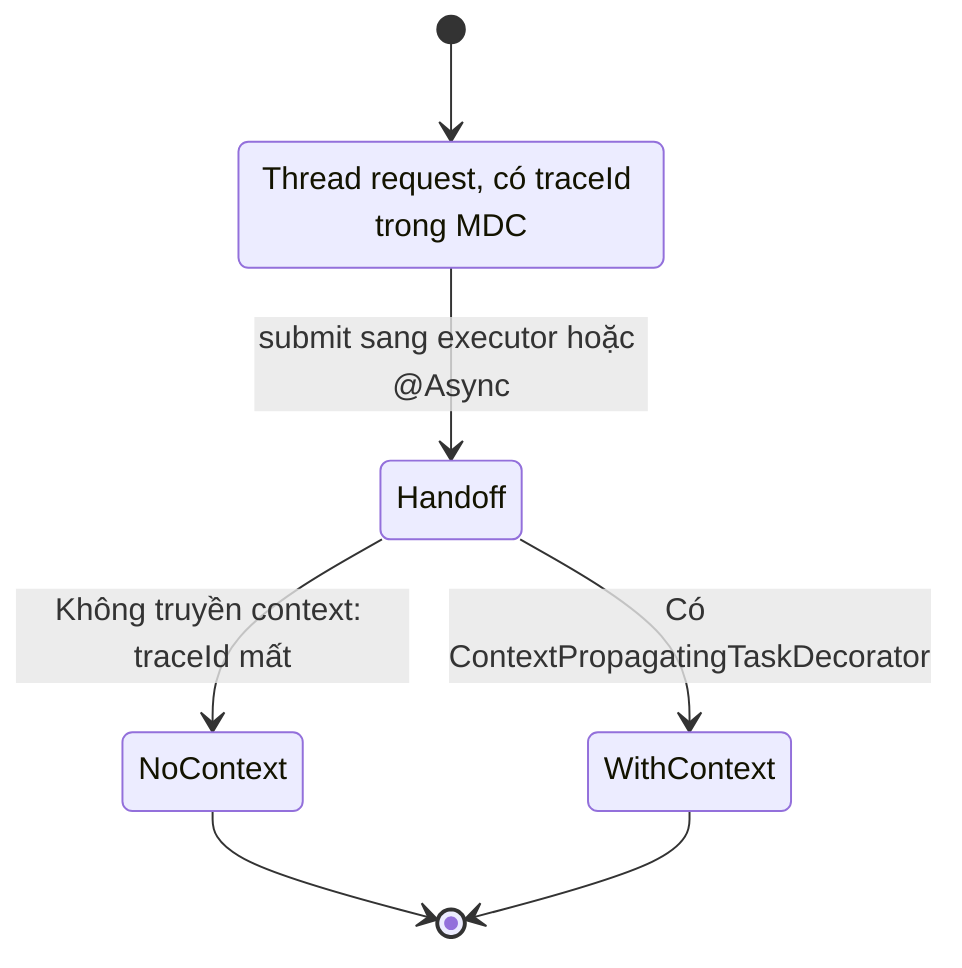

# Lý thuyết 53: Tracing và log tập trung (OpenTelemetry, Micrometer Tracing, Loki/ELK)

Khi một request đi qua gateway, service đơn hàng, service thanh toán và cơ sở dữ liệu, metric chỉ nói "p99 đang cao", còn log của mỗi service nằm ở một nơi và không biết dòng nào thuộc request nào. Tracing giải bài toán đó: gắn cho cả hành trình một mã định danh chung và đo từng chặng. Hình dung tờ phiếu vận chuyển bưu kiện: mỗi trạm đều ghi cùng một mã vận đơn và giờ nhận, giờ giao, nên khi bưu kiện đến trễ bạn thấy ngay trạm nào giữ lâu. Bài này giải thích trace, span, cách mã vận đơn được truyền đi, cách Spring Boot 4 nối với OpenTelemetry, và cách nối trace với log để từ một dòng log nhảy sang cả hành trình.

> **Phiên bản (kiểm tra 2026-10-30):** Spring Boot 4.1 (tài liệu 4.1.2, Micrometer Tracing 1.7). Boot 4 có starter `org.springframework.boot:spring-boot-starter-opentelemetry` cho OpenTelemetry với OTLP, và property dạng `management.opentelemetry.tracing.export.otlp.*`. Boot 3.5 dùng `spring-boot-starter-actuator` cộng `micrometer-tracing-bridge-otel` và `opentelemetry-exporter-otlp`, property `management.otlp.tracing.*`. Tài liệu 4.1 cho biết auto-configuration OpenTelemetry với Zipkin sẽ bị gỡ ở Boot 4.2. Tên property chi tiết (endpoint, transport) nên kiểm tra lại theo phiên bản.

**Cốt lõi:** Trong hệ thống nhiều service, một lỗi hay một đoạn chậm nằm ở đâu đó dọc đường đi của request, nhưng mỗi service chỉ thấy phần của mình. Tracing tạo một traceId duy nhất khi request vào và truyền nó theo mọi lời gọi (header HTTP, message), mỗi đoạn việc là một span có thời điểm bắt đầu và kết thúc; gom lại ta có cây thời gian của cả hành trình.

- Vì traceId phải sống xuyên qua ranh giới tiến trình nên nó được truyền trong header (W3C `traceparent`) hoặc thuộc tính message, và client HTTP phải do Spring tạo (auto-configured builder) mới tự gắn header.
- Vì ghi lại mọi request tốn kém nên ta lấy mẫu (sampling), và Spring Boot mặc định chỉ lấy mẫu một phần nhỏ nên "không thấy trace" thường là bình thường.
- Vì traceId nằm trong MDC (thuộc ThreadLocal) nên sang thread khác (`@Async`, executor tự tạo) là mất, và log mất khả năng nối với trace.



Mô hình tư duy: traceId là sợi chỉ xuyên suốt, span là các nút thắt trên sợi chỉ; mất sợi ở bất kỳ chỗ nào (thread, client tự tạo, message không mang header) thì hành trình bị đứt thành hai trace.

**Tóm tắt:**

- Trace là toàn bộ hành trình của một request; span là một đoạn việc có bắt đầu, kết thúc, thuộc tính; span có quan hệ cha-con.
- Context propagation truyền traceId và spanId qua tiến trình: chuẩn W3C `traceparent` cho HTTP, thuộc tính (header) cho message.
- Micrometer Tracing là facade; bridge OpenTelemetry làm OTel thành tracer thật; Boot 4 gói bằng `spring-boot-starter-opentelemetry`.
- Mẫu mặc định chỉ 10% request (`management.tracing.sampling.probability`); head sampling quyết định lúc đầu, tail sampling quyết định sau khi biết kết quả và cần Collector.
- OTel Collector gồm receiver, processor, exporter; nó tách ứng dụng khỏi backend và là nơi làm tail sampling.
- Nối log với trace bằng traceId và spanId trong MDC; Boot tự thêm correlation id vào log khi có Micrometer Tracing.
- Log có cấu trúc (JSON) hỗ trợ sẵn qua `logging.structured.format.console` (ecs, gelf, logstash) giúp tìm kiếm chính xác.
- Bẫy: mất context khi đổi thread, log dữ liệu nhạy cảm, log quá nhiều.

## Vấn đề nó giải quyết

Với kiến trúc nhiều service, câu hỏi "vì sao request này chậm" không trả lời được bằng log rời rạc hay metric tổng hợp. Bạn phải mở log của từng service, đoán dòng nào thuộc cùng request theo thời gian, và vẫn không biết thời gian đi đâu. Trace cho thấy ngay: 800ms của request thì 650ms nằm ở một lời gọi thanh toán, và trong đó 600ms ở một câu SQL. Nó biến việc truy nguyên từ đoán mò thành đọc biểu đồ.

## Khi nào dùng, khi nào không

Dùng ngay khi có từ hai service trở lên, hoặc một service gọi nhiều hệ thống ngoài (DB, cache, API). Với monolith đơn giản, correlation id trong log đã cho phần lớn giá trị; trace thêm chi phí và hạ tầng. Trace không thay thế metric (xem [Metric trong thực tế](/go?p=01-Spring-Boot%2Fhard%2Flt-52-micrometer-prometheus-grafana-slo.md)) vì nó được lấy mẫu và không phù hợp để đếm tổng; cũng không thay log cho chi tiết nghiệp vụ. Ba trụ cột làm việc cùng nhau: metric phát hiện, trace khoanh vùng, log cho chi tiết. Nền tảng Actuator và observability xem [Observability](/go?p=01-Spring-Boot%2Fmedium%2Flt-19-observability.md).

## Các khái niệm cần biết

| Khái niệm | Ý nghĩa ngắn |
|---|---|
| **Trace** | Toàn bộ hành trình một request, nhận diện bằng traceId (128 bit) |
| **Span** | Một đoạn việc có thời gian bắt đầu, kết thúc, tên, thuộc tính; có spanId (64 bit) |
| **Parent span** | Span gọi ra span con; span gốc không có cha |
| **Context propagation** | Truyền traceId và spanId qua ranh giới tiến trình hoặc thread |
| **`traceparent`** | Header W3C: phiên bản, traceId, spanId cha, cờ lấy mẫu |
| **Baggage** | Cặp khóa-giá trị đi theo trace tới mọi service; dùng tiết kiệm |
| **Micrometer Observation** | API nội bộ Spring: một observation sinh cả metric và span |
| **Bridge** | Cầu nối Micrometer Tracing tới tracer thật (OpenTelemetry hoặc Brave) |
| **OTLP** | Giao thức xuất dữ liệu của OpenTelemetry (gRPC hoặc HTTP) |
| **Sampling** | Chọn trace nào được giữ lại |
| **OTel Collector** | Tiến trình trung gian nhận, xử lý, chuyển tiếp telemetry |
| **MDC** | Mapped Diagnostic Context: map theo thread mà logger đọc khi ghi log |

## Cơ chế: một request qua nhiều service

Mỗi chặng tạo một span con và truyền ngữ cảnh đi tiếp:



Cách đọc: traceId T không đổi suốt hành trình, spanId đổi ở mỗi chặng và chặng sau ghi spanId của chặng trước làm cha. Mỗi service gửi span của mình riêng, không đợi cả chuỗi; backend ghép lại theo traceId và quan hệ cha-con. Dạng `traceparent` có bốn phần dạng `00-<traceId 32 hex>-<spanId 16 hex>-<cờ>` với cờ `01` nghĩa là được lấy mẫu.

**Nền tảng:** Trace không phải đối tượng tập trung ở đâu đó; nó là tập các span độc lập chia sẻ cùng traceId, được ghép sau khi đến backend. Điều duy nhất tồn tại lúc chạy là ngữ cảnh (traceId, spanId, cờ lấy mẫu) được truyền theo request. Hiểu điều này thì mọi lỗi "trace bị đứt" đều quy về một câu hỏi: ngữ cảnh có được truyền qua chỗ này không.

## Micrometer Tracing và OpenTelemetry trong Spring Boot

Spring dùng Micrometer Observation: một lần "quan sát" (một request HTTP, một lời gọi DB) vừa ghi metric vừa sinh span. Micrometer Tracing là facade; bridge cho OpenTelemetry biến span đó thành span OTel. Boot 4 gói gọn bằng một starter (Minh họa, chưa chạy thử):

```xml
<!-- Boot 4.1 -->
<dependency>
  <groupId>org.springframework.boot</groupId>
  <artifactId>spring-boot-starter-actuator</artifactId>
</dependency>
<dependency>
  <groupId>org.springframework.boot</groupId>
  <artifactId>spring-boot-starter-opentelemetry</artifactId>
</dependency>
```

```properties
spring.application.name=orders
management.tracing.sampling.probability=0.1
# Điểm nhận OTLP (Collector); tên property chi tiết kiểm tra lại theo phiên bản
management.opentelemetry.tracing.export.otlp.endpoint=http://otel-collector:4318/v1/traces
```

Ở Boot 3.5 bạn tự khai báo `io.micrometer:micrometer-tracing-bridge-otel` và `io.opentelemetry:opentelemetry-exporter-otlp`, và dùng `management.otlp.tracing.endpoint`. Tracer thay thế là Brave cho Zipkin (`spring-boot-starter-zipkin`).

Tự tạo span cho đoạn việc quan trọng (Minh họa, chưa chạy thử):

```java
@Service
class PricingService {
    private final Tracer tracer;
    PricingService(Tracer tracer) { this.tracer = tracer; }

    BigDecimal price(String sku) {
        Span span = tracer.nextSpan().name("pricing.compute").tag("sku.category", "book").start();
        try (Tracer.SpanInScope ws = tracer.withSpan(span)) {
            return compute(sku);
        } catch (RuntimeException e) {
            span.error(e);
            throw e;
        } finally {
            span.end();
        }
    }
}
```

Với phần lớn nhu cầu, dùng `ObservationRegistry` hoặc `@Observed` thay vì tự quản span. Lưu ý quan trọng theo tài liệu Boot: để trace tự truyền qua mạng, phải dùng builder do Boot cấu hình (`RestClient.Builder`, `RestTemplateBuilder`, `WebClient.Builder`) chứ không tự `new RestClient()`, nếu không header `traceparent` không được gắn.

**Phải thuộc:** Boot lấy mẫu mặc định 10% (`management.tracing.sampling.probability`), sampler OTel mặc định là `parent-based-trace-id-ratio`: nếu có cha và cha được lấy mẫu thì lấy theo, nếu không có cha thì lấy theo xác suất. Client HTTP phải được tạo từ builder auto-configured thì mới tự truyền trace.

## Sampling: head và tail

Lưu toàn bộ span của mọi request là quá đắt về mạng, lưu trữ và CPU. Sampling chọn trace nào giữ lại. Có hai thời điểm quyết định:



Head sampling quyết định ở đầu, rẻ và đơn giản, nhưng quyết định khi chưa biết trace có lỗi hay chậm, nên có thể bỏ đúng trace bạn cần. Tail sampling đợi thu đủ span của trace rồi mới quyết (giữ mọi trace lỗi, mọi trace chậm hơn ngưỡng, cộng một phần nhỏ trace bình thường), nhưng đòi hỏi Collector giữ span trong bộ nhớ một thời gian và mọi span của một trace phải về cùng một Collector. Đánh đổi là chi phí và độ phức tạp hạ tầng so với khả năng giữ đúng trace quan trọng. Một dự án thực tế thường bắt đầu bằng head sampling thấp, rồi thêm tail sampling khi cần.

**Suy luận:** Lấy mẫu mặc định thấp vì chi phí trace tỷ lệ với lưu lượng, còn giá trị của một trace bình thường rất thấp. Nhưng head sampling quyết định trước khi biết kết quả, nên với xác suất 10% thì 90% trace lỗi cũng bị bỏ, đó là lý do lỗi hiếm khó có trace. Từ đó suy ra ba điều. Thứ nhất, "không thấy trace của request này" là bình thường chứ chưa chắc cấu hình sai; khi debug cục bộ hãy đặt xác suất bằng 1. Thứ hai, quyết định lấy mẫu phải được truyền theo cờ trong `traceparent` để cả trace nhất quán (service sau theo quyết định service trước); nếu không sẽ có trace thiếu mảnh. Thứ ba, muốn giữ chắc trace lỗi và chậm thì phải tail sampling ở Collector, chấp nhận chi phí bộ nhớ. Điểm dễ nhầm là tưởng đặt xác suất 100% là miễn phí.

## OTel Collector

Collector là tiến trình trung gian giữa ứng dụng và backend. Ứng dụng chỉ cần nói OTLP với Collector; đổi từ Jaeger sang Tempo là đổi cấu hình Collector, không đổi code.



Ba loại thành phần: receiver nhận dữ liệu vào, processor biến đổi (gộp batch để giảm số request, loại thuộc tính nhạy cảm, tail sampling), exporter đẩy ra backend. Một cấu hình tối thiểu cho traces (Minh họa, chưa chạy thử):

```yaml
receivers:
  otlp:
    protocols:
      http:
processors:
  batch: {}
exporters:
  otlp/tempo:
    endpoint: tempo:4317
    tls: { insecure: true }
service:
  pipelines:
    traces:
      receivers: [otlp]
      processors: [batch]
      exporters: [otlp/tempo]
```

Collector còn là nơi che dữ liệu nhạy cảm trước khi rời hệ thống và là điểm duy nhất cần cấp quyền tới backend. Chi phí là một thành phần phải vận hành, cần chạy nhiều bản cho độ sẵn sàng.

## Backend trace: Jaeger, Tempo, Zipkin

| Backend | Điểm chính |
|---|---|
| **Jaeger** | Backend trace lâu đời, giao diện tìm theo service, thời lượng, tag; lưu ở Elasticsearch hoặc Cassandra tùy cấu hình |
| **Grafana Tempo** | Lưu trace rẻ vào object storage, truy theo traceId; kết hợp tốt với Grafana, Loki, Prometheus |
| **Zipkin** | Gọn nhẹ, quen thuộc với hệ sinh thái Spring (Brave); phù hợp hệ thống nhỏ |

Chọn theo hệ sinh thái đang dùng: đã có Grafana thì Tempo cho liên kết trơn tru metric-log-trace. Tránh chọn theo tính năng, vì cả ba đều hiển thị được cây span; khác nhau ở chi phí lưu trữ và vận hành. Lưu ý phương án OpenTelemetry với exporter Zipkin đã bị OTel đánh dấu deprecated và sẽ bị gỡ khỏi auto-configuration ở Boot 4.2 theo tài liệu.

## Nối log, trace và metric

Giá trị lớn nhất đến khi ba loại tín hiệu nối được với nhau. Khi có Micrometer Tracing, Boot tự đặt `traceId` và `spanId` vào MDC và thêm correlation id vào mỗi dòng log (dạng `[traceId-spanId]`). Bạn đổi định dạng bằng `logging.pattern.correlation`.



Cách đọc: đi từ metric (phát hiện) tới trace (khoanh vùng) tới log (chi tiết) bằng cách lần theo traceId. Exemplar là con số traceId gắn vào một điểm của histogram; tài liệu Boot nói Prometheus exemplar cần bật ở phía Prometheus và dùng định dạng OpenMetrics, và mặc định chỉ trace được lấy mẫu mới thành exemplar (`management.tracing.exemplars.include`).

## Log có cấu trúc và tập trung

Log văn bản tự do khó truy vấn chính xác. Log dạng JSON, mỗi trường một khóa, cho phép lọc `traceId`, `level`, `service` mà không phải viết regex. Spring Boot hỗ trợ sẵn chỉ bằng cấu hình:

```properties
logging.structured.format.console=ecs
# các giá trị Boot hỗ trợ: ecs, gelf, logstash
logging.structured.ecs.service.name=orders
```

Thông thường ứng dụng ghi log ra stdout, agent (Promtail, Alloy, Fluent Bit, Filebeat) thu và gửi đi; ứng dụng không tự đẩy log lên mạng để tránh chặn luồng nghiệp vụ.



| | Loki | ELK (Elasticsearch, Logstash, Kibana) |
|---|---|---|
| Lập chỉ mục | Chỉ nhãn (label), nội dung không index | Toàn văn, mọi trường |
| Chi phí lưu trữ | Thấp | Cao hơn |
| Tìm kiếm | Lọc theo nhãn rồi quét nội dung | Nhanh, phong phú, phân tích |
| Hợp với | Hệ Grafana, tìm theo traceId và nhãn | Phân tích tự do, tìm kiếm mạnh |

Chọn theo nhu cầu: cần liên kết trong Grafana và chi phí thấp thì Loki; cần tìm toàn văn và phân tích sâu thì ELK. Với Loki, nhãn (label) cũng có cardinality: đừng dùng traceId làm nhãn, hãy để nó trong nội dung dòng log. Chi tiết cấu hình logging nền tảng xem [JDBC, connection pool, logging](/go?p=08-Java%2FJava-Core%2Fmedium%2Flt-28-jdbc-connection-pool-logging.md).

## Mất context khi đổi thread, @Async và virtual thread

MDC và ngữ cảnh trace nằm trong ThreadLocal. Khi công việc chuyển sang thread khác, ngữ cảnh không tự đi theo:



Theo tài liệu Boot: với `@Async` và `AsyncTaskExecutor` auto-configured, bạn phải bật `spring.task.execution.propagate-context`; nếu tự cấu hình executor thì đăng ký bean `ContextPropagatingTaskDecorator`. Với reactive, bật `spring.reactor.context-propagation=auto`. Executor tự tạo bằng `Executors.newFixedThreadPool(...)` và gọi `CompletableFuture.supplyAsync` mặc định không truyền ngữ cảnh, nên log và span ở đó thành mồ côi. Cơ chế `@Async` xem [Scheduling và Async](/go?p=01-Spring-Boot%2Fmedium%2Flt-18-scheduling-async.md).

Virtual thread không làm ThreadLocal hỏng: mỗi virtual thread có ThreadLocal riêng nên log trong request vẫn có traceId. Vấn đề vẫn là chỗ giao việc sang thread khác (executor, `CompletableFuture`), giống thread thường. Với virtual thread số lượng rất lớn, hãy cẩn thận lượng dữ liệu đặt trong ThreadLocal.

Ví dụ truyền ngữ cảnh khi tự tạo executor (Minh họa, chưa chạy thử):

```java
@Configuration
class AsyncConfig {
    @Bean
    ContextPropagatingTaskDecorator contextPropagatingTaskDecorator() {
        return new ContextPropagatingTaskDecorator();
    }
}
```

**Suy luận:** Ngữ cảnh trace nằm trong ThreadLocal vì code nghiệp vụ không muốn truyền thêm tham số traceId qua mọi method. Cái giá là ngữ cảnh gắn với thread, nên bất kỳ chỗ nào công việc nhảy sang thread khác đều phải sao chép ngữ cảnh một cách tường minh. Từ đó suy ra: `@Async` trên executor mặc định cần bật tùy chọn propagate, executor tự tạo cần decorator, và thư viện bên thứ ba có thread riêng (ví dụ client gửi message bất đồng bộ) cần instrumentation riêng. Triệu chứng nhận biết là log có traceId ở dòng đầu rồi dòng sau (sau khi đổi thread) trống hoặc khác. Điểm dễ nhầm là cho rằng virtual thread giải quyết vấn đề này; nó chỉ làm thread rẻ, không tự truyền ngữ cảnh giữa các thread.

## Truyền ngữ cảnh qua message

Với Kafka hoặc RabbitMQ, không có HTTP header, nên ngữ cảnh đi trong header của message. Producer ghi `traceparent` vào header record, consumer đọc ra và tạo span mới cùng traceId (quan hệ thường là link hoặc con, tùy cấu hình). Để Boot instrument, thường cần bật observation trên template hoặc container (ví dụ `observationEnabled` của Kafka template và listener container); tên chính xác theo từng thư viện, hãy kiểm tra lại theo phiên bản. Thiếu bước này, trace đứt tại broker: producer và consumer thành hai trace khác nhau.

## Bẫy thường gặp

| Bẫy | Nguyên nhân | Cách xử lý |
|---|---|---|
| Trace đứt giữa hai service | Client HTTP tự `new`, không dùng builder auto-configured | Dùng `RestClient.Builder` được inject |
| Không thấy trace | Lấy mẫu mặc định chỉ 10% | Debug đặt xác suất 1; production dùng tail sampling |
| Log mất traceId sau `@Async` | Không truyền context sang thread khác | `spring.task.execution.propagate-context`, hoặc `ContextPropagatingTaskDecorator` |
| Log lộ dữ liệu nhạy cảm | Log body request, token, số thẻ, email | Che dữ liệu (mask), không log body, lọc ở Collector |
| Chi phí log và trace quá lớn | Log DEBUG ở production, lấy mẫu 100% | Mức log hợp lý, lấy mẫu có chọn lọc, giới hạn thuộc tính span |
| Loki chậm, đắt | Dùng traceId hoặc userId làm nhãn | Nhãn ít giá trị, traceId nằm trong nội dung |
| Trace đứt qua message | Header message không mang ngữ cảnh | Bật observation cho producer và consumer |
| Collector mất span | Không đủ bộ nhớ khi tail sampling | Cấu hình giới hạn, nhiều bản cùng route theo traceId |

## Phỏng vấn khó: chuỗi hỏi xoáy

### Chuỗi 1: Trace và context propagation

1. **Câu mở:** Trace và span là gì, và vì sao một request qua nhiều service cần traceId?
2. **Xoáy 1:** traceId được truyền đi như thế nào qua HTTP và qua Kafka?
3. **Xoáy 2:** Hai service đều có trace nhưng trong backend chúng là hai trace rời. Bạn kiểm tra những gì?

**Đáp án ngắn:** Trace là hành trình toàn bộ của một request, span là một đoạn việc có thời gian và quan hệ cha-con; traceId chung cho phép ghép các span của nhiều service lại thành một cây. Không có nó, log và thời gian của từng service là mảnh rời không nối được. Cơ chế gốc là context propagation: service gọi ghi `traceparent` (phiên bản, traceId, spanId cha, cờ lấy mẫu) vào header HTTP, service nhận đọc ra và tạo span con cùng traceId; với Kafka, ngữ cảnh đi trong header của record. Mỗi service gửi span của mình độc lập về backend, backend ghép theo traceId. Trace đứt thường do ngữ cảnh không được truyền tại một điểm: client HTTP tự `new` thay vì dùng builder do Boot cấu hình, message không được instrument, hoặc gateway ở giữa không chuyển tiếp header. Cũng cần loại trừ chuyện hai service dùng chuẩn propagation khác nhau (W3C so với B3). Ở production, kiểm tra bằng cách xem header thực tế ở service nhận và đối chiếu quyết định lấy mẫu giữa các service.

**Sai lầm hay gặp:**
- Nghĩ trace là một đối tượng tập trung, thay vì tập span ghép theo traceId.
- Quên rằng client tự tạo không tự gắn header.
- Không phân biệt traceId (cả hành trình) với spanId (một đoạn).

### Chuỗi 2: Sampling và chi phí

1. **Câu mở:** Vì sao Spring Boot mặc định chỉ lấy mẫu 10% request?
2. **Xoáy 1:** Head sampling và tail sampling khác nhau thế nào, và mỗi loại đánh đổi gì?
3. **Xoáy 2:** Bạn muốn luôn giữ trace lỗi và trace chậm hơn 2 giây. Thiết kế thế nào, và tốn gì?

**Đáp án ngắn:** Chi phí tracing tỷ lệ với lưu lượng (CPU tạo span, mạng, lưu trữ), còn giá trị của một request bình thường thấp, nên lấy mẫu để giữ chi phí chấp nhận được. Head sampling quyết định ngay khi request vào, rẻ và đơn giản, nhưng chưa biết kết quả nên có thể bỏ đúng trace lỗi hiếm. Tail sampling đợi thu đủ span rồi mới quyết dựa trên đặc điểm (có lỗi, quá chậm), nên giữ đúng trace quan trọng, nhưng cần Collector giữ span trong bộ nhớ và mọi span của một trace phải về cùng một Collector (cân bằng tải theo traceId). Thiết kế cho yêu cầu trên: ứng dụng lấy mẫu rộng (hoặc 100% span gửi về Collector tùy tải), Collector chạy processor tail sampling với chính sách giữ trace có status lỗi, giữ trace có độ trễ trên 2 giây, và giữ một tỷ lệ nhỏ phần còn lại. Đánh đổi là bộ nhớ và độ phức tạp của lớp Collector, cùng độ trễ trước khi trace khả dụng. Cần giám sát chính Collector vì nếu nó rớt span thì bạn mất đúng dữ liệu mình muốn giữ.

**Sai lầm hay gặp:**
- Đặt 100% ở production mà không tính chi phí.
- Nghĩ head sampling vẫn giữ được trace lỗi.
- Triển khai tail sampling nhiều Collector mà không định tuyến theo traceId nên trace bị chia đôi.

### Chuỗi 3: Mất context và log

1. **Câu mở:** Log trong request có traceId, nhưng log trong method `@Async` thì không. Vì sao?
2. **Xoáy 1:** Sửa thế nào, và virtual thread có tự giải quyết vấn đề không?
3. **Xoáy 2:** Bạn bật log JSON và đẩy lên Loki. Những rủi ro vận hành và bảo mật nào cần lường?

**Đáp án ngắn:** MDC và ngữ cảnh trace nằm trong ThreadLocal nên gắn với thread; `@Async` chạy trên thread của executor, không phải thread request, nên ngữ cảnh không được sao chép và dòng log mất traceId. Sửa bằng cách truyền ngữ cảnh một cách tường minh: với executor auto-configured của Boot, bật `spring.task.execution.propagate-context`; với executor tự tạo, đăng ký `ContextPropagatingTaskDecorator`; với reactive, `spring.reactor.context-propagation=auto`. Virtual thread không tự giải quyết: mỗi virtual thread có ThreadLocal riêng nên log trong request vẫn ổn, nhưng khi giao việc sang thread khác thì vẫn phải truyền ngữ cảnh. Với log JSON lên Loki, rủi ro vận hành là cardinality của nhãn (không dùng traceId hay userId làm nhãn) và chi phí do log quá nhiều (DEBUG ở production). Rủi ro bảo mật là dữ liệu nhạy cảm (token, số thẻ, thông tin cá nhân) lọt vào log và thường được lưu lâu, truy cập rộng; cần che dữ liệu ở nguồn hoặc ở Collector, đặt thời hạn lưu và phân quyền truy cập. Kiểm chứng bằng một test hoặc truy vấn thực: tìm theo traceId phải ra đủ log của mọi thread trong request đó.

**Sai lầm hay gặp:**
- Cho rằng virtual thread tự động truyền ngữ cảnh.
- Dùng traceId làm nhãn Loki.
- Log nguyên body request chứa dữ liệu cá nhân và coi đó là "tiện debug".

## Câu hỏi tự kiểm tra

**Câu 1.** Một request đi Gateway, Order, Payment. Có bao nhiêu traceId và bao nhiêu span tối thiểu?

*Gợi ý suy luận:* Cái gì giữ nguyên, cái gì đổi ở mỗi chặng?

*Lập luận và đáp án:* Một traceId duy nhất vì nó được truyền nguyên theo header `traceparent`. Mỗi service tạo ít nhất một span cho phần việc của mình, nên tối thiểu 3 span, thường nhiều hơn vì span client và span server của mỗi lời gọi, cộng span DB hoặc cache. Mỗi span ghi spanId của span chặng trước làm cha, đó là cách backend dựng cây.

**Câu 2.** Bạn đặt `management.tracing.sampling.probability=1` ở dev và thấy đủ trace, lên production thì thiếu trace của một lỗi hiếm. Giải thích và đề xuất.

*Gợi ý suy luận:* Mặc định là 10%. Quyết định lấy mẫu diễn ra lúc nào?

*Lập luận và đáp án:* Production dùng xác suất thấp (head sampling), và quyết định xảy ra trước khi biết request lỗi, nên phần lớn trace lỗi hiếm bị bỏ. Đề xuất: giữ head sampling thấp cho chi phí, thêm tail sampling ở Collector để giữ mọi trace lỗi và chậm. Trong lúc điều tra một sự cố cụ thể, có thể tạm nâng xác suất cho service liên quan, chấp nhận chi phí ngắn hạn.

**Câu 3.** Vì sao thêm `traceId` làm nhãn trong Loki là sai, trong khi để nó trong dòng log là đúng?

*Gợi ý suy luận:* So sánh với cardinality của metric.

*Lập luận và đáp án:* Loki chỉ lập chỉ mục theo nhãn, mỗi tổ hợp nhãn là một luồng (stream). traceId có giá trị gần như duy nhất mỗi request nên sinh hàng triệu stream, làm chỉ mục phình to và truy vấn chậm, cùng bản chất với cardinality explosion của Prometheus. Để traceId trong nội dung dòng, rồi lọc bằng truy vấn nội dung sau khi đã thu hẹp theo nhãn ít giá trị (service, môi trường), giữ chỉ mục nhỏ mà vẫn tìm được.

**Câu 4.** Một `CompletableFuture.supplyAsync(...)` trong service ghi log không có traceId. Có các cách xử lý nào và đánh đổi gì?

*Gợi ý suy luận:* ThreadLocal thuộc về thread nào?

*Lập luận và đáp án:* Task chạy trên thread của `ForkJoinPool` chung nên ngữ cảnh của thread request không được sao chép. Cách một: truyền executor do Spring quản lý đã có `ContextPropagatingTaskDecorator` vào `supplyAsync(..., executor)`. Cách hai: bọc task bằng cơ chế sao chép ngữ cảnh thủ công (chụp traceId trước, đặt lại trong task), dễ sai và tốn công. Cách ba: bỏ `CompletableFuture` mặc định, dùng `@Async` với executor đã cấu hình propagate. Ưu tiên cách một vì tập trung và nhất quán, chi phí là phải nhớ luôn truyền executor.

Nguồn: Spring Boot Reference (Tracing, Observability, Logging, Metrics) tài liệu 4.1.2; Micrometer Tracing 1.7; OpenTelemetry docs (Collector, sampling); W3C Trace Context. Đã tra ngày 2026-10-30. Tên property OTLP chi tiết và property observation của Kafka cần kiểm tra lại theo phiên bản.

