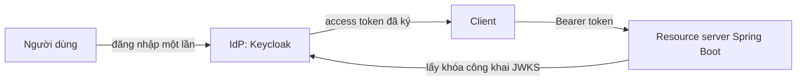
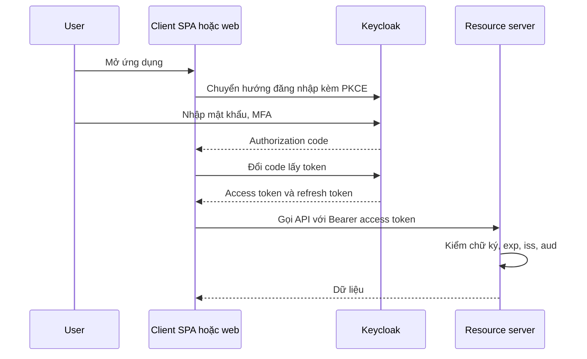
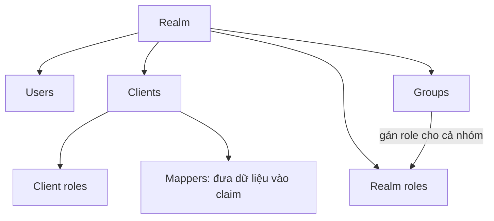
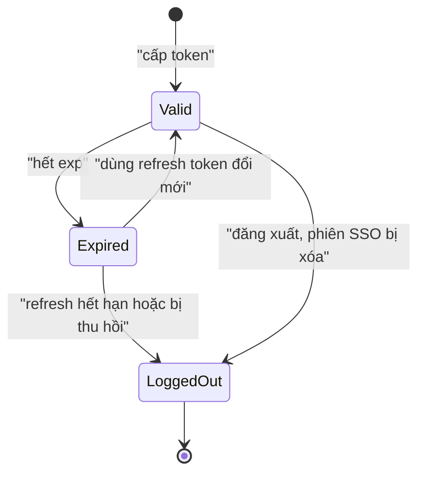
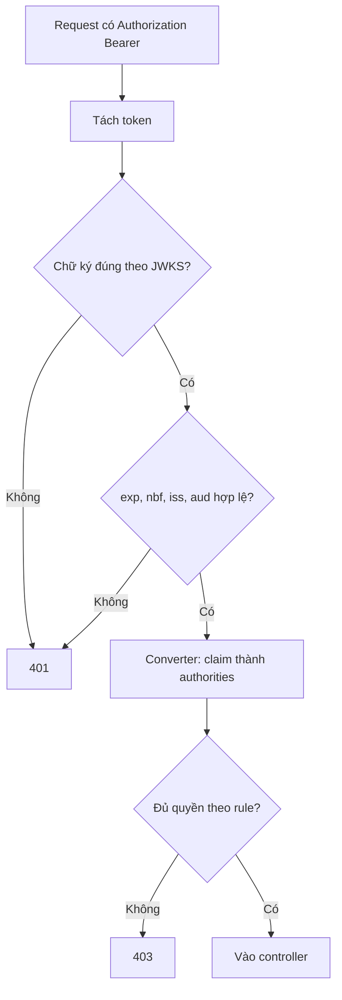
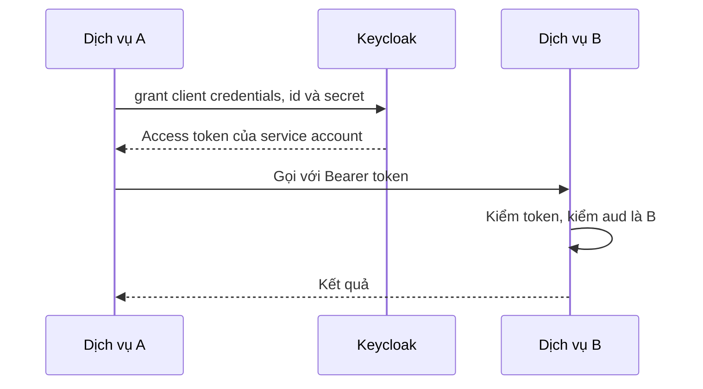
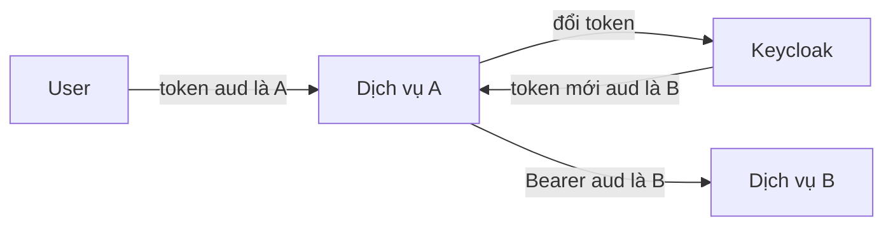

# Lý thuyết 54: Identity Provider (Keycloak, Spring Authorization Server) và Resource Server

Mỗi ứng dụng tự lưu mật khẩu, tự làm trang đăng nhập, tự cấp phiên thì sớm muộn có hai lỗi: người dùng phải đăng nhập lại ở từng hệ thống, và mỗi nơi vá bảo mật một kiểu. Identity Provider (IdP) gom việc xác thực về một chỗ. Ứng dụng của bạn không còn hỏi "mật khẩu đúng không" mà chỉ kiểm tra "token này do IdP tin cậy ký, còn hạn, và dành cho tôi".

Bài này nối ba mảnh: IdP (Keycloak hoặc Spring Authorization Server), giao thức OAuth2/OIDC, và Spring Boot làm **resource server**. Phần giao thức cơ bản xem [OAuth2 và OIDC](/go?p=01-Spring-Boot%2Fmedium%2Flt-20-oauth2-oidc.md), cấu hình JWT cơ bản xem [Spring Security với JWT](/go?p=01-Spring-Boot%2Fmedium%2Flt-06-spring-security-jwt.md), phần chuyên sâu xem [Spring Security chuyên sâu](/go?p=01-Spring-Boot%2Fhard%2Flt-35-spring-security-chuyen-sau.md), nền tảng phiên và token xem [Xác thực, phiên, token](/go?p=03-Network-Security%2Fmedium%2Flt-05-xac-thuc-phien-token.md).

> **Phiên bản (kiểm tra 2026-10-30):** Spring Boot 4.1 với Spring Security 7.1.x (tài liệu 7.1.2 đã tra). Starter resource server ở Boot 4 theo công cụ migration là `spring-boot-starter-security-oauth2-resource-server`; ở Boot 3.5 là `spring-boot-starter-oauth2-resource-server`. Authorization Server nay có tài liệu "OAuth 2.1 Authorization Server" trong Spring Security 7.1 (cấu hình qua DSL `oauth2AuthorizationServer`); dự án Spring Authorization Server riêng có dòng 1.5.x. Keycloak: dòng 26.x, bản mới nhất tôi thấy từ nguồn thứ cấp là 26.8.x, giấy phép Apache 2.0. Tên starter, DSL và bản Keycloak: kiểm tra lại theo phiên bản.

**Cốt lõi:** Xác thực (bạn là ai) là việc khó và dễ sai, nên tách ra một dịch vụ chuyên trách là IdP; IdP xác minh người dùng một lần rồi phát token đã ký, và mọi ứng dụng chỉ cần kiểm chữ ký, hạn dùng, issuer, audience của token đó. Cơ chế gốc là chữ ký số bất đối xứng: IdP giữ khóa riêng để ký, resource server lấy khóa công khai (JWKS) để kiểm mà không cần gọi IdP mỗi request.

- Vì token được ký bằng khóa riêng của IdP nên resource server chỉ cần khóa công khai để xác minh, không cần biết mật khẩu hay gọi lại IdP.
- Vì token là bản sao đã ký, tự đứng được và hết hạn theo thời gian nên muốn thu hồi sớm rất khó, phải đánh đổi bằng token sống ngắn.
- Vì xác thực chỉ trả lời "bạn là ai" còn quyền do ứng dụng quyết định nên role và scope trong token chỉ là dữ liệu đầu vào, không phải quyết định.



Mô hình tư duy: IdP là nơi cấp và đóng dấu giấy thông hành, resource server là cửa kiểm dấu; cửa không cần gọi nơi cấp mỗi lần, chỉ cần biết dấu thật trông thế nào.

**Tóm tắt:**

- Tách xác thực khỏi ứng dụng để có SSO, một nơi quản user, một nơi vá bảo mật và bật MFA.
- Bốn vai trò OAuth2: resource owner (user), client (app xin quyền), authorization server (IdP phát token), resource server (API kiểm token).
- Keycloak gồm realm (ranh giới user), client, role, group, mapper (đưa dữ liệu vào claim); access token sống ngắn, refresh token để lấy cái mới.
- Spring Boot làm resource server chỉ cần starter và `issuer-uri`; mặc định kiểm chữ ký, `exp`, `nbf`, `iss` và ánh xạ `scope` thành `SCOPE_...`.
- Role của Keycloak nằm ở claim riêng (`realm_access`, `resource_access`), phải tự viết converter để thành `ROLE_...`.
- Mặc định Boot không kiểm `aud`; phải cấu hình `audiences` hoặc validator, nếu không token cấp cho API khác vẫn được nhận.
- Service-to-service dùng client credentials; truyền danh tính người dùng giữa microservice bằng propagation hoặc token exchange.
- JWT khó thu hồi, role quá nhiều làm token phình, lệch đồng hồ làm token "chưa hợp lệ"; luôn tách authentication khỏi authorization.

## Vấn đề nó giải quyết

Không có IdP, N ứng dụng có N bảng user, N trang đăng nhập, N cách đặt lại mật khẩu. Người dùng nghỉ việc thì phải khóa ở N nơi, quên một nơi là còn cửa mở. Bật xác thực hai lớp phải làm N lần. Có IdP: đăng nhập một lần dùng nhiều ứng dụng (SSO), khóa một tài khoản là khóa mọi nơi, chính sách mật khẩu và MFA đặt một chỗ, và ứng dụng chỉ còn việc kiểm token.

## Khi nào dùng, khi nào không

Dùng IdP khi có từ hai ứng dụng trở lên, cần SSO, đăng nhập mạng xã hội hoặc LDAP/AD của công ty, hoặc yêu cầu MFA và kiểm toán đăng nhập. Một ứng dụng nội bộ nhỏ, một nhóm user, không cần SSO thì Spring Security form login hoặc JWT tự cấp trong bài [Spring Security với JWT](/go?p=01-Spring-Boot%2Fmedium%2Flt-06-spring-security-jwt.md) là đủ; dựng Keycloak là thêm một thành phần phải vận hành, sao lưu, nâng cấp.

Chọn giữa Keycloak và Spring Authorization Server: dùng **Keycloak** khi cần có sẵn giao diện quản trị, đăng ký user, social login, federation LDAP, MFA mà không muốn viết. Tự dựng **Spring Authorization Server** khi bạn cần IdP nhúng trong hệ sinh thái Spring, tùy biến sâu luồng cấp token, hoặc là một sản phẩm cần chính mình làm authorization server; đổi lại bạn tự viết giao diện, quản lý user, MFA, và chịu trách nhiệm bảo mật.

## Các khái niệm cần biết

| Khái niệm | Ý nghĩa |
|---|---|
| Resource owner (user) | Người sở hữu dữ liệu, đăng nhập và đồng ý cấp quyền |
| Client | Ứng dụng xin token: SPA, app di động, backend khác |
| Authorization server | Xác thực user, phát token (Keycloak, Spring Authorization Server) |
| Resource server | API bảo vệ, nhận Bearer token và kiểm tra |
| Access token | Giấy thông hành ngắn hạn gửi tới API, thường là JWT |
| ID token | Token OIDC cho client biết user là ai; không gửi cho API |
| Refresh token | Dùng đổi lấy access token mới, sống lâu hơn, giữ kín |
| Claim | Một trường trong JWT: `sub`, `iss`, `aud`, `exp`, `scope`... |
| JWKS | Tập khóa công khai của IdP để kiểm chữ ký, có `kid` chọn khóa |
| Realm (Keycloak) | Vùng cô lập user, client, role; mỗi realm có issuer riêng |
| Mapper (Keycloak) | Quy tắc đưa thuộc tính user hoặc role vào claim của token |

## Các vai trò và luồng cơ bản

Có bốn vai trò. Điểm hay nhầm: client **không** phải là API, và resource server **không** xác thực mật khẩu. Luồng phổ biến cho người dùng là authorization code với PKCE:



Đọc từ trên xuống: user chỉ đưa mật khẩu cho Keycloak, không bao giờ cho client hay API. Client nhận code rồi đổi lấy token. API nhận token và tự kiểm bằng khóa công khai đã lấy trước, không có mũi tên nào từ API gọi Keycloak cho mỗi request.

**Nền tảng:** OAuth2 là giao thức **ủy quyền** (cấp quyền gọi API); OIDC là lớp mỏng thêm lên để **xác thực** (biết user là ai, qua ID token). API chỉ nhận access token. Dùng ID token để gọi API là lỗi khái niệm. Chi tiết các grant xem [OAuth2 và OIDC](/go?p=01-Spring-Boot%2Fmedium%2Flt-20-oauth2-oidc.md).

## Keycloak: các thứ cần nắm

Keycloak tổ chức theo **realm**. Mỗi realm là một thế giới riêng gồm user, client, role, group; realm A và B không thấy nhau. Issuer của realm có dạng `https://<host>/realms/<tên-realm>`; đó là giá trị `iss` trong token và là `issuer-uri` bạn cấu hình ở Spring.



Đọc sơ đồ: user được gán role trực tiếp hoặc qua group; client có role riêng; mapper quyết định cái gì thành claim trong token. Cách role xuất hiện trong access token mặc định của Keycloak:

- **Realm role** nằm ở `realm_access.roles`.
- **Client role** nằm ở `resource_access.<clientId>.roles`.
- Scope chuẩn nằm ở claim `scope` (chuỗi cách nhau bởi dấu cách).

Các cấu hình quan trọng trên client: loại client (public cho SPA dùng PKCE, confidential có secret cho backend), valid redirect URIs (đặt đúng, không dùng `*`), và "Service accounts roles" bật cho client credentials. Thời hạn token đặt ở realm settings, tab Tokens: access token mặc định ngắn (vài phút, mặc định tôi nhớ là 5 phút, kiểm tra lại theo bản bạn dùng); phiên SSO có idle và max riêng, refresh token sống theo phiên SSO. Offline token tồn tại ngoài phiên, cần quyền riêng, dùng cho tác vụ nền.

**Phải thuộc:** access token sống ngắn (phút), refresh token dài hơn và giữ kín; client public (SPA) dùng authorization code + PKCE, không dùng implicit; client confidential giữ secret ở backend. Vì JWT không thu hồi được tức thì nên "sống ngắn + refresh" là cơ chế thay cho thu hồi.

### Vòng đời access token và refresh



Đọc: một access token chỉ có một lối sống, từ cấp đến hết hạn. Khi hết hạn, client dùng refresh token để xin cái mới mà không bắt user nhập lại mật khẩu. Nếu refresh token cũng hết hoặc phiên SSO bị xóa thì user phải đăng nhập lại. Điểm mấu chốt: đăng xuất ở IdP không làm token đang lưu hành hết hiệu lực ngay; resource server vẫn chấp nhận cho đến `exp`.

## Spring Authorization Server: khi nào tự dựng

Spring Authorization Server cài đặt chuẩn OAuth 2.1 và OIDC 1.0 dưới dạng thư viện của Spring Security, bạn lắp vào một ứng dụng Boot. Nó cho bạn các endpoint chuẩn (authorize, token, JWKS, introspection, revocation, discovery) nhưng **không** có giao diện quản trị user hay MFA sẵn; bạn tự cung cấp `UserDetailsService`, trang đăng nhập, kho client đã đăng ký (`RegisteredClientRepository`), kho khóa ký (`JWKSource`).

Tự dựng hợp lý khi: IdP là một phần sản phẩm (bạn bán nền tảng cho khách), cần tùy biến luồng cấp token, hoặc muốn gắn chặt vào mô hình user hiện có mà không muốn thêm một hệ thống riêng. Không hợp khi mục tiêu chỉ là "có đăng nhập tập trung": Keycloak làm sẵn, được kiểm chứng rộng, bạn đỡ phải tự chịu trách nhiệm về lỗ hổng. Vì tài liệu và cấu hình thay đổi giữa Spring Security 6 và 7 (DSL, tên starter), hãy kiểm tra lại theo bản đang dùng.

_Minh họa_ (chưa chạy thử), khung tối thiểu theo hướng DSL của Security 7.x, tên phương thức kiểm tra lại theo bản:

```java
@Configuration
class AuthServerConfig {

    @Bean
    SecurityFilterChain authServer(HttpSecurity http) throws Exception {
        http.oauth2AuthorizationServer(as -> as.oidc(Customizer.withDefaults()))
            .authorizeHttpRequests(a -> a.anyRequest().authenticated())
            .formLogin(Customizer.withDefaults());
        return http.build();
    }

    // Còn phải tự khai: RegisteredClientRepository, JWKSource (khóa ký, nên lưu ngoài code),
    // AuthorizationServerSettings (issuer), UserDetailsService.
}
```

## Spring Boot làm resource server

Thêm starter (Boot 4: `spring-boot-starter-security-oauth2-resource-server`; Boot 3.5: `spring-boot-starter-oauth2-resource-server`) và khai issuer:

```yaml
spring:
  security:
    oauth2:
      resourceserver:
        jwt:
          issuer-uri: https://sso.example.com/realms/shop
          # jwk-set-uri: https://sso.example.com/realms/shop/protocol/openid-connect/certs
          audiences: shop-api
```

`issuer-uri` làm hai việc: Spring dùng nó để **khám phá** endpoint khóa (qua `/.well-known/openid-configuration`) và để kiểm claim `iss`. Việc khám phá diễn ra ở request đầu tiên mang JWT, nên ứng dụng khởi động được kể cả khi IdP đang tắt. Nếu IdP không có endpoint khám phá hoặc resource server phải khởi động độc lập, khai thêm `jwk-set-uri` để Spring không cần khám phá; `iss` vẫn được kiểm nếu còn `issuer-uri`. Tùy chọn `audiences` bật kiểm `aud`.



Đọc: có hai cổng khác nhau. Cổng xác thực (chữ ký, thời hạn, issuer, audience) trả 401 nếu sai. Cổng phân quyền (authorities có đủ không) trả 403. Lẫn hai cổng này là lỗi phổ biến khi debug: token đúng nhưng thiếu role cho 403, không phải 401.

### Ánh xạ role từ claim sang authority

Mặc định Spring chỉ đọc claim `scope`/`scp` và thêm tiền tố `SCOPE_`. Role của Keycloak nằm ở `realm_access.roles` nên phải tự viết converter:

```java
@Bean
SecurityFilterChain api(HttpSecurity http) throws Exception {
    http.authorizeHttpRequests(a -> a
            .requestMatchers("/actuator/health").permitAll()
            .requestMatchers(HttpMethod.GET, "/orders/**").hasAuthority("SCOPE_orders.read")
            .requestMatchers("/admin/**").hasRole("ADMIN")
            .anyRequest().authenticated())
        .oauth2ResourceServer(o -> o.jwt(j -> j.jwtAuthenticationConverter(keycloakConverter())));
    return http.build();
}

private Converter<Jwt, AbstractAuthenticationToken> keycloakConverter() {
    var scopes = new JwtGrantedAuthoritiesConverter();      // giữ SCOPE_...
    return jwt -> {
        Set<GrantedAuthority> auth = new HashSet<>(scopes.convert(jwt));
        Map<String, Object> realm = jwt.getClaimAsMap("realm_access");
        if (realm != null && realm.get("roles") instanceof Collection<?> roles) {
            roles.forEach(r -> auth.add(new SimpleGrantedAuthority("ROLE_" + r)));
        }
        return new JwtAuthenticationToken(jwt, auth, jwt.getSubject());
    };
}
```

_Minh họa_ (chưa chạy thử). Package của `JwtAuthenticationToken` và `JwtGrantedAuthoritiesConverter` nằm dưới `org.springframework.security.oauth2.server.resource.authentication`. `hasRole("ADMIN")` tìm authority `ROLE_ADMIN`, nên tiền tố `ROLE_` phải do converter thêm.

### Kiểm tra audience và scope

`issuer-uri` chứng minh "ai phát", còn `aud` chứng minh "phát cho ai". Không kiểm `aud` thì token Keycloak cấp cho client khác (ví dụ ứng dụng báo cáo) vẫn qua cổng của API đơn hàng, vì cùng issuer, cùng chữ ký. Cách đơn giản là property `audiences`; cách linh hoạt là validator tự viết ghép với validator mặc định bằng `DelegatingOAuth2TokenValidator`. Trong Keycloak, `aud` không tự có theo client của API: phải thêm mapper "Audience" vào client scope để đưa tên API vào `aud`. Scope thì kiểm bằng `hasAuthority("SCOPE_...")` hoặc `@PreAuthorize`.

**Nền tảng:** hợp lệ về chữ ký chưa đủ. Bốn câu hỏi bắt buộc với mọi JWT: ai ký (chữ ký + `iss`), còn hạn không (`exp`, `nbf`), cấp cho ai (`aud`), có quyền làm việc này không (scope, role, kiểm tra nghiệp vụ). Thiếu câu nào là có lỗ hổng.

**Suy luận:** Resource server kiểm token tại chỗ vì mục tiêu của IdP tách rời là API không phụ thuộc IdP mỗi request. Để làm được, token phải tự đứng được: có chữ ký để chống giả, có `exp` để tự hết hạn, có `iss` và `aud` để biết nguồn và đích. Từ đó suy ra ba hệ quả. Thứ nhất, chỉ ai có khóa công khai đúng mới kiểm được, nên khám phá JWKS qua `issuer-uri` là bước đầu. Thứ hai, vì không hỏi lại IdP nên không thể biết user đã bị khóa, đây là gốc của vấn đề thu hồi. Thứ ba, những gì không nằm trong token (audience bạn chưa đòi, quyền theo dữ liệu) thì không ai kiểm hộ, nên Boot mặc định bỏ qua `aud` và bạn phải bật. Điểm dễ nhầm là thấy "đăng nhập chạy được" nên tưởng đã an toàn, trong khi mới kiểm chữ ký mà chưa kiểm đích và quyền.

## Service-to-service: client credentials

Khi không có người dùng (job nền, dịch vụ gọi dịch vụ), client tự xác thực bằng `client_id` và secret để lấy token đại diện cho **chính dịch vụ**. Trong Keycloak: tạo client confidential, bật "Service accounts roles", gán role cho service account đó.



Spring hỗ trợ lấy và cache token này qua `spring-boot-starter-security-oauth2-client` (Boot 4, tên Boot 3.5 là `spring-boot-starter-oauth2-client`) cùng `OAuth2AuthorizedClientManager`; token được dùng lại đến gần hạn rồi mới xin cái mới. Đừng xin token mới cho mỗi request: sẽ đè IdP. Secret để trong vault hoặc biến môi trường, không commit.

## Truyền danh tính giữa microservice

Khi người dùng gọi A, A gọi B thay mặt người dùng, có ba cách:

| Cách | Mô tả | Khi nào |
|---|---|---|
| Propagation | A chuyển nguyên Bearer token của user sang B | Cùng vùng tin cậy, cùng audience hoặc audience gồm cả hai |
| Token exchange | A đổi token của user lấy token mới có audience là B, quyền hẹp hơn | Cần tách audience, giảm quyền, ghi nhận chuỗi ủy quyền |
| Client credentials | A gọi B bằng danh tính của chính A, kèm user id làm dữ liệu | B không cần quyền của user, chỉ cần biết ai kích hoạt |



Đọc: propagation đơn giản nhưng token cho A bị dùng ở B, nên cả hai phải chấp nhận `aud` chung, và nếu B bị lộ token thì kẻ tấn công dùng được ở A. Token exchange tốn thêm một vòng gọi nhưng mỗi dịch vụ chỉ nhận token đúng audience. Token exchange chuẩn (RFC 8693) có trong Keycloak ở dạng được hỗ trợ chính thức từ các bản 26.2 trở đi cho trường hợp nội bộ; phạm vi hỗ trợ kiểm tra lại theo bản Keycloak bạn dùng.

## Multi-tenant: nhiều issuer

Khi mỗi khách hàng có realm riêng thì API nhận token từ nhiều issuer. Không thể chỉ một `issuer-uri`. Dùng `JwtIssuerAuthenticationManagerResolver` để chọn decoder theo `iss` của token:

```java
// Minh họa (chưa chạy thử): chỉ tin các issuer khai trước
var resolver = JwtIssuerAuthenticationManagerResolver.fromTrustedIssuers(
        "https://sso.example.com/realms/acme",
        "https://sso.example.com/realms/globex");

http.oauth2ResourceServer(o -> o.authenticationManagerResolver(resolver));
```

Điều bắt buộc: danh sách issuer là **danh sách tin cậy cố định hoặc tra từ kho của bạn**, không bao giờ tin `iss` tự do trong token rồi gọi tới URL đó, vì kẻ tấn công sẽ đưa issuer của hắn. Cũng nhớ ánh xạ issuer sang tenant để dữ liệu không lẫn.

## Bẫy thường gặp

| Bẫy | Hậu quả | Cách xử lý |
|---|---|---|
| Không kiểm `aud` | Token cấp cho API khác vẫn được nhận | `audiences` hoặc validator; thêm Audience mapper ở Keycloak |
| Nhét quá nhiều role, group vào token | Header quá lớn (vượt giới hạn ở proxy, 431/400), token lộ thông tin | Chỉ đưa role cần thiết, dùng scope; tra quyền chi tiết từ DB hoặc introspection |
| Lệch đồng hồ giữa máy | Token "chưa hợp lệ" hoặc hết hạn sớm | Đồng bộ NTP; Spring mặc định cho phép lệch 60 giây, chỉnh `JwtTimestampValidator` nếu cần |
| Cache JWKS sai | Xoay khóa xong vẫn chấp nhận khóa cũ, hoặc IdP sập là API lỗi | Để Spring cache và làm mới theo `kid` lạ; cấu hình thời gian cache hợp lý |
| Thu hồi JWT | User bị khóa vẫn gọi được đến hết `exp` | Access token ngắn; danh sách thu hồi hoặc introspection cho API nhạy cảm |
| Lẫn authentication và authorization | Tin role trong token cho mọi quyết định, bỏ qua kiểm tra sở hữu dữ liệu | Role cho phép "loại hành động"; nghiệp vụ vẫn kiểm "dữ liệu này của ai" |
| Dùng ID token gọi API | Sai mục đích, sai `aud` | Chỉ dùng access token cho API |
| `*` trong redirect URI | Chiếm code, đánh cắp token | Liệt kê chính xác URI |
| Tin `iss` tự do ở multi-tenant | Kẻ tấn công dựng IdP giả | Danh sách issuer tin cậy cố định |

## Phỏng vấn khó: chuỗi hỏi xoáy

### Chuỗi 1: Resource server kiểm token thế nào

1. **Câu mở:** API Spring Boot của bạn nhận một JWT từ Keycloak. Nó làm gì để tin token đó?
2. **Xoáy 1:** Nó có gọi Keycloak cho mỗi request không? Và nếu Keycloak xoay khóa ký thì sao?
3. **Xoáy 2:** Chữ ký đúng, token chưa hết hạn, nhưng cấp cho một API khác. Boot mặc định có chặn không?

**Đáp án ngắn:** Resource server kiểm tại chỗ bằng mật mã chứ không hỏi lại IdP: xác minh chữ ký bằng khóa công khai trong JWKS, kiểm `exp`, `nbf` và `iss`. `issuer-uri` giúp Spring khám phá endpoint JWKS ở request đầu và so claim `iss`. Khóa công khai được cache và Spring tự làm mới khi gặp `kid` chưa biết, nên xoay khóa không cần khởi động lại; vì vậy mỗi request không tốn một lần gọi mạng tới Keycloak, và IdP tạm sập chỉ ảnh hưởng token mới và việc làm mới khóa. Đánh đổi là thu hồi tức thì không có sẵn. Mặc định Boot không kiểm `aud`, nên token cùng issuer nhưng cấp cho API khác vẫn qua; phải đặt `audiences` hoặc validator riêng và thêm Audience mapper ở Keycloak. Production còn cần NTP đồng bộ vì cả `exp` và `nbf` phụ thuộc đồng hồ, cùng log lý do từ chối (iss sai, aud sai, hết hạn) để debug.

**Sai lầm hay gặp:**
- Nói API "gọi Keycloak xác thực mỗi request".
- Nghĩ chữ ký hợp lệ là đủ, quên `aud`.
- Không phân biệt 401 (xác thực) với 403 (phân quyền).

### Chuỗi 2: Role, quyền và thu hồi

1. **Câu mở:** Role của Keycloak vào Spring Security `hasRole("ADMIN")` bằng đường nào?
2. **Xoáy 1:** Vì sao đưa mọi role và group vào token là ý tồi?
3. **Xoáy 2:** Admin khóa tài khoản một user, user đó vẫn gọi API được trong vài phút. Giải thích và cách xử lý.

**Đáp án ngắn:** Keycloak để realm role ở `realm_access.roles` và client role ở `resource_access.<client>.roles`; Spring mặc định chỉ đọc `scope`, nên phải viết `JwtAuthenticationConverter` đọc claim đó và thêm tiền tố `ROLE_` thì `hasRole("ADMIN")` mới khớp `ROLE_ADMIN`. Nhét hết role và group vào token làm token phình, vượt giới hạn header của proxy hoặc server, lộ cấu trúc tổ chức nếu token bị lộ, và role đổi thì token cũ vẫn mang quyền cũ đến hết hạn. Giải pháp là chỉ đưa role cần cho quyết định thô và scope, còn quyền chi tiết tra từ DB theo `sub` hoặc dùng introspection. Token là bản sao ký sẵn nên IdP khóa user không làm token đang lưu hành mất hiệu lực; tới `exp` mới hết. Cách giảm: access token sống ngắn, refresh bị chặn khi user bị khóa, với API nhạy cảm thì introspection (opaque token) hoặc danh sách thu hồi, hoặc bổ sung bước kiểm tra trạng thái user trong nghiệp vụ. Mỗi cách đánh đổi giữa độ tức thì và tải lên IdP, nên chọn theo độ nhạy từng API.

**Sai lầm hay gặp:**
- Quên tiền tố `ROLE_` rồi tưởng Keycloak không gửi role.
- Tăng thời hạn access token lên hàng giờ cho "đỡ phiền".
- Coi role trong token là đủ để cho phép mọi hành động trên mọi dữ liệu.

### Chuỗi 3: Microservice và multi-tenant

1. **Câu mở:** Service A gọi service B thay mặt user. Bạn truyền danh tính thế nào?
2. **Xoáy 1:** Propagation và token exchange khác nhau ở chỗ nào, vì sao exchange an toàn hơn?
3. **Xoáy 2:** Hệ thống có 200 tenant, mỗi tenant một realm. Cấu hình resource server ra sao, rủi ro gì?

**Đáp án ngắn:** Có ba lựa chọn: chuyển tiếp nguyên token (propagation), đổi token lấy token mới cho B (token exchange), hoặc A tự gọi bằng client credentials kèm user id làm dữ liệu. Propagation đơn giản nhưng token cấp cho A được dùng ở B, nên hai bên buộc chấp nhận chung audience và một dịch vụ bị lộ token là kẻ tấn công đi được cả chuỗi. Token exchange (RFC 8693) cho token có audience là B và quyền hẹp hơn, mỗi dịch vụ chỉ nhận đúng audience của mình, đổi lại thêm một lần gọi IdP nên cần cache và xử lý lỗi. Client credentials phù hợp khi B không cần quyền của user. Với nhiều tenant, dùng `JwtIssuerAuthenticationManagerResolver` chọn decoder theo `iss`; decoder được dựng lười và cache theo issuer. Rủi ro lớn nhất là tin `iss` do token tự khai: phải đối chiếu với danh sách issuer tin cậy lấy từ cấu hình hoặc DB, nếu không kẻ tấn công dựng IdP giả và tự phát token. Cần thêm ánh xạ issuer sang tenant để không lẫn dữ liệu, và giám sát số decoder cùng tải JWKS khi số tenant lớn.

**Sai lầm hay gặp:**
- Chuyển tiếp token mà không nghĩ tới audience.
- Xin token client credentials mới cho mỗi request, không cache.
- Tin `iss` trong token rồi gọi tới URL đó để lấy khóa.

## Câu hỏi tự kiểm tra

**1. Vì sao API không cần gọi Keycloak mỗi request mà vẫn tin được token?**

Gợi ý suy luận: ai giữ khóa nào, và token chứa gì để kiểm?

Lập luận và đáp án: Keycloak ký token bằng khóa riêng; API giữ khóa công khai (JWKS) nên chỉ cần phép kiểm chữ ký, không cần bí mật nào. Token mang `iss`, `aud`, `exp` nên API kiểm được nguồn, đích và hạn tại chỗ. Vì vậy mỗi request không tốn lần gọi mạng; cái giá là không thu hồi tức thì.

**2. Token đúng chữ ký, đúng issuer, chưa hết hạn nhưng thuộc client báo cáo. Vì sao API đơn hàng cần từ chối, và làm thế nào?**

Gợi ý suy luận: `iss` chứng minh điều gì, `aud` chứng minh điều gì?

Lập luận và đáp án: `iss` cho biết ai phát, không cho biết phát cho ai. Cùng realm thì mọi client dùng chung issuer và khóa, nên chỉ `aud` phân biệt được. Cần cấu hình `audiences` hoặc validator và thêm Audience mapper ở Keycloak để đưa tên API vào `aud`; không làm thì token cho dịch vụ khác dùng được như token cho API này.

**3. Bạn đặt access token sống 1 giờ để đỡ refresh. Hệ quả gì, nên đổi ra sao?**

Gợi ý suy luận: thu hồi JWT có dễ không, cửa sổ rủi ro bằng bao lâu?

Lập luận và đáp án: JWT không thu hồi tức thì nên token bị lộ hoặc user bị khóa vẫn dùng được suốt cửa sổ 1 giờ. Thu hẹp bằng access token vài phút và dùng refresh token (bị chặn khi user bị khóa) để giữ trải nghiệm. API nhạy cảm thêm introspection hoặc kiểm trạng thái. Đây là đánh đổi giữa tải lên IdP và độ tức thì của thu hồi.

**4. Phân biệt authentication và authorization trong một request Bearer. Lỗi nào trả 401, lỗi nào 403?**

Gợi ý suy luận: bước nào trả lời "token này là của ai, có thật không" và bước nào trả lời "được làm việc này không"?

Lập luận và đáp án: Authentication là kiểm token (chữ ký, `exp`, `iss`, `aud`); sai thì 401. Authorization là kiểm authorities có đủ cho endpoint hoặc dữ liệu; thiếu thì 403. Token hợp lệ vẫn có thể bị 403 nếu thiếu role, và role đủ vẫn chưa nói người dùng được đọc đơn hàng của người khác; phần đó là kiểm tra sở hữu trong nghiệp vụ.

Nguồn: tài liệu Spring Security 7.1.2 (OAuth 2.0 Resource Server JWT, OAuth 2.1 Authorization Server), Spring Authorization Server (bản phát hành 1.5.x, blog spring.io 2026-06), thông tin migration starter Boot 4 từ OpenRewrite/mvnrepository (nguồn thứ cấp), Keycloak (keycloak.org, bản 26.x từ nguồn thứ cấp), tra ngày 2026-10-30. Chưa kiểm chứng trực tiếp trên trang chính thức: tên starter Boot 4 đã dựa trên công cụ migration, mặc định thời hạn token Keycloak, phạm vi token exchange theo bản.

