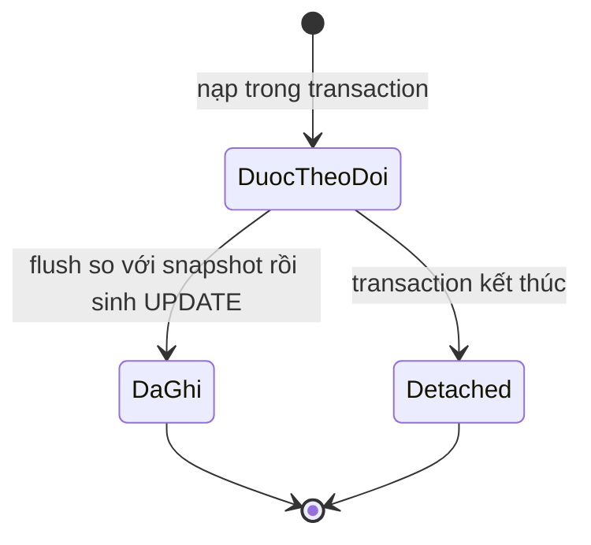
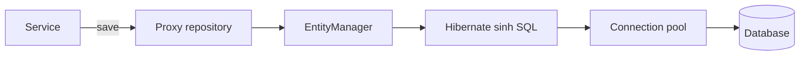
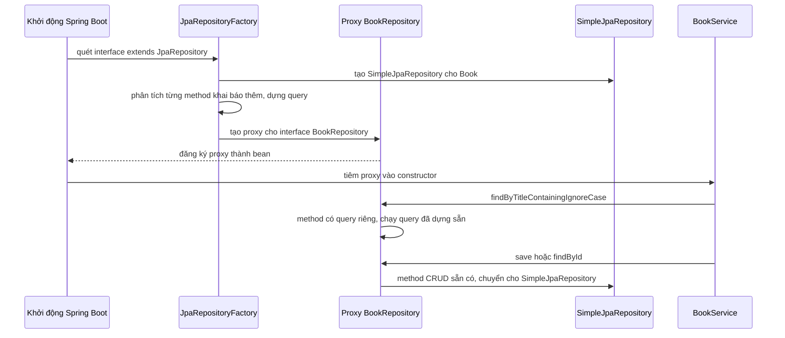
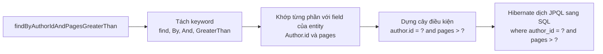
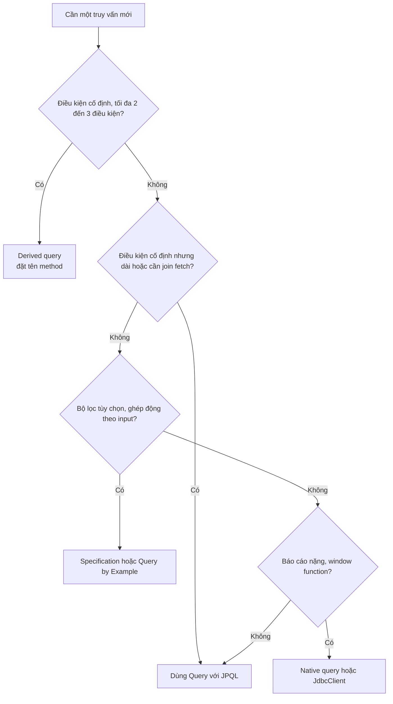

# Lý thuyết 4: Spring Data JPA

## Spring Data JPA là gì?

Spring Data JPA cho phép bạn làm việc với database bằng object Java thay vì tự viết SQL cho từng thao tác. Bạn khai báo một `interface` repository, Spring tự sinh phần cài đặt lúc chạy. Bên dưới, người làm việc thật sự là JPA (đặc tả chuẩn của Java về ORM) và Hibernate (thư viện cài đặt JPA phổ biến nhất); Spring Data chỉ là lớp bọc phía trên để bạn viết ít code hơn.

**Cốt lõi:** Thay vì tự viết SQL và map từng cột, bạn khai báo interface repository và Spring sinh proxy chuyển mọi call xuống `EntityManager` của JPA/Hibernate. Thứ tạo ra các hành vi "lạ" là persistence context, vùng nhớ theo dõi entity trong một transaction.

- Vì entity trong transaction được persistence context theo dõi nên đổi field là Hibernate tự sinh `UPDATE` lúc flush, không cần gọi `save`.
- Vì context gắn với transaction nên quan hệ `LAZY` chạm ngoài transaction ném `LazyInitializationException`, còn chạm trong vòng lặp thành N+1.
- Vì repository chỉ là interface nên query được dựng lúc khởi động từ tên method hoặc `@Query`, và sai tên field thì lỗi ngay lúc đó.



Mô hình tư duy: entity chỉ được theo dõi và tự ghi khi còn transaction; hết transaction thì nó thành detached.

**Tóm tắt:**

- Spring Data JPA là lớp mỏng: bạn khai báo interface repository, Spring sinh proxy, bên dưới là `EntityManager` của JPA/Hibernate.
- Entity trong transaction được persistence context theo dõi, nên đổi field là Hibernate tự sinh `UPDATE` lúc flush (dirty checking), không cần gọi `save`.
- Query có ba nguồn: suy ra từ tên method, `@Query` viết JPQL, hoặc SQL tay (native query, `JdbcClient`) khi cần kiểm soát từng câu.
- Quan hệ nhiều nên để `LAZY`: chạm vào ngoài transaction gây `LazyInitializationException`, chạm trong vòng lặp gây N+1.
- Chữa N+1 bằng `join fetch` hoặc `@EntityGraph`, và trả DTO thay vì entity ra API.
- Quan hệ hai chiều: chỉ bên có `@JoinColumn` ghi foreign key, bên `mappedBy` chỉ là phía đọc, nên phải giữ hai phía sync.
- Ở production dùng `ddl-auto: validate` kèm Flyway và tắt `open-in-view`; JPA hợp với CRUD, báo cáo nặng thì dùng SQL tay.

## Vấn đề nó giải quyết

Nếu dùng JDBC thuần, với mỗi bảng bạn phải viết lại SQL, mở connection, đặt tham số, đọc `ResultSet` rồi map từng cột sang field của object. Đoạn code này lặp lại ở mọi bảng, dễ sai (quên đóng connection, nhầm thứ tự cột) và không ai muốn đọc. Spring Data JPA có sẵn CRUD, phân trang, sắp xếp, và cho phép suy ra query từ chính tên method.

## Khi nào nên dùng, khi nào không

Dùng khi app làm việc với database quan hệ và phần lớn là thao tác CRUD thông thường. Không nên ép mọi thứ vào ORM: báo cáo phức tạp, query nhiều bảng với window function, hoặc query rất nặng thì nên viết SQL (native query hoặc JdbcTemplate) riêng, vì SQL do ORM sinh ra không phải lúc nào cũng tối ưu. Nhiều dự án dùng cả hai: JPA cho ghi và đọc đơn giản, SQL tay cho báo cáo.

Cách dùng gói gọn trong ba bước: đánh dấu class bằng `@Entity`, tạo interface extend `JpaRepository`, rồi để Spring sinh phần cài đặt. Query riêng thì dùng `@Query` hoặc đặt tên method theo quy ước.

## Các khái niệm cần biết

- **ORM (Object-Relational Mapping)**: kỹ thuật ánh xạ bảng và dòng trong database thành class và object, để bạn thao tác với object còn thư viện lo SQL.
- **Entity**: class Java được ánh xạ tới một bảng; mỗi object là một dòng. Cần `@Entity` và một primary key `@Id`.
- **Repository**: object cung cấp các thao tác truy cập dữ liệu cho một entity. Với `JpaRepository<Book, Long>`, bạn có sẵn `save`, `findById`, `findAll`, `deleteById`... mà không viết dòng nào.
- **JPQL**: ngôn ngữ truy vấn giống SQL nhưng viết theo tên class và field (`select b from Book b`) thay vì tên bảng và cột. Hibernate dịch nó sang SQL của từng loại database.
- **Persistence context**: vùng nhớ do `EntityManager` quản lý, giữ các entity đang "được theo dõi" trong một transaction. Nó là nền tảng cho dirty checking và cache cấp một (chi tiết ở [JPA internals](/go?p=01-Spring-Boot%2Fmedium%2Flt-16-jpa-internals.md)).
- **Lazy loading**: quan hệ chỉ được tải khi bạn thực sự truy cập (`b.getAuthor()`), không tải sẵn cùng entity cha. Tiết kiệm truy vấn, nhưng truy cập ngoài transaction sẽ gây `LazyInitializationException`.
- **Projection**: chỉ chọn một số cột cần dùng thay vì toàn bộ entity, giúp truy vấn nhẹ hơn.
- **Dirty checking**: Hibernate so sánh entity đang được quản lý với snapshot lúc nạp; nếu khác thì tự sinh `UPDATE` khi flush, nên bạn không cần gọi `save`.

## Flow một lần gọi repository

Hãy theo dõi điều gì xảy ra khi service gọi `repository.save(book)`. Bạn không viết cài đặt nào cho `BookRepository`, thứ nhận call là một proxy do Spring sinh ra.



Đọc sơ đồ: proxy chuyển call cho `SimpleJpaRepository` (cài đặt mặc định) rồi tới `EntityManager`. Hibernate sinh SQL phù hợp với loại database, mượn một connection từ pool (tập connection dùng lại để khỏi mở mới mỗi lần) để chạy, rồi trả connection về.

Còn việc interface biến thành object chạy được diễn ra lúc khởi động:



Đọc sơ đồ: proxy chia call thành hai loại. Method CRUD sẵn có (`save`, `findById`...) được chuyển cho `SimpleJpaRepository`; method bạn khai báo thêm đã được phân tích và dựng query ngay lúc khởi động, nên sai tên field thì lỗi từ lúc khởi động.

**Nền tảng:** Spring Data JPA chỉ là lớp mỏng: repository interface được Spring sinh proxy, bên dưới là `EntityManager` của JPA/Hibernate. Entity trong một transaction được persistence context theo dõi, nên đổi field là Hibernate tự sinh `UPDATE` lúc flush (dirty checking). Hiểu persistence context là hiểu gần hết hành vi "lạ" của JPA.

**Suy luận:** Vì repository chỉ là interface, Spring phải sinh phần cài đặt lúc khởi động, nên thứ được inject vào service là proxy chứ không phải class bạn viết. Proxy này chuyển mọi call xuống `EntityManager`, nên các hành vi "lạ" của Spring Data thực chất là hành vi của persistence context. Entity lấy ra trong transaction được context theo dõi, nên đổi field là đủ để sinh `UPDATE` lúc flush, còn gọi thêm `save` chỉ là thừa. Cũng vì context gắn với transaction, khi transaction kết thúc thì entity thành detached và quan hệ `LAZY` chưa tải sẽ ném `LazyInitializationException`. Thứ nhất, lỗi này nổ ở controller hoặc lúc serialize chứ không ở repository, nên rất dễ đổ nhầm cho Jackson. Thứ hai, bật `open-in-view` làm lỗi biến mất, nhưng chỉ vì SQL được chạy ngầm ở tầng view và connection bị giữ suốt request, nên N+1 bị che chứ không hết. Điểm dễ nhầm nhất là coi `LAZY` là "tiết kiệm" tuyệt đối: nó chỉ dời chi phí sang lúc chạm vào, và trong vòng lặp thì thành 1+N câu truy vấn. Hệ quả khi thiết kế và review: mỗi query phải quyết định rõ cần quan hệ nào (`join fetch` hoặc `@EntityGraph`), trả DTO ra ngoài và tắt `open-in-view`.

## Entity và Repository

Ví dụ sau là mô hình sách và tác giả. `@ManyToOne(fetch = LAZY)` nói rằng khi nạp sách thì chưa nạp tác giả. `@Query` chứa JPQL, trong đó `join fetch` yêu cầu nạp luôn tác giả bằng một câu join.

```java
@Entity
@Table(name = "books")
public class Book {
    @Id
    @GeneratedValue(strategy = GenerationType.IDENTITY)
    private Long id;

    @Column(nullable = false, length = 200)
    private String title;

    @ManyToOne(fetch = FetchType.LAZY)
    @JoinColumn(name = "author_id")
    private Author author;
}

public interface BookRepository extends JpaRepository<Book, Long> {
    List<Book> findByTitleContainingIgnoreCase(String keyword);

    @Query("select b from Book b join fetch b.author where b.id = :id")
    Optional<Book> findWithAuthor(@Param("id") Long id);
}
```

## Cấu hình và bảng tạo ra

```yaml
spring:
  datasource:
    url: jdbc:postgresql://localhost:5432/shop
    username: shop
    password: ${DB_PASSWORD}
  jpa:
    hibernate:
      ddl-auto: validate      # production: chỉ kiểm tra khớp schema, Flyway lo tạo bảng
    open-in-view: false       # tránh giữ session suốt request
    properties:
      hibernate.format_sql: true
logging:
  level:
    org.hibernate.SQL: debug  # in SQL; tham số bind: org.hibernate.orm.jdbc.bind: trace
```

```sql
-- db/migration/V1__create_books.sql (Flyway)
create table authors (id bigserial primary key, name varchar(100) not null);
create table books (
    id bigserial primary key,
    title varchar(200) not null,
    author_id bigint references authors(id)
);
```

`GenerationType.IDENTITY` khớp cột `bigserial`/auto increment: database tự cấp id khi insert. Hệ quả là Hibernate phải insert ngay mới biết id nên không thể gom batch insert khi dùng IDENTITY (xem [lt-34](/go?p=01-Spring-Boot%2Fhard%2Flt-34-jpa-hieu-nang-khoa-cache.md)). Về `ddl-auto`: `validate` chỉ so khớp entity với schema thật, còn `update` hoặc `create` để Hibernate tự sửa schema, tiện khi học nhưng nguy hiểm ở production vì có thể sửa schema ngoài ý muốn.

**Phải thuộc:** các mặc định hay bị hỏi: `spring.jpa.open-in-view` mặc định là `true` (giữ `EntityManager` suốt request, nên nên đặt `false`); `ddl-auto` mặc định là `create-drop` với DB nhúng và `none` với DB khác; fetch mặc định của `@ManyToOne` và `@OneToOne` là EAGER, của `@OneToMany` và `@ManyToMany` là LAZY; `save()` gọi `persist` nếu entity mới, `merge` nếu đã có id.

## Query suy ra từ tên method

Spring Data đọc tên method, tách theo keyword (`findBy`, `And`, `Containing`, `OrderBy`...) và dựng truy vấn tương ứng lúc khởi động. Nhờ đó bạn không viết SQL cho các truy vấn đơn giản. Nếu tên method sai tên field (ví dụ `findByTitel`), ứng dụng báo lỗi ngay lúc khởi động chứ không đợi tới lúc gọi.

| Tên method | JPQL tương đương |
|---|---|
| `findByTitle(String t)` | `where title = ?` |
| `findByTitleContainingIgnoreCase(String k)` | `where upper(title) like upper('%k%')` |
| `findByAuthorIdAndPagesGreaterThan(Long a, int p)` | `where author.id = ? and pages > ?` |
| `existsByTitle(String t)` | trả `boolean` |
| `countByAuthorId(Long a)` | trả `long` |
| `findTop5ByOrderByCreatedAtDesc()` | 5 bản ghi mới nhất |

Tên dài quá 3 điều kiện thì chuyển sang `@Query` cho dễ đọc.

Cách một tên method được "dịch" thành truy vấn:



Đọc sơ đồ: tên được cắt theo keyword, mỗi phần còn lại phải khớp tên field (kể cả đường dẫn lồng như `AuthorId`), rồi mới thành điều kiện. Không khớp được field nào thì lỗi lúc khởi động.

Khi nào dùng cách nào để viết truy vấn:



Đọc sơ đồ: đi từ cách đơn giản nhất xuống phức tạp nhất. Điều kiện cố định và ngắn thì đặt tên method; dài hơn thì `@Query`; bộ lọc ghép động theo input người dùng thì Specification (xem [JPA nâng cao](/go?p=01-Spring-Boot%2Fmedium%2Flt-37-spring-data-jpa-nang-cao.md)); báo cáo nặng thì SQL tay.

## Phân trang, projection và bulk update

Ba nhu cầu thường gặp: lấy dữ liệu theo trang (không bao giờ `findAll()` một bảng lớn), chỉ lấy vài cột để nhẹ hơn, và cập nhật nhiều dòng bằng một câu lệnh thay vì nạp từng entity.

```java
public interface BookRepository extends JpaRepository<Book, Long> {

    Page<Book> findByAuthorId(Long authorId, Pageable pageable);

    // Projection dạng interface: chỉ select hai cột
    interface BookSummary { Long getId(); String getTitle(); }
    List<BookSummary> findByTitleContaining(String keyword);

    @Modifying(clearAutomatically = true)
    @Query("update Book b set b.title = upper(b.title) where b.author.id = :aid")
    int upperCaseTitles(@Param("aid") Long authorId);   // cần @Transactional ở service
}
```

```java
Page<Book> page = repository.findByAuthorId(5L, PageRequest.of(0, 20, Sort.by("title")));
// page.getContent(), page.getTotalElements(), page.getTotalPages()
```

`Page` chạy thêm câu `count`; không cần tổng thì trả `Slice`. `@Modifying` update thẳng DB, bỏ qua persistence context nên cần `clearAutomatically = true` (lý do và ví dụ ở [JPA internals](/go?p=01-Spring-Boot%2Fmedium%2Flt-16-jpa-internals.md)).

## `save()` làm gì

Tên `save` gây hiểu nhầm là "luôn lưu": với entity mới (id null) nó gọi `persist` rồi insert, với entity đã có id nó gọi `merge`, tức select rồi update nếu khác. Entity đang được quản lý trong transaction thì không cần `save`, thay đổi tự ghi khi flush. Bảng so sánh `persist` và `merge`, bẫy "dùng giá trị trả về của `merge`" và dirty checking ở [JPA internals](/go?p=01-Spring-Boot%2Fmedium%2Flt-16-jpa-internals.md); transaction ở [Transaction](/go?p=01-Spring-Boot%2Fmedium%2Flt-05-transaction.md).

## N+1: trước và sau

N+1 là lỗi hiệu năng phổ biến nhất của JPA: lấy N cuốn sách bằng 1 câu truy vấn, rồi mỗi lần chạm tới `getAuthor()` đang lazy lại sinh thêm một câu, nên 100 sách thành 101 câu. Dữ liệu nhỏ thì không thấy, lên production thì chậm hẳn. Cách phát hiện là bật log SQL và tìm cùng một câu `select ... where id=?` lặp N lần; cách chữa gọn nhất là nạp luôn quan hệ trong một câu join như `findWithAuthor` ở trên (`join fetch`) hoặc gắn `@EntityGraph(attributePaths = "author")` lên method repository. Sơ đồ 1+N, bảng so sánh `JOIN FETCH`, `@EntityGraph`, batch fetching, DTO projection và các bẫy phân trang ở [JPA hiệu năng, lock và cache](/go?p=01-Spring-Boot%2Fhard%2Flt-34-jpa-hieu-nang-khoa-cache.md).

## Quan hệ hai chiều

Khi cả hai phía đều biết nhau (`Author` có danh sách `Book`, `Book` có `Author`), JPA cần biết phía nào thực sự ghi foreign key xuống database, nếu không sẽ ghi trùng hoặc không ghi. `cascade = ALL` nghĩa là thao tác trên tác giả (lưu, xóa) lan sang các sách; `orphanRemoval = true` nghĩa là sách bị gỡ khỏi danh sách thì bị xóa khỏi database. Chỉ nên dùng cascade cho quan hệ "sở hữu" chặt (đơn hàng và dòng đơn hàng), không dùng cho quan hệ độc lập như sách và thể loại.

```java
@Entity
public class Author {
    @Id @GeneratedValue(strategy = GenerationType.IDENTITY) private Long id;
    private String name;

    @OneToMany(mappedBy = "author", cascade = CascadeType.ALL, orphanRemoval = true)
    private List<Book> books = new ArrayList<>();

    // Giữ hai chiều sync
    public void addBook(Book b) { books.add(b); b.setAuthor(this); }
}
```

`mappedBy` chỉ ra bên **không sở hữu** foreign key; bên có `@JoinColumn` (`Book.author`) mới là bên ghi xuống DB. Quên gán `b.setAuthor(this)` thì foreign key là null dù đã `books.add(b)`.

## Quan hệ

| Annotation | Ví dụ |
|---|---|
| `@OneToMany` / `@ManyToOne` | Tác giả có nhiều sách |
| `@ManyToMany` | Sách thuộc nhiều thể loại |
| `@OneToOne` | User và hồ sơ |

## Khi nào dùng JDBC

JPA không phải lựa chọn duy nhất. Khi bạn cần kiểm soát từng câu SQL (báo cáo, bulk insert lớn, bảng không có primary key rõ ràng) hoặc không muốn trả giá cho persistence context, dùng thẳng JDBC qua các công cụ của Spring. Ba lựa chọn, từ thấp lên cao:

| Công cụ | Là gì | Dùng khi |
|---|---|---|
| `JdbcTemplate` | API cổ điển, tự quản connection, ném `DataAccessException` thay cho `SQLException` | Code cũ; `batchUpdate` hàng loạt |
| `JdbcClient` | API fluent (Spring Framework 6.1, Boot 3.2 trở lên), bọc `JdbcTemplate`, hỗ trợ tham số có tên | Code mới cần SQL tay |
| Spring Data JDBC | Repository như JPA nhưng đơn giản: không lazy loading, không dirty checking, không cache cấp một | Mô hình aggregate gọn, muốn hành vi dễ đoán |

Ví dụ _Minh họa_ với `JdbcClient`: tham số có tên (bind, không nối chuỗi nên không bị injection) và map thẳng vào `record`.

```java
public record BookRow(long id, String title) { }

@Repository
class BookReportDao {
    private final JdbcClient jdbc;
    BookReportDao(JdbcClient jdbc) { this.jdbc = jdbc; }

    List<BookRow> findByAuthor(long authorId) {
        return jdbc.sql("select id, title from books where author_id = :aid order by title")
                .param("aid", authorId)
                .query(BookRow.class)
                .list();
    }
}
```

Spring Data JDBC giữ cú pháp repository quen thuộc nhưng khác triết lý: mỗi repository ứng với một aggregate root, `save` luôn là insert hoặc update ngay (không có khái niệm entity "đang được theo dõi"), quan hệ phải khai báo rõ ràng và nạp cùng aggregate.

```java
public interface BookRepository extends CrudRepository<Book, Long> {
    List<Book> findByTitleContaining(String keyword);
}
```

Cách chọn: CRUD thông thường với quan hệ vừa phải, JPA là mặc định phổ biến. Aggregate nhỏ, muốn tránh bất ngờ của lazy loading và flush, cân nhắc Spring Data JDBC. Báo cáo, bulk, query tối ưu bằng tay thì `JdbcClient` cạnh JPA trong cùng ứng dụng (dùng chung `DataSource` và transaction). Lưu ý: một transaction chỉ thấy dữ liệu JPA chưa flush nếu bạn flush trước khi chạy câu JDBC, vì JDBC không đọc persistence context.

## Lưu ý quan trọng

- **Bài toán N+1:** đọc N bản ghi rồi mỗi bản ghi lại truy vấn thêm một lần cho quan hệ. Dùng `join fetch` hoặc `@EntityGraph`.
- Mặc định đặt `fetch = LAZY` cho quan hệ nhiều.
- Không trả entity ra ngoài API (dễ lỗi lazy loading và lộ dữ liệu), dùng DTO.
- Schema nên quản lý bằng Flyway/Liquibase, không dùng `ddl-auto=update` ở production.
- Bật `spring.jpa.show-sql=true` khi học để thấy SQL sinh ra.

## Phỏng vấn khó: chuỗi hỏi xoáy

Người phỏng vấn senior thường mở bằng một câu dễ, rồi xoáy xuống cơ chế, đánh đổi và sự cố thật. Câu trả lời tốt luôn đi từ cốt lõi xuống, không nhảy thẳng vào chi tiết.

### Chuỗi 1: Dirty checking, flush và `save`

1. **Câu mở:** Bạn đổi một field của entity trong service và không gọi `save`, nhưng DB vẫn được cập nhật. Vì sao?
2. **Xoáy 1:** Câu `UPDATE` được gửi lúc nào, và Hibernate biết entity đã đổi bằng cách nào?
3. **Xoáy 2:** Nếu ra khỏi transaction, hoặc dùng `@Modifying` update hàng loạt, thì chuyện gì khác đi?

**Đáp án ngắn:** Entity nạp trong transaction nằm trong persistence context, và Hibernate giữ một snapshot lúc nạp. Đến lúc flush (thường khi commit), nó so entity với snapshot, cái nào khác thì tự sinh `UPDATE`. Đó là dirty checking, nên gọi thêm `save` chỉ là thừa. Hệ quả là lỗi constraint thường nổ lúc commit chứ không ở dòng đổi field. Ra khỏi transaction thì entity thành detached, đổi field không tự xuống DB nữa. `@Modifying` JPQL update đi thẳng xuống DB, bỏ qua persistence context, nên entity đã nạp trong context còn giữ giá trị cũ; cần `clearAutomatically = true` và method phải nằm trong transaction. Còn `save` với entity đã có id gọi `merge`, tức select rồi update nếu khác, chứ không phải "luôn insert". Cách nhìn thấy trong thực tế: bật log SQL và xem câu `UPDATE` xuất hiện ở thời điểm nào.

**Sai lầm hay gặp:**
- Nói `save` là bắt buộc để lưu, hoặc `save` luôn là insert.
- Không giải thích được vì sao lỗi constraint nổ lúc commit.
- Không biết bulk update bỏ qua persistence context.

### Chuỗi 2: `LazyInitializationException` và `open-in-view`

1. **Câu mở:** Controller trả entity và nổ `LazyInitializationException`. Đồng đội đổ cho Jackson. Thực chất là gì?
2. **Xoáy 1:** Vì sao lỗi nổ ở controller chứ không ở repository?
3. **Xoáy 2:** Bật `open-in-view` (mặc định `true`) thì lỗi biến mất. Có nên để vậy không?

**Đáp án ngắn:** Quan hệ `LAZY` chỉ là proxy chưa tải. Persistence context gắn với transaction, nên khi transaction kết thúc entity thành detached, và chạm vào quan hệ chưa tải thì ném lỗi. Lỗi nổ khi Jackson serialize ở controller vì đó là lúc getter được chạm, nên trông như lỗi của Jackson. `open-in-view` giữ `EntityManager` suốt request, SQL chạy ngầm ở tầng view nên lỗi biến mất; nhưng connection bị giữ lâu hơn và N+1 bị che chứ không hết. Cách đúng là để query quyết định rõ quan hệ cần dùng (`join fetch` hoặc `@EntityGraph`), trả DTO thay vì entity, và đặt `open-in-view: false`. Cách phát hiện: bật log SQL và tìm cùng một câu `select ... where id=?` lặp N lần. Lazy chỉ dời chi phí sang lúc chạm vào, trong vòng lặp thì thành 1+N câu.

**Sai lầm hay gặp:**
- Đổ lỗi cho Jackson, hoặc đổi sang EAGER cho hết lỗi.
- Coi việc bật `open-in-view` là đã sửa xong.
- Trả entity thẳng ra API.

