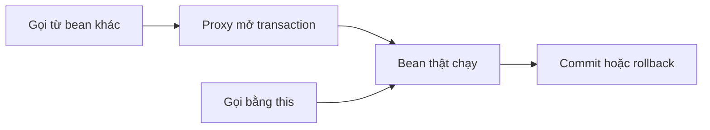
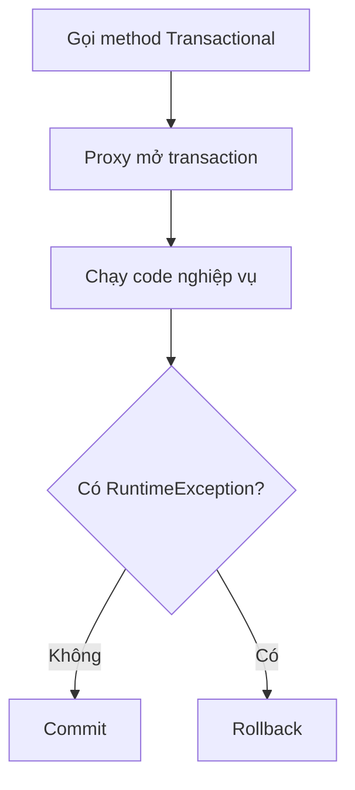
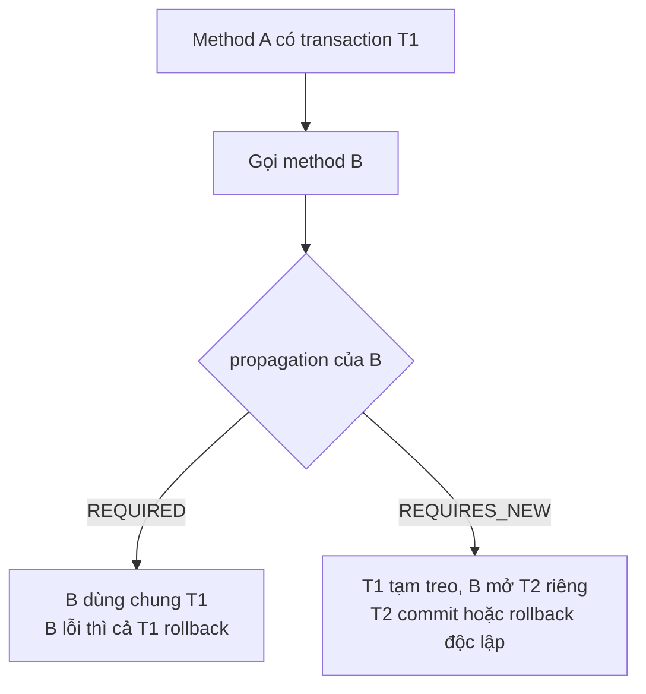
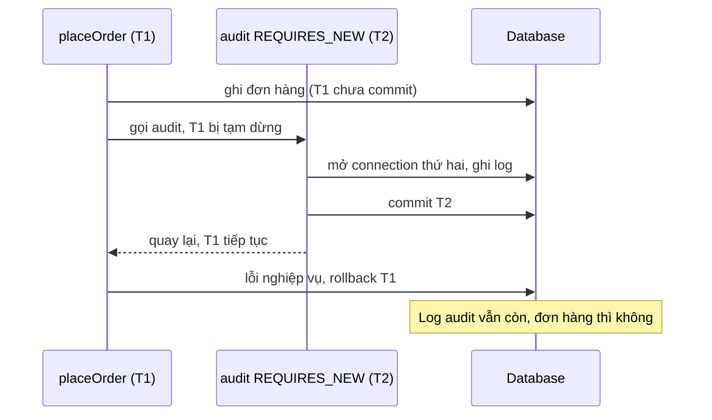
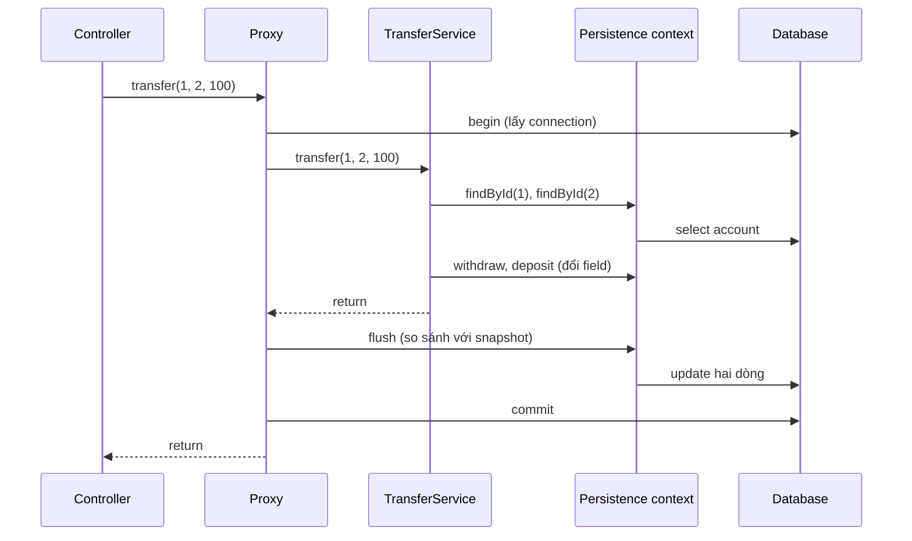

# Lý thuyết 5: Transaction

## Transaction là gì?

Transaction là cách gom nhiều thao tác database thành một khối không thể chia nhỏ: hoặc tất cả thành công và được lưu (commit), hoặc có lỗi thì tất cả bị hoàn tác (rollback) như chưa từng xảy ra. Hãy nghĩ tới việc chuyển tiền tại quầy: nhân viên trừ tiền tài khoản A rồi cộng tiền tài khoản B. Nếu hệ thống sập giữa hai bước, bạn muốn cả hai việc cùng không xảy ra, chứ không muốn tiền biến mất.

**Cốt lõi:** Nhiều thao tác DB phải thành công hoặc thất bại cùng nhau, nên transaction gom chúng thành một khối atomic. Spring làm việc này bằng proxy bọc bean: proxy mở transaction gắn với thread hiện tại trước method, rồi commit hoặc rollback sau.

- Vì logic transaction nằm trong proxy chứ không trong class của bạn nên call không đi qua proxy (`this`, `private`, `final`, `new`) thì không có transaction.
- Vì transaction gắn với thread nên thread khác như `@Async` bắt đầu với context trống.
- Vì `REQUIRED` tham gia transaction chung nên lỗi ở method trong chỉ đánh dấu rollback-only, còn `REQUIRES_NEW` mở transaction độc lập nhưng giữ thêm một connection.



Mô hình tư duy: transaction chỉ tồn tại trên đường đi qua proxy, còn gọi bằng `this` đi thẳng vào bean thật và bỏ qua nó.

**Tóm tắt:**

- Transaction gom nhiều thao tác DB thành một khối atomic: tất cả được commit hoặc tất cả bị rollback.
- `@Transactional` chạy bằng proxy bọc bean: proxy mở transaction (gắn với thread hiện tại) trước method và commit hoặc rollback sau.
- Mặc định chỉ rollback với `RuntimeException` và `Error`; muốn rollback checked exception phải khai báo `rollbackFor`.
- Propagation mặc định `REQUIRED` tham gia transaction đang có; `REQUIRES_NEW` mở transaction độc lập nhưng tốn thêm một connection.
- Self-invocation, method `private` hoặc `final`, object tạo bằng `new`, thread khác đều làm `@Transactional` mất tác dụng mà không báo lỗi.
- `UPDATE` chỉ được gửi lúc flush (thường khi commit), nên lỗi constraint thường nổ lúc commit chứ không ở dòng đổi field.
- Đặt `@Transactional` ở service, giữ transaction ngắn, không gọi API ngoài chậm bên trong, và đừng nuốt exception vì transaction sẽ vẫn commit.

## Vấn đề nó giải quyết

Không có transaction, mỗi câu lệnh SQL tự commit riêng. Lỗi xảy ra sau khi đã trừ tài khoản A mà trước khi cộng tài khoản B sẽ để dữ liệu ở trạng thái nửa vời, và rất khó sửa về sau vì không ai biết bản ghi nào đã đổi, bản ghi nào chưa. Transaction đảm bảo tính atomic cho cả nghiệp vụ.

## Khi nào dùng, khi nào không

Dùng khi một nghiệp vụ sửa nhiều bản ghi hoặc nhiều bảng mà phải đi cùng nhau. Method chỉ đọc một dòng thì thường không cần transaction, hoặc dùng `readOnly = true`. Cách dùng trong Spring: gắn `@Transactional` lên method của **service**, không đặt ở controller. Mặc định Spring chỉ rollback khi có `RuntimeException` (hoặc `Error`). Cuối cùng, Spring làm việc này qua proxy nên gọi method trong cùng class sẽ không có hiệu lực (xem mục self-invocation bên dưới).

## Các khái niệm cần biết

- **ACID**: bốn đảm bảo của transaction. *Atomicity* (tất cả hoặc không gì), *Consistency* (dữ liệu luôn thỏa các constraint), *Isolation* (các transaction chạy concurrent không làm hỏng nhau) và *Durability* (đã commit thì không mất dù server sập).
- **Commit và rollback**: commit là xác nhận và ghi vĩnh viễn; rollback là hủy mọi thay đổi từ đầu transaction.
- **Proxy**: Spring không sửa class của bạn mà bọc nó trong một object trung gian. Proxy mở transaction trước khi gọi method thật và commit hoặc rollback sau khi method trả về (chi tiết ở [AOP và proxy](/go?p=01-Spring-Boot%2Fmedium%2Flt-13-aop-proxy.md)).
- **Propagation**: quy định method này làm gì khi nó được gọi từ một method khác đã có transaction. `REQUIRED` (mặc định) tham gia transaction đang có, nếu chưa có thì tạo mới. `REQUIRES_NEW` tạm treo transaction cũ và mở một transaction độc lập, commit hoặc rollback riêng; hợp để ghi log kiểm toán vẫn lưu dù nghiệp vụ chính thất bại.
- **Isolation**: mức độ một transaction được thấy thay đổi chưa commit hoặc mới commit của transaction khác. Mức thấp thì nhanh nhưng có thể đọc sai (dirty read, non-repeatable read, phantom read); mức cao thì an toàn hơn nhưng chậm và dễ lock chờ nhau. Mặc định dùng mức của database (PostgreSQL là `READ_COMMITTED`, MySQL InnoDB là `REPEATABLE_READ`).
- **Persistence context, flush, dirty checking**: Hibernate giữ entity đã nạp trong một vùng nhớ, so sánh với snapshot lúc nạp, và chỉ gửi `UPDATE` khi flush (thường lúc commit). Nhờ vậy bạn đổi field là đủ, không cần gọi `save`.
- **Self-invocation**: một method gọi method khác trong cùng object (`this.xxx()`), call không đi qua proxy nên annotation bị bỏ qua.

**Nền tảng:** `@Transactional` không phải phép màu mà là proxy bọc ngoài bean: proxy mở transaction (lấy connection, tắt auto-commit) trước khi gọi method thật, rồi commit hoặc rollback sau. Transaction gắn với thread hiện tại. Từ đó suy ra mọi bẫy: gọi nội bộ không qua proxy, thread khác không có transaction, method không qua proxy thì không có transaction.

**Phải thuộc:** mặc định `@Transactional` rollback với `RuntimeException` và `Error`, KHÔNG rollback với checked exception (muốn thì `rollbackFor`). Propagation mặc định là `REQUIRED`; isolation mặc định là mức của DB (PostgreSQL `READ_COMMITTED`, MySQL InnoDB `REPEATABLE_READ`). ACID = Atomicity, Consistency, Isolation, Durability.

## Flow cơ bản

Khi code gọi một method `@Transactional`, thứ nhận call đầu tiên là proxy chứ không phải service thật. Proxy quyết định commit hay rollback theo kết quả:



## Ví dụ

```java
@Service
public class TransferService {
    private final AccountRepository accounts;

    public TransferService(AccountRepository accounts) {
        this.accounts = accounts;
    }

    @Transactional
    public void transfer(Long fromId, Long toId, BigDecimal amount) {
        Account from = accounts.findById(fromId).orElseThrow();
        Account to = accounts.findById(toId).orElseThrow();
        from.withdraw(amount);
        to.deposit(amount);
    }
}
```

Entity đang được quản lý nên thay đổi được tự ghi khi commit, không cần gọi `save`.

## Thuộc tính hay dùng

| Thuộc tính | Ý nghĩa |
|---|---|
| `readOnly = true` | Truy vấn chỉ đọc, tối ưu hơn |
| `rollbackFor = Exception.class` | Rollback cả checked exception (mặc định chỉ RuntimeException) |
| `propagation` | Hành vi khi đã có transaction (`REQUIRED`, `REQUIRES_NEW`...) |
| `isolation` | Mức isolation (`READ_COMMITTED`, `REPEATABLE_READ`...) |

Phần lớn method chỉ cần mặc định. Chỉ chỉnh `propagation` hoặc `isolation` khi bạn có lý do cụ thể và hiểu hệ quả: `REQUIRES_NEW` dùng bừa sẽ chiếm thêm một connection cho mỗi lần gọi và có thể làm cạn connection pool; nâng `isolation` lên cao làm tăng khả năng lock wait và deadlock.

Hai kiểu `propagation` hay gặp, so sánh qua flow:



Với `REQUIRED`, nếu B ném `RuntimeException` và A bắt lại rồi tiếp tục, transaction chung đã bị đánh dấu rollback-only nên cuối cùng commit vẫn thất bại với `UnexpectedRollbackException` (xem bài chuyên sâu).

**Suy luận:** Với `REQUIRED`, B không có transaction riêng mà tham gia T1, nên khi B ném `RuntimeException`, proxy của B chỉ có thể đánh dấu T1 là rollback-only chứ không rollback hẳn được, vì T1 thuộc về A. Vì vậy dù A bắt exception rồi chạy tiếp, lúc A commit thì proxy của A thấy cờ rollback-only, rollback toàn bộ và ném `UnexpectedRollbackException` để báo rằng commit bạn mong đợi đã không xảy ra. Với `REQUIRES_NEW` thì khác: T2 độc lập nên lỗi của B không đánh dấu T1, và A bắt exception xong vẫn commit được. Đổi lại `REQUIRES_NEW` giữ hai connection cùng lúc, nên cái giá chuyển từ tính đúng đắn sang hiệu năng, và dùng bừa sẽ cạn pool. Điểm dễ nhầm là tưởng try/catch ở A "nuốt" được lỗi của B: try/catch chỉ nuốt exception ở mức Java, không gỡ được cờ rollback-only của transaction. Hệ quả khi thiết kế: muốn A sống sót khi B lỗi thì B phải là `REQUIRES_NEW` (hoặc `NESTED` với savepoint), còn nếu cần all-or-nothing thì giữ `REQUIRED` và để exception đi tiếp.

### Bảy kiểu propagation

Hai kiểu ở trên là phần lớn nhu cầu, nhưng Spring có đủ bảy. Bảng dưới để tra khi gặp; chỉ `REQUIRED` và `REQUIRES_NEW` (và biết `NESTED` là gì) là cần thuộc.

| Kiểu | Hành vi | Dùng khi |
|---|---|---|
| `REQUIRED` (mặc định) | Có transaction thì tham gia, chưa có thì tạo mới | Hầu hết trường hợp |
| `REQUIRES_NEW` | Luôn tạo transaction mới, **tạm dừng** transaction ngoài | Ghi audit log phải lưu dù nghiệp vụ chính lỗi |
| `NESTED` | Savepoint trong transaction hiện tại | Khôi phục một phần; hỗ trợ phụ thuộc transaction manager và JDBC savepoint |
| `SUPPORTS` | Có thì tham gia, không có thì chạy không transaction | Hiếm |
| `NOT_SUPPORTED` | Tạm dừng transaction hiện tại, chạy không transaction | Thao tác không nên nằm trong transaction |
| `MANDATORY` | Bắt buộc đã có transaction, không thì lỗi | Khẳng định constraint thiết kế |
| `NEVER` | Có transaction thì lỗi | Hiếm |

Sơ đồ dưới cho thấy vì sao `REQUIRES_NEW` hợp với audit log: log commit độc lập nên còn lại khi đơn hàng rollback.



Cái giá là **connection thứ hai** trong lúc connection đầu vẫn bị giữ. Nếu nhiều request cùng lúc làm vậy và pool nhỏ, tất cả giữ connection thứ nhất và chờ connection thứ hai, dẫn tới cạn pool và treo cả hệ thống. Dùng `REQUIRES_NEW` có kiểm soát và đặt pool lớn hơn số thread chạy concurrent tối đa.

## Điều gì xảy ra bên trong `transfer`



Hai điểm cần hiểu: (1) proxy mở transaction **trước** khi code của bạn chạy; (2) `update` chỉ được gửi lúc **flush** ở cuối (dirty checking), nên lỗi constraint DB thường nổ lúc commit chứ không phải ngay dòng `deposit`.

## Self-invocation: trước và sau

Đây là cái bẫy kinh điển nhất. Vấn đề đặt ra: bạn đánh dấu `saveAudit` là `REQUIRES_NEW` nhưng `checkout` gọi nó bằng `this`, nên call không đi qua proxy và annotation bị bỏ qua mà không có cảnh báo. Hệ quả: log kiểm toán nằm chung transaction và bị rollback theo nghiệp vụ chính, đúng điều bạn định tránh. Cách giải quyết là tách sang bean khác.

```java
// SAI: checkout và saveAudit nằm cùng class, gọi qua this nên không qua proxy
@Service
class OrderService {
    public void checkout(Order o) {
        // this.saveAudit(...): REQUIRES_NEW KHÔNG có tác dụng
        saveAudit(o);
    }

    @Transactional(propagation = Propagation.REQUIRES_NEW)
    public void saveAudit(Order o) { /* ... */ }
}

// ĐÚNG: tách sang bean khác để lời gọi đi qua proxy
@Service
class AuditService {
    @Transactional(propagation = Propagation.REQUIRES_NEW)
    public void saveAudit(Order o) { /* ... */ }
}

@Service
class OrderService {
    private final AuditService audit;
    OrderService(AuditService audit) { this.audit = audit; }

    @Transactional
    public void checkout(Order o) {
        // qua proxy của AuditService: transaction mới thật sự
        audit.saveAudit(o);
    }
}
```

**Phải thuộc:** self-invocation (`this.method()`) bỏ qua proxy nên `@Transactional`, `@Async`, `@Cacheable` đều mất tác dụng; muốn có hành vi của proxy phải gọi sang bean khác (hoặc dùng `TransactionTemplate`). Cơ chế proxy ở [AOP và proxy](/go?p=01-Spring-Boot%2Fmedium%2Flt-13-aop-proxy.md).

**Suy luận:** `@Transactional` hoạt động bằng proxy vì Spring không muốn sửa class của bạn, nên toàn bộ logic mở và đóng transaction nằm trong object bọc bên ngoài. Vì vậy transaction chỉ tồn tại khi call đi qua proxy, và mọi bẫy đều là các cách khác nhau để call không qua proxy. Self-invocation bỏ qua proxy vì `this` trỏ tới object thật chứ không phải proxy. Method `private` hoặc `final` không override được trong subclass CGLIB, nên advice không chen vào được. Object tạo bằng `new` thì chưa bao giờ được Spring bọc. Thread khác không thấy transaction vì connection và transaction được gắn vào thread hiện tại, nên `@Async` hoặc `CompletableFuture` bắt đầu với context trống. Điểm dễ nhầm là cả bốn trường hợp đều không báo lỗi: code vẫn chạy, chỉ là mất transaction, nên chỉ lộ ra khi có lỗi giữa chừng và dữ liệu đã nửa vời. Hệ quả khi review: thấy `@Transactional` thì hỏi call tới nó đến từ đâu (bean khác, method public, cùng thread), và viết một test rollback không bọc `@Transactional` để kiểm chứng.

Self-invocation chỉ là một trong nhiều chỗ `@Transactional` âm thầm không chạy. Bảng dưới liệt kê các nguyên nhân khác và cách xử lý.

| Nguyên nhân | Cách xử lý |
|---|---|
| Gọi nội bộ trong cùng class (self-invocation) | Tách sang bean khác, hoặc dùng `TransactionTemplate` |
| Method `private`, hoặc class/method `final` khi dùng proxy CGLIB; (trước Spring 6 còn phải là `public`, từ Spring 6 proxy theo class chấp nhận cả `protected` và package-visible) | Dùng `public`, bỏ `final` |
| Object không do Spring tạo (`new Service()`) | Để Spring quản lý bean |
| Chạy ở thread khác (`@Async`, `CompletableFuture`) | Mở transaction trong thread đó: transaction gắn với thread |
| Đặt trên interface trong một số cấu hình proxy | Đặt trên class cài đặt |
| Bean chưa qua `BeanPostProcessor` (ví dụ trong `@PostConstruct`) | Dùng `ApplicationReadyEvent` hoặc runner |

## Rollback với checked exception và `readOnly`

Checked exception (như `IOException`) mặc định **không** làm rollback, vì Spring theo quy ước của EJB coi nó là lỗi nghiệp vụ "có thể dự đoán". Nếu bạn muốn rollback cả trường hợp này, khai báo `rollbackFor`. Còn `readOnly = true` là gợi ý cho Spring và Hibernate rằng method chỉ đọc: Hibernate có thể bỏ qua dirty checking và driver có thể chọn replica. Đừng dùng nó để "chặn ghi", vì nó không phải rào chắn bảo mật.

```java
@Transactional(rollbackFor = Exception.class)
public void importFile(Path p) throws IOException {
    // IOException (checked) giờ cũng làm rollback
}

@Transactional(readOnly = true)
// không tự flush, Hibernate bỏ bản chụp dirty checking
public List<BookResponse> list() {
    return repository.findAll().stream().map(BookResponse::from).toList();
}
```

## Quản lý transaction bằng code

`TransactionTemplate` là cách khai báo transaction bằng code thay vì annotation. Dùng khi cần ranh giới nhỏ hơn một method, hoặc tránh self-invocation. Ví dụ dưới giữ việc gọi API chậm ở ngoài transaction để không giữ connection DB trong lúc chờ mạng:

```java
@Service
class ReportService {
    private final TransactionTemplate tx;

    ReportService(PlatformTransactionManager tm) { this.tx = new TransactionTemplate(tm); }

    void run() {
        String data = callSlowApi();                     // ngoài transaction
        // chỉ đoạn ghi nằm trong transaction
        tx.executeWithoutResult(status -> save(data));
    }
    // callSlowApi, save: bỏ qua phần cài đặt
}
```

## Kiểm thử

```java
@SpringBootTest
class TransferServiceTest {
    @Autowired TransferService service;
    @Autowired AccountRepository accounts;

    @Test
    void transferFails_rollsBack() {
        assertThrows(IllegalStateException.class,
                // vượt số dư
                () -> service.transfer(1L, 2L, new BigDecimal("999999")));
        assertEquals(0, new BigDecimal("100").compareTo(accounts.findById(1L).orElseThrow().getBalance()));
    }
}
```

Đừng đặt `@Transactional` lên class test nếu mục đích là kiểm tra rollback của service: test sẽ bao ngoài và che đi hành vi thật. Test có `@Transactional` tự rollback nên cũng che các lỗi chỉ lộ lúc commit thật (constraint DB, hành vi `REQUIRES_NEW`, `AFTER_COMMIT`): với các trường hợp đó hãy viết test không dùng `@Transactional` và dọn dữ liệu thủ công. Phần nâng cao (rollback-only và `UnexpectedRollbackException`, dual write, định tuyến replica) ở [Transaction chuyên sâu](/go?p=01-Spring-Boot%2Fhard%2Flt-31-transaction-chuyen-sau.md).

## Bẫy thường gặp

- **Gọi nội bộ (self-invocation):** method `@Transactional` được gọi từ method khác trong cùng class thì không qua proxy, annotation không có tác dụng.
- `@Transactional` trên method `private` không hoạt động; trên method không `public` thì tùy phiên bản (Spring 6 trở lên với proxy theo class thì được, trước đó thì không). Cứ để `public` cho chắc.
- Nuốt exception trong `try/catch` khiến transaction vẫn commit.
- Transaction giữ connection DB: không gọi API ngoài chậm bên trong.
- Xung đột concurrent write: dùng optimistic lock với `@Version`.

## Phỏng vấn khó: chuỗi hỏi xoáy

Người phỏng vấn senior thường mở bằng một câu dễ, rồi xoáy xuống cơ chế, đánh đổi và sự cố thật. Câu trả lời tốt luôn đi từ cốt lõi xuống, không nhảy thẳng vào chi tiết.

### Chuỗi 1: `REQUIRED`, rollback-only và `REQUIRES_NEW`

1. **Câu mở:** A (có transaction) gọi B (`REQUIRED`), B ném `RuntimeException`, A bắt bằng `try/catch` rồi chạy tiếp. Kết quả cuối cùng là gì?
2. **Xoáy 1:** Vì sao lại có `UnexpectedRollbackException`?
3. **Xoáy 2:** Đổi B thành `REQUIRES_NEW` thì khác gì, và cái giá là gì?

**Đáp án ngắn:** Cuối cùng commit của A thất bại với `UnexpectedRollbackException`. Với `REQUIRED`, B không có transaction riêng mà tham gia T1 của A, nên khi B ném `RuntimeException`, proxy của B chỉ đánh dấu T1 là rollback-only, không rollback hẳn được vì T1 thuộc về A. `try/catch` chỉ nuốt exception ở mức Java, không gỡ được cờ này. Lúc A commit, proxy của A thấy cờ, rollback toàn bộ và ném exception để báo commit mong đợi đã không xảy ra. Với `REQUIRES_NEW`, T2 độc lập nên lỗi của B không đánh dấu T1 và A vẫn commit được; `NESTED` với savepoint cũng là một lựa chọn, tùy transaction manager. Đổi lại `REQUIRES_NEW` giữ hai connection cùng lúc; nhiều request làm vậy với pool nhỏ thì cạn pool và treo hệ thống. Chọn theo yêu cầu: cần all-or-nothing thì giữ `REQUIRED` và để exception đi tiếp; cần A sống sót thì `REQUIRES_NEW`.

**Sai lầm hay gặp:**
- Nói `try/catch` "nuốt" được lỗi của transaction chung.
- Dùng `REQUIRES_NEW` bừa mà không nghĩ tới connection pool.
- Quên rằng checked exception mặc định không gây rollback.

### Chuỗi 2: `@Transactional` không chạy mà không báo lỗi

1. **Câu mở:** Bạn có `@Transactional` mà lỗi giữa chừng vẫn để dữ liệu nửa vời. Nghi ngờ điều gì trước?
2. **Xoáy 1:** Vì sao `this`, `private`, `final`, `new` và thread khác đều làm nó mất tác dụng?
3. **Xoáy 2:** Viết test thế nào để thật sự kiểm chứng rollback?

**Đáp án ngắn:** Nghi là call không đi qua proxy. Logic mở và đóng transaction nằm trong proxy chứ không trong class của bạn, và transaction gắn với thread hiện tại. `this` trỏ tới object thật nên self-invocation bỏ qua proxy; `private` hoặc `final` không override được trong subclass CGLIB; object tạo bằng `new` chưa bao giờ được Spring bọc; thread khác như `@Async` bắt đầu với context trống. Cả bốn đều chạy bình thường và chỉ lộ khi có lỗi giữa chừng. Ngoài ra checked exception mặc định không rollback, cần `rollbackFor`. Cách sửa: tách sang bean khác hoặc dùng `TransactionTemplate`. Về test: gây lỗi giữa chừng rồi đọc lại DB, và đừng đặt `@Transactional` lên class test, vì test bao ngoài sẽ che hành vi thật và che cả lỗi chỉ lộ lúc commit thật. Khi review, hỏi call tới method này đến từ bean nào, qua method public, cùng thread không.

**Sai lầm hay gặp:**
- Chỉ biết tên "self-invocation" mà không giải thích được vì sao nó không qua proxy.
- Kiểm thử rollback bằng test có `@Transactional`.
- Nghĩ checked exception cũng rollback theo mặc định.

