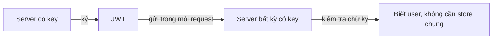
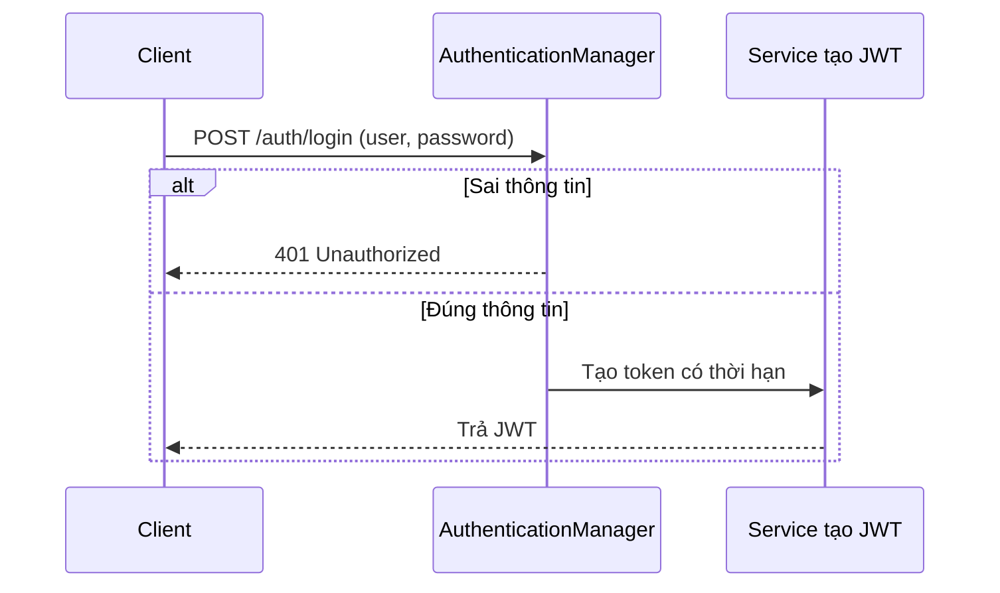
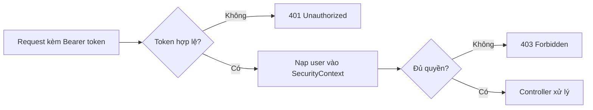
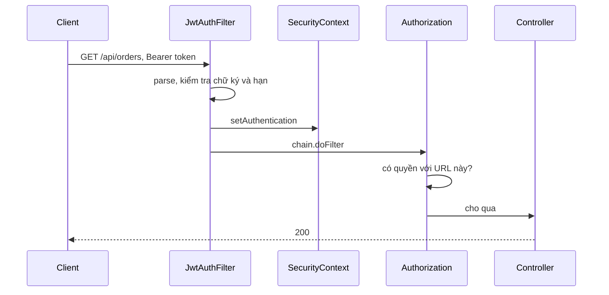

# Lý thuyết 6: Spring Security và JWT

## Spring Security và JWT là gì?

Spring Security là framework bảo mật của Spring, lo hai việc: authentication (bạn là ai) và authorization (bạn được làm gì). JWT (JSON Web Token) là một chuỗi token đã được ký, bên trong chứa sẵn thông tin về người dùng. Hai thứ này hay đi cùng nhau: Spring Security đứng chặn ở cửa, còn JWT là "vé vào cửa" mà client xuất trình trong mỗi request.

**Cốt lõi:** API stateless không nhớ ai đã đăng nhập, nên mỗi request phải tự mang bằng chứng, và JWT là vé có chữ ký để server nào có key cũng kiểm tra được. Spring Security là filter chain chặn trước controller: một filter đọc token và đặt user vào `SecurityContext`, bước cuối chain mới quyết định cho qua hay chặn.

- Vì chữ ký chỉ chứng minh payload không bị sửa chứ không che nó nên không bỏ dữ liệu nhạy cảm vào token.
- Vì server không nhớ token nên token còn hạn vẫn hợp lệ dù user đã logout, và phải để thời hạn ngắn.
- Vì filter JWT chỉ đặt hoặc bỏ trống authentication nên 401 hay 403 do cuối chain quyết định, và API JWT cần `authenticationEntryPoint` để ra 401.



Mô hình tư duy: chữ ký thay cho session chung, nên server nào có key cũng nhận ra user.

**Tóm tắt:**

- Spring Security lo authentication (bạn là ai) và authorization (bạn được làm gì); JWT là token đã ký, chứa sẵn claims của user.
- JWT giúp API stateless: server nào có key cũng verify được token mà không cần session chung, đổi lại khó thu hồi sớm.
- Spring Security là servlet filter chain đứng trước controller; filter JWT đặt `Authentication` vào `SecurityContext` (gắn theo thread) rồi luôn gọi `chain.doFilter`.
- `401` là chưa authenticate được, `403` là đã authenticate nhưng thiếu quyền; API JWT phải khai báo `authenticationEntryPoint` để trả 401.
- Payload JWT chỉ được ký chứ không được encrypt, nên không bỏ dữ liệu nhạy cảm vào đó.
- Mật khẩu hash bằng BCrypt, signing key lấy từ biến môi trường, access token ngắn hạn kèm refresh token.
- Luôn kết thúc luật bằng `anyRequest().authenticated()`; `@PreAuthorize` chạy qua proxy nên bị self-invocation làm mất tác dụng.

## Vì sao cần JWT?

API không được bảo vệ thì ai gọi cũng được. Cách truyền thống là session: sau khi đăng nhập, server lưu "người này đã đăng nhập" trong memory rồi đưa cho client một id phiên. Cách này buộc server phải nhớ từng người dùng, nên khó mở rộng khi chạy nhiều instance (request sau có thể rơi vào máy không có phiên). JWT đảo ngược cách làm: vé tự chứa thông tin người dùng và có chữ ký, server nào có key đều kiểm tra được mà không cần tra store chung.

## Khi nào dùng, khi nào không

Dùng cho API có đăng nhập và authorization theo vai trò, nhất là API stateless phục vụ SPA hoặc mobile. Với app web render phía server thông thường, session vẫn là lựa chọn ổn và còn đơn giản hơn, vì thu hồi phiên chỉ cần xóa nó khỏi server. Cái giá của JWT là khó thu hồi sớm (xem phần Lưu ý ở cuối).

Cách làm, tóm gọn: cấu hình `SecurityFilterChain`, thêm một filter đọc JWT từ header `Authorization: Bearer ...`, kiểm tra chữ ký rồi nạp người dùng vào `SecurityContext`. Sau đó authorize theo URL hoặc bằng `@PreAuthorize`.

## Các khái niệm cần biết

- **Stateless**: server không giữ trạng thái đăng nhập giữa các request; mỗi request tự chứng minh danh tính bằng token.
- **Bearer token**: loại token mà "ai cầm nó thì được dùng". Client gửi qua header `Authorization: Bearer <token>`. Vì vậy phải dùng HTTPS và không để lộ token.
- **Claims**: các cặp key và value trong payload, ví dụ `sub` (chủ thể, thường là username), `exp` (thời điểm hết hạn), `iat` (thời điểm phát hành), hoặc claim tự định nghĩa như `roles`.
- **`SecurityFilterChain`**: filter chain áp dụng cho request. Bạn khai báo nó như một bean để cấu hình luật truy cập.
- **`SecurityContext` và `SecurityContextHolder`**: nơi lưu người dùng hiện tại của request đang xử lý (mặc định theo thread). Controller và `@PreAuthorize` đọc người dùng từ đây.
- **`OncePerRequestFilter`**: class cơ sở đảm bảo filter chỉ chạy một lần cho mỗi request.
- **`AuthenticationManager`**: thành phần nhận username và mật khẩu, kiểm tra và trả về `Authentication` nếu đúng.
- **BCrypt**: thuật toán hash mật khẩu cố ý chậm và có salt ngẫu nhiên, nên bản hash bị lộ cũng khó dò ngược.
- **HMAC (HS256)**: chữ ký đối xứng, dùng cùng một secret key để ký và kiểm tra. Hệ thống nhiều dịch vụ thường chuyển sang chữ ký bất đối xứng (RS256) để chỉ nơi phát hành mới giữ secret key.

## Flow đăng nhập và gọi API

Hãy xem hai giai đoạn. Đầu tiên client đăng nhập một lần để đổi mật khẩu lấy token:



Sau đó, mọi request đều mang token và đi qua filter. Có hai cổng chặn khác nhau: token sai thì `401` (chưa authenticate được), token đúng nhưng thiếu quyền thì `403`:



## Cấu hình cơ bản (Spring Boot 3)

Cấu hình dưới đây làm bốn việc: tắt CSRF (vì không dùng cookie), đặt chế độ không tạo session, khai báo luật truy cập (`/auth/**` mở, `/api/admin/**` cần vai trò ADMIN, còn lại phải đăng nhập), và chèn `jwtFilter` đứng **trước** filter đăng nhập bằng form để token được đọc sớm. Luôn kết thúc bằng `anyRequest().authenticated()` để các đường dẫn quên khai báo bị chặn mặc định.

```java
@Configuration
@EnableMethodSecurity
public class SecurityConfig {

    @Bean
    SecurityFilterChain filterChain(HttpSecurity http, JwtAuthFilter jwtFilter) throws Exception {
        http
            .csrf(csrf -> csrf.disable())
            .sessionManagement(s -> s.sessionCreationPolicy(SessionCreationPolicy.STATELESS))
            .authorizeHttpRequests(auth -> auth
                .requestMatchers("/auth/**").permitAll()
                .requestMatchers("/api/admin/**").hasRole("ADMIN")
                .anyRequest().authenticated())
            // Không có dòng này, request chưa authenticate nhận 403 chứ không phải 401 (entry point mặc định là Http403ForbiddenEntryPoint)
            .exceptionHandling(e -> e.authenticationEntryPoint(new HttpStatusEntryPoint(HttpStatus.UNAUTHORIZED)))
            .addFilterBefore(jwtFilter, UsernamePasswordAuthenticationFilter.class);
        return http.build();
    }

    @Bean
    PasswordEncoder passwordEncoder() {
        return new BCryptPasswordEncoder();
    }
}
```

**Phải thuộc:** `401 Unauthorized` là chưa authenticate được (thiếu hoặc sai token), `403 Forbidden` là đã authenticate nhưng thiếu quyền. Với `SecurityFilterChain` tự cấu hình mà không có `httpBasic`, `formLogin` hay entry point tùy biến, Spring Security trả 403 cho request chưa đăng nhập, nên API JWT cần khai báo `authenticationEntryPoint` để trả 401. Luôn kết thúc luật bằng `anyRequest().authenticated()` (hoặc `denyAll()`), và `hasRole("ADMIN")` tự thêm prefix `ROLE_`.

**Nền tảng:** Spring Security là một servlet filter chain đứng trước mọi controller. Mỗi request đi qua chain, filter authentication đặt người dùng vào `SecurityContext` (gắn theo thread), cuối chain filter authorization quyết định cho qua hay chặn. JWT chỉ là cách filter đầu chain biết "người này là ai" mà không cần session.

**Suy luận:** Vì API stateless nên server không nhớ ai đã đăng nhập, mỗi request phải tự mang bằng chứng, và chữ ký của JWT giúp server nào có key cũng kiểm tra được mà không cần tra store chung. Hệ quả đầu tiên là server không "quên" token được: token còn hạn và chữ ký đúng thì vẫn hợp lệ dù user đã logout hay bị khóa, nên phải để thời hạn ngắn, kèm refresh token và danh sách thu hồi khi cần. Thứ hai, chữ ký chỉ chứng minh payload không bị sửa chứ không che nó, nên ai cũng đọc được payload và không được để dữ liệu nhạy cảm trong đó. Thứ ba, ai cầm token là dùng được (bearer), nên phải có HTTPS và tránh để token lộ trong URL hay log. Về mã lỗi, filter JWT chỉ đặt `Authentication` vào `SecurityContext` hoặc để trống, còn quyết định chặn là của `authorizeHttpRequests` ở cuối chain: chưa có authentication thì ra 401 (nếu đã khai báo entry point), có authentication nhưng thiếu quyền thì ra 403. Điểm dễ nhầm là thiếu entry point thì request chưa đăng nhập cũng nhận 403, nên client tưởng "token đủ nhưng thiếu quyền" trong khi thực ra token chưa hợp lệ. Hệ quả khi thiết kế: token ngắn hạn, entry point trả 401 rõ ràng, filter luôn gọi `chain.doFilter`, và luật luôn kết thúc bằng `anyRequest().authenticated()`.

## Cấu trúc JWT

JWT gồm ba phần Base64URL ngăn bởi dấu chấm: `header.payload.signature`. Payload ai cũng giải mã được, chữ ký chỉ chứng minh nội dung **không bị sửa**, nên tuyệt đối không bỏ mật khẩu hay dữ liệu nhạy cảm vào payload (JWT chỉ được ký, không được encrypt, trừ khi dùng JWE). Cách ký HS256 từng bước, các kiểu tấn công (`alg: none`, hoán đổi RS256 sang HS256) và quy trình server kiểm tra token ở bài [Authentication, Session và Token](/go?p=03-Network-Security%2Fmedium%2Flt-05-xac-thuc-phien-token.md).

## Tạo và kiểm tra token (jjwt 0.12)

`JwtService` gói hai việc: `generate` tạo token có hạn dùng và `parse` kiểm tra chữ ký lẫn thời hạn, ném `JwtException` nếu sai. Secret key đọc từ cấu hình; HS256 yêu cầu tối thiểu 32 byte, ngắn hơn thư viện sẽ từ chối.

```java
@Service
public class JwtService {
    private final SecretKey key;
    private final long ttlSeconds;

    public JwtService(@Value("${app.jwt.secret}") String secret,
                      @Value("${app.jwt.ttl-seconds:900}") long ttlSeconds) {
        // tối thiểu 32 byte cho HS256
        this.key = Keys.hmacShaKeyFor(secret.getBytes(StandardCharsets.UTF_8));
        this.ttlSeconds = ttlSeconds;
    }

    public String generate(String username, List<String> roles) {
        Instant now = Instant.now();
        return Jwts.builder()
                .subject(username)
                .claim("roles", roles)
                .issuedAt(Date.from(now))
                .expiration(Date.from(now.plusSeconds(ttlSeconds)))
                .signWith(key)
                .compact();
    }

    /** Ném JwtException nếu sai chữ ký hoặc hết hạn. */
    public Claims parse(String token) {
        return Jwts.parser().verifyWith(key).build()
                .parseSignedClaims(token).getPayload();
    }
}
```

## Filter đọc JWT

Filter này là cầu nối giữa token và Spring Security: nó lấy token từ header, kiểm tra, rồi đặt `Authentication` vào `SecurityContext` để các bước sau (authorization, controller) biết ai đang gọi. Chú ý nó **luôn** gọi `chain.doFilter`, kể cả khi token xấu; việc từ chối là của `authorizeHttpRequests` ở cuối chain, nhờ vậy các đường dẫn `permitAll` vẫn dùng được khi client lỡ gửi token hết hạn.

```java
@Component
public class JwtAuthFilter extends OncePerRequestFilter {
    private final JwtService jwt;

    public JwtAuthFilter(JwtService jwt) { this.jwt = jwt; }

    @Override
    protected void doFilterInternal(HttpServletRequest req, HttpServletResponse res, FilterChain chain)
            throws ServletException, IOException {
        String header = req.getHeader(HttpHeaders.AUTHORIZATION);
        if (header != null && header.startsWith("Bearer ")) {
            try {
                Claims c = jwt.parse(header.substring(7));
                @SuppressWarnings("unchecked")
                List<String> roles = c.get("roles", List.class);
                var authorities = roles.stream()
                        .map(r -> new SimpleGrantedAuthority("ROLE_" + r)).toList();
                var auth = new UsernamePasswordAuthenticationToken(c.getSubject(), null, authorities);
                SecurityContextHolder.getContext().setAuthentication(auth);
            } catch (JwtException e) {
                // token xấu: để chain trả 401 ở bước sau
                SecurityContextHolder.clearContext();
            }
        }
        // luôn cho đi tiếp; authorizeHttpRequests quyết định cho qua hay chặn
        chain.doFilter(req, res);
    }
}
```



Lưu ý: bean kiểu `Filter` (kể cả `@Component`) bị Boot tự đăng ký vào servlet filter chain chung, không chỉ trong security chain. Với `OncePerRequestFilter` nó có thể chạy sớm ở vị trí servlet, ngoài security chain, rồi bị bỏ qua khi tới vị trí bạn `addFilterBefore`; kết quả là authentication không ổn định. Cách tránh: thêm `FilterRegistrationBean<JwtAuthFilter>` với `setEnabled(false)`, hoặc tạo filter bằng `new` trong `SecurityConfig` thay vì để là bean. Đây là câu hỏi hay gặp.

## Đăng nhập: cấp token

Endpoint đăng nhập nhận username và mật khẩu, nhờ `AuthenticationManager` kiểm tra, rồi tạo JWT chứa tên và các vai trò. Vai trò được bỏ prefix `ROLE_` khi nhét vào token và thêm lại khi đọc (trong filter ở trên), để hai phía thống nhất.

```java
@RestController
@RequestMapping("/auth")
class AuthController {
    private final AuthenticationManager authManager;
    private final JwtService jwt;

    AuthController(AuthenticationManager authManager, JwtService jwt) {
        this.authManager = authManager;
        this.jwt = jwt;
    }

    record LoginRequest(String username, String password) {}
    record TokenResponse(String accessToken) {}

    @PostMapping("/login")
    TokenResponse login(@RequestBody LoginRequest req) {
        Authentication auth = authManager.authenticate(
                new UsernamePasswordAuthenticationToken(req.username(), req.password()));
        List<String> roles = auth.getAuthorities().stream()
                .map(a -> a.getAuthority().replaceFirst("^ROLE_", "")).toList();
        return new TokenResponse(jwt.generate(auth.getName(), roles));
    }
}
```

`AuthenticationManager` không tự là bean trong Boot 3; khai báo thêm trong `SecurityConfig`:

```java
@Bean
AuthenticationManager authenticationManager(AuthenticationConfiguration config) throws Exception {
    return config.getAuthenticationManager();
}
```

Nó dùng `UserDetailsService` (bean bạn cung cấp, đọc user từ DB) và `PasswordEncoder` để so mật khẩu. Sai mật khẩu ném `BadCredentialsException`.

## Test endpoint có bảo mật

```java
@WebMvcTest(OrderController.class)
@Import(SecurityConfig.class)
class OrderControllerSecurityTest {
    @Autowired MockMvc mvc;
    @MockitoBean OrderService service;
    // SecurityConfig cần JwtAuthFilter, filter cần JwtService
    @MockitoBean JwtService jwtService;

    @Test
    void noToken_returns401() throws Exception {
        mvc.perform(get("/api/orders")).andExpect(status().isUnauthorized());
    }

    @Test
    @WithMockUser(roles = "USER")
    void admin_endpoint_forbiddenForUser() throws Exception {
        mvc.perform(get("/api/admin/stats")).andExpect(status().isForbidden());
    }
}
```

`@MockitoBean` từ Spring Framework 6.2 (Boot 3.4); bản cũ dùng `@MockBean`. Phần filter chain, CSRF/CORS, xử lý 401/403 tùy biến ở [Spring Security chuyên sâu](/go?p=01-Spring-Boot%2Fhard%2Flt-35-spring-security-chuyen-sau.md); OAuth2 resource server ở [OAuth2 và OIDC](/go?p=01-Spring-Boot%2Fmedium%2Flt-20-oauth2-oidc.md).

## Authorization theo method

Luật URL chỉ biết đường dẫn và vai trò. Khi cần kiểm tra theo dữ liệu (chỉ chủ tài khoản hoặc admin mới xem được hồ sơ), dùng `@PreAuthorize` với biểu thức SpEL: `#username` là tham số của method, `authentication` là người đang đăng nhập. Trong bài này principal là chuỗi username (do filter tạo ở trên), nên so sánh với `authentication.name`.

```java
@PreAuthorize("hasRole('ADMIN') or #username == authentication.name")
public UserResponse getUser(String username) { ... }
```

Nó cần `@EnableMethodSecurity` và hoạt động qua proxy như `@Transactional`, nên gọi nội bộ trong cùng class sẽ không được kiểm tra. `@PostAuthorize` và authorization theo quyền sở hữu dữ liệu (chống IDOR) ở [Spring Security chuyên sâu](/go?p=01-Spring-Boot%2Fhard%2Flt-35-spring-security-chuyen-sau.md).

## Lưu ý

- Mật khẩu luôn hash bằng BCrypt, không lưu dạng rõ (lý do ở [Authentication, Session và Token](/go?p=03-Network-Security%2Fmedium%2Flt-05-xac-thuc-phien-token.md)).
- Signing key của JWT lấy từ biến môi trường, không viết cứng trong code.
- Access token ngắn hạn kèm refresh token xoay vòng, và JWT khó thu hồi sớm (cần blacklist hoặc đổi key): chi tiết ở bài [Authentication, Session và Token](/go?p=03-Network-Security%2Fmedium%2Flt-05-xac-thuc-phien-token.md).
- CSRF chỉ tắt được khi API không dùng cookie để authenticate; phân biệt CSRF với CORS ở [Spring Security chuyên sâu](/go?p=01-Spring-Boot%2Fhard%2Flt-35-spring-security-chuyen-sau.md).

## Phỏng vấn khó: chuỗi hỏi xoáy

Người phỏng vấn senior thường mở bằng một câu dễ, rồi xoáy xuống cơ chế, đánh đổi và sự cố thật. Câu trả lời tốt luôn đi từ cốt lõi xuống, không nhảy thẳng vào chi tiết.

### Chuỗi 1: Filter JWT, 401 và 403

1. **Câu mở:** API JWT của bạn trả `403` cho request không có token. Vì sao?
2. **Xoáy 1:** Filter JWT làm gì khi token sai, và vì sao nó vẫn gọi `chain.doFilter`?
3. **Xoáy 2:** Filter là `@Component`, thỉnh thoảng authentication không ổn định. Nguyên nhân có thể là gì?

**Đáp án ngắn:** Filter JWT chỉ có một việc: token hợp lệ thì đặt `Authentication` vào `SecurityContext`, không thì để trống. Quyết định chặn là của `authorizeHttpRequests` ở cuối chain: chưa có authentication thì ra 401, có mà thiếu quyền thì ra 403. Cấu hình không có `httpBasic`, `formLogin` hay entry point tùy biến thì request chưa đăng nhập nhận 403, nên phải khai báo `authenticationEntryPoint` trả 401. Filter luôn gọi `chain.doFilter` để các đường `permitAll` vẫn dùng được khi client lỡ gửi token hết hạn; việc từ chối thuộc về cuối chain. Về lỗi không ổn định: bean kiểu `Filter` bị Boot tự đăng ký vào servlet filter chain chung, nên `OncePerRequestFilter` có thể chạy sớm ngoài security chain rồi bị bỏ qua ở vị trí `addFilterBefore`. Tránh bằng `FilterRegistrationBean` với `setEnabled(false)`, hoặc tạo filter bằng `new` trong `SecurityConfig`. Kiểm chứng bằng test cả hai trường hợp 401 và 403.

**Sai lầm hay gặp:**
- Cho filter tự trả 401 rồi dừng chain, làm hỏng các đường `permitAll`.
- Không biết entry point mặc định cho ra 403.
- Không biết bean `Filter` bị đăng ký ở cả servlet chain chung.

### Chuỗi 2: JWT, thu hồi và chữ ký

1. **Câu mở:** User đã logout hoặc bị khóa nhưng token cũ vẫn gọi API được. Vì sao?
2. **Xoáy 1:** Chữ ký JWT bảo vệ điều gì và không bảo vệ điều gì?
3. **Xoáy 2:** Hệ thống nhiều dịch vụ nên dùng HS256 hay RS256, và bạn giảm thiểu rủi ro thu hồi thế nào?

**Đáp án ngắn:** Server không giữ trạng thái nên không "quên" được token: còn hạn và chữ ký đúng thì vẫn hợp lệ. Đó là cái giá của stateless, đổi lấy việc server nào có key cũng verify được mà không cần store chung. Chữ ký chỉ chứng minh payload không bị sửa, không che nó: payload chỉ là Base64URL nên ai cũng đọc được, vì vậy không đặt dữ liệu nhạy cảm vào đó (trừ khi dùng JWE). Giảm thiểu bằng access token ngắn hạn, refresh token xoay vòng, và danh sách chặn hoặc đổi key khi cần. HS256 dùng chung một secret để ký và kiểm, nên mọi dịch vụ verify được cũng ký được; hệ thống nhiều dịch vụ thường chuyển sang RS256 để chỉ nơi phát hành giữ key bí mật. Với HS256, secret tối thiểu 32 byte và lấy từ biến môi trường. Token là bearer, nên cần HTTPS và không để lộ trong URL hay log.

**Sai lầm hay gặp:**
- Nói JWT "được mã hóa" trong khi nó chỉ được ký.
- Hứa "thu hồi tức thì" mà không có danh sách chặn hay cơ chế opaque token.
- Để secret viết cứng trong code hoặc quá ngắn.

