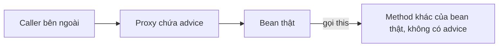
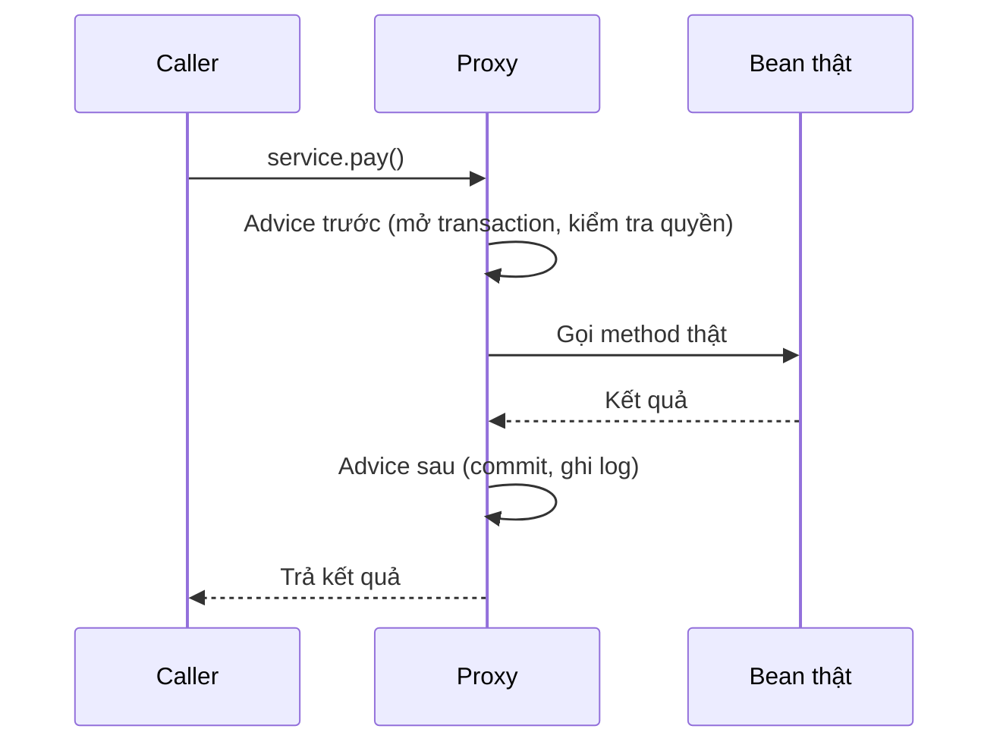
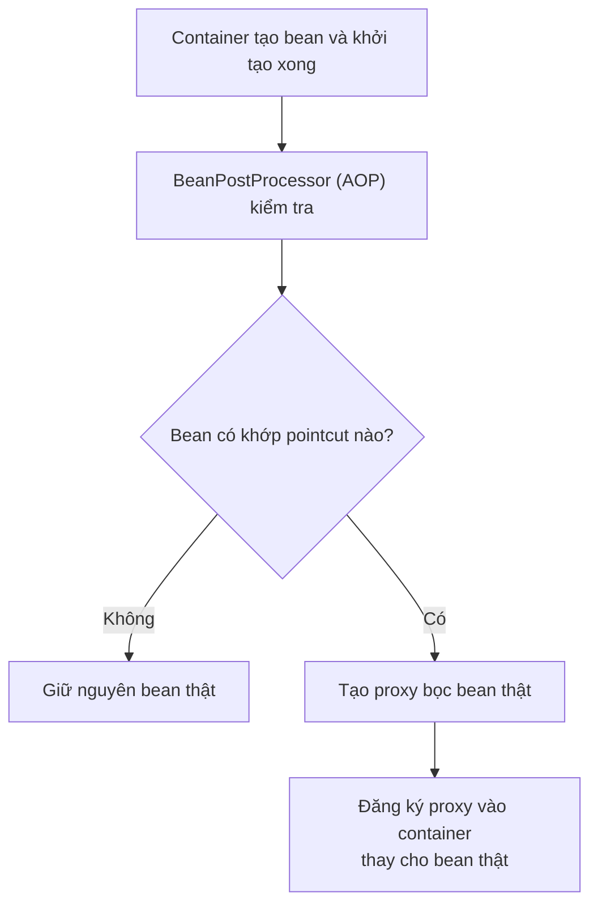
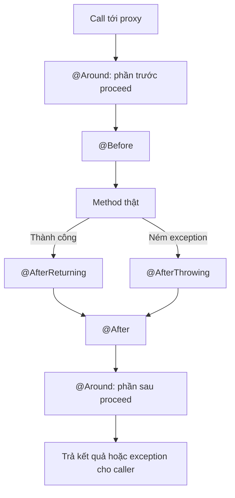

# Lý thuyết 13: AOP và Proxy

## AOP là gì?

AOP (Aspect-Oriented Programming) cho phép bạn viết những việc dùng chung như transaction, ghi log, kiểm tra quyền, cache ở **một chỗ**, rồi gắn vào nhiều method mà không sửa code của chúng. Hình dung một tòa nhà: mỗi phòng làm việc riêng (nghiệp vụ), còn bảo vệ ở cổng kiểm tra thẻ cho mọi người ra vào (aspect dùng chung). Bạn không phải đặt một bảo vệ trong từng phòng.

Spring hiện thực AOP bằng **proxy**: một object bọc quanh bean thật, chạy thêm logic trước và sau khi gọi method thật. Người gọi tưởng đang nói chuyện với bean, thực ra là nói chuyện với proxy.

**Cốt lõi:** Việc dùng chung như transaction, log, quyền không nên lặp trong từng method, nên Spring đặt chúng vào một proxy bọc ngoài bean thật. Proxy được tạo lúc chạy khi `BeanPostProcessor` thay bean bằng proxy, nên chỉ call đi qua proxy mới được chèn logic.

- Vì advice nằm trong proxy chứ không trong class thật nên `this.method()` đi thẳng vào object thật và mất advice.
- Vì proxy phải trông giống bean (subclass hoặc cùng interface) nên method `private`, `final` và class `final` không bọc được.
- Vì nhiều advice lồng quanh một call nên thứ tự do `@Order` quyết định, số nhỏ nằm ngoài cùng.



Mô hình tư duy: advice chỉ nằm trên đường đi vào qua proxy, còn call nội bộ trong bean thật thì không đi qua nó.

**Tóm tắt:**

- AOP gom logic dùng chung (transaction, log, security, cache) vào một chỗ rồi gắn vào nhiều method mà không sửa code của chúng.
- Spring AOP làm bằng proxy tạo lúc chạy: `BeanPostProcessor` thay bean thật bằng proxy, nên thứ bạn `@Autowired` là proxy.
- Có hai loại proxy: JDK dynamic proxy (cùng interface) và CGLIB (subclass); Spring Boot mặc định dùng CGLIB.
- Bốn thuật ngữ cốt lõi: aspect (module chứa logic), pointcut (chọn method), advice (code chạy và chạy khi nào), join point (điểm chèn, luôn là call method của bean).
- Có năm loại advice; `@Around` mạnh nhất nhưng phải tự gọi `proceed()`, quên thì method thật không chạy.
- Chỉ call đi qua proxy mới có advice: self-invocation, method `private` hoặc `final`, class `final` đều làm advice mất tác dụng.
- Nhiều aspect thì dùng `@Order` (số nhỏ chạy ngoài cùng); thiếu `spring-boot-starter-aop` thì aspect không chạy mà không báo lỗi.

## Vấn đề nó giải quyết

Không có AOP, mọi method nghiệp vụ đều phải lặp đoạn `try/catch/commit/rollback` hoặc code log, và logic nghiệp vụ bị chôn giữa những dòng kỹ thuật đó. Muốn đổi cách ghi log phải sửa khắp nơi, quên một chỗ là có lỗ hổng. AOP gom phần lặp lại vào một nơi và để nghiệp vụ sạch.

## Khi nào dùng, khi nào không

Dùng khi cùng một hành vi áp cho nhiều method: đo thời gian, audit, kiểm tra quyền, retry, cache. Nếu chỉ cần cho một chỗ thì cứ viết thẳng trong code, đừng dựng aspect. Phần lớn thời gian bạn không tự viết aspect mà dùng sẵn các annotation chạy trên AOP như `@Transactional`, `@Cacheable`, `@Async`, `@PreAuthorize`; việc cần nhớ là chúng đều có chung giới hạn của proxy (self-invocation, method `private`/`final`).

## Các khái niệm cần biết

- **Cross-cutting concern**: việc xuất hiện ở nhiều tầng, nhiều class nhưng không thuộc nghiệp vụ nào, như log, bảo mật, transaction.
- **Aspect**: một module gói toàn bộ logic dùng chung (một class có `@Aspect`).
- **Join point**: điểm trong chương trình có thể chèn logic. Trong Spring AOP, join point luôn là một call method của bean.
- **Pointcut**: biểu thức chọn ra những join point cần can thiệp, ví dụ "mọi method có `@Timed`".
- **Advice**: đoạn code chạy tại pointcut, và nó chạy khi nào (`@Before`, `@After`, `@Around`...).
- **Weaving**: việc gắn aspect vào code đích. Spring làm lúc chạy bằng proxy; AspectJ đầy đủ có thể weave lúc compile hoặc lúc load class, mạnh hơn nhưng phức tạp hơn.
- **`BeanPostProcessor`**: hook của Spring chạy với mỗi bean sau khi khởi tạo. Proxy AOP được tạo ở đây: processor thấy bean khớp pointcut thì trả về proxy thay cho bean thật.
- **Self-invocation**: gọi method trong cùng một object bằng `this`, bỏ qua proxy.

## Cơ chế: gọi qua proxy

Vấn đề đặt ra là làm sao chèn logic mà người gọi không biết. Spring thay bean thật bằng proxy trong container, nên mọi call từ bên ngoài đều đi qua proxy trước:



Proxy được tạo ở bước *after initialization* của `BeanPostProcessor` (xem [Bean lifecycle](/go?p=01-Spring-Boot%2Feasy%2Flt-10-bean-lifecycle.md)). Caller giữ reference tới proxy, không phải bean thật. Quá trình tạo proxy lúc khởi động:



Hệ quả: khi `@Autowired` một service có `@Transactional`, thứ bạn nhận được là proxy. Bean không khớp pointcut nào thì không có proxy và không có chi phí gì thêm.

**Nền tảng:** Spring AOP là proxy tạo lúc chạy, không sửa bytecode của class bạn. `BeanPostProcessor` ở bước after-init thay bean thật bằng proxy; chỉ call đi qua proxy mới được chèn advice. Mọi giới hạn (self-invocation, `private`, `final`, thread khác) đều suy ra từ đây.

## Hai loại proxy

Spring cần một object "trông giống" bean thật. Có hai cách tạo: dựa vào interface hoặc extend class.

| | JDK dynamic proxy | CGLIB |
|---|---|---|
| Cách làm | Cài đặt cùng interface | Tạo subclass của class |
| Yêu cầu | Bean có interface | Class không `final`, method không `final` |
| Mặc định trong Spring Boot | Không | **Có** (`proxyTargetClass=true`) |

CGLIB là mặc định nên bạn thường không cần quan tâm bean có interface hay không. Nó chỉ là vấn đề khi class bị `final` (không thể extend, Spring báo lỗi lúc khởi động) hoặc khi method `final`/`private` (proxy không override được, nên advice bị bỏ qua âm thầm).

**Phải thuộc:** JDK dynamic proxy cài cùng interface; CGLIB tạo subclass của class (không proxy được class/method `final`). Spring Boot mặc định dùng CGLIB (`spring.aop.proxy-target-class=true`), còn Spring Framework thuần mặc định JDK proxy nếu bean có interface.

**Suy luận:** Spring AOP chọn proxy tạo lúc chạy thay vì sửa bytecode vì mục tiêu là gắn hành vi vào bean mà không đổi class của bạn và không cần compiler đặc biệt. Để một object "trông giống" bean thật mà vẫn chèn được logic, proxy phải là subclass (CGLIB) hoặc cài cùng interface (JDK proxy), nên người gọi cứ tưởng đang nói chuyện với bean. Từ đó suy ra giới hạn: chỉ call đi qua proxy mới được chèn advice, vì advice nằm trong proxy chứ không nằm trong class thật. Thứ nhất, `this.method()` đi thẳng vào object thật nên mất advice. Thứ hai, method `private` hoặc `final` không override được trong subclass nên proxy không chặn được. Thứ ba, class `final` không extend được nên không tạo được proxy CGLIB, và lỗi này lộ ngay lúc khởi động, khác với hai trường hợp trên là âm thầm. Điểm dễ nhầm là thấy app chạy và test pass nên tưởng aspect đang hoạt động, trong khi nó chỉ chạy với call từ bên ngoài. Hệ quả khi review: đặt hành vi cần proxy trên method public của một bean riêng, và kiểm tra bằng `AopUtils.isAopProxy` hoặc bằng tác dụng thật thay vì tin vào annotation.

## Viết một aspect

Ví dụ sau đo thời gian chạy của bất kỳ method nào gắn `@Timed`. `@Around` bao quanh call: `pjp.proceed()` là lúc method thật chạy, nên bạn đặt đồng hồ trước và sau nó. `finally` đảm bảo vẫn ghi log khi method ném lỗi.

```java
@Aspect
@Component
public class TimingAspect {
    private static final Logger log = LoggerFactory.getLogger(TimingAspect.class);

    @Around("@annotation(Timed)")
    public Object measure(ProceedingJoinPoint pjp) throws Throwable {
        long start = System.nanoTime();
        try {
            return pjp.proceed();
        } finally {
            long ms = (System.nanoTime() - start) / 1_000_000;
            log.info("{} mất {} ms", pjp.getSignature().toShortString(), ms);
        }
    }
}
```

Cần `spring-boot-starter-aop`. Nếu thiếu starter này, `@Aspect` vẫn biên dịch được nhưng không được kích hoạt, nên aspect "không chạy mà không báo lỗi". Các thuật ngữ pointcut, advice, join point, aspect đã giải thích ở đầu bài.

### Annotation đi kèm và cách dùng

Aspect trên dùng `@Timed` nhưng chưa định nghĩa. Bản đầy đủ chạy được:

```java
@Retention(RetentionPolicy.RUNTIME)
@Target(ElementType.METHOD)
public @interface Timed {}

// Pointcut dạng "binding": lấy luôn annotation vào tham số nếu cần đọc thuộc tính
// @Around("@annotation(timed)") public Object measure(ProceedingJoinPoint pjp, Timed timed)

@Service
public class ReportService {
    @Timed
    public String build() { return "report"; }
}
```

### Các loại advice và biểu thức pointcut

| Advice | Chạy khi | Ghi chú |
|---|---|---|
| `@Before` | Trước method | Không chặn được call trừ khi ném exception |
| `@AfterReturning` | Method trả bình thường | Nhận được giá trị trả về (`returning`) |
| `@AfterThrowing` | Method ném exception | Không nuốt được exception |
| `@After` | Luôn sau method (như `finally`) | |
| `@Around` | Bao quanh | Mạnh nhất: tự gọi `proceed()`, đổi tham số, đổi kết quả |

| Biểu thức | Nghĩa |
|---|---|
| `execution(* com.example.service..*.*(..))` | Mọi method của mọi class trong package service và con |
| `within(com.example.service.*)` | Mọi method của class trong package |
| `@annotation(com.example.Timed)` | Method có annotation |
| `@within(org.springframework.stereotype.Service)` | Mọi method của class có `@Service` |
| `bean(*Service)` | Theo tên bean (đặc thù Spring) |

Dùng `@Around` khi cần kiểm soát `proceed()` (ví dụ retry, cache, đo thời gian); còn lại ưu tiên advice hẹp nhất cho đủ việc, vì `@Around` quên gọi `proceed()` thì method thật không bao giờ chạy. Một call đi qua các advice theo thứ tự:



Thứ tự này theo tài liệu Spring từ 5.2.7 trở đi cho các advice cùng aspect; bạn không nên viết code phụ thuộc quá chặt vào chi tiết này.

**Phải thuộc:** năm loại advice: `@Before`, `@AfterReturning`, `@AfterThrowing`, `@After` (như `finally`), `@Around` (mạnh nhất, phải tự gọi `proceed()`). Nhiều aspect thì `@Order` số nhỏ chạy ngoài cùng.

## Thấy proxy bằng mắt

```java
@SpringBootTest
class ProxyTest {
    @Autowired ReportService service;

    @Test
    void beanIsProxy() {
        assertTrue(AopUtils.isAopProxy(service));
        assertTrue(AopUtils.isCglibProxy(service));
        System.out.println(service.getClass());   // ReportService$$SpringCGLIB$$0
    }
}
```

Proxy CGLIB là một subclass, còn trạng thái nằm ở **object thật** mà nó bọc. Đọc trực tiếp field của một bean từ bên ngoài (`service.name`) sẽ đọc field của proxy (thường là null), nên luôn truy cập qua method.

## Self-invocation: trước và sau

Đây là bẫy gặp nhiều nhất. Proxy chỉ chặn được call đi **qua nó**. Khi `buildTwice` gọi `build()`, call diễn ra bên trong bean thật bằng `this`, không còn qua proxy, nên `@Timed` không chạy. Hiện tượng: code vẫn chạy đúng nhưng không có log, không có transaction, không có cache, và không có thông báo lỗi nào.

```java
@Service
class ReportService {
    @Timed
    public String build() { return "x"; }

    public String buildTwice() {
        return build() + build();   // this.build(): KHÔNG qua proxy, @Timed không chạy
    }
}
```

Sửa bằng cách tách `build()` sang bean khác và inject vào. Cách "tự inject chính mình" (`@Lazy ReportService self`) chạy được nhưng che giấu thiết kế sai. Với `@Transactional` xem ví dụ ở [Transaction](/go?p=01-Spring-Boot%2Fmedium%2Flt-05-transaction.md); với `@Async` xem [Scheduling và Async](/go?p=01-Spring-Boot%2Fmedium%2Flt-18-scheduling-async.md).

## Thứ tự nhiều aspect

Khi hai aspect cùng áp lên một method, thứ tự quan trọng: kiểm tra quyền phải chạy trước khi đo thời gian, và cache thường nên nằm ngoài transaction. `@Order` quyết định: số nhỏ ưu tiên cao hơn, tức nằm bao ngoài.

```java
@Aspect @Component @Order(1)   // số nhỏ chạy ngoài cùng
class SecurityAspect { /* ... */ }

@Aspect @Component @Order(2)
class TimingAspect { /* ... */ }
```

Chuỗi gọi: `Security(before) -> Timing(before) -> method -> Timing(after) -> Security(after)`. `@Transactional` mặc định có thứ tự thấp nhất (chạy trong cùng); đặt `@EnableTransactionManagement(order = ...)` nếu cần cache hoặc retry nằm ngoài hay trong transaction.

## Bẫy kinh điển

| Bẫy | Nguyên nhân | Cách xử lý |
|---|---|---|
| **Self-invocation**: `this.other()` không có transaction/cache | Gọi nội bộ không đi qua proxy | Tách sang bean khác, hoặc tự inject chính mình (hạn chế) |
| Method `private`/`final` không được bọc | Proxy không override được | Dùng `public`, không `final` |
| Aspect không chạy | Class không phải bean, hoặc pointcut sai | Kiểm tra bean do Spring quản lý |
| Thứ tự advice sai (ví dụ cache trước transaction) | Nhiều aspect cùng áp | Đặt `@Order` |
| Exception bị nuốt | `finally`/`catch` trong advice | Ném lại exception |

## Khi nào dùng, khi nào không

- Dùng cho hành vi **ngang** áp lên nhiều nơi. Đừng dùng để giấu nghiệp vụ chính: người đọc code sẽ không thấy nó chạy.
- Aspect có chi phí nhỏ mỗi lần gọi; đừng áp vào vòng lặp nóng.

## Phỏng vấn khó: chuỗi hỏi xoáy

Người phỏng vấn senior thường mở bằng một câu dễ, rồi xoáy xuống cơ chế, đánh đổi và sự cố thật. Câu trả lời tốt luôn đi từ cốt lõi xuống, không nhảy thẳng vào chi tiết.

### Chuỗi 1: Proxy là gì, JDK hay CGLIB

1. **Câu mở:** Bạn `@Autowired` một service có `@Transactional`. Object nhận được là gì?
2. **Xoáy 1:** JDK dynamic proxy và CGLIB khác nhau ra sao, Boot mặc định dùng cái nào, và `final` gây lỗi thế nào?
3. **Xoáy 2:** Vì sao đọc trực tiếp field của bean (`service.name`) có thể ra null?

**Đáp án ngắn:** Nhận được proxy. `BeanPostProcessor` ở bước after-init thấy bean khớp pointcut thì trả proxy thay cho bean thật, nên caller giữ proxy và chỉ call đi qua nó mới được chèn advice. JDK proxy cài cùng interface, CGLIB tạo subclass của class. Spring Boot mặc định CGLIB (`proxyTargetClass=true`), còn Spring Framework thuần dùng JDK proxy nếu bean có interface. Class `final` không extend được nên lỗi ngay lúc khởi động; method `final` hoặc `private` không override được nên advice bị bỏ qua âm thầm. Proxy CGLIB là một subclass, trạng thái nằm ở object thật mà nó bọc, nên đọc field từ bên ngoài là đọc field của proxy, thường là null; luôn truy cập qua method. Kiểm tra bằng `AopUtils.isAopProxy`, hoặc xem `getClass()` có dạng `$$SpringCGLIB$$`. Bean không khớp pointcut nào thì không có proxy và không tốn thêm gì.

**Sai lầm hay gặp:**
- Nói "Spring sửa bytecode class của mình".
- Không phân biệt lỗi lúc khởi động (class `final`) với lỗi âm thầm (method `final`).
- Thấy app chạy và test xanh nên tin aspect đang hoạt động.

### Chuỗi 2: Thứ tự advice và `@Around`

1. **Câu mở:** Hai aspect, kiểm tra quyền và đo thời gian, cùng áp lên một method. Cái nào chạy trước, và bạn điều khiển thế nào?
2. **Xoáy 1:** `@Transactional` đứng ở đâu trong thứ tự đó, và vì sao cache hay retry cần để ý?
3. **Xoáy 2:** `@Around` nguy hiểm hơn các advice khác ở chỗ nào, và vì sao aspect của bạn có thể không chạy mà không báo lỗi?

**Đáp án ngắn:** Dùng `@Order`: số nhỏ ưu tiên cao hơn, nằm bao ngoài. Chuỗi là Security (before), Timing (before), method, Timing (after), Security (after), và kiểm tra quyền nên nằm ngoài đo thời gian. `@Transactional` mặc định có thứ tự thấp nhất, tức chạy trong cùng; cache hay retry nằm trong hay ngoài transaction cho hành vi khác nhau, nên cần chủ động chỉnh `@EnableTransactionManagement(order = ...)`. `@Around` mạnh nhất vì tự gọi `proceed()`, đổi được tham số và kết quả; quên `proceed()` thì method thật không bao giờ chạy, và `catch` nuốt exception làm caller không thấy lỗi. Nên chọn advice hẹp nhất đủ việc. Aspect không chạy mà không báo lỗi thường vì thiếu `spring-boot-starter-aop`, class không phải bean do Spring quản lý, hoặc pointcut sai. Kiểm chứng bằng test tác dụng thật của aspect chứ không tin vào annotation.

**Sai lầm hay gặp:**
- Nói số lớn chạy ngoài cùng.
- Dùng `@Around` cho việc `@Before` làm được.
- Giấu nghiệp vụ chính trong aspect khiến người đọc không thấy nó chạy.

