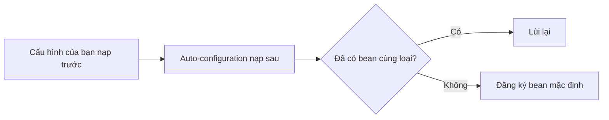
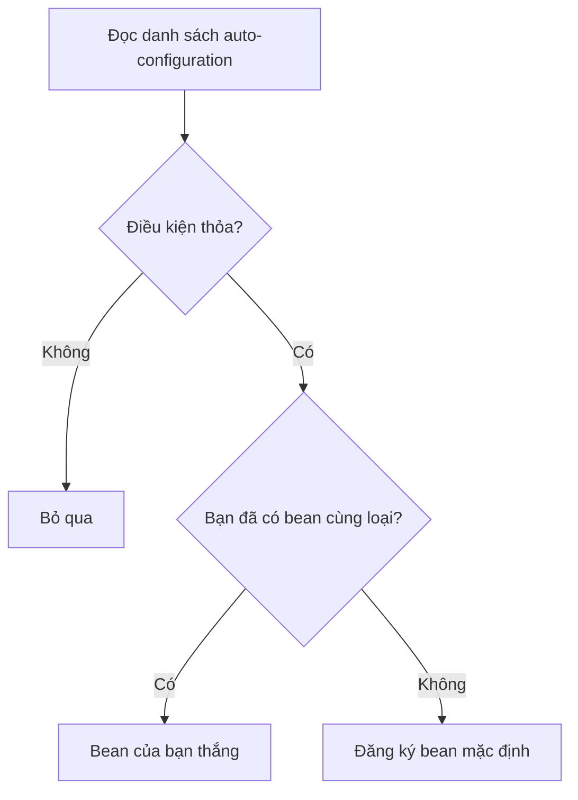
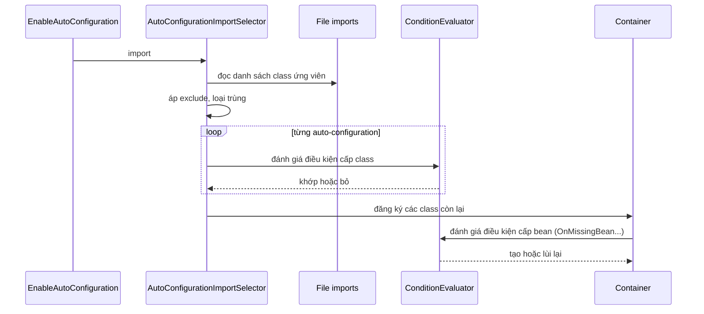

# Lý thuyết 14: Auto-configuration và @Conditional

## Auto-configuration là gì?

Khi bạn thêm `spring-boot-starter-web` vào dự án, tự nhiên có sẵn Tomcat, `DispatcherServlet`, Jackson mà bạn không khai báo dòng nào. Đó là **auto-configuration**: Spring Boot tự tạo bean dựa vào ba thứ: thư viện nào đang có trong classpath, cấu hình (property) ra sao, và bạn đã tự khai báo bean đó chưa. Ví dụ classpath có driver H2 và JPA thì Boot tự dựng `DataSource` nối tới H2 in-memory.

**Cốt lõi:** Boot không biết trước bạn sẽ khai báo bean nào, nên auto-configuration là các class `@Configuration` có điều kiện và được nạp sau cấu hình của bạn. Nhờ nạp sau, điều kiện thấy được bean của bạn và bản mặc định tự lùi lại.

- Vì auto-configuration nạp sau cấu hình của user nên `@ConditionalOnMissingBean` mới thấy bean của bạn và back off.
- Vì điều kiện cấp class được đánh giá trước nên thư viện tùy chọn vắng mặt không gây `ClassNotFoundException`.
- Vì Boot không có phép màu nào ngoài danh sách ứng viên cộng điều kiện nên khi bean không như ý, hãy đọc condition evaluation report bằng `--debug` thay vì đoán.



Mô hình tư duy: thứ tự nạp là điều khiến bean của bạn luôn thắng bản mặc định.

**Tóm tắt:**

- Auto-configuration tạo bean theo điều kiện: classpath có gì, property ra sao, và bạn đã tự khai báo bean đó chưa.
- Nó chỉ là các class `@Configuration` có điều kiện, nạp sau cấu hình của user, nên `@ConditionalOnMissingBean` mới thấy bean của bạn và back off.
- Ba điều kiện then chốt: `@ConditionalOnClass`, `@ConditionalOnMissingBean`, `@ConditionalOnProperty`; hạn chế `@ConditionalOnBean` vì phụ thuộc thứ tự.
- Từ Boot 2.7/3.0, danh sách đăng ký trong `META-INF/spring/...AutoConfiguration.imports`; quên file này là lý do hay gặp nhất của "starter không chạy".
- Auto-configuration phải nằm ngoài vùng `@ComponentScan`, nếu không nó bị quét như config thường và mất thứ tự nạp.
- Debug bằng `--debug` hoặc `/actuator/conditions` để đọc condition evaluation report; tắt một cái bằng `exclude` hoặc `spring.autoconfigure.exclude`.
- Test điều kiện bằng `ApplicationContextRunner` thay vì dựng cả ứng dụng.

## Vấn đề nó giải quyết

Không có nó, mỗi lần thêm một thư viện bạn phải viết cả đống bean cấu hình (`DataSource`, `EntityManagerFactory`, `TransactionManager`...). Phần này lặp lại ở mọi dự án và dễ sai. Điều tinh tế là auto-configuration chạy **theo điều kiện**: bạn tự khai báo bean của mình thì bean mặc định tự lùi lại (back off), không đè lên bạn. Đó là nguyên tắc "mặc định thông minh, override dễ".

## Khi nào cần hiểu sâu

Khi cần trả lời "vì sao bean này tự có mặt?" hoặc "vì sao cấu hình của mình không ăn?". Cũng cần khi bạn viết starter hoặc thư viện dùng chung cho nhiều dự án. Nếu chỉ dùng Boot ở mức ứng dụng, bạn hiếm khi tự viết auto-configuration, nhưng vẫn cần biết cách đọc báo cáo điều kiện để debug.

Cách làm, tóm gọn: viết class `@AutoConfiguration`, đăng ký trong `META-INF/spring/org.springframework.boot.autoconfigure.AutoConfiguration.imports`, thêm điều kiện bằng các `@Conditional...`. Muốn biết điều kiện nào đúng hay sai thì chạy với `--debug`.

## Các khái niệm cần biết

- **Classpath**: tập hợp thư viện và class mà JVM thấy lúc chạy. Auto-configuration "ngửi" classpath: có class nào đó nghĩa là bạn đã thêm thư viện tương ứng.
- **`@Conditional`**: annotation gốc cho phép một cấu hình hoặc một `@Bean` chỉ được đăng ký khi một điều kiện đúng. Các `@ConditionalOnXxx` là phiên bản dựng sẵn.
- **Back off**: khi `@ConditionalOnMissingBean` thấy đã có bean cùng kiểu thì bỏ qua bản mặc định, nhường cho bean của bạn.
- **Starter**: một dependency "gom gói" kéo theo các thư viện cần thiết (ví dụ `spring-boot-starter-data-jpa`). Starter tự nó thường không có code; auto-configuration mới là thứ làm việc.
- **`@ConfigurationProperties`**: gắn các property có chung prefix (ví dụ `audit.endpoint`) vào một class có kiểu, thay cho `@Value` rời rạc.
- **Condition evaluation report**: bản liệt kê auto-configuration nào được bật (positive matches), bị tắt (negative matches) và vì sao.

## Flow quyết định

Với mỗi auto-configuration trong danh sách, Boot hỏi hai tầng câu hỏi: điều kiện chung có thỏa không, rồi từng bean đã có người khai báo chưa.



**Nền tảng:** auto-configuration chỉ là các class `@Configuration` thông thường nhưng có điều kiện (`@Conditional...`), được nạp SAU cấu hình của người dùng. Nhờ thứ tự đó, `@ConditionalOnMissingBean` mới nhìn thấy bean của bạn và lùi lại. Boot không có phép màu nào khác ngoài danh sách class ứng viên cộng điều kiện.

**Suy luận:** Boot phải tự dựng bean mà không biết trước bạn sẽ khai báo gì, nên auto-configuration được thiết kế là các `@Configuration` có điều kiện và được nạp sau cấu hình của người dùng. Vì nạp sau, lúc `@ConditionalOnMissingBean` được đánh giá thì bean của bạn đã nằm trong container, nên bản mặc định lùi lại thay vì đè lên. Từ đó suy ra hai quy tắc: mọi `@Bean` mặc định nên có `@ConditionalOnMissingBean` để ai cũng override được, và auto-configuration phải nằm ngoài vùng `@ComponentScan` để không bị quét như config thường rồi mất thứ tự nạp. Điều kiện cấp class như `@ConditionalOnClass` được đánh giá trước, nên thư viện tùy chọn vắng mặt không gây `ClassNotFoundException`. `@ConditionalOnBean` thì ngược lại: nó chỉ thấy các bean đã đăng ký tại thời điểm đó nên phụ thuộc thứ tự, và cho kết quả sai nếu cấu hình kia chưa được xử lý. Điểm dễ nhầm lớn nhất là override một bean như `ObjectMapper`: bean của bạn thay hoàn toàn bản mặc định nên các property `spring.jackson.*` ngừng có tác dụng. Hệ quả khi gỡ rối: chạy `--debug` để đọc condition evaluation report thay vì đoán, và ưu tiên customizer thay vì thay cả bean.

## Các điều kiện thường dùng

| Annotation | Bật khi |
|---|---|
| `@ConditionalOnClass` | Class có trong classpath |
| `@ConditionalOnMissingBean` | **Chưa có** bean cùng loại, nên bạn override được |
| `@ConditionalOnProperty` | Property có giá trị mong đợi |
| `@ConditionalOnWebApplication` | Là ứng dụng web |
| `@ConditionalOnBean` | Đã có bean khác |

Dùng `@ConditionalOnClass` để cấu hình chỉ bật khi thư viện có mặt (tránh `ClassNotFoundException` khi thư viện tùy chọn vắng). Dùng `@ConditionalOnMissingBean` cho mọi `@Bean` mặc định để người dùng override được. Dùng `@ConditionalOnProperty` làm công tắc bật tắt. Hạn chế `@ConditionalOnBean` vì nó phụ thuộc thứ tự xử lý (xem phần bẫy).

**Phải thuộc:** từ Boot 2.7/3.0, danh sách auto-configuration nằm trong file `META-INF/spring/org.springframework.boot.autoconfigure.AutoConfiguration.imports` (mỗi dòng một class, class gắn `@AutoConfiguration`). Các điều kiện then chốt: `@ConditionalOnClass`, `@ConditionalOnMissingBean`, `@ConditionalOnProperty`. Xem báo cáo điều kiện bằng `--debug` hoặc `/actuator/conditions`; loại trừ bằng `exclude` hoặc `spring.autoconfigure.exclude`.

## Ví dụ: tự viết auto-configuration

Giả sử bạn làm thư viện `audit` cho nhiều dự án. Cấu hình dưới nói: "nếu `AuditClient` có trong classpath, và người dùng chưa tự tạo, và property `audit.enabled` không bị tắt, thì tạo `AuditClient` từ `audit.endpoint`".

```java
@AutoConfiguration
@ConditionalOnClass(AuditClient.class)
@EnableConfigurationProperties(AuditProperties.class)
public class AuditAutoConfiguration {

    @Bean
    @ConditionalOnMissingBean
    @ConditionalOnProperty(prefix = "audit", name = "enabled", havingValue = "true", matchIfMissing = true)
    public AuditClient auditClient(AuditProperties props) {
        return new AuditClient(props.endpoint());
    }
}
```

Class này chưa được Boot biết tới cho đến khi bạn liệt kê nó trong tệp `META-INF/spring/org.springframework.boot.autoconfigure.AutoConfiguration.imports` (mỗi dòng một tên class đầy đủ). Quên bước này là lý do thường gặp nhất của "starter của tôi không chạy". (Phiên bản: file `.imports` có từ Boot 2.7; từ Boot 3.0 cơ chế cũ đăng ký auto-configuration qua `spring.factories` với khóa `EnableAutoConfiguration` không còn được hỗ trợ.)

```text
com.example.audit.AuditAutoConfiguration
```

## Sơ đồ: từ `@SpringBootApplication` tới bean mặc định

`@SpringBootApplication` đã bao gồm `@EnableAutoConfiguration`. Annotation này kích hoạt một selector đọc danh sách ứng viên và lọc theo điều kiện:



Hai tầng điều kiện: cấp **class** (`@ConditionalOnClass`) loại cả cấu hình, cấp **bean** (`@ConditionalOnMissingBean`) loại từng `@Bean`. Danh sách đọc từ mọi file `AutoConfiguration.imports` trên classpath, nên thư viện của bạn chỉ cần thêm một file là xong. Cơ chế dựng context ở [lt-30](/go?p=01-Spring-Boot%2Fhard%2Flt-30-spring-khoi-dong-application-context.md).

## Ví dụ hoàn chỉnh: auto-configuration hoạt động như thế nào

Ba mảnh ghép: class thư viện thuần Java, class cấu hình có kiểu, và (ở người dùng) property cùng bean tùy chọn. Chú ý bước 3: chỉ cần khai báo một bean cùng kiểu, bản mặc định sẽ lùi lại.

```java
// 1. Class thư viện, không phụ thuộc Spring
public class AuditClient {
    private final String endpoint;
    public AuditClient(String endpoint) { this.endpoint = endpoint; }
    public void send(String event) { /* gọi endpoint */ }
}

// 2. Cấu hình có kiểu
@ConfigurationProperties(prefix = "audit")
public record AuditProperties(String endpoint, boolean enabled) {}
```

```yaml
# ứng dụng dùng: chỉ cần thêm dependency và khai báo property
audit:
  endpoint: https://audit.example.com
```

```java
// 3. Người dùng tự khai báo bean cùng kiểu thì bản mặc định lùi lại
@Configuration
class MyAuditConfig {
    @Bean
    AuditClient customAuditClient() { return new AuditClient("https://custom.example.com"); }
}
```

## Kiểm thử auto-configuration

Bạn không cần dựng cả ứng dụng để thử điều kiện. `ApplicationContextRunner` cho phép dựng một context nhỏ với đúng cấu hình bạn chọn, truyền property giả, rồi kiểm tra bean có được tạo hay không. Ba test dưới đây kiểm tra ba nhánh: tạo mặc định, lùi lại, và bị tắt bằng property.

```java
class AuditAutoConfigurationTest {
    private final ApplicationContextRunner runner = new ApplicationContextRunner()
            .withConfiguration(AutoConfigurations.of(AuditAutoConfiguration.class));

    @Test
    void createsClientByDefault() {
        runner.withPropertyValues("audit.endpoint=http://x")
              .run(ctx -> assertThat(ctx).hasSingleBean(AuditClient.class));
    }

    @Test
    void backsOffWhenUserDefinesBean() {
        runner.withUserConfiguration(MyAuditConfig.class)
              .withPropertyValues("audit.endpoint=http://x")
              .run(ctx -> assertThat(ctx.getBeanNamesForType(AuditClient.class))
                      // bản mặc định không được tạo
                      .containsExactly("customAuditClient"));
    }

    @Test
    void disabledByProperty() {
        runner.withPropertyValues("audit.enabled=false")
              .run(ctx -> assertThat(ctx).doesNotHaveBean(AuditClient.class));
    }
}
```

`ApplicationContextRunner` (gói `org.springframework.boot.test.context.runner`) dựng context nhẹ, rất nhanh, là công cụ chuẩn để test điều kiện. Method `assertThat(ctx)` là của AssertJ (`ApplicationContextAssert`) có sẵn trong `spring-boot-starter-test`.

## Bẫy hay gặp

| Bẫy | Giải thích |
|---|---|
| `@ConditionalOnBean` trong auto-configuration chạy sai | Phụ thuộc thứ tự xử lý; thêm `@AutoConfiguration(after = ...)` |
| Đặt auto-configuration trong package được `@ComponentScan` | Nó bị quét như cấu hình thường, mất thứ tự và cơ chế lùi lại. Phải để ngoài vùng quét và đăng ký bằng file imports |
| Muốn tắt một auto-configuration mà không sửa code | Đặt `spring.autoconfigure.exclude` trong cấu hình |
| Override cả `ObjectMapper` làm mất `spring.jackson.*` | Bean tự khai báo thay thế hoàn toàn bản mặc định; dùng `Jackson2ObjectMapperBuilderCustomizer` (Boot 3; Boot 4 dùng Jackson 3 nên tên customizer và package đổi theo, xem [bài 38](/go?p=01-Spring-Boot%2Fhard%2Flt-38-boot4-framework7-thay-doi.md)) |

## Cách debug

Khi một bean không xuất hiện hoặc lại là bản không mong muốn, đừng đoán mà hãy hỏi Boot:

- Chạy với `--debug` hoặc `debug=true`: in condition evaluation report (positive/negative matches).
- Endpoint `/actuator/conditions` xem điều kiện khi đang chạy.
- Loại bỏ một auto-configuration: `@SpringBootApplication(exclude = DataSourceAutoConfiguration.class)`.

## Tư duy thiết kế

- Quy ước: **mặc định thông minh, override dễ**. Mọi `@Bean` trong auto-configuration nên có `@ConditionalOnMissingBean`.
- Tách module `xxx-spring-boot-autoconfigure` (logic) và `xxx-spring-boot-starter` (chỉ gom dependency).
- Auto-configuration nạp **sau** bean của người dùng, nên điều kiện `OnMissingBean` mới đúng.

## Phỏng vấn khó: chuỗi hỏi xoáy

Người phỏng vấn senior thường mở bằng một câu dễ, rồi xoáy xuống cơ chế, đánh đổi và sự cố thật. Câu trả lời tốt luôn đi từ cốt lõi xuống, không nhảy thẳng vào chi tiết.

### Chuỗi 1: Vì sao bean của bạn thắng bản mặc định

1. **Câu mở:** Bạn khai báo một bean `AuditClient` và bản mặc định của starter biến mất. Cơ chế nào làm vậy?
2. **Xoáy 1:** Vì sao thứ tự nạp quyết định điều này, và vì sao auto-configuration phải nằm ngoài vùng `@ComponentScan`?
3. **Xoáy 2:** `@ConditionalOnBean` dùng trong auto-configuration cho kết quả sai. Vì sao?

**Đáp án ngắn:** Auto-configuration chỉ là các `@Configuration` có điều kiện, được nạp sau cấu hình của người dùng. Khi `@ConditionalOnMissingBean` được đánh giá thì bean của bạn đã nằm trong container, nên bản mặc định lùi lại (back off). Nếu auto-configuration nằm trong package bị `@ComponentScan` quét thì nó bị coi như config thường, mất thứ tự nạp và cơ chế lùi lại; vì vậy phải để ngoài vùng quét và đăng ký bằng file imports. `@ConditionalOnBean` chỉ thấy những bean đã đăng ký tại thời điểm đó nên phụ thuộc thứ tự, và sai khi cấu hình kia chưa được xử lý; sửa bằng `@AutoConfiguration(after = ...)`. Điều kiện cấp class như `@ConditionalOnClass` được đánh giá trước, nên thư viện tùy chọn vắng mặt không gây `ClassNotFoundException`. Quy ước thiết kế: mọi `@Bean` mặc định nên có `@ConditionalOnMissingBean` để người dùng override dễ.

**Sai lầm hay gặp:**
- Nói "Boot có phép màu" mà không nêu được thứ tự nạp.
- Dùng `@ConditionalOnBean` rồi không biết vì sao nó chập chờn.
- Để auto-configuration trong package được `@ComponentScan` quét.

### Chuỗi 2: "Starter của tôi không chạy"

1. **Câu mở:** Bạn viết một starter, thêm dependency vào ứng dụng nhưng bean không xuất hiện. Kiểm tra gì trước?
2. **Xoáy 1:** Boot 3 đăng ký danh sách auto-configuration ở đâu, và `spring.factories` còn dùng được cho việc này không?
3. **Xoáy 2:** Bạn khai báo `ObjectMapper` riêng và `spring.jackson.*` không còn tác dụng. Giải thích, và kiểm thử điều kiện thế nào?

**Đáp án ngắn:** Kiểm tra file `META-INF/spring/org.springframework.boot.autoconfigure.AutoConfiguration.imports`, mỗi dòng một tên class đầy đủ, class gắn `@AutoConfiguration`. Quên file này là lý do hay gặp nhất. File `.imports` có từ Boot 2.7; từ Boot 3.0 cách cũ qua `spring.factories` với khóa `EnableAutoConfiguration` không còn được hỗ trợ. Sau đó đọc condition evaluation report bằng `--debug` hoặc `/actuator/conditions`, xem positive và negative matches cùng lý do. `ObjectMapper` tự khai báo thay hoàn toàn bản mặc định nên các property `spring.jackson.*` ngừng tác dụng; ưu tiên customizer thay vì thay cả bean (Boot 4 dùng Jackson 3 nên tên và package customizer đổi, kiểm tra lại theo phiên bản). Kiểm thử bằng `ApplicationContextRunner`, một context nhỏ chạy nhanh: một test cho tạo mặc định, một cho back off, một cho bị tắt bằng property.

**Sai lầm hay gặp:**
- Đoán mò thay vì đọc condition evaluation report.
- Vẫn đăng ký auto-configuration qua `spring.factories` trên Boot 3.
- Thay cả bean khi chỉ cần customizer.

