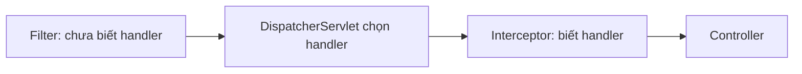
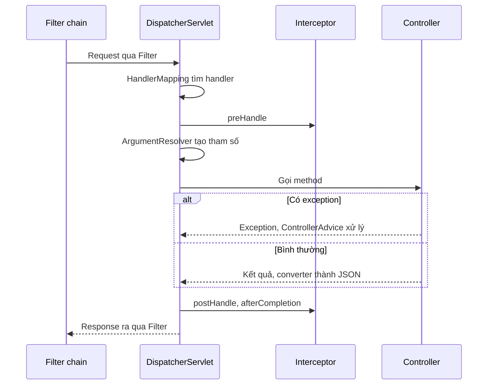
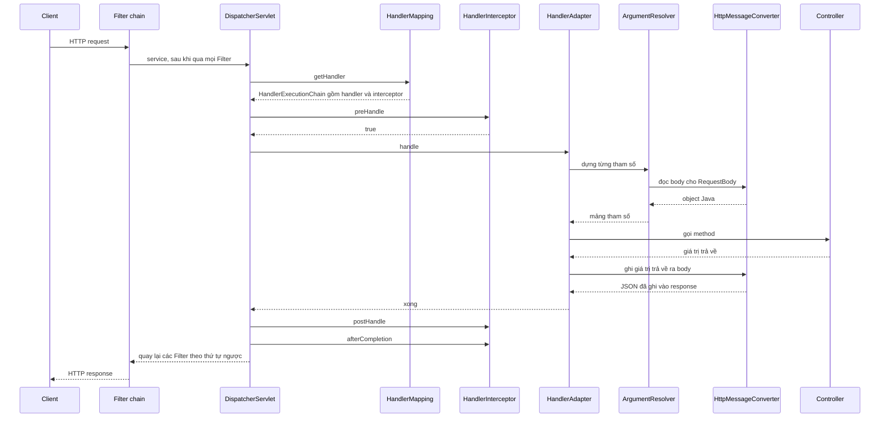
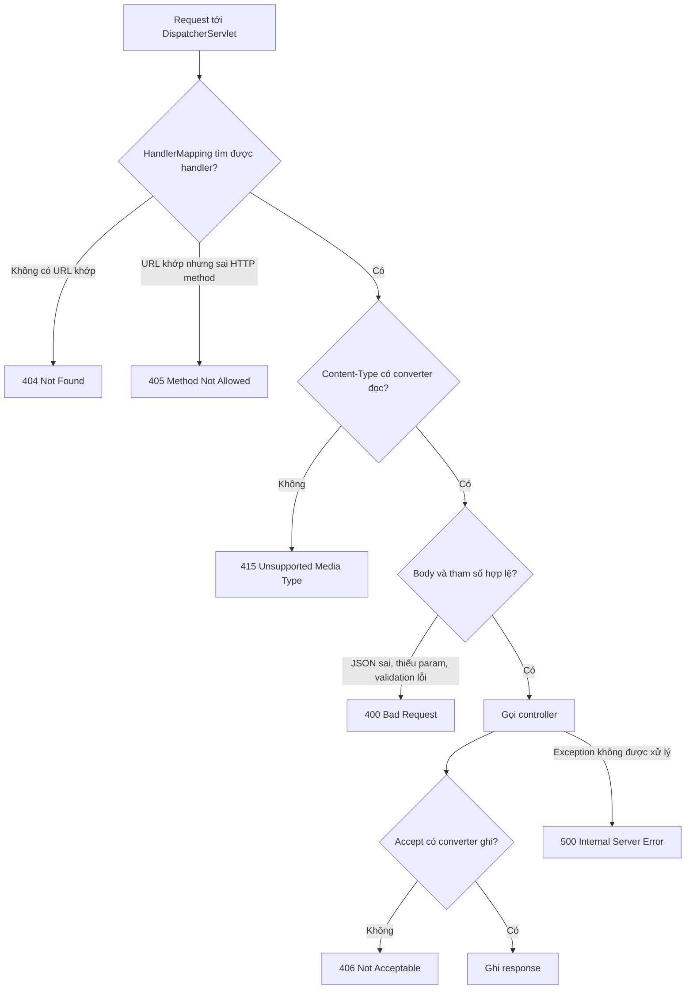
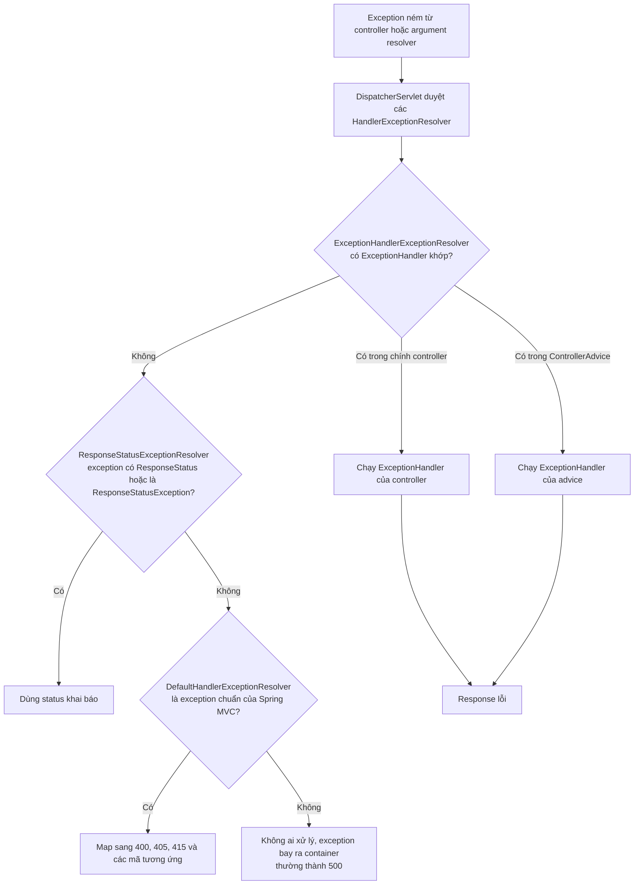
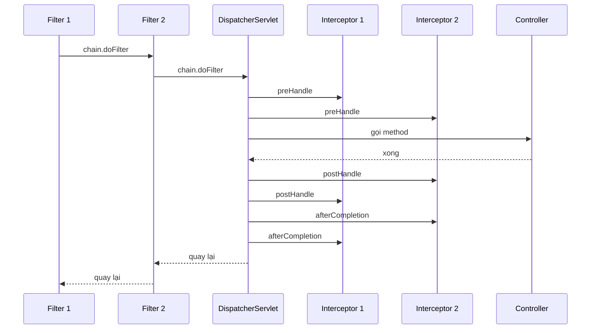
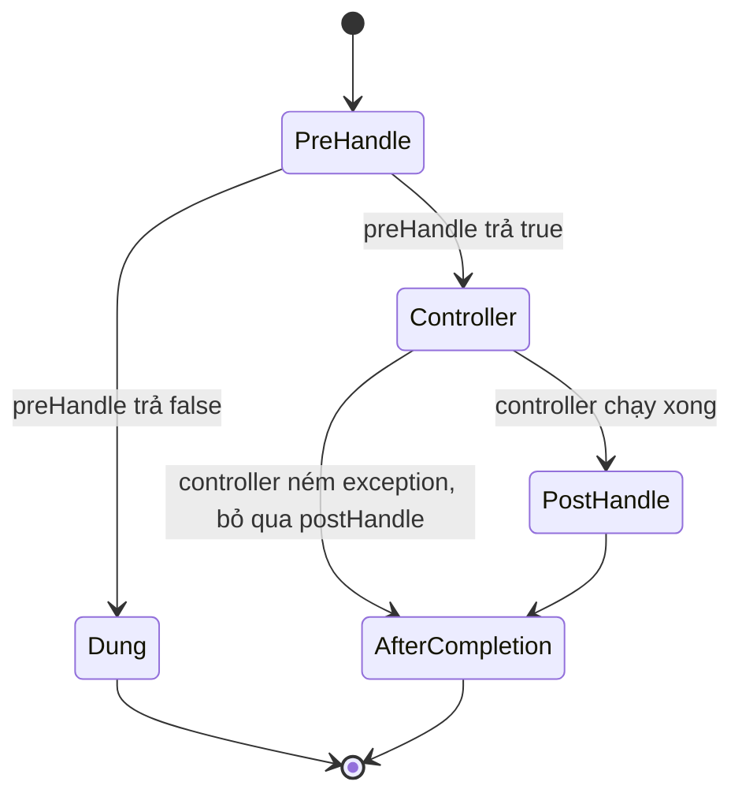

# Lý thuyết 15: Spring MVC bên trong, Filter và Interceptor

## Đường đi của một request

Bạn viết `@GetMapping("/books")` và nó chạy. Nhưng từ lúc byte đầu tiên của request tới server cho đến khi JSON được trả về, có cả một pipeline các thành phần xử lý. Bài này mô tả pipeline đó và chỉ ra những điểm dọc đường mà bạn có thể chen logic của mình vào.

**Cốt lõi:** Spring MVC là front controller: một servlet duy nhất (`DispatcherServlet`) điều phối mọi request tới các thành phần thay thế được. Filter nằm ngoài ở tầng servlet, còn interceptor nằm trong, sau khi đã chọn được handler; mọi khác biệt suy ra từ vị trí này.

- Vì Filter chạy trước `DispatcherServlet` nên nó không biết controller, và lỗi ném từ đó không tới `@ControllerAdvice`.
- Vì interceptor chạy sau `HandlerMapping` nên biết handler, và `afterCompletion` luôn chạy khi `preHandle` đã trả `true`.
- Vì body là stream đọc một lần và thread được tái dùng nên log body cần `ContentCachingRequestWrapper` và MDC phải dọn trong `finally`.



Mô hình tư duy: chọn tầng theo thông tin cần có, vì chỉ sau khi `DispatcherServlet` chọn xong handler thì mới biết controller nào sẽ chạy.

**Tóm tắt:**

- Mỗi request đi qua một pipeline: Filter, `DispatcherServlet`, `HandlerMapping`, interceptor, argument resolver, controller, message converter, rồi ra ngược lại.
- Filter thuộc Servlet container nên không biết controller; interceptor thuộc Spring MVC nên biết handler.
- Exception ném trong Filter không đi qua `@ControllerAdvice`; khi controller ném exception thì `postHandle` bị bỏ qua nhưng `afterCompletion` vẫn chạy.
- `preHandle` trả `false` thì pipeline dừng ngay và controller không được gọi.
- Body của request chỉ đọc được một lần; muốn log phải bọc bằng `ContentCachingRequestWrapper`.
- Mã lỗi cho biết request chết ở bước nào: 404 không có mapping, 405 sai HTTP method, 415 không converter đọc `Content-Type`, 406 không converter ghi `Accept`.
- Thread được tái dùng nên MDC phải dọn trong `finally`; `Converter` chỉ áp dụng cho tham số đơn, không áp dụng cho JSON body.

## Vì sao cần biết?

Không rõ đường đi thì bạn đặt logic sai tầng. Ví dụ muốn bắt exception ném từ filter bằng `@ControllerAdvice` thì không được, vì filter chạy trước và nằm ngoài Spring MVC. Muốn đọc body trong interceptor cũng không ổn vì body chỉ đọc được một lần. Các lỗi 4xx/5xx khó hiểu thường là do request chết ở một bước mà bạn không biết nó tồn tại (ví dụ `415` do không có converter phù hợp, `405` do sai HTTP method).

## Khi nào dùng cái nào

Cần xử lý chung cho nhiều endpoint (log, authentication, đo thời gian, bắt lỗi tập trung), hoặc dữ liệu vào ra có dạng lạ thì chen logic vào pipeline. Chỉ một endpoint cần thì xử lý ngay trong controller là đủ, đừng dựng cơ chế chung vội. Chọn theo thời điểm cần chen: `Filter` ở tầng servlet (trước cả Spring MVC), `HandlerInterceptor` quanh controller, `HandlerMethodArgumentResolver` để tự dựng tham số, `@ControllerAdvice` để bắt exception chung.

## Các khái niệm cần biết

- **Servlet container (Tomcat)**: phần mềm nhận connection HTTP, tạo `HttpServletRequest` và `HttpServletResponse`, rồi giao cho servlet. Mỗi request chạy trên một thread của nó.
- **`DispatcherServlet`**: servlet duy nhất của Spring MVC, đóng vai "tổng đài": nhận mọi request rồi điều phối cho các thành phần khác.
- **`Filter`**: đoạn code của chuẩn Servlet chạy trước và sau servlet. Nó không biết gì về controller.
- **`HandlerInterceptor`**: hook của Spring MVC chạy quanh call controller và biết controller (handler) nào sẽ được gọi.
- **Handler**: thứ xử lý request, thường là một method có `@RequestMapping`/`@GetMapping`.
- **Message converter**: chuyển đổi qua lại giữa body HTTP và object Java (Jackson biến JSON thành object và ngược lại).
- **MDC (Mapped Diagnostic Context)**: nơi lưu dữ liệu theo thread của thư viện log để gắn thông tin như `requestId` vào mọi dòng log của request đó.
- **Content negotiation**: server chọn định dạng trả về dựa trên header `Accept` của client, và hiểu dữ liệu vào dựa trên `Content-Type`.

## Flowchart: đường đi của một request

Hãy theo dõi sơ đồ từ trên xuống: request đi qua filter, tới `DispatcherServlet`, tìm handler, qua interceptor, dựng tham số, gọi controller, rồi đi ngược ra.



Nếu `preHandle` trả `false`, `DispatcherServlet` dừng ngay và controller không được gọi (interceptor tự chịu trách nhiệm viết response). Khi controller ném exception, `postHandle` bị bỏ qua nhưng `afterCompletion` vẫn chạy, nên dọn dẹp tài nguyên phải đặt ở `afterCompletion`.

Sơ đồ trên rút gọn để nhìn tổng thể. Bản đầy đủ hơn, tách riêng từng thành phần và hai chiều đi và về:



Đọc sơ đồ: `HandlerMapping` trả về không chỉ handler mà cả danh sách interceptor áp dụng cho request đó. `DispatcherServlet` không tự gọi controller mà nhờ `HandlerAdapter`, và `HandlerAdapter` dùng argument resolver (đọc body qua message converter) để dựng tham số, rồi ghi kết quả trả về cũng qua message converter. Lưu ý: ở controller `@RestController` với `@ResponseBody`, response đã được ghi trong bước `handle`, nên `postHandle` không còn sửa được header hay body của response đó.

## Filter, Interceptor, Advice khác nhau thế nào

Ba thứ này hay bị nhầm vì đều "chen vào giữa request". Điểm khác biệt chính là chúng nằm ở tầng nào và biết được những gì.

| | Servlet `Filter` | `HandlerInterceptor` | `@ControllerAdvice` |
|---|---|---|---|
| Thuộc về | Servlet container | Spring MVC | Spring MVC |
| Biết controller nào? | Không | **Có** (qua handler) | Có |
| Chạy khi | Trước cả `DispatcherServlet` | Quanh call controller | Khi có exception hoặc xử lý body |
| Dùng cho | Bảo mật, log, nén, CORS, MDC | Đo thời gian theo endpoint, kiểm tra theo annotation | Xử lý lỗi chung, `@InitBinder` |
| Sửa được body request? | Có (bọc request) | Hạn chế | Với `RequestBodyAdvice` |

**Phải thuộc:** thứ tự một request: `Filter` (servlet) rồi `DispatcherServlet`, `HandlerMapping`, `preHandle`, `ArgumentResolver`, controller, `HttpMessageConverter`, `postHandle`, `afterCompletion`, rồi Filter lúc ra. Lỗi ném trong Filter KHÔNG đi qua `@ControllerAdvice`; exception ở controller thì `postHandle` bị bỏ qua nhưng `afterCompletion` vẫn chạy.

**Nền tảng:** Spring MVC là front controller: một servlet duy nhất (`DispatcherServlet`) điều phối mọi request tới các thành phần thay thế được (mapping, adapter, resolver, converter). Filter thuộc tầng servlet nên không biết controller; interceptor thuộc Spring MVC nên biết handler.

Quy tắc chọn nhanh: cần chạy cho **mọi** request kể cả tài nguyên tĩnh và không cần biết controller thì dùng `Filter`; cần biết endpoint nào đang được gọi (ví dụ đọc annotation trên method) thì dùng `HandlerInterceptor`; cần biến exception thành response thì dùng `@ControllerAdvice`.

**Suy luận:** Filter thuộc Servlet container còn `DispatcherServlet` thuộc Spring MVC, và Filter chạy trước servlet, nên mọi khác biệt đều suy ra từ vị trí này. Vì Filter chạy trước khi Spring MVC chọn handler, nó không biết controller nào sẽ xử lý, và exception ném từ Filter không bao giờ tới `@ControllerAdvice` (cơ chế này chỉ bắt exception bên trong `DispatcherServlet`). Ngược lại interceptor chạy sau `HandlerMapping` nên biết handler và đọc được annotation trên method, nhưng cũng vì thế không thấy những request đã chết trước đó. Thứ nhất, 401 và 403 từ Spring Security xảy ra trong filter chain nên phải tùy biến bằng entry point và access denied handler chứ không bằng `@ControllerAdvice`. Thứ hai, body của request là stream chỉ đọc được một lần, nên ai đọc trước (filter log body) sẽ làm controller nhận body rỗng, trừ khi bọc bằng `ContentCachingRequestWrapper`. Thứ ba, Tomcat tái dùng thread cho request khác, nên mọi thứ gắn theo thread như MDC phải dọn trong `finally`, nếu không `requestId` cũ sẽ dính sang request sau. Điểm dễ nhầm là khi controller ném exception thì `postHandle` bị bỏ qua nhưng `afterCompletion` vẫn chạy, nên dọn dẹp phải đặt ở `afterCompletion`. Hệ quả khi thiết kế: chọn tầng theo thông tin cần có, cần handler thì dùng interceptor, cần mọi request thì dùng Filter, cần biến exception thành response thì dùng advice.

## Các thành phần quan trọng

- **`HandlerMapping`**: ánh xạ URL và HTTP method tới method.
- **`HandlerMethodArgumentResolver`**: biến request thành tham số (`@PathVariable`, `@RequestBody`, hoặc loại bạn tự viết như `@CurrentUser`).
- **`HttpMessageConverter`**: đọc/ghi body (Jackson cho JSON). Chọn dựa trên `Content-Type`/`Accept`.
- **`ProblemDetail`** (RFC 7807, nay được thay bằng RFC 9457): định dạng lỗi chuẩn từ Spring 6.

## DispatcherServlet làm gì, theo thứ tự

Bảng sau là cùng pipeline ở trên nhưng chi tiết hơn, với tên class cụ thể và điều xảy ra nếu bước đó thất bại. Hai thuật ngữ mới: `HandlerAdapter` là class biết cách gọi một loại handler cụ thể (cho phép `DispatcherServlet` không phụ thuộc kiểu handler), và `HandlerExceptionResolver` là thành phần biến exception thành response.

| Bước | Thành phần | Kết quả |
|---|---|---|
| 1 | `HandlerMapping` (`RequestMappingHandlerMapping`) | Tìm `HandlerMethod` khớp URL, HTTP method, `consumes`/`produces`. Không khớp: 404, sai method: 405 |
| 2 | `HandlerAdapter` (`RequestMappingHandlerAdapter`) | Chuẩn bị gọi method |
| 3 | `HandlerInterceptor.preHandle` | Trả `false` thì dừng chain |
| 4 | `HandlerMethodArgumentResolver` | Dựng từng tham số; `@RequestBody` dùng `HttpMessageConverter` đọc JSON |
| 5 | Gọi method controller | Giá trị trả về hoặc exception |
| 6 | `HandlerMethodReturnValueHandler` | `@ResponseBody` ghi qua `HttpMessageConverter` ra JSON |
| 7 | Exception thì `HandlerExceptionResolver` | `@ExceptionHandler` trong `@ControllerAdvice` |
| 8 | `postHandle`, `afterCompletion` | `afterCompletion` luôn chạy (dọn dẹp) nếu `preHandle` đã trả `true` |

Request 415 (Unsupported Media Type) nghĩa là không có converter đọc `Content-Type`; 406 là không có converter ghi được `Accept`. 400 thường do JSON sai hoặc binding/validation lỗi.

Dùng mã lỗi để suy ra request chết ở bước nào:



Đọc sơ đồ: mỗi mã lỗi ứng với một cổng trong pipeline. Thấy 405 thì đừng sửa converter, thấy 415 thì xem `Content-Type` của client trước khi nghi ngờ controller. Thực tế 406 có thể được phát hiện trước khi gọi controller khi method khai báo `produces`; sơ đồ đặt sau cùng để dễ nhớ theo luồng dữ liệu.

### Xử lý exception bên trong DispatcherServlet

Khi một bước ném exception, `DispatcherServlet` nhờ danh sách `HandlerExceptionResolver` thử lần lượt cho tới khi có cái xử lý được:



Đọc sơ đồ: `@ExceptionHandler` đặt ngay trong controller được ưu tiên hơn handler trong `@ControllerAdvice`; nếu cả hai đều không có thì mới tới các resolver mặc định. Trong advice, bạn có thể trả `ProblemDetail` để có định dạng lỗi chuẩn RFC 9457. Muốn các exception chuẩn của MVC (ví dụ thiếu tham số, sai kiểu) cũng ra `ProblemDetail`, cho advice kế thừa `ResponseEntityExceptionHandler`, hoặc bật thuộc tính `spring.mvc.problemdetails.enabled` của Boot (kiểm tra lại tên thuộc tính theo phiên bản bạn dùng).

### Thứ tự Filter và Interceptor khi có nhiều cái

Khi có nhiều Filter và nhiều Interceptor, chúng lồng nhau như các lớp vỏ hành:



Đọc sơ đồ: phần đi vào thì theo thứ tự đăng ký (Filter theo `@Order` hoặc `FilterRegistrationBean`, Interceptor theo thứ tự `addInterceptor`), phần đi ra thì đảo ngược. Nếu `preHandle` của Interceptor 2 trả `false`, controller không chạy, và `afterCompletion` chỉ được gọi cho những interceptor đã `preHandle` thành công, tức Interceptor 1.

### Vòng đời một interceptor khi có lỗi



Đọc sơ đồ: `afterCompletion` là điểm duy nhất chắc chắn chạy khi `preHandle` đã trả `true`, kể cả khi có exception, nên đặt việc dọn dẹp ở đó.

## Ví dụ: Filter, Interceptor và Advice cùng chạy

Ba đoạn code sau là ba tầng điển hình. Filter gắn `requestId` vào log và dọn trong `finally` (vì thread được tái dùng, không dọn thì `requestId` của request trước dính sang request sau). Interceptor đo thời gian cho từng endpoint dưới `/api/**`. Advice biến `IllegalArgumentException` thành `400` với định dạng `ProblemDetail`.

```java
// 1. Filter: tầng servlet, gắn request ID vào log
@Component
@Order(Ordered.HIGHEST_PRECEDENCE)
public class RequestIdFilter extends OncePerRequestFilter {
    @Override
    protected void doFilterInternal(HttpServletRequest req, HttpServletResponse res, FilterChain chain)
            throws ServletException, IOException {
        String id = Optional.ofNullable(req.getHeader("X-Request-Id")).orElse(UUID.randomUUID().toString());
        MDC.put("requestId", id);
        res.setHeader("X-Request-Id", id);
        try {
            chain.doFilter(req, res);
        } finally {
            MDC.remove("requestId");   // luôn dọn, thread được tái dùng
        }
    }
}

// 2. Interceptor: biết handler nào, đo thời gian theo endpoint
public class TimingInterceptor implements HandlerInterceptor {
    private static final Logger log = LoggerFactory.getLogger(TimingInterceptor.class);

    @Override
    public boolean preHandle(HttpServletRequest req, HttpServletResponse res, Object handler) {
        req.setAttribute("startNs", System.nanoTime());
        return true;
    }

    @Override
    public void afterCompletion(HttpServletRequest req, HttpServletResponse res, Object handler, Exception ex) {
        long ms = (System.nanoTime() - (long) req.getAttribute("startNs")) / 1_000_000;
        log.info("{} {} -> {} ({} ms)", req.getMethod(), req.getRequestURI(), res.getStatus(), ms);
    }
}

@Configuration
class WebConfig implements WebMvcConfigurer {
    @Override
    public void addInterceptors(InterceptorRegistry registry) {
        registry.addInterceptor(new TimingInterceptor()).addPathPatterns("/api/**");
    }
    // addArgumentResolvers cho CurrentUserResolver bên dưới
}

// 3. Advice: bắt exception từ controller (không bắt được lỗi từ Filter)
@RestControllerAdvice
class ApiExceptionHandler {
    @ExceptionHandler(IllegalArgumentException.class)
    ProblemDetail badRequest(IllegalArgumentException e) {
        return ProblemDetail.forStatusAndDetail(HttpStatus.BAD_REQUEST, e.getMessage());
    }
}
```

Interceptor được tạo bằng `new` và đăng ký qua `WebMvcConfigurer`, khác với Filter là bean tự đăng ký. Ba thứ này tạo nên thứ tự log: `Filter(vào) -> preHandle -> controller -> afterCompletion -> Filter(ra)`.

## Hai cách "đọc body hai lần"

Vấn đề đặt ra: body của request là một stream chỉ đọc được một lần. Nếu filter đọc để log thì controller sẽ nhận body rỗng và báo `400`. Cách giải quyết là bọc request vào `ContentCachingRequestWrapper`, nó vừa để controller đọc bình thường vừa giữ lại bản sao trong bộ nhớ.

```java
// Filter log body: bọc request để cache nội dung (đọc xong controller mới có dữ liệu)
@Component
class BodyLogFilter extends OncePerRequestFilter {
    @Override
    protected void doFilterInternal(HttpServletRequest req, HttpServletResponse res, FilterChain chain)
            throws ServletException, IOException {
        var wrapped = new ContentCachingRequestWrapper(req);
        try {
            chain.doFilter(wrapped, res);
        } finally {
            String body = new String(wrapped.getContentAsByteArray(), StandardCharsets.UTF_8);
            // ghi log body ở đây, nhớ che dữ liệu nhạy cảm
        }
    }
}
```

Chỉ có nội dung sau khi controller đã đọc stream. Muốn xem trước khi controller chạy thì phải tự đọc và bọc lại thành stream mới (tốn memory), nên hạn chế.

## Test từng tầng

```java
@WebMvcTest(BookController.class)
class BookControllerMvcTest {
    @Autowired MockMvc mvc;
    @MockitoBean BookService service;

    @Test
    void wrongMethod_returns405() throws Exception {
        mvc.perform(delete("/api/v1/books"))
           .andExpect(status().isMethodNotAllowed());
    }

    @Test
    void unsupportedMediaType_returns415() throws Exception {
        mvc.perform(post("/api/v1/books").contentType(MediaType.TEXT_PLAIN).content("x"))
           .andExpect(status().isUnsupportedMediaType());
    }
}
```

`@WebMvcTest` nạp Filter, `HandlerInterceptor` đăng ký qua `WebMvcConfigurer`, và `@ControllerAdvice`, nên test được cả đường đi này.

## Ví dụ: ArgumentResolver tự viết

`HandlerMethodArgumentResolver` dùng khi nhiều controller cùng cần một tham số lấy từ ngữ cảnh (người dùng hiện tại, tenant, ngôn ngữ). Thay vì mỗi controller tự gọi `SecurityContextHolder`, bạn đặt annotation `@CurrentUser` lên tham số và để resolver dựng giá trị. `supportsParameter` quyết định resolver có xử lý tham số này không; `resolveArgument` trả giá trị.

```java
@Component
public class CurrentUserResolver implements HandlerMethodArgumentResolver {
    public boolean supportsParameter(MethodParameter p) {
        return p.hasParameterAnnotation(CurrentUser.class);
    }
    public Object resolveArgument(MethodParameter p, ModelAndViewContainer m,
                                  NativeWebRequest req, WebDataBinderFactory f) {
        return SecurityContextHolder.getContext().getAuthentication().getPrincipal();
    }
}
```

Đăng ký qua `WebMvcConfigurer.addArgumentResolvers`. Controller khi đó chỉ cần `get(@CurrentUser User user)`.

```java
@Retention(RetentionPolicy.RUNTIME)
@Target(ElementType.PARAMETER)
public @interface CurrentUser {}

@Configuration
class ResolverConfig implements WebMvcConfigurer {
    private final CurrentUserResolver resolver;
    ResolverConfig(CurrentUserResolver resolver) { this.resolver = resolver; }

    @Override
    public void addArgumentResolvers(List<HandlerMethodArgumentResolver> resolvers) {
        resolvers.add(resolver);
    }
}
```

Lỗi ở tầng bảo mật (401/403) cũng xảy ra trong Filter chain, trước DispatcherServlet, xem [Spring Security chuyên sâu](/go?p=01-Spring-Boot%2Fhard%2Flt-35-spring-security-chuyen-sau.md). Định dạng lỗi nhất quán ở [REST API thực chiến](/go?p=01-Spring-Boot%2Fmedium%2Flt-33-rest-api-thuc-chien.md).

## SpEL và chuyển đổi kiểu

Hai chuyện nhỏ nhưng gặp ở khắp nơi trong Spring: chuỗi `"2026-10-27"` trên URL biến thành `LocalDate` bằng cách nào, và biểu thức `#{...}` trong annotation chạy ở đâu. Cả hai là cơ chế nền của MVC (và của cấu hình), nên đặt cạnh phần ArgumentResolver ở trên. Chỉ cần tự viết khi kiểu dữ liệu của bạn lạ (mã đơn có prefix, enum đặt tên khác, tiền tệ); kiểu thông dụng Spring đã lo sẵn.

### Khái niệm

- **SpEL (Spring Expression Language)**: ngôn ngữ biểu thức đánh giá lúc chạy, viết trong `#{...}`. Dùng để truy cập bean khác, gọi method, tính toán trong annotation. Đừng nhầm với `${...}` là placeholder đọc property.
- **`ConversionService`**: type converter trung tâm của Spring (nguồn kiểu S sang đích kiểu T). MVC dùng nó cho `@RequestParam`, `@PathVariable`, `@ModelAttribute`, header; Boot dùng bản `WebConversionService` đã cấu hình sẵn.
- **`Converter<S, T>`**: đổi một chiều S sang T, không biết gì về ngôn ngữ hay định dạng.
- **`Formatter<T>`**: đổi hai chiều giữa `String` và T, có `Locale` (ngày, số, tiền). `@DateTimeFormat` và `@NumberFormat` là cách khai báo sẵn.

### SpEL dùng ở đâu

| Nơi dùng | Ví dụ | Ghi chú |
|---|---|---|
| `@Value` | `@Value("#{orderConfig.maxItems * 2}")` | Truy cập bean khác, tính toán |
| `@Cacheable` | `key = "#id"`, `unless = "#result == null"` | `#tên_tham_số`, `#result` |
| `@PreAuthorize` | `"hasRole('ADMIN') or #userId == authentication.name"` | Gọi tên tham số, object `authentication` |
| `@ConditionalOnExpression` | `"${feature.x:false} and ..."` | Điều kiện nạp bean |

Dùng trực tiếp bằng code khi cần đánh giá biểu thức lưu trong cấu hình. Câu dẫn: đoạn dưới đọc `name.length()` của một object.

_Minh họa_ (cần spring-expression):

```java
ExpressionParser parser = new SpelExpressionParser();
EvaluationContext ctx = SimpleEvaluationContext.forReadOnlyDataBinding().build();
Integer len = parser.parseExpression("name.length()").getValue(ctx, book, Integer.class);
```

Với biểu thức do người dùng nhập, dùng `SimpleEvaluationContext` (chỉ đọc property, không gọi được kiểu tùy ý). `StandardEvaluationContext` cho phép `T(java.lang.Runtime).getRuntime().exec(...)`, nghĩa là chạy lệnh trên server.

### Converter và Formatter tự viết

Tình huống: client gọi `GET /orders?status=paid` (chữ thường) nhưng enum là `PAID`. Mặc định Spring dùng `Enum.valueOf` nên `paid` ném lỗi `MethodArgumentTypeMismatchException` và trả `400`. Một `Converter` chịu trách nhiệm đúng một cặp kiểu, đăng ký qua `WebMvcConfigurer.addFormatters`.

_Minh họa_:

```java
@Configuration
class ConversionConfig implements WebMvcConfigurer {
    @Override
    public void addFormatters(FormatterRegistry registry) {
        registry.addConverter(String.class, OrderStatus.class,
                s -> OrderStatus.valueOf(s.trim().toUpperCase()));
        registry.addFormatter(new MoneyFormatter());
    }
}

class MoneyFormatter implements Formatter<Money> {
    @Override public Money parse(String text, Locale locale) { return Money.of(text); }
    @Override public String print(Money money, Locale locale) { return money.toString(); }
}
```

Dùng lambda cho `addConverter` có thể mất thông tin kiểu generic ở một số phiên bản; nếu Spring báo không xác định được kiểu nguồn và đích, truyền rõ hai `Class` như trên hoặc viết class có tên. Kiểm tra lại theo phiên bản.

Với `@ConfigurationProperties` (đọc `application.yml`), Boot dùng cơ chế chuyển đổi kiểu riêng. Converter của bạn phải đánh dấu `@ConfigurationPropertiesBinding` (và là bean) mới có tác dụng ở đó. Đã có sẵn cú pháp `10s` cho `Duration`, `5MB` cho `DataSize`.

### Bẫy thường gặp

| Bẫy | Hệ quả |
|---|---|
| Nghĩ `Converter` áp dụng cho body JSON | `@RequestBody` dùng Jackson, không qua `ConversionService`. Converter chỉ chạy cho tham số đơn (query, path, header, form). Với JSON phải viết `JsonDeserializer` hoặc `@JsonCreator` |
| Converter có state hoặc không thread-safe | Converter là singleton dùng chung nhiều request, lỗi dữ liệu lẫn nhau |
| Dùng `StandardEvaluationContext` với dữ liệu người dùng | Lỗ hổng chạy mã tùy ý (SpEL injection) |
| Lẫn `${}` và `#{}` | `@Value("#{app.name}")` tìm bean tên `app`, không đọc property; ngược lại `${}` không tính toán được |
| Không bắt `MethodArgumentTypeMismatchException` | Client nhận lỗi mặc định khó hiểu; xử lý trong `@ControllerAdvice` (xem [REST API thực chiến](/go?p=01-Spring-Boot%2Fmedium%2Flt-33-rest-api-thuc-chien.md)) |

## Điều cần nhớ

- Body của request chỉ đọc được **một lần**; muốn log body ở filter phải bọc bằng `ContentCachingRequestWrapper`.
- Lỗi xảy ra trong Filter **không** đi qua `@ControllerAdvice`.
- Mặc định mỗi request chiếm một thread của Tomcat; xử lý chậm làm cạn pool (xem [Concurrency](/go?p=01-Spring-Boot%2Fhard%2Flt-22-concurrency-virtual-threads.md)).
- Thứ tự Filter quan trọng: đặt bằng `@Order` hoặc `FilterRegistrationBean`.

## Phỏng vấn khó: chuỗi hỏi xoáy

Người phỏng vấn senior thường mở bằng một câu dễ, rồi xoáy xuống cơ chế, đánh đổi và sự cố thật. Câu trả lời tốt luôn đi từ cốt lõi xuống, không nhảy thẳng vào chi tiết.

### Chuỗi 1: Filter, interceptor và lỗi ném ra

1. **Câu mở:** Filter của bạn ném exception nhưng `@RestControllerAdvice` không bắt. Vì sao?
2. **Xoáy 1:** Filter, interceptor và advice khác nhau về vị trí và về thông tin biết được thế nào?
3. **Xoáy 2:** Controller ném exception thì `postHandle` và `afterCompletion` ra sao, và nếu `preHandle` của Interceptor 2 trả `false` thì sao?

**Đáp án ngắn:** Filter thuộc Servlet container và chạy trước `DispatcherServlet`, còn `@ControllerAdvice` chỉ bắt exception bên trong `DispatcherServlet`, nên lỗi từ filter không bao giờ tới nó. Vì vậy 401 và 403 của Spring Security, vốn xảy ra trong filter chain, phải tùy biến bằng entry point và access denied handler. Filter không biết controller nào sẽ xử lý; interceptor chạy sau `HandlerMapping` nên biết handler và đọc được annotation trên method, nhưng không thấy những request đã chết trước đó. Khi controller ném exception, `postHandle` bị bỏ qua còn `afterCompletion` vẫn chạy, nên việc dọn dẹp đặt ở `afterCompletion`. Nếu `preHandle` của Interceptor 2 trả `false` thì controller không chạy, và `afterCompletion` chỉ được gọi cho những interceptor đã `preHandle` thành công, tức Interceptor 1. Chọn tầng theo thông tin cần có: mọi request thì Filter, cần handler thì interceptor, biến exception thành response thì advice.

**Sai lầm hay gặp:**
- Đặt xử lý lỗi chung ở advice rồi ngạc nhiên vì lỗi từ filter lọt ra ngoài.
- Dọn tài nguyên ở `postHandle` thay vì `afterCompletion`.
- Nghĩ interceptor chạy cho mọi request, kể cả request không tìm được handler.

### Chuỗi 2: Đọc body hai lần và MDC bị dính

1. **Câu mở:** Filter log body xong thì controller báo `400`. Chuyện gì xảy ra?
2. **Xoáy 1:** Bọc bằng `ContentCachingRequestWrapper` rồi thì khi nào mới lấy được nội dung?
3. **Xoáy 2:** Log của request sau xuất hiện `requestId` của request trước. Nguyên nhân?

**Đáp án ngắn:** Body của request là stream chỉ đọc được một lần. Filter đọc trước thì controller nhận body rỗng và báo 400. `ContentCachingRequestWrapper` vừa để controller đọc bình thường vừa giữ bản sao trong memory, nhưng nội dung chỉ có sau khi controller đã đọc stream, nên phải lấy ở `finally` sau `chain.doFilter`. Muốn xem trước khi controller chạy thì phải tự đọc rồi bọc thành stream mới, tốn memory nên hạn chế; nhớ che dữ liệu nhạy cảm khi log. Về `requestId` bị dính: Tomcat tái dùng thread cho request khác, mà MDC lưu theo thread, nên nếu không `MDC.remove` trong `finally` thì giá trị cũ sang request sau. Cùng nguyên lý cho mọi thứ gắn theo thread. Cách phát hiện trong production: khi tìm log theo `requestId` thấy dòng của request khác lẫn vào.

**Sai lầm hay gặp:**
- Đọc body trong filter hoặc interceptor mà không bọc wrapper.
- Chỉ dọn MDC ở đường thành công, bỏ `finally`.
- Nghĩ lấy được body từ wrapper ngay trước `chain.doFilter`.

