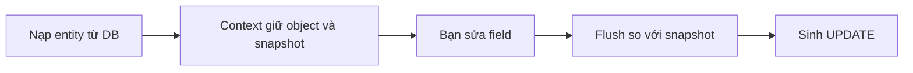
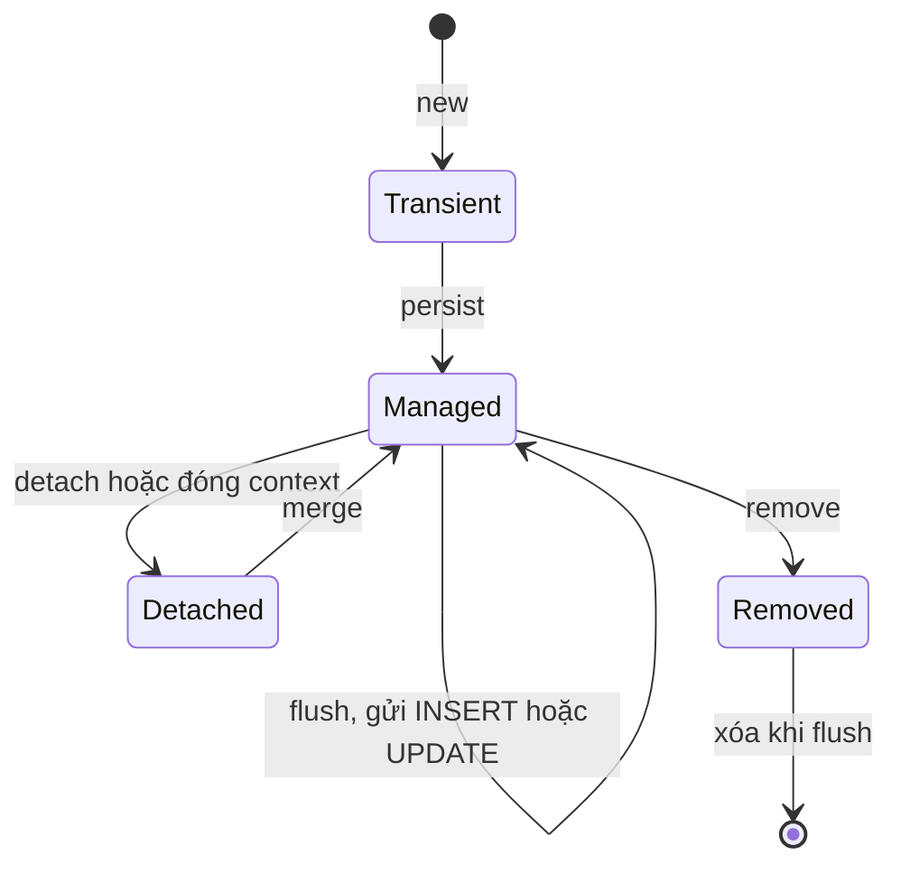
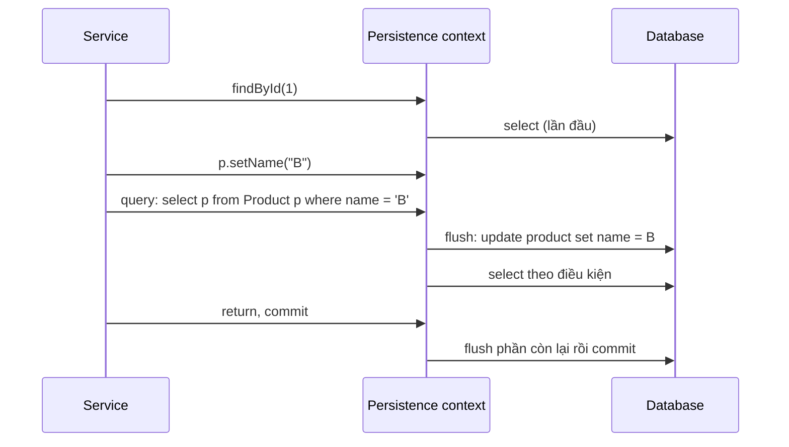

# Lý thuyết 16: JPA bên trong, Persistence Context

## Persistence context là gì?

Khi bạn dùng JPA, có một object tên `EntityManager` đứng giữa code Java và database. Nó giữ một "vùng nhớ làm việc" gọi là **persistence context**. Hãy hình dung đó là chiếc bàn làm việc của một nhân viên kho: mọi món hàng (entity) bạn lấy ra từ kho (database) đều được đặt lên bàn và nhân viên ghi nhớ trạng thái ban đầu của từng món. Cuối ca, nhân viên so sánh từng món trên bàn với ghi chú, món nào đã bị sửa thì tự cập nhật lại vào kho. Bạn không cần dặn.

**Cốt lõi:** Code Java làm việc với object, còn database làm việc với dòng, và bạn không muốn tự theo dõi object nào đã đổi. JPA giải quyết bằng một persistence context: nó giữ mọi entity đã nạp cùng snapshot ban đầu, rồi đến lúc flush mới so sánh và sinh SQL.

- Vì entity managed được giữ cùng snapshot, nên chỉ cần đổi field là `UPDATE` tự sinh lúc flush chứ không phải ngay dòng `setX`.
- Vì mỗi id chỉ ứng với một object trong context, nên đọc lại cùng id không chạm DB và bulk update bỏ qua context sẽ để lại dữ liệu cũ.
- Vì context gắn với transaction, nên hết transaction thì entity thành detached và lazy loading không còn chạy.



Mô hình tư duy: sơ đồ cho thấy JPA không ghi theo từng dòng code của bạn mà ghi theo chênh lệch giữa object và snapshot tại thời điểm flush.

**Tóm tắt:**

- Persistence context là cache cấp 1 gắn với transaction: cùng id luôn ra cùng một object.
- Entity có bốn trạng thái: transient, managed, detached, removed; chỉ managed mới được theo dõi.
- Dirty checking: entity managed được so với snapshot lúc nạp và tự sinh `UPDATE` khi flush.
- Flush (mặc định AUTO) chạy trước query bị ảnh hưởng, khi commit và khi gọi `flush()`, nên lỗi constraint nổ lúc flush chứ không ở dòng `setX`.
- `persist` đưa chính object vào context, `merge` trả về bản managed; luôn dùng giá trị trả về của `merge`.
- `LAZY` cần context còn mở: ra khỏi transaction mà chạm vào quan hệ sẽ ném `LazyInitializationException`, nên fetch đủ trong service rồi trả DTO.
- `@Modifying` update bỏ qua persistence context nên cần `clearAutomatically = true`; `equals`/`hashCode` không nên dựa vào id tự sinh.
- Mapping nâng cao gồm `@Embeddable`, `AttributeConverter`, `@MappedSuperclass`, soft delete và `@Enumerated(STRING)`.

## Vì sao phải hiểu?

Không hiểu cơ chế này thì rất khó giải thích những chuyện hay gặp: sửa field mà không gọi `save` vẫn bị ghi xuống DB; `LazyInitializationException` bật ra khi đã ra khỏi transaction; hoặc N+1 query làm app chậm hẳn mà code trông rất vô tội. Mọi hiện tượng này đều là hệ quả của chiếc "bàn làm việc" trên.

## Khi nào cần để tâm

Mỗi khi dùng JPA, và đặc biệt khi gặp hiệu năng kém hoặc dữ liệu được lưu "lạ" so với code. Cách học: nắm lifecycle của entity (new, managed, detached, removed), biết khi nào JPA flush xuống DB, quản lý quan hệ hai chiều cho đúng, và chọn chiến lược fetch (lazy hay eager, `join fetch`) có chủ đích thay vì để mặc định.

## Entity lifecycle

Một entity luôn ở một trong bốn trạng thái. Trạng thái quyết định JPA có theo dõi nó hay không, nên đây là bản đồ quan trọng nhất của bài:

- **Transient (mới)**: vừa `new`, JPA chưa biết tới, chưa có dòng trong DB.
- **Managed (được quản lý)**: nằm trong persistence context, mọi thay đổi được theo dõi và tự ghi khi flush.
- **Detached (rời)**: từng được quản lý nhưng context đã đóng (hoặc bị `detach`). Vẫn có id nhưng thay đổi không còn được theo dõi.
- **Removed (đã đánh dấu xóa)**: sẽ bị xóa khi flush.



**Phải thuộc:** bốn trạng thái entity: transient, managed, detached, removed. `persist` đưa chính object vào context; `merge` trả về bản managed (object truyền vào vẫn detached).

**Nền tảng:** persistence context là cache cấp 1 gắn với một transaction: cùng id luôn ra cùng một object, và entity managed được so với snapshot ban đầu để tự sinh `UPDATE` khi flush (dirty checking). Đóng context (hết transaction) thì entity thành detached và lazy loading không còn hoạt động.

**Suy luận:** Hibernate giữ mọi entity đã nạp trong persistence context cùng một snapshot lúc nạp, vì chỉ có vậy nó mới biết field nào đã đổi mà không cần bạn báo. Từ đó suy ra dirty checking: đổi field của entity managed là đủ, và `UPDATE` được gửi lúc flush chứ không phải ngay dòng `setX`. Vì mỗi id chỉ ứng với một object trong context, `findById` lần hai trả chính object cũ mà không chạm DB, và đó cũng là lý do đọc lại dữ liệu sau một bulk update vẫn ra giá trị cũ. Thứ nhất, lỗi constraint nổ ở câu truy vấn kế tiếp hoặc lúc commit, vì flush mới là lúc SQL thật được gửi. Thứ hai, flush AUTO chạy trước query có thể bị ảnh hưởng để query thấy đúng dữ liệu bạn vừa sửa, nên một câu `select` có thể kéo theo một `UPDATE` bất ngờ. Thứ ba, context gắn với transaction, nên hết transaction thì entity thành detached, không còn được theo dõi và lazy loading hỏng. Điểm dễ nhầm là sửa trên object cũ sau `merge`: `merge` trả về bản managed mới, nên thay đổi trên object truyền vào không được ghi. Hệ quả khi review: xác định entity đang managed hay detached, dùng giá trị trả về của `merge`, và với `@Modifying` thì phải clear context.

## Các khái niệm chính

Bảng sau chốt lại các keyword sẽ lặp lại trong suốt bài. Hãy đọc kèm các ví dụ ngay bên dưới để thấy chúng hoạt động.

| Khái niệm | Ý nghĩa |
|---|---|
| **Persistence context** | Cache cấp 1: cùng một id trong một transaction luôn ra **cùng một object** |
| **Dirty checking** | Cuối transaction, Hibernate so sánh với snapshot ban đầu, tự sinh `UPDATE` nếu entity thay đổi |
| **Flush** | Đẩy thay đổi xuống DB (chưa commit). Tự chạy trước truy vấn, hoặc khi commit |
| **Lazy loading** | Quan hệ chỉ tải khi chạm vào, cần context còn mở |
| **Proxy entity** | Với `LAZY`, Hibernate trả object giả, tải thật khi truy cập |

## Quan sát được bằng code

Hai ví dụ cho thấy hai hệ quả trực tiếp. Ví dụ đầu: entity đang managed nên đổi tên là đủ, `UPDATE` tự sinh lúc commit. Ví dụ sau: truy vấn cùng id lần hai không chạm DB vì context trả lại chính object đã nạp (cache cấp 1), nên `a == b`.

```java
@Transactional
public void rename(Long id, String newName) {
    Product p = repository.findById(id).orElseThrow();
    p.setName(newName);          // không gọi save, vẫn có UPDATE khi commit
}

@Transactional
public void sameObject(Long id) {
    Product a = repository.findById(id).get();
    Product b = repository.findById(id).get();  // không truy vấn lần hai
    assert a == b;                               // cùng một đối tượng
}
```

## Flush xảy ra khi nào

Flush là lúc Hibernate đẩy các thay đổi đang giữ trong memory xuống database dưới dạng câu SQL, nhưng chưa commit (vẫn rollback được). Sơ đồ cho thấy một flush "bất ngờ" xảy ra giữa transaction khi bạn chạy một truy vấn:



Với `FlushModeType.AUTO` (mặc định), Hibernate flush: (1) trước khi chạy JPQL/HQL có thể bị ảnh hưởng bởi thay đổi chưa ghi, (2) khi commit, (3) khi gọi `flush()` thủ công. Lý do của (1): để truy vấn thấy đúng dữ liệu bạn vừa sửa trong cùng transaction. Hệ quả: lỗi constraint DB (unique, not null) thường nổ **ở dòng truy vấn kế tiếp hoặc lúc commit**, không phải dòng `setX`.

**Phải thuộc:** flush mặc định (`FlushModeType.AUTO`) chạy trước truy vấn bị ảnh hưởng, khi commit và khi gọi `flush()`. Flush đẩy SQL xuống DB nhưng chưa commit.

## Persist, merge và `save`

`persist` dùng cho entity mới: nó đưa **chính object bạn truyền** vào context. `merge` dùng cho entity có id nhưng không nằm trong context (ví dụ nhận từ client): nó nạp bản managed từ DB, chép trạng thái của bạn sang đó, và trả về **bản managed**, còn object bạn truyền vẫn là detached. `repository.save` của Spring Data chọn một trong hai tùy entity mới hay không (xem [Spring Data JPA](/go?p=01-Spring-Boot%2Fmedium%2Flt-04-spring-data-jpa.md)).

| Thao tác | Với entity mới | Với entity detached |
|---|---|---|
| `persist(e)` | Đưa chính `e` vào context, insert khi flush | Lỗi `PersistentObjectException` |
| `merge(e)` | Tạo bản sao managed (có select trước), insert | Copy trạng thái vào bản managed, trả về **bản managed** |

```java
Product detached = new Product(5L, "X");     // có id, nhưng không nằm trong context
Product managed = em.merge(detached);        // trả bản managed
detached.setName("Y");                       // KHÔNG được theo dõi
managed.setName("Z");                        // được theo dõi, sẽ update
```

Bẫy: sau `merge`, phải dùng **giá trị trả về**, không dùng đối số truyền vào.

## `LazyInitializationException`: trước và sau

Vấn đề đặt ra: quan hệ `LAZY` chỉ được tải khi bạn chạm tới, và việc tải đó cần persistence context còn mở. Khi service trả entity ra ngoài thì transaction (và context) đã đóng, controller chạm vào `getBooks()` thì Hibernate không còn cách nào hỏi DB và ném `LazyInitializationException`. Cách giải quyết là tải đủ dữ liệu cần thiết ngay trong service, rồi trả DTO.

```java
// TRƯỚC: lazy collection được chạm sau khi transaction đã kết thúc
@Service
class AuthorService {
    private final AuthorRepository authors;
    AuthorService(AuthorRepository authors) { this.authors = authors; }

    // transaction kết thúc ở đây
    public Author get(Long id) { return authors.findById(id).orElseThrow(); }
}
// controller: author.getBooks().size()  -> LazyInitializationException

// SAU: tải đủ trong service rồi trả DTO
public record AuthorDto(Long id, String name, List<String> bookTitles) {}

@Transactional(readOnly = true)
public AuthorDto getDto(Long id) {
    // @Query "select a from Author a left join fetch a.books where a.id = :id"
    Author a = authors.findWithBooks(id).orElseThrow();
    return new AuthorDto(a.getId(), a.getName(), a.getBooks().stream().map(Book::getTitle).toList());
}
```

Bật `open-in-view` chỉ che lỗi này bằng cách giữ session suốt request, đổi lại là câu SQL ẩn ở tầng view và giữ connection lâu.

## `equals` và `hashCode` của entity

Entity thường được bỏ vào `Set` hoặc so sánh. Nếu `hashCode` đổi khi id được cấp (từ null sang có giá trị lúc persist) thì object đã nằm trong `HashSet` sẽ "biến mất" vì nằm sai ô băm. Bảng sau so sánh các cách làm:

| Cách | Vấn đề |
|---|---|
| Mặc định (theo địa chỉ) | Hai bản của cùng dòng (khác context) không bằng nhau |
| Dựa vào `id` sinh tự động | `id` null trước khi persist, `hashCode` đổi sau khi lưu: hỏng `HashSet` |
| Dựa vào natural key (business key) bất biến | Tốt nhất nếu có (mã đơn, email) |
| Dựa vào `id` nhưng `hashCode` hằng số | Cách phổ biến cho entity không có natural key |

```java
@Override
public boolean equals(Object o) {
    if (this == o) return true;
    // dùng instanceof để chịu được proxy lazy
    if (!(o instanceof Product other)) return false;
    return id != null && id.equals(other.id);
}

@Override
// hằng số theo class, an toàn khi id đổi từ null sang có giá trị
public int hashCode() { return getClass().hashCode(); }
```

Không dùng Lombok `@Data` trên entity (sinh `equals`/`hashCode`/`toString` kéo cả quan hệ lazy).

## Thao tác bulk bỏ qua persistence context

Câu `update` bulk (`@Modifying`) chạy thẳng trong DB, không đi qua các entity đang nằm trong context. Hệ quả: context vẫn giữ giá trị cũ và các lần đọc sau trong cùng transaction trả về dữ liệu lỗi thời, không có thông báo nào.

```java
@Transactional
public void bulk() {
    Product p = repo.findById(1L).get();             // nạp vào context, name = "A"
    repo.renameAll("B");                             // @Modifying update thẳng DB
    // vẫn "A": đọc từ cache cấp 1
    System.out.println(repo.findById(1L).get().getName());
}
```

Sửa bằng `@Modifying(clearAutomatically = true)` hoặc gọi `em.clear()`. Chi tiết hiệu năng, lock, cache ở [lt-34](/go?p=01-Spring-Boot%2Fhard%2Flt-34-jpa-hieu-nang-khoa-cache.md); cơ chế transaction ở [Transaction](/go?p=01-Spring-Boot%2Fmedium%2Flt-05-transaction.md).

## Mapping nâng cao: Embeddable, Converter, inheritance, soft delete, enum

Phần trên nói về hành vi lúc chạy; phần này nói về cách khai báo mapping cho mô hình phức tạp hơn một bảng một class.

| Kỹ thuật | Là gì | Dùng khi |
|---|---|---|
| `@Embeddable` + `@Embedded` | Nhóm vài field thành một value object nhưng vẫn nằm cùng bảng | `Address`, `Money`, khoảng thời gian |
| `AttributeConverter` | Tự quy định cách đổi một kiểu Java sang cột và ngược lại | Kiểu tùy biến, encrypt cột, lưu danh sách thành chuỗi |
| `@MappedSuperclass` | Class cha chứa field chung, không phải entity, không có bảng riêng | `id`, cột audit dùng chung |
| `@Inheritance` | Inheritance entity thật, chọn `SINGLE_TABLE`, `JOINED` hoặc `TABLE_PER_CLASS` | Có polymorphic query trên class cha |
| `@SQLDelete` + `@SQLRestriction` | Xóa mềm: đổi `DELETE` thành `UPDATE`, tự lọc dòng đã xóa | Cần giữ dữ liệu để truy vết |
| `@Enumerated(STRING)` | Lưu enum bằng tên thay vì số thứ tự | Gần như luôn luôn |

Value object và converter. `@Embeddable` không có `@Id`, các cột của nó được chép vào bảng của entity chứa nó; dùng `@AttributeOverride` khi cùng một kiểu xuất hiện hai lần. `@Converter(autoApply = true)` áp dụng cho mọi field kiểu đó.

_Minh họa_ (Hibernate 6, Jakarta Persistence 3; Boot 4 đi với Hibernate 7 và Jakarta Persistence 3.2, nền Java 17; phần lớn annotation dưới đây dùng nguyên, nhưng một số kiểu tham số API Hibernate đổi, đọc migration guide Hibernate 7 khi nâng cấp).

```java
@Embeddable
// kiểm tra lại theo phiên bản Hibernate nếu dùng record
public record Money(BigDecimal amount, String currency) { }

@Entity
public class Invoice {
    @Id @GeneratedValue private Long id;

    @Embedded
    @AttributeOverride(name = "amount", column = @Column(name = "total_amount"))
    @AttributeOverride(name = "currency", column = @Column(name = "total_currency"))
    private Money total;

    @Convert(converter = TagListConverter.class)
    private List<String> tags;
}

@Converter
public class TagListConverter implements AttributeConverter<List<String>, String> {
    public String convertToDatabaseColumn(List<String> tags) { return tags == null ? null : String.join(",", tags); }
    public List<String> convertToEntityAttribute(String db) { return db == null ? List.of() : List.of(db.split(",")); }
}
```

Inheritance. `@MappedSuperclass` là lựa chọn nhẹ nhất và đủ cho phần lớn trường hợp (field chung). Với `@Inheritance` có đánh đổi: `SINGLE_TABLE` nhanh nhất nhưng các cột riêng của lớp con phải cho phép null; `JOINED` chuẩn hóa tốt nhưng mỗi lần đọc phải join; `TABLE_PER_CLASS` polymorphic query dùng `union` nên chậm, hiếm dùng.

Soft delete. Xóa mềm đặt cờ thay vì xóa dòng. `@SQLDelete` thay câu `DELETE` bằng câu `UPDATE`, `@SQLRestriction` thêm điều kiện vào mọi câu nạp entity.

```java
@Entity
@SQLDelete(sql = "update books set deleted = true where id = ?")
@SQLRestriction("deleted = false")
public class Book {
    @Id @GeneratedValue private Long id;
    private boolean deleted;
}
```

`@SQLRestriction` thay cho `@Where` đã bị đánh dấu lỗi thời từ Hibernate 6.3; Hibernate 6.4 có thêm `@SoftDelete`. Kiểm tra lại theo phiên bản (Hibernate 7 vẫn dùng `@SQLRestriction`). Bẫy: native query và câu `@Query(nativeQuery = true)` không tự thêm điều kiện này; constraint `unique` vẫn tính cả dòng đã xóa mềm nên có thể cần unique index có điều kiện (tùy database).

Enum. `@Enumerated(EnumType.ORDINAL)` (mặc định nếu không khai báo) lưu số thứ tự, nên chèn một giá trị vào giữa enum sẽ làm sai dữ liệu cũ mà không báo lỗi. Luôn khai báo `EnumType.STRING`; muốn mã ngắn ổn định thì dùng `AttributeConverter` riêng. Đổi tên hằng enum khi dùng `STRING` vẫn phải migrate dữ liệu.

```java
@Enumerated(EnumType.STRING)
@Column(nullable = false, length = 20)
private BookStatus status;
```

Lọc động bằng Specification, auditing và custom repository xem [Spring Data JPA nâng cao](/go?p=01-Spring-Boot%2Fmedium%2Flt-37-spring-data-jpa-nang-cao.md).

## Lỗi hay gặp và nguyên nhân gốc

| Lỗi | Nguyên nhân | Cách xử lý |
|---|---|---|
| `LazyInitializationException` | Chạm vào quan hệ lazy sau khi context đã đóng | Tải trước bằng `join fetch`/`@EntityGraph`, trả DTO |
| N+1 truy vấn | Lazy trong vòng lặp | `join fetch`, `@BatchSize`, truy vấn DTO |
| `save` thừa hoặc kỳ lạ | Quên rằng entity managed tự được ghi | Hiểu dirty checking |
| Hai bên quan hệ không khớp | Chỉ cập nhật một phía của quan hệ hai chiều | Viết method `addComment` cập nhật cả hai |
| Hiệu năng bulk write kém | `GenerationType.IDENTITY` tắt batch insert | Dùng `SEQUENCE`, bật `jdbc.batch_size` |
| `OpenEntityManagerInView` che giấu N+1 | Bật mặc định `spring.jpa.open-in-view=true` | Tắt, và tải dữ liệu rõ ràng trong service |

## Tư duy

- Entity là **mô hình gắn với DB**, không phải DTO. Đừng đưa ra API.
- Transaction ngắn, dữ liệu cần thiết nạp đủ ở tầng service, trả DTO ra ngoài.
- Đừng cố "đoán" Hibernate: bật log SQL và đếm câu lệnh.

## Phỏng vấn khó: chuỗi hỏi xoáy

Người phỏng vấn senior thường mở bằng câu dễ rồi xoáy xuống cơ chế, đánh đổi và sự cố thật. Câu trả lời tốt luôn đi từ cốt lõi xuống: persistence context giữ object cùng snapshot, mọi hệ quả suy ra từ đó.

### Chuỗi 1: Dirty checking và thời điểm flush

1. **Câu mở:** Mình không gọi `save`, chỉ `setName` trên một entity, vậy sao vẫn có `UPDATE`?
2. **Xoáy 1:** Hibernate biết field nào đã đổi bằng cách nào, và `UPDATE` thật sự được gửi ở thời điểm nào?
3. **Xoáy 2:** Giữa transaction mình chạy một câu JPQL select rồi mới commit. Câu select có kéo theo `UPDATE` không, và lỗi unique sẽ nổ ở dòng nào?

**Đáp án ngắn:** Entity managed được persistence context giữ cùng một snapshot lúc nạp, nên Hibernate không cần bạn báo gì. Lúc flush, nó so từng entity với snapshot và sinh `UPDATE` cho cái nào lệch; đó là dirty checking. `setName` chỉ đổi object trong memory, SQL chưa đi đâu. Với `FlushModeType.AUTO`, flush chạy trước JPQL có thể bị ảnh hưởng bởi thay đổi chưa ghi, khi commit và khi gọi `flush()` thủ công. Vì vậy một câu select có thể kéo theo `UPDATE` bất ngờ, và lỗi unique hay not null thường nổ ở dòng truy vấn kế tiếp hoặc lúc commit, không phải dòng `setX`. Flush chỉ đẩy SQL xuống chứ chưa commit nên vẫn rollback được. Trong production, khi stack trace chỉ vào một câu select trông vô tội, hãy nghĩ tới flush và bật log SQL để thấy thứ tự thật.

**Sai lầm hay gặp:**

- Nói "phải gọi `save` mới có `UPDATE`" hoặc "JPA ghi ngay khi gọi setter": nhầm cơ chế snapshot và flush.
- Gộp flush với commit làm một.
- Bỏ sót điều kiện: entity detached hoặc transient không được theo dõi nên đổi field không sinh `UPDATE`.

### Chuỗi 2: Cache cấp 1 và bulk update

1. **Câu mở:** Gọi `findById` hai lần cùng id trong một transaction thì có hai câu SELECT không?
2. **Xoáy 1:** Sau một `@Modifying` update hàng loạt, đọc lại vẫn ra giá trị cũ. Vì sao không có lỗi nào?
3. **Xoáy 2:** Thêm `clearAutomatically = true` là xong chưa? Entity mình vừa sửa dở mà chưa flush thì sao?

**Đáp án ngắn:** Persistence context là cache cấp 1 gắn với transaction, mỗi id chỉ ứng với một object, nên lần đọc thứ hai trả chính object cũ mà không chạm DB (`a == b`). Câu `@Modifying` update chạy thẳng trong DB và không đi qua các entity đang nằm trong context, nên context vẫn giữ giá trị cũ và không có thông báo nào. Sửa bằng `clearAutomatically = true` hoặc `em.clear()` để lần đọc sau nạp lại từ DB. Nhưng clear xóa cả context: mọi entity đang managed bị detach, nên thay đổi chưa flush của chúng có nguy cơ mất. Hãy chủ động `flush()` trước (Spring Data có `flushAutomatically` trên `@Modifying`, kiểm tra lại theo phiên bản). Cách phát hiện: viết test đọc lại sau bulk update và so với log SQL.

**Sai lầm hay gặp:**

- Gọi cache cấp 1 là cache Redis hoặc second-level cache: nhầm, nó chỉ sống trong một transaction.
- Tưởng bulk update cũng cập nhật các object đang nằm trong memory.
- Chỉ nhớ "thêm `clear`" mà không nói được tác dụng phụ lên entity đang managed.

