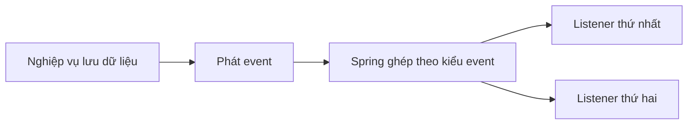
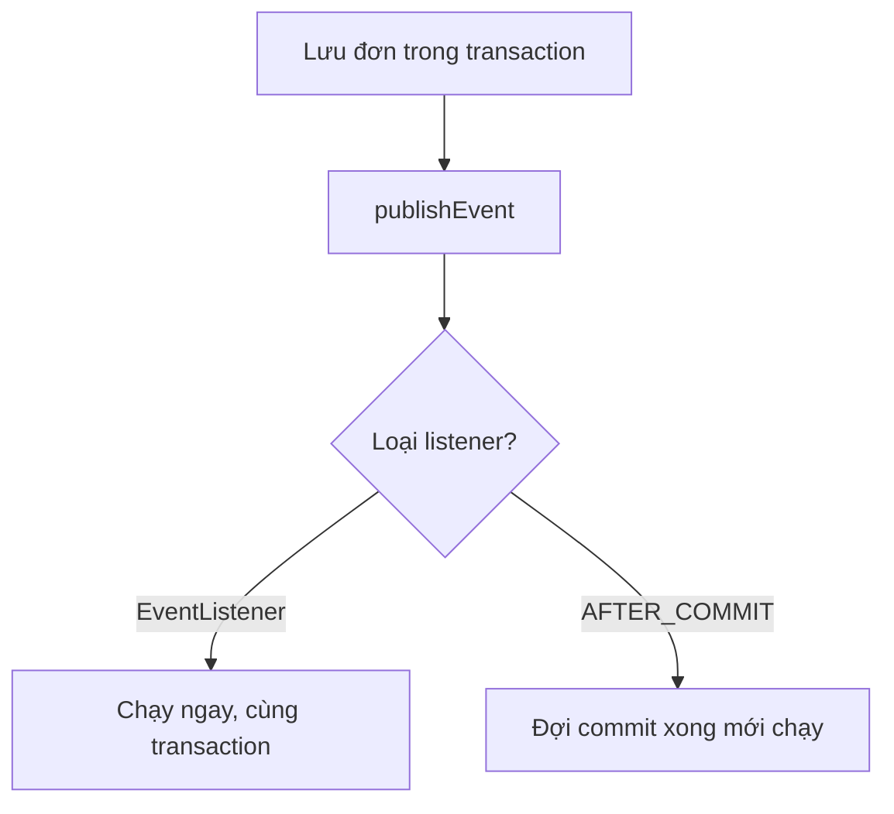
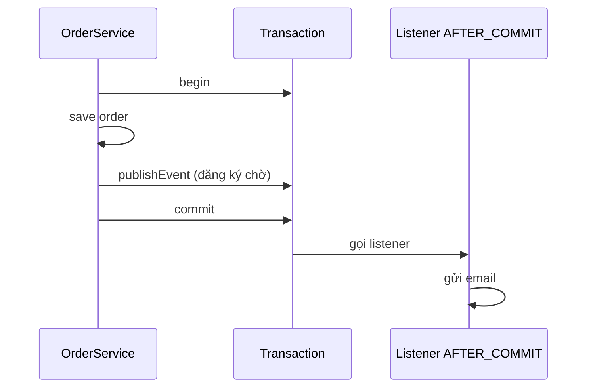

# Lý thuyết 17: Application Event

## Application Event là gì?

Application Event là cơ chế "phát và nghe" **trong cùng một ứng dụng**: một bên phát ra một event ("đơn hàng vừa được tạo"), các bên khác đăng ký nghe và phản ứng. Bên phát không biết (và không cần biết) có ai đang nghe. Giống như loa phát thanh trong tòa nhà: người thông báo chỉ nói một lần, ai quan tâm thì tự phản ứng.

**Cốt lõi:** Nếu nghiệp vụ chính gọi thẳng từng phản ứng phụ thì nó phình to và bị trói chặt vào những thứ không liên quan. Event đảo lại: người phát chỉ ném ra một object, Spring tìm các listener theo kiểu của object đó và gọi chúng ngay trong call stack của người phát.

- Vì listener được ghép theo kiểu event, nên người phát không biết ai nghe và thêm phản ứng mới chỉ cần thêm listener.
- Vì listener chạy ngay trong thread và transaction của người phát, nên listener lỗi thì nghiệp vụ chính cũng lỗi.
- Vì việc như gửi email chỉ đúng khi dữ liệu đã lưu, nên listener được gắn vào một pha của transaction, và event nằm trong memory nên không bền khi ứng dụng sập.



Mô hình tư duy: sơ đồ cho thấy người phát chỉ biết class event, còn việc ai phản ứng và khi nào (ngay hay sau commit) do Spring quyết định.

**Tóm tắt:**

- Application Event là cơ chế publish/listen trong một JVM: người phát không biết ai nghe, nên thêm phản ứng phụ chỉ cần thêm listener, không sửa code cũ.
- `@EventListener` mặc định chạy sync, cùng thread và cùng transaction với người phát, nên listener ném lỗi thì nghiệp vụ chính cũng lỗi.
- Việc chỉ được làm khi dữ liệu đã lưu (như gửi email) dùng `@TransactionalEventListener`, mặc định ở pha `AFTER_COMMIT`.
- Publish ngoài transaction thì listener loại này bị bỏ qua lặng lẽ, trừ khi đặt `fallbackExecution = true`.
- Ở pha `AFTER_COMMIT` transaction cũ đã xong, nên muốn ghi DB trong listener phải mở transaction mới bằng `REQUIRES_NEW`.
- `@Async` đưa listener sang thread khác, nhưng lỗi không tự báo; cần `@EnableAsync`, pool riêng và xử lý lỗi trong listener.
- Event nội bộ không bền vững, tắt ứng dụng giữa chừng là mất; cần tin cậy giữa các service thì dùng outbox cộng message broker.
- Spring cũng tự phát event theo lifecycle (`ApplicationReadyEvent`, `ContextClosedEvent`) để bạn lắng nghe.

## Vấn đề nó giải quyết

Không có event thì `OrderService` phải gọi thẳng service email, thống kê, thông báo đẩy, và phình to mỗi lần thêm một phản ứng phụ; nghiệp vụ chính bị trói chặt với những thứ không liên quan. Dùng event thì thêm hành vi mới chỉ cần thêm một listener, không sửa code cũ. Hai phía chỉ cùng biết về class event.

## Khi nào dùng, khi nào không

Dùng cho các việc phụ phát sinh sau một nghiệp vụ chính, trong phạm vi **một JVM**. Không dùng khi cần gửi sang service khác hoặc cần đảm bảo không mất message khi ứng dụng sập: lúc đó cần message broker như Kafka. Cách dùng: phát bằng `ApplicationEventPublisher.publishEvent`, nghe bằng `@EventListener`; cần chạy sau khi transaction commit thì dùng `@TransactionalEventListener`.

## Các khái niệm cần biết

- **Publisher và listener**: publisher gọi `publishEvent(obj)`; listener là method nhận đúng kiểu `obj` đó. Spring dùng kiểu của tham số để ghép.
- **Sync theo mặc định**: `publishEvent` gọi listener ngay, trong cùng thread và cùng transaction, rồi mới trả về. Nên listener ném lỗi thì nghiệp vụ chính cũng lỗi.
- **Coupling**: mức độ một class gắn chặt với class khác. Event giảm coupling vì người phát chỉ cần biết class event.
- **Pha transaction (`TransactionPhase`)**: thời điểm trong lifecycle của transaction mà listener chạy (trước commit, sau commit, sau rollback...).
- **Outbox pattern**: kỹ thuật ghi event vào bảng trong cùng transaction với nghiệp vụ, rồi một process khác gửi lên broker, để không mất event khi ứng dụng sập.
- **SpEL**: ngôn ngữ biểu thức của Spring, dùng trong `condition` của listener.

## Flow

Điểm quan trọng nhất là **khi nào** listener chạy so với transaction. `@EventListener` chạy ngay lập tức trong transaction; `@TransactionalEventListener(AFTER_COMMIT)` đợi commit thành công rồi mới chạy:



**Phải thuộc:** `@EventListener` mặc định chạy sync, cùng thread, cùng transaction với người phát (listener ném lỗi thì nghiệp vụ chính cũng lỗi). `@TransactionalEventListener` mặc định pha `AFTER_COMMIT`; publish ngoài transaction thì listener này không chạy (trừ khi `fallbackExecution = true`).

**Nền tảng:** event nội bộ giảm coupling giữa các phần trong cùng một JVM, nhưng không bền vững và không thay được message broker. Muốn tin cậy giữa các service phải dùng outbox cộng broker.

## Ví dụ

Hãy xem một đơn hàng được tạo. `OrderService` chỉ lưu đơn và phát `OrderCreated`. Việc gửi email nằm ở listener riêng: chạy sau commit (để chắc chắn đơn đã lưu, không gửi email cho đơn bị rollback) và async bằng `@Async` (để không làm chậm người dùng).

```java
public record OrderCreated(Long orderId, String email) {}

@Service
public class OrderService {
    private final ApplicationEventPublisher events;
    private final OrderRepository repository;

    public OrderService(ApplicationEventPublisher events, OrderRepository repository) {
        this.events = events;
        this.repository = repository;
    }

    @Transactional
    public Order create(CreateOrder req) {
        Order order = repository.save(Order.from(req));
        events.publishEvent(new OrderCreated(order.getId(), req.email()));
        return order;
    }
}

@Component
class OrderEmailListener {
    @TransactionalEventListener(phase = TransactionPhase.AFTER_COMMIT)
    @Async
    void on(OrderCreated e) { /* gửi email */ }
}
```

## Các pha của `@TransactionalEventListener`

Vấn đề đặt ra: publish event nằm giữa transaction, nhưng bạn chỉ muốn phản ứng khi dữ liệu đã chắc chắn được lưu. `@TransactionalEventListener` gắn listener vào một pha của transaction đang chạy tại thời điểm publish.

| Pha | Chạy khi | Dùng cho |
|---|---|---|
| `BEFORE_COMMIT` | Ngay trước commit, vẫn trong transaction | Ghi thêm dữ liệu cùng transaction |
| `AFTER_COMMIT` (mặc định) | Sau commit thành công | Gửi email, đẩy message |
| `AFTER_ROLLBACK` | Sau rollback | Bù trừ, ghi log lỗi |
| `AFTER_COMPLETION` | Sau commit hoặc rollback | Dọn dẹp |

Nếu publish event **ngoài** transaction thì listener loại này **không chạy** (bị bỏ qua lặng lẽ), trừ khi đặt `fallbackExecution = true`.



**Suy luận:** `publishEvent` chạy sync vì cách đơn giản nhất để listener đọc được dữ liệu vừa ghi và rollback cùng nghiệp vụ là cho nó chạy ngay trong call stack và transaction của người phát. Từ đó suy ra hai hệ quả: listener ném exception thì nghiệp vụ chính rollback theo, và listener chậm thì request chậm theo. Việc gửi email cần điều ngược lại, tức chỉ chạy khi dữ liệu đã chắc chắn được lưu; vì vậy Spring không đẩy listener sang thread khác mà đăng ký nó vào một pha của transaction và chạy khi commit xong. Cũng vì pha `AFTER_COMMIT` nằm sau khi transaction kết thúc, xuất hiện ba điểm dễ nhầm. Thứ nhất, transaction cũ không còn dùng được, nên ghi DB trong listener phải mở `REQUIRES_NEW`. Thứ hai, publish ngoài transaction thì không có pha nào để đăng ký, listener bị bỏ qua mà không có lỗi. Thứ ba, `AFTER_COMMIT` cộng `@Async` vẫn chưa bền: listener lỗi sau commit hoặc ứng dụng sập thì event mất, vì không có gì lưu nó lại. Khi review, hỏi ba câu: việc này có được phép làm hỏng nghiệp vụ chính không (chọn sync hay `AFTER_COMMIT`), có cần ghi DB không (`REQUIRES_NEW`), và mất event có chấp nhận được không (nếu không thì dùng outbox).

## Ghi DB trong listener `AFTER_COMMIT`

```java
@Component
class AuditListener {
    private final AuditRepository audits;
    AuditListener(AuditRepository audits) { this.audits = audits; }

    @TransactionalEventListener(phase = TransactionPhase.AFTER_COMMIT)
    // bắt buộc: transaction cũ không dùng được nữa
    @Transactional(propagation = Propagation.REQUIRES_NEW)
    public void on(OrderCreated e) {
        audits.save(new Audit("ORDER_CREATED", e.orderId()));
    }
}
```

Transaction cũ đã xong ở pha này nên không thể tham gia tiếp. Từ Spring Framework 6.1, kết hợp `@TransactionalEventListener` với `@Transactional` chỉ được chấp nhận khi là `REQUIRES_NEW` hoặc `NOT_SUPPORTED`, còn `REQUIRED` mặc định bị từ chối lúc khởi động.

## Listener có điều kiện, thứ tự và dây chuyền

`condition` cho phép bỏ qua listener khi event không phù hợp (ở đây chỉ xử lý đơn trên 1000), `@Order` sắp thứ tự khi có nhiều listener sync cho cùng event, và trả về một object từ listener sẽ publish tiếp object đó như event mới. Dây chuyền dài khiến flow khó theo dõi; chỉ dùng khi thực sự rõ ràng.

```java
@Component
class VipListener {
    // SpEL, đánh giá trước khi gọi (giả sử OrderCreated có thêm field amount)
    @EventListener(condition = "#e.amount > 1000")
    // số nhỏ chạy trước (với listener sync)
    @Order(1)
    public void on(OrderCreated e) { /* ... */ }

    // Trả về object thì Spring publish tiếp object đó như một event mới
    @EventListener
    public OrderNotified chain(OrderCreated e) { return new OrderNotified(e.orderId()); }
}
```

## Event async và xử lý lỗi

`@EventListener` cùng `@Async` chạy ở thread khác: lỗi không ảnh hưởng người phát nhưng cũng không tự báo. Cần `@EnableAsync` và pool riêng (xem [Scheduling và Async](/go?p=01-Spring-Boot%2Fmedium%2Flt-18-scheduling-async.md)). Muốn listener sync không làm hỏng người phát, bọc `try/catch` trong listener.

## Test event

```java
@SpringBootTest
@RecordApplicationEvents
class OrderEventTest {
    @Autowired OrderService service;
    @Autowired ApplicationEvents events;

    @Test
    void createPublishesEvent() {
        service.create(new CreateOrder("a@x.com", 10));
        assertThat(events.stream(OrderCreated.class)).hasSize(1);
    }
}
```

`@RecordApplicationEvents` và `ApplicationEvents` nằm trong `org.springframework.test.context.event`. Với listener `AFTER_COMMIT`, test bọc `@Transactional` rồi rollback sẽ **không bao giờ** kích hoạt listener; hoặc dùng `TestTransaction.flagForCommit()`, hoặc đừng bọc.

## Điều cần nhớ

- `@EventListener` mặc định chạy **sync, cùng thread, cùng transaction**: listener lỗi thì làm hỏng cả nghiệp vụ chính.
- Gửi email khi transaction **chưa commit** là lỗi phổ biến: lỡ rollback thì email đã đi. Dùng `AFTER_COMMIT`.
- Trong `AFTER_COMMIT`, transaction cũ đã xong; muốn ghi DB phải mở transaction mới (`REQUIRES_NEW`).
- Event nội bộ **không bền vững**: tắt ứng dụng giữa chừng thì mất. Cần bảo đảm tin cậy thì dùng Outbox + message broker (xem [Kiến trúc hướng sự kiện với Kafka](/go?p=01-Spring-Boot%2Fhard%2Flt-07-event-driven-kafka.md)).
- Ranh giới: event nội bộ cho một ứng dụng; broker cho giao tiếp giữa các service.

## Event có sẵn của Spring Boot

Chính Spring cũng phát event trong lifecycle của ứng dụng; bạn nghe bằng `@EventListener` như event của mình. Ví dụ dùng `ApplicationReadyEvent` để nạp dữ liệu khởi động hoặc `ContextClosedEvent` để dọn dẹp khi tắt.

| Event | Khi nào |
|---|---|
| `ApplicationStartedEvent` | Context đã nạp, chưa chạy runner |
| `ApplicationReadyEvent` | Sẵn sàng nhận request |
| `ContextClosedEvent` | Bắt đầu tắt |

## Phỏng vấn khó: chuỗi hỏi xoáy

Người phỏng vấn senior thường mở bằng câu dễ rồi xoáy xuống cơ chế, đánh đổi và sự cố thật. Câu trả lời tốt luôn đi từ cốt lõi xuống: listener chạy trong call stack của người phát, còn phần "sau commit" và "không mất event" là hai chuyện khác nhau.

### Chuỗi 1: Listener sau commit

1. **Câu mở:** Vì sao gửi email nên đặt trong `@TransactionalEventListener` chứ không phải `@EventListener` thường?
2. **Xoáy 1:** Listener `AFTER_COMMIT` cần ghi một bản audit vào DB. Gắn `@Transactional` bình thường có được không?
3. **Xoáy 2:** Có chỗ gọi `publishEvent` ngoài transaction thì listener có chạy không? Và test bọc `@Transactional` rồi rollback thì sao?

**Đáp án ngắn:** `@EventListener` chạy sync, cùng thread và cùng transaction với người phát. Gửi email ở đó thì lỡ transaction rollback, email đã đi mất. `@TransactionalEventListener` đăng ký listener vào một pha của transaction, mặc định `AFTER_COMMIT`, nên chỉ chạy khi dữ liệu chắc chắn đã lưu. Ở pha này transaction cũ đã xong, nên ghi DB phải mở transaction mới bằng `REQUIRES_NEW`; từ Spring Framework 6.1, `REQUIRED` mặc định bị từ chối lúc khởi động. Nếu publish ngoài transaction thì không có pha nào để đăng ký, listener bị bỏ qua lặng lẽ trừ khi đặt `fallbackExecution = true`. Test bọc `@Transactional` rồi rollback thì listener `AFTER_COMMIT` không bao giờ chạy; dùng `TestTransaction.flagForCommit()` hoặc đừng bọc. Dấu hiệu trong production: email không đi mà không có lỗi nào, hãy kiểm tra lúc publish có transaction hay không.

**Sai lầm hay gặp:**

- Nói "chạy sau commit nên cứ ghi DB tiếp": bỏ sót `REQUIRES_NEW`.
- Cho rằng `@TransactionalEventListener` tự đẩy sang thread khác; thread khác là việc của `@Async`.
- Tin rằng có annotation này là chắc chắn chạy, không biết publish ngoài transaction thì bị bỏ qua.

### Chuỗi 2: Event nội bộ và độ tin cậy

1. **Câu mở:** Application Event của Spring khác message broker như Kafka ở điểm nào?
2. **Xoáy 1:** Listener `AFTER_COMMIT` kèm `@Async` gửi email. Nếu nó lỗi sau commit, hoặc ứng dụng sập giữa chừng thì sao?
3. **Xoáy 2:** Yêu cầu là không được mất event. Thiết kế thế nào, và khi có nhiều service thì có đổi không?

**Đáp án ngắn:** Event nội bộ chỉ sống trong memory của một JVM; người phát gọi listener ngay trong call stack và không có gì lưu event lại. Vì vậy `AFTER_COMMIT` cộng `@Async` vẫn chưa bền: listener lỗi sau commit thì dữ liệu đã lưu nhưng email không đi, ứng dụng sập thì event mất, vì transaction đã xong và không ai nhớ. Muốn không mất, dùng outbox: ghi event vào bảng trong cùng transaction với nghiệp vụ, rồi một process khác đọc bảng đó và gửi lên broker. Ghi cùng transaction là điểm mấu chốt, vì dữ liệu và event cùng thành công hoặc cùng thất bại. Đổi lại có độ trễ, và bên nhận nên chịu được việc nhận trùng (kiểm tra theo cách triển khai). Giữa nhiều service thì bắt buộc cần broker, vì event nội bộ không vượt qua ranh giới JVM. Cách phát hiện sự cố: đối chiếu số đơn đã lưu với số email đã gửi.

**Sai lầm hay gặp:**

- Coi `ApplicationEventPublisher` như một message queue.
- Nghĩ `AFTER_COMMIT` đã đủ bảo đảm, không nêu được kịch bản sập giữa commit và gửi.
- Nói "dùng outbox" mà không giải thích được vì sao phải ghi cùng transaction.

