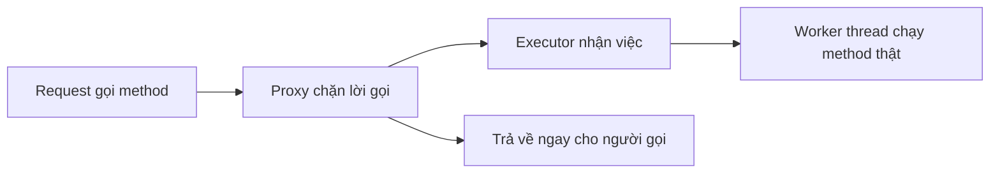
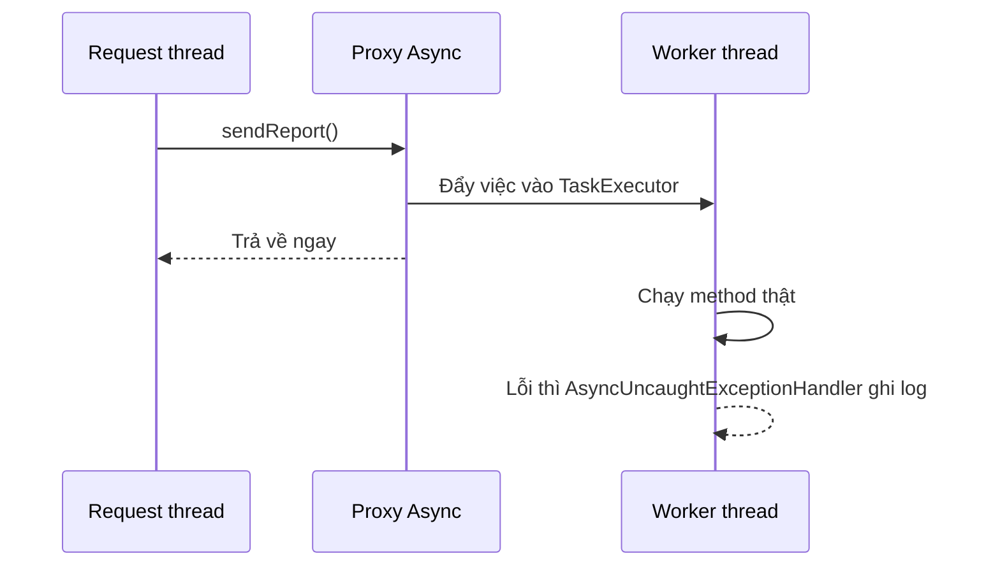
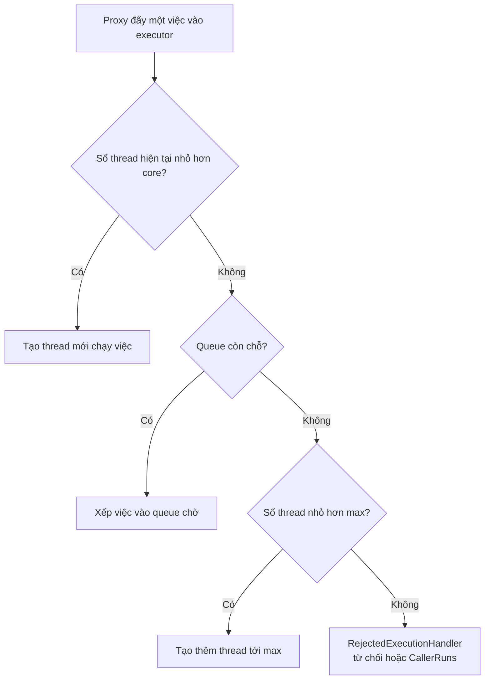
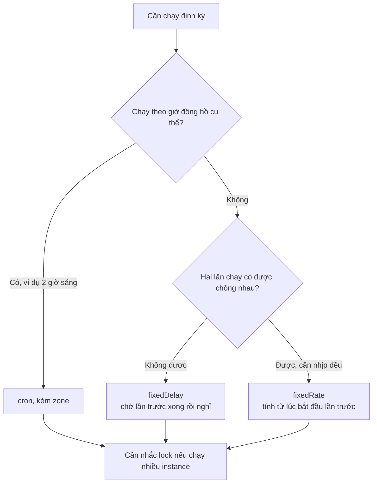
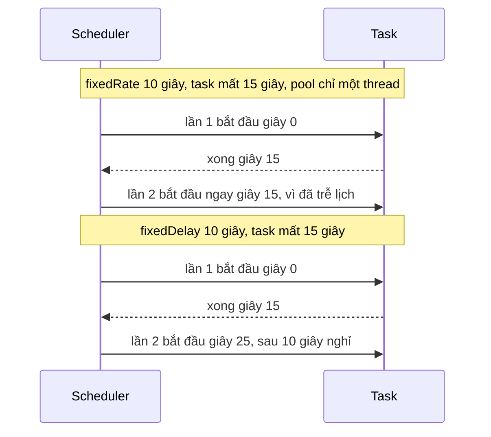
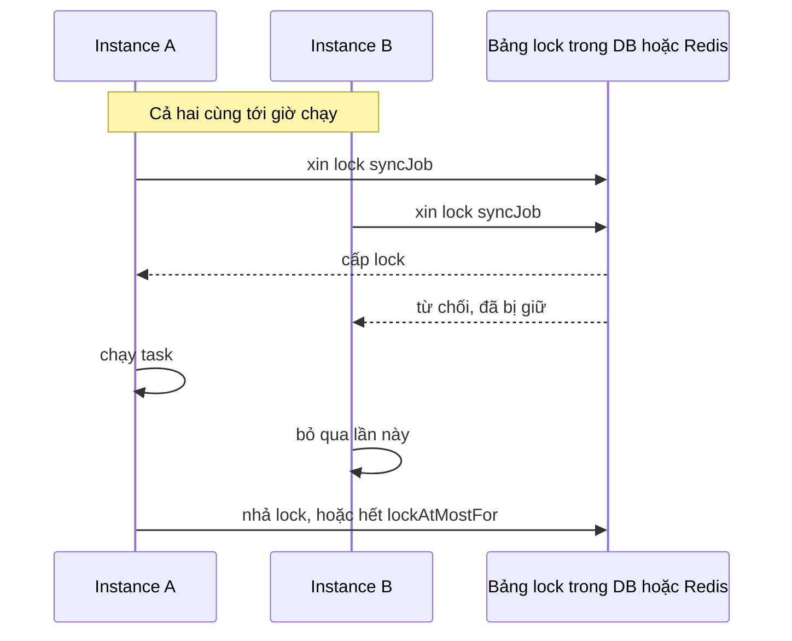

# Lý thuyết 18: Scheduling và Async

## Scheduling và Async là gì?

Hai annotation này giúp ứng dụng làm việc **không theo nhịp của một request**. `@Scheduled` cho một method chạy theo lịch (mỗi 5 phút, mỗi đêm 2 giờ...). `@Async` cho một method chạy ở thread khác, người gọi trả về ngay và không phải chờ. Ví dụ đời thường: `@Scheduled` giống đồng hồ báo thức, còn `@Async` giống việc bạn nhờ nhân viên gửi thư hộ rồi quay lại làm việc khác thay vì đứng chờ tới bưu điện.

**Cốt lõi:** Việc chậm làm request giữ thread quá lâu, còn việc định kỳ cần thứ gì đó tự kích hoạt. Spring giải quyết cả hai bằng cách chặn lời gọi ở ranh giới bean (proxy), đẩy việc vào một thread pool rồi trả về ngay, còn lịch thì do scheduler kích hoạt trên pool.

- Vì chỉ lời gọi đi qua proxy mới được đẩy đi, nên self-invocation chạy sync mà code vẫn đúng.
- Vì worker là thread khác, nên nó không có transaction, `SecurityContext` hay MDC của thread gọi.
- Vì pool xếp việc vào queue trước rồi mới tạo thread vượt `core`, nên queue không giới hạn khiến `max` vô dụng và việc dồn vào memory.



Mô hình tư duy: sơ đồ cho thấy người gọi và worker tách rời nhau tại proxy, nên mọi thứ gắn theo thread đều không đi theo sang worker.

**Tóm tắt:**

- `@Scheduled` chạy method theo lịch, `@Async` chạy method ở thread khác để người gọi không phải chờ; cả hai đều hoạt động qua proxy và thread pool.
- Pool nhận việc theo thứ tự: dưới `core` thì tạo thread, hết `core` thì xếp vào queue, queue đầy mới tạo thêm tới `max`, vượt nữa thì `RejectedExecutionHandler`.
- Pool mặc định của Boot có queue không giới hạn, nên `max` gần như không dùng tới và khi quá tải việc dồn vào memory; luôn đặt `queue-capacity` và rejected handler.
- `@Scheduled` mặc định chỉ có một thread; cron của Spring có 6 trường; `fixedRate` tính từ lúc bắt đầu lần trước, `fixedDelay` tính từ lúc kết thúc.
- Self-invocation làm `@Async` chạy sync trên thread của request; thread worker không có transaction, `SecurityContext`, MDC của thread gọi nên phải truyền context sang.
- Exception của method `void` không về người gọi: xử lý bằng `AsyncUncaughtExceptionHandler`, còn `CompletableFuture` thì dùng `exceptionally`.
- Chạy nhiều instance thì task `@Scheduled` chạy trùng ở mỗi instance; dùng ShedLock (distributed lock) hoặc scheduler tập trung.
- Việc quan trọng không được mất khi restart thì dùng queue bền vững thay vì `@Async`; task định kỳ phải idempotent.

## Vấn đề nó giải quyết

Gửi email hay xuất báo cáo ngay trong request thì người dùng phải đứng chờ, và request chiếm một thread của server lâu (thread là tài nguyên hữu hạn, chiếm nhiều thì server không phục vụ được người khác). Việc định kỳ như dọn dữ liệu cũ hay đồng bộ dữ liệu thì cần một thứ tự động kích hoạt mà không cần ai gọi.

## Khi nào dùng, khi nào không

Dùng cho tác vụ định kỳ và việc nền không cần kết quả ngay. **Không** dùng cho việc quan trọng cần đảm bảo chạy xong: `@Async` giữ việc trong memory, ứng dụng restart là mất. Những việc đó nên dùng queue bền vững hoặc Spring Batch.

Cách làm: bật `@EnableScheduling` hoặc `@EnableAsync`, cấu hình thread pool riêng thay vì dùng mặc định, và xử lý lỗi trong task vì `@Async` rất dễ nuốt exception. Khi chạy nhiều instance, task `@Scheduled` sẽ chạy trùng ở mỗi instance, cần lock hoặc chỉ cho một instance chạy (xem cuối bài).

## Các khái niệm cần biết

- **Thread pool (`TaskExecutor`)**: một nhóm thread dựng sẵn để tái sử dụng. Việc `@Async` được ném vào pool, thread rảnh nhận làm. Pool có giới hạn nên không để server sinh thread vô hạn.
- **Core size, max size, queue capacity**: `core` là số thread luôn giữ; `queue` là queue khi tất cả core đều bận; `max` là số thread tối đa chỉ sinh thêm khi queue đã đầy.
- **`RejectedExecutionHandler`**: quyết định làm gì khi pool và queue đều đầy (từ chối, tự chạy ở thread của người gọi, bỏ việc cũ...).
- **`CompletableFuture`**: object đại diện cho kết quả sẽ có trong tương lai, cho phép nối tiếp xử lý (`thenApply`, `exceptionally`) mà không block thread.
- **Cron**: biểu thức mô tả lịch lặp, ví dụ `0 0 2 * * *` là 02:00 mỗi ngày.
- **Idempotent**: chạy một việc nhiều lần cho cùng kết quả như chạy một lần. Tác vụ định kỳ nên idempotent vì có thể chạy trùng hoặc chạy lại sau lỗi.
- **MDC và SecurityContext**: dữ liệu gắn theo thread (mã request cho log, người dùng hiện tại). Thread mới không có chúng, phải truyền sang.
- **ShedLock**: thư viện distributed lock để chỉ một instance chạy mỗi lần.

## Flow của `@Async`

Khi bạn gọi một method `@Async`, thứ nhận call là proxy. Proxy chỉ đẩy việc vào executor rồi trả về ngay; thread worker mới chạy method thật:



Khi việc được đẩy vào executor, pool xử lý theo thứ tự cố định (áp dụng cho `ThreadPoolTaskExecutor` bọc `ThreadPoolExecutor`):



Đọc sơ đồ: thread vượt `core` chỉ sinh ra khi queue đã đầy. Với queue không giới hạn của pool mặc định, nhánh "queue còn chỗ" luôn đúng nên `max` không bao giờ được dùng.

Về cách pool nhận việc, nhiều người đoán sai thứ tự: pool ưu tiên **xếp vào queue trước, tạo thêm thread sau**, và chỉ mở thread vượt `core` khi queue đầy. Sơ đồ quyết định và thí nghiệm chạy thật nằm ở bài gốc [Thread pool trong thực tế](/go?p=08-Java%2FJava-Concurrency%2Fmedium%2Flt-08-thread-pool.md); `ThreadPoolTaskExecutor` chỉ bọc `ThreadPoolExecutor` đó.

**Phải thuộc:** thứ tự `ThreadPoolExecutor`: thread dưới `core` thì tạo thread mới, hết `core` thì xếp vào queue, queue đầy mới tạo thêm tới `max`, vượt nữa thì `RejectedExecutionHandler`. Mặc định của Boot (`applicationTaskExecutor`): core 8, queue không giới hạn (nên `max` gần như không dùng tới); `@Scheduled` mặc định chỉ một thread (`spring.task.scheduling.pool.size=1`).

**Nền tảng:** `@Async` và `@Scheduled` đều chạy qua proxy và thread pool, nên thừa hưởng mọi giới hạn của proxy (self-invocation) và của thread (không có transaction, `SecurityContext`, MDC của thread gọi).

**Suy luận:** `@Async` dựa trên proxy cộng thread pool vì cách ít xâm lấn nhất để đổi "chạy ngay ở đây" thành "chạy ở thread khác" là chặn call tại ranh giới bean, đẩy việc vào executor rồi trả về ngay. Từ đó suy ra ba hệ quả. Thứ nhất, chỉ call đi qua proxy mới được đẩy đi, nên self-invocation chạy sync ngay trên thread của request mà code vẫn đúng; đó là lý do lỗi này im lặng. Thứ hai, thread worker là thread khác nên không thừa hưởng transaction, `SecurityContext` hay MDC (đều gắn theo `ThreadLocal`); đây không phải lỗi của Spring mà là hệ quả trực tiếp của việc đổi thread, nên phải truyền tay bằng `TaskDecorator`. Thứ ba, `ThreadPoolExecutor` ưu tiên xếp vào queue trước và tạo thread sau, vì tái dùng thread có sẵn rẻ hơn tạo thread mới; với queue không giới hạn của pool mặc định thì `max` không bao giờ được dùng, và khi quá tải việc không bị từ chối mà dồn vào memory. Điểm dễ nhầm là tưởng tăng `max-size` sẽ chịu được tải lớn hơn. Khi review: luôn đặt `queue-capacity` hữu hạn kèm `RejectedExecutionHandler`, tách method `@Async` sang bean khác, và hỏi mất việc khi restart có chấp nhận được không.

## Ví dụ

Cấu hình bật hai tính năng, khai báo một pool riêng có giới hạn, rồi dùng `@Async("appExecutor")` để chỉ định pool và `@Scheduled(cron...)` cho việc dọn dẹp ban đêm.

```java
@Configuration
@EnableAsync
@EnableScheduling
class AsyncConfig {
    @Bean
    TaskExecutor appExecutor() {
        ThreadPoolTaskExecutor ex = new ThreadPoolTaskExecutor();
        ex.setCorePoolSize(4);
        ex.setMaxPoolSize(8);
        ex.setQueueCapacity(100);
        ex.setThreadNamePrefix("app-");
        return ex;
    }
}

@Service
class ReportService {
    @Async("appExecutor")
    public CompletableFuture<Report> build(Long id) { ... }

    @Scheduled(cron = "0 0 2 * * *")        // 02:00 mỗi ngày
    public void nightlyCleanup() { ... }
}
```

## Ba kiểu lịch của `@Scheduled`

Chọn kiểu lịch tùy câu hỏi "lần sau tính từ lúc nào". `fixedRate` hợp việc cần nhịp đều (nhưng dễ chồng lấp nếu một lần chạy quá lâu), `fixedDelay` hợp việc không được chồng nhau (chờ xong rồi nghỉ), `cron` hợp lịch theo đồng hồ (mỗi 2 giờ sáng).

| Thuộc tính | Nghĩa | Ví dụ |
|---|---|---|
| `fixedRate = 60_000` | Cách nhau 60 giây tính từ lúc **bắt đầu** lần trước | Lần chạy chậm hơn chu kỳ thì lần sau bị dồn |
| `fixedDelay = 60_000` | Chờ 60 giây sau khi lần trước **kết thúc** | Không bao giờ chồng lên nhau |
| `cron = "0 0 2 * * *"` | Biểu thức 6 trường | giây phút giờ ngày tháng thứ |
| `initialDelay` | Trễ lần đầu | Chờ ứng dụng ấm lên |

Chọn kiểu lịch theo nhu cầu:



Sự khác nhau giữa `fixedRate` và `fixedDelay` khi một lần chạy kéo dài hơn chu kỳ:



Đọc sơ đồ: với một thread, `fixedRate` không chạy chồng mà chạy bù ngay khi lần trước xong; còn `fixedDelay` luôn có khoảng nghỉ cố định giữa hai lần. Con số trong sơ đồ chỉ để minh họa.

**Phải thuộc:** cron của Spring có **6 trường** (giây phút giờ ngày tháng thứ), không phải 5 như Unix; `fixedRate` tính từ lúc bắt đầu lần trước, `fixedDelay` tính từ lúc kết thúc lần trước.

Cron của Spring có **6 trường** (có giây), không phải 5 như Unix. Thêm `zone = "Asia/Ho_Chi_Minh"` để khỏi phụ thuộc múi giờ máy chủ. Method `@Scheduled` phải không có tham số và trả `void`.

## Chọn cấu hình pool bằng property

```yaml
spring:
  task:
    execution:                 # pool của @Async mặc định (applicationTaskExecutor)
      pool:
        core-size: 4
        max-size: 8
        queue-capacity: 100
      thread-name-prefix: app-
    scheduling:                # pool của @Scheduled
      pool:
        size: 2
      thread-name-prefix: sched-
  threads:
    virtual:
      enabled: false           # true: dùng virtual thread (Java 21+, Boot 3.2+)
```

Khi bật `spring.threads.virtual.enabled=true`, Boot 3.2+ cho Tomcat xử lý request trên virtual thread và để executor/scheduler mặc định của `@Async`, `@Scheduled` chạy trên virtual thread (kiểm tra lại theo phiên bản). Khi đó `core-size`, `queue-capacity` không còn là giới hạn tải; xem [Đồng thời trong Java và Virtual Threads](/go?p=01-Spring-Boot%2Fhard%2Flt-22-concurrency-virtual-threads.md) để biết cách giới hạn bằng `Semaphore`.

Boot tự dựng `ThreadPoolTaskExecutor` từ các property này khi chưa có bean `Executor` riêng. Khi bạn khai báo bean `TaskExecutor` riêng (như ví dụ trên) thì cấu hình `spring.task.execution.*` không còn áp cho nó.

## Cách `@Async` hoạt động, trước và sau

`@Async` hoạt động qua proxy (xem [AOP và Proxy](/go?p=01-Spring-Boot%2Fmedium%2Flt-13-aop-proxy.md)), nên gọi nội bộ bằng `this` không qua proxy và method chạy sync ngay trên thread của request. Hiện tượng: code vẫn đúng nhưng "async" không xảy ra và người dùng vẫn phải chờ. Sửa bằng cách tách sang bean khác.

```java
// SAI: gọi nội bộ, chạy sync ngay trên thread của request
@Service
class MailService {
    public void register(User u) {
        sendWelcome(u);              // this.sendWelcome: không qua proxy
    }
    @Async public void sendWelcome(User u) { /* chậm */ }
}

// ĐÚNG: tách ra bean khác
@Service
class WelcomeMailer {
    @Async("appExecutor")
    public void sendWelcome(User u) { /* chạy ở thread app-1 */ }
}
@Service
class RegistrationService {
    private final WelcomeMailer mailer;
    RegistrationService(WelcomeMailer mailer) { this.mailer = mailer; }
    public void register(User u) { mailer.sendWelcome(u); }
}
```

Kiểu trả về: `void` (bắn rồi quên), `CompletableFuture<T>` (có kết quả), tránh `Future` thuần. Exception của method `void` không về người gọi: xử lý bằng `AsyncConfigurer`.

```java
@Configuration
@EnableAsync
class AsyncErrorConfig implements AsyncConfigurer {
    @Override
    public AsyncUncaughtExceptionHandler getAsyncUncaughtExceptionHandler() {
        return (ex, method, params) ->
                LoggerFactory.getLogger(method.getDeclaringClass())
                             .error("Async lỗi ở {}", method.getName(), ex);
    }
}
```

Với `CompletableFuture`, lỗi nằm trong future: dùng `.exceptionally(...)` hoặc `.handle(...)`.

## Truyền context sang thread mới

Thread worker không thừa hưởng gì từ thread gọi. Nếu không truyền, log ở thread worker mất `requestId` và code đọc người dùng hiện tại nhận `null`. `TaskDecorator` là móc cho phép bọc mỗi task: ví dụ dưới sao chép MDC từ thread gọi sang worker và dọn sau khi chạy xong. `CallerRunsPolicy` là chiến lược "đầy thì người gọi tự chạy", vô tình làm chậm người gọi nên tự giảm tải.

```java
@Bean
TaskExecutor appExecutor() {
    ThreadPoolTaskExecutor ex = new ThreadPoolTaskExecutor();
    ex.setCorePoolSize(4);
    ex.setMaxPoolSize(8);
    ex.setQueueCapacity(100);
    ex.setThreadNamePrefix("app-");
    // Sao chép MDC (requestId) sang thread worker
    ex.setTaskDecorator(runnable -> {
        Map<String, String> mdc = MDC.getCopyOfContextMap();
        return () -> {
            if (mdc != null) MDC.setContextMap(mdc);
            try { runnable.run(); } finally { MDC.clear(); }
        };
    });
    // đầy thì người gọi tự chạy: tự giảm tải
    ex.setRejectedExecutionHandler(new ThreadPoolExecutor.CallerRunsPolicy());
    ex.initialize();
    return ex;
}
```

`SecurityContext` truyền bằng cách bọc executor trong `DelegatingSecurityContextAsyncTaskExecutor` (Spring Security). Transaction thì không truyền được: việc `@Async` phải tự mở transaction của nó.

Với `queueCapacity=100`, `core=4`, `max=8` thì thread thứ 5 chỉ sinh ra khi 100 việc đã nằm trong queue (cơ chế đầy đủ ở [Thread pool trong thực tế](/go?p=08-Java%2FJava-Concurrency%2Fmedium%2Flt-08-thread-pool.md)). Cỡ pool nên tính theo loại tác vụ (CPU hay I/O) và theo tài nguyên hạ nguồn như connection pool của DB, xem [Đồng thời trong Java và Virtual Threads](/go?p=01-Spring-Boot%2Fhard%2Flt-22-concurrency-virtual-threads.md).

Muốn graceful shutdown, khai báo thêm hai dòng để ứng dụng chờ việc đang dở trước khi dừng:

```java
// chờ việc đang chạy và đang nằm trong queue
ex.setWaitForTasksToCompleteOnShutdown(true);
ex.setAwaitTerminationSeconds(30);              // nhưng không quá 30 giây
```

## Test

```java
@SpringBootTest
class AsyncTest {
    @Autowired WelcomeMailer mailer;

    @Test
    void runsOnWorkerThread() throws Exception {
        // giả sử WelcomeMailer có thêm: @Async("appExecutor") CompletableFuture<String> threadName()
        // trả Thread.currentThread().getName()
        CompletableFuture<String> name = mailer.threadName();
        assertTrue(name.get(2, TimeUnit.SECONDS).startsWith("app-"));
    }
}
```

Với việc không trả kết quả, dùng Awaitility: `await().atMost(2, SECONDS).untilAsserted(() -> ...)`. Task `@Scheduled` nên tách logic ra method thường rồi test method đó, không đợi đồng hồ. Bẫy ngoài đời và thiết kế bền vững: [Resilience và chịu lỗi](/go?p=01-Spring-Boot%2Fhard%2Flt-32-resilience-chiu-loi.md).

## Bẫy

| Bẫy | Giải thích |
|---|---|
| `@Async` không hiệu lực | Cùng bài toán proxy: gọi nội bộ (self-invocation) hoặc phương thức không `public` |
| Mất context | Thread mới **không** có transaction, `SecurityContext`, MDC của thread gọi |
| Dùng executor mặc định | Spring Boot dựng pool mặc định với queue không giới hạn; khi quá tải việc dồn vào queue và ăn memory, còn `max-size` không bao giờ được dùng tới. Luôn đặt `queue-capacity` và `RejectedExecutionHandler` rõ ràng |
| `@Scheduled` mặc định chạy **một thread** | Tác vụ chậm làm trễ các tác vụ khác |
| Chạy trùng khi có nhiều instance | Mỗi instance đều chạy lịch của mình |

## Chạy không trùng khi nhiều instance

Giả sử bạn chạy 3 instance sau load balancer; cả ba đều có `@Scheduled` nên cùng chạy "gửi báo cáo 2 giờ sáng", khách nhận ba email. Cần cơ chế để chỉ một instance thắng mỗi lần:

- **ShedLock**: lock trong DB/Redis, chỉ một instance chạy mỗi lần.
- Hoặc dùng scheduler tập trung (Quartz cluster, Kubernetes CronJob).

Cách ShedLock giúp chỉ một instance chạy:



Đọc sơ đồ: mọi instance vẫn kích hoạt method theo lịch của riêng mình, nhưng chỉ instance giữ được lock mới chạy thân method. `lockAtMostFor` là lưới an toàn khi instance chết giữa chừng không nhả lock; đặt lớn hơn thời gian chạy tối đa của task. `lockAtLeastFor` giữ lock tối thiểu một khoảng để các instance lệch giờ không chạy lại ngay sau.

```java
@Scheduled(cron = "0 */5 * * * *")
@SchedulerLock(name = "syncJob", lockAtMostFor = "4m", lockAtLeastFor = "30s")
public void sync() { ... }
```

## Tư duy

- Tác vụ định kỳ phải **idempotent**: chạy lại không gây hại.
- Việc nền cần quan sát: log, metric thời gian chạy, cảnh báo khi không chạy.
- Việc quan trọng không được mất khi tắt ứng dụng nên dùng queue bền vững thay vì `@Async`.

## Phỏng vấn khó: chuỗi hỏi xoáy

Người phỏng vấn senior thường mở bằng câu dễ rồi xoáy xuống cơ chế, đánh đổi và sự cố thật. Câu trả lời tốt luôn đi từ cốt lõi xuống: việc được đẩy vào một thread pool theo thứ tự cố định, và lịch chạy là chuyện của từng instance.

### Chuỗi 1: Thứ tự nhận việc của thread pool

1. **Câu mở:** Pool `@Async` đang quá tải, mình tăng `max-size` từ 8 lên 100. Có chịu tải tốt hơn không?
2. **Xoáy 1:** `ThreadPoolExecutor` nhận một việc mới thì quyết định theo thứ tự nào?
3. **Xoáy 2:** Với `core=4`, `queue=100`, `max=8`, thread thứ 5 sinh ra lúc nào? Nếu queue không giới hạn thì sao?

**Đáp án ngắn:** Thường là không, vì thread vượt `core` chỉ sinh khi queue đã đầy. Thứ tự là: dưới `core` thì tạo thread, hết `core` thì xếp vào queue, queue đầy mới tạo thêm tới `max`, vượt nữa thì `RejectedExecutionHandler`. Pool ưu tiên xếp hàng vì tái dùng thread có sẵn rẻ hơn tạo thread mới. Với `core=4`, `queue=100`, `max=8`, thread thứ 5 chỉ có khi 100 việc đã nằm trong queue. Pool mặc định của Boot có queue không giới hạn nên nhánh "queue còn chỗ" luôn đúng, `max` không bao giờ được dùng, và khi quá tải việc không bị từ chối mà dồn vào memory. Cách làm đúng: đặt `queue-capacity` hữu hạn kèm rejected handler, ví dụ `CallerRunsPolicy` để người gọi tự chạy và tự giảm tải. Dấu hiệu trong production: memory tăng dần và độ trễ việc nền tăng dù CPU còn rảnh.

**Sai lầm hay gặp:**

- Đảo thứ tự: nói queue đầy rồi mới tới `core`, hoặc tạo thread tới `max` trước khi xếp hàng.
- Tin rằng tăng `max-size` là tăng tải chịu được dù queue không giới hạn.
- Không nhắc rejected handler, tưởng pool tự từ chối khi quá tải.

### Chuỗi 2: `@Scheduled` khi chạy nhiều instance

1. **Câu mở:** Task `@Scheduled` gửi báo cáo lúc 2 giờ sáng, deploy lên 3 instance thì khách nhận mấy email?
2. **Xoáy 1:** ShedLock giải quyết thế nào, và `lockAtMostFor` với `lockAtLeastFor` để làm gì?
3. **Xoáy 2:** Task mất 15 giây mà `fixedRate` là 10 giây, scheduler chỉ có một thread. Chuyện gì xảy ra, và khác `fixedDelay` ra sao?

**Đáp án ngắn:** Ba email, vì mỗi instance tự kích hoạt lịch của mình và `@Scheduled` không biết gì về instance khác. ShedLock dùng lock trong DB hoặc Redis: mọi instance vẫn tới giờ và gọi method, nhưng chỉ instance giữ được lock mới chạy thân method. `lockAtMostFor` là lưới an toàn khi instance chết giữa chừng không nhả lock, nên đặt lớn hơn thời gian chạy tối đa của task; `lockAtLeastFor` giữ lock tối thiểu để các instance lệch giờ không chạy lại ngay. Hoặc dùng scheduler tập trung như Quartz cluster, Kubernetes CronJob. Về nhịp: `@Scheduled` mặc định chỉ một thread, `fixedRate` tính từ lúc bắt đầu nên với một thread nó không chạy chồng mà chạy bù ngay khi lần trước xong; `fixedDelay` luôn nghỉ đủ khoảng cố định sau khi lần trước kết thúc. Dù chọn gì, task phải idempotent vì có thể chạy trùng hoặc chạy lại sau lỗi.

**Sai lầm hay gặp:**

- Nghĩ `fixedRate` luôn chạy chồng lên nhau; với một thread thì không.
- Đặt `lockAtMostFor` nhỏ hơn thời gian chạy thật, lock hết hạn giữa chừng và instance khác chạy trùng.
- Quên cron của Spring có 6 trường (có giây) và nên đặt `zone`.

