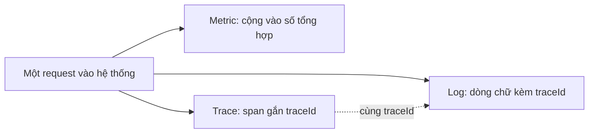
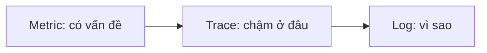
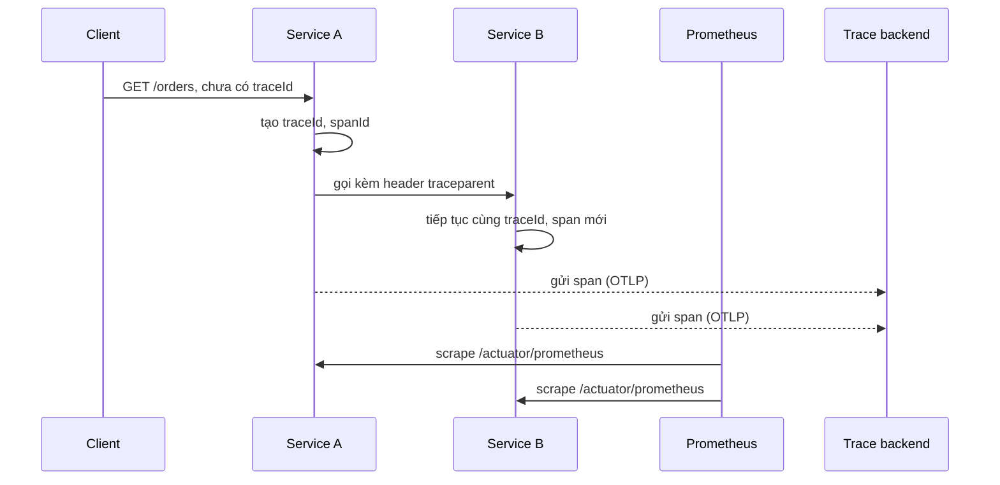
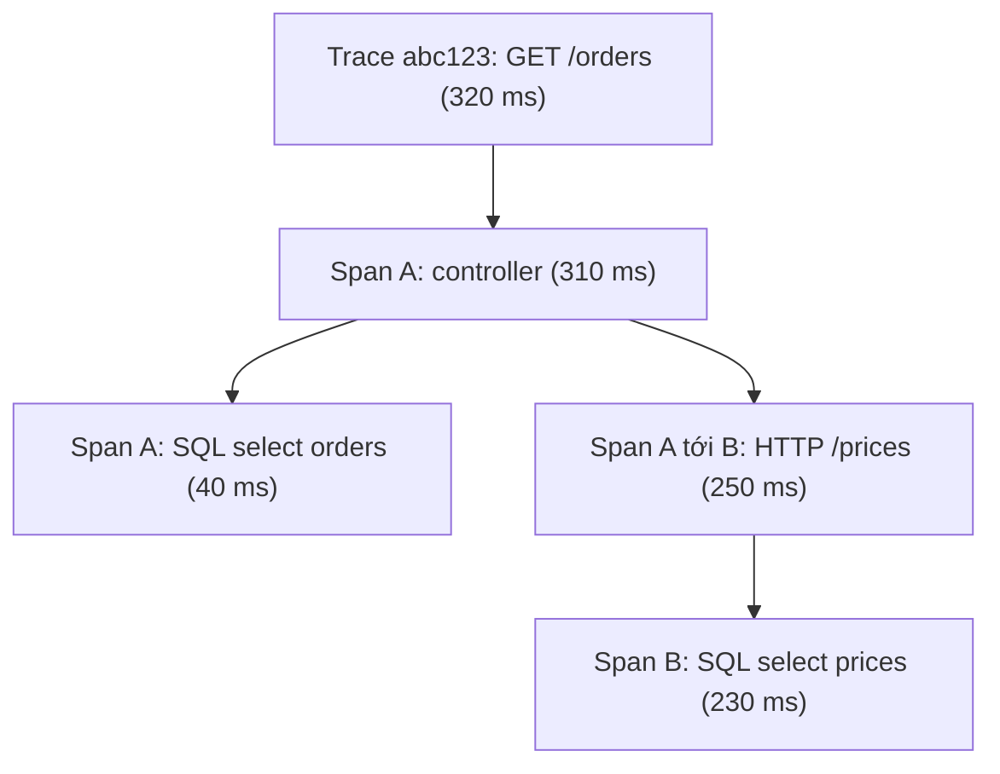

# Lý thuyết 19: Observability (Log, Metric, Trace)

## Observability là gì?

Observability là việc nhìn vào dữ liệu mà ứng dụng tự phát ra (log, metric, trace) để biết bên trong nó đang diễn ra chuyện gì, mà không cần mở code ra đoán. Hãy nghĩ tới bảng đồng hồ trên xe: bạn không mở nắp ca-pô khi đang chạy, nhưng đồng hồ tốc độ, đèn báo nhiệt độ và hộp đen cho bạn biết xe có ổn không và nếu hỏng thì hỏng ở đâu.

**Cốt lõi:** Trên production bạn không gắn debugger được, nên ứng dụng phải tự phát ra dữ liệu để người ngoài đoán được trạng thái bên trong. Có ba loại dữ liệu vì chúng đánh đổi giữa chi tiết và chi phí, và `traceId` là sợi dây nối chúng lại.

- Vì log ghi từng sự việc nên khối lượng tăng theo số request, do đó cần metric tổng hợp rẻ để biết có vấn đề.
- Vì metric mất thông tin của từng request, nên cần trace nối các span qua nhiều service bằng `traceId` để biết chậm ở đâu.
- Vì `traceId` được in vào mỗi dòng log, nên từ trace nhảy sang log để biết vì sao; và vì không đo lại được quá khứ, nên phải bật cả ba từ đầu dự án.



Mô hình tư duy: sơ đồ cho thấy một request để lại ba dấu vết có độ chi tiết khác nhau, và `traceId` là chỗ duy nhất ghép trace với log.

**Tóm tắt:**

- Observability là nhìn vào dữ liệu ứng dụng tự phát ra (log, metric, trace) để biết bên trong đang xảy ra gì; nên làm từ đầu dự án vì không thể đo lại quá khứ.
- Metric báo có vấn đề, trace chỉ chậm ở đâu, log nói vì sao; thiếu một loại thì hai loại kia không bù được.
- Trace nối các span của một request qua nhiều service bằng `traceId`, truyền qua header `traceparent`; chỉ hoạt động khi client được tạo từ builder do Boot cung cấp.
- Metric theo kiểu pull (Prometheus scrape `/actuator/prometheus`), trace theo kiểu push (OTLP); xác suất sampling trace mặc định là 10%.
- Dùng p95/p99 thay vì trung bình, và tránh tag có quá nhiều giá trị (cardinality) vì làm nổ memory của hệ thống metric.
- Actuator mặc định chỉ expose `health`; các endpoint khác chứa thông tin nhạy cảm nên phải bảo vệ hoặc đặt ở port riêng.
- Liveness trả lời "còn sống không", readiness trả lời "sẵn sàng nhận request chưa"; đừng đưa dependency ngoài vào liveness.
- Alert theo triệu chứng người dùng thấy (tỷ lệ lỗi, latency) và đặt SLO, thay vì theo từng nguyên nhân kỹ thuật.

## Vì sao cần?

Trên production bạn không gắn debugger được. Khi người dùng báo "chậm" hoặc "lỗi", không có dữ liệu này thì bạn chỉ biết đoán: chậm ở service nào, query nào, lỗi bắt đầu từ lúc nào. Với hệ thống nhiều service, một request đi qua nhiều nơi, và không có dữ liệu thì gần như không thể lần ra khâu có vấn đề.

## Khi nào làm

Làm ngay từ đầu dự án. Đợi có sự cố rồi mới thêm thì lúc cần nhất lại không có dữ liệu của quá khứ (bạn không thể quay lại đo một lỗi đã xảy ra). Cách làm gói gọn: Micrometer cho metric, log có cấu trúc kèm `traceId` để lần theo một request, OpenTelemetry cho trace qua nhiều service, Actuator cho health check.

## Các khái niệm cần biết

- **Log**: bản ghi văn bản về một sự việc cụ thể ("thanh toán đơn 42 thất bại vì hết hạn thẻ"). Chi tiết nhất nhưng tốn chỗ và khó tổng hợp.
- **Metric**: con số đo theo thời gian (số request/giây, % lỗi, latency). Nhẹ, dùng để vẽ biểu đồ và đặt alert, nhưng không cho biết chi tiết từng request.
- **Trace và span**: một trace là hành trình của **một request** qua nhiều service; mỗi chặng trong đó (một HTTP call, một câu SQL) là một **span** có thời điểm bắt đầu và độ dài. Tất cả span cùng thuộc một `traceId`.
- **Micrometer**: thư viện facade đo metric của Spring, tương tự SLF4J cho log: bạn viết một lần, xuất sang Prometheus, Datadog... tùy cấu hình.
- **OpenTelemetry (OTel) và OTLP**: chuẩn mở để thu thập trace, metric, log; OTLP là giao thức truyền dữ liệu đó tới collector hoặc backend.
- **Prometheus và scrape**: Prometheus là hệ thống lưu metric theo kiểu pull: định kỳ nó gọi (scrape) `/actuator/prometheus` của từng instance để lấy số liệu.
- **Actuator**: module của Spring Boot mở các endpoint vận hành (`health`, `metrics`, `loggers`...).
- **Percentile (p95, p99)**: p95 = 95% request nhanh hơn giá trị này. Trung bình che giấu những request rất chậm mà người dùng vẫn cảm nhận được.
- **Cardinality**: số giá trị khác nhau của một tag. Tag có quá nhiều giá trị (như id người dùng) làm số time series nổ tung và hệ thống metric hết memory.
- **SLO (Service Level Objective)**: mục tiêu chất lượng định lượng, ví dụ "99,9% request thành công mỗi tháng".

## Ba trụ cột

Ba loại dữ liệu bổ sung cho nhau và thường dùng theo thứ tự khi xử lý sự cố: metric báo "có vấn đề", trace chỉ "chậm ở đâu", log nói "vì sao".



| Trụ cột | Công cụ thường dùng | Trả lời câu hỏi |
|---|---|---|
| Metric | Micrometer, Prometheus, Grafana | Có vấn đề không? Mức độ nào? |
| Trace | OpenTelemetry, Tempo, Jaeger, Zipkin | Request chậm ở service nào? |
| Log | Logback JSON, ELK/Loki | Chi tiết lỗi là gì? |

**Nền tảng:** metric trả lời "có vấn đề không" (con số tổng hợp, rẻ), trace trả lời "chậm ở đâu" (đường đi một request qua nhiều service, nối bằng `traceId`), log trả lời "vì sao" (chi tiết từng sự việc). Mỗi loại thiếu thì hai loại kia không bù được.

**Suy luận:** ba loại dữ liệu tồn tại tách biệt vì chúng đánh đổi giữa chi tiết và chi phí. Log ghi từng sự việc nên chi tiết nhất, nhưng khối lượng tăng theo số request, không thể đọc hết hay tổng hợp rẻ. Metric chỉ giữ số tổng hợp theo thời gian nên rẻ và đủ để đặt alert, nhưng mất thông tin của từng request. Trace nối các span của một request qua nhiều service bằng `traceId`, nên trả lời được "chậm ở đâu", điều mà metric của từng service riêng lẻ không ghép lại được. Suy ra quy trình xử lý sự cố: metric báo có vấn đề, trace khoanh vùng service hoặc câu SQL, log cho lý do cụ thể, và `traceId` in trong log là cầu nối giữa trace và log. Điểm dễ nhầm là nghĩ chỉ cần log tốt: khi một request đi qua nhiều service mà log không có `traceId`, bạn không thể ghép các dòng log của cùng một request. Khi thiết kế, bật cả ba loại từ đầu và bảo đảm `traceId` có mặt trong mọi dòng log.

## Bật lên trong Spring Boot 3

Bạn cần bốn thứ: Actuator (các endpoint vận hành), registry Prometheus (định dạng metric cho Prometheus đọc), bridge Micrometer Tracing sang OpenTelemetry, và exporter OTLP (gửi span đi). Thiếu bridge hoặc exporter thì không có trace dù mọi thứ khác chạy bình thường.

```xml
<dependency><groupId>org.springframework.boot</groupId><artifactId>spring-boot-starter-actuator</artifactId></dependency>
<dependency><groupId>io.micrometer</groupId><artifactId>micrometer-registry-prometheus</artifactId></dependency>
<!-- trace: bridge Micrometer sang OpenTelemetry và exporter OTLP -->
<dependency><groupId>io.micrometer</groupId><artifactId>micrometer-tracing-bridge-otel</artifactId></dependency>
<dependency><groupId>io.opentelemetry</groupId><artifactId>opentelemetry-exporter-otlp</artifactId></dependency>
```

```yaml
management:
  endpoints:
    web:
      exposure:
        include: health,info,metrics,prometheus   # mặc định chỉ lộ health
  endpoint:
    health:
      probes:
        enabled: true                  # bật /health/liveness và /health/readiness
      show-details: when-authorized
  metrics:
    tags:
      application: ${spring.application.name}      # tag chung cho mọi metric
  tracing:
    sampling:
      # chỉ sampling 10% request ở production; mặc định 0.1
      probability: 0.1
  otlp:
    tracing:
      endpoint: http://otel-collector:4318/v1/traces
logging:
  pattern:
    # in traceId vào mỗi dòng log
    level: "%5p [${spring.application.name:},%X{traceId:-},%X{spanId:-}]"
```

**Phải thuộc:** mặc định Actuator chỉ expose `health` qua web (muốn thêm phải dùng `management.endpoints.web.exposure.include`); xác suất sampling trace mặc định là `0.1` (10%); liveness và readiness nằm ở `/actuator/health/liveness` và `/actuator/health/readiness`. Meter: `Counter` chỉ tăng, `Gauge` lên xuống, `Timer` đo thời gian.

Actuator endpoint chứa thông tin nhạy cảm: đặt ở port quản trị riêng (`management.server.port`) hoặc bảo vệ bằng Security, không mở ra Internet.

## Actuator: các endpoint phụ

Ngoài `health`, `metrics`, `prometheus`, Actuator có nhiều endpoint giúp chẩn đoán. Mỗi cái đều phải được expose rõ ràng (`management.endpoints.web.exposure.include`) và bảo vệ.

| Endpoint | Cho biết | Lưu ý |
|---|---|---|
| `conditions` | Auto-configuration nào bật/tắt và vì sao | Tương đương `--debug` lúc chạy |
| `mappings` | Mọi URL và handler tương ứng | Tìm nhanh endpoint bị thiếu hoặc trùng |
| `beans`, `configprops`, `env` | Danh sách bean, giá trị cấu hình, property | Giá trị nhạy cảm được che mặc định (từ Boot 3); đừng bật hiện đầy đủ ở production |
| `threaddump` | Ảnh chụp mọi thread | Tìm deadlock, thread kẹt |
| `heapdump` | File dump heap để phân tích bằng công cụ | Chứa mật khẩu, token trong memory: gần như không bao giờ mở ra ngoài |
| `startup` | Thời gian từng bước khởi động | Cần `BufferingApplicationStartup` (xem bài [Spring khởi động bên trong (SpringApplication và ApplicationContext)](/go?p=01-Spring-Boot%2Fhard%2Flt-30-spring-khoi-dong-application-context.md)) |
| `scheduledtasks` | Các tác vụ `@Scheduled` | Xem cùng [Scheduling và Async](/go?p=01-Spring-Boot%2Fmedium%2Flt-18-scheduling-async.md) |
| `info` | Thông tin build, git, tự đặt | Chỉ có dữ liệu khi cấu hình |
| `shutdown` | Tắt ứng dụng | Tắt mặc định; mở ra là rủi ro lớn |

Cách bảo vệ: đặt port quản trị riêng (`management.server.port`) không công khai, hoặc cho `EndpointRequest.toAnyEndpoint()` yêu cầu role quản trị trong chuỗi Security. Tên và hành vi che giá trị khác nhau theo phiên bản, kiểm tra lại.

## Một request đi qua công cụ nào

Sơ đồ cho thấy hai data flow khác nhau chạy song song. Trace được **push** từ ứng dụng ra backend; metric được Prometheus **pull** về theo chu kỳ. `traceparent` là header chuẩn W3C để service B biết nó đang thuộc trace nào.



Spring tự đo HTTP server (`http.server.requests`, thành `http_server_requests_seconds_*` ở Prometheus), HikariCP, JVM, Tomcat. Trace truyền qua service chỉ khi dùng `RestClient`/`RestTemplate`/`WebClient` **được tạo từ builder do Boot cung cấp** (inject `RestClient.Builder`), vì builder đó đã gắn sẵn observation. `new RestTemplate()` thì mất liên kết trace.

Một trace trông như cây các span lồng nhau; độ dài mỗi span cho biết thời gian đi đâu:



Nhìn cây này bạn thấy ngay phần lớn thời gian nằm ở câu SQL trong Service B, thay vì phải đoán.

## Metric: chọn cái gì đo

Đo mọi thứ không có nghĩa là hiểu được gì. Hai khung tư duy giúp chọn đúng:

- **RED** (cho service): Rate (request/giây), Errors (tỷ lệ lỗi), Duration (latency, đo bằng **p95/p99**, đừng chỉ nhìn trung bình).
- **USE** (cho tài nguyên): Utilization, Saturation, Errors (CPU, connection pool, thread pool).

```java
@Component
class OrderMetrics {
    private final Counter created;
    OrderMetrics(MeterRegistry registry) {
        this.created = Counter.builder("orders.created").tag("channel", "web").register(registry);
    }
    void orderCreated() { created.increment(); }
}
```

Tránh gắn **tag có số lượng giá trị vô hạn** (id người dùng) vì làm nổ memory hệ thống metric.

**Suy luận:** Prometheus lưu mỗi tổ hợp giá trị tag thành một time series riêng, nên số series bằng tích số giá trị của các tag. Tag như `userId` có hàng triệu giá trị làm số series tăng theo cấp nhân, memory của hệ thống metric cạn dù ứng dụng vẫn chạy bình thường: lỗi xuất hiện ở nơi khác và thường sau khi deploy. Vì thế tag chỉ nên có tập giá trị nhỏ và biết trước (`channel`, `status`), còn định danh từng request thuộc về log và trace. Tương tự, latency trung bình che những request chậm vì vài request rất chậm bị hàng nghìn request nhanh kéo xuống; p95/p99 phản ánh trải nghiệm của nhóm người dùng tệ nhất, nên alert theo percentile. Đổi lại, muốn Prometheus tính được percentile phải bật histogram (`publishPercentileHistogram`), và histogram tạo thêm series theo từng bucket, nên chỉ bật cho metric quan trọng. Khi review, mỗi tag mới phải trả lời được câu hỏi "có tối đa bao nhiêu giá trị khác nhau".

### Các loại meter

Chọn loại meter theo bản chất của giá trị: giá trị chỉ tăng thì `Counter`, giá trị lên xuống thì `Gauge`, thời gian thì `Timer`.

| Loại | Dùng cho | Ví dụ |
|---|---|---|
| `Counter` | Chỉ tăng | Số đơn tạo, số lỗi |
| `Gauge` | Giá trị lên xuống | Độ dài queue, số connection đang dùng |
| `Timer` | Thời gian và số lần | Thời gian xử lý đơn |
| `DistributionSummary` | Phân phối giá trị không phải thời gian | Kích thước payload |

```java
@Service
class CheckoutService {
    private final Timer timer;
    private final ObservationRegistry observations;

    CheckoutService(MeterRegistry registry, ObservationRegistry observations) {
        this.timer = Timer.builder("checkout.duration")
                .publishPercentileHistogram()      // cho phép tính p95/p99 ở Prometheus
                .register(registry);
        this.observations = observations;
    }

    void checkout() {
        timer.record(() -> doCheckout());
    }

    // Observation: một khai báo, tự sinh cả metric lẫn span trace
    void checkoutObserved() {
        Observation.createNotStarted("checkout", observations)
                .lowCardinalityKeyValue("channel", "web")
                .observe(this::doCheckout);
    }

    private void doCheckout() { /* nghiệp vụ */ }
}
```

Truy vấn p95 trong Prometheus: `histogram_quantile(0.95, sum by (le) (rate(checkout_duration_seconds_bucket[5m])))`. Dùng `Observation` khi muốn một điểm đo cho cả metric và trace.

## Log: có cấu trúc và có ngữ cảnh

Một dòng log chỉ có giá trị khi tìm lại được. **MDC** (Mapped Diagnostic Context) là nơi lưu theo thread của thư viện log: những gì bạn `put` vào sẽ được in kèm ở mọi dòng log sau đó của thread đó, nên bạn không phải truyền `userId` vào từng câu log.

```java
MDC.put("userId", userId);      // mọi dòng log sau đó đều mang userId
log.info("Tạo đơn thành công orderId={}", orderId);
```

- Dùng log JSON để máy lọc được.
- Mỗi request có `traceId` (Spring Boot 3 với Micrometer Tracing tự thêm vào MDC).
- Không log mật khẩu, token, dữ liệu cá nhân.
- Mức log: `ERROR` cần người xem, `WARN` bất thường tự xử lý được, `INFO` mốc nghiệp vụ, `DEBUG` chẩn đoán.

### Log thực dụng

```java
private static final Logger log = LoggerFactory.getLogger(OrderService.class);

// tham số {}, không nối chuỗi
log.info("Tạo đơn orderId={} userId={}", orderId, userId);
// exception đặt CUỐI để có stack trace
log.error("Thanh toán thất bại orderId={}", orderId, exception);
// tránh tính toán tốn khi tắt debug
if (log.isDebugEnabled()) { log.debug("Chi tiết: {}", expensive()); }
```

Đổi mức log lúc đang chạy: `POST /actuator/loggers/com.example` với body `{"configuredLevel":"DEBUG"}` (cần expose endpoint `loggers`). MDC là `ThreadLocal`, không theo sang thread `@Async` trừ khi dùng `TaskDecorator` (xem [Scheduling và Async](/go?p=01-Spring-Boot%2Fmedium%2Flt-18-scheduling-async.md)).

### Logging của Spring Boot

Spring Boot dùng SLF4J làm facade và Logback làm mặc định, nên đa số cấu hình đi qua `application.yml` mà không cần file XML.

```yaml
logging:
  level:
    root: INFO
    com.example.order: DEBUG        # theo package
    org.hibernate.SQL: DEBUG
  group:
    business: com.example.order,com.example.payment   # log group: gom nhiều logger
  file:
    name: logs/app.log
  structured:
    format:
      # log JSON có cấu trúc, từ Boot 3.4; cũng có logstash, gelf
      console: ecs
```

Với log group, `logging.level.business=TRACE` đổi mức cho cả nhóm một lần; Boot có sẵn nhóm `web` và `sql`. Khi cần cấu hình sâu (appender riêng, rolling theo ngày), thêm `logback-spring.xml`; hậu tố `-spring` cho phép dùng `<springProfile>` để khác nhau theo profile. Trước Boot 3.4 muốn log JSON phải thêm thư viện encoder; từ 3.4 có định dạng cấu trúc tích hợp sẵn, kiểm tra lại theo phiên bản.

Đổi mức log lúc đang chạy dùng endpoint `loggers` đã nói ở trên. Thay đổi chỉ nằm trong memory nên mất khi khởi động lại, và nên đặt lại về mức cũ sau khi chẩn đoán xong vì `DEBUG` ở production làm đầy ổ đĩa và chậm ứng dụng.

## Health tùy biến

```java
@Component
// id trong health: "paymentGateway"
class PaymentGatewayHealthIndicator implements HealthIndicator {
    private final PaymentClient client;
    PaymentGatewayHealthIndicator(PaymentClient client) { this.client = client; }

    @Override
    public Health health() {
        try {
            client.ping();
            return Health.up().build();
        } catch (Exception e) {
            return Health.down(e).build();   // /actuator/health trả DOWN (HTTP 503)
        }
    }
}
```

Bean này chui vào `/actuator/health` (không vào liveness). Muốn đưa vào readiness: `management.endpoint.health.group.readiness.include: readinessState,paymentGateway`. Cách tiếp cận chịu lỗi khi dependency chết ở [Resilience và chịu lỗi](/go?p=01-Spring-Boot%2Fhard%2Flt-32-resilience-chiu-loi.md).

## Health và probe

Actuator cung cấp hai endpoint cho Kubernetes: `/actuator/health/liveness` ("còn sống không", sai thì khởi động lại) và `/actuator/health/readiness` ("sẵn sàng nhận request chưa", sai thì ngừng gửi traffic). Đừng đưa dependency ngoài như DB chậm vào liveness. Cấu hình probe, sơ đồ phối hợp ba loại probe và graceful shutdown ở [Đóng gói, Docker và Kubernetes cho Spring Boot](/go?p=01-Spring-Boot%2Fhard%2Flt-29-docker-kubernetes.md); bảng so sánh các probe và cách gỡ lỗi pod ở [Kubernetes vận hành](/go?p=04-DevOps%2Fhard%2Flt-06-kubernetes-van-hanh.md).

## Alert

Alert theo **triệu chứng người dùng thấy** (tỷ lệ lỗi, latency) thay vì theo từng nguyên nhân kỹ thuật, và đặt SLO để alert khi đốt nhanh error budget. Cách đặt SLI/SLO, tính error budget, burn rate và quy trình ứng phó sự cố ở [Xử lý sự cố, SRE và vận hành bền vững](/go?p=04-DevOps%2Fhard%2Flt-07-su-co-sre-observability.md).

## Phỏng vấn khó: chuỗi hỏi xoáy

Người phỏng vấn senior thường mở bằng câu dễ rồi xoáy xuống cơ chế, đánh đổi và sự cố thật. Câu trả lời tốt luôn đi từ cốt lõi xuống: mỗi loại dữ liệu đánh đổi giữa chi tiết và chi phí, và `traceId` là sợi dây nối chúng.

### Chuỗi 1: Ba trụ cột và `traceId`

1. **Câu mở:** Đã có log rồi, sao còn cần metric và trace?
2. **Xoáy 1:** Người dùng báo chậm, bạn lần theo thứ tự nào, và `traceId` nối các mảnh ra sao?
3. **Xoáy 2:** Trace đứt giữa service A và B dù cả hai đều bật tracing. Nghi ngờ gì trước?

**Đáp án ngắn:** Ba loại đánh đổi giữa chi tiết và chi phí. Log chi tiết nhất nhưng khối lượng tăng theo số request, khó tổng hợp. Metric chỉ giữ số tổng hợp nên rẻ và đặt alert được, nhưng mất thông tin từng request. Trace nối các span của một request qua nhiều service bằng `traceId`. Quy trình xử lý sự cố: metric báo có vấn đề, trace khoanh vùng service hoặc câu SQL, log cho lý do cụ thể; `traceId` in trong mỗi dòng log là cầu nối giữa trace và log. Trace truyền sang service khác bằng header `traceparent`, và chỉ hoạt động khi client được tạo từ builder do Boot cung cấp vì builder đó gắn sẵn observation; `new RestTemplate()` làm trace đứt. Cũng kiểm tra đã có bridge và exporter OTLP, và nhớ sampling mặc định là 10% nên không thấy mọi request. Vì không đo lại được quá khứ, phải bật cả ba từ đầu dự án.

**Sai lầm hay gặp:**

- Nói "chỉ cần log tốt": không ghép được log của một request đi qua nhiều service nếu thiếu `traceId`.
- Nhầm vai trò: cho rằng log báo có vấn đề còn metric nói vì sao.
- Quên sampling 10% rồi thắc mắc vì sao không thấy trace của một request cụ thể.

### Chuỗi 2: Percentile và cardinality

1. **Câu mở:** Vì sao alert latency nên dùng p95 hoặc p99 thay vì trung bình?
2. **Xoáy 1:** Một dev thêm tag `userId` vào metric. Lỗi xuất hiện ở đâu và vì sao?
3. **Xoáy 2:** Bật histogram để Prometheus tính được p95 thì phải trả giá gì?

**Đáp án ngắn:** Trung bình bị hàng nghìn request nhanh kéo xuống nên che những request rất chậm mà người dùng vẫn cảm nhận; p95 nghĩa là 95% request nhanh hơn giá trị đó, phản ánh nhóm người dùng tệ nhất. Prometheus lưu mỗi tổ hợp giá trị tag thành một time series riêng, nên số series bằng tích số giá trị của các tag. Tag `userId` có hàng triệu giá trị làm số series nổ, memory của hệ thống metric cạn dù ứng dụng vẫn chạy bình thường: lỗi hiện ra ở nơi khác và thường sau khi deploy. Định danh từng request thuộc về log và trace; tag chỉ nên có tập giá trị nhỏ và biết trước như `channel`, `status`. Muốn Prometheus tính percentile phải bật `publishPercentileHistogram`, và histogram tạo thêm series theo từng bucket, nên chỉ bật cho metric quan trọng. Khi review, mỗi tag mới phải trả lời được "tối đa bao nhiêu giá trị khác nhau".

**Sai lầm hay gặp:**

- Chỉ nói "cardinality cao thì tốn" mà không giải thích được cơ chế nhân số series.
- Dùng latency trung bình để đặt alert.
- Coi histogram là miễn phí.

