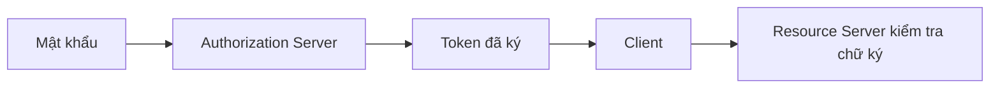
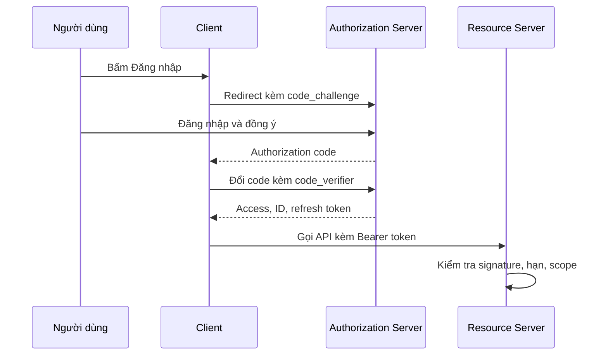
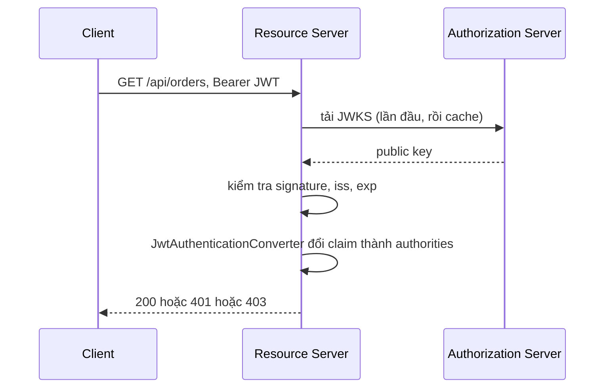

# Lý thuyết 20: OAuth2 và OpenID Connect

## OAuth2 và OIDC là gì?

OAuth2 là chuẩn **authorization**: cho phép một ứng dụng truy cập tài nguyên của bạn mà không phải đưa mật khẩu cho nó. Ví dụ quen thuộc: một app chỉnh ảnh xin quyền đọc ảnh trong Google Drive của bạn; bạn đồng ý trên trang của Google và app nhận một "chìa khóa tạm" chỉ mở được đúng thư mục ảnh, thay vì chìa khóa nhà. OIDC (OpenID Connect) là lớp **authentication** chạy trên OAuth2, cho ứng dụng biết người dùng là ai ("Đăng nhập bằng Google").

**Cốt lõi:** Nếu app nào cũng tự giữ mật khẩu thì mỗi app là một chỗ có thể lộ. OAuth2 và OIDC dồn việc đăng nhập về một Authorization Server, còn client và API chỉ cầm token do nơi đó phát và ký.

- Vì mật khẩu chỉ đi tới Authorization Server, nên client và API chỉ làm việc với token và có SSO.
- Vì trình duyệt là kênh dễ lộ, nên chỉ `code` dùng một lần đi qua đó, còn token được đổi qua kênh trực tiếp kèm bằng chứng PKCE.
- Vì JWT được ký và tự chứa claim, nên API kiểm tra bằng public key đã cache mà không hỏi Authorization Server, đổi lại token bị revoke vẫn sống đến khi hết hạn.



Mô hình tư duy: sơ đồ cho thấy mật khẩu dừng lại ở một nơi, còn mọi bên sau đó chỉ tin vào chữ ký trên token.

**Tóm tắt:**

- OAuth2 là chuẩn authorization (client được làm gì thay người dùng, qua access token có scope); OIDC thêm authentication (người dùng là ai, qua ID token) khi có scope `openid`.
- Mật khẩu chỉ đi tới Authorization Server; client và API chỉ làm việc với token, nhờ đó có SSO.
- Flow chuẩn là Authorization Code + PKCE; service gọi service dùng Client Credentials; Implicit và Password đã lỗi thời.
- `code` đi qua trình duyệt nên có thể lộ, còn token chỉ trao qua kênh trực tiếp; PKCE, `state`, `nonce` và `redirect_uri` khớp đăng ký sẵn mỗi cái chặn một kiểu tấn công.
- Access token để gọi API, ID token để client biết danh tính (không dùng gọi API), refresh token để đổi access token mới.
- Resource Server kiểm tra signature bằng public key (JWKS) đã cache, không gọi Authorization Server cho mỗi request; token đã bị revoke vẫn hợp lệ đến khi hết hạn.
- Luôn kiểm tra `iss`, `aud`, `exp` và scope; Keycloak cần `JwtAuthenticationConverter` để map role từ `realm_access.roles`.
- Đừng tự dựng Authorization Server; dùng sản phẩm có sẵn như Keycloak, Auth0, Okta.

## Vấn đề nó giải quyết

Nếu app nào cũng tự lưu mật khẩu thì mỗi app là một chỗ có thể bị lộ, và người dùng phải đăng nhập lại ở từng app. Với OAuth2 và OIDC, việc đăng nhập giao cho một nơi chuyên trách (Authorization Server), các app chỉ nhận token. Nhờ đó có SSO (single sign-on: đăng nhập một lần dùng nhiều app) và mật khẩu chỉ đi tới đúng một nơi.

## Khi nào dùng, khi nào không

Dùng khi đăng nhập bằng Google, Keycloak, Azure AD; bảo vệ API dùng chung cho nhiều client; hoặc gọi giữa các service. App nhỏ chỉ có một nơi đăng nhập thì Spring Security với JWT tự quản lý (xem [Spring Security và JWT](/go?p=01-Spring-Boot%2Fmedium%2Flt-06-spring-security-jwt.md)) có thể đủ và đơn giản hơn. Khi hệ thống lớn lên, đừng tự dựng Authorization Server: dùng sản phẩm có sẵn.

Trong Spring Security, bạn có hai vai: **Client** (app đăng nhập người dùng) và **Resource Server** (API kiểm tra token). Phần cấp token do một Authorization Server bên ngoài lo (Keycloak, Auth0, Okta).

## Các vai

Bốn vai xuất hiện trong mọi flow OAuth2. Hãy xác định rõ ai là ai trước khi đọc sơ đồ:

| Vai | Là ai |
|---|---|
| Resource Owner | Người dùng |
| Client | Ứng dụng muốn truy cập thay người dùng |
| Authorization Server | Cấp token (Keycloak, Auth0...) |
| Resource Server | API của bạn, chấp nhận token |

**Nền tảng:** OAuth2 là ủy quyền (client được phép làm gì thay người dùng, qua access token có scope), OIDC thêm xác thực (người dùng là ai, qua ID token) khi có scope `openid`. Mật khẩu chỉ đi tới Authorization Server; client và API chỉ làm việc với token.

**Phải thuộc:** bốn vai: Resource Owner, Client, Authorization Server, Resource Server. Flow cho người dùng là Authorization Code + PKCE; service gọi service là Client Credentials; Implicit và Password đã lỗi thời. Access token gọi API, ID token cho client biết danh tính (không dùng gọi API), refresh token đổi access token mới.

## Các khái niệm cần biết

- **Scope**: phạm vi quyền mà client xin (`orders:read`, `profile`). Người dùng đồng ý theo scope, token chỉ mang đúng phạm vi đó.
- **Grant type**: cách client lấy token. *Authorization Code* dành cho ứng dụng có người dùng; *Client Credentials* dành cho service gọi service (không có người dùng).
- **PKCE (Proof Key for Code Exchange, đọc "pixy")**: cơ chế thêm vào Authorization Code để kẻ chặn được `code` cũng không đổi được token. Client sinh một chuỗi bí mật ngẫu nhiên (`code_verifier`), gửi trước hash của nó (`code_challenge`), và chỉ khi đổi code mới tiết lộ bản gốc.
- **JWKS (JSON Web Key Set)**: danh sách public key mà Authorization Server công bố để Resource Server kiểm tra signature token.
- **Issuer (`iss`) và audience (`aud`)**: ai phát hành token và token dành cho ai. Kiểm tra cả hai để không chấp nhận token của nơi khác hoặc token dành cho API khác.
- **Opaque token và introspection**: token là chuỗi ngẫu nhiên không tự chứa thông tin; Resource Server phải hỏi Authorization Server (introspection) mỗi lần để biết nó còn hiệu lực không.
- **Discovery**: URL `/.well-known/openid-configuration` trả về mọi địa chỉ endpoint, nên client chỉ cần biết `issuer-uri`.
- **BFF (Backend for Frontend)**: một backend nhỏ giữ token thay cho SPA, để token không nằm trong trình duyệt.

## Flowchart: Authorization Code + PKCE (flow chuẩn cho web/mobile)

Hãy đọc từ trên xuống: client không bao giờ thấy mật khẩu, chỉ thấy `code` rồi đổi lấy token qua kênh trực tiếp tới Authorization Server.



Vì sao phải có bước "code" rồi mới đổi token? Vì `code` đi qua trình duyệt (thanh địa chỉ, lịch sử) nên có thể bị lộ, còn token chỉ được trao qua kênh trực tiếp giữa client và Authorization Server, nơi có thể xác minh thêm `code_verifier`.

**Suy luận:** Authorization Code + PKCE có hai bước (code rồi mới đổi token) vì hai kênh có mức tin cậy khác nhau. Bước redirect đi qua trình duyệt, nơi URL nằm trong lịch sử, log của proxy và header Referer, nên mọi thứ trong đó đều có thể bị lộ; vì vậy chỉ `code`, dùng một lần và sống ngắn, được đi qua đó. Token thật chỉ được trao qua kênh trực tiếp giữa client và Authorization Server, nơi có thể xác minh thêm `client_secret` hoặc `code_verifier`. Với app công khai (SPA, mobile) không giữ được secret, kẻ chặn được `code` vẫn đổi được token, nên PKCE thay secret bằng một bí mật sinh mới ở mỗi lần đăng nhập: client gửi hash trước, tiết lộ bản gốc sau, nên kẻ chỉ thấy bước đầu không có gì để đổi. Tương tự, `state` chặn callback giả mạo và `nonce` chặn replay ID token. Hai điểm dễ nhầm: tưởng PKCE chỉ cần cho mobile (thực tế nên dùng cho mọi client), và tưởng ID token gọi được API vì nó cũng là một JWT hợp lệ (nó dành cho client, không dành cho Resource Server). Khi review, kiểm tra `redirect_uri` khớp chính xác với đăng ký, PKCE được bật, và API chỉ nhận access token có đúng `aud`.

## Các loại token

Ba loại token phục vụ ba đối tượng dùng khác nhau; nhầm lẫn giữa chúng là lỗi bảo mật thường gặp (ví dụ dùng ID token để gọi API).

| Token | Dùng để | Người đọc |
|---|---|---|
| **Access token** | Gọi API, ngắn hạn | Resource Server |
| **ID token** (OIDC) | Cho Client biết danh tính người dùng | Client |
| **Refresh token** | Lấy access token mới, dài hạn, giữ kín | Authorization Server |

## Resource Server với Spring Boot

Đây là phía API của bạn. Chỉ cần khai báo `issuer-uri`, Spring tự lấy JWKS từ Authorization Server và dựng bộ kiểm tra JWT. Phần Java dưới đây chỉ là luật truy cập: `/api/admin/**` cần scope `admin` (Spring thêm tiền tố `SCOPE_`), còn lại cần token hợp lệ.

```yaml
spring:
  security:
    oauth2:
      resourceserver:
        jwt:
          issuer-uri: https://auth.example.com/realms/demo
```

```java
@Bean
SecurityFilterChain api(HttpSecurity http) throws Exception {
    http.authorizeHttpRequests(a -> a
            .requestMatchers("/api/admin/**").hasAuthority("SCOPE_admin")
            .anyRequest().authenticated())
        .oauth2ResourceServer(o -> o.jwt(Customizer.withDefaults()));
    return http.build();
}
```

Spring tự tải public key từ `issuer-uri` để kiểm tra signature; bạn không tự ký token.

## Các tham số của Authorization Code + PKCE

Bước redirect đến Authorization Server mang theo nhiều tham số, mỗi tham số chặn một kiểu tấn công. Hiểu chúng giúp bạn gỡ lỗi khi đăng nhập báo `invalid_request` hoặc `redirect_uri mismatch`. Dòng bắt đầu bằng `//` dưới đây chỉ là chú thích, không phải một phần của URL thật.

```text
GET /realms/demo/protocol/openid-connect/auth
    ?response_type=code
    &client_id=web-app
    &redirect_uri=https://app.example.com/login/oauth2/code/keycloak
    &scope=openid profile email
    &state=xyz123                       // chống CSRF: client so khớp khi nhận về
    &nonce=abc789                       // OIDC: gắn vào ID token, chống replay
    &code_challenge=BASE64URL(SHA256(code_verifier))
    &code_challenge_method=S256
```

| Tham số | Chống gì |
|---|---|
| `state` | Giả mạo callback (CSRF ở flow đăng nhập) |
| `nonce` | Replay ID token |
| `code_verifier` / `code_challenge` | Kẻ chặn được `code` cũng không đổi được token vì thiếu verifier (PKCE) |
| `redirect_uri` khớp đăng ký sẵn | Chuyển code tới địa chỉ lạ |
| `code` dùng một lần, sống ngắn | Giảm cửa sổ bị lạm dụng |

Scope `openid` là thứ biến OAuth2 thành OIDC (có ID token). `userinfo` endpoint và `/.well-known/openid-configuration` (discovery) cho client tự tìm các URL.

Ứng dụng tự cài PKCE (SPA, mobile, không dùng thư viện OIDC) phải sinh cặp này đúng cách. Ví dụ JDK sau tạo `code_verifier` ngẫu nhiên rồi tính `code_challenge` theo phương thức `S256` (_Đã chạy thử trên JDK 11_: verifier và challenge đều dài 43 ký tự; với vector kiểm thử của RFC 7636, verifier `dBjftJeZ4CVP-mB92K27uhbUJU1p1r_wW1gFWFOEjXk` cho challenge `E9Melhoa2OwvFrEMTJguCHaoeK1t8URWbuGJSstw-cM`). Authorization Server đối chiếu: hash SHA-256 của verifier phải bằng challenge đã nhận ở bước đầu.

```java
byte[] rnd = new byte[32];
new SecureRandom().nextBytes(rnd);
Base64.Encoder b64 = Base64.getUrlEncoder().withoutPadding();
String verifier = b64.encodeToString(rnd);
String challenge = b64.encodeToString(MessageDigest.getInstance("SHA-256")
        .digest(verifier.getBytes(StandardCharsets.US_ASCII)));   // method S256
```

Nhớ không dùng ID token để gọi API: ID token dành cho Client biết danh tính, access token mới dành cho Resource Server. Phần nền về session, JWT và MFA ở [Authentication, Session và Token](/go?p=03-Network-Security%2Fmedium%2Flt-05-xac-thuc-phien-token.md).

## Spring Boot làm Client (đăng nhập người dùng)

Khi ứng dụng Spring của bạn là nơi người dùng bấm "Đăng nhập", nó đóng vai Client. Bạn khai báo thông tin đăng ký với Authorization Server (client id, secret, scope) và gọi `oauth2Login`; Spring lo toàn bộ redirect, đổi code, và tạo session.

```yaml
spring:
  security:
    oauth2:
      client:
        registration:
          keycloak:
            client-id: web-app
            client-secret: ${OIDC_CLIENT_SECRET}
            scope: openid,profile,email
            # authorization-grant-type mặc định là authorization_code
        provider:
          keycloak:
            # tự lấy các endpoint qua discovery
            issuer-uri: https://auth.example.com/realms/demo
```

```java
@Bean
SecurityFilterChain web(HttpSecurity http) throws Exception {
    http.authorizeHttpRequests(a -> a.requestMatchers("/", "/public/**").permitAll()
                                     .anyRequest().authenticated())
        // /oauth2/authorization/keycloak để bắt đầu đăng nhập
        .oauth2Login(Customizer.withDefaults());
    return http.build();
}
```

Redirect URI mặc định là `{baseUrl}/login/oauth2/code/{registrationId}`. Nên đăng ký đúng địa chỉ này ở Authorization Server. Đây là flow **server-side** (có session); SPA thuần nên dùng mẫu BFF hoặc thư viện OIDC phía trình duyệt với PKCE.

## Resource Server: kiểm tra token thế nào

Vấn đề đặt ra: API phải tin token mà không gọi Authorization Server cho mỗi request (nếu không thì thành bottleneck). Cách giải quyết là kiểm tra signature bằng public key tải một lần và cache:



Resource Server **không gọi** Authorization Server cho mỗi request; chỉ dùng public key đã cache. Hệ quả: token đã bị revoke vẫn hợp lệ đến khi hết hạn, nên access token ngắn hạn. Cần revoke tức thì thì dùng **opaque token** với introspection (`opaquetoken.introspection-uri`), đổi lại mỗi request tốn một lần gọi.

**Suy luận:** Resource Server không gọi Authorization Server cho mỗi request vì nếu gọi, Authorization Server thành bottleneck và điểm hỏng chung của mọi API. JWT được thiết kế tự chứa claim và được ký, nên chỉ cần public key đã cache là kiểm tra được signature, `iss` và `exp` cục bộ. Cái giá là hệ quả trực tiếp: Resource Server không có cách nào biết token đã bị revoke, nên token đó vẫn hợp lệ đến khi hết hạn. Vì vậy access token phải ngắn hạn, còn refresh token (dài hạn, giữ kín) mới là thứ bị revoke ở Authorization Server. Điểm dễ nhầm là tưởng đăng xuất hoặc khóa tài khoản có hiệu lực ngay trên mọi API. Nếu nghiệp vụ cần revoke tức thì thì phải trả giá bằng opaque token và introspection, tức một call tới Authorization Server cho mỗi request.

### Ánh xạ role từ Keycloak và kiểm tra audience

Keycloak đặt vai trò trong claim lồng `realm_access.roles`, còn Spring mặc định chỉ đọc `scope`. Nên cần một `JwtAuthenticationConverter` tự viết để `hasRole(...)` hoạt động. Bean `JwtDecoder` thêm kiểm tra `aud` để API từ chối token cấp cho API khác (nếu không, token hợp lệ của một service có thể được dùng nhầm ở service khác).

```java
@Bean
JwtAuthenticationConverter jwtAuthConverter() {
    JwtAuthenticationConverter conv = new JwtAuthenticationConverter();
    conv.setJwtGrantedAuthoritiesConverter(jwt -> {
        Map<String, Object> realm = jwt.getClaimAsMap("realm_access");
        Collection<String> roles = realm == null ? List.of() : (Collection<String>) realm.get("roles");
        return roles.stream()
                .<GrantedAuthority>map(r -> new SimpleGrantedAuthority("ROLE_" + r))
                .collect(Collectors.toList());
    });
    return conv;
}

@Bean
JwtDecoder jwtDecoder(@Value("${spring.security.oauth2.resourceserver.jwt.issuer-uri}") String issuer) {
    NimbusJwtDecoder decoder = JwtDecoders.fromIssuerLocation(issuer);
    OAuth2TokenValidator<Jwt> audience = new JwtClaimValidator<List<String>>(
            "aud", aud -> aud != null && aud.contains("orders-api"));
    decoder.setJwtValidator(new DelegatingOAuth2TokenValidator<>(
            JwtValidators.createDefaultWithIssuer(issuer), audience));
    return decoder;
}
```

```java
.oauth2ResourceServer(o -> o.jwt(j -> j.jwtAuthenticationConverter(jwtAuthConverter())))
```

Mặc định Spring chuyển claim `scope`/`scp` thành authority `SCOPE_xxx`. Khi tự cấu hình converter như trên thì scope không tự thêm: thêm lại nếu cần. Phép ép kiểu `(Collection<String>)` cần `@SuppressWarnings("unchecked")`.

## Test endpoint với JWT giả

```java
@WebMvcTest(OrderController.class)
@Import(ResourceServerConfig.class)
class OrderApiSecurityTest {
    @Autowired MockMvc mvc;
    @MockitoBean OrderService service;
    @MockitoBean JwtDecoder jwtDecoder;     // tránh gọi ra issuer thật khi khởi động

    @Test
    void admin_scope_ok() throws Exception {
        mvc.perform(get("/api/admin/stats")
                .with(SecurityMockMvcRequestPostProcessors.jwt()
                        .authorities(new SimpleGrantedAuthority("SCOPE_admin"))))
           .andExpect(status().isOk());
    }

    @Test
    void no_token_401() throws Exception {
        mvc.perform(get("/api/admin/stats")).andExpect(status().isUnauthorized());
    }
}
```

So sánh với JWT tự quản ở [Spring Security và JWT](/go?p=01-Spring-Boot%2Fmedium%2Flt-06-spring-security-jwt.md); lỗ hổng, CSRF/CORS và xử lý 401/403 ở [Spring Security chuyên sâu](/go?p=01-Spring-Boot%2Fhard%2Flt-35-spring-security-chuyen-sau.md).

## Điều cần nhớ

- Luôn dùng **Authorization Code + PKCE**; flow Implicit và Password đã lỗi thời.
- Service-to-service dùng **Client Credentials** (không có người dùng).
- Kiểm tra `iss`, `aud`, `exp` và scope; không tin dữ liệu chưa xác minh signature.
- Ánh xạ role từ claim (ví dụ `realm_access.roles` của Keycloak) bằng `JwtAuthenticationConverter`.
- Tự dựng Authorization Server là việc phức tạp và nhạy cảm; ưu tiên dùng sản phẩm có sẵn.

## Phỏng vấn khó: chuỗi hỏi xoáy

Người phỏng vấn senior thường mở bằng câu dễ rồi xoáy xuống cơ chế, đánh đổi và sự cố thật. Câu trả lời tốt luôn đi từ cốt lõi xuống: mật khẩu chỉ dừng ở Authorization Server, còn mọi bên khác chỉ tin vào token đã ký.

### Chuỗi 1: Vì sao Authorization Code cần PKCE

1. **Câu mở:** Vì sao Authorization Code có hai bước (code rồi mới đổi token) thay vì trả token luôn qua redirect?
2. **Xoáy 1:** SPA hoặc mobile không giữ được `client_secret`. Kẻ chặn được `code` thì PKCE chặn bằng cách nào?
3. **Xoáy 2:** `state` và `nonce` chặn gì, và có phải PKCE chỉ cần cho mobile?

**Đáp án ngắn:** Hai bước vì hai kênh có độ tin cậy khác nhau. Redirect đi qua trình duyệt, nơi URL nằm trong lịch sử, log của proxy và header Referer, nên chỉ `code` dùng một lần và sống ngắn được đi qua đó. Token thật được đổi qua kênh trực tiếp giữa client và Authorization Server, nơi xác minh thêm được `client_secret` hoặc `code_verifier`. App công khai không giữ được secret, nên PKCE thay bằng một bí mật sinh mới ở mỗi lần đăng nhập: client gửi `code_challenge` (hash SHA-256 của `code_verifier`) trước, tiết lộ bản gốc khi đổi code, nên kẻ chỉ thấy bước đầu không có gì để đổi. `state` chặn callback giả mạo (CSRF ở flow đăng nhập), `nonce` gắn vào ID token để chặn replay. PKCE nên dùng cho mọi client, không chỉ mobile. Khi gỡ lỗi đăng nhập báo `redirect_uri mismatch`, hãy nhớ `redirect_uri` phải khớp chính xác với đăng ký để code không bị chuyển tới địa chỉ lạ.

**Sai lầm hay gặp:**

- Nói "PKCE là mã hóa code" mà không giải thích được verifier, challenge và vì sao hash gửi trước.
- Nhầm `state` (chống callback giả) với `nonce` (chống replay ID token).
- Chọn Implicit hoặc Password flow vì "đơn giản hơn": cả hai đã lỗi thời.

### Chuỗi 2: Kiểm tra JWT, revoke và audience

1. **Câu mở:** Resource Server kiểm tra access token dạng JWT bằng cách nào, có gọi Authorization Server mỗi request không?
2. **Xoáy 1:** Admin khóa tài khoản lúc 10:00 nhưng token cũ vẫn gọi được API. Đây là lỗi hay thiết kế, xử lý ra sao?
3. **Xoáy 2:** Token hợp lệ cấp cho API `payments` đem gọi sang API `orders`. Chặn bằng gì? Và ID token có dùng gọi API được không?

**Đáp án ngắn:** Không gọi. JWT được ký và tự chứa claim, nên Resource Server chỉ cần public key lấy từ JWKS (qua `issuer-uri`) rồi cache, và kiểm tra signature, `iss`, `exp` cục bộ. Nếu gọi mỗi request thì Authorization Server thành bottleneck và điểm hỏng chung. Cái giá là hệ quả trực tiếp: không có cách biết token đã bị revoke, nên nó vẫn hợp lệ đến khi hết hạn. Vì vậy access token phải ngắn hạn, còn refresh token mới là thứ bị revoke ở Authorization Server. Cần revoke tức thì thì dùng opaque token với introspection, đổi lại mỗi request tốn một call. Để chặn token cấp cho API khác, thêm validator kiểm tra `aud` vào `JwtDecoder`, cùng `iss` và scope. ID token dành cho client biết danh tính, không dành cho Resource Server, nên không dùng để gọi API dù nó cũng là một JWT hợp lệ.

**Sai lầm hay gặp:**

- Nói đăng xuất hoặc khóa tài khoản có hiệu lực ngay trên mọi API.
- Chỉ kiểm tra signature mà quên `aud`, `iss`, `exp` và scope.
- Dùng ID token để gọi API vì thấy nó cũng ký hợp lệ.

