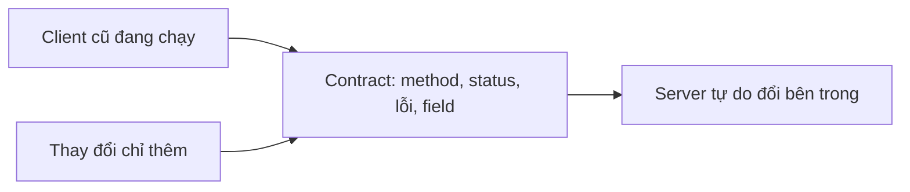
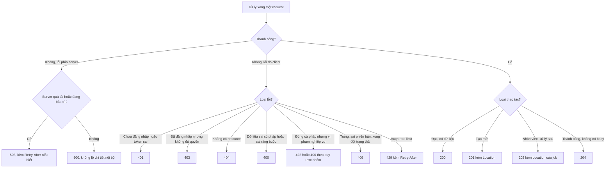
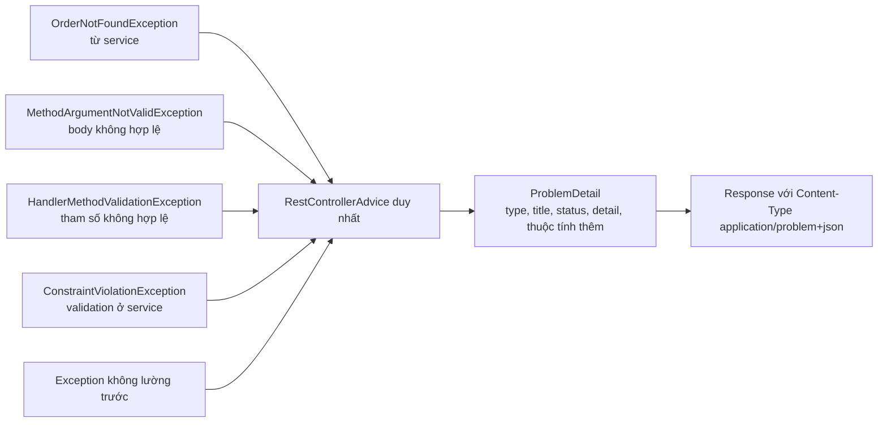
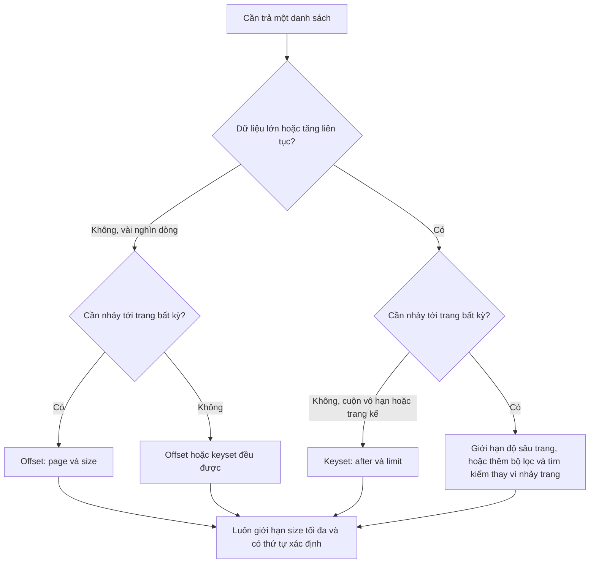
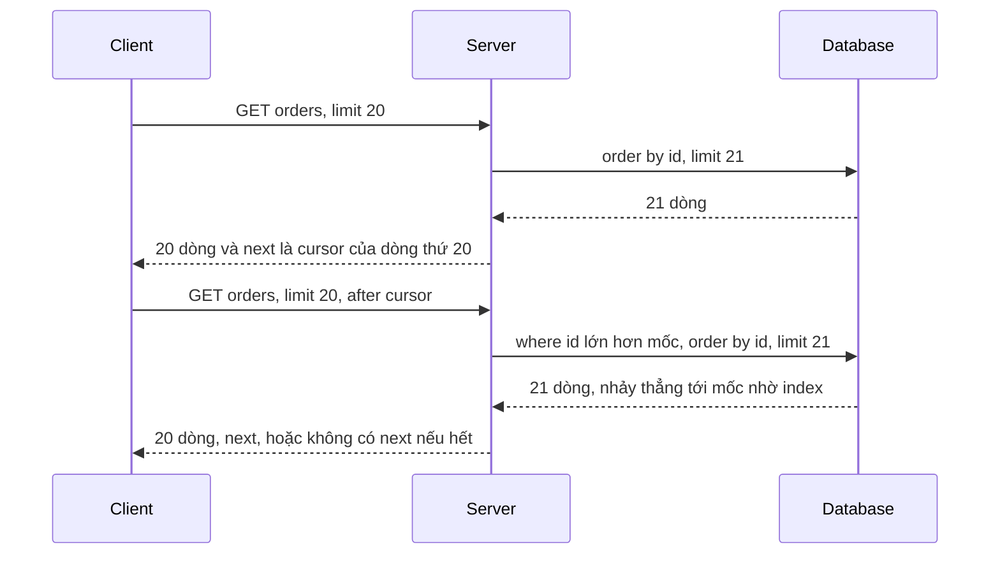
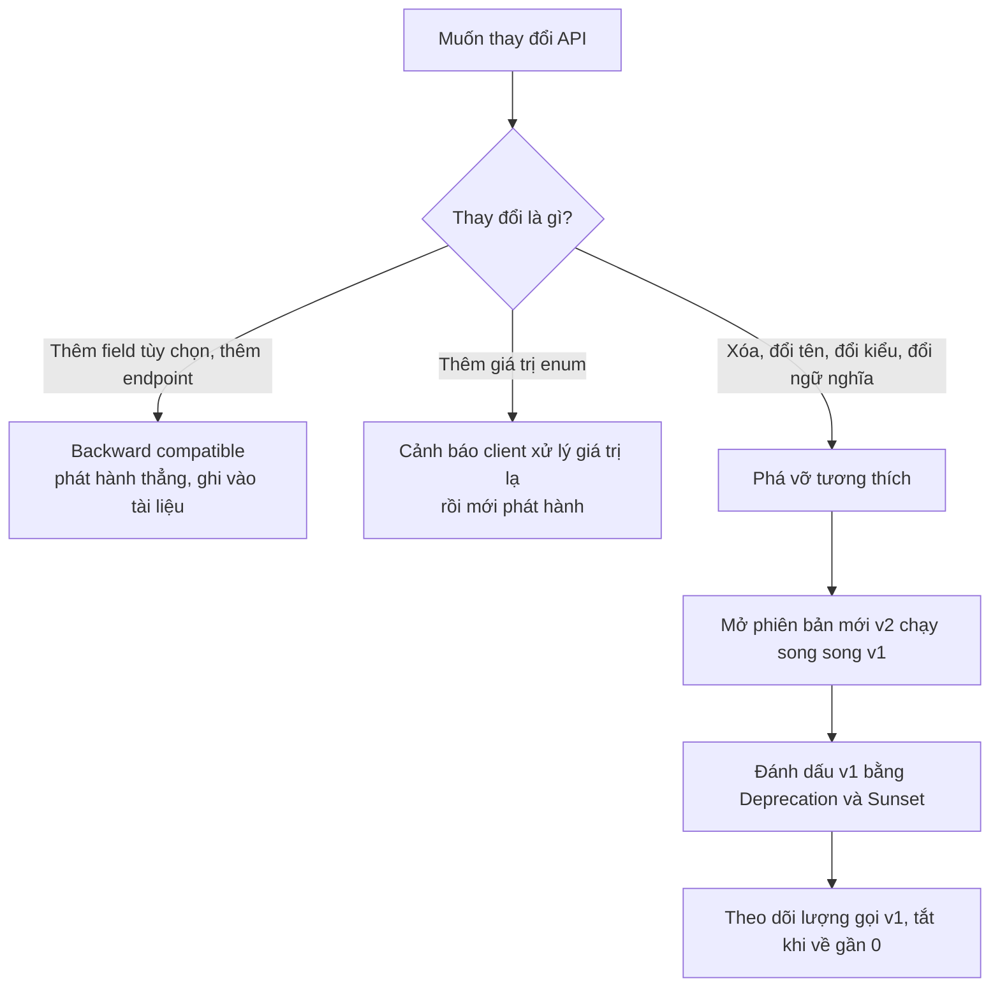
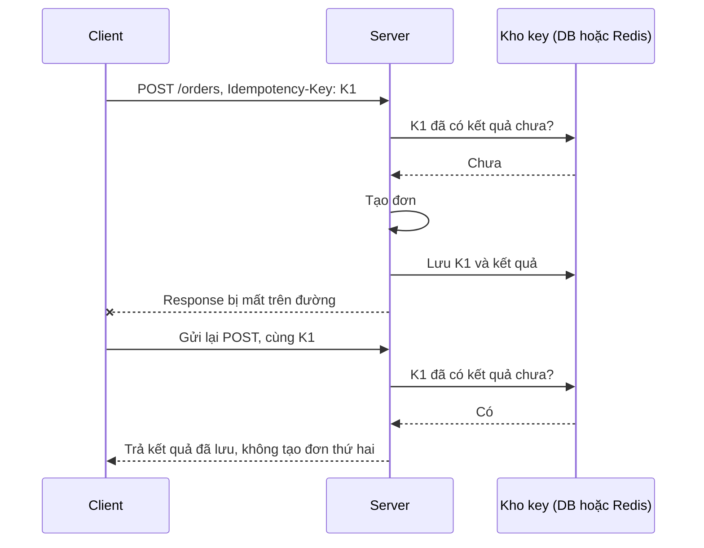
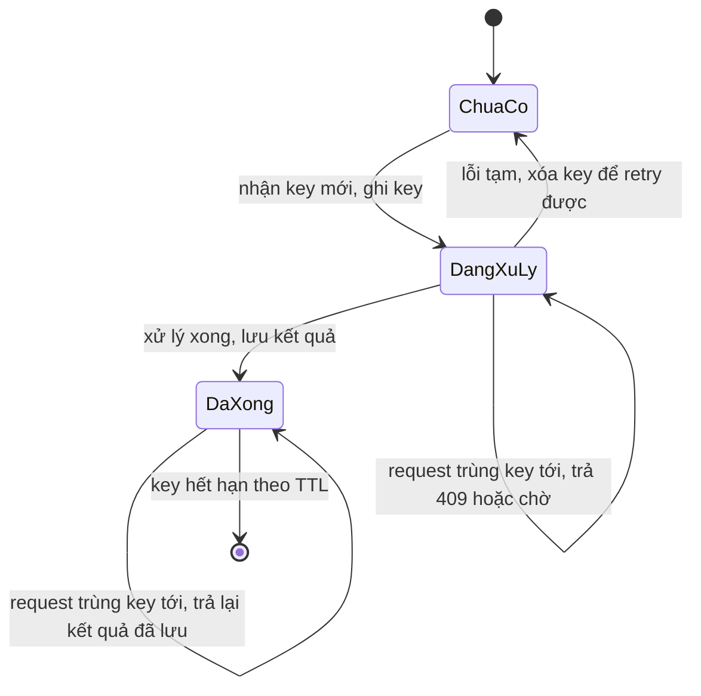
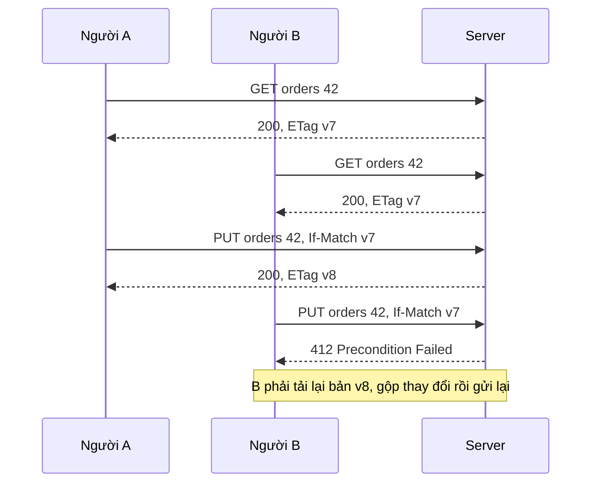
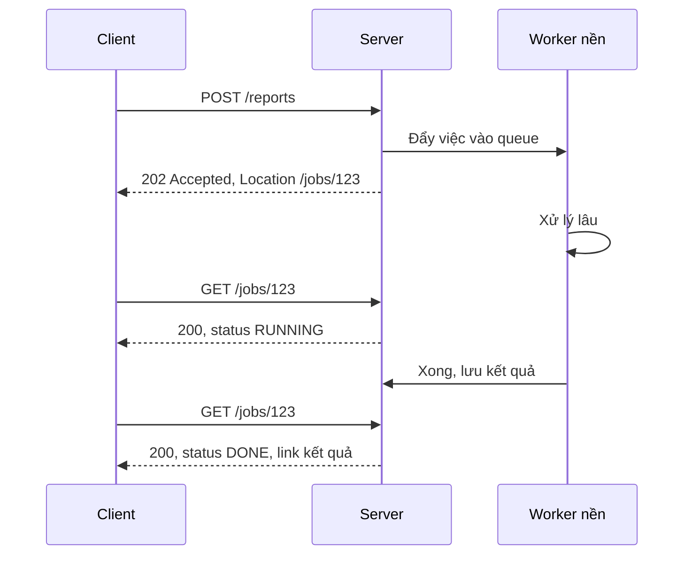

# Lý thuyết 33: Thiết kế REST API thực chiến

## Thiết kế REST API là việc gì?

Viết một endpoint chạy được thì dễ. Khó là thiết kế sao cho người khác dùng đúng ngay lần đầu, dùng được lâu dài, và bạn vẫn đổi được bên trong mà không làm hỏng họ. Bài này tập hợp các quy ước và quyết định thiết kế giúp API dễ dùng, dễ mở rộng, an toàn và backward compatible: đặt tên resource, chọn status code, định dạng lỗi, phân trang, phiên bản, idempotency.

**Cốt lõi:** API là contract với client mà bạn không kiểm soát khi nào họ cập nhật, và mạng giữa hai bên thì không đáng tin. Vì vậy thiết kế tốt dựa vào ngữ nghĩa chuẩn của HTTP để client và proxy hiểu đúng mà không cần biết nghiệp vụ, và chỉ thay đổi theo hướng thêm.

- Vì client cũ chỉ đọc những gì nó biết, nên chỉ thêm field tùy chọn là an toàn, còn xóa hay đổi nghĩa phải mở phiên bản mới chạy song song.
- Vì mạng lỗi nên client phải gửi lại, nên method idempotent retry được còn `POST` cần `Idempotency-Key`.
- Vì client và proxy đọc status code mà không phân tích body, nên dùng mã đúng nghĩa và một cấu trúc lỗi duy nhất.



Mô hình tư duy: sơ đồ cho thấy contract là lớp đệm ổn định giữa client không kiểm soát được và server muốn tiến hóa.

**Tóm tắt:**

- API là contract với client mà bạn không kiểm soát được khi nào họ cập nhật, nên mọi quyết định thiết kế đều nhằm đổi được bên trong mà không làm hỏng bên ngoài.
- URL là danh từ, HTTP method là động từ; `GET`, `PUT`, `DELETE` idempotent nên retry được, `POST` thì không và cần `Idempotency-Key`.
- Dùng status code đúng nghĩa (`4xx` lỗi do client, `5xx` lỗi do server) và một cấu trúc lỗi chung `ProblemDetail`; không bao giờ trả `200` kèm `{"error": ...}`.
- Validate cú pháp ở biên bằng Bean Validation, nghiệp vụ ở service, và luôn kiểm tra quyền sở hữu để tránh IDOR; một lỗi validation có ba loại exception cần xử lý cả ba.
- Mọi danh sách phải phân trang và giới hạn `size`; offset chậm khi N lớn, keyset ổn định và nhanh nhưng không nhảy tới trang tùy ý.
- Chỉ thêm field tùy chọn mới là backward compatible; xóa, đổi tên, đổi kiểu hoặc đổi ngữ nghĩa cần phiên bản mới chạy song song.
- ETag cùng `If-Match` chống lost update (trả `412`); không trả entity mà dùng DTO để không lộ schema và tránh mass assignment.
- Việc chạy lâu trả `202` kèm `Location`; async, SSE và upload cần giải phóng thread container, đặt timeout và giới hạn kích thước.

## Vì sao đáng đầu tư?

API là **contract** với người dùng khác. Khi đã có client (app mobile, đối tác) gọi vào, mỗi thay đổi có thể làm hỏng họ, và bạn không kiểm soát được khi nào họ cập nhật. Vì vậy sai ở khâu thiết kế là sai tốn kém nhất, khó sửa nhất. Các buổi code review senior thường góp ý đúng những điểm trong bài này.

## Khi nào dùng

Khi thiết kế endpoint mới, review PR, hoặc nâng cấp API đang chạy. Nguyên tắc xuyên suốt: tuân theo ngữ nghĩa HTTP; trả lỗi có cấu trúc thống nhất; phân trang mọi danh sách; đổi API theo hướng backward compatible; ghi tài liệu bằng OpenAPI.

## Các khái niệm cần biết

- **REST**: phong cách thiết kế API xoay quanh *resource* (danh từ như `orders`) và các HTTP method chuẩn (`GET`, `POST`...) tác động lên chúng. Nó không bắt buộc định dạng, nhưng JSON là phổ biến nhất.
- **Safe**: method không làm thay đổi dữ liệu trên server (`GET`). Nhờ vậy trình duyệt, proxy, crawler gọi tự do mà không gây hại.
- **Idempotent**: gọi một lần hay nhiều lần cho cùng kết quả cuối cùng. Quan trọng vì mạng hay lỗi và client sẽ gửi lại; với method idempotent việc gửi lại là an toàn. Ví dụ `DELETE /orders/42` gọi hai lần thì đơn vẫn chỉ "đã xóa", còn `POST /orders` gọi hai lần có thể tạo hai đơn.
- **Backward compatible**: client cũ vẫn chạy đúng khi server nâng cấp. Thêm trường tùy chọn thì tương thích; xóa hoặc đổi tên trường thì không.
- **DTO (Data Transfer Object)**: class riêng chỉ để mang dữ liệu vào ra qua API, tách khỏi entity của database.
- **Mass assignment**: lỗi cho phép client gửi thêm trường (như `role`) mà server vô tình ghi vào entity.
- **OpenAPI**: chuẩn mô tả API (đường dẫn, tham số, lỗi) dạng máy đọc được; từ đó sinh tài liệu và mã client.
- **Rate limiting**: giới hạn số request mỗi người dùng trong một khoảng thời gian, để một client không làm sập cả hệ thống.

## Resource và method

Hãy nghĩ URL là **danh từ** (cái gì) và HTTP method là **động từ** (làm gì). Nhờ vậy `GET /orders/42` đã tự nói lên nó làm gì mà không cần tên như `/getOrder`.

| Nên | Không nên |
|---|---|
| `GET /orders/42`, `POST /orders`, `DELETE /orders/42` | `/getOrder`, `/createOrder` (động từ trong URL) |
| Danh từ số nhiều, chữ thường, gạch ngang | Trộn hoa thường, số ít số nhiều lẫn lộn |
| Quan hệ lồng nhau một cấp: `/orders/42/items` | Lồng quá sâu `/a/1/b/2/c/3/d` |
| Hành động không phải CRUD: `POST /orders/42/cancel` | Giả vờ nó là `PUT` của một field khó hiểu |

Ngữ nghĩa HTTP: bảng sau cho biết method nào an toàn và idempotent. Dùng bảng này để quyết định có thể tự động retry hay không: `GET`, `PUT`, `DELETE` retry được; `POST` thì phải có thêm cơ chế riêng (xem mục Idempotency).

| Method | Safe (không đổi dữ liệu) | Idempotent | Ghi chú |
|---|---|---|---|
| `GET` | Có | Có | Không có body ghi |
| `PUT` | Không | Có | Thay thế toàn bộ resource |
| `PATCH` | Không | Không bảo đảm | Cập nhật một phần |
| `DELETE` | Không | Có | Xóa lần hai vẫn cùng kết quả cuối |
| `POST` | Không | **Không** | Tạo mới; cần idempotency key nếu có thể retry |

**Phải thuộc:** `GET`, `PUT`, `DELETE` idempotent (retry được); `POST` không idempotent (cần `Idempotency-Key`); `PATCH` không bảo đảm. Chỉ `GET` vừa safe vừa idempotent.

**Suy luận:** mạng không đáng tin nên client không bao giờ biết chắc một request bị rớt đã tới server hay chưa, và cách duy nhất để chắc chắn là gửi lại. Gửi lại chỉ an toàn khi thao tác idempotent, vì thế HTTP gán sẵn semantic cho từng method để proxy, client library và gateway tự quyết định có retry hay không mà không cần hiểu nghiệp vụ: `GET` đọc, `PUT` đặt về một trạng thái cố định, `DELETE` xóa, lặp lại đều không đổi kết quả cuối. `POST` thì bản chất là "tạo thêm một cái nữa", nên lặp lại sinh trùng; đó là lý do không thể retry `POST` một cách vô tư. Có hai điểm dễ nhầm. Thứ nhất, idempotent không có nghĩa là "response giống hệt nhau": `DELETE` lần hai có thể trả `404` thay vì `204`, vì idempotent chỉ nói trạng thái cuối giống nhau. Thứ hai, `PATCH` trông giống `PUT` nhưng không bảo đảm: "đặt giá trị" thì idempotent, "cộng thêm 1" thì không. Vì request lần đầu có thể đã thành công, lời giải cho `POST` phải nằm ở phía server nhớ ý định bằng `Idempotency-Key`, không phải ở client cố đoán. Khi review: mọi `POST` có thể bị retry (app mobile, gateway, message consumer) phải có key hoặc ràng buộc unique ở DB, và `PUT`, `DELETE` phải thật sự idempotent chứ không chỉ trên tài liệu.

## Status code

Status code là thứ đầu tiên client (và proxy, công cụ giám sát) đọc. Chọn mã đúng nghĩa giúp client xử lý đúng mà không phải phân tích body. Quy tắc nhanh: `2xx` thành công, `4xx` lỗi do client (gửi lại y nguyên vẫn lỗi), `5xx` lỗi do server (có thể thử lại sau).

| Mã | Dùng khi |
|---|---|
| 200 | Thành công có nội dung |
| 201 + `Location` | Tạo mới thành công |
| 202 | Đã nhận, xử lý async |
| 204 | Thành công, không nội dung |
| 400 | Request sai cú pháp hoặc dữ liệu không hợp lệ |
| 401 | Chưa xác thực |
| 403 | Đã xác thực nhưng không có quyền |
| 404 | Không tìm thấy |
| 409 | Xung đột (trùng, sai phiên bản) |
| 422 | Đúng cú pháp nhưng sai nghiệp vụ (tùy quy ước nhóm) |
| 429 + `Retry-After` | Vượt rate limit |
| 500 | Lỗi phía server; không lộ chi tiết nội bộ |
| 503 | Tạm thời không phục vụ |

Đừng trả `200` kèm `{"error": ...}`: client, proxy và công cụ giám sát đều dựa vào status code.

Khi không chắc chọn mã nào, đi theo flow sau:



Đọc sơ đồ: trước hết tách thành công, lỗi client, lỗi server; sau đó mới chọn mã chi tiết. Câu hỏi hữu ích nhất để phân biệt `4xx` và `5xx` là "client gửi lại y nguyên có thành công không": nếu không thì là lỗi client, nếu có thể thì thường là lỗi server hoặc tạm thời.

**Phải thuộc:** 200 OK, 201 Created (kèm `Location`), 204 No Content, 400 dữ liệu sai, 401 chưa xác thực, 403 không đủ quyền, 404 không thấy, 409 xung đột, 429 vượt rate limit (kèm `Retry-After`), 500 lỗi server, 503 tạm ngưng. `4xx` là lỗi client, `5xx` là lỗi server.

**Nền tảng:** API là contract với client mà bạn không kiểm soát khi nào họ cập nhật, nên mọi thiết kế (status code, định dạng lỗi, phiên bản, backward compatible) đều nhằm để đổi bên trong mà không làm hỏng bên ngoài.

## Định dạng lỗi: `ProblemDetail`

Vấn đề đặt ra: nếu mỗi endpoint trả lỗi một kiểu, client phải viết mã xử lý riêng cho từng nơi. Chuẩn RFC 9457 (kế nhiệm RFC 7807) định nghĩa một cấu trúc JSON chung cho lỗi (`type`, `title`, `status`, `detail`, cộng thêm thuộc tính tùy ý). Spring 6 hỗ trợ sẵn qua `ProblemDetail`. Ví dụ dưới xử lý hai trường hợp: không tìm thấy đơn (`404`) và dữ liệu vào không hợp lệ (`400` kèm danh sách lỗi theo trường).

```java
@RestControllerAdvice
class ApiExceptionHandler extends ResponseEntityExceptionHandler {

    @ExceptionHandler(OrderNotFoundException.class)
    ProblemDetail notFound(OrderNotFoundException ex) {
        ProblemDetail pd = ProblemDetail.forStatusAndDetail(HttpStatus.NOT_FOUND, ex.getMessage());
        pd.setTitle("Order not found");
        pd.setProperty("orderId", ex.getOrderId());
        return pd;
    }

    @Override
    protected ResponseEntity<Object> handleMethodArgumentNotValid(
            MethodArgumentNotValidException ex, HttpHeaders headers,
            HttpStatusCode status, WebRequest request) {
        ProblemDetail pd = ProblemDetail.forStatus(HttpStatus.BAD_REQUEST);
        pd.setTitle("Validation failed");
        pd.setProperty("errors", ex.getBindingResult().getFieldErrors().stream()
                .map(f -> Map.of("field", f.getField(), "message", String.valueOf(f.getDefaultMessage())))
                .toList());
        return ResponseEntity.badRequest().body(pd);
    }
}
```

Quy tắc: mọi endpoint trả **cùng một cấu trúc lỗi**; thông điệp lỗi hữu ích cho client nhưng không lộ stack trace, tên bảng, hay đường dẫn nội bộ.

Mọi nguồn lỗi khác nhau đều được gom về cùng một hợp đồng lỗi ở một chỗ:



Đọc sơ đồ: nhiều loại exception đi vào một advice, một cấu trúc đi ra. Exception không lường trước nên được ánh xạ thành `500` với thông điệp chung, còn chi tiết chỉ ghi vào log kèm `traceId`. Lỗi từ Filter (như `401` của Spring Security) không đi qua advice này nên cần cấu hình riêng để cùng định dạng.

## Kiểm tra dữ liệu đầu vào

Không bao giờ tin dữ liệu từ client. Bean Validation (các annotation `@NotBlank`, `@Size`, `@Min`...) kiểm tra ngay tại biên của API, và `@Valid` kích hoạt việc kiểm tra. Nếu thất bại, Spring ném `MethodArgumentNotValidException`, chính là ngoại lệ được xử lý trong `ApiExceptionHandler` ở trên.

```java
public record CreateOrderRequest(
        @NotBlank String customerId,
        @NotEmpty @Size(max = 100) List<@Valid Item> items) {

    public record Item(@NotBlank String sku, @Min(1) int quantity) {}
}

@PostMapping("/orders")
ResponseEntity<OrderResponse> create(@Valid @RequestBody CreateOrderRequest req) { ... }
```

Kiểm tra cú pháp bằng Bean Validation ở biên; kiểm tra **nghiệp vụ** (còn hàng, đủ hạn mức) ở tầng service. Luôn kiểm tra quyền sở hữu: user A không được xem đơn của user B dù biết id (lỗ hổng IDOR).

## Validation nâng cao

Mục "Kiểm tra dữ liệu đầu vào" ở trên dừng ở `@Valid` trên body. Thực tế bạn sẽ gặp thêm bốn nhu cầu: cùng một DTO nhưng luật khác nhau giữa tạo mới và cập nhật; luật nghiệp vụ không có sẵn annotation; kiểm tra ở service (không chỉ ở controller); và hiểu vì sao cùng là "validation lỗi" mà ném ra các exception khác nhau.

### Khái niệm

- **Validation group**: nhãn (một interface rỗng) gắn vào ràng buộc để chọn nhóm ràng buộc chạy ở từng tình huống.
- **`ConstraintValidator<A, T>`**: class thực thi một ràng buộc tự viết; `A` là annotation, `T` là kiểu giá trị được kiểm tra.
- **Method validation**: kiểm tra ràng buộc đặt trên tham số hoặc giá trị trả về của method, không chỉ trên field của DTO.
- **`@Valid` và `@Validated`**: `@Valid` (Jakarta) chỉ kích hoạt và lan xuống object lồng nhau; `@Validated` (Spring) thêm chọn group và bật method validation khi đặt trên class.

### Groups: cùng DTO, luật khác nhau

Vấn đề: `id` phải rỗng khi tạo, phải có khi cập nhật. Một bộ ràng buộc duy nhất không thỏa cả hai. Khai báo hai group và chọn bằng `@Validated` ở controller.

_Minh họa_:

```java
interface OnCreate {}
interface OnUpdate {}

public record BookRequest(
        @Null(groups = OnCreate.class) @NotNull(groups = OnUpdate.class) Long id,
        @NotBlank(groups = {OnCreate.class, OnUpdate.class}) String title) {}

@PostMapping("/books")
Book create(@Validated(OnCreate.class) @RequestBody BookRequest req) { ... }

@PutMapping("/books/{id}")
Book update(@Validated(OnUpdate.class) @RequestBody BookRequest req) { ... }
```

Ràng buộc không ghi `groups` thuộc group `Default`. Khi bạn chọn `@Validated(OnCreate.class)`, các ràng buộc `Default` **không** chạy trừ khi group của bạn kế thừa `Default`. `@Valid` không chọn được group.

### Ràng buộc tự viết

Ví dụ kiểm tra email chưa tồn tại. Validator được Spring tạo nên tiêm được bean, ví dụ repository. Quy ước: giá trị `null` trả `true`, để `@NotNull` lo chuyện bắt buộc.

_Minh họa_:

```java
@Target({FIELD, PARAMETER, RECORD_COMPONENT})
@Retention(RUNTIME)
@Constraint(validatedBy = UniqueEmailValidator.class)
public @interface UniqueEmail {
    String message() default "Email đã tồn tại";
    Class<?>[] groups() default {};
    Class<? extends Payload>[] payload() default {};
}

class UniqueEmailValidator implements ConstraintValidator<UniqueEmail, String> {
    private final UserRepository users;
    UniqueEmailValidator(UserRepository users) { this.users = users; }

    @Override
    public boolean isValid(String email, ConstraintValidatorContext ctx) {
        return email == null || !users.existsByEmail(email);
    }
}
```

Kiểm tra "chưa tồn tại" bằng validator chỉ là kiểm tra sớm để báo lỗi đẹp. Hai request cùng lúc vẫn có thể lọt cả hai, nên vẫn cần ràng buộc `UNIQUE` ở database.

### Method validation ở service

Controller không phải cổng duy nhất: job nền, consumer Kafka, service khác cũng gọi service của bạn. Đặt `@Validated` trên class service thì Spring tạo proxy và kiểm tra ràng buộc trên tham số.

_Minh họa_:

```java
@Service
@Validated
class TransferService {
    void transfer(@NotBlank String from, @NotBlank String to, @Positive long amount) { ... }
}
```

Vi phạm ném `jakarta.validation.ConstraintViolationException` (không có `BindingResult`). Nếu không bắt, controller trả `500`; hãy ánh xạ sang `400` trong `@RestControllerAdvice`. Vì dựa vào proxy, gọi method từ trong cùng class (self-invocation) bỏ qua kiểm tra, giống bẫy của `@Transactional` (xem [Transaction chuyên sâu](/go?p=01-Spring-Boot%2Fhard%2Flt-31-transaction-chuyen-sau.md)).

### Ba exception: khác nhau thế nào

Spring 6.1 thêm method validation tích hợp sẵn cho controller: ràng buộc đặt thẳng trên tham số controller (`@RequestParam @Min(1) int page`) được kiểm tra mà không cần `@Validated` trên class. Kết quả là có ba kiểu lỗi, tùy chỗ đặt ràng buộc.

| Exception | Khi nào xảy ra | Mặc định |
|---|---|---|
| `MethodArgumentNotValidException` | `@Valid` trên `@RequestBody` hoặc `@ModelAttribute` và có lỗi, khi method không có ràng buộc nào khác trên tham số | `400`, có `BindingResult` theo field |
| `HandlerMethodValidationException` | Ràng buộc trực tiếp trên tham số controller (query, path, header), hoặc `@Valid` phối hợp ràng buộc khác (Spring 6.1+) | `400`, danh sách lỗi theo từng tham số |
| `ConstraintViolationException` | Method validation qua proxy: `@Validated` trên class service (hoặc trên class controller) | Không ánh xạ sẵn, thành `500` nếu không bắt |

Hệ quả thực tế: `handleMethodArgumentNotValid` ở `ApiExceptionHandler` phía trên **không** bắt lỗi `?page=0`. Cần thêm `handleHandlerMethodValidationException` (có sẵn để override trong `ResponseEntityExceptionHandler` từ Spring 6.1) và một `@ExceptionHandler(ConstraintViolationException.class)`. Đặt `@Validated` lên class controller sẽ chuyển lỗi tham số về `ConstraintViolationException` (qua proxy) thay vì cơ chế mới; Spring khuyên bỏ nó khỏi controller khi dùng 6.1+. Kiểm tra lại theo phiên bản Boot đang dùng.

### Bẫy thường gặp

| Bẫy | Hệ quả |
|---|---|
| Quên `@Valid` trên phần tử lồng (`List<@Valid Item>`, field object) | Ràng buộc bên trong bị bỏ qua, dữ liệu sai lọt vào |
| Chọn group nhưng ràng buộc `Default` không chạy | Mất kiểm tra tưởng đã có |
| Ràng buộc nghiệp vụ chỉ nằm ở validator, không có `UNIQUE` ở DB | Race condition tạo trùng |
| `@Validated` trên service rồi gọi `this.method()` | Không kiểm tra gì |
| Chỉ xử lý `MethodArgumentNotValidException` | Lỗi tham số query/path trả định dạng khác hoặc `500` |

## Phân trang

Một endpoint trả toàn bộ danh sách chạy tốt khi có 50 dòng và sập khi có 5 triệu dòng (tràn memory, response nặng, DB quá tải). Vì vậy mọi danh sách đều phải phân trang. Có hai cách chính: **offset** (bỏ qua N dòng đầu rồi lấy tiếp, như `limit 20 offset 4000`) và **keyset/cursor** (lấy các dòng sau một mốc, như `where id > 100 limit 20`). Offset chậm khi N lớn vì DB vẫn phải đọc rồi vứt N dòng; keyset nhảy thẳng tới mốc nhờ index.

| Cách | Ưu | Nhược |
|---|---|---|
| Offset (`page`, `size`) | Dễ, nhảy tới trang bất kỳ | Chậm khi offset lớn (DB vẫn phải quét và bỏ qua); dữ liệu thay đổi giữa các trang gây trùng/sót |
| Keyset / cursor (`after=<id>`) | Ổn định, nhanh với dữ liệu lớn | Không nhảy tới trang tùy ý |

Chọn cách phân trang theo nhu cầu, và hình dung vì sao keyset nhanh:





Đọc sơ đồ: server lấy dư một dòng (`limit + 1`) để biết còn trang sau hay không mà không cần chạy thêm câu `count`. Cursor chỉ là mốc của dòng cuối, nên chi phí mỗi trang không phụ thuộc đã cuộn sâu bao nhiêu.

Cursor thường là một chuỗi mã hóa (ở đây là Base64 của vị trí cuối cùng), client không cần hiểu bên trong; nó chỉ gửi lại giá trị `next` để lấy trang kế.

```text
GET /orders?limit=20&after=eyJpZCI6MTAwfQ
{ "data": [ ... ], "next": "eyJpZCI6MTIwfQ" }
```

Luôn **giới hạn `size` tối đa** (ví dụ 100) và có thứ tự sắp xếp xác định (thêm id làm tie-breaker). Đừng bao giờ trả danh sách không phân trang. Chi tiết về hiệu năng truy vấn ở [JPA hiệu năng, khóa và cache](/go?p=01-Spring-Boot%2Fhard%2Flt-34-jpa-hieu-nang-khoa-cache.md).

## Lọc và sắp xếp

Nếu client truyền `sort=anything` và bạn đưa thẳng vào câu truy vấn, bạn gặp hai rủi ro: sắp xếp theo cột không có index làm DB quét toàn bảng, và nhận tên cột tự do có thể lộ cột nhạy cảm hoặc dẫn tới injection. Chỉ cho phép sắp xếp và lọc theo **danh sách trường được duyệt trước** (whitelist) và có index; nhận tên cột tự do từ client vừa chậm vừa nguy cơ lộ dữ liệu.

## Phiên bản và backward compatibility

Khi buộc phải đổi contract theo cách làm hỏng client cũ, bạn cần chạy song song bản cũ và bản mới, nghĩa là cần đánh phiên bản. Có hai cách đặt phiên bản phổ biến:

| Cách | Ví dụ | Nhận xét |
|---|---|---|
| Trong URL | `/v1/orders` | Dễ hiểu, dễ cache, phổ biến |
| Trong header | `Accept: application/vnd.app.v2+json` | Sạch URL, khó thử bằng trình duyệt |

Nguyên tắc quan trọng hơn cách chọn: **tiến hóa backward compatible** để ít cần phiên bản mới.

- Được phép: thêm trường mới (tùy chọn), thêm endpoint, thêm giá trị enum nếu client được cảnh báo xử lý giá trị lạ.
- Cần phiên bản mới: xóa hoặc đổi tên trường, đổi kiểu, đổi ngữ nghĩa.
- Client nên **bỏ qua trường lạ** (`FAIL_ON_UNKNOWN_PROPERTIES` tắt).
- Có kế hoạch ngừng hỗ trợ: thông báo, header `Deprecation` và `Sunset`.

Quy trình quyết định khi muốn đổi response hoặc request:



Đọc sơ đồ: mặc định đi nhánh "thêm" để không cần phiên bản mới. Nhánh phá vỡ luôn đi đủ bốn bước: song song, đánh dấu, theo dõi, rồi mới tắt; bỏ bước theo dõi là tắt khi vẫn còn client dùng.

**Suy luận:** server và client được release độc lập, và bạn không biết chính xác client nào đang chạy bản nào, nên mỗi thay đổi response phải được nhìn từ phía client cũ. Client cũ chỉ đọc các field nó biết và bỏ qua phần còn lại (nếu parser được cấu hình đúng), vì vậy thêm một field tùy chọn là an toàn: không ai phụ thuộc vào thứ chưa từng tồn tại. Ngược lại, xóa, đổi tên, đổi kiểu hay đổi ngữ nghĩa làm vỡ đúng thứ client đang dùng, nên chỉ làm được trên phiên bản mới chạy song song. Từ đó thấy hai điểm dễ nhầm. Đổi ngữ nghĩa mà giữ nguyên tên và kiểu (ví dụ `price` từ đồng sang xu) là thay đổi phá vỡ nguy hiểm nhất vì không có lỗi parse nào báo. Thêm một giá trị enum mới cũng có thể phá vỡ nếu client xử lý bằng `switch` cứng không có nhánh mặc định. Hệ quả hành động: mặc định chỉ thêm, đặt field mới là optional, yêu cầu client bỏ qua field lạ, và khi buộc phải phá vỡ thì mở phiên bản mới kèm `Deprecation` và `Sunset` để client có thời gian chuyển.

## Idempotency và retry

Vấn đề đặt ra: `POST` tạo resource không idempotent, mà mạng thì lỗi. Client gửi `POST /orders`, server đã tạo đơn nhưng response bị rớt giữa đường; client không biết nên gửi lại, và khách bị trừ tiền hai lần. Cách giải quyết là để client gắn một key duy nhất cho mỗi **ý định**, server nhớ key đó và không thực hiện lại. Dùng header `Idempotency-Key`:



Trạng thái của một key bên phía server, gồm cả trường hợp request trùng đến khi lần đầu còn đang chạy:



Đọc sơ đồ: việc ghi key phải nguyên tử (ràng buộc unique hoặc lệnh set-if-absent) để hai request cùng lúc không cùng thấy "chưa có". Nên lưu kèm bản băm của body để phát hiện cùng key nhưng nội dung khác, trường hợp đó nên trả lỗi `4xx` thay vì trả kết quả cũ.

Các bước chi tiết:

1. Client sinh key (UUID) và gửi cùng request.
2. Server lưu key cùng kết quả (trong bảng có ràng buộc duy nhất hoặc Redis).
3. Request lặp với cùng key trả về **kết quả đã lưu**, không thực hiện lại.
4. Request đang xử lý trùng key thì trả `409` hoặc chờ.

Chi tiết cài đặt ở [Khóa phân tán và Idempotency](/go?p=01-Spring-Boot%2Fhard%2Flt-26-distributed-lock-idempotency.md).

## Chống ghi đè concurrent: ETag

Tình huống: hai người cùng mở đơn 42, người A sửa xong lưu, rồi người B lưu đè lên mà không hề thấy thay đổi của A (lost update). **ETag** là mã đại diện cho phiên bản hiện tại của resource. Client gửi lại mã này trong `If-Match` khi cập nhật; nếu server thấy mã đã khác (đã có người sửa) thì từ chối bằng `412`.

```text
GET /orders/42           -> ETag: "v7"
PUT /orders/42           If-Match: "v7"
-> 200 nếu còn là v7, 412 Precondition Failed nếu đã bị người khác sửa
```

Ánh xạ tự nhiên với optimistic lock `@Version` ở tầng JPA.



Đọc sơ đồ: người B không ghi đè được vì mã `v7` của B đã cũ. Nhờ đó thay đổi của A không bị mất âm thầm.

## DTO, không lộ entity

Không trả `@Entity` trực tiếp: lộ cấu trúc DB, gây lỗi lazy loading khi serialize, ràng buộc API với schema, và dễ bị **mass assignment** (client gửi trường như `role` hay `price` mà bạn không muốn nhận). Dùng `record` làm DTO; ánh xạ bằng MapStruct hoặc tay.

## Tác vụ chạy lâu

Giữ connection HTTP vài phút gây timeout ở proxy, trình duyệt và load balancer, đồng thời chiếm thread của server. Cách làm: nhận việc, trả ngay `202 Accepted` kèm `Location: /jobs/123`; client hỏi trạng thái định kỳ (polling) hoặc nhận webhook (server gọi ngược về client khi xong).



## Servlet nâng cao: async, SSE, upload

Mặc định mỗi request giữ một thread của Tomcat từ lúc vào đến lúc ra. Với việc chờ lâu (chờ kết quả service khác, đẩy event, tải file lớn), giữ thread là lãng phí và làm cạn pool. Servlet hỗ trợ xử lý async: thread của container được trả lại ngay, kết quả sẽ được ghi sau bởi thread khác. Mục này chỉ nêu API phía Spring; không dùng khi việc chạy nhanh và sync là đủ. Với tác vụ kéo dài hàng phút, vẫn dùng mẫu `202` ở mục trên.

### Khái niệm

- **Async request**: controller trả một object "hứa hẹn" thay vì kết quả; Spring giải phóng thread container, khi kết quả có thì gửi response.
- **`Callable<T>`**: Spring chạy nó trên một executor riêng, đơn giản nhất.
- **`DeferredResult<T>`**: bạn giữ object và gọi `setResult` từ thread/event nào đó (callback, message listener).
- **`StreamingResponseBody`**: bạn ghi thẳng vào `OutputStream` của response từ thread khác, dùng cho tải file lớn hoặc dữ liệu sinh dần.
- **`SseEmitter`**: đẩy nhiều event qua một connection (Server-Sent Events, `text/event-stream`).

| Kiểu trả về | Khi nào chọn |
|---|---|
| `Callable<T>` | Việc tính toán tách khỏi thread container, không cần điều khiển ai hoàn tất |
| `DeferredResult<T>` | Kết quả đến từ nơi khác (event, queue), có timeout riêng |
| `CompletableFuture<T>` | Đã có chuỗi async sẵn |
| `StreamingResponseBody` | Response lớn, ghi từng khúc |
| `SseEmitter` | Đẩy nhiều event cho một client |

_Minh họa_ (hai kiểu đầu):

```java
@GetMapping("/report")
Callable<Report> report() {
    return () -> reportService.build();        // chạy trên executor của MVC
}

@GetMapping("/payments/{id}/wait")
DeferredResult<String> waitPayment(@PathVariable String id) {
    // timeout, giá trị khi quá hạn
    DeferredResult<String> result = new DeferredResult<>(15_000L, "TIMEOUT");
    waiters.put(id, result);
    result.onCompletion(() -> waiters.remove(id));
    // nơi khác gọi waiters.get(id).setResult("PAID")
    return result;
}
```

### SseEmitter

Vấn đề: server cần đẩy tiến độ hoặc thông báo mà client không phải hỏi liên tục. Spring trả `SseEmitter`; bạn giữ nó trong một tập thread-safe, gọi `send` khi có event, và gỡ khỏi tập khi kết thúc. Phần phía trình duyệt, so sánh với WebSocket, proxy và connection lại nằm ở [Realtime với SSE và WebSocket](/go?p=12-Fullstack%2Flt-03-realtime-sse-websocket.md).

_Minh họa_:

```java
private final Set<SseEmitter> emitters = ConcurrentHashMap.newKeySet();

@GetMapping(path = "/events", produces = MediaType.TEXT_EVENT_STREAM_VALUE)
SseEmitter subscribe() {
    // 0: không hết hạn phía Spring (kiểm tra timeout của proxy)
    SseEmitter emitter = new SseEmitter(0L);
    emitters.add(emitter);
    emitter.onCompletion(() -> emitters.remove(emitter));
    emitter.onTimeout(() -> emitters.remove(emitter));
    emitter.onError(e -> emitters.remove(emitter));
    return emitter;
}

void publish(OrderEvent event) {
    for (SseEmitter emitter : emitters) {
        try {
            emitter.send(SseEmitter.event().id(event.id()).name("order").data(event));
        } catch (IOException e) {
            emitters.remove(emitter);                   // client đã đóng connection
        }
    }
}
```

Mỗi client giữ một connection mở: tính theo số connection mở cùng lúc, không phải số request/giây. Timeout mặc định của async lấy từ container (Tomcat khoảng 30 giây, kiểm tra lại) hoặc `spring.mvc.async.request-timeout`; cần gửi định kỳ một event heartbeat để proxy không cắt connection rảnh.

### Streaming response và upload

Tải file lớn: đọc tất cả vào `byte[]` rồi trả là cách nhanh nhất để hết memory. Ghi từng khúc qua `StreamingResponseBody`.

_Minh họa_:

```java
@GetMapping("/exports/{id}")
ResponseEntity<StreamingResponseBody> export(@PathVariable long id) {
    // ghi dần, không giữ cả file
    StreamingResponseBody body = out -> exportService.writeCsv(id, out);
    return ResponseEntity.ok()
            .header(HttpHeaders.CONTENT_DISPOSITION, "attachment; filename=\"orders.csv\"")
            .contentType(MediaType.parseMediaType("text/csv"))
            .body(body);
}
```

Upload dùng `MultipartFile`. Spring (Tomcat) phân tích toàn bộ multipart trước khi vào controller: phần nhỏ giữ trong memory, phần lớn hơn `file-size-threshold` được ghi ra file tạm. Hai giới hạn quan trọng là kích thước từng file và cả request.

```yaml
spring:
  servlet:
    multipart:
      max-file-size: 10MB       # mỗi file (mặc định 1MB)
      max-request-size: 20MB    # cả request (mặc định 10MB)
      file-size-threshold: 1MB  # vượt ngưỡng này ghi ra đĩa
```

_Minh họa_:

```java
@PostMapping(path = "/avatars", consumes = MediaType.MULTIPART_FORM_DATA_VALUE)
ResponseEntity<Void> upload(@RequestPart("file") MultipartFile file) throws IOException {
    if (file.isEmpty()) return ResponseEntity.badRequest().build();
    // không dùng tên file của client
    Path target = storageDir.resolve(UUID.randomUUID() + ".bin");
    try (InputStream in = file.getInputStream()) {
        // sao chép theo stream
        Files.copy(in, target);
    }
    return ResponseEntity.created(URI.create("/avatars/" + target.getFileName())).build();
}
```

Vượt giới hạn thì Spring ném `MaxUploadSizeExceededException`; hãy ánh xạ thành `413` trong `@RestControllerAdvice` (mặc định có thể ra `500` hoặc `400` tùy phiên bản, kiểm tra lại). File rất lớn (hàng trăm MB trở lên) nên để client tải thẳng lên object storage bằng URL ký sẵn (presigned URL), server chỉ cấp URL và nhận thông báo hoàn tất. Muốn thật sự streaming qua server thì tắt multipart của Spring (`spring.servlet.multipart.enabled=false`) và đọc stream bằng thư viện như Commons FileUpload; cách này khó hơn nhiều, chỉ dùng khi buộc phải.

### Bẫy thường gặp

| Bẫy | Hệ quả |
|---|---|
| Dùng `getOriginalFilename()` làm đường dẫn lưu | Path traversal (`../../etc/...`), ghi đè file |
| Tin `Content-Type` do client khai | Upload mã độc đội lốt ảnh; kiểm tra nội dung (magic bytes) và giới hạn loại file |
| `file.getBytes()` với file lớn | Tràn memory |
| Không gỡ `SseEmitter` đã đóng | Memory leak, ghi vào connection chết gây `IOException` liên tục |
| Dùng `SecurityContext`, `RequestContextHolder` trong thread async | Mất ngữ cảnh người dùng/request nếu không truyền sang |
| Không đặt timeout cho `DeferredResult` | Client treo đến khi proxy cắt |

## Rate limiting, nén, cache

- Rate limiting theo người dùng/API key; trả `429` với `Retry-After`.
- Bật nén (gzip) cho response lớn.
- `GET` ổn định: dùng `Cache-Control`, `ETag` và `If-None-Match` (trả `304`).

## Tài liệu và API contract

- Sinh OpenAPI (ví dụ springdoc-openapi) và coi nó là API contract; contract testing (Pact hoặc kiểm tra tương thích schema) khi nhiều nhóm dùng chung.
- Ghi rõ error code, ví dụ và giới hạn.

## Danh sách kiểm tra khi review API

- Tên resource và method đúng ngữ nghĩa?
- Status code và định dạng lỗi nhất quán?
- Danh sách có phân trang và giới hạn tối đa?
- Dữ liệu vào được kiểm tra, quyền sở hữu được kiểm tra?
- Thay đổi có backward compatible không?
- `POST` có cơ chế idempotency khi client retry?
- Không lộ entity, không lộ thông tin nội bộ trong lỗi?
- Có timeout, rate limiting, ghi log kèm `traceId`?

## Phỏng vấn khó: chuỗi hỏi xoáy

Người phỏng vấn senior thường mở bằng câu dễ rồi xoáy xuống cơ chế, đánh đổi và sự cố thật. Câu trả lời tốt luôn đi từ cốt lõi xuống: mạng không đáng tin nên client phải gửi lại, và API là contract mà bạn không kiểm soát khi nào client đổi.

### Chuỗi 1: `Idempotency-Key` khi hai request đến cùng lúc

1. **Câu mở:** Thiết kế `Idempotency-Key` cho `POST /orders` thế nào?
2. **Xoáy 1:** Hai request cùng key đến gần như đồng thời, lần đầu còn đang xử lý. Server làm gì, và việc ghi key cần tính chất gì?
3. **Xoáy 2:** Cùng key nhưng body khác nhau thì sao? Còn nếu lần đầu gặp lỗi tạm giữa chừng?

**Đáp án ngắn:** Client sinh một key (UUID) cho mỗi ý định và gửi kèm request; server lưu key cùng kết quả trong bảng có ràng buộc duy nhất hoặc Redis. Gửi lại cùng key thì trả kết quả đã lưu, không tạo đơn thứ hai. Key đi qua ba trạng thái: chưa có, đang xử lý, đã xong. Request trùng key khi lần đầu còn chạy thì trả `409` hoặc chờ. Việc ghi key phải nguyên tử (unique constraint hoặc set-if-absent), nếu không hai request cùng lúc đều thấy "chưa có" và cùng tạo đơn. Nên lưu kèm bản băm của body để phát hiện cùng key nhưng nội dung khác, và trả lỗi `4xx` thay vì kết quả cũ. Nếu xử lý lỗi tạm thì xóa key để client retry được, không thì client bị kẹt. Key có TTL để hết hạn. Ràng buộc unique ở DB trên chính nghiệp vụ là lưới an toàn cuối cùng.

**Sai lầm hay gặp:**

- Nói "kiểm tra key đã có chưa rồi mới ghi" mà không nói được tính nguyên tử.
- Để server tự sinh key: key phải gắn với ý định của client thì mới nhận ra lần gửi lại.
- Quên trường hợp request trùng đến khi lần đầu còn đang xử lý.

### Chuỗi 2: ETag và lost update

1. **Câu mở:** Hai người cùng sửa đơn 42, người lưu sau ghi đè người lưu trước. Chống ở tầng HTTP bằng gì?
2. **Xoáy 1:** `ETag` và `If-Match` hoạt động ra sao, status code nào khi lệch, và người B phải làm gì?
3. **Xoáy 2:** Nó nối với tầng JPA thế nào, và nếu client không gửi `If-Match` thì sao?

**Đáp án ngắn:** Đây là lost update. ETag là mã đại diện cho phiên bản hiện tại của resource: `GET` trả `ETag: "v7"`, client gửi lại `If-Match: "v7"` khi `PUT`. Nếu server thấy mã đã khác, tức đã có người sửa, thì từ chối bằng `412 Precondition Failed`. Người B phải tải lại bản mới, gộp thay đổi rồi gửi lại; nhờ vậy thay đổi của A không bị mất âm thầm. Cơ chế này ánh xạ tự nhiên với optimistic lock `@Version` ở JPA: version tăng mỗi lần ghi và đóng vai trò mã phiên bản. Không cần giữ lock lúc người dùng ngồi sửa form vài phút. Giới hạn: client không gửi `If-Match` thì server không có gì để so sánh, nên phải quyết định bắt buộc header này hay chấp nhận ghi đè; quyết định đó là của thiết kế API. Dấu hiệu sự cố trong production: người dùng than "dữ liệu tôi sửa tự biến mất".

**Sai lầm hay gặp:**

- Nhầm `If-Match` (điều kiện khi ghi, ra `412`) với `If-None-Match` (cache `GET`, ra `304`).
- Chỉ đề xuất khóa bi quan ở DB, không thấy rằng giữ lock suốt lúc người dùng sửa form là không khả thi.
- Không giải thích được vì sao phiên bản phải đi cùng request chứ không chỉ nằm ở server.

## Câu hỏi phỏng vấn thường gặp

1. Client gửi lại một request bị rớt mạng. Với `PUT`, `PATCH` và `POST`, method nào gửi lại an toàn, và vì sao?

   **Phải thuộc:** Câu này là câu cốt lõi, gặp rất thường xuyên.

   **Gợi ý suy luận:**
   - Gọi một thao tác hai lần có cho cùng kết quả cuối với gọi một lần không (khái niệm idempotent)?
   - `PUT` thay thế toàn bộ, `PATCH` cập nhật một phần, `POST` tạo mới: mỗi cái lặp lại thì trạng thái cuối thế nào?

   **Lập luận:** mạng hay lỗi nên client sẽ gửi lại; gửi lại chỉ an toàn nếu thao tác idempotent. `PUT` đặt resource về một trạng thái cho trước, lặp lại vẫn ra trạng thái đó nên idempotent. `POST` tạo mới nên lặp lại có thể tạo hai resource, không idempotent. `PATCH` tùy nội dung (đặt giá trị thì idempotent, "cộng thêm 1" thì không), nên không bảo đảm. Vì vậy `GET`, `PUT`, `DELETE` retry được, còn `POST` cần cơ chế riêng.

   **Đáp án ngắn:** `PUT` thay thế toàn bộ và idempotent; `PATCH` cập nhật một phần, không bảo đảm idempotent; `POST` tạo mới và không idempotent.

   **Nhớ:** idempotent quyết định có tự động retry được hay không. Xem bảng "Ngữ nghĩa HTTP".

2. Thiết kế định dạng lỗi chung cho toàn API. Trả `401` khác `403` khi nào?

   **Gợi ý suy luận:**
   - Nếu mỗi endpoint trả lỗi một kiểu, client phải làm gì?
   - Chưa biết bạn là ai và biết bạn là ai nhưng không có quyền: hai tình huống đó có cùng cách xử lý của client không?
   - Thông điệp lỗi nên chứa gì, và tuyệt đối không chứa gì?

   **Lập luận:** nếu mỗi nơi lỗi một kiểu thì client phải viết xử lý riêng cho từng nơi, nên dùng một cấu trúc chung: `ProblemDetail` theo RFC 9457 (`type`, `title`, `status`, `detail`, thêm thuộc tính tùy ý) qua `@RestControllerAdvice`. Về mã: `401` nghĩa là chưa xác thực, client xử lý bằng cách đăng nhập hoặc làm mới token; `403` nghĩa là đã biết bạn là ai nhưng không có quyền, đăng nhập lại không giải quyết được. Thông điệp phải hữu ích nhưng không lộ stack trace, tên bảng hay đường dẫn nội bộ.

   **Đáp án ngắn:** dùng `ProblemDetail` thống nhất cho mọi endpoint. `401` khi chưa xác thực, `403` khi đã xác thực nhưng không đủ quyền; không lộ chi tiết nội bộ.

   **Nhớ:** một cấu trúc lỗi, status code đúng nghĩa; không trả `200` kèm `{"error": ...}`.

3. Danh sách 5 triệu dòng, trang 20.000 mở rất chậm. Phân trang offset và keyset khác nhau thế nào, vì sao offset chậm?

   **Gợi ý suy luận:**
   - Với `limit 20 offset 400000`, DB phải đọc bao nhiêu dòng rồi bỏ đi bao nhiêu?
   - Với `where id > :last limit 20`, DB bắt đầu từ đâu nhờ index?
   - Người dùng có cần nhảy thẳng tới trang bất kỳ không, và dữ liệu có thay đổi giữa các lần xem không?

   **Lập luận:** offset buộc DB đọc rồi vứt N dòng đầu, N càng lớn càng chậm; dữ liệu thêm bớt giữa các trang còn gây trùng hoặc sót dòng. Keyset dùng điều kiện sau mốc cuối đã thấy, nên nhờ index nhảy thẳng tới mốc và chi phí không đổi theo vị trí. Đổi lại keyset không nhảy tới trang tùy ý. Do đó offset hợp danh sách nhỏ cần nhảy trang, keyset hợp dữ liệu lớn, cuộn vô hạn. Luôn giới hạn `size` tối đa và có thứ tự xác định (thêm id làm tie-breaker).

   **Đáp án ngắn:** offset phải đọc rồi bỏ N dòng nên chậm khi N lớn; keyset dùng mốc (`id > last`) nhờ index nên nhanh và ổn định nhưng không nhảy trang tùy ý.

   **Nhớ:** mọi danh sách đều phải phân trang, có giới hạn size. Xem [JPA hiệu năng, khóa và cache](/go?p=01-Spring-Boot%2Fhard%2Flt-34-jpa-hieu-nang-khoa-cache.md).

4. Mình muốn thêm một trường vào response mà không làm hỏng app mobile cũ chưa cập nhật. Làm thế nào?

   **Gợi ý suy luận:**
   - Client cũ làm gì khi gặp một trường nó không biết? Nó có bị phụ thuộc vào trường đó không?
   - Thêm trường, xóa trường, đổi tên trường: thay đổi nào làm client cũ gãy?

   **Lập luận:** client cũ chỉ đọc các trường nó biết, nên thêm một trường tùy chọn không làm nó hỏng nếu client bỏ qua trường lạ (`FAIL_ON_UNKNOWN_PROPERTIES` tắt). Ngược lại xóa, đổi tên, đổi kiểu hoặc đổi ngữ nghĩa trường sẽ làm client cũ sai, lúc đó cần phiên bản mới (`/v2/...` hoặc header) chạy song song bản cũ, kèm kế hoạch ngừng hỗ trợ (`Deprecation`, `Sunset`). Vì bạn không kiểm soát được khi nào client cập nhật, hãy tiến hóa theo hướng backward compatible để ít khi cần phiên bản mới.

   **Đáp án ngắn:** chỉ thêm trường tùy chọn, không xóa hay đổi tên; client bỏ qua trường lạ. Thay đổi phá vỡ thì tạo phiên bản mới chạy song song.

   **Nhớ:** API là contract, thêm thì được, bớt hoặc đổi thì cần phiên bản.

5. Client gửi `POST /orders`, server tạo đơn nhưng response rớt giữa đường, client gửi lại và khách có hai đơn. Làm sao tránh?

   **Phải thuộc:** Câu này là câu cốt lõi, gặp rất thường xuyên.

   **Gợi ý suy luận:**
   - Client có biết lần đầu thành công hay chưa không? Server nhận ra "đây là cùng một ý định" bằng cách nào?
   - Server cần nhớ gì giữa hai lần gọi, và nên lưu ở đâu?
   - Nếu lần hai đến khi lần một còn đang xử lý thì sao?

   **Lập luận:** `POST` không idempotent và client không thể biết kết quả lần đầu, nên cần một định danh cho mỗi ý định: client sinh `Idempotency-Key` (UUID) và gửi cùng request. Server lưu key cùng kết quả (bảng có ràng buộc duy nhất hoặc Redis). Lần gửi lại với cùng key nhận kết quả đã lưu, không tạo đơn thứ hai. Nếu request cùng key đang xử lý thì trả `409` hoặc chờ.

   **Đáp án ngắn:** dùng header `Idempotency-Key`: server lưu key và kết quả, lần gửi lại cùng key trả kết quả cũ thay vì tạo đơn mới.

   **Nhớ:** idempotency key biến `POST` thành thao tác retry an toàn. Xem [Khóa phân tán và Idempotency](/go?p=01-Spring-Boot%2Fhard%2Flt-26-distributed-lock-idempotency.md).

6. `GET /orders/42` trả đơn của người khác chỉ vì họ đoán ra id. Đây là lỗi gì, và phòng ngừa trong Spring thế nào?

   **Gợi ý suy luận:**
   - Đã đăng nhập đã đủ để xem mọi đơn chưa? Cái gì phải kiểm tra thêm: ai sở hữu đơn 42?
   - Kiểm tra đó nên nằm ở tầng nào, và có thể nhúng trực tiếp vào truy vấn được không?

   **Lập luận:** đó là IDOR (broken object-level authorization): hệ thống kiểm tra "đã đăng nhập" nhưng không kiểm tra quyền trên từng object. Luật theo URL không biết dữ liệu của ai, nên kiểm tra quyền sở hữu phải nằm ở tầng service hoặc truy vấn: truy vấn kèm `ownerId` của người hiện tại, hoặc `@PreAuthorize`/`@PostAuthorize` so với `authentication.name`. Nên trả `404` hoặc `403` đồng nhất, không tiết lộ đơn có tồn tại hay không.

   **Đáp án ngắn:** đó là IDOR; luôn kiểm tra quyền sở hữu dữ liệu ở tầng service hoặc truy vấn (kèm `ownerId`, hoặc `@PreAuthorize`/`@PostAuthorize`).

   **Nhớ:** đăng nhập không bằng được phép xem mọi object. Xem [Spring Security chuyên sâu](/go?p=01-Spring-Boot%2Fhard%2Flt-35-spring-security-chuyen-sau.md).

7. `GET /orders?page=0` trả `500` hoặc một định dạng lỗi lạ, trong khi `POST` với body sai lại trả `400` đúng chuẩn. Vì sao, và `MethodArgumentNotValidException` khác `HandlerMethodValidationException` ra sao?

   **Gợi ý suy luận:**
   - Ràng buộc nằm ở đâu: trên field của DTO trong body hay trực tiếp trên tham số `@RequestParam`?
   - Spring có cùng một cơ chế kiểm tra cho hai chỗ đó không?
   - Nếu `@Validated` đặt trên class thì ai thực hiện kiểm tra: controller hay proxy?

   **Lập luận:** `@Valid` trên `@RequestBody` được kiểm tra khi bind dữ liệu, lỗi thành `MethodArgumentNotValidException` kèm `BindingResult`. Ràng buộc đặt thẳng trên tham số (query, path, header) đi qua method validation: từ Spring 6.1 cho controller là `HandlerMethodValidationException`, còn qua proxy `@Validated` là `ConstraintViolationException`. Handler chỉ bắt loại thứ nhất sẽ bỏ sót hai loại còn lại, nên chúng rơi về xử lý mặc định hoặc `500`. Cần xử lý cả ba và đưa về cùng một cấu trúc `ProblemDetail`.

   **Đáp án ngắn:** body `@Valid` thì `MethodArgumentNotValidException`; ràng buộc trên tham số controller thì `HandlerMethodValidationException` (6.1+); method validation qua proxy thì `ConstraintViolationException`. Xử lý cả ba.

   **Nhớ:** một lỗi "validation" có ba đường ra khác nhau. Xem mục "Validation nâng cao".

8. Hàng nghìn client mở trang theo dõi tiến độ bằng SSE và server nghẽn dù CPU rảnh. Nên nghi ngờ điều gì?

   **Gợi ý suy luận:**
   - Mỗi client SSE giữ một connection trong bao lâu?
   - Nếu mỗi connection giữ một thread của container thì pool chịu được bao nhiêu client?
   - Controller trả `SseEmitter` thì thread container có được giải phóng không?

   **Lập luận:** SSE là connection sống lâu nên số client cùng lúc bằng số connection mở. Nếu xử lý sync, mỗi connection chiếm một thread nên pool cạn dù CPU rảnh. Trả `SseEmitter` (hoặc `DeferredResult`) cho Spring chạy kiểu async, giải phóng thread và chỉ dùng lại khi có event để ghi. Cũng phải gỡ emitter khi `onCompletion`, `onTimeout`, `onError`, và cấu hình giới hạn connection, nhịp heartbeat ở proxy.

   **Đáp án ngắn:** nghi ngờ giữ thread theo connection. Dùng `SseEmitter` async, gỡ emitter đã đóng, chú ý số connection cùng lúc ở container và proxy.

   **Nhớ:** async giải phóng thread container, nhưng mỗi client vẫn là một connection. Xem [Realtime với SSE và WebSocket](/go?p=12-Fullstack%2Flt-03-realtime-sse-websocket.md).

