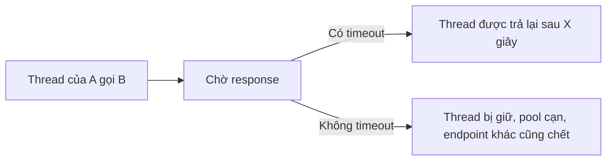
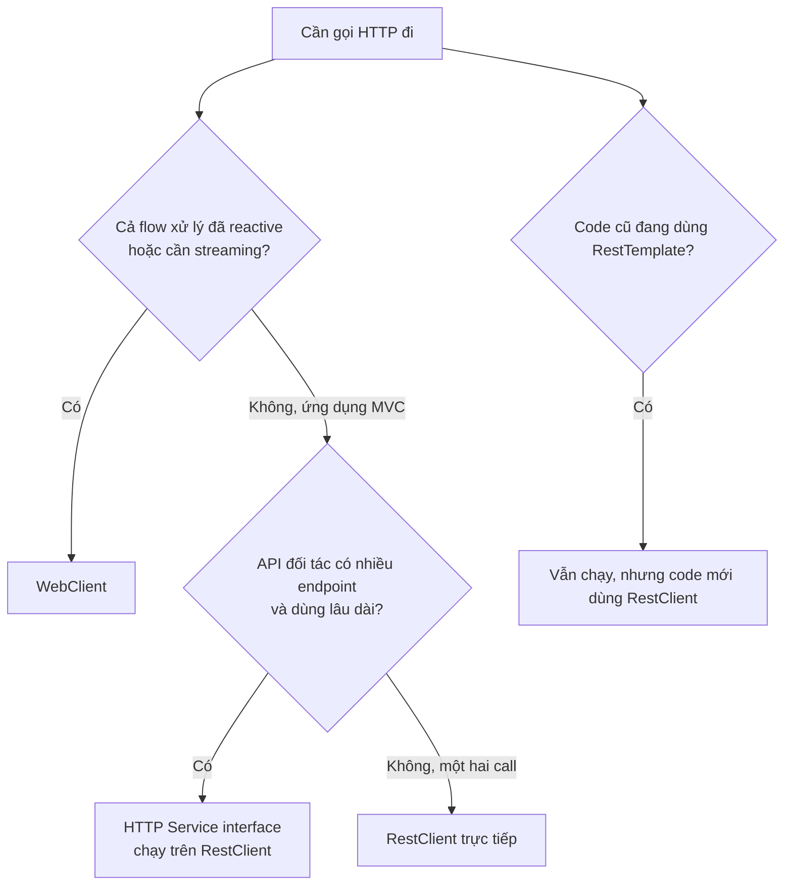
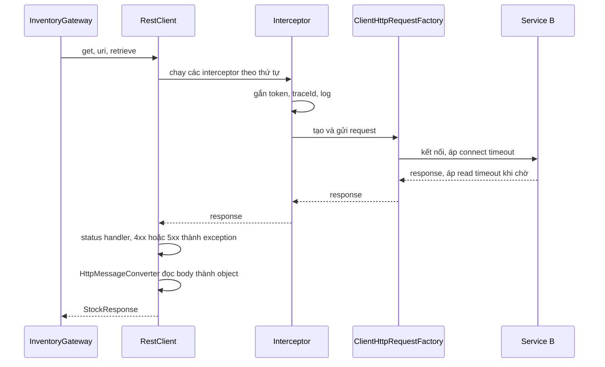
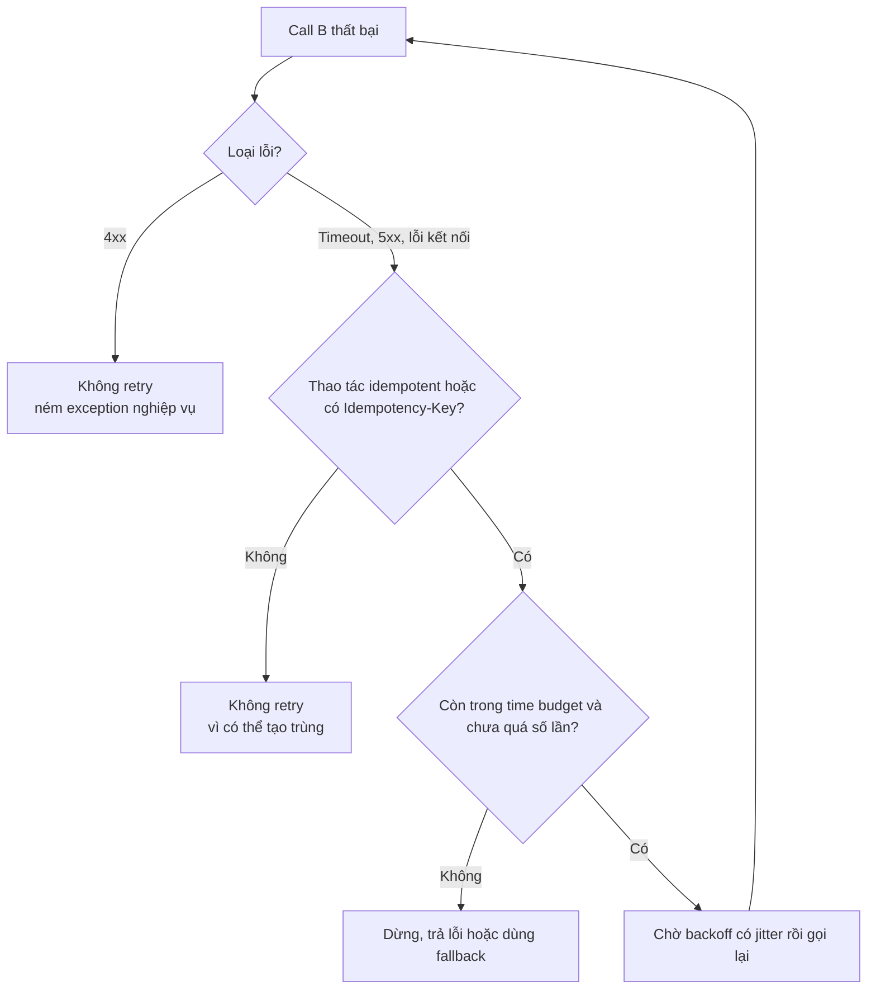
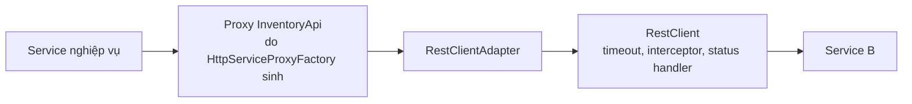

# Lý thuyết 36: Gọi HTTP đi với RestClient, HTTP Service interface và WebClient

Khi service của bạn gọi một service khác (hoặc API bên thứ ba), phần đáng lo không phải là gửi request mà là mọi thứ quanh nó: chờ bao lâu thì bỏ cuộc, gắn token và `traceId` ở đâu, đọc lỗi `4xx/5xx` thế nào, và làm sao để code gọi không vương vãi chuỗi URL khắp nơi. Spring cung cấp ba cách chính: `RestClient` (sync, kiểu fluent), HTTP Service interface (khai báo interface rồi để Spring sinh cài đặt) và `WebClient` (reactive). Bài này giúp bạn chọn đúng và cấu hình đúng, đặc biệt là timeout, vì thiếu timeout là nguyên nhân kinh điển của cascading failure (xem [Resilience và chịu lỗi](/go?p=01-Spring-Boot%2Fhard%2Flt-32-resilience-chiu-loi.md)).

**Cốt lõi:** Một call HTTP sync giữ một thread cho tới khi có response, mà thread của server là tài nguyên hữu hạn dùng chung cho mọi endpoint. Vì vậy phần quan trọng của việc gọi đi là cấu hình vận hành (timeout, interceptor, xử lý lỗi) được đặt một lần ở client, chứ không phải câu lệnh gửi request.

- Vì call sync giữ thread tới khi có response, nên thiếu timeout thì một service chậm làm cạn pool và mọi endpoint chết theo.
- Vì timeout, interceptor và status handler cùng nằm ở `RestClient`, nên đặt một lần là áp cho mọi call, kể cả HTTP Service interface chạy trên nó.
- Vì trace và metric được builder của Boot gắn sẵn, nên phải inject `RestClient.Builder` và dùng `.uri` có biến thay vì client tạo tay hay nối chuỗi.



Mô hình tư duy: sơ đồ cho thấy timeout là thứ duy nhất đặt chặn trên cho thời gian một thread bị giữ khi dependency chậm.

**Tóm tắt:**

- Gọi HTTP đi có ba cách: `RestClient` (sync, cho code mới), HTTP Service interface (khai báo interface, Spring sinh proxy) và `WebClient` (reactive).
- Chỉ dùng `WebClient` khi cả flow đã reactive; đưa nó vào ứng dụng MVC rồi `.block()` khắp nơi là gánh độ phức tạp mà không được lợi gì.
- Thiếu timeout là nguyên nhân kinh điển của cascading failure: thread bị giữ vô hạn, pool cạn, mọi endpoint chết theo.
- Luôn đặt cả connect timeout lẫn read timeout, và timeout bên trong phải nhỏ hơn timeout bên ngoài (time budget).
- Luôn inject `RestClient.Builder` do Boot cung cấp; `RestClient.create()` hay `new RestTemplate()` làm mất observation nên trace bị đứt.
- Tách `4xx` (lỗi của mình, không retry) và `5xx` (có thể retry) thành hai exception để tầng retry quyết định đúng.
- HTTP Service interface dùng lại `RestClient` bên dưới nên timeout, interceptor, status handler đặt một lần là áp cho mọi method.
- Dùng `.uri("/stocks/{id}", id)` thay vì nối chuỗi để giá trị được encode đúng và metric không bị nổ cardinality.

## Khi nào dùng, khi nào không

Dùng `RestClient` cho ứng dụng Spring MVC thông thường (kể cả khi bật virtual thread). Dùng HTTP Service interface khi bạn gọi một API có nhiều endpoint và muốn code gọi giống như gọi một bean. Chỉ dùng `WebClient` khi cả flow xử lý đã là reactive (xem [WebFlux và Reactor](/go?p=01-Spring-Boot%2Fhard%2Flt-21-webflux-reactor.md)) hoặc cần streaming. Đừng đưa `WebClient` vào ứng dụng MVC chỉ vì "nó mới hơn", rồi gọi `.block()` khắp nơi: bạn gánh độ phức tạp reactive mà không được lợi gì. `RestTemplate` vẫn chạy nhưng ở maintenance mode; code mới nên dùng `RestClient` (có từ Spring Framework 6.1, tức Boot 3.2).

## Các khái niệm cần biết

- **RestClient**: client sync với API fluent (`get().uri(...).retrieve().body(...)`), thay thế `RestTemplate` cho code mới.
- **RestClient.Builder**: builder cấu hình chung (base URL, header, interceptor, timeout). Nên inject builder do Boot cung cấp thay vì `RestClient.create()`, vì builder đó đã gắn sẵn observation để trace truyền qua service (xem [Observability (Log, Metric, Trace)](/go?p=01-Spring-Boot%2Fmedium%2Flt-19-observability.md)).
- **ClientHttpRequestFactory**: class cài đặt gọi HTTP thật bên dưới (JDK `HttpClient`, Apache HttpClient, Jetty, Reactor Netty...). Timeout được đặt ở đây.
- **Connect timeout và read timeout**: thời gian tối đa để thiết lập connection, và để chờ dữ liệu response. Cần cả hai.
- **Interceptor** (`ClientHttpRequestInterceptor`): đoạn code chạy trước và sau mọi request, dùng cho việc chung như gắn header xác thực, ghi log.
- **Status handler** (`defaultStatusHandler`, `onStatus`): quy tắc biến status code `4xx/5xx` thành exception của bạn.
- **HTTP Service interface**: interface có `@HttpExchange` (hoặc `@GetExchange`, `@PostExchange`...) mô tả API; `HttpServiceProxyFactory` sinh proxy cài đặt (từ Spring Framework 6.0).
- **WebClient**: client reactive trả `Mono`/`Flux`, non-blocking.

**Phải thuộc:** `RestClient` (Spring Framework 6.1, Boot 3.2) là client sync cho code mới, thay `RestTemplate` (maintenance mode); `WebClient` chỉ dùng khi flow đã reactive. Luôn inject `RestClient.Builder` do Boot cấp (để trace truyền được) và luôn đặt cả connect timeout lẫn read timeout.

Chọn công cụ theo hoàn cảnh:



Đọc sơ đồ: điều kiện đầu tiên là flow có reactive hay không; nếu không thì mặc định là `RestClient`, và chuyển sang HTTP Service interface khi số endpoint đủ nhiều để interface gọn hơn code thủ công. Hai lựa chọn này dùng chung cấu hình `RestClient` bên dưới.

## RestClient: cách dùng cơ bản

Ví dụ dưới tạo một `RestClient` từ builder, gọi `GET` và đọc body thành object. `retrieve()` ném exception khi gặp `4xx/5xx`, nên bạn không phải tự kiểm tra status code cho đường thành công.

_Minh họa_ (chưa chạy được trong sandbox vì không có Spring Boot):

```java
@Configuration
class InventoryClientConfig {
    @Bean
    // builder do Boot cấp
    RestClient inventoryRestClient(RestClient.Builder builder) {
        return builder
            .baseUrl("https://inventory.internal")
            .defaultHeader(HttpHeaders.ACCEPT, MediaType.APPLICATION_JSON_VALUE)
            .build();
    }
}

@Service
class InventoryGateway {
    private final RestClient client;
    InventoryGateway(RestClient inventoryRestClient) { this.client = inventoryRestClient; }

    StockResponse getStock(long productId) {
        return client.get()
            // biến đường dẫn, không nối chuỗi
            .uri("/stocks/{id}", productId)
            .retrieve()
            .body(StockResponse.class);
    }
}
```

Dùng `.uri("/stocks/{id}", id)` thay vì nối chuỗi để giá trị được encode đúng và metric gom theo mẫu URL (không sinh một metric cho mỗi id).

Một lần gọi đi, từ code của bạn tới service kia, đi qua các lớp sau:



Đọc sơ đồ: timeout nằm ở lớp thấp nhất, `ClientHttpRequestFactory`; interceptor bọc quanh việc gửi; status handler và converter chạy sau khi có response. Vì vậy timeout không phải là chuyện của `RestClient` fluent mà phải đặt ở factory khi dựng builder.

## Timeout: bắt buộc phải đặt

Mặc định nhiều cài đặt không có timeout hoặc timeout rất dài, nên một service chậm sẽ giữ thread của bạn vô hạn. Cách đặt timeout phụ thuộc vào `ClientHttpRequestFactory` đang dùng. Ví dụ đầy đủ với client JDK nằm ở mục Timeout của bài [Resilience và chịu lỗi](/go?p=01-Spring-Boot%2Fhard%2Flt-32-resilience-chiu-loi.md), bài này không lặp lại. Điểm cần nhớ: timeout bên trong phải nhỏ hơn timeout bên ngoài (time budget).

**Nền tảng:** mỗi call sync giữ một thread cho tới khi có response; thread là tài nguyên hữu hạn. Không có timeout thì một service chậm giữ thread vô hạn, pool cạn và lỗi lan ngược lên mọi endpoint, kể cả những endpoint không liên quan.

**Suy luận:** timeout là bắt buộc vì call sync giữ một thread từ lúc gửi request tới lúc nhận response, mà thread của server (Tomcat mặc định tối đa 200) là tài nguyên chung cho mọi endpoint. Nếu B chậm mà không có timeout, số thread bị giữ tăng theo tốc độ request tới A, đến khi chạm trần thì mọi endpoint của A, kể cả những cái không gọi B, đều hết thread. Đó là cascading failure: lỗi của một dependency biến thành lỗi của cả service. Đặt timeout biến "chờ vô hạn" thành "giữ thread tối đa X giây", nên số thread bị giữ có chặn trên là tốc độ request nhân X. Có hai điểm dễ nhầm: chỉ đặt read timeout mà quên connect timeout (host chết thì connect có thể treo rất lâu), và đặt timeout bên trong lớn hơn timeout của caller bên ngoài (caller đã bỏ cuộc mà A vẫn làm việc vô ích). Vì thế timeout phải lồng nhau theo time budget, và retry phải nằm trong budget đó. Khi review, mọi client gọi ra ngoài phải có cả hai timeout; nếu không thì sớm muộn sẽ có sự cố dây chuyền.

Boot 3.x có các thuộc tính `spring.http.client.*` để đặt timeout cho builder tự động cấu hình, nhưng tên và phiên bản bắt đầu hỗ trợ khác nhau giữa các bản 3.x: kiểm tra lại theo phiên bản bạn dùng. Cách chắc chắn nhất là tự dựng `ClientHttpRequestFactory` như ví dụ ở bài Resilience.

## Interceptor và error handler

Interceptor là chỗ đặt việc lặp lại ở mọi request. Ví dụ gắn token của service-to-service: một chỗ, áp cho toàn bộ client, thay vì nhớ gắn ở từng call. Lưu ý interceptor đọc body response sẽ làm body bị tiêu thụ, nên cần bọc bằng `BufferingClientHttpRequestFactory` nếu muốn log body.

_Minh họa_:

```java
@Bean
RestClient paymentRestClient(RestClient.Builder builder, TokenProvider tokens) {
    return builder
        .baseUrl("https://payment.internal")
        .requestInterceptor((request, body, execution) -> {
            // gắn token mỗi lần gọi
            request.getHeaders().setBearerAuth(tokens.current());
            return execution.execute(request, body);
        })
        .defaultStatusHandler(HttpStatusCode::is4xxClientError, (req, res) -> {
            // lỗi nghiệp vụ, không retry
            throw new PaymentRejectedException(res.getStatusCode());
        })
        .defaultStatusHandler(HttpStatusCode::is5xxServerError, (req, res) -> {
            throw new PaymentUnavailableException(res.getStatusCode()); // có thể retry
        })
        .build();
}
```

Việc tách `4xx` (lỗi của mình, gọi lại vẫn lỗi) và `5xx` (lỗi của đối phương, có thể thử lại) thành hai exception khác nhau là để tầng retry và circuit breaker ở bài Resilience quyết định đúng: chỉ retry loại thứ hai.

Quyết định có retry hay không khi một call thất bại, và retry nằm trong time budget:



Đọc sơ đồ: retry chỉ an toàn khi lỗi có thể tạm thời và thao tác lặp lại không gây hại; bên cạnh đó phải còn thời gian trong ngân sách tổng của caller. Cơ chế retry, circuit breaker cụ thể xem [Resilience và chịu lỗi](/go?p=01-Spring-Boot%2Fhard%2Flt-32-resilience-chiu-loi.md).

## HTTP Service interface

Khi API có nhiều endpoint, khai báo interface sẽ gọn hơn viết `RestClient` thủ công cho từng cái. Bạn mô tả API bằng annotation, Spring sinh proxy cài đặt bằng chính `RestClient` bên dưới (nên timeout, interceptor, status handler ở trên vẫn áp dụng).

_Minh họa_:

```java
@HttpExchange("/stocks")
interface InventoryApi {
    @GetExchange("/{id}")
    StockResponse getStock(@PathVariable long id);

    @PostExchange("/reservations")
    ReservationResponse reserve(@RequestBody ReserveRequest request);
}

@Configuration
class InventoryApiConfig {
    @Bean
    InventoryApi inventoryApi(RestClient inventoryRestClient) {
        var factory = HttpServiceProxyFactory
            .builderFor(RestClientAdapter.create(inventoryRestClient))
            .build();
        return factory.createClient(InventoryApi.class);
    }
}
```

Cấu trúc các lớp khi gọi qua interface:



Đọc sơ đồ: annotation trên interface chỉ mô tả API; mọi cấu hình vận hành nằm ở `RestClient` phía dưới. Muốn đổi timeout hoặc thêm token, sửa `RestClient` một lần là áp cho mọi method của interface.

Từ đây `InventoryApi` inject như bean thường và dễ mock trong test. Các bản Spring Framework mới (7, đi cùng Boot 4) bổ sung cách đăng ký nhóm interface bằng annotation và cấu hình, đỡ phải viết `@Bean` như trên: kiểm tra lại theo phiên bản.

## WebClient

`WebClient` trả `Mono`/`Flux` và non-blocking, nên hợp khi bạn đã ở trong flow reactive hoặc cần gọi nhiều API song song rồi gộp. Timeout đặt ở connector (ví dụ Reactor Netty) và thêm `.timeout(Duration)` trên `Mono` cho tổng thời gian.

_Minh họa_:

```java
Mono<StockResponse> stock = webClient.get()
    .uri("/stocks/{id}", productId)
    .retrieve()
    .onStatus(HttpStatusCode::is5xxServerError,
        res -> Mono.error(new InventoryUnavailableException()))
    .bodyToMono(StockResponse.class)
    .timeout(Duration.ofSeconds(2));       // không có dòng này thì chờ vô hạn
```

Gọi `.block()` trên thread của Netty (event loop) sẽ ném lỗi hoặc làm treo cả server; chỉ `.block()` ở ứng dụng MVC thuần, và khi đó hãy cân nhắc `RestClient` thay thế.

## Bẫy thường gặp

| Bẫy | Hệ quả |
|---|---|
| Không đặt timeout | Một service chậm giữ thread vô hạn, cạn thread pool, lỗi lan ngược |
| `RestClient.create()` hoặc `new RestTemplate()` thay vì builder của Boot | Mất observation, trace không truyền sang service kia |
| Nối chuỗi URL | Sai encoding, metric nổ số lượng tag |
| Xử lý mọi lỗi `catch (Exception)` | Retry nhầm lỗi `4xx`, hoặc nuốt lỗi |
| `.block()` trong flow reactive | Treo event loop |
| Retry `POST` không có idempotency key | Tạo trùng (xem [Thiết kế REST API thực chiến](/go?p=01-Spring-Boot%2Fmedium%2Flt-33-rest-api-thuc-chien.md)) |
| Chỉ đặt read timeout, quên connect timeout | Connection tới host chết vẫn treo lâu |

## Phỏng vấn khó: chuỗi hỏi xoáy

Người phỏng vấn senior thường mở bằng câu dễ rồi xoáy xuống cơ chế, đánh đổi và sự cố thật. Câu trả lời tốt luôn đi từ cốt lõi xuống: call sync giữ một thread, và cấu hình vận hành được đặt một lần ở client.

### Chuỗi 1: Timeout, time budget và retry

1. **Câu mở:** Khi gọi service khác bằng `RestClient`, cấu hình timeout nào là bắt buộc và đặt ở đâu?
2. **Xoáy 1:** Chỉ đặt read timeout, quên connect timeout thì sao? Timeout của A gọi B nên lớn hơn hay nhỏ hơn timeout của caller gọi A?
3. **Xoáy 2:** Call B bị timeout. Có retry không, và `POST` thì sao?

**Đáp án ngắn:** Cần cả connect timeout lẫn read timeout, đặt ở `ClientHttpRequestFactory` nằm dưới `RestClient`, vì đó là lớp thật sự gọi HTTP. Chỉ có read timeout thì connection tới host chết vẫn có thể treo rất lâu. Timeout phải lồng nhau theo time budget: bên trong nhỏ hơn bên ngoài, nếu không caller đã bỏ cuộc mà A vẫn làm việc vô ích. Không có timeout thì số thread bị giữ không có chặn trên; có timeout, chặn trên là tốc độ request nhân X giây. Về retry: `4xx` là lỗi của mình, gọi lại vẫn lỗi nên không retry. Timeout, `5xx` và lỗi kết nối mới có thể retry, nhưng chỉ khi thao tác idempotent hoặc có `Idempotency-Key`, còn phải nằm trong time budget và có backoff kèm jitter. Retry `POST` không key có thể tạo trùng. Vì thế tách `4xx` và `5xx` thành hai exception ở status handler để tầng retry quyết định đúng.

**Sai lầm hay gặp:**

- Chỉ nói "đặt timeout" mà không phân biệt connect với read, không nhắc time budget.
- Bắt `catch (Exception)` rồi retry mọi lỗi, kể cả `4xx`.
- Retry `POST` mà không nhắc idempotency.

### Chuỗi 2: `RestClient`, `WebClient` và virtual thread

1. **Câu mở:** Ứng dụng Spring MVC mới cần gọi API ngoài. Chọn `RestClient`, `WebClient` hay `RestTemplate`, vì sao?
2. **Xoáy 1:** Một dev chọn `WebClient` rồi `.block()` khắp nơi cho "hiện đại". Có gì sai?
3. **Xoáy 2:** Nếu bật virtual thread thì còn cần timeout không?

**Đáp án ngắn:** Ứng dụng MVC thì dùng `RestClient` (Spring Framework 6.1, Boot 3.2): sync, fluent, thay `RestTemplate` vốn đã ở maintenance mode. Gọi một đối tác có nhiều endpoint thì khai báo HTTP Service interface chạy trên `RestClient`. `WebClient` trả `Mono`/`Flux` và non-blocking, chỉ đáng dùng khi cả flow đã reactive hoặc cần streaming. Dùng nó trong MVC rồi `.block()` là gánh độ phức tạp reactive mà không được lợi gì; còn `.block()` trên thread của Netty (event loop) thì ném lỗi hoặc làm treo cả server. Với virtual thread, việc chờ call sync rẻ hơn nên áp lực lên pool thread giảm, nhưng timeout vẫn cần: request vẫn treo, caller phía trên vẫn chờ, và tài nguyên hạ nguồn như connection pool vẫn có thể cạn. Cuối cùng luôn inject `RestClient.Builder` do Boot cung cấp để trace không bị đứt.

**Sai lầm hay gặp:**

- Chọn `WebClient` chỉ vì "mới hơn".
- Nói virtual thread thay thế được timeout.
- Tạo client bằng `RestClient.create()` hoặc `new RestTemplate()` rồi thắc mắc vì sao trace đứt.

## Câu hỏi phỏng vấn thường gặp

1. Service A gọi B bằng `RestClient`. B chậm, và sau vài phút A ngừng trả lời mọi request kể cả các endpoint không liên quan tới B. Vì sao, và sửa thế nào?

   **Phải thuộc:** Câu này là câu cốt lõi, gặp rất thường xuyên.

   **Gợi ý suy luận:**
   - Một request của A gọi B giữ một thread trong lúc chờ. Chờ bao lâu nếu không đặt timeout?
   - Số thread xử lý của A hữu hạn. Khi tất cả đang chờ B thì request tới endpoint khác được ai xử lý?

   **Lập luận:** không có timeout nên mỗi call B giữ một thread cho tới khi B trả lời. B chậm khiến thread bị giữ nhiều hơn thread được trả, pool cạn dần, rồi các endpoint không liên quan cũng không có thread để chạy. Đặt connect và read timeout nhỏ làm thread được giải phóng sớm, kèm circuit breaker và bulkhead để ngừng gọi B khi nó đang yếu.

   **Đáp án ngắn:** thiếu timeout làm thread bị giữ vô hạn nên pool cạn; đặt connect/read timeout, thêm circuit breaker và bulkhead.

2. Trace trên Zipkin đứt ở A: B có trace riêng, không nối với A. Code của A dùng `RestClient.create()`. Nguyên nhân là gì?

   **Gợi ý suy luận:**
   - Việc truyền `traceId` sang service kia thực hiện bằng gì (header nào, ai gắn)?
   - Cái gắn header đó nằm trong builder được cấu hình sẵn hay trong object tạo tay?

   **Lập luận:** trace truyền qua header HTTP do instrumentation của client gắn vào. Instrumentation đó được Boot gắn vào `RestClient.Builder` do nó cung cấp. `RestClient.create()` tạo client trần nên không gắn header, B không biết request thuộc trace nào và mở trace mới.

   **Đáp án ngắn:** client tạo tay không có observation; inject `RestClient.Builder` của Boot.

3. Interface `@HttpExchange` của bạn nhận lỗi `404` từ đối tác nhưng code gọi nhận về exception khó hiểu. Bạn muốn `404` nghĩa là "không có" (trả `Optional.empty`) còn `5xx` mới là lỗi. Nên cấu hình ở đâu?

   **Gợi ý suy luận:**
   - Proxy của interface dùng client nào bên dưới? Cấu hình của client đó có áp dụng không?
   - Quy tắc "mã nào thành exception nào" nên đặt một lần hay ở từng method?

   **Lập luận:** proxy chỉ là layer mỏng gọi `RestClient` đã truyền vào adapter, nên status handler đặt trên `RestClient` có hiệu lực cho mọi method của interface. Đặt một lần ở builder để quy tắc nhất quán. Với `404` có thể để method trả kiểu cho phép rỗng hoặc bắt exception tương ứng ở gateway nghiệp vụ.

   **Đáp án ngắn:** đặt status handler trên `RestClient` làm nền cho interface, vì proxy dùng lại client đó.

Nguồn: tài liệu tham khảo Spring Framework (`RestClient`, HTTP Interface) và Spring Boot 3.x, viết theo kiến thức về Spring Framework 6.1 trở lên, chưa chạy thử trong sandbox. Tên thuộc tính và API mới ở Spring Framework 7 / Boot 4: kiểm tra lại theo phiên bản.

