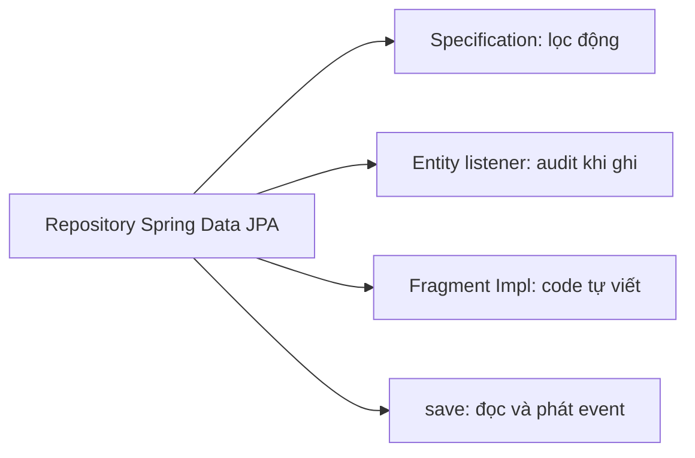
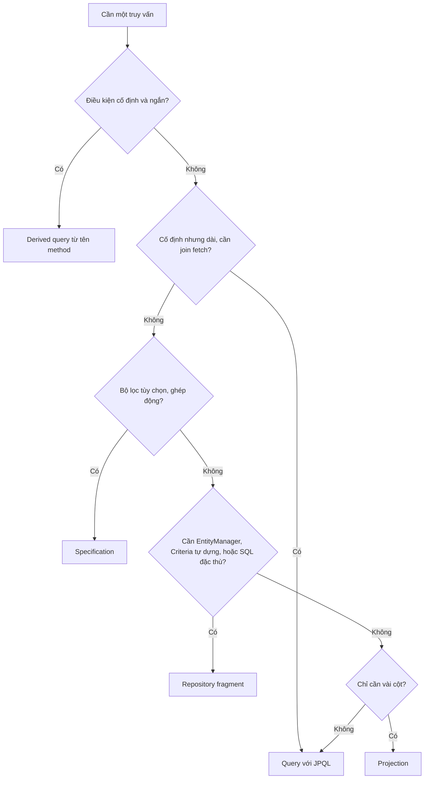
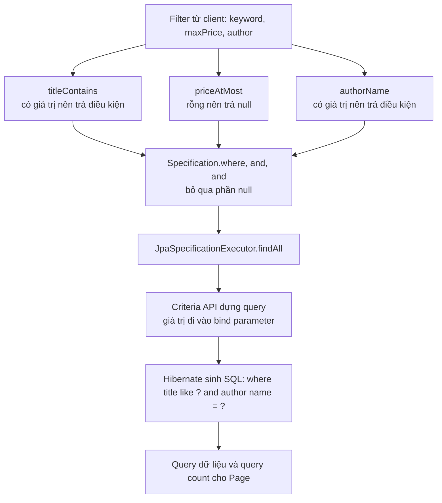
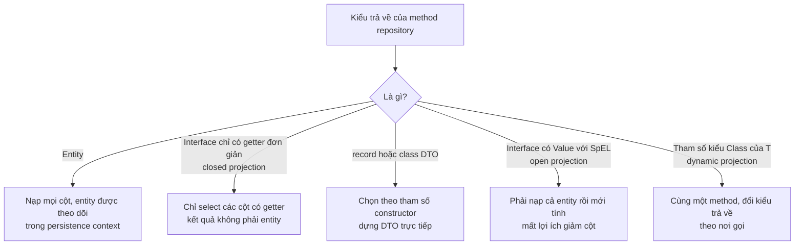
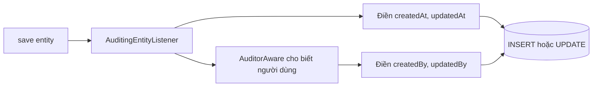
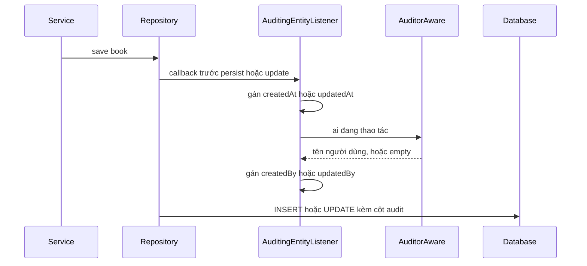
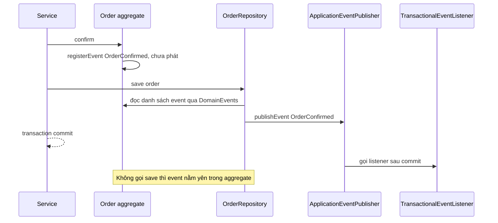

# Lý thuyết 37: Spring Data JPA nâng cao

Bài [Spring Data JPA](/go?p=01-Spring-Boot%2Fmedium%2Flt-04-spring-data-jpa.md) dừng ở query suy ra từ tên method và `@Query`. Hai cách đó gãy khi gặp ba tình huống thật: màn hình tìm kiếm có nhiều filter tùy chọn (tên method sẽ dài hàng mét), mọi bảng cần biết "ai tạo, ai sửa, lúc nào", và một repository cần thêm một thao tác mà Spring không tự sinh được. Bài này giải quyết cả ba, kèm cách phát event từ aggregate khi lưu.

Dùng khi filter động, audit đồng nhất hoặc logic query riêng bắt đầu lặp lại ở nhiều nơi. Chưa cần khi chỉ có vài query cố định: `@Query` rõ ràng hơn.

**Cốt lõi:** Query suy ra từ tên method và `@Query` là hai cách cố định, nên chúng gãy khi cần filter động, audit đồng nhất hoặc logic riêng. Spring Data cho cắm thêm từng nhu cầu vào một điểm mở rộng: `Specification` ghép điều kiện, entity listener điền audit khi ghi, fragment `Impl` trộn code tự viết vào repository.

- Vì mỗi filter là một hàm độc lập trả `null` khi trống, nên số tổ hợp filter không làm tăng code, nhưng SQL thật vẫn sinh ra nên join có thể làm sai `count`.
- Vì auditing dựa trên entity listener của JPA, nên chỉ thay đổi đi qua entity mới được điền, còn `@Modifying` và SQL tay bỏ qua.
- Vì event chỉ được đọc khi gọi `save`, nên aggregate chỉ ghi lại event còn việc phát nằm ở repository.



Mô hình tư duy: sơ đồ cho thấy repository chuẩn vẫn là lõi, và mỗi nhu cầu nâng cao bám vào một điểm riêng nên chỉ có hiệu lực khi đường đi đi qua điểm đó.

**Tóm tắt:**

- Khi query suy ra từ tên method và `@Query` không đủ, dùng ba công cụ: `Specification`, auditing và repository fragment; thêm `@DomainEvents` để phát event khi lưu aggregate.
- `Specification` biến mỗi filter thành một điều kiện ghép được; trả `null` nghĩa là không lọc, nên số tổ hợp filter không làm tăng số code.
- `Specification` dùng bind parameter nên tránh được injection, nhưng join kèm `Page` có thể làm sai `count`; phải kiểm tra SQL thực tế.
- Auditing cần đủ ba thứ: `@EnableJpaAuditing`, `@EntityListeners(AuditingEntityListener.class)` và `AuditorAware`; thiếu một thì cột audit null mà không báo lỗi.
- Auditing chạy qua entity listener nên `@Modifying` và SQL tay bỏ qua, `updatedAt` không đổi.
- Repository fragment là một interface cộng một class có hậu tố `Impl`; đặt sai tên thì lỗi lúc khởi động.
- `@DomainEvents` (qua `AbstractAggregateRoot`) chỉ phát event khi gọi `save`, `saveAll` hoặc `delete` trên repository; không `save` thì event không đi.
- Muốn listener chỉ chạy sau commit dùng `@TransactionalEventListener`; listener lỗi sau commit thì event mất.

## Các khái niệm cần biết

| Khái niệm | Là gì, dùng khi nào |
|---|---|
| `Specification<T>` | Một điều kiện lọc có thể ghép (`and`, `or`, `not`). Dùng cho tìm kiếm có filter tùy chọn. Repository cần thêm `JpaSpecificationExecutor<T>`. |
| Auditing | Tự điền `createdAt`, `updatedAt`, `createdBy`, `updatedBy` khi lưu. Bật bằng `@EnableJpaAuditing`. |
| `AuditorAware<T>` | Bean cho Spring biết "người đang thao tác" là ai (thường lấy từ `SecurityContext`). |
| Repository fragment | Interface + class `Impl` chứa code tự viết, được trộn vào repository. Dùng khi cần query hoặc logic mà Spring không sinh được. |
| `@DomainEvents` | Method trên aggregate root trả về các event để Spring Data phát ra sau khi `save`. |

Chọn cách truy vấn theo nhu cầu, từ đơn giản nhất lên:



Đọc sơ đồ: Specification, fragment và projection là ba nhánh mở rộng của cây quyết định ở bài [Spring Data JPA](/go?p=01-Spring-Boot%2Fmedium%2Flt-04-spring-data-jpa.md). Chúng không loại trừ nhau: một tìm kiếm có thể dùng Specification để lọc và projection để chỉ lấy vài cột.

## Specification: lọc động

Vấn đề: màn hình tìm sách có tên, tác giả, khoảng giá, mỗi ô có thể bỏ trống. Viết một method cho từng tổ hợp là không khả thi; nối chuỗi JPQL thì dễ sai và dễ injection. Specification biến mỗi điều kiện thành một hàm nhỏ rồi ghép lại, ô nào trống thì bỏ qua.

_Minh họa_ (Spring Data JPA 3.x). Mỗi hàm tĩnh trả một điều kiện, trả `null` nghĩa là "không lọc".

```java
public interface BookRepository
        extends JpaRepository<Book, Long>, JpaSpecificationExecutor<Book> { }

public final class BookSpecs {
    private BookSpecs() { }

    public static Specification<Book> titleContains(String keyword) {
        return (root, query, cb) -> keyword == null ? null
                : cb.like(cb.lower(root.get("title")), "%" + keyword.toLowerCase() + "%");
    }

    public static Specification<Book> priceAtMost(BigDecimal max) {
        return (root, query, cb) -> max == null ? null : cb.lessThanOrEqualTo(root.get("price"), max);
    }

    public static Specification<Book> authorName(String name) {
        return (root, query, cb) -> name == null ? null
                : cb.equal(root.join("author").get("name"), name);
    }
}
```

Ghép các điều kiện ở service và truyền cùng `Pageable`. `Specification.where(...)` chấp nhận điều kiện `null` nên không cần `if` lồng nhau.

```java
Specification<Book> spec = Specification
        .where(BookSpecs.titleContains(filter.keyword()))
        .and(BookSpecs.priceAtMost(filter.maxPrice()))
        .and(BookSpecs.authorName(filter.author()));

Page<Book> page = bookRepository.findAll(spec, PageRequest.of(0, 20, Sort.by("title")));
```

Cách các điều kiện được ghép thành một câu truy vấn:



Đọc sơ đồ: mỗi filter độc lập, filter trống không tạo điều kiện nào. Đoạn cuối cho thấy một `Page` thực chất chạy hai câu SQL (dữ liệu và `count`), đây là chỗ cần kiểm tra khi có join.

Lưu ý: tên field trong `root.get("title")` là chuỗi, đổi tên field sẽ chỉ lỗi lúc runtime (metamodel sinh `Book_.title` giúp bắt lỗi lúc compile). Join trong Specification kèm `Page` có thể nhân dòng và làm sai `count`; kiểm tra SQL thực tế. Một số API của `Specification` đổi giữa các phiên bản, kiểm tra lại theo phiên bản đang dùng.

**Suy luận:** `Specification` trả `null` khi không lọc và được ghép bằng `Specification.where(...).and(...)` để số tổ hợp filter không còn làm tăng số code: mỗi điều kiện là một hàm độc lập, và `null` bị bỏ qua nên không có nhánh `if` nào theo tổ hợp. Specification được dựng bằng Criteria API nên giá trị đi vào query dưới dạng bind parameter, đó là lý do nó chống injection tốt hơn nối chuỗi JPQL. Nhưng Criteria vẫn sinh SQL thật, nên mọi vấn đề của SQL vẫn còn: một `join` tới quan hệ one-to-many nhân dòng của bảng chính, và khi đó query `count` của `Page` có thể đếm khác với query dữ liệu, làm `totalElements` sai và trang lặp dòng. Điểm dễ nhầm là tin rằng đã dùng API an toàn thì kết quả cũng đúng. Hệ quả: với mọi Specification có join, bật log SQL và kiểm tra cả query dữ liệu lẫn query count, đồng thời đặt `Sort` xác định để các trang không chồng lấn.

## Projection: chỉ lấy cột cần dùng

Khi màn hình chỉ cần vài cột, nạp cả entity là phí. Spring Data cho khai báo kiểu trả về nhỏ hơn và tự giới hạn phần được chọn:



Đọc sơ đồ: closed projection và DTO là hai cách giúp câu SQL chỉ chứa cột cần thiết; open projection (dùng SpEL) mất lợi ích đó. Kết quả projection không phải entity được quản lý, nên sửa nó không sinh `UPDATE`. Hành vi chi tiết với quan hệ lồng nhau có thể khác giữa các phiên bản, kiểm tra SQL thực tế bằng log.

## Auditing: ai tạo, ai sửa, lúc nào

Vấn đề: tự gán `createdAt` ở từng service thì sớm muộn có chỗ quên. Auditing cho Spring Data điền giúp, ở một nơi duy nhất.



Theo thời gian, việc điền diễn ra ngay trước khi câu SQL được gửi:



Đọc sơ đồ: việc điền nằm trong callback của JPA, không nằm trong service. Vì thế mọi đường ghi đi qua entity đều được điền, và mọi đường không qua entity (update hàng loạt, SQL tay) thì không.

_Minh họa_. Bước một: bật auditing và khai báo `AuditorAware`. Ở đây lấy tên người đăng nhập từ Spring Security; chưa đăng nhập thì trả `Optional.empty()` (các cột `*By` sẽ null).

```java
@Configuration
@EnableJpaAuditing
public class AuditConfig {

    @Bean
    AuditorAware<String> auditorProvider() {
        return () -> Optional.ofNullable(SecurityContextHolder.getContext().getAuthentication())
                .filter(Authentication::isAuthenticated)
                .map(Authentication::getName);
    }
}
```

Bước hai: đặt các field audit vào một `@MappedSuperclass` để mọi entity dùng chung (xem mapping kế thừa trong bài [JPA bên trong, Persistence Context](/go?p=01-Spring-Boot%2Fmedium%2Flt-16-jpa-internals.md)).

```java
@MappedSuperclass
@EntityListeners(AuditingEntityListener.class)
public abstract class Auditable {
    @CreatedDate        @Column(updatable = false) private Instant createdAt;
    @LastModifiedDate   private Instant updatedAt;
    @CreatedBy          @Column(updatable = false) private String createdBy;
    @LastModifiedBy     private String updatedBy;
    // getter
}

@Entity
public class Book extends Auditable { /* ... */ }
```

Auditing chạy qua entity listener của JPA, nên chỉ có tác dụng khi entity đi qua persistence context. Câu `@Modifying` update hàng loạt và SQL tay bỏ qua listener nên không cập nhật `updatedAt`. Với Spring Boot, `@EnableJpaAuditing` đặt trên class riêng (như trên) thay vì class `@SpringBootApplication` để các test slice `@DataJpaTest` không bị kéo cấu hình lạ vào.

**Phải thuộc:** auditing cần đủ ba thứ: `@EnableJpaAuditing`, `@EntityListeners(AuditingEntityListener.class)` trên entity (hoặc `@MappedSuperclass`), và `AuditorAware` nếu cần `createdBy`. Thiếu một thứ thì cột audit null mà không báo lỗi; `@Modifying` và SQL tay bỏ qua listener.

**Suy luận:** auditing được xây trên entity listener của JPA (`@PrePersist`, `@PreUpdate`) vì đó là điểm duy nhất mà persistence provider đã cầm entity trong tay ngay trước khi sinh INSERT hoặc UPDATE, nên điền `createdAt` ở đó thì không service nào phải nhớ làm. Cái giá của thiết kế này là auditing chỉ tồn tại với những thay đổi đi qua entity: `save`, hoặc dirty checking lúc flush. Một `@Modifying` update hàng loạt hay SQL tay gửi thẳng câu lệnh cho DB, không có entity nào được nạp, nên không callback nào chạy và `updatedAt` đứng yên. Điểm dễ nhầm là tưởng auditing là tính năng của database, hay của Spring Data ở mức repository, nên khi thấy một số bản ghi cập nhật đúng và một số không thì không có lỗi nào báo cho bạn. Thiếu một trong ba mảnh (`@EnableJpaAuditing`, `@EntityListeners`, `AuditorAware`) cũng cho kết quả im lặng tương tự: cột bị null. Hệ quả: với update hàng loạt phải tự set `updated_at = now()` trong câu lệnh (hoặc dùng trigger), và nên có test kiểm tra cột audit được điền cho từng đường ghi dữ liệu.

## Custom repository bằng fragment

Vấn đề: cần một thao tác mà tên method hay `@Query` không diễn tả nổi (ví dụ gọi `EntityManager` trực tiếp, hoặc dựng query bằng Criteria). Fragment cho phép tự viết phần đó và để repository vẫn là một interface.

Quy ước đặt tên: class cài đặt phải có tên interface fragment cộng hậu tố `Impl`, nếu không Spring không tìm thấy và sẽ coi method là query suy ra từ tên rồi báo lỗi lúc khởi động.

```java
public interface BookRepositoryCustom {
    List<Book> searchByRawRank(String keyword, int limit);
}

public class BookRepositoryCustomImpl implements BookRepositoryCustom {
    @PersistenceContext
    private EntityManager em;

    @Override
    public List<Book> searchByRawRank(String keyword, int limit) {
        return em.createQuery("select b from Book b where b.title like :k order by b.rating desc", Book.class)
                .setParameter("k", "%" + keyword + "%")
                .setMaxResults(limit)
                .getResultList();
    }
}

public interface BookRepository extends JpaRepository<Book, Long>, BookRepositoryCustom { }
```

Có thể ghép nhiều fragment vào một repository; mỗi fragment một trách nhiệm. Fragment là bean Spring nên tiêm được bean khác bằng constructor.

## `@DomainEvents`: phát event khi lưu aggregate

Vấn đề: sau khi lưu đơn hàng, cần báo cho phần khác (gửi mail, ghi log nghiệp vụ). Gọi trực tiếp trong service làm service biết quá nhiều. Aggregate tự ghi lại event, Spring Data phát chúng khi gọi `save`.

_Minh họa_. `AbstractAggregateRoot` là class có sẵn, cung cấp `registerEvent` và đã gắn `@DomainEvents`. Event được phát qua `ApplicationEventPublisher` mỗi khi gọi `save`, `saveAll`, `delete` trên repository (chỉ gọi `persist` bằng `EntityManager` thì không có).

```java
@Entity
public class Order extends AbstractAggregateRoot<Order> {
    @Id @GeneratedValue private Long id;
    private String status;

    public Order confirm() {
        this.status = "CONFIRMED";
        registerEvent(new OrderConfirmed(id));   // chưa phát, chỉ ghi lại
        return this;
    }
}

@Component
class OrderListener {
    @TransactionalEventListener(phase = TransactionPhase.AFTER_COMMIT)
    void on(OrderConfirmed event) { /* gửi mail */ }
}
```



Đọc sơ đồ: `confirm` chỉ ghi lại event; `save` mới làm Spring Data đọc và phát; listener gắn `AFTER_COMMIT` chỉ chạy khi transaction đã commit thành công.

Hai điều dễ nhầm. Thứ nhất, phát event xảy ra lúc `save` chứ không phải lúc đổi trạng thái; entity đang managed mà không gọi `save` thì event không đi. Thứ hai, listener thường `@EventListener` chạy cùng transaction và cùng thread, còn muốn chỉ chạy khi đã commit thì dùng `@TransactionalEventListener`, và nhớ rằng nếu listener lỗi sau commit thì event mất (mô hình bền hơn xem Outbox ở [Transaction chuyên sâu](/go?p=01-Spring-Boot%2Fhard%2Flt-31-transaction-chuyen-sau.md)). Cơ chế event nền tảng ở [Application Event](/go?p=01-Spring-Boot%2Fmedium%2Flt-17-application-events.md).

## Bẫy thường gặp

| Bẫy | Hệ quả |
|---|---|
| Specification trả điều kiện join mà không kiểm `count` | `Page.totalElements` sai, trang bị lặp dòng |
| Quên `@EntityListeners(AuditingEntityListener.class)` hoặc `@EnableJpaAuditing` | Cột audit luôn null, không báo lỗi |
| `@Modifying` update hàng loạt | `updatedAt` không đổi, vì bỏ qua listener |
| Đặt tên class fragment sai hậu tố `Impl` | Lỗi khởi động "No property found" |
| Gọi `registerEvent` rồi không `save` | Event không bao giờ được phát |
| Dùng `AuditorAware` đọc `SecurityContext` trong job chạy nền | `createdBy` null vì không có người đăng nhập; trả một giá trị hệ thống |

## Phỏng vấn khó: chuỗi hỏi xoáy

Người phỏng vấn senior thường mở bằng câu dễ rồi xoáy xuống cơ chế, đánh đổi và sự cố thật. Câu trả lời tốt luôn đi từ cốt lõi xuống: mỗi tính năng bám vào một điểm mở rộng, và chỉ có hiệu lực khi đường đi đi qua điểm đó.

### Chuỗi 1: `Specification`, join và `Page`

1. **Câu mở:** Dùng `Specification` có join để lọc theo tác giả, sao `Page.totalElements` lại sai?
2. **Xoáy 1:** Một `Page` thực chất chạy mấy câu SQL, và join làm hai câu đó lệch nhau thế nào?
3. **Xoáy 2:** Phát hiện và xử lý ra sao? Còn `root.get("title")` mà đổi tên field thì lỗi ở lúc nào?

**Đáp án ngắn:** `Specification` dựng query bằng Criteria API, nên giá trị đi vào bind parameter và chống injection tốt hơn nối chuỗi JPQL. Nhưng Hibernate vẫn sinh SQL thật, nên mọi vấn đề của SQL còn nguyên. Một `Page` chạy hai câu: truy vấn dữ liệu và truy vấn `count`. Một `join` tới quan hệ one-to-many nhân dòng của bảng chính, nên `count` có thể đếm khác dữ liệu, làm `totalElements` sai và trang lặp dòng. An toàn khỏi injection không có nghĩa là kết quả đúng. Cách làm: bật log SQL, kiểm tra cả câu dữ liệu lẫn câu `count`, và đặt `Sort` xác định để các trang không chồng lấn; nếu join gây nhân dòng thì cân nhắc cách lọc không nhân dòng, kiểm tra lại theo phiên bản. Tên field trong `root.get("title")` là chuỗi nên đổi tên field chỉ lỗi lúc runtime; metamodel sinh `Book_.title` giúp bắt lỗi lúc compile.

**Sai lầm hay gặp:**

- Nói "dùng `Specification` là an toàn nên kết quả đúng": nhầm an toàn injection với đúng nghiệp vụ.
- Không biết `Page` có câu `count` riêng.
- Quên `Sort` xác định nên các trang chồng lấn.

### Chuỗi 2: Auditing im lặng thất bại

1. **Câu mở:** Cột `createdBy` bị null ở nhiều bản ghi dù đã cấu hình auditing. Kiểm tra gì?
2. **Xoáy 1:** Auditing cần đủ những mảnh nào, và vì sao thiếu một mảnh lại không báo lỗi?
3. **Xoáy 2:** Job nền hoặc consumer ghi dữ liệu thì `AuditorAware` trả gì? Vì sao nên tách `@EnableJpaAuditing` khỏi class `@SpringBootApplication`?

**Đáp án ngắn:** Cần ba mảnh: `@EnableJpaAuditing`, `@EntityListeners(AuditingEntityListener.class)` trên entity hoặc `@MappedSuperclass`, và bean `AuditorAware` nếu cần `createdBy`. Auditing chạy qua entity listener của JPA, tức là nó chỉ hoạt động khi entity đi qua persistence context. Thiếu `@EnableJpaAuditing` hoặc thiếu `@EntityListeners` thì listener không được gắn; thiếu `AuditorAware` thì không biết người dùng. Cả ba trường hợp đều không ném exception, cột chỉ null. `AuditorAware` thường đọc `SecurityContext`; chưa đăng nhập thì trả `Optional.empty()` nên cột `*By` null, và job nền không có người đăng nhập nên nên trả một giá trị hệ thống. Đặt `@EnableJpaAuditing` trên class cấu hình riêng để test slice `@DataJpaTest` không bị kéo cấu hình lạ. Cách phát hiện: viết test kiểm tra cột audit được điền cho từng đường ghi dữ liệu.

**Sai lầm hay gặp:**

- Cho rằng auditing là tính năng của database hoặc của repository.
- Chỉ nhớ `@EnableJpaAuditing` mà quên `@EntityListeners`.
- Quên rằng job nền không có `SecurityContext` nên `createdBy` null.

## Câu hỏi phỏng vấn thường gặp

1. Cột `updated_at` của một số bản ghi không đổi dù dữ liệu đã được sửa, trong khi các bản ghi khác thì đổi. Nguyên nhân có thể là gì?

   **Phải thuộc:** Câu này là câu cốt lõi, gặp rất thường xuyên.

   **Gợi ý suy luận:**
   - Auditing do ai điền: Hibernate trong lúc flush hay câu SQL?
   - Thao tác sửa đi qua entity hay qua câu update viết tay?
   - Entity listener có được gọi khi chạy `@Modifying` không?

   **Lập luận:** `@LastModifiedDate` được điền bởi `AuditingEntityListener`, một callback của JPA chạy khi entity đi qua persistence context. Bản ghi sửa qua `save` hoặc dirty checking thì được điền. Bản ghi sửa bằng `@Modifying` hoặc SQL tay chạy thẳng DB, không đi qua entity nên listener không được gọi. Vì vậy chỉ một phần bản ghi có `updated_at` mới.

   **Đáp án ngắn:** auditing dựa trên entity listener nên bỏ sót update hàng loạt; tự set `updated_at = now()` trong câu update đó hoặc dùng trigger.

2. Màn hình tìm kiếm có 8 filter tùy chọn. Viết 8 method `findBy...` hay nối chuỗi JPQL đều không ổn. Hướng giải quyết là gì và vì sao an toàn hơn nối chuỗi?

   **Gợi ý suy luận:**
   - Điều kiện nào có thể là "không lọc" khi người dùng bỏ trống?
   - Tham số đi vào query bằng cách nào: nối chuỗi hay bind parameter?
   - Có cách nào ghép các điều kiện nhỏ lại mà không `if` lồng?

   **Lập luận:** mỗi filter thành một `Specification` độc lập, filter trống trả `null`. `Specification.where(a).and(b)` bỏ qua phần `null` nên số tổ hợp không còn là vấn đề. Specification dựng truy vấn bằng Criteria API, giá trị đi vào dưới dạng tham số bind chứ không nối vào chuỗi, nên tránh được injection.

   **Đáp án ngắn:** dùng `JpaSpecificationExecutor` với các `Specification` ghép bằng `and`; kiểm tra `count` khi có join.

3. Gọi `order.confirm()` trong service có `@Transactional` nhưng listener `OrderConfirmed` không chạy. Vì sao?

   **Gợi ý suy luận:**
   - `registerEvent` làm gì: phát ngay hay chỉ ghi nhớ?
   - Ai đọc danh sách event đó và vào lúc nào?
   - Entity đang managed có cần `save` để Spring Data biết không?

   **Lập luận:** `registerEvent` chỉ thêm event vào một danh sách trong aggregate. Spring Data đọc danh sách này (qua `@DomainEvents`) ở bước `save` của repository rồi mới phát. Dirty checking tự ghi UPDATE nhưng không đi qua `save`, nên event nằm yên.

   **Đáp án ngắn:** phải gọi `repository.save(order)` để event được phát; ngoài ra nếu dùng `@TransactionalEventListener` thì chỉ chạy sau commit.

