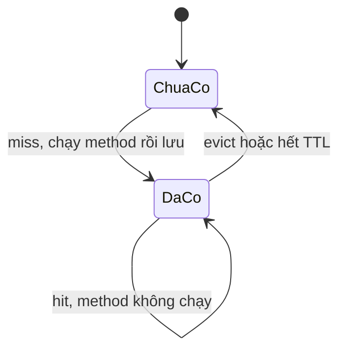
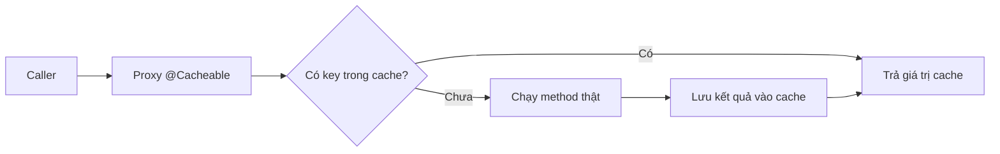
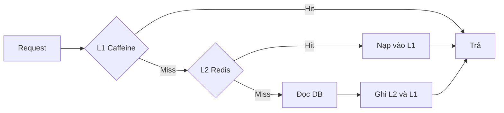

# Lý thuyết 39: Spring Cache abstraction

Ghi cache bằng tay nghĩa là chỗ nào cũng lặp ba bước: tìm trong cache, không có thì gọi nguồn thật, rồi ghi kết quả lại. Spring Cache abstraction gom việc đó vào annotation: bạn gắn `@Cacheable` lên method, Spring (qua proxy) lo phần còn lại, và bạn đổi nơi lưu (memory trong JVM, Redis) chỉ bằng cấu hình. Nó hợp với cache theo key đơn giản. Khi cần chống stampede nhiều instance, jitter TTL theo key hay Bloom filter, bạn phải tự viết; các mẫu và sự cố đó nằm ở [Cache pattern và các vấn đề của cache](/go?p=06-Distributed-Systems%2FRedis%2Fmedium%2Flt-03-cache-pattern-van-de-cache.md), còn bài này chỉ về lớp annotation và cách ghép cache cục bộ với Redis.

**Cốt lõi:** Ghi cache bằng tay nghĩa là lặp ba bước ở mọi nơi: tìm trong cache, gọi nguồn thật, ghi lại. Spring Cache đặt một proxy đứng trước method để làm thay, nên method nghiệp vụ không biết gì về cache, và có hit thì method không chạy.

- Vì cache là proxy đứng trước method, nên self-invocation bỏ qua cache và khi cache hit thì side effect trong method không xảy ra.
- Vì key do proxy tính từ tham số trước khi gọi method, nên key phải ổn định và tường minh, và `@Cacheable` chỉ nên đặt trên method thuần đọc.
- Vì cache cục bộ là bản sao riêng của từng instance mà không ai báo khi bản gốc đổi, nên độ lệch tối đa bằng TTL của nó.



Mô hình tư duy: sơ đồ cho thấy mỗi key chỉ có hai trạng thái, và method thật chỉ chạy ở lần chuyển từ chưa có sang đã có.

**Tóm tắt:**

- Spring Cache gom ba bước (tìm trong cache, gọi nguồn thật, ghi lại) vào annotation; đổi nơi lưu (Caffeine, Redis) chỉ bằng cấu hình.
- Nó chạy bằng proxy: cache hit thì method thật không chạy, nên self-invocation bỏ qua cache và side effect trong method không xảy ra.
- `@Cacheable` đọc, `@CachePut` luôn chạy method rồi ghi cache, `@CacheEvict` xóa mục; phải có `@EnableCaching`, nếu không annotation im lặng không có tác dụng.
- `condition` đánh giá trước khi chạy method, `unless` đánh giá sau dựa trên `#result`; dùng `unless` để không cache `null`.
- Sau khi cập nhật, `@CacheEvict` thường an toàn hơn `@CachePut` vì không để lại giá trị cũ khi hai cập nhật chồng nhau.
- `sync = true` chỉ giữ lock trong một JVM, còn `@CacheEvict` không tự gắn với transaction nên có thể xóa trước khi commit.
- Caffeine là cache cục bộ rất nhanh nhưng mỗi instance giữ bản riêng; luôn đặt `maximumSize` và TTL.
- Cache hai tầng (Caffeine trước, Redis sau) giảm call mạng nhưng thêm bài toán invalidation giữa các instance.

## Các khái niệm cần biết

- **CacheManager**: nơi cấp các cache theo tên; mỗi cài đặt ứng với một kho lưu (Caffeine, Redis, `ConcurrentMapCacheManager`).
- **Cache name và key**: cache được gọi theo tên (ví dụ `product`), bên trong mỗi mục có key do SpEL tính từ tham số (`#id`).
- **`@Cacheable`**: có trong cache thì trả luôn và không chạy method; chưa có thì chạy method rồi lưu kết quả.
- **`@CachePut`**: luôn chạy method rồi ghi kết quả vào cache; dùng để cập nhật mục cache khi bạn có sẵn giá trị mới.
- **`@CacheEvict`**: xóa mục (hoặc cả cache với `allEntries = true`).
- **`condition` và `unless`**: điều kiện bật cache. `condition` đánh giá trước khi chạy method (dựa trên tham số); `unless` đánh giá sau, dựa trên kết quả (`#result`), để loại một số kết quả khỏi cache.
- **Caffeine**: thư viện cache trong memory JVM, có giới hạn kích thước và TTL; rất nhanh vì không qua mạng.
- **Multi-level**: cache cục bộ (L1, Caffeine) đứng trước cache dùng chung (L2, Redis).

## Cách hoạt động: proxy chặn call

Annotation chạy nhờ proxy AOP, nên có chung giới hạn với `@Transactional` (xem [AOP và Proxy](/go?p=01-Spring-Boot%2Fmedium%2Flt-13-aop-proxy.md)): gọi method trong cùng class (self-invocation) sẽ không qua proxy nên không có cache.



Đọc sơ đồ: cache hit thì method thật không chạy; chưa có thì chạy một lần rồi lưu. Vì method không chạy khi cache hit, mọi side effect trong method cũng không xảy ra.

**Nền tảng:** Spring Cache là proxy AOP đứng trước method: key đã có trong cache thì trả giá trị cache và method thật không chạy. Vì vậy self-invocation bỏ qua cache và side effect trong method không xảy ra khi cache hit.

**Phải thuộc:** `@Cacheable` (đọc, cache hit thì không chạy method), `@CachePut` (luôn chạy method rồi ghi cache), `@CacheEvict` (xóa mục, `allEntries = true` xóa cả cache). Phải có `@EnableCaching` (Boot không tự bật; có annotation này thì auto-configuration mới dựng `CacheManager` phù hợp với thư viện trên classpath); `condition` đánh giá trước khi chạy method, `unless` đánh giá sau dựa trên `#result`.

**Suy luận:** Spring Cache không sửa code của method mà bọc nó bằng proxy, vì như vậy logic cache (tìm, miss thì gọi nguồn, lưu) nằm ở một chỗ và method nghiệp vụ không biết gì về cache. Từ cơ chế này suy ra ba hệ quả. Thứ nhất, chỉ call đi qua proxy mới được cache, nên gọi `this.get(id)` trong cùng class (self-invocation) chạy thẳng method thật và cache im lặng không có tác dụng. Thứ hai, khi cache hit proxy trả giá trị và method không được gọi, nên mọi side effect trong method (ghi log nghiệp vụ, đếm lượt xem, gửi event) biến mất; vì vậy `@Cacheable` chỉ nên đặt trên method thuần đọc. Thứ ba, key do proxy tính từ tham số trước khi gọi method nên key phải ổn định: object tham số thiếu `equals`/`hashCode`, hoặc nhiều tham số dùng key mặc định, sẽ gây miss liên tục hoặc trả nhầm giá trị của key khác. Điểm dễ nhầm là thấy `@Cacheable` trên method rồi tin rằng cache đang hoạt động; hãy xác nhận bằng log SQL hoặc metric cache hit. Khi review: kiểm tra `@EnableCaching`, call đi qua bean khác, key tường minh, và method không có side effect.

## Ba annotation trong một service

Ví dụ dưới dùng cả ba annotation cho một `ProductService`. Câu dẫn: `get` đọc có cache; `update` ghi DB rồi cập nhật mục cache bằng chính kết quả; `delete` xóa mục. `unless` loại kết quả `null` khỏi cache để không nhớ nhầm "chưa tồn tại".

_Minh họa_ (chưa chạy trong sandbox vì không có Spring Boot):

```java
@Service
class ProductService {
    private final ProductRepository repo;
    ProductService(ProductRepository repo) { this.repo = repo; }

    @Cacheable(cacheNames = "product", key = "#id", unless = "#result == null")
    public Product get(long id) {
        return repo.findById(id).orElse(null);
    }

    @CachePut(cacheNames = "product", key = "#result.id")
    public Product update(Product p) {
        return repo.save(p);                       // kết quả mới được ghi vào cache
    }

    @CacheEvict(cacheNames = "product", key = "#id")
    public void delete(long id) {
        repo.deleteById(id);
    }
}
```

Chọn `@CachePut` hay `@CacheEvict` khi cập nhật? `@CachePut` cho lần đọc sau cache hit ngay nhưng dễ để lại giá trị cũ khi hai cập nhật chồng nhau; `@CacheEvict` chậm hơn một lần đọc nhưng ít rủi ro lệch hơn. Lập luận chi tiết vì sao xóa thường an toàn hơn ghi nằm ở mục nhất quán của bài [Cache pattern và các vấn đề của cache](/go?p=06-Distributed-Systems%2FRedis%2Fmedium%2Flt-03-cache-pattern-van-de-cache.md).

`condition` ví dụ: `@Cacheable(cacheNames = "report", key = "#id", condition = "#id > 0")` chỉ dùng cache khi `id` hợp lệ.

## `sync = true` và cache cùng transaction

Hai chi tiết hay bị bỏ sót khi dùng annotation. Thứ nhất, `@Cacheable(sync = true)` chỉ cho một thread nạp lại khi miss, nhưng lock này nằm **trong một JVM**: chạy nhiều instance thì mỗi instance vẫn có một thread đi nạp, nên DB nhận tối đa một truy vấn trên mỗi instance. Muốn một truy vấn cho cả cluster cần mutex qua Redis, xem `loadWithLock` ở bài [Cache pattern và các vấn đề của cache](/go?p=06-Distributed-Systems%2FRedis%2Fmedium%2Flt-03-cache-pattern-van-de-cache.md).

Thứ hai, `@CacheEvict` mặc định chạy **sau** khi method thực thi thành công (`beforeInvocation = false`), nhưng không tự gắn với transaction: nếu method nằm trong `@Transactional`, cache có thể bị xóa trước khi commit, và một reader chen vào sẽ nạp lại bản cũ. Cách xử lý là xóa sau commit hoặc bọc `CacheManager` bằng `TransactionAwareCacheManagerProxy` (kiểm tra lại theo phiên bản Spring).

## Caffeine làm cache cục bộ

Cache trong JVM nhanh nhất và không cần hạ tầng, nhưng mỗi instance giữ bản riêng nên các instance có thể thấy giá trị lệch nhau cho tới khi hết TTL. Dùng khi dữ liệu ít đổi hoặc chấp nhận lệch vài chục giây: cấu hình, danh mục, kết quả tra cứu.

_Minh họa_:

```java
@Configuration
@EnableCaching
class LocalCacheConfig {
    @Bean
    CacheManager cacheManager() {
        var manager = new CaffeineCacheManager("product", "category");
        manager.setCaffeine(Caffeine.newBuilder()
            .maximumSize(10_000)                    // bắt buộc có giới hạn
            .expireAfterWrite(Duration.ofMinutes(5)));
        return manager;
    }
}
```

Không đặt `maximumSize` là bẫy phổ biến: cache phình tới khi hết heap.

## Nhiều tầng: Caffeine trước, Redis sau

Khi traffic đọc rất lớn, mỗi lần đọc đều đi mạng tới Redis vẫn tốn. Thêm tầng L1 cục bộ giảm số lần gọi Redis, đổi lại thêm một nơi có thể lệch.



Điểm khó là **invalidation**: khi instance A xóa mục, L1 của instance B vẫn còn bản cũ. Hai cách thường gặp: để TTL của L1 ngắn (vài chục giây) và chấp nhận lệch ngắn; hoặc phát thông báo xóa qua Pub/Sub của Redis để mọi instance xóa L1 của mình. Spring không có sẵn cache hai tầng trong lõi: bạn tự ghép hai tầng (một `CacheManager` tự viết, hoặc thư viện bên thứ ba), nên cân nhắc xem có thật cần không, vì Redis một tầng thường đã đủ. Phần cấu hình `RedisCacheManager` (TTL, serializer) xem bài [Cache pattern và các vấn đề của cache](/go?p=06-Distributed-Systems%2FRedis%2Fmedium%2Flt-03-cache-pattern-van-de-cache.md).

**Suy luận:** cache hai tầng giảm số call mạng tới Redis vì L1 trả lời ngay trong cùng process, nhưng chính điều đó tạo ra bài toán mới: L1 của mỗi instance là một bản sao riêng mà không ai báo khi bản gốc đổi. Redis (L2) chỉ biết về chính nó, nên một lệnh evict ở instance A xóa L1 của A và L2, còn L1 của B, C, D vẫn giữ giá trị cũ cho đến khi hết TTL. Do đó độ lệch tối đa giữa các instance bằng TTL của L1, và TTL ngắn là công cụ đơn giản nhất để chặn độ lệch đó, đổi lại tỷ lệ cache hit thấp hơn. Muốn độ lệch gần bằng 0 phải có kênh thông báo (Pub/Sub của Redis) để mọi instance tự xóa L1, nghĩa là bạn tự viết và tự vận hành, kể cả trường hợp một instance mất kết nối Pub/Sub đúng lúc có thông báo. Điểm dễ nhầm là nghĩ "đã có Redis dùng chung nên mọi instance thấy cùng dữ liệu", trong khi request chỉ chạm L1 thì không bao giờ tới Redis. Khi thiết kế, chỉ thêm L1 cho dữ liệu đọc rất nhiều và chấp nhận lệch bằng TTL; dữ liệu cần nhất quán thì dùng Redis một tầng.

## Bẫy thường gặp

| Bẫy | Hệ quả |
|---|---|
| Gọi method `@Cacheable` từ cùng class | Không qua proxy, không có cache |
| Quên `@EnableCaching` | Annotation không có tác dụng, không báo lỗi |
| Cache hỏng vì key mặc định | Nhiều tham số dùng chung key sai; luôn đặt `key` tường minh khi có nhiều tham số |
| Cache `null` hoặc cache object sẽ bị sửa | Nhớ nhầm "không tồn tại"; sửa object trả về làm đổi luôn giá trị trong cache cục bộ |
| Không đặt `maximumSize` hoặc TTL | Bộ nhớ phình, dữ liệu cũ vĩnh viễn |
| `@CacheEvict` chạy trước commit | Reader nạp lại bản cũ (xem mục `sync = true` và cache cùng transaction ở trên) |
| `@Cacheable` trên method có side effect | Cache hit thì side effect không chạy |
| Nhiều tầng mà không có kế hoạch invalidation | Các instance thấy dữ liệu khác nhau tới hết TTL |

## Phỏng vấn khó: chuỗi hỏi xoáy

Người phỏng vấn senior thường mở bằng câu dễ rồi xoáy xuống cơ chế, đánh đổi và sự cố thật. Câu trả lời tốt luôn đi từ cốt lõi xuống: cache là một proxy đứng trước method, nên mọi hệ quả suy ra từ việc method có chạy hay không.

### Chuỗi 1: Key, `condition` và `unless`

1. **Câu mở:** `@Cacheable` trên method hai tham số, thỉnh thoảng trả nhầm dữ liệu của lần gọi khác. Vì sao?
2. **Xoáy 1:** `condition` và `unless` khác nhau thế nào, và vì sao cache `null` là bẫy?
3. **Xoáy 2:** Method vừa đọc vừa đếm lượt xem, và trả về object mà caller có thể sửa. Cache hit thì gặp gì?

**Đáp án ngắn:** Key do proxy tính từ tham số trước khi gọi method. Nhiều tham số dùng key mặc định, hoặc object tham số thiếu `equals`/`hashCode`, sẽ gây miss liên tục hoặc trả nhầm giá trị của key khác, nên luôn đặt `key` tường minh bằng SpEL. `condition` đánh giá trước khi chạy method, dựa trên tham số; `unless` đánh giá sau, dựa trên `#result`. Dùng `unless = "#result == null"` để không nhớ nhầm "chưa tồn tại". Cache hit thì proxy trả giá trị và method không chạy, nên mọi side effect trong method như đếm lượt xem, ghi log nghiệp vụ, gửi event đều biến mất; vì vậy `@Cacheable` chỉ đặt trên method thuần đọc. Với cache cục bộ, sửa object trả về làm đổi luôn giá trị nằm trong cache. Đừng tin chỉ vì thấy annotation: xác nhận bằng log SQL hoặc metric cache hit.

**Sai lầm hay gặp:**

- Nhầm `condition` (trước khi chạy, theo tham số) với `unless` (sau khi chạy, có `#result`).
- Tin rằng có `@Cacheable` là cache đang chạy, quên `@EnableCaching` hoặc self-invocation.
- Đặt `@Cacheable` lên method có side effect.

### Chuỗi 2: `@CacheEvict`, transaction và `sync = true`

1. **Câu mở:** Method `update` có `@Transactional` và `@CacheEvict`, vậy mà thỉnh thoảng vẫn đọc ra giá trị cũ. Vì sao?
2. **Xoáy 1:** `@CacheEvict` chạy lúc nào so với commit, và một reader chen vào thì chuyện gì xảy ra?
3. **Xoáy 2:** `sync = true` có chống được stampede trên cả cluster 4 instance không?

**Đáp án ngắn:** `@CacheEvict` mặc định chạy sau khi method thực thi thành công (`beforeInvocation = false`) nhưng không tự gắn với transaction. Nếu method nằm trong `@Transactional`, cache có thể bị xóa trước khi commit. Một reader chen vào lúc đó thấy DB vẫn là bản cũ, nạp bản cũ vào cache, và nó nằm đó đến khi hết TTL. Cách xử lý: xóa sau commit, hoặc bọc `CacheManager` bằng `TransactionAwareCacheManagerProxy` (kiểm tra lại theo phiên bản Spring). `sync = true` chỉ cho một thread nạp khi miss, nhưng lock này nằm trong một JVM: 4 instance thì mỗi instance vẫn có một thread đi nạp, nên DB nhận tối đa 4 truy vấn thay vì một. Muốn một truy vấn cho cả cluster cần mutex qua Redis. Phát hiện trong production bằng cách so giá trị cache với DB sau update, và nhìn số truy vấn DB tăng đột biến khi một key phổ biến hết hạn.

**Sai lầm hay gặp:**

- Nói "evict là xong, cache luôn đúng" mà bỏ qua thứ tự so với commit.
- Tin `sync = true` bảo vệ cả cluster.
- Không nhắc TTL như lưới an toàn cuối cho dữ liệu cũ.

## Câu hỏi phỏng vấn thường gặp

1. Method `findProduct` có `@Cacheable` nhưng log SQL cho thấy DB vẫn bị truy vấn mỗi lần. Các nguyên nhân có thể?

   **Phải thuộc:** Câu này là câu cốt lõi, gặp rất thường xuyên.

   **Gợi ý suy luận:**
   - Annotation chạy nhờ thứ gì chặn call? Call từ cùng class có đi qua nó không?
   - Key có thật sự giống nhau giữa các lần gọi không? Kết quả có bị loại bởi `unless` không?

   **Lập luận:** `@Cacheable` hoạt động qua proxy. Nếu gọi từ method khác trong cùng class thì không qua proxy nên không có cache. Nếu qua proxy mà vẫn miss, kiểm tra `@EnableCaching`, key sinh ra khác nhau (object không có `equals`/`hashCode`), `unless` loại kết quả, hoặc TTL quá ngắn.

   **Đáp án ngắn:** thường do self-invocation không qua proxy; kiểm tra thêm `@EnableCaching`, key và `unless`.

2. Khi nào dùng `@CachePut`, khi nào `@CacheEvict` sau một lần cập nhật? Chọn sai thì gặp gì?

   **Gợi ý suy luận:**
   - Hai cập nhật chồng nhau cùng ghi cache thì giá trị nào ở lại?
   - Xóa mục thì lần đọc kế tiếp lấy giá trị từ đâu?

   **Lập luận:** `@CachePut` ghi giá trị mới ngay nên đọc sau cache hit, nhưng nếu hai thread cập nhật chạm nhau thì thứ tự ghi cache có thể đảo so với thứ tự ghi DB và để lại giá trị cũ. `@CacheEvict` buộc lần đọc kế tiếp nạp từ DB nên luôn lấy giá trị đã commit, đổi lại một lần miss.

   **Đáp án ngắn:** `@CachePut` cho đọc nhanh nhưng dễ lệch khi chồng cập nhật; `@CacheEvict` an toàn hơn, thường là lựa chọn mặc định.

3. Chạy 4 instance dùng Caffeine, người dùng cập nhật sản phẩm nhưng lúc thấy giá mới lúc thấy giá cũ khi tải lại trang. Giải thích và đề xuất.

   **Gợi ý suy luận:**
   - Mỗi instance giữ cache ở đâu? Lệnh xóa ở instance A có tới được instance B không?
   - Request tải lại trang vào instance nào?

   **Lập luận:** Caffeine nằm trong memory từng JVM nên xóa ở A không ảnh hưởng B, C, D. Load balancer chuyển request qua các instance khác nhau, mỗi instance có thể còn bản cũ cho tới khi hết TTL. Giảm TTL, hoặc thông báo xóa qua Redis Pub/Sub, hoặc chuyển sang cache dùng chung (Redis).

   **Đáp án ngắn:** cache cục bộ không sync giữa các instance; rút TTL, phát thông báo xóa, hoặc dùng Redis dùng chung.

Nguồn: tài liệu tham khảo Spring Framework (Cache Abstraction) và Caffeine, viết theo kiến thức về Spring Framework 6.x / Boot 3.x, chưa chạy thử trong sandbox. Chi tiết cấu hình theo phiên bản: kiểm tra lại.

