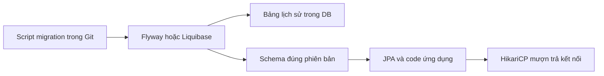
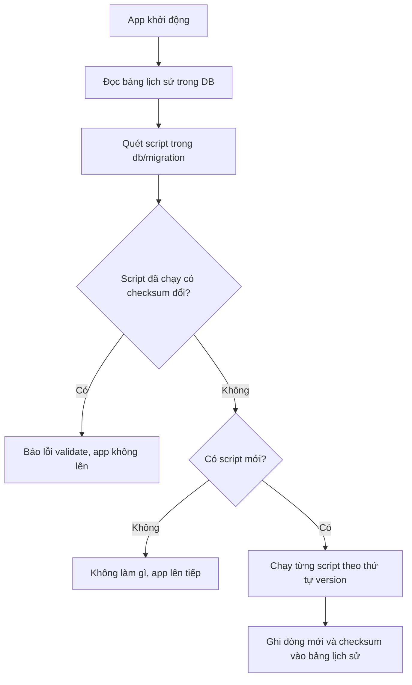
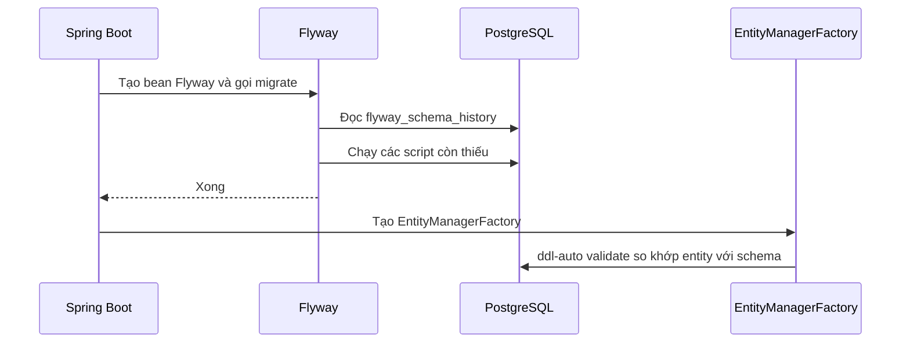
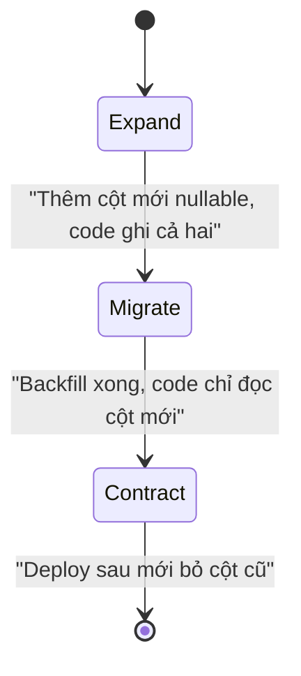
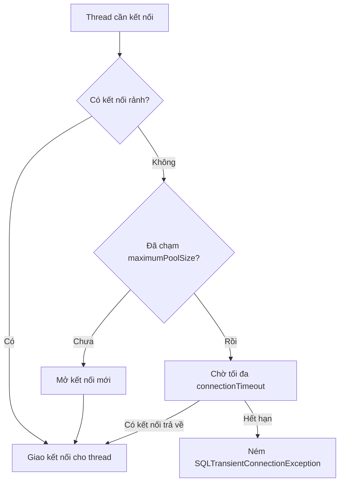
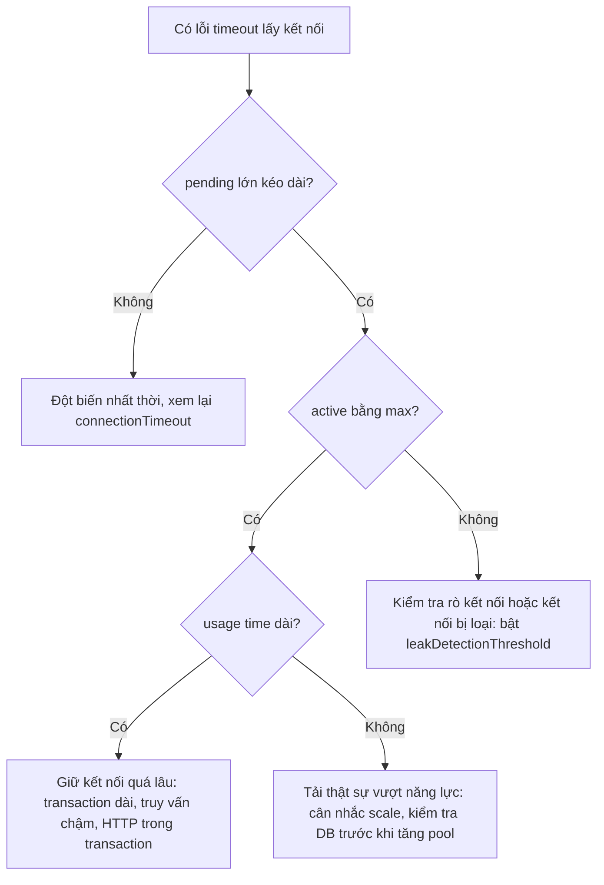

# Lý thuyết 40: Migration schema (Flyway, Liquibase) và HikariCP

Code ứng dụng có Git, có review, có bản build. Schema của database cũng là một phần của hệ thống, nhưng nhiều đội vẫn sửa nó bằng tay trên từng môi trường. Bài này nói về hai việc nằm ngay ranh giới giữa ứng dụng và database: đưa schema vào quy trình như code (Flyway, Liquibase), và quản lý đường ống kết nối tới database (HikariCP). Cả hai đều "chạy ngầm" khi mọi thứ ổn, và chỉ lộ ra khi production sự cố.

> **Phiên bản (kiểm tra 2026-10-30):** Spring Boot 4.1 (Framework 7, Hibernate 7). Boot 4 có starter riêng: `spring-boot-starter-flyway` và `spring-boot-starter-liquibase` (xác nhận trong tài liệu Boot "Database Initialization"). Với PostgreSQL phải thêm `org.flywaydb:flyway-database-postgresql`. Boot 3.5 chưa có starter Flyway: dùng `org.flywaydb:flyway-core` cộng module database. HikariCP là pool mặc định khi có `spring-boot-starter-jdbc` hoặc `spring-boot-starter-data-jpa`; README HikariCP ghi bản 7.1.0 cho Java 11+. Số phiên bản cụ thể do BOM của Boot quản lý, hãy kiểm tra lại theo phiên bản bạn dùng.

**Cốt lõi:** Schema thay đổi theo thời gian cùng với code, nên nó phải có lịch sử, thứ tự và có thể tái lập trên mọi môi trường. Công cụ migration lưu một bảng lịch sử trong chính database, ghi script nào đã chạy kèm checksum, và chỉ chạy những script còn thiếu theo đúng thứ tự. HikariCP giải bài toán khác: mở kết nối tới database rất đắt, nên giữ một số ít kết nối mở sẵn và cho thread mượn rồi trả.

- Vì database nhớ script nào đã chạy (kèm checksum) nên sửa một file đã chạy là làm app không khởi động được.
- Vì database chỉ chịu được số kết nối hữu hạn hiệu quả nên pool nhỏ vừa đủ thường nhanh hơn pool lớn.
- Vì khi deploy, code cũ và code mới chạy song song nên migration phải tương thích ngược (expand rồi mới contract).



Mô hình tư duy: schema là một chuỗi commit có thứ tự, DB lưu "đã chạy tới đâu"; còn pool là cổng vào có số chỗ hạn chế, mỗi chỗ là một kết nối thật.

**Tóm tắt:**

- Schema phải có version như code: tái lập được môi trường, review được, biết production đang ở phiên bản nào.
- Flyway chạy các file `V<version>__<tên>.sql` theo thứ tự version và ghi vào bảng `flyway_schema_history`; file `R__` (repeatable) chạy lại khi checksum đổi.
- Liquibase dùng changelog gồm nhiều changeset định danh bằng id, author và đường dẫn file; trạng thái nằm ở `DATABASECHANGELOG`.
- Spring Boot tự chạy migration khi khởi động và đảm bảo nó xong trước khi `EntityManagerFactory` được tạo.
- Migration an toàn không downtime theo mẫu expand and contract: thêm trước, chuyển dữ liệu, bỏ sau, mỗi bước là một lần deploy riêng.
- Rollback thực tế thường là roll-forward: viết migration mới sửa lỗi, vì dữ liệu đã thay đổi không "undo" sạch được.
- HikariCP giữ pool kết nối; tham số quan trọng nhất là `maximumPoolSize`, và nên nhỏ vừa đủ.
- Cạn pool chẩn đoán bằng metric `active`, `pending`, `acquire` chứ không bằng cách tăng pool theo cảm tính.

## Vấn đề nó giải quyết

Không có migration tool, schema bị sửa bằng tay: ai đó chạy `ALTER TABLE` trên production, quên chạy trên staging. Hai môi trường lệch nhau, test xanh ở máy dev nhưng lỗi trên production, và không ai biết bản deploy nào cần schema nào. Còn `spring.jpa.hibernate.ddl-auto=update` tự sinh DDL lúc khởi động thì không có lịch sử, không kiểm soát được thứ tự, và không bao giờ xóa cột.

Về kết nối: mỗi lần mở kết nối PostgreSQL là một lần bắt tay TCP, xác thực và tạo một process phía server. Mở mới cho mỗi request thì chậm và làm database quá tải. Pool giải quyết bằng việc tái dùng kết nối, đồng thời đặt trần số kết nối đồng thời mà database phải gánh.

## Khi nào dùng, khi nào không

Dùng migration tool cho mọi dự án có database thật; đây gần như mặc định. Chọn Flyway nếu đội quen SQL và muốn đơn giản; chọn Liquibase nếu cần changelog trừu tượng theo database (YAML, XML), `rollback` khai báo sẵn, context và label để bật tắt changeset theo môi trường. `ddl-auto` chỉ nên là `none` hoặc `validate` trên production; `create-drop` chỉ để thử nghiệm với DB nhúng.

Không cần tinh chỉnh pool khi tải thấp và mặc định đã đủ. Tinh chỉnh khi thấy dấu hiệu: thread chờ kết nối, `pending` lớn, timeout `Connection is not available`. Điều chỉnh có cơ sở từ metric, không theo kiểu "tăng cho chắc".

## Các khái niệm cần biết

| Khái niệm | Ý nghĩa |
|---|---|
| Versioned migration | Chạy đúng một lần, theo thứ tự version tăng dần (Flyway `V2__add_email.sql`) |
| Repeatable migration | Flyway `R__views.sql`, chạy lại mỗi khi nội dung (checksum) đổi; hợp với view, function |
| Changeset | Đơn vị của Liquibase, định danh bởi id, author và file chứa nó |
| Checksum | Mã băm nội dung script, lưu lại khi chạy, so sánh ở lần khởi động sau để phát hiện bị sửa |
| Baseline | Đánh dấu một DB có sẵn dữ liệu là "đang ở version N", để Flyway bỏ qua các script cũ |
| Out-of-order | Cho phép chạy script có version thấp hơn version đã áp dụng (mặc định tắt) |
| Expand and contract | Chia thay đổi phá vỡ thành các bước tương thích ngược: mở rộng, chuyển, thu hẹp |
| Roll-forward | Sửa lỗi bằng migration mới thay vì quay về bản cũ |
| Connection pool | Tập kết nối mở sẵn, mượn và trả thay vì mở mới |
| Connection leak | Mượn mà không trả, pool dần cạn |

## Cơ chế: bảng lịch sử và checksum

Cả hai tool có cùng ý: một bảng trong database ghi lại những gì đã chạy. Mỗi lần khởi động, tool đọc bảng, so với các script trong classpath, rồi quyết định.



Cách đọc: nhánh "checksum đổi" là bẫy phổ biến nhất. Flyway mặc định `validate-on-migrate` bật, nên khi bạn sửa một file đã chạy, lần khởi động sau app dừng ngay với lỗi checksum mismatch. Đây là tính năng bảo vệ chứ không phải lỗi: nó cho biết lịch sử đã bị viết lại. Cách đúng là để nguyên file cũ và thêm file mới sửa tiếp. Chỉ khi chắc chắn thay đổi vô hại (đổi comment) mới dùng lệnh `repair` để cập nhật checksum.

**Nền tảng:** Migration tool là máy trạng thái lưu ngay trong database: "đã chạy tới version nào, bằng script có checksum gì". Mọi hành vi (bỏ qua script cũ, báo lỗi khi sửa file, từ chối chạy script thấp hơn) đều suy ra từ việc so sánh script trong code với bảng lịch sử.

## Flyway so với Liquibase

| | Flyway | Liquibase |
|---|---|---|
| Cách viết | File SQL (hoặc Java) đặt tên theo version | Changelog YAML, XML, JSON hoặc SQL; nhiều changeset |
| Định danh | Số version trong tên file | id + author + đường dẫn file |
| Bảng trạng thái | `flyway_schema_history` | `DATABASECHANGELOG` và `DATABASECHANGELOGLOCK` |
| Rollback | Undo migration thuộc bản trả phí; thực tế dùng roll-forward | Có thể khai báo `rollback` cho changeset |
| Độc lập database | Viết SQL đúng dialect | Mô tả trừu tượng, tool sinh SQL theo DB |
| Mặc định trong Boot | `classpath:db/migration` | `db/changelog/db.changelog-master.yaml` |

Lựa chọn thực tế: Flyway đơn giản và minh bạch vì bạn thấy đúng câu SQL chạy; Liquibase linh hoạt hơn khi một codebase phải chạy trên nhiều loại DB hoặc cần context theo môi trường. Với dự án chỉ dùng PostgreSQL, Flyway thường là điểm khởi đầu hợp lý. Chuyện "undo của Flyway có phí" cần kiểm tra lại theo bản và gói bạn dùng.

**Phải thuộc:** Flyway: `V<version>__<tên>.sql` chạy một lần theo thứ tự, `R__<tên>.sql` chạy lại khi checksum đổi, mặc định tìm ở `classpath:db/migration`; `validate-on-migrate` mặc định `true`, `out-of-order` mặc định `false`, `baseline-on-migrate` mặc định `false`. Liquibase: changeset định danh bằng id + author + file.

## Tích hợp Spring Boot

Thêm starter và driver, đặt file vào `src/main/resources/db/migration`, xong. Boot tự chạy `Flyway.migrate()` khi khởi động.

```xml
<!-- Boot 4.x -->
<dependency>
  <groupId>org.springframework.boot</groupId>
  <artifactId>spring-boot-starter-flyway</artifactId>
</dependency>
<dependency>
  <groupId>org.flywaydb</groupId>
  <artifactId>flyway-database-postgresql</artifactId>
</dependency>
```

```yaml
spring:
  flyway:
    locations: "classpath:db/migration"
    # baseline-on-migrate: true   # chỉ khi nhận DB có sẵn dữ liệu, xem phần Bẫy
  jpa:
    hibernate:
      ddl-auto: validate          # kiểm tra entity khớp schema, không sinh DDL
```

Nếu muốn Flyway dùng tài khoản riêng (có quyền DDL) khác tài khoản chạy ứng dụng (chỉ DML), đặt `spring.flyway.url`, `spring.flyway.user`, `spring.flyway.password`; chỉ cần đặt `url` hoặc `user` là Flyway dùng DataSource riêng, thuộc tính nào thiếu thì lấy từ `spring.datasource`. Đây là thực hành tốt về phân quyền: tài khoản ứng dụng không nên có quyền `DROP TABLE`.

Thứ tự khởi động quan trọng với JPA: migration phải xong trước khi Hibernate kiểm tra schema.



Cách đọc: Boot phát hiện bean `Flyway` (và `SpringLiquibase`) là bean "khởi tạo database", và tự khai báo các bean phụ thuộc vào database đã khởi tạo, gồm `EntityManagerFactory`, `DSLContext` của jOOQ, `JdbcClient`, `JdbcTemplate`. Nhờ đó không cần `@DependsOn` thủ công. Nhắc về `ddl-auto`: với DB không nhúng, Boot mặc định `none`; chỉ khi là DB nhúng và không có tool migration thì mặc định `create-drop`. Khi dùng cả Flyway và `schema.sql`/`data.sql`, Boot khuyên chỉ dùng một cơ chế, và cách trộn đó dự kiến bị gỡ hỗ trợ.

Boot cũng chạy migration ngay trong test nếu starter có trên classpath. File `src/test/resources/db/migration/V9999__test-data.sql` chạy sau các migration thật và chỉ khi test.

## Migration an toàn, không downtime

Khi deploy rolling, có lúc code cũ và code mới cùng chạy trên một schema. Nếu migration đổi tên cột trong một bước, code cũ lập tức vỡ. Mẫu expand and contract tách thành các bước tương thích với cả hai phiên bản code:



Cách đọc: ba trạng thái là ba lần deploy riêng. Ví dụ đổi `full_name` thành `first_name` và `last_name`. Deploy 1 thêm hai cột mới (nullable), code ghi vào cả cột cũ lẫn mới. Chạy backfill. Deploy 2 chuyển code đọc cột mới. Deploy 3, khi chắc không còn code cũ, mới `DROP COLUMN full_name`. Bước cuối là bước duy nhất không đảo ngược được, nên nó đi sau cùng và tách riêng.

Các kỹ thuật cho PostgreSQL (đã là thực hành phổ biến; cơ chế khóa nên đối chiếu với [PG cấu hình, tuning, giám sát](/go?p=02-Database%2Fhard%2Flt-19-pg-cau-hinh-tuning-giam-sat.md) và phiên bản bạn chạy):

- **Thêm cột:** `ADD COLUMN` nullable không default là thao tác chỉ đổi metadata. Từ PostgreSQL 11, thêm cột với default là hằng số cũng không viết lại bảng; default không ổn định (volatile) thì có.
- **Ràng buộc trên bảng lớn:** thêm `CHECK` hoặc khóa ngoại bằng `NOT VALID` (chỉ kiểm hàng mới), rồi `VALIDATE CONSTRAINT` sau, vì bước validate không chặn ghi.
- **Index:** `CREATE INDEX CONCURRENTLY` không khóa ghi nhưng không chạy được trong transaction. Với Flyway cần tắt transaction cho script đó (cấu hình `executeInTransaction=false` cho script; kiểm tra cách khai báo theo phiên bản Flyway). Với Liquibase dùng `runInTransaction="false"`. Nếu lệnh thất bại giữa chừng, index để lại ở trạng thái `INVALID`, phải `DROP` rồi tạo lại.
- **Backfill theo batch:** cập nhật hàng triệu dòng trong một `UPDATE` giữ khóa và sinh WAL khổng lồ, kéo theo replication lag (xem [replication và vận hành](/go?p=02-Database%2Fhard%2Flt-11-replication-partition-van-hanh.md)). Chia thành lô nhỏ (vài nghìn dòng), commit từng lô, tốt nhất chạy ngoài migration bằng job riêng.
- **`lock_timeout`:** DDL cần khóa bảng; nếu có một transaction dài đang giữ bảng, DDL xếp hàng chờ và mọi truy vấn sau đó xếp hàng chờ DDL, như một nút thắt. Đặt `SET lock_timeout = '5s';` ở đầu script để DDL bỏ cuộc nhanh rồi thử lại, thay vì làm treo cả bảng.

```sql
-- V12__orders_add_status_index.sql  (Minh họa, chưa chạy thử)
-- cần executeInTransaction=false cho script này
SET lock_timeout = '5s';
CREATE INDEX CONCURRENTLY IF NOT EXISTS idx_orders_status_created
    ON orders (status, created_at);
```

**Suy luận:** Vì database không biết gì về việc deploy, mọi thay đổi schema phải chấp nhận hai phiên bản code cùng lúc, nên nguyên tắc là mỗi migration phải tương thích ngược với code đang chạy. Từ đó suy ra: không đổi tên hay xóa trong cùng bước với thêm, không để một câu lệnh giữ khóa lâu, và tách phần dữ liệu (backfill) khỏi phần cấu trúc (DDL). Ngoài ra, thử migration trên bản sao dữ liệu cỡ production, vì một lệnh nhanh trên 1.000 dòng có thể khóa bảng nhiều phút ở 100 triệu dòng.

## Migration trong CI và rollback thực tế

Quy trình lành mạnh: CI dựng PostgreSQL thật (Testcontainers là cách phổ biến), chạy toàn bộ migration từ đầu, rồi chạy test; mọi pull request có migration đều được thử trên DB trống. Thêm bước thử nâng cấp từ snapshot schema của production. Một script lỗi cú pháp bị bắt ở CI, không ở lúc deploy.

Về rollback: nhiều người mong "undo". Thực tế không đơn giản. Migration `DROP COLUMN` không thể undo vì dữ liệu đã mất; migration backfill có thể đã bị code mới ghi chồng. Vì thế đa số đội chọn roll-forward: phát hiện lỗi thì viết migration mới sửa, deploy lại. Điều kiện để roll-forward nhanh là mỗi migration nhỏ và theo expand and contract, nên bước nguy hiểm duy nhất (contract) nằm riêng. Khi thật sự cần đường lui: giữ bản backup hoặc point-in-time recovery, và đảm bảo code phiên bản trước vẫn chạy được với schema mới (chính là lý do cần tương thích ngược).

## Lỗi hay gặp với migration

- **Sửa file đã chạy:** checksum lệch, app không khởi động (đã nói ở trên). Sửa bằng migration mới.
- **Nhiều instance cùng khởi động:** cả hai cùng thấy script chưa chạy. Cả Flyway và Liquibase đều có cơ chế khóa (Liquibase qua bảng `DATABASECHANGELOGLOCK`; Flyway qua khóa phía database) để chỉ một instance chạy, các instance kia chờ. Vấn đề còn lại là deploy bị kẹt khi tiến trình chết giữa chừng làm khóa Liquibase không được nhả. Cách an toàn hơn: chạy migration như một bước riêng (job hoặc init container) trước khi rolling update, thay vì để mọi pod tự chạy.
- **`ddl-auto=update` trên production:** không có lịch sử, không review, có thể sinh DDL không mong muốn và bỏ qua thay đổi kiểu cột. Dùng `validate` hoặc `none`.
- **Script không idempotent giữa chừng:** PostgreSQL cho DDL trong transaction nên script lỗi thường rollback gọn. Nhưng MySQL không có DDL transactional, nên script lỗi giữa chừng có thể để schema nửa vời.
- **`baseline-on-migrate` bật bừa:** bật cờ này khiến Flyway coi DB không rỗng là "đã baseline", mất lớp bảo vệ chống chạy nhầm database. Chỉ dùng một lần khi nhận một DB có sẵn, đặt `baseline-version` rõ ràng.
- **Out-of-order:** hai nhánh cùng thêm `V10` và `V11` theo thứ tự đảo. Mặc định Flyway từ chối script thấp hơn version đã chạy; bật `out-of-order` chỉ khi hiểu rủi ro thứ tự phụ thuộc.

## HikariCP: pool hoạt động ra sao

Một thread cần chạy truy vấn sẽ mượn kết nối từ pool; xong thì "đóng" (thực chất trả về pool, không đóng thật). Nếu không có kết nối rảnh và pool chưa chạm trần, Hikari mở kết nối mới. Nếu đã chạm trần, thread chờ tối đa `connectionTimeout`, hết hạn thì ném `SQLTransientConnectionException`.



Cách đọc: nhánh cuối là thứ bạn thấy trong log khi cạn pool. Thông báo thường dạng "Connection is not available, request timed out after 30000ms". Đừng hiểu nhầm là database hỏng; thường database vẫn khỏe, chỉ là mọi kết nối đang bị giữ bởi các thread chậm hoặc bị rò.

Các tham số quan trọng (mặc định theo README HikariCP; Boot cấu hình qua `spring.datasource.hikari.*`):

| Tham số | Mặc định | Ý nghĩa |
|---|---|---|
| `maximumPoolSize` | 10 | Trần tổng số kết nối (rảnh và đang dùng), cũng là trần số kết nối thật tới DB |
| `minimumIdle` | bằng `maximumPoolSize` | Số kết nối rảnh tối thiểu; HikariCP khuyên để mặc định để pool có kích thước cố định |
| `connectionTimeout` | 30000 ms | Thread chờ kết nối bao lâu trước khi lỗi; tối thiểu 250 ms |
| `idleTimeout` | 600000 ms | Kết nối rảnh bị bỏ sau bao lâu; chỉ có tác dụng khi `minimumIdle` nhỏ hơn `maximumPoolSize` |
| `maxLifetime` | 1800000 ms | Tuổi thọ tối đa; nên ngắn hơn vài giây so với giới hạn của DB hoặc hạ tầng mạng (tường lửa, load balancer) |
| `keepaliveTime` | 120000 ms | Chu kỳ "ping" kết nối rảnh để hạ tầng không cắt; phải nhỏ hơn `maxLifetime`, tối thiểu 30000 |
| `leakDetectionThreshold` | 0 (tắt) | Kết nối bị giữ quá ngưỡng này thì log cảnh báo có thể rò; tối thiểu 2000 để bật |

```yaml
spring:
  datasource:
    hikari:
      maximum-pool-size: 10
      connection-timeout: 3000      # thất bại nhanh thay vì chờ 30 giây
      max-lifetime: 1500000         # ngắn hơn giới hạn phía hạ tầng
      leak-detection-threshold: 20000   # bật khi điều tra, tắt hoặc để cao khi chạy bình thường
```

**Phải thuộc:** `maximumPoolSize` mặc định 10; `connectionTimeout` 30 giây; `maxLifetime` 30 phút (nên ngắn hơn timeout của DB hoặc hạ tầng); `leakDetectionThreshold` mặc định tắt. Pool ra lỗi do chờ quá `connectionTimeout`, không phải do database từ chối.

## Chọn cỡ pool: không to hơn cần thiết

Trực giác sai: "nhiều request thì cần nhiều kết nối". Thực tế database chỉ chạy hiệu quả khi số truy vấn đang thực thi gần với số lõi CPU và khả năng I/O của nó. Quá nhiều kết nối hoạt động làm tranh chấp CPU, lock và bộ nhớ, nên tổng thông lượng giảm. Wiki "About Pool Sizing" của HikariCP minh họa rằng pool nhỏ thường vượt pool lớn; công thức khởi điểm hay trích là số lõi của DB nhân hai cộng số ổ đĩa hiệu dụng, và chỉ là điểm xuất phát để đo, không phải chân lý.

Hai điều hay bị quên. Một: trần thật nằm ở database. Nếu 20 pod, mỗi pod pool 10, thì tới 200 kết nối, và `max_connections` của PostgreSQL (xem [cấu hình PG](/go?p=02-Database%2Fhard%2Flt-19-pg-cau-hinh-tuning-giam-sat.md)) phải chứa được con số đó cùng các kết nối quản trị và replica. Hai: pool lớn không sửa được code giữ kết nối lâu. Gốc rễ cạn pool thường là transaction quá dài: gọi HTTP bên ngoài bên trong `@Transactional`, hoặc `open-in-view` giữ kết nối suốt request (xem [Transaction](/go?p=01-Spring-Boot%2Fmedium%2Flt-05-transaction.md)). Khi cạn pool, bước đầu là rút ngắn thời gian giữ kết nối, không phải tăng trần.

## Chẩn đoán cạn pool bằng metric

Với Micrometer và Actuator (xem [Observability](/go?p=01-Spring-Boot%2Fmedium%2Flt-19-observability.md)), Hikari xuất các metric dạng `hikaricp.connections.*` (kiểm tra tên chính xác trên endpoint `/actuator/metrics` của bản bạn dùng).



Cách đọc: `active` là số đang cho mượn, `idle` là số rảnh, `pending` là số thread đang chờ, `max` là trần, `acquire` là thời gian chờ lấy kết nối, `usage` là thời gian giữ kết nối trước khi trả. Dấu hiệu rò kết nối: `active` chạm trần và không giảm khi tải giảm. Dấu hiệu giữ lâu: `usage` cao kèm `pending` cao. Truy vấn chậm tìm bằng log chậm của PostgreSQL và `pg_stat_activity`, rồi mới quay lại sửa code hoặc tăng pool.

## Bẫy thường gặp

| Bẫy | Nguyên nhân | Cách xử lý |
|---|---|---|
| App không khởi động sau khi sửa file migration cũ | Checksum lệch | Thêm migration mới; `repair` chỉ khi chắc an toàn |
| Index tạo làm treo bảng | `CREATE INDEX` thường khóa ghi | Dùng `CONCURRENTLY`, tắt transaction cho script |
| DDL làm treo cả bảng | Chờ khóa sau transaction dài, hàng chờ phía sau bị chặn | `lock_timeout` và thử lại |
| Deploy rolling vỡ code cũ | Đổi tên hoặc xóa cột trong một bước | Expand and contract, nhiều lần deploy |
| Hai pod cùng migrate, kẹt khóa | Tiến trình chết giữ khóa | Chạy migration bằng job riêng |
| Cạn pool khi tải tăng | Transaction dài, rò kết nối | Đo `usage`, `pending`; bật leak detection khi điều tra |
| Pool nhân số pod vượt `max_connections` | Chỉ nhìn một instance | Tính tổng toàn cụm, dùng bộ gom kết nối nếu cần |
| `ddl-auto=update` lên production | Tiện lúc dev | `validate` hoặc `none`, DDL đi qua migration |

## Phỏng vấn khó: chuỗi hỏi xoáy

Người phỏng vấn senior thường mở bằng một câu dễ, rồi xoáy xuống cơ chế, đánh đổi và sự cố thật. Câu trả lời tốt đi từ cốt lõi xuống chi tiết.

### Chuỗi 1: Vì sao cần migration tool, checksum để làm gì

1. **Câu mở:** Vì sao không để Hibernate tự sinh schema bằng `ddl-auto=update` mà phải dùng Flyway hoặc Liquibase?
2. **Xoáy 1:** Flyway làm sao biết script nào đã chạy, và chuyện gì xảy ra nếu bạn sửa một file đã chạy?
3. **Xoáy 2:** Hai pod khởi động cùng lúc thì sao, và bạn thiết kế quy trình deploy thế nào cho đáng tin?

**Đáp án ngắn:** Schema phải có lịch sử, thứ tự và tái lập được như code, mà `ddl-auto=update` không có lịch sử, không review được, không xóa cột, và có thể sinh DDL không lường trước. Flyway lưu trong `flyway_schema_history` version, mô tả và checksum của từng script đã chạy; mỗi lần khởi động nó so script trong classpath với bảng này. Sửa file đã chạy thì checksum lệch, `validate-on-migrate` (mặc định bật) làm app không lên; đây là bảo vệ chống viết lại lịch sử. Cách đúng là thêm migration mới, và `repair` chỉ dùng khi chắc thay đổi vô hại. Khi nhiều instance cùng khởi động, tool dùng cơ chế khóa (Liquibase có bảng `DATABASECHANGELOGLOCK`) để chỉ một bên chạy, nhưng tiến trình chết giữa chừng có thể để lại khóa. Thực tế production nên chạy migration như một bước riêng (job hoặc init container) trước khi rolling update, và đặt `ddl-auto` là `validate` hoặc `none`.

**Sai lầm hay gặp:**
- Nói "sửa file migration cũ rồi deploy lại" như thể bình thường.
- Không biết `ddl-auto=update` không bao giờ xóa cột và không có lịch sử.
- Nghĩ rằng khóa của tool giải quyết mọi tranh chấp lúc deploy.

### Chuỗi 2: Thay đổi schema không downtime

1. **Câu mở:** Bạn cần đổi tên một cột đang được dùng trên production, không được downtime. Làm thế nào?
2. **Xoáy 1:** Tạo index trên bảng 200 triệu dòng thế nào để không chặn ghi, và có gì cần cẩn thận với Flyway?
3. **Xoáy 2:** DDL của bạn không chạy nổi và cả bảng bắt đầu treo. Vì sao, và xử lý ra sao?

**Đáp án ngắn:** Khi deploy rolling, code cũ và mới cùng chạy trên một schema, nên không đổi tên trong một bước. Dùng expand and contract: thêm cột mới nullable, code ghi cả hai cột, backfill theo lô nhỏ, chuyển code đọc cột mới, và ở lần deploy cuối mới xóa cột cũ; đó là bước duy nhất không đảo ngược nên tách riêng. Index dùng `CREATE INDEX CONCURRENTLY`, không khóa ghi nhưng không chạy được trong transaction, nên script phải tắt transaction (cấu hình `executeInTransaction=false` của Flyway, kiểm tra theo phiên bản); nếu lệnh lỗi sẽ để lại index `INVALID` cần xóa và tạo lại. Bảng treo vì DDL cần khóa mạnh, đang xếp sau một transaction dài, và mọi truy vấn đến sau xếp sau DDL; giải pháp là `SET lock_timeout` để DDL bỏ cuộc nhanh rồi thử lại, và tìm transaction dài trong `pg_stat_activity`. Backfill một `UPDATE` khổng lồ thì sinh WAL lớn và làm replica trễ, nên chia lô. Thử trên bản sao dữ liệu cỡ production trước khi chạy thật.

**Sai lầm hay gặp:**
- Đổi tên cột trực tiếp rồi "deploy nhanh".
- Dùng `CREATE INDEX` thường trên bảng lớn đang ghi.
- Không đặt `lock_timeout`, để DDL xếp hàng chặn cả ứng dụng.

### Chuỗi 3: Pool kết nối và cạn pool

1. **Câu mở:** HikariCP làm gì, và vì sao cần pool?
2. **Xoáy 1:** Hệ thống báo "Connection is not available, request timed out". Đồng nghiệp đề xuất tăng `maximumPoolSize` lên 100. Bạn phản ứng thế nào?
3. **Xoáy 2:** Bạn chọn cỡ pool ra sao, và có 30 pod thì tính thế nào?

**Đáp án ngắn:** Mở kết nối tới database đắt (bắt tay mạng, xác thực, một process phía PostgreSQL), nên pool giữ sẵn một số kết nối cho thread mượn và trả. Lỗi timeout nghĩa là thread chờ quá `connectionTimeout` (mặc định 30 giây) vì mọi kết nối đang bị giữ; chưa chắc database có vấn đề. Tôi không tăng pool ngay mà nhìn metric: `pending` và `active` chạm `max` kéo dài, `usage` cao nghĩa là kết nối bị giữ lâu bởi transaction dài, truy vấn chậm, hay gọi HTTP trong `@Transactional`; `active` không giảm khi tải giảm là dấu hiệu rò, bật `leakDetectionThreshold` để tìm chỗ. Tăng pool lên 100 có thể làm database tranh chấp nhiều hơn và chậm hơn, nên pool nên nhỏ vừa đủ, khởi điểm theo số lõi của DB rồi đo. Với 30 pod, tổng kết nối là 30 nhân cỡ pool và phải nằm dưới `max_connections` của PostgreSQL cùng phần chừa cho quản trị và replica; nếu không thì giảm pool mỗi pod hoặc dùng bộ gom kết nối. Đặt `maxLifetime` ngắn hơn giới hạn của hạ tầng và `keepaliveTime` nhỏ hơn `maxLifetime` để tránh kết nối chết.

**Sai lầm hay gặp:**
- Phản xạ tăng pool khi thấy timeout.
- Chỉ tính pool của một instance, quên nhân số pod.
- Bật `leakDetectionThreshold` thấp rồi hiểu cảnh báo cho truy vấn chậm hợp lệ là rò.

## Câu hỏi tự kiểm tra

**Câu 1.** Vì sao Flyway từ chối khởi động khi bạn sửa một dấu cách trong `V3__...sql` đã chạy?

*Gợi ý suy luận:* Flyway so sánh cái gì với cái gì mỗi lần khởi động? Mục đích của việc đó là gì?

*Lập luận và đáp án:* Flyway lưu checksum của script khi chạy xong, và mỗi lần khởi động tính lại checksum từ file hiện tại rồi so với bảng lịch sử. Khác nhau nghĩa là lịch sử đã bị viết lại, nên các môi trường có thể đang ở trạng thái không như file nói. Việc từ chối là chủ ý. Sửa bằng cách khôi phục file cũ và thêm migration mới; `repair` chỉ khi bạn chắc thay đổi không ảnh hưởng.

**Câu 2.** Tại sao `ADD COLUMN ... NOT NULL DEFAULT ...` cần cẩn thận, và cách làm an toàn là gì?

*Gợi ý suy luận:* Điều gì xảy ra với dữ liệu hiện có và với khóa bảng? Có thể tách thành bước nào?

*Lập luận và đáp án:* Bảng đang có dữ liệu nên cột mới phải có giá trị cho mọi hàng; nếu default không phải hằng số hoặc làm viết lại bảng thì giữ khóa lâu. An toàn hơn: thêm cột nullable, đặt default cho hàng mới, backfill theo lô, thêm ràng buộc `CHECK ... NOT VALID` rồi `VALIDATE`, sau đó mới đặt `NOT NULL`. Mọi bước đặt `lock_timeout` và thử trên dữ liệu cỡ thật.

**Câu 3.** Một service chạy ổn với pool 10 nay có `pending` cao. Liệt kê thứ tự bạn kiểm tra.

*Gợi ý suy luận:* Phân biệt giữ lâu, rò, và quá tải thật.

*Lập luận và đáp án:* Xem `usage` và `active`: nếu `active` bằng `max` và `usage` cao thì có giữ kết nối lâu (transaction dài, truy vấn chậm, HTTP trong transaction); xem log chậm và `pg_stat_activity`. Nếu `active` không giảm khi tải giảm thì nghi rò, bật `leakDetectionThreshold`. Chỉ khi cả hai loại trừ và DB còn dư năng lực mới tăng pool, vừa phải, và kiểm tra tổng kết nối toàn cụm so với `max_connections`.

**Câu 4.** Vì sao rollback migration thường là roll-forward?

*Gợi ý suy luận:* Điều gì khác nhau giữa quay lại code và quay lại dữ liệu?

*Lập luận và đáp án:* Code cũ quay lại được vì nó không có trạng thái, còn dữ liệu đã đổi thì không: cột đã xóa mất dữ liệu, backfill có thể đã bị ghi chồng, giao dịch mới đã phát sinh. Nên cách thực tế là viết migration mới sửa lỗi và đảm bảo code bản trước vẫn chạy được với schema mới nhờ expand and contract; đường lui cuối cùng là backup hoặc point-in-time recovery.

Nguồn: Spring Boot reference và How-to "Database Initialization" (nhánh main, Boot 4.x), phần "SQL Databases" (docs.spring.io); README HikariCP (github.com/brettwooldridge/HikariCP, nhánh dev); trang cấu hình Flyway chung cho mặc định `validate-on-migrate`, `out-of-order`, `baseline-on-migrate`; tra cứu ngày 2026-10-30. Chưa đối chiếu trực tiếp: chi tiết khóa đồng thời của Flyway trên PostgreSQL, cách khai báo `executeInTransaction=false` theo phiên bản, tên chính xác của metric Hikari.

